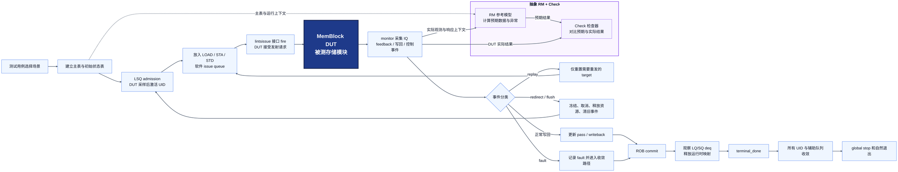

# Memblock访存策略和计划

## 1. 策略

### 1.1 随机激励支持场景与参数汇总

| 序号 | 场景 | 支持参数（省略公共前缀 `MEMBLOCK_`） | 生成 / 控制逻辑与支持边界 | 参数数量 |
| ---: | --- | --- | --- | ---: |
| 1 | 主表规模与构建模式 | `MAIN_TRANS_NUM`、`USE_MANUAL_MAIN_TABLE`、`CONTROL_WORKER_TOPOLOGY_MODE` | 随机主表按配置生成 N 个条目；控制拓扑为 AUTO 时支持插入 CSR/SFence marker，并额外保留末尾 check_store；手工模式不计作随机场景。 | 3 |
| 2 | 虚拟地址窗口 | `MAIN_VADDR_{BASE,RANGE}` | 普通随机路径在窗口内选择 64B 对齐起始地址；边界路径在同一窗口内选合法访问跨度。 | 2 |
| 3 | 物理地址映射与访问窗口 | `PADDR_{BASE,RANGE}`、`MAIN_MEM_RANGES_EN` | TLB entry 随机选择物理 PPN；范围开关控制 shared memory 的严格访问窗口或按需稀疏分配。 | 3 |
| 4 | 整数 Load / FP_LOAD 分类 / Store / Prefetch 混合 | `OP_CLASS_{INT_LOAD,FP_LOAD,STORE,PREFETCH}_WT` | 4 类按权重抽样；FP_LOAD 是现有发射与写回分类，操作码与整数 Load 共用下面 7 项配置。 | 4 |
| 5 | Load 操作码与宽度 | `LOAD_FUOP_{LB,LH,LW,LD,LBU,LHU,LWU}_WT` | 7 种操作码；1/2/4/8B 及符号扩展、零扩展；INT_LOAD 和 FP_LOAD 共用权重，不重复计数。 | 7 |
| 6 | Store 操作码与宽度 | `STORE_FUOP_{SB,SH,SW,SD}_WT` | 4 种操作码、1/2/4/8B；同一 UID 拆成 STA 与 STD 分别发射。 | 4 |
| 7 | 软件 Prefetch 类型 | `PREFETCH_FUOP_{I,R,W}_WT` | 3 种 Prefetch 操作码按权重选择。 | 3 |
| 8 | 地址对齐、非对齐与跨界 | `BOUNDARY_PROFILE_GEN_EN`；`BOUNDARY_{ALIGNED,MISALIGN_WITHIN_8B,CROSS_8B_WITHIN_16B,CROSS_16B_SAME_LINE,CROSS_CACHELINE_SAME_4K,CROSS_4K}_WT`；`STORE_CROSS_8B_WITHIN_16B_EN` | 6 类：自然对齐、8B 内非对齐、跨 8B 不跨 16B、跨 16B 不跨行、跨行不跨 4KB、跨 4KB；按合法的操作类型 × 宽度 × profile 组合采样，Store 跨 8B 子类有独立门控。 | 8 |
| 9 | 地址复用与访存相关性 | `ADDR_REUSE_EN_{0,1}_WT`；`ADDR_REUSE_{LOAD_AFTER_STORE,LOAD_AFTER_LOAD,STORE_AFTER_LOAD,STORE_AFTER_STORE}_WT`；`ADDR_REUSE_KEEP_REF_SIZE_EN_{0,1}_WT`；`ADDR_REF_WINDOW_FIXED`、`ADDR_REF_WINDOW_{SMALL,MEDIUM,LARGE}_WEIGHT` | 4 种前后继组合；随机命中复用、选择近期 UID、选择保留参考宽度；历史窗口支持固定值或 3 档权重。 | 12 |
| 10 | 每拍 LSQ 入队压力 | `ENQ_PER_CYCLE`、`ENQ_PER_CYCLE_RAND_EN`、`ENQ_PER_CYCLE_{ZERO,MIDDLE,MAX}_WEIGHT` | 固定每拍数量，或按零/中间/最大 3 档在 V2 的 0..6 路 slot 内抽样；中间档 -1 表示 AUTO 权重，实际接纳仍受资源约束。 | 5 |
| 11 | LOAD / STA / STD 发射并行度 | `{LOAD,STA,STD}_PIP_NUM_{LIMIT,RANDOM_EN}` | 3 类端口分别固定使用上限或逐拍从 1..上限抽样；V2 物理上限为 3/2/2，不改变 DUT 容量。 | 6 |
| 12 | 发射优先级与乱序 | `SEND_PRI_MODE_EN`、`GLOBAL_SEND_PRI_EN_WT`；`SEND_PRI_{DEFAULT,LOW_WT,MID_WT,HIGH_WT}`；`SEND_PRI_STD_{DEFAULT,LOW_WT,MID_WT,HIGH_WT}` | 普通 target 与 STD 两套优先级，分别从 0..33、34..66、67..100 三档采样；全局优先级过滤按权重命中，并结合 ROB 年龄仲裁。 | 10 |
| 13 | 请求发射延迟 | `DELAY_{0,1_20,21_50}_WT` | 3 档：0、1..20、21..50；先选档，再抽样档内延迟。 | 3 |
| 14 | ROB 起点与回绕 | `ROB_START_{FIXED_EN,FIXED_VALUE,ZERO_WT,MID_WT,NEAR_WRAP_WT}` | 固定起点或从零/中段/近回绕 3 档抽样；后续 ROB key 按序推进并翻转 flag。 | 5 |
| 15 | 访存依赖与 StoreSet | `MDP_LOAD_WAIT_WT`、`MDP_STORESET_HIT_WT`、`LOAD_WAIT_STRICT_WT` | 按 UID 的确定性百分比命中构造 Load 等待较老 Store、StoreSet 命中及严格等待；不是独立随机化 DUT 反馈。 | 3 |
| 16 | PC / FTQ / 目的寄存器 / RVC 元数据 | `RVC_WT`、`PC_BASE`、`PC_STRIDE`、`FTQ_IDX_BASE`、`PDEST_{BASE,RANGE}` | RVC 按 UID 确定性百分比命中；PC、FTQ、PDEST 按 UID 和配置派生，保持 replay 时一致。 | 6 |
| 17 | L2TLB 多级页表 / 大页 | `L2TLB_LEVEL_WEIGHT_EN`、`L2TLB_S{1,2}_LEVEL_{0,1,2,3}_WT` | 两阶段各 4 档 level 权重；按实际激活阶段、Sv39/Sv48 模式和合法映射条件选择，不能视为所有 level 无条件可用。 | 9 |
| 18 | L2TLB 翻译故障注入 | `L2TLB_S1_{PF,AF}_1_WT`、`L2TLB_S2_{GPF,GAF}_1_WT` | 4 类故障候选按百分比权重采样；仅对激活阶段生效，并按翻译 profile 收敛；不是主表中直接随机置 fault 位。 | 4 |
| 19 | L2TLB PTE 权限与非法属性 | `L2TLB_S{1,2}_PTE_MODE`；`L2TLB_S1_PTE_{R,W,X,U,G,A,D,N,V}_1_WT`；`L2TLB_S2_PTE_{R,W,X,U,G,A,D,N}_1_WT` | 两阶段各选 LEGAL/MIXED/EXCEPTION_BIASED profile；S1 9 个属性、S2 8 个属性；V2 S2 没有 entry_v，因此无 S2 V 参数。 | 19 |
| 20 | PBMT 与静态 PBMTE 门控 | `L2TLB_S{1,2}_PBMT_{0,1,2}_WT`、`MMU_SV39_{M,H}_PBMTE_EN` | 每阶段 3 类 PBMT 候选；两个 PBMTE 开关仅供 topology=0 的静态 Sv39 CSR producer 使用，实际翻译遵循运行期 CSR 上下文。 | 8 |
| 21 | L2TLB 返回延迟、并发与乱序 | `L2TLB_SEQ_EN`、`L2TLB_MAX_OUTSTANDING`、`L2TLB_RESP_REORDER_EN`、`L2TLB_RESP_{MID,LONG}_LATENCY`、`L2TLB_RESP_{1C,MID,LONG}_WT`、`L2TLB_IDLE_STOP_CYCLE` | 3 档响应延迟；多笔 outstanding；可从到期响应中乱序选择；无在途请求后按 idle 条件退出。 | 9 |
| 22 | L2TLB 物理页复用 / 别名 | `L2TLB_PPN_REUSE_{EN,HISTORY_SIZE,WT}` | 开启后收集已完成响应历史；新 4KB miss 按命中权重复用有效 PPN；历史长度 1..256，权重 0..100。 | 3 |
| 23 | CSR 初始翻译 / 权限 / 特权上下文 | `CSR_INIT_*`：3 个 ATP mode 各 3 权重、3 个 ID 各 MIN/MAX、MXR/SUM/VMXR/VSUM 各 2 权重、VIRT 2 权重、IMODE/DMODE 各 3 权重 | 31 项约束初始 Bare/Sv39/Sv48、ASID/VMID、权限与 U/S/M 上下文；当前专项 cfg 将 PRIV_VIRT 固定为 0，不能据候选字段宣称动态 stage-2 已闭环。 | 31 |
| 24 | CSR 静态功能开关组合 | `CSR_ENABLE_*_{0,1}_WT`：L1D_PF/AGT/PHT/STRIDE、L2_PF_MASTER/RECV/PBOP/VBOP、LDLD_VIO、CACHE_ERROR、UNCACHE_OUTSTANDING、MISALIGN_LD/ST | 13 个允许随机的功能开关，各有 0/1 两个权重；初始配置采样后，动态 profile 保持其当前值。 | 26 |
| 25 | CSR 动态状态切换 | `CSR_CHANGE_{SATP,VSATP,HGATP,PERMISSION,PRIV_CONTEXT,PMP_PMA}_ENABLE`；`CSR_CHANGE_*` 的 31 项 mode/ID/权限/特权候选参数 | 6 组动态使能控制变化范围；开启组重新采样，关闭组复制已提交状态；PRIV_VIRT 专项限制同初始上下文。 | 37 |
| 26 | CSR marker 随机插入 | `CSR_CONTROL_{ENABLE,MIN_INTERVAL,MAX_INTERVAL}` | AUTO 主表按 MIN..MAX 随机间隔预约 CSR marker；通过控制屏障执行，需配套 AUTO 控制拓扑。 | 3 |
| 27 | PMP/PMA 保护区与访问属性 | `CSR_PMP_PMA_EXCEPTION_{ENABLE,BASE,RANGE}`；`CSR_PMP_EXCEPTION_{R,W,X}_{0,1}_WT`；`CSR_PMA_EXCEPTION_{C,ATOMIC}_{0,1}_WT` | 5 个属性各 0/1 权重，加保护区域 3 参数；PMP 满足 W→R 联合约束，异常区需满足地址合法性；配套 PMA/PMP 模型和 CSR 控制流程。 | 13 |
| 28 | SFence marker 与 payload | `SFENCE_CONTROL_{ENABLE,MIN_INTERVAL,MAX_INTERVAL}` | 随机间隔插入 SFence；addr/id 和 {hv,hg}=00/10/01 三类每笔随机，valid/flushPipe/rs1/rs2 固定为 1；payload 没有独立权重参数。 | 3 |
| 29 | L2/DCache 返回时序 | `L2_RSP_DELAY_{ZERO,SMALL,MEDIUM,LARGE}_WT`、`L2_RSP_REORDER_EN` | 4 档延迟：0、1..10、10..100、101..1000；可从已到期响应中乱序选择。 | 5 |
| 30 | Uncache 返回时序 | `UNCACHE_RSP_DELAY_{ZERO,SMALL,MEDIUM,LARGE}_WT`、`UNCACHE_RSP_REORDER_EN` | 独立配置 4 档返回延迟与到期响应乱序；通过真实 Uncache 请求触发。 | 5 |
| 31 | L2 / Uncache denied、corrupt 注入 | `L2_D_ERROR_STICKY_EN`、`L2_GRANTDATA_{DENIED,CORRUPT}_WT`、`L2_CBO_ACK_{DENIED,CORRUPT}_WT`、`UNCACHE_{DENIED,CORRUPT}_WT` | 6 个百分比权重在建立响应时采样；sticky 模式按物理 64B line 保留 L2 错误；CBO ACK 两项仅是 responder 配置，不表示主动 CBO 已支持。 | 7 |
| 32 | L2 Hint 插入 | `L2_HINT_VALID_WT` | 对符合条件的响应按百分比权重生成 Hint；0 关闭。 | 1 |
| 33 | L2 Probe 压力与降权 | `L2_PROBE_{EN,PRE_START_WT,COUNT_ONE_WT,COUNT_MID_WT,COUNT_LARGE_WT,TO_B_WT}` | 总开关、启动概率、3 档批量（1、2..6、7..15）、toB/toN 比例；物理容量和协议约束仍由 responder 检查。 | 6 |
| 34 | 入队 / 发射 / 提交流程与握手 | `LSQENQ_SEQ_EN`、`LSQENQ_READY_TIMEOUT`、`DISPATCH_ISSUE_SEQ_EN`、`DISPATCH_ISSUE_NONBLOCKING_EN`、`DISPATCH_READY_TIMEOUT`、`LSQCOMMIT_SEQ_EN` | 控制主流程开关、阻塞/非阻塞 issue 与等待超时；仅对真实 fire 更新已发状态，未 fire 请求保留重试；不新增随机反馈。 | 6 |
| 35 | Redirect / Flush 恢复 | `REDIRECT_{SEQ_EN,DRIVE_TIMEOUT,FREEZE_TIMEOUT}` | 依据实际控制事件冻结、驱动 redirect、取消并恢复资源；3 项为流程控制，不是 redirect 随机概率。 | 3 |
| 36 | Replay 等待翻译 | `REPLAY_WAIT_PTW_{EN,TIMEOUT}` | 实际 replay 事件触发；可等待翻译条件后重新发射对应 target，保持同一 UID。 | 2 |
| 37 | StoreBuffer flush 协同 | `FLUSHSB_{SEQ_EN,REQUEST_CYCLE,TIMEOUT}` | 按指定 cycle 请求 flushSb 并等待收尾；是可配置控制场景，不是随机间隔。 | 3 |
| 38 | PMA/PMP 参考模型与检查 | `PMA_PMP_{MODEL_EN,RAW_COMPARE_EN,XMR_CHECK_EN,UNDEFINED_AFTER_TLB_FAULT}` | 4 项控制参考模型、raw 比对、内部观测与翻译故障后未定义属性处理；不作为新增随机场景。 | 4 |
| 39 | 诊断与完成判定 | `HARD_XZ_CHECK_EN`、`CHECK_TRIGGER_EN`、`LSQ_RESYNC_ON_MISMATCH`、`STA_REAL_WB_PASS_EN`、`ACTIVE_SEQ_NO_PROGRESS_WARN_CYCLES` | X/Z、trigger、LSQ 对账、STA 真实写回和无进展诊断；均为检查/兼容控制，不计作新的随机行为。 | 5 |
| 40 | AMO / LRSC（当前禁用） | `OP_CLASS_AMO_WT`、`AMO_FUOP_{LR,SC,AMOSWAP,AMOADD,AMOXOR,AMOAND,AMOOR,AMOMIN,AMOMAX,AMOMINU,AMOMAXU}_{W,D}_WT` | 已定义 1 个类别权重与 22 个操作码权重；V2 校验强制类别权重为 0，随机/手工/边界主表均在 admission 前拒绝 AMO，不能作为已支持场景。 | 23 |
| 41 | CBO（当前禁用） | `OP_CLASS_CBO_WT`、`CBO_FUOP_{ZERO,CLEAN,FLUSH,INVAL}_WT` | 已定义 1 个类别权重与 4 个操作码权重；V2 校验强制类别权重为 0，主动 CBO 主流程尚未开放。 | 5 |
| — | 向量访存（当前不支持） | 无可用随机主表入口 | 当前 V2 主表校验拒绝 vector LS；不把已有接口或结构字段计为已支持随机场景。 | 0 |
| **合计** | **配置项统计，非覆盖率或组合数量** | **当前源码 296 项场景/流程/检查配置 + 28 项 AMO/CBO 保留配置** | **按独立参数名去重；花括号按所列成员展开，星号只匹配当前已定义项；默认或专项 cfg 是否启用不改变定义数量。** | **324** |
| — | 源码依据 | [参数定义](../../../mem_ut/ver/ut/memblock/env/plus.sv)、[配置读取与能力门控](../../../mem_ut/ver/ut/memblock/seq/base_seq_help/seq_csr_common.sv) | [主表与边界生成](../../../mem_ut/ver/ut/memblock/seq/base_seq_help/memblock_dispatch_base_sequence.sv)、[翻译随机模型](../../../mem_ut/ver/ut/memblock/seq/base_seq_help/tlb_map_builder.sv)、[CSR 随机模型](../../../mem_ut/ver/ut/memblock/seq/base_seq_help/memblock_csr_randomizer.sv)、[SFence 激励](../../../mem_ut/ver/ut/memblock/seq/base_seq/memblock_sfence_control_base_sequence.sv)、[L2/Uncache responder](../../../mem_ut/ver/ut/memblock/seq/base_seq_help/mem_base_sequence.sv) | — |

## 2. 计划

| 计划口径 | 内容 |
| --- | --- |
| 范围 | 当前 V2 测试框架、RM（参考模型）及功能覆盖率；本表是待办汇总，不表示已实现或已完成验证。 |
| 优先级 | P0：当前标量主流程的检查可信度与覆盖基础；P1：扩展特殊指令及控制语义；P2：向量及依赖前序能力的复杂组合。优先级为建议，不含人员、工期或覆盖率达标承诺。 |
| 现有能力 | 已有普通标量 Load/Store、6 类地址边界、replay/redirect、CSR/SFence、翻译/PMP/PMA、L2/Uncache 错误注入及部分结果检查；不按旧 TODO 文件直接认定这些能力缺失。 |
| 覆盖率边界 | 当前 `memblock_fcov.sv` 仅有注释模板；下表覆盖项均为待建模候选。模块名已核对当前生成 RTL，具体事件、时序、bin 和 cross 尚需逐项分析与信号映射。 |
| 统计原则 | 激励生成、DUT 实际事件命中、RM 正确性检查分别统计；未开放功能标为阻塞，不能通过不采样或忽略 bin 计成已覆盖；不虚构当前覆盖率百分比。 |

| 编号 | 分类 | 大特性 / MemBlock 内部模块 | 当前状态与主要缺口 | 计划内容 | 完成标准 | 建议优先级 / 前置依赖 |
| --- | --- | --- | --- | --- | --- | --- |
| F01 | 测试框架 | 原子访存与多 uop | AMO/LRSC/CAS 只有编码、分类或局部基础；AMO/MOU 在 admission 前拒绝。 | 分阶段建立 LR/SC、普通 AMO W/D、AMOCAS 多 uop 的激励与资源生命周期，补齐地址/数据协同、真实写回、异常及取消。 | 每类操作完成从建表、发射到真实完成、提交、资源释放；LR/SC 成败、多 uop 和中断恢复均有专项用例。 | P1；与 R01、C12 协同，闭环前保持禁用。 |
| F02 | 测试框架 | 缓存块操作 CBO/CMO | 主动 CBO 路径禁用；分类和 ACK 错误参数不代表完整支持。 | 区分 ZERO/CLEAN/FLUSH/INVAL 的数据需求、完成来源、SQ/StoreBuffer 协同和异常取消。 | 不使用普通 STA/STD pass 代替 CBO 完成；真实 ACK、提交/释放和异常恢复均完成。 | P1；与 R02、C04/C06/C07 协同。 |
| F03 | 测试框架 | 向量访存与多元素管理 | vector LS 被拒绝；缺少元素范围 owner、子 uop 与 vector 写回的完整生命周期。 | 分阶段支持 unit-stride、stride/index、segment、mask 和 FOF；建立 UID→LQ/SQ 范围→子 uop 的归属与回滚。 | 元素/字段写回、异常、replay、redirect、提交和范围释放均可追溯且无残留。 | P2；先完成范围映射、多 uop 基础，再与 R03、C13 协同。 |
| F04 | 测试框架 | 虚拟化与 Hypervisor 访存 | HLV/HLVX/HSV 未纳入普通操作解码；CSR 候选含虚拟化字段，但专项 cfg 固定 PRIV_VIRT=0。 | 补齐操作类型、hyperinst/HLVX 上下文、G-stage 翻译、异常标签及动态上下文映射的自洽激励。 | HLV/HLVX/HSV 和合法虚拟化组合进入真实主流程；上下文切换前后归属和收尾正确。 | P1；与 R04、C08/C09 协同，不将候选字段视为已支持。 |
| F05 | 测试框架 | 软件 / 硬件预取 | 软件 Prefetch 沿用 load-like 主流程，专用完成语义仍需完善；硬件预取无普通 UID 生命周期。 | 分开定义软件预取 accepted/完成/异常边界和硬件预取的请求、过滤、合并、丢弃事件。 | 不强制所有预取等待普通 Load 写回；两种预取的完成、取消和无副作用检查各有用例。 | P1；与 R05、C14 协同。 |
| F06 | 测试框架 | 访存压力与恢复组合 | 已有随机入队宽度、发射并行度、延迟、边界、replay/redirect 和 fault 收尾；待按大场景系统化组织组合矩阵与验收。 | 组合队列逼满、issue hold、资源回绕、STA/STD 先后、跨页故障、迟到反馈、MMIO/flushSb 和多轮恢复；先审计已有入口，再补缺失模式。 | 每类压力场景具有入口、发生证据、owner 对账和无进展诊断；fault 依真实完成/取消释放，不伪造 deq。 | P0；复用现有标量流程，联动 C01–C11/C15。 |
| F07 | 测试框架 | CSR / SFence 与翻译上下文 | 已有控制 marker、屏障与翻译 responder；SFence 当前 rs1/rs2 固定，完整定向失效与虚拟化切换组合尚待扩展。 | 扩展按地址/ASID 的失效组合、CSR 与在途翻译并发、同 VPN 多上下文、旧响应隔离；动态 stage-2 先补映射生命周期。 | 各失效范围、切换前后响应和重发均有可追溯证据；保持真实 filter 延迟及 outstanding 账本。 | P1；与 R04、C08/C15 协同。 |
| F08 | 测试框架 | Debug / Trigger 专项激励 | 已有 debug 快照、PMP/PMA 部分 debug 消费及 trigger metadata 诊断；主动 CSR 基线 debug=0，完整调试行为专项未建立。 | 规划合法 debug 地址/权限上下文及 trigger 条件、action、访存恢复组合，先确认当前 DUT 暴露能力。 | 具有可重复的主动用例和实际触发证据；metadata 诊断与功能正确性检查分别验收。 | P1；与 R06、C09/C15 协同。 |
| R01 | RM 未支持 / 待完善 | 原子运算与保留语义 | `rm_ls_core` 仅有 OTHER/LOAD/STORE 类型，未建立原子事务的独立计算与比较。 | 建立 AMO 读改写、LR 保留、SC 成败和 CAS 比较交换、多 uop 数据组装及异常无副作用检查。 | 从独立预期状态得出返回值和内存新值；成功、失败、异常、取消各有可检出反例。 | P1；依赖 F01。 |
| R02 | RM 未支持 / 待完善 | CBO 数据与完成语义 | CBO 未作为独立参考操作；现有普通 Store byte overlay 不能直接替代。 | ZERO 检查清零范围；CLEAN/FLUSH/INVAL 定义可观测效果、完成和不应发生的数据副作用，关联 ACK/错误。 | 各类 CBO 有独立预期和实际事件来源，不以普通 Store 完成充当证明。 | P1；依赖 F02 及相应可观测点。 |
| R03 | RM 未支持 / 待完善 | 向量数据与精确异常 | 当前核心是最多 8 字节的标量访问；未建向量元素、字段与部分完成参考状态。 | 建立元素/segment 索引、mask/tail、VL/VSTART、FOF、异常定位及部分 Store 更新模型。 | 逐元素数据、有效掩码、异常位置和可见内存副作用可比对，且支持 flush/replay。 | P2；依赖 F03。 |
| R04 | RM 未支持 / 待完善 | 虚拟化、Hypervisor 与请求级翻译检查 | 已有 UID 上下文的翻译路径/PTE/PBMT 检查；HLV/HSV 尚未闭环，DTLB→L2TLB 请求缺稳定 UID 追溯字段。 | 补齐 hyperinst/HLVX 与权限、G-stage 异常；区分已存在的 UID 翻译检查和待补的逐请求 opcode/CSR→s2xlate 检查。 | 有唯一 owner 才进行严格逐请求检查；同 VPN 多 UID 不按地址猜归属；新增指令数据与异常独立比对。 | P1；依赖 F04/F07；请求级检查需先建立稳定关联。 |
| R05 | RM 未支持 / 待完善 | 预取专用检查 | Prefetch 未进入普通 LOAD/STORE 参考计算；transaction 转发不等于功能检查。 | 定义软件/硬件预取各自允许的完成、过滤、合并、取消、异常及无架构副作用条件。 | 预取错误可被专用检查检出，且不会因缺少 demand-load 写回产生误报。 | P1；依赖 F05。 |
| R06 | RM 未支持 / 待完善 | Debug / Trigger 与异常附加信息 | 已有标量数据、异常向量/原因及 PMP/PMA 等检查；完整 trigger action、debug 场景和异常地址附加信息尚未形成统一结果比较。 | 先列出现有检查清单，再补 debug/trigger 结果及 vaddr/gpaddr 等当前可观测异常信息的独立预期。 | 区分“接口字段合法”与“行为结果正确”；有匹配/不匹配反例，缺观测点时明确阻塞。 | P1；依赖 F08 与对应 monitor 观测能力。 |
| R07 | RM 未支持 / 待完善 | 内存顺序、转发来源与协议一致性 | 程序序标量值模型和最终 Store 对比已有；不能据此证明 SQ/SBuffer 转发选择、内部 replay 或一致性协议全部正确。 | 在保留值模型基础上增加事件/顺序检查：最新较老 Store 来源、部分字节合并、取消后副作用、C/D/E 完成与错误归属；多核 RVWMO 另列范围。 | 数据结果与关键事件关系都可检出违规；不要求复制完整缓存实现，也不宣称单核模型覆盖多核一致性。 | P0；先覆盖 F06 的现有标量范围，其他功能随前置解锁。 |
| C00 | 功能覆盖率基础 | 公共覆盖采样与归属 | `memblock_fcov.sv` 的 covergroup/coverpoint 均为注释模板，当前没有模块级功能覆盖实现。 | 建立独立 coverage collector、真实事件快照、实例标识及必要 owner/epoch；定义采样条件、合法交叉、不可达项和报告口径。 | 实际事件有有效采样；reset/flush/重复回放不误计；模型能合并报告，未触达和未开放项清晰可见。 | P0；所有 C01–C15 的共同基础。 |
| C01 | 功能覆盖率建模 | LoadUnit | 当前有 3 路实例；待建立 Load 流水与反馈的模块级场景模型。 | 候选覆盖：操作/宽度、端口、对齐、翻译与缓存返回类别、转发来源、replay 原因、异常、写回和 redirect 相对时序。 | 映射当前 RTL 的请求、反馈和完成事件；按同一动态请求关联，避免跨请求伪交叉。 | P0；C00，先对现有标量功能建模。 |
| C02 | 功能覆盖率建模 | StoreUnit + STD 执行单元 | 当前有 2 路 StoreUnit 和 2 路 MemExeUnit 数据侧实例。 | 候选覆盖：STA/STD 先后、端口、宽度、地址/数据到达、翻译 miss、STA replay、写回及 flush。 | 区分地址与数据 target；不为标量 STD 虚构不存在的 backend replay 通道。 | P0；C00、F06。 |
| C03 | 功能覆盖率建模 | LSQ / LoadQueue | 已确认 `LsqWrapper` 下含 `LoadQueue`，后者含 VirtualLoadQueue、RAW/RAR、Replay、Uncache 和异常子模块。 | 候选覆盖：占用空/中/满、入队/出队组合、指针回绕、RAW/RAR 相关事件、replay 原因/重入、取消范围和异常。 | 分子队列采样真实分配/反馈/释放；主表候选或软件队列标签不替代 DUT 命中。 | P0；C00、F06；向量范围等待 F03。 |
| C04 | 功能覆盖率建模 | StoreQueue | 存在地址/数据子模块与异常缓冲；普通 Store 已有激励。 | 候选覆盖：STA/STD 分离就绪、占用与回绕、提交/排空、转发与 byte mask、异常/取消、后续 CBO。 | 以真实 SQ 事件验证有效命中；普通 Store 与未开放 CBO 分开统计。 | P0；C00、F06；CBO 依赖 F02。 |
| C05 | 功能覆盖率建模 | LoadMisalignBuffer / StoreMisalignBuffer | 当前生成 RTL 有两个独立非对齐缓冲；6 类输入地址标签已有。 | 候选覆盖：跨 8B/16B/行/页的适用组合、拆分阶段、数据拼接、跨页异属性、第一/后半访问异常及 flush。 | 输入 profile 命中与内部实际进入/拆分/完成分别计数，不能只统计激励标签。 | P0；C00、现有边界与 fault 路径。 |
| C06 | 功能覆盖率建模 | Sbuffer | 当前存在 `inner_sbuffer`；已有 Store 与 flushSb 支撑。 | 候选覆盖：同/异行合并、字节覆盖、转发、占用压力、替换/排空、flushSb 和 Cache 侧阻塞。 | 建立入队→合并/发出→完成的可观测事件链；队列满和排空均有实测命中。 | P0；C00、F06。 |
| C07 | 功能覆盖率建模 | DCache | `DCacheWrapper/DCache` 下已核对 LoadPipe、MainPipe、MissQueue、ProbeQueue、WritebackQueue。 | 候选覆盖：hit/miss、miss 分配/合并/资源满、refill、Probe/Release、权限变化、同线竞争、Hint、denied/corrupt；后续接入原子/CBO。 | 协议事务和关键内部事件均有采样证据；只将实际生成配置可达的组合纳入目标。 | P0；C00、现有 responder；特殊指令依赖 F01/F02。 |
| C08 | 功能覆盖率建模 | DTLB / PTWNewFilter / L2TLB 边界 | 当前有 load/store/prefetch TLB；L2TLB agent 接管 DTLB filter 与内部 PTW 的交接点。 | 候选覆盖：TLB 请求/命中未命中、页级、权限/故障、并发重复 key、返回次序、PPN 复用、CSR/SFence 失效与旧响应。 | 区分 DTLB/filter 的实际事件与 responder 生成值；接管模式下不得把响应注入计成真实 L2TLB 内部 walker/cache 覆盖，后者需另备直通模式。 | P0；C00；虚拟化扩展依赖 F04/F07。 |
| C09 | 功能覆盖率建模 | PMP / PMA 与权限检查 | 当前有 PMP 及多路 PMPChecker，且有属性参考模型。 | 候选覆盖：权限 R/W/X、区域边界/重叠优先级、访问跨度、特权、PBMT/PMA 路由、debug 与 fault 组合。 | DUT 实际判定与模型配置分别记录；逐项核验内部信号，不把模型自算结果计成 RTL 命中。 | P0；C00；debug 专项依赖 F08。 |
| C10 | 功能覆盖率建模 | Uncache / MMIO | 存在 `Uncache` 与 LQ Uncache 子路径；已有 MMIO sideband 和响应模型。 | 候选覆盖：读/写、宽度、顺序/并发、延迟/乱序、错误、ROB pending/提交前后、flush 与请求生命周期。 | 以真实请求/响应和 sideband 事件关联；区分架构允许的 MMIO 行为与普通 cacheable 行为。 | P0；C00、F06、R07。 |
| C11 | 功能覆盖率建模 | MemBlock 端口与资源仲裁 | 多路 Load/STA/STD、异常写回和各缓冲共享资源；输入并行度随机已有。 | 候选覆盖：同时发射、部分 fire、端口冲突、资源反压、多源写回及进度恢复。 | 覆盖实际仲裁/接受/完成组合；声明 valid 不等于 fire，配置上限不等于物理并行命中。 | P0；C00、F06。 |
| C12 | 功能覆盖率建模 | AtomicsUnit | RTL 实例存在，主动 AMO 当前禁用。 | 候选覆盖：LR/SC 成败、AMO 算子/宽度、CAS 多 uop、权限/对齐异常、缓存路径、flushSb 协同和完成。 | F01/R01 就绪后采样真实原子事件；前置未完成时标为阻塞，不用禁用配置宣称覆盖完成。 | P1；依赖 F01、R01、C00。 |
| C13 | 功能覆盖率建模 | 向量 Split / Merge / Segment / FOF | 已核对 VLSplitImp、VSSplitImp、VL/VSMergeBufferImp、VSegmentUnit、VfofBuffer；主动向量流未开放。 | 候选覆盖：访存模式、元素宽度、mask/tail、split/merge、segment、FOF、异常位置、部分完成与取消。 | 按元素/字段和动态 owner 关联真实拆分/合并事件；不可达配置单列。 | P2；依赖 F03、R03、C00。 |
| C14 | 功能覆盖率建模 | SMSPrefetcher / L1Prefetcher | 当前两个预取模块存在；软件预取路径已有但专用检查待完善。 | 候选覆盖：训练来源、预测/过滤、请求发出与丢弃、翻译、miss 合并、late prefetch 及需求访问竞争。 | 训练输入、预取输出、Cache 实际消费分别统计；不以 enable 配置作为功能命中。 | P1；C00；结合 F05、R05。 |
| C15 | 功能覆盖率建模 | MemBlock 控制、异常与跨模块交互 | 已有 redirect/replay、CSR/SFence 与异常恢复；模块间交叉覆盖未建立。 | 候选覆盖：异常原因/来源、replay→重发、redirect→取消对账、CSR/SFence→翻译失效、flushSb→排空、回绕与迟到事件交叉。 | 每个跨周期场景有起止事件、owner/epoch 和真实收尾；不拼接不同 UID 或不同代际事件。 | P0；C00、F06；新控制语义随 F07/F08 解锁。 |

| 资料与核对入口 | 链接 |
| --- | --- |
| 框架能力与当前门控 | [框架待办](../../plan/test_framework/plan/undo/mem_ut_test_framework_todo_20260614.md)、[参数校验](../../../mem_ut/ver/ut/memblock/seq/base_seq_help/seq_csr_common.sv)、[主表校验](../../../mem_ut/ver/ut/memblock/seq/base_seq_help/memblock_dispatch_base_sequence.sv)、[操作解码](../../../mem_ut/ver/ut/memblock/seq/base_seq_help/memblock_op_behavior_util.sv)；旧待办只作为线索，以当前实现复核为准。 |
| RM 当前实现与逐请求检查边界 | [RM 入口](../../../mem_ut/ver/ut/memblock/env/src/memblock_rm/memblock_rm.sv)、[标量值核心](../../../mem_ut/ver/ut/memblock/env/src/memblock_rm/rm_ls_core.sv)、[请求级翻译检查待办](../../plan/rm_plan/undo/rm_todo_20260614.md) |
| 覆盖率现状与建模准则 | [当前覆盖类模板](../../../mem_ut/ver/ut/memblock/common/memblock_common/src/memblock_fcov.sv)、[V2 建模准则](../rtl/v2/memblock_functional_coverage_scenario_analysis_modeling_guideline_20261013.md)；覆盖点落地时需完成语义分析、生成 RTL 信号映射及采样时序核验。 |
| 当前模块与接管边界 | [MemBlock 生成 RTL](../../../build/rtl/MemBlock.sv)、[LSQ](../../../build/rtl/LsqWrapper.sv)、[LoadQueue](../../../build/rtl/LoadQueue.sv)、[DCache](../../../build/rtl/DCache.sv)、[V2 L2TLB 接管点](../../../mem_ut/ver/ut/memblock/rule/version/v2/l2tlb_interface_profile.md) |
