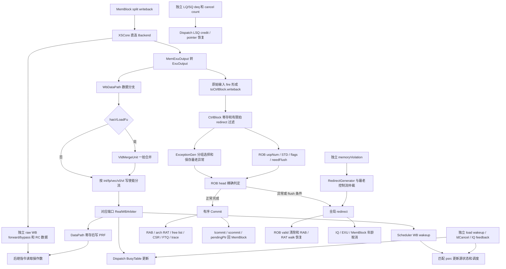

# V2 访存写回后端数据与控制 Flow

## 1. 术语

| 术语 | 本文含义 |
|---|---|
| WB / 写回 | 执行结果到达后端并被接受，不等于架构提交。Scala Decoupled 端口用 `valid && ready` 表示接受。 |
| PRF / 物理寄存器 | 保存推测执行结果的寄存器文件；目的地址是 `pdest`，不是逻辑寄存器号。 |
| ROB | 维护指令顺序、剩余完成计数和精确异常摘要；不是功能数据的统一暂存仓库。 |
| RAB / RenameBuffer | 保存目的逻辑/物理寄存器映射，接受 ROB 的提交/恢复数量，驱动 RAT 和空闲寄存器恢复。 |
| RAT | 逻辑到物理寄存器映射；推测表服务执行，架构表记录已经提交的状态。 |
| IQ / Scheduler | 发射队列及调度器，维护源操作数就绪、发射、失败重试等状态。 |
| BusyTable | 按物理寄存器编号记录 busy/ready；不是 ROB 有效位，也不是目的寄存器分配世代表。 |
| 快速唤醒 / IQ wakeup | 在最终 PRF 写入前按执行进度预测结果可用，失败时用 `ldCancel/ogCancel` 撤销依赖。 |
| WB wakeup | 寄存器写端口产生的完成唤醒，主要按 `pdest` 与源 `psrc` 匹配。 |
| bypass / forward | 让消费者直接读取执行输出或延迟一拍/两拍的数据，绕过等待 PRF 落盘。 |
| RC / RegCache | 物理寄存器值的近端缓存；数据写入与 tag/依赖维护由不同模块协作。 |
| redirect / flush | 按 ROB 年龄取消错误路径；`flushItself` 决定是否同时取消锚点本身。 |
| replay | 必须区分 IQ 重试、LSQ 内重放、MemBlock `memoryViolation` redirect、写回 `replayInst` 标记。 |
| walk | 从架构状态/快照重建保留路径的重命名状态，不是等待所有被取消请求执行完成。 |
| `robIdx` | ROB 环形指针，含 `flag/value`；不是跨任意次 redirect 永久唯一的事务 ID。 |
| `lqDeq/sqDeq` | 物理 LQ/SQ 释放数量；不能与 ROB 输出的 `lcommit/scommit` 架构提交计数混用。 |
| owner / 所有者 | 当前占有一个 ROB 槽位、物理寄存器或返回缓冲的动态请求；编号复用后，所有者已经改变。 |
| generation / epoch | 用来区别不同次分配或重发的世代概念；本文不能把 TB 的 UID/epoch 当成真实 WB 接口字段。 |
| staging | 上游 entry 之外暂存结果的输出流水寄存器；entry 释放后仍可能持有尚未被下游接受的数据。 |
| MDP / SSIT / LFST | 访存依赖预测器、PC 到 store-set 的表及最近 Store 表；当前源码保留内部更新，但使用端被覆盖为零。 |
| FTQ | 前端取指目标队列；后端通过其索引取得 PC、报告提交和重取目标，不存放 Load 结果数据。 |
| FOF | 向量 fault-only-first；非首元素故障可转为缩短 VL，并非所有故障都直接走普通 trap。 |

## 2. 版本与范围

| 项目 | 内容 |
|---|---|
| RTL 版本 | V2，基于 `kunminghu-v2` 的当前母任务工作区 |
| 分支 | `codex/memblock-csr-prefix-fix-20261025`，不是主线分支 |
| 核验 HEAD | `2b593d1e9db9cd490c72a743dc4226ff2a0caf38` |
| 最近生产源码提交 | `c9763bd7d`；上述 HEAD 与其之间是文档提交 |
| 权威源码根目录 | `/nfs/home/lixiangrui/work/memblock_ut/XiangShan_V2/.codex_mother_integration_20261028/src/main/scala/xiangshan` |
| Profile | `mem_ut/ver/ut/memblock/rule/version/v2/branch_policy.md`、`memblock_rtl_profile.md` |
| 最后核验日期 | 2026-10-29 |
| 分析方式 | 源码静态追踪；没有运行整核仿真，没有修改 Scala/RTL/TB |

入口是 `MemBlock.io.mem_to_ooo.writeback*`；沿真实连接追踪到数据消费者、ROB、异常、架构提交、
回滚和反馈回 MemBlock 的控制。还纳入独立但相关的 wakeup、IQ feedback、LSQ release 和 memoryViolation。
这是一份覆盖后端相关调用链的 flow，不是对所有 ALU/FPU 算法、CSR 位定义或 Cache 一致性协议的逐行审计。
这些模块只在实际消费访存结果、影响写回或恢复时展开。

### 2.1 模块覆盖清单

| 层次 | 核验模块 | 在本 Flow 中的作用 |
|---|---|---|
| 集成 | `XSCore`、`MemBlock`、`Backend` | split WB 来源、Bundle 转换、fanout、控制回灌 |
| 数据写回 | `WbDataPath`、`VldMergeUnit`、`RealWBCollideChecker`、`RealWBArbiter` | 向量合并、寄存器类别选择、端口仲裁、背压 |
| 数据消费 | `DataPath`、`Regfile`、`BypassNetwork`、`RegCache` | PRF、forward/bypass、缓存数据 |
| 依赖与调度 | `NewDispatch`、`BusyTable`、`RegCacheTagTable`、`Scheduler`、`IssueQueue`、`EntryBundles`、`MultiWakeupQueue` | 目的 ready、源就绪、重试、load dependency 和 tag |
| 顺序与异常 | `CtrlBlock`、`Rob`、`NewRobDeqPtrWrapper`、`RobEnqPtrWrapper`、`ExceptionGen` | 写回窗口过滤、完成计数、最老异常、提交与回退 |
| 架构恢复 | `RenameBuffer`、`RenameTableWrapper/RenameTable`、`Rename`、`BaseFreeList`、`MEFreeList`、`StdFreeList`、`VTypeBuffer` | 映射提交、快照恢复、资源重新分配 |
| 特殊异常 | `VecExcpDataMergeModule`、CSR wrapper / `NewCSR` | 向量部分完成修复、trap 状态及目标 |
| 访存依赖预测 | `MemCtrl`、`SSIT`、`WaitTable`、`LFST` | 违例训练和 Store issue 通知；明确当前使用端关闭边界 |
| 控制与观测 | `RedirectGenerator`、`Trace/TraceBuffer`、`DiffRatStateBuffer`、ROB debug/difftest/perf | 访存违例、前端重取、trace 背压、调试影子 |

### 2.2 完成条件不是一个条件

- WB 完成：该写回端口发生握手；不代表提交，也不代表 Cache/总线事务全部结束。
- 数据可用：具体旁路或 PRF 通路在自己的时钟边界形成有效结果。
- ROB 完成：本 entry 所需计数为零，Store 还满足 `stdWritebacked` 等谓词。
- 架构完成：ROB 有序提交，并由 RAB/RAT 完成对应映射更新；两者存在寄存器延迟。
- 访存资源完成：LQ/SQ、本地 buffer、SBuffer/Uncache 分别满足自己的释放/响应条件。
- 取消完成：后端恢复与旧外部事务的本地取消收尾是不同生命周期，不能用其中一个代替另一个。

### 2.3 阅读入口

| 要回答的问题 | 阅读位置 |
|---|---|
| 未提交的 Load 结果到底存在哪里 | 第 6 节 PRF、第 8.3 节映射提交、第 12.1 节示例 |
| 乱序结果怎样找到对应 ROB entry | 第 5.3 节编号分配、第 8.2 节槽位匹配 |
| 为什么后继指令不等提交就能执行 | 第 7 节 BusyTable、唤醒、旁路和 RC |
| Store 的数据和完成为什么分开 | 第 5.1 节 STA/STD、第 10.1 节释放、第 12.1 节示例 |
| redirect 清什么、等什么、如何处理迟到返回 | 第 11 节取消边界、walk 与输出 staging |
| 哪些端口虽然连接但当前没有功能效果 | 第 7.6、7.7 节 |

## 3. 主流程图



图中从 `C` 到 `RAW` 是**原始执行输入握手**，不是 PRF 合并后结果反向流入 ROB；从 `X` 到 `BP`
也不是仲裁成功信号的副本。三路有不同的 valid、ready 和寄存器边界。

## 4. 按源码顺序的主流程伪代码

抽象职责：将访存执行完成拆成数据发布、依赖解除、顺序记账和精确架构动作，维持各自独立的取消边界。

```text
1. XSCore 将 MemBlock 的各类 writeback 和独立 sideband 接入 Backend。
2. Backend 保留 valid/ready，转换 data/pdest/robIdx/Wen/exception/LSQ/VPU/debug 字段。
3. 对 PRF 数据分支：
     有向量 load capability -> 先进入 VldMergeUnit；
     按运行时目的寄存器类别选择仲裁输入；
     根据端口映射和 priority 仲裁，生成 to*Preg。
4. to*Preg 并行：DataPath 寄存数据写 PRF；Dispatch 更新 BusyTable；Scheduler 生成 WB wakeup。
5. 独立 raw MemBlock WB 向 BypassNetwork 发布数据；独立 load wakeup 向 IQ 发布预测就绪。
6. 原始 ExuOutput fire -> toCtrlBlock.writeback；CtrlBlock 锁存结果、构造有限 redirect 过滤和计数。
7. ROB 按槽位更新剩余写回数、STD 完成和 flags；ExceptionGen 保存最老异常上下文。
8. 仅在 ROB head 满足完成、异常及阻塞约束后，产生正常提交或精确异常/flush redirect。
9. 正常提交经 RAB 更新架构映射/回收旧物理资源，并通知 CSR、LSQ、FTQ、trace 和 difftest。
10. redirect 取消年轻路径，ROB 回退分配位置/清 valid，RAT/free list 从快照或架构态重建。
11. 已发外部请求可能继续返回；对应 MemBlock owner 必须记住取消并消费响应，不能依靠 ROB 全局等待。
```

## 5. 入口与身份字段

### 5.1 Split WB 的真实来源

抽象职责：把不同访存执行结果汇集为后端执行端口。端口名字不是唯一的操作类型或唯一 producer。

| 入口 | 可能来源 | 后端主要动作 |
|---|---|---|
| `writebackLda` | LoadUnit、AtomicsUnit override、LoadMisalignBuffer；NC/MMIO 经对应 load 返回路径 | 按 `rfWen/fpWen` 写目的 PRF，报告完成/异常 |
| `writebackHyuLda` | HybridUnit load 路径，取决于配置是否实例化 | 与 load 类似，可含独立 replay 标记 |
| `writebackSta/writebackHyuSta` | StoreUnit/HybridUnit 地址完成，STA0 还可接 SQ MMIO/CBO、StoreMisalignBuffer | 主要报告完成/异常，通常不写目的 PRF |
| `writebackStd` | Store data FU；MemBlock 明确排除 AMO 的 STD WB | 设置 ROB 的 STD 完成，Store 数据本身先进入 SQ，不经 ROB 写内存 |
| `writebackVldu` | VL/VS merge buffer、segment、FOF fix-VL 等共享出口 | 可能写 vec/v0/vl，也可能只是 vector store 完成；不能按端口名直接认定有 load 数据 |

源码：`XSCore.scala:169`、`mem/MemBlock.scala:520,1373,1738`、`backend/Backend.scala:1054`。
`Backend.writeBack` 的展开顺序与 MemBlock 必须一致：STA、HYU-LDA/HYU-STA、LDA、VLS、STD。

### 5.2 `Backend` 的转换

抽象职责：将 MemBlock 的 `MemExuOutput` 转为后端参数化的 `ExuOutput`，不在此处重新分配身份或查 ROB。
源码：`backend/Backend.scala:672`、`backend/Bundles.scala:981`。

```text
sink.valid = source.valid
source.ready = sink.ready
data(*) = source.data；pdest = source.uop.pdest；robIdx = source.uop.robIdx
各存在的 Wen / exceptionVec / flushPipe / replay 字段 = uop 对应字段
可选 lqIdx/sqIdx、trigger、VPU 元数据、debug 信息保持来源
```

`pdest` 定位数据目的地；`robIdx` 定位顺序记账；`lqIdx/sqIdx` 服务访存和 debug；三者不能互相替代。
可选字段是否存在由 `ExeUnitParams/FuConfig` 的编译期 capability 决定，存在不表示运行时置位。
本转换没有“查询 ROB active owner，查不到就丢弃”的硬件逻辑；测试框架 UID/epoch 不在这条真实接口中。

### 5.3 身份从哪里来，为什么可以乱序写回

抽象职责：在指令进入执行之前分配顺序位置和数据目的位置，后续执行携带这些字段返回，而不是
在 WB 时按到达顺序寻找空 ROB entry。源码：`backend/rename/Rename.scala:176,346,414,454`、
`backend/rob/Rob.scala:1000`、`backend/rob/RobBundles.scala:204`。

```text
Rename 的 robIdxHead 与本批前缀计数 -> uop.robIdx；ROB 压缩/多 uop 决定是否共享 entry
对应类别 free list -> uop.pdest；RAT 将后继指令的逻辑源翻译为 psrc
Dispatch/ROB 首 uop 入队 -> 建立该槽位 valid 和 numWB，RAB 记录目的映射
IQ -> DataPath -> MemBlock 保留 robIdx/pdest，LSQ 另外分配 lqIdx/sqIdx
MemBlock 结果乱序回来 -> pdest 选 PRF 地址，robIdx.value 选 ROB 物理槽位
```

`robIdx.flag` 用于环形年龄和完整指针比较，但完成计数更新处没有拿它与 entry 的独立分配世代匹配。
更重要的是，redirect 会回退分配指针，因此**不必绕满整个 ROB，就可能再次分配相同的完整指针**。
不能把增加一个环形 flag 等价理解成“后端永久识别任意迟到旧结果”。正常协议要求上游取消旧执行结果，
让编号复用仍然安全；PRF/BusyTable 的编号同样不自带这种永久唯一性。

## 6. 数据写回通路

### 6.1 `WbDataPath` 与 `acceptCond()`

抽象职责：按目的寄存器类别和写口配置路由结果，并把仲裁结果反馈给支持背压的执行端口。
源码：`backend/datapath/WbArbiter.scala:123,176,220,245`。

```text
收集 int/fp/vf/mem 原始执行输入
对 hasVLoadFu 的输入替换 PRF 分支的数据源为 VldMergeUnit 输出
acceptCond -> [intWen, fpWen, vecWen, v0Wen, vlWen] 和 notWrite
对应候选 valid = exuOut.valid && 对应 Wen
不确定延迟端口：ready 依赖所属类别仲裁 ready，或 notWrite
确定延迟端口：ready=true，同时断言有效写入必须赢得仲裁
hasNoDataWB / isHighestWBPriority 的端口按配置覆盖为 always-ready
```

不能只看到 `Decoupled` 就假设所有端口都允许无限背压。当前 whole-core 生成 RTL 还可能将部分
ready 常量传播裁掉；本文的握手推导以 Scala 边界为准，不保证 standalone Verilog 导出同名 ready。

### 6.2 `VldMergeUnit`

抽象职责：按向量 mask/tail/vstart 等语义处理最终向量数据，而非收集 MemBlock 的每个访存 flow。
源码：`backend/datapath/VldMergeUnit.scala:13`、`WbArbiter.scala:128`。

```text
input.ready = output.ready
wbFire = input.fire && !input.robIdx.needFlush(current flush)
锁存 input bits；wbReg.valid = wbFire
锁存数据作为 vd/oldVd，结合 vm/vma/vta/vl/vstart/veew 等送 VldMgu
vlWen 的 FOF 尾 uop 直接选原 data；其它选合并后的 vd
输出 wbReg 身份和新 data
```

这增加一拍数据阶段；MemBlock `VMergeBuffer` 已经先完成元素/flow 聚合，两者不能混称。
`WbDataPath` 在这里将合并使用的 `vstart` 接到当前 CSR 输入，不能拿 fault WB 内更新后的 vstart
代替此次向量访问开始时的上下文。该模块不是通用多项弹性 FIFO，任意背压时序须按当前端口配置核验。
此外，**到 CtrlBlock 的 WB 仍由原始 `io.fromMemExu.fire` 形成，不等待此合并后的 PRF 输出。**

### 6.3 `RealWBCollideChecker` / `RealWBArbiter`

抽象职责：对同一物理写口的竞争者选出一个结果，解决端口冲突，不负责指令是否仍有效的生命周期校验。
源码：`WbArbiter.scala:39,47,300`、`RFWBConflictChecker.scala:114`。

```text
按 wbCfg.port 分组，按 priority 排序
每组用 RealWBArbiter 选择优先级最高的有效输入
获胜者获得 ready；输出 ready 固定 true
生成 WriteBackBundle，保留 pdest/data/robIdx 等
```

虽然接口带 `flush` 且上层连接它，`RealWBCollideChecker` 的 scalar 仲裁实现并没有消费该信号。
不能因“连了 flush”就断言 scalar PRF 写入受到 redirect 检查。`RFWBConflictChecker` 的发射前
端口预约也不能替代这里的 canceled-owner 检查。

### 6.4 `as*RfWriteBundle()` → `DataPath` → `Regfile`

抽象职责：把获胜结果转换成按物理地址写入的 PRF 操作，发布供其他后端结构使用的写回通知。
源码：`backend/Bundles.scala:802`、`WbArbiter.scala:362`、`DataPath.scala:341`、`regfile/Regfile.scala:48,112`。

```text
toIntPreg.wen = rfWen && arbiter.fire；addr = pdest；data = result
其它类别同理，分别进入 FP / VF / V0 / VL PRF
DataPath 锁存 addr/data，RegNext(wen)
Regfile 对 wen && addr==entry 置入 data
```

关键源码摘录，来自 `DataPath.scala` 和 `Regfile.scala` 的不同模块：

```scala
// DataPath
intRfWaddr := io.fromIntWb.map(x => RegEnable(x.addr, x.wen)).toSeq
intRfWdata := io.fromIntWb.map(x => RegEnable(x.data, x.wen)).toSeq
intRfWen := RegNext(VecInit(io.fromIntWb.map(_.wen).toSeq))

// Regfile，省略零寄存器特例
val wenOH = VecInit(io.writePorts.map(w => w.wen && w.addr === i.U))
val wData = Mux1H(wenOH, io.writePorts.map(_.data))
when(wenOH.asUInt.orR) {
  if (i == 0) mem_0 := wData
  else mem(i) := wData
}
```

因此必须区分两个时钟沿：若 `toIntPreg.wen` 在 E0 之前有效，E0 锁存 DataPath 写口，
E1 才由 Regfile 将该已寄存写口更新到存储。WB wakeup 可以更早发出，这是操作数读取/旁路
需要对齐的流水关系，不代表 wakeup 当时 PRF 数组已经完成更新。

最终 `RfWritePortWithConfig` 已无 ROB pointer，PRF 无法自己查询“这条指令是否被取消”。
整数零寄存器与同地址多写断言是局部特殊规则，不是所有旧写回的防护机制。
`DataPath.io.flush` 主要作用于发射/读操作数流水，不应推断它会门控上述 PRF 写寄存器逻辑。
同样，`acceptCond()` 依据 Wen 分流，没有通用的 `!exceptionVec.orR` 写口条件。
异常 WB 是否携带可写数据取决于 producer；不能把“ROB 最后会精确 trap”理解为 PRF 当拍一定不写。

## 7. 结果如何使后继指令运行

### 7.1 Dispatch `BusyTable`

抽象职责：让尚未入 IQ 的指令知道其物理源是否已经就绪；按物理寄存器维护依赖，而非维护 ROB 完成。
源码：`Backend.scala:283`、`CtrlBlock.scala:740`、`dispatch/NewDispatch.scala:229`、`rename/BusyTable.scala:118,129,152`。

```text
to*Preg.wen 与类别 Wen -> wbPregs.valid；bits = PRF addr
wbPregs -> wbMask
正常分配 -> allocMask；快速唤醒 -> wakeUpMask；load 取消 -> ldCancelMask
写回或快速唤醒：tableUpdate=false，表示 ready
否则分配或 load 取消：tableUpdate=true，表示 busy
read.resp 还会旁路检查本拍 allocPregs，避免同拍分配误读 ready
```

源码中 ready 更新优先于 busy 更新，因此不能把同拍 allocation 当作所有旧 WB 的全局防护。
BusyTable 没有全局 redirect 输入和物理寄存器 owner-generation 表；正常恢复依赖 RAT/free list 和后续重新分配。

### 7.2 Scheduler 的 WB wakeup → IQ source state

抽象职责：解除已经在 IQ 中等待该结果的源依赖，并调整后续操作数数据来源。
源码：`Backend.scala:323,361,410`、`issue/Scheduler.scala:177`、`issue/EntryBundles.scala:180,335`、`backend/Bundles.scala:325`。

```text
Scheduler 从 to*Preg 生成 wakeup(valid=wen, pdest=addr, 各类别 Wen)
同时生成/接收延迟一拍的 WB wakeup，按 IQ 配置连接对应端口
源 psrc==wakeup.pdest && SrcType 与寄存器类别匹配 -> srcWakeupByWB
结合 IQ 快速唤醒、loadCancel 更新 srcState/dataSources/loadDependency
源均就绪且 entry 未被 redirect 覆盖 -> 可以被选中发射
```

普通 WB wakeup 不带永久取消世代。IQ 自己的 `status.robIdx.needFlush(flush)` 会取消旧消费者，
但不能仅靠这一点鉴别“一个合法新消费者正等待同编号新物理寄存器，却收到了旧生产者的唤醒”。

### 7.3 独立 Load 快速唤醒与撤销

抽象职责：在 Load 结果真正写入 PRF 前预测其将成功，降低依赖指令延迟；失败时撤销依赖链。
源码：`mem/pipeline/LoadUnit.scala:858`、`XSCore.scala:168`、`Backend.scala:422`、`Scheduler.scala:401`、
`IssueQueue.scala:1133`、`backend/Bundles.scala:999`。

```text
LoadUnit 的 io.wakeup 在选定的 load/replay/NC/MMIO/MAB 入口事件发布 uop
MemBlock -> Backend -> MemScheduler -> Load IQ loadWakeUp
Load IQ 用 RegNext(uop.fire) 和 uop.Wen/pdest 产生跨 Scheduler 的 IQ wakeup
依赖状态带对应 loadDependency；ld1Cancel/ld2Cancel 命中位0/位1时撤销
取消可令消费者源重新 busy、发射结果失败重试或清掉相关流水 valid
```

它不等于最终 WB。Load IQ 这一直接生产分支也不同于非 Load 单元使用的 `MultiWakeupQueue`：
后者按 `flushFunc` 检查 ROB redirect、load dependency 和阶段 og0/og1 失败，不能把该函数的保护
误套到所有 Load 快速唤醒分支。`ldCancel` 是短程依赖撤销，不是无限期保存旧 UID 的取消表。

### 7.4 BypassNetwork 与 RegCache

抽象职责：把执行结果直接或延迟后送给下一条指令，减少等待 PRF 读回；缓存热点物理寄存器值。
源码：`Backend.scala:542`、`datapath/BypassNetwork.scala:96,139,195`、`DataPath.scala:485`、
`regcache/RegCache.scala:78`、`regcache/RegCacheTagTable.scala:79`。

```text
raw MemBlock WB -> bypass.valid=source.valid
bypass.intWen=source.uop.rfWen && source.isFromLoadUnit
data/pdest 直传；产生 forward、RegEnable 后 bypass、适用时 bypass2
IQ 的 exuSources/dataSources 决定消费者读哪个来源
需要 RC 的来源：延迟后的 data/tag 进入 RegCache 数据模块
IQ wakeup 的 rcDest/pdest/loadDependency 进入 Dispatch RC tag table
alloc、同 tag 替换和 ldCancel 按规则失效 tag
```

这一路使用 raw valid，不是 PRF 仲裁成功的统一副本；`isFromLoadUnit` 约束必须保留。
数据写入与 tag 可见性不是同一动作，不能看到 RC data 写入就认定新指令一定会读取它。
消费者实际进入 EXU 还经过 `NewPipelineConnect` 对自己的 ROB 年龄和 load dependency 的检查。

### 7.5 IQ feedback 与各种 replay 的分工

抽象职责：维护访存指令的发射生命周期；反馈成功/阻塞不代替 ROB 的最终完成记账。
源码：`IssueQueue.scala:1109,1202`、`EntryBundles.scala:183,386`、`Backend.scala:738,761`。

| 事件 | 作用与后续 |
|---|---|
| `feedbackFast/feedbackSlow.hit` | 转换为 `RespType.success/block`，按 ROB/LSQ/uop 等实际字段路由到 IQ entry |
| `finalIssueResp` | 入口 issue timeout 或更老请求替换等条件下反馈 block，允许重新发射 |
| LSQ replay | MemBlock 内部重新执行；不能把一次中间重放当作一次最终 WB |
| `memoryViolation` | 独立请求全局 redirect，可早于 ROB head |
| WB `replayInst` | 携带给 ExceptionGen/ROB 的精确重放标记；本身不代表 PRF 写口被屏蔽 |

各类反馈要区分 compile-time capability 与具体运行时 producer；LDA、STA、STD、HYU 的字段并不完全相同。

### 7.6 Store issue、访存违例与依赖预测

抽象职责：将 Store 已进入执行、Load 检测到顺序违例等信息反馈到调度和预测逻辑；这些不是
最终 WB 事件，也不能用来证明某条 Store 已提交。源码：`mem/MemBlock.scala:1356`、
`Backend.scala:427`、`CtrlBlock.scala:625,660`、`ctrlblock/MemCtrl.scala:11`、
`ctrlblock/RedirectGenerator.scala:85`、`issue/Scheduler.scala:429`。

```text
StoreUnit.issue.valid/bits -> MemBlock.stIn -> Backend
  -> CtrlBlock.MemCtrl：延迟一拍送 LFST.storeIssue
  -> MemScheduler.memWaitUpdateReq.robIdx；stIssuePtr 另由 MemBlock 输入
memoryViolation -> RedirectGenerator.loadReplay
  -> 选择 redirect，读取相关 PC，形成 memPredUpdate
  -> MemCtrl 延迟一拍更新 SSIT 和 WaitTable
```

但当前使用端有以下覆盖，必须按 Chisel 最后连接解释：

```scala
// CtrlBlock.scala：在前面的正常连接之后
dispatch.io.lfst.resp := 0.U.asTypeOf(dispatch.io.lfst.resp)
rename.io.waittable := 0.U.asTypeOf(rename.io.waittable)
rename.io.ssit := 0.U.asTypeOf(rename.io.ssit)
```

所以内部训练通路存在，不等于当前 Rename/Dispatch 实际使用了训练结果。
`IssueQueue.memIO.checkWait` 中的 `stIssuePtr/memWaitUpdateReq` 在本次源码检索中也只找到定义和
Scheduler 连线，没有找到消费这些输入的判断；不能据此声称当前 IQ 会按这组输入解除等待。
这不关闭真正的 LSQ 违例检测和 `memoryViolation` redirect，两者不是同一个功能。

### 7.7 已连线但未消费的 Load sideband

抽象职责：区分真实功能链路与接口残留，防止按名字补出源码中不存在的异常或唤醒处理。
源码：`XSCore.scala:160,183`、`Backend.scala:1001,1020`。

| sideband | 当前源码事实 | 不能作出的推论 |
|---|---|---|
| `otherFastWakeup` | MemBlock 的 `fast_uop` 接入 Backend；Backend 及其子模块中未找到该输入消费者 | 它与第 7.3 节实际消费的 `wakeup/loadWakeUp` 是同一路，或它会额外解除 IQ 依赖 |
| `s3_delayed_load_error` | XSCore 将该向量接入 Backend；后端仅有输入定义，无后续功能消费 | 后端会靠它撤销一拍前的 PRF 数据或补写 ROB 异常 |

以上只描述当前源码连接边界，不额外推断相关 LoadUnit 异常处理错误，也不代替最终生成 RTL 检查。

## 8. 完成记账：WB → CtrlBlock → ROB

### 8.1 原始 fire 与三组寄存输出

抽象职责：将一次真实接受的执行结果送入 ROB，并分别提供计数、异常和调试所需视图。
源码：`WbArbiter.scala:345`、`Backend.scala:261`、`CtrlBlock.scala:125,153,764`、`Rob.scala:140`。

```text
toCtrlBlock.writeback.valid = 原始 io.from*Exu.fire
CtrlBlock:
  delayedWriteBack.valid = RegNext(raw.valid)，不按 redirect 屏蔽
  delayedNotFlushedWriteBack.valid = RegNext(raw.valid && !kill[当前,延迟1拍 redirect])
  delayedNotFlushedWriteBackNums = 同 ROB 配置组的当拍完成数，检查[当前,延迟1拍,延迟2拍 redirect]
ROB:
  exuWriteback = delayedWriteBack
  writeback = delayedNotFlushedWriteBack
  writebackNums = delayedNotFlushedWriteBackNums
```

计数分组由 `schdType/CanCompress/hasVLoadFu` 等配置决定，并非无条件将所有相同 ROB 的写回相加。
`writebackNums.valid` 有构造，但 ROB 的对应 `wbCnt` 表达式选择的是 `.bits`；必须结合计数生成时的
`sameRobidxBools` 过滤理解，不能凭该 valid 推断所有副作用都已统一门控。
ROB 的 `stdWBs/fflagsWBs/vxsatWBs` 来自未做该 redirect 过滤的 `exuWriteback`。
STD 完成并不走普通 `writebackNums` 递减；flags 聚合也不能套用普通计数的过滤结论。

### 8.2 ROB 槽位更新与提交窗口旁路

抽象职责：记录一个 ROB entry 还缺多少执行完成，并使当前/下一提交行及时看到更新。
源码：`Rob.scala:1000,1033,1086`、`RobBundles.scala` 的 `connectCommitEntry/isWritebacked`。

```text
初次入队：uopNum=numWB；Store stdWritebacked=false，其它为true
每个物理槽 i:
  canWb = exuWBs.valid && wb.robIdx.value==i
  wbCnt = 按 canWb 选择 writebackNums.bits
  needFlushWriteBack = 按已过滤异常端口匹配的 needFlush 摘要
  有效且需要异常清理 -> uopNum-=wbCnt，并解除 STD 等待
  否则无效且首次入队 -> 初始化新 entry
  否则有效 -> uopNum-=wbCnt；命中 STD 时 stdWritebacked=true
同步更新提交行/下一行的 needUpdate 副本，避免读口寄存延迟漏看到新结果
```

关键匹配不是按返回先后顺序，而是如下地址比较和计数选择：

```scala
val canWbSeq = exuWBs.map(writeback =>
  writeback.valid && writeback.bits.robIdx.value === i.U)
val wbCnt = Mux1H(canWbSeq, io.writebackNums.map(_.bits))
```

这里用于匹配完成计数的判断只比较 `robIdx.value`；没有查询 TB UID、epoch 或每次分配的独立 generation。
ROB 压缩/多 uop 可使多个执行结果共同减少同一 entry 计数，不能强制解释成“一次 WB 就可以提交”。
`fflags/vxsat` 等可选字段按槽位聚合，实际访存 lane 不具备该能力时不会凭空生成相应动作。

### 8.3 正常提交

抽象职责：只让队头起连续完成且不被异常/阻塞覆盖的指令形成架构状态。
源码：`RobDeqPtrWrapper.scala:64`、`Rob.scala:765,838`、`Rab.scala:114`。

```text
commit_w = uopNum==0 && stdWritebacked
队头开始按有效、完成、异常边界和 hasCommitted 选择连续 commit lanes
redirect、walk、精确异常、trace 等 block 条件限制正常提交
ROB 根据 realDestSize 向 RAB 发布需要提交的目的映射数量
RAB 从自身队列输出 ldest/pdest/寄存器类别，经过 io.rabCommits 寄存
arch RAT 更新映射；free list 回收可释放旧物理资源
```

提交不是“将 ROB 中的 load data 再抄到架构寄存器”。数据早已可能在 PRF 中，提交改变的是可见映射和退休状态。
RAB 可拆多拍处理多个目的映射；压缩 ROB entry、向量多目的寄存器不能用一条固定一拍假设概括。

## 9. 异常、CSR 与向量部分完成

### 9.1 `ExceptionGen` 的异常流水

抽象职责：从可能乱序完成的请求中保存最老的异常上下文，供 ROB 在精确顺序点处理。
源码：`Rob.scala:1220`、`RobBundles.scala:296`、`ExceptionGen.scala:77`。

```text
WB -> RobExceptionInfo(exceptionVec/flushPipe/replayInst/trigger/向量上下文)
s0：按实际执行单元类别分组，组内选最老；屏蔽当前 redirect、flush 及规定的上一拍 flush
s1：组间选择并再次检查取消
s2/current：保留更老者；相同 ROB 合并，向量按 vstart 等优先级更新；current 被取消时清除/替换
ROB head 的 robIdx 必须命中保存的异常，且满足完成/延迟稳定条件，才精确处理
```

该流水也不是永久取消表。一个本应已在 producer 处丢弃、却在旧 redirect 完全过去后才新进入的异常，
不能指望 `current.robIdx.needFlush(current redirect)` 自动记住历史。

### 9.2 ROB head 与 CSR trap

抽象职责：在正确的指令顺序点选择异常、flushPipe 或其它精确动作，并提供 CSR 所需上下文。
源码：`Rob.scala:576`、`CtrlBlock.scala:104,361`、`Backend.scala:584`、`fu/wrapper/CSR.scala:129`。

```text
deqNeedFlush = entry.needFlush && commit_v && commit_w
命中 ExceptionGen 当前项后形成 exception/flushPipe/replay 分类
真实 exception/interrupt -> exceptionHappen -> RegNext(exception.valid)
把 PC/instr/commitType/exceptionVec/trigger/vls 等上下文锁存给 CSR
CSR wrapper -> NewCSR trap 处理；MemBlock exceptionAddr 另外提供 VA/GPA
CtrlBlock 结合 trapTarget 形成向前端的精确目标 redirect
```

必须按现有表达式理解 `flushOut.valid`：它显式使用 `intrEnable || deqCanException || deqCanFlushPipe`；
`replayInst` 还参与 `not_commit` 和 redirect level 选择，但不能仅见该标记就声称它独立满足所有
`flushOut.valid` 条件。HYU 的执行级 `rollback` 经 `memoryViolation` 是另一条已存在的重放入口。
具体 replay 组合应对照 producer、ExceptionGen 合并和 ROB 条件一起检查。

### 9.3 向量精确异常修复

抽象职责：保留向量 fault 之前已经完成的元素，恢复 fault 及之后需要保留的旧目的数据。
源码：`Rob.scala:584,730`、`Rab.scala:255`、`CtrlBlock.scala:820`、`VecExcpDataMergeModule.scala:207,249,440`。

```text
ROB 确认向量 load 精确异常 -> 产生 VecExcpInfo，协调 RAB 目的映射处理
RAB 提供新 preg，RAT 提供旧 preg，模块收集所需映射
noExcp -> waitRab -> mergeVd -> mvOldVd -> finish -> noExcp
mergeVd 读取旧/新向量寄存器，按 vstart 和元素映射合并
mvOldVd 恢复需要整体保留的后续旧目的内容
专用写口覆盖 DataPath 的相关 VF/V0 PRF 端口
busy 反馈给后端/CSR，限制恢复期间的推进
```

这是特殊部分完成恢复，不是一般 scalar Load 的重写流程。普通 `VldMergeUnit` 与此异常修复 FSM
也不是同一个模块。FOF 的非首元素 fault 转化/最终 VL 结果首先由 MemBlock 的专用机制产生，不能
把所有 FOF 返回都按普通 trap 处理。

### 9.4 提交侧其他副作用

- `fflags/dirty_fs/dirty_vs/vxsat/vstart` 按 ROB 提交或精确异常条件更新 CSR；不能将推测 WB 的
  flags 直接当成已提交 CSR 状态。源码：`Rob.scala:710,832`、`Backend.scala:586`。
- `isStoreException` 源于异常时锁存的 `commitType`，Backend 持续取其 bit0，不是“每拍无异常就清零”。
  MemBlock 用它选择异常地址来源；只有相应异常上下文有效时才解释其功能含义。
- `vlWriteBackInfo` 主要由对应 VSET 执行侧产生 zero/vlmax 信息，配合 VL 寄存器唤醒用于省略无必要的
  oldVd 依赖；不能把它误称为每次 FOF VL 写回都产生的统一数值旁路。
  `VlBusyTable` 对非这两个指定写口的 VL 更新会保守清除 zero/vlmax 快捷判断的可信度，普通 VL ready
  仍由其基类 WB 状态维护。源码：`rename/BusyTable.scala:194,214,255`。

## 10. 提交/释放反馈与观测路径

### 10.1 ROB → MemBlock，MemBlock → Dispatch

抽象职责：将架构顺序授权和物理访存资源回收分开传递。
源码：`Rob.scala:838`、`Backend.scala:269,420,858`、`XSCore.scala:238`。

| 路径 | 含义 |
|---|---|
| ROB `lcommit/scommit` → `robLsqIO` → MemBlock | 延迟后的退休计数；当前 `scommit` 排除普通 vector store 统计 |
| ROB `pendingPtr/pendingld/pendingst/pendingMMIOld/pendingVst` → MemBlock | 队头及顺序授权，不要求当拍 `commitValid(0)=1` |
| MemBlock `lqDeq/sqDeq` → Dispatch/Scheduler | 实际物理资源释放，参与 LSQ 影子信用和指针更新 |
| MemBlock `lqCancelCnt/sqCancelCnt` → Dispatch/Scheduler | redirect 取消数量，服务恢复，不是正常提交 |

特别注意 `Backend.scala:270` 把 `sqDeq` 接到局部名为 `scommit` 的 consumer，该命名不改变它的
物理释放语义。Store 的 STA/STD WB、ROB commit、SQ completed/deq、SBuffer 对外写是不同事件。
普通、MMIO/CBO 和 fault drain 的顺序边界详见 StoreQueue/ROB 既有专题。

### 10.2 前端、Trace、Difftest 和性能统计

抽象职责：把完成/提交结果变成可观测信息；调试影子不能冒充功能数据存储或取消保护。

| 消费者 | 信息与边界 | 源码 |
|---|---|---|
| ROB debug | `debug_exuData/debug_exuDebug` 按 raw 完成身份保存数据和时刻，主要服务日志/观测 | `Rob.scala:529` |
| FTQ commit | 正常退休通知延迟一拍；ROB flush 周期按现有门控避免先提交后 flush 的前端歧义 | `CtrlBlock.scala:339` |
| Trace/TraceBuffer | 从退休/异常块生成 trace，经 PC 读取送编码器；缓冲背压可阻止 ROB commit | `CtrlBlock.scala:280`、`trace/Trace.scala:30` |
| Difftest | commit/load/trap 事件和物理寄存器状态；按 env 开关实例化 | `Rob.scala:1516`、`DataPath.scala` |
| DiffRatStateBuffer | 按 rename 更新和 commit ROB 选择调试映射快照；不是 PRF 功能写回的 owner 校验 | `rob/DiffRatStateBuffer.scala:75`、`RenameTable.scala:177` |
| Perf/TopDown | writeback/退休数量、ROB head 等待 load/STA/STD 的周期、指令位置等 | `Rob.scala:1256,1344` |

因此仿真中在 ROB 层次看见 `data` 数组，并不表示该核采用“数据只存 ROB，提交才写 PRF”的结构。

## 11. Redirect 的全链路与迟到写回边界

### 11.1 Redirect 来源与广播

抽象职责：确定恢复点和年龄范围，并向所有持有推测状态的模块发布取消事实。
源码：`CtrlBlock.scala:104,213,315,753`、`ctrlblock/RedirectGenerator.scala:32`、`RobBundles.scala:210`。

```text
ROB 精确异常/flushOut -> 延迟得到 s1_robFlushRedirect
执行侧 redirect 与独立 memoryViolation -> 选择最老合法候选 -> stage2Redirect
优先选择 ROB flush 或执行侧候选，形成 s1_s3_redirect
当前版本分发：ROB/RAT/Rename/Dispatch/MemBlock 顶层；Issue/DataPath/EXU 经过一级延迟
MemBlock 自己还有 rawRedirect 的寄存边界
needFlush = redirect.valid && (比锚点年轻 || flushItself && 正好等于锚点)
```

`RedirectGenerator` 的 `flushAfterCounter` 为短期候选过滤服务，不是可以检索任意旧 WB 的后端历史表。
memoryViolation 是独立控制入口，不必等到对应指令成为 ROB head；它还产生访存依赖预测训练信息，
但当前预测结果使用端被覆盖为零，详见第 7.6 节。

### 11.2 哪些状态被清除，哪些不清除

| 状态 | redirect 行为 |
|---|---|
| Decode/rename/dispatch 流水 valid | 按各级 flush 清理，阻止错误路径继续分配 |
| IQ entry / EXU 和 DataPath 发射流水 | 按该 entry 的 ROB 年龄取消，不能无条件清掉更老指令 |
| ROB valid | 按捕获的 redirect 与旧 enq 范围清掉取消槽位 |
| ROB enq pointer | `flushItself` 回到锚点，否则回到锚点之后 |
| RAB/RAT/free list | 选择架构态或快照，walk 重建保留路径，取消年轻分配的可达性 |
| LQ / 未 committed SQ | 按年龄取消、报告 cancel count 并恢复指针；已 committed SQ 有独立 drain 语义 |
| PRF data | 不逐项擦零；旧值是否可用由映射、ready 和资源所有权决定 |
| 已发外部事务 | 未必能撤回；本地记取消并等待响应收尾，不等于正常结果仍能发给后端 |
| 已提交架构态/更老合法指令 | 保留；全局 redirect 不等于系统复位或 Cache 整体失效 |

源码：`Rob.scala:955`、`RobEnqPtrWrapper.scala:54`、`RenameTable.scala:129`、`Rename.scala:152`、
`freelist/BaseFreeList.scala:60`、`MEFreeList.scala:34`、`EntryBundles.scala:182`、
`mem/lsqueue/VirtualLoadQueue.scala:97`、`StoreQueue.scala:1493`。

### 11.3 ROB 清理、walk 与等待条件

抽象职责：先使错误路径失去有效身份，再恢复剩余路径的分配状态；不等待所有被取消请求正常完成。
源码：`Rob.scala:691,860,955`、`Rab.scala:205`。

```text
ROB 收到 redirect：保存范围，回退 enq pointer，进入 walk
RegNext(redirect.valid) 形成范围清除条件，后续时钟沿置对应 entry.valid=false
按源码相对周期注释：T 收到 redirect，T+1 读 walk 信息，T+2 开始 walk
walk 从架构边界/快照向保留终点推进，RAB 重建对应目的映射状态
walkFinished && rab.walkEnd && vtypeBuffer.walkEnd -> ROB 回 idle
```

这里没有 MemBlock 全 outstanding 清零或全 WB ACK 集合的退出条件。保留的更老 load 仍可能使
正常提交等待；这不等于“redirect 必须等待所有年轻 load WB 才回收它们”。
清 valid 的寄存器边界、walk 周期和顶层 redirect 的可见周期不能合并成一个固定延迟。

核心退出表达式中的三个条件如下，均为后端恢复状态：

```scala
state === s_walk && walkFinished && rab.io.status.walkEnd && vtypeBuffer.io.status.walkEnd
```

以时钟沿严格表述：若 ROB 在 E0 前看到 `io.redirect.valid`，E0 捕获范围并置起
`redirectValidReg`；E0 到 E1 之间组合形成清理条件，E1 将相应 entry 的 `valid` 写为 false。
这不要求 E1 前收到被取消请求的 WB，也不表示所有取消消费者与 ROB 在同一个沿清理完毕。

### 11.4 后端现有保护的实际边界

| 位置 | 有效保护 | 不能由此推出的保证 |
|---|---|---|
| CtrlBlock WB 过滤 | 当前/有限拍延迟 redirect 覆盖的完成、异常和计数 | 不接受任何更晚到达的 canceled WB |
| ROB `valid` | 槽位无效且未复用时，普通计数更新分支不递减它 | 槽位重新有效后可识别旧生产者 |
| 首次 ROB 入队分支 | 首次入队初始化可优先于普通 WB 递减 | 任意晚一拍旧 WB 都无害 |
| PRF 写口 | 由 Wen/fire/端口仲裁决定 | 会查询 ROB valid 或已取消世代 |
| BusyTable/WB wakeup | 按物理编号和类别通知 ready | 能区分同编号的旧/新物理寄存器所有者 |
| IQ/EXU 取消 | 清掉错误路径消费者及短程 load dependency | 能无限期阻止旧生产者错误唤醒合法新消费者 |
| RAT/free list 恢复 | 清除错误推测映射，重建合法分配 | 等待全部旧 MemBlock response 才允许资源复用 |

**旧写回不必然破坏架构，但不能默认安全。** 若旧 ROB slot 已无效且未复用，`pdest` 也没有合法
新消费者，旧数据写入可能没有架构影响；若资源复用后才到达，可能错减新 entry 完成计数、覆盖新结果、
错误 ready/wakeup，或影响异常/debug。实际影响取决于到达、分配、消费者读取和新结果覆盖的顺序。

### 11.5 对 NC staging 缺陷的应用

抽象职责：用上述合同解释已观测的 MemBlock 输出，不将 standalone 证据扩张为全核损坏实测。

`LoadQueueUncacheEntry` 在 `s_resp` 用 `needFlushReg` 记住取消，响应回来消费后释放；但当前
`LoadQueueUncache.scala:493` 的 NC 输出 `AddPipelineReg(..., false.B)` 未保存这一取消事实。
返回已离开 entry 后，entry 的取消保护不能清除输出寄存器中的 payload。长背压跨过 LoadUnit/
CtrlBlock 的有限 redirect 检查窗口后，就可能形成被取消请求的晚 WB。

此处没有“等所有 NC 写回后才清 ROB”的全局保护。需在持有返回的环节保证取消不丢失，或另有
经过证明的端到端身份/过滤机制；不能通过 checker 无条件吞旧 WB 宣称 RTL 安全。
既有 seed `846339364` 的波形证明旧 LDA 输出，**没有完整后端，尚未证明实际新 PRF/ROB 被污染**。
正式记录见 [W44 RTL Buglist](../../../../buglist/rtl/v2/rtl_buglist_2026-W44_20261026.md)。

### 11.6 关键状态的所有权、保持与清除

| 状态/队列 | 所有者与建立 | 保持/更新 | 清除或结束 | 优先级边界 |
|---|---|---|---|---|
| scalar WB 输出 | MemBlock 对应 producer 生成 valid/payload | 是否保持受 lane 配置与 ready 约束 | fire 或 producer cancel | 不把 Scala Decoupled 等价于任意可背压 FIFO |
| `VldMergeUnit.wbReg` | raw vector input.fire 锁存 | 下一拍处理 mask/tail | valid 每拍由 wbFire 更新 | 输入当前 redirect gate；不是多项完成计数器 |
| PRF 写寄存 | DataPath 收到 to*Preg.wen | addr/data 锁存，wen 延迟 | 按 RF 时钟更新，wen 随输入更新 | 不检查 ROB owner；向量异常专用写口可覆盖 |
| PRF data | Regfile 对命中 addr 写入 | 一直保持最后一次写入值 | 下次合法/异常修复写覆盖，非 redirect 擦零 | 零寄存器为局部例外 |
| BusyTable bit | Dispatch 分配目的寄存器设 busy | 快速/WB 唤醒改 ready，load cancel 可重设 busy | 后续分配和唤醒继续维护 | ready 更新分支优先，read 额外旁路 alloc |
| IQ source | IQ entry 入队捕获 psrc/srcState | WB/IQ wakeup、load dependency 更新 | entry flush/deq/迁移 | 消费者取消与生产者 identity 是不同检查 |
| RC tag/data | tag 由 IQ wakeup 建立，data 由 bypass 写入 | 依赖和年龄信息更新 | 分配复用、替换、load cancel 失效 tag | 数据存在不代表 tag 可命中 |
| ROB `valid` | 首 uop 入队置位 | 直到 commit/redirect | 捕获范围后的 redirect 清除或退休清除 | 具体赋值优先级以 `Rob.scala:975` 为准 |
| ROB `uopNum/STD` | `numWB` 和 Store 类型初始化 | WB 减计数，STD WB/异常解除 STD 等待 | 新 owner 首次入队重新初始化 | 无效且未复用不做普通计数更新 |
| 提交行 `needUpdate` | 主 entry 的寄存读副本 | 同拍 enq/WB 做旁路更新 | 行读取/流水推进替换 | 不能只核对主数组忽略该副本 |
| ExceptionGen `current` | 收集到有效最老异常置起 | 更老事件替换，同 ROB 按规则合并 | flush/redirect 覆盖，或替换 | 多阶段均检查当前取消，不保存无限历史 |
| RAB commit/walk 数量 | ROB 按 realDestSize 发布 | 加新数量、减实际处理数量 | 对应数量归零且状态转换 | 特殊 walk 可同时有 commit/walk 语义 |
| RAT/free list | rename/提交建立推测/架构状态 | 提交更新、快照保存、walk 重建 | redirect 恢复后重新分配 | 不等待 canceled MemBlock 全响应集合 |
| 向量异常修复 FSM | 最老精确异常发布 VecExcpInfo | 等映射、读取并合并/恢复旧值 | finish 后回 noExcp | busy 限制恢复相关推进 |
| uncache canceled entry | 发请求前分配，redirect 置 needFlushReg | 已发请求期间继续保留取消事实 | 收响应后丢结果并释放 | 取消后不发正常 WB；输出 staging 必须另有 owner |

## 12. 时序核对表

表中 W 表示 scalar 原始 WB 在后端被接受的周期，R 表示 ROB 自己看到有效 redirect 的周期。
它们不是前文 standalone 波形中的绝对 ns，也不是所有配置固定的整核延迟。

| 相对阶段 | 数据/依赖分支 | ROB/控制分支 |
|---|---|---|
| W | scalar 有效结果竞争对应写口；raw 结果可供 forward；to*Preg 形成 WB wakeup | 原始 fire 生成 CtrlBlock 输入 |
| W 后一级 | DataPath 的 addr/data/wen 已寄存，驱动 RF 写口；下一个沿才更新 RF 存储，具体读取可见性服从 RF 实现 | CtrlBlock 已形成延迟完成信息；ROB 在消费它的沿更新状态，不保证立即可退休 |
| 向量额外阶段 | 数据分支先有 VldMergeUnit 的一拍处理 | 原始输入 fire 路径不因此改为等待后处理 PRF 输出 |
| R | 各 consumer 按自己的 redirect 边界取消，PRF 不统一擦零 | ROB 捕获范围并准备恢复 |
| R 后一级清除阶段 | MemBlock 内部 redirect 还需按自身寄存边界对齐 | 延迟 redirect 条件参与 valid 清除；不可把范围寄存当作所有 slot 已当拍组合无效 |
| R+2 起 | 未撤回的旧外部事务可继续在本地收尾 | 源码注释规定开始 walk，时长取决于保留范围、RAB 和 VTypeBuffer |
| 恢复结束 | 合法请求可继续分配/执行 | 恢复退出条件不含“所有 MemBlock WB 完成” |

ROB 异常到前端目标另有 `CtrlBlock.scala:361` 的 T0–T6 注释：ROB flush、异常锁存、CSR 目标、
前端 redirect 分阶段完成。该延迟是目标计算/分发，不是等待年轻 MemBlock 请求排空的证据。

### 12.1 三个端到端例子

以下数字仅作流程示意，不是本次仿真的绝对 ROB/PRF 编号或周期。

**普通 Load 未提交，但后继已使用结果**：

```text
ld x5, [x1] 在 Rename 得到 robIdx=(flag=0,value=40)、pdest=73
  -> 推测 RAT 的 x5 指向 p73；后继 add 的 psrc 指向 p73
  -> MemBlock 返回 data=0x1234、robIdx=40、pdest=73
  -> 数据分支向 PRF[p73] 写入 0x1234，快速/WB 唤醒允许 add 取得结果
  -> 控制分支令 ROB[40] 的剩余完成数归零
  -> 若 ROB[39] 尚未完成，ld 与 add 都不能越过它退休，但可以已经完成执行
  -> ld 获准正常提交后，RAB/RAT 的架构 x5 映射才更新到 p73，旧映射按规则回收
```

如果 ld 已 WB、未提交时被更老 redirect 覆盖，PRF[p73] 不需要擦零；恢复推测映射和分配状态，
使错误路径结果不成为架构态。**这依赖取消后不再出现旧 owner 的新 WB，而非依赖数据被擦除。**

**普通 scalar Store 的地址、数据与对外写**：

```text
Store 的地址和数据可以不同拍就绪，分别送 StoreUnit/SQ 和 Store data/SQ
  -> STA WB 报告地址侧完成/异常，STD WB 设置 ROB.stdWritebacked
  -> ROB 等所需完成数归零、STD 完成且无更老阻塞，才授权普通 Store 提交
  -> SQ 按 commit 和自身 ready 条件向 SBuffer drain；SQ 释放另报 sqDeq
  -> SBuffer 后续写 Cache/外部存储；不把 Store 数据从 ROB 读出再发送
```

这个例子只针对普通 scalar Store；MMIO、CBO、fault drain、向量 Store 和 AMO 有各自顺序授权，
不能把上面的固定先后关系无条件套用到所有 STA 出口。

**redirect 与迟到 NC 响应**：

```text
更老指令触发 redirect，取消一个已向 Uncache 发请求的年轻 Load
  -> ROB 清该 entry，RAB/RAT/free list walk 恢复；不等待该年轻 Load 正常 WB
  -> 正确的本地收尾：Uncache entry 保持 needFlushReg，收到响应后丢结果、释放 entry
  -> 若返回已移到额外输出 staging，取消责任必须延续到 staging，而非随 entry 释放消失
  -> 旧结果若跨过 redirect 过滤窗口再次出现，后端没有永久 UID/世代表替它统一兜底
```

第 11.5 节的已观测问题属于第三个例子，不等价于“所有 redirect 后的合法更老 Load 都要丢弃”。

## 13. 现场排查顺序

1. 先确认 WB 实际来源：LDA 不等于必为普通 load，VLDu 不等于必有向量数据写使能。
2. 同时记录 `valid/ready/fire`、完整 `robIdx`、`pdest`、Wen、exception/flush/replay，区分 raw 与 merge 后。
3. 查 raw bypass 和 load wakeup 是否已发布，再查 PRF 写口、BusyTable 与 IQ wakeup。
4. 查 CtrlBlock 三组输出及对应 ROB 主 entry/提交行副本，不能只看最终 `uopNum`。
5. 有异常时查 ExceptionGen 的 s0/s1/current 与 head 命中，再看 CSR/向量修复和 redirect。
6. 有 redirect 时先对齐每一级局部到达时刻，确认取消 owner 是否一直保留到最后一笔旧响应被消费。
7. 判断影响时检查 ROB slot 与物理寄存器何时复用、是否已经出现合法消费者；不要只凭 stale valid 就宣称已污染。
8. 将 ROB commit、RAB 映射提交、LSQ release、SBuffer/外部完成分别结算，不互相代替。

## 14. 关联知识与源码证据

- [ROB 压缩与后端指令信息流](rob_compress_and_backend_instruction_flow.md)：分配、压缩、RAB 与提交基础。
- [LSQ 入队与 Redirect 恢复](lsq_enqueue_redirect_flow.md)：信用、取消 count 和物理队列恢复。
- [StoreQueue 端到端 Flow](storequeue_feature_flow.md)：Store 数据、顺序授权、drain/deq。
- [向量访存 uop 与 flow 拆分](vector_memory_uop_flow_decomposition.md)：MemBlock 内元素聚合与 FOF。
- [Memory flushPipe](memory_flush_pipe_flow.md)：静态 capability、动态 producer 和精确重启边界。
- [Int writeback agent](../../../interface/v2/agents/int_writeback_agent.md)：当前 DUT split 字段与采样边界。

以下路径以第 2 节权威源码根目录为基准，行号用于本次版本定位，类/信号名用于长期检索：

| 路径与入口 | 证据 |
|---|---|
| `XSCore.scala:160,235` | WB、wakeup、异常地址和 ROB/LSQ 双向连接 |
| `mem/MemBlock.scala:520,1373,1738` | scalar/atomic/misaligned/store/vector WB 汇聚 |
| `backend/Backend.scala:261,283,323,489,542,672,792,858` | 各结果 fanout、转换、回灌 |
| `backend/Bundles.scala:325,758,802,981,999` | 唤醒匹配、写口转换、MemExuOutput、依赖取消 |
| `backend/datapath/WbArbiter.scala:123,176,220,300,345,362` | 合并、分类、仲裁、原始 fire 与 PRF 分支 |
| `backend/datapath/VldMergeUnit.scala:13` | 向量数据一拍处理及当前 flush gate |
| `backend/datapath/RFWBConflictChecker.scala:114` | 实际固定优先级写口仲裁 |
| `backend/datapath/DataPath.scala:341,385,485,588` | RF 写寄存、向量异常专用覆盖、RC 与发射取消 |
| `backend/regfile/Regfile.scala:48,112` | 最终写口字段及存储更新 |
| `backend/datapath/BypassNetwork.scala:96,139,195` | forward/bypass/bypass2 和 RC 数据 |
| `backend/regcache/RegCache.scala:78`、`backend/regcache/RegCacheTagTable.scala:79` | RC 地址延迟与 tag/取消 |
| `backend/dispatch/NewDispatch.scala:229`、`rename/BusyTable.scala:118,152` | 依赖状态及 ready/busy 优先级 |
| `backend/issue/Scheduler.scala:177,401`、`IssueQueue.scala:1109,1133` | WB/Load 快速唤醒与访存 feedback |
| `backend/issue/EntryBundles.scala:180,335,400`、`MultiWakeupQueue.scala:38` | source ready、dataSources 与阶段取消 |
| `backend/CtrlBlock.scala:104,125,153,213,280,315,634,753` | redirect、有限过滤、trace、RAT/ROB 连接 |
| `backend/rob/Rob.scala:529,576,691,765,838,860,955,1033,1086,1220,1516` | debug、异常、完成、恢复和观测 |
| `backend/rob/RobDeqPtrWrapper.scala:64`、`RobEnqPtrWrapper.scala:54` | 有序退休与分配回退 |
| `backend/rob/ExceptionGen.scala:77`、`backend/rob/RobBundles.scala:296` | 最老异常和字段语义 |
| `backend/rob/Rab.scala:114,205,255`、`rename/RenameTable.scala:129,261` | 映射提交/恢复及向量异常映射 |
| `backend/rename/Rename.scala:152`、`backend/rename/freelist/BaseFreeList.scala:60`、`backend/rename/freelist/MEFreeList.scala:34` | 分配恢复不等待外部响应 |
| `backend/rename/Rename.scala:176,346,414,454`、`backend/rename/freelist/StdFreeList.scala:29` | ROB 身份、物理目的分配、推测 RAT 和分类 free list |
| `backend/ctrlblock/MemCtrl.scala:11`、`backend/CtrlBlock.scala:625,660` | 预测器内部更新、实际使用端的清零覆盖 |
| `backend/Backend.scala:1001,1020`、`backend/issue/IssueQueue.scala:1078` | 未找到后续功能消费者的输入；区别存在、连接与实际生效 |
| `backend/VecExcpDataMergeModule.scala:207,249,440` | 向量精确异常修复 FSM |
| `backend/fu/wrapper/CSR.scala:129`、`ctrlblock/RedirectGenerator.scala:32` | trap 与执行侧/访存 redirect |
| `backend/trace/Trace.scala:30`、`rob/DiffRatStateBuffer.scala:75` | trace 流水和调试映射影子 |
| `mem/lsqueue/LoadQueueUncache.scala:84,145,493` | 单事务取消收尾与 NC staging 缺口 |

## 15. 版本差异、修订与待确认项

本文仅核验 V2 当前工作区，不将 V3 的聚合 WB、接口裁剪或新过滤机制套入本结论。

| 日期 | 核验提交 | 修订说明 |
|---|---|---|
| 2026-10-29 | `2b593d1e9` | 首次建立。以访存 WB 为独立入口补全后端数据/依赖/完成/异常/提交/恢复 fanout；明确 PRF 与 ROB 分工、身份分配与复用、向量原始完成与后处理数据分支、有限 redirect 保护、当前未消费 sideband 和依赖预测使用端关闭边界。 |

待确认项：

- 未运行全核仿真/形式验证，NC stale WB 是否在真实前端、IQ、恢复延迟下触发资源复用污染仍需整核证据。
- PRF 仲裁端口、lane capability、固定延迟假设、向量处理的背压能力受具体 elaboration 配置影响，
  若换 config 或生成版本需重新核对，不能将当前 Scala 路由推导当作所有配置的吞吐证明。
- replay-only WB 的所有 producer 组合、向量异常元素级数据正确性和 CSR trap 全状态转换不是本次
  功能正确性证明；本文给出实际路由、精确门控及应继续核对的模块，不追加未复现 Bug 结论。
