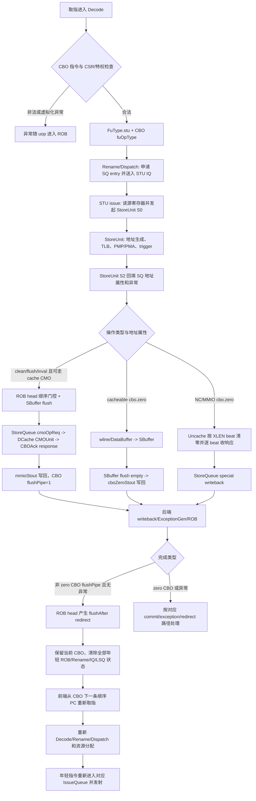
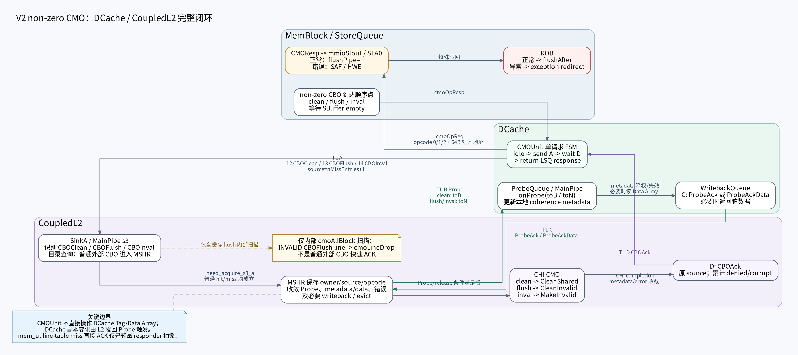

# V2 CBO 指令在 MemBlock 与后端的执行 Flow

## 版本元数据

| 项目 | 内容 |
|---|---|
| RTL 版本 | V2 |
| 分支 | `mem_ut_uvm_v2` |
| 核验 commit | `325a3533d041b1485e77d7e0cd32499819cb3f26`；该 commit 锁定 `coupledL2=55d8e69c690690dbc786e9ca2f3839a95555df95`、`utility=2f0743f1f3ee1889049841926fa382cd0b32d8e2` |
| 权威源码 | `src/main/scala/xiangshan/backend/decode/DecodeUnit.scala`、`src/main/scala/xiangshan/backend/dispatch/NewDispatch.scala`、`src/main/scala/xiangshan/backend/issue/IssueQueue.scala`、`src/main/scala/xiangshan/backend/rob/Rob.scala`、`src/main/scala/xiangshan/backend/rob/RobBundles.scala`、`src/main/scala/xiangshan/backend/CtrlBlock.scala`、`src/main/scala/xiangshan/package.scala`、`src/main/scala/xiangshan/mem/pipeline/StoreUnit.scala`、`src/main/scala/xiangshan/mem/lsqueue/StoreQueue.scala`、`src/main/scala/xiangshan/mem/lsqueue/LSQWrapper.scala`、`src/main/scala/xiangshan/mem/MemBlock.scala`、`src/main/scala/xiangshan/cache/dcache/DCacheWrapper.scala`、`src/main/scala/xiangshan/cache/dcache/mainpipe/MissQueue.scala`、`src/main/scala/xiangshan/cache/dcache/mainpipe/Probe.scala`、`src/main/scala/xiangshan/cache/dcache/mainpipe/MainPipe.scala`、`src/main/scala/xiangshan/cache/dcache/mainpipe/WritebackQueue.scala`、`utility/rocket-chip/src/main/scala/tilelink/Edges.scala`、`utility/rocket-chip/src/main/scala/tilelink/Bundles.scala`、`coupledL2/src/main/scala/coupledL2/SinkA.scala`、`coupledL2/src/main/scala/coupledL2/tl2chi/MainPipe.scala`、`coupledL2/src/main/scala/coupledL2/tl2chi/MSHR.scala`、`coupledL2/src/main/scala/coupledL2/CoupledL2.scala`；测试约束核对 `mem_ut/ver/ut/memblock/seq/base_seq_help` |
| 最后核验日期 | `2026-11-10` |

## 术语与抽象功能说明

本文中的 CBO 指架构指令 `cbo.zero/clean/flush/inval`，CMO 指 MemBlock 到 DCache 的 cache-management 请求接口及其下游 cache 协议操作。硬件代码一般用 CBO 命名指令和操作类型，用 CMO 命名 `cmoOpReq/cmoOpResp` 请求响应。本文覆盖从 Decode、后端 dispatch/issue、StoreUnit、StoreQueue 到写回/ROB 的主路径，并分别界定 mem_ut 模拟后端测试框架的接口行为约束和无内部 cache 的 RM 黑盒可观察约束。

| 术语 | 含义 |
|---|---|
| `FuType.stu` | Store execution unit 类型；CBO 与普通 scalar store 使用相同的 STU 执行路由。 |
| `fuOpType` | 区分 `cbo_zero/clean/flush/inval` 的动态操作码。 |
| `wline` | Store data/SBuffer 路径上的整 cache line 标记；CBO.zero 的主存路径借此等待 SBuffer 清空后单独完成。 |
| `deqCanDoCbo` | StoreQueue 队头 CBO 可启动专用 CMO 流程的资格条件，不是静态能力开关。 |
| `flushPipe` | 写回给 ROB 的顺序控制属性。CBO 在 StoreQueue 特殊写回阶段动态置位，不是在 Decode 时将所有 CBO 静态标为 flushPipe。 |
| `flushAfter` | ROB redirect level；保留触发 redirect 的当前指令，只清除其后的年轻指令，并从当前指令的下一条顺序 PC 恢复取指。 |
| `replayInst` | 从当前指令自身 PC 恢复取指的 redirect 语义。它会重新执行当前指令，与非 zero CBO 的 `flushPipe/flushAfter` 不同。 |
| `lsqCanAccept` | `NewDispatch` 对全部 Rename/Dispatch 指令施加的公共 LSQ credit 门控；它同时检查 LQ/SQ 的保守余量，不等价于“当前指令是否实际申请 LQ/SQ”。 |
| CBO responder | mem_ut 中响应 DUT DCache TileLink CBO 请求的模拟下游模型；它与主序列生成一条 CBO 架构指令是不同能力。 |
| DCache `CMOUnit` | DCache MissQueue 内的 non-zero CMO 协议发起器；一次锁存一笔 `CMOReq`，发送 TileLink A CBO 请求并等待 D `CBOAck`。它不直接读写 DCache Tag/Data Array。 |
| TileLink A/B/C/D | A 为 DCache 向 L2 发起 CBO；B 为 L2 向 DCache 发 Probe；C 为 DCache 返回 `ProbeAck/ProbeAckData`；D 为 L2 返回 `CBOAck`。 |
| `toB` / `toN` | B-channel Probe 的权限上限。`toB` 要求 DCache 最多保留共享副本；`toN` 要求 DCache 放弃该行副本。 |
| MSHR | CoupledL2 中保存一笔未完成事务及其 Probe、CHI、metadata、错误和回复状态的 Miss Status Handling Register。 |
| CHI CMO | CoupledL2 向更低层发出的 `CleanShared`、`CleanInvalid` 或 `MakeInvalid` 请求，以及必要的 writeback/evict 前置动作。 |
| `CBOAck` | TileLink D-channel 的 non-zero CBO 完成回复；不携带原始地址或 clean/flush/inval 类型，依靠 source 和两端保存的请求状态关联。 |
| `cmoAllBlock` | CoupledL2 全缓存 flush 扫描的内部阻塞/扫描状态。其 INVALID line drop 是内部逐行完成边界，不等同于普通外部 CBO miss 直接返回 `CBOAck`。 |
| 模拟后端测试框架 | 负责模拟后端向 MemBlock 提供 LSQ admission、IssueQueue 发射、ROB pending/commit sideband 和 redirect 恢复，并维护 transaction/owner/epoch 生命周期；不负责复制 MemBlock 内部算法。 |
| RM | mem_ut 黑盒参考模型；只根据输入指令和 MemBlock 可观察接口检查权限/异常、最终完成、redirect 及架构数据效果，不维护内部 cache、SBuffer、DataBuffer 或 RAW CAM 状态。 |

## Flow 范围

入口为 Decode 识别 CBO 指令；出口为 StoreQueue 将完成结果送入后端写回并等待 ROB 顺序完成，或产生异常/redirect。覆盖 CBO 指令的后端路径以及相关 mem_ut 主激励约束。本文新增展开 non-zero CMO 从 StoreQueue 进入 DCache CMOUnit、经过 CoupledL2 Probe/CHI/metadata 收敛并返回 `CBOAck` 的主链；不穷举 CoupledL2 的全部 nested snoop/retry 组合。更完整的 TileLink 字段和 responder 建模边界见 [L2 内侧 TileLink 请求、权限与回复 flow](l2_inner_tilelink_request_response_flow.md)，SQ 状态机细节见 [V2 StoreQueue 特性与端到端 Flow](storequeue_feature_flow.md)。

## 主流程图



## 主流程文字伪代码

```text
1. Decode 根据指令匹配 CBO_ZERO/CLEAN/FLUSH/INVAL，产生 FuType.stu 和对应 LSUOpType；先应用 HasCMO、CSR 权限和虚拟化检查。
2. 合法 uop 经 Rename/Dispatch 按 scalar STU 路由；Store 类 LSQ 资源申请为 SQ entry，uop 进入 store issue queue。
3. Store issue 后由 StoreUnit 计算 rs1+imm 地址。CBO 地址不按普通 store 的自然对齐规则报 misalign；请求仍经过 DTLB 与 PMP/PMA。
4. StoreUnit S2 把地址、存储属性、trigger/异常等回填 SQ。异常项不进入正常 CMO request。
5. clean/flush/inval 等非 zero CBO 必须到 SQ 队头并满足 deqCanDoCbo；先等 SBuffer empty，再发 cmoOpReq，接收 cmoOpResp。
6. cacheable cbo.zero 通过 wline 标记整行 zero 数据，交给 SBuffer；等 SBuffer empty 后由 cboZeroStout 产生单独写回。
7. NC/MMIO cbo.zero 不走 cacheable wline 完成链，而通过 Uncache 对整 cache line 按 XLEN beat 写零，最后复用特殊 writeback。
8. StoreQueue 特殊写回汇入 MemBlock STU writeback 端口；非 zero CBO 的该 uop.flushPipe 在有效 CBO 队头写回时置位。注意 CBO 在发出 cmoOpReq 前已经受 ROB head/pending 顺序门控，不是完成写回后才首次到达 ROB 队头。
9. ExceptionGen/ROB 收到无异常的 flushPipe 后，将该 CBO 识别为需要清流水但允许当前指令完成的事件，产生 RedirectLevel.flushAfter，而不是 replayInst 使用的 RedirectLevel.flush。
10. flushAfter 以当前 CBO 的 robIdx 为边界，保留当前 CBO，清除其后的年轻 ROB entry、Rename 投机映射、IssueQueue entry、LSQ entry 及其他受 redirect 管理的年轻状态；CBO 自身不重新向 StoreUnit/DCache 发起 CMO。
11. CtrlBlock 的通用恢复逻辑按 `isRVC` 选择当前 PC 加 2 或 4；CBO 是 32 位指令，因此本流程的实际恢复 PC 为 CBO PC 加 4，frontend 从 CBO 下一条顺序指令重新取指。
12. 被清除的年轻指令不是由 MemBlock 保存旧 uop 并内部重发，而是重新经过 Fetch、Decode、Rename、Dispatch，重新分配 ROB、物理寄存器和 LSQ 资源，再重新进入对应 IssueQueue 并发射。
13. 无异常时 CBO 本身可按 ROB 顺序退休；异常结果走 exception redirect。SQ entry 的 completed、物理 sqDeq 和架构 ROB commit 是不同事件，不可互相替代。
```

## 关键阶段

### 1. Decode 与指令资格

源码位置：`src/main/scala/xiangshan/backend/decode/DecodeUnit.scala:474-481,882-929,1175`

`CBODecode` 将四种指令全部译码到 `FuType.stu`，分别赋予 `LSUOpType.cbo_*`，源操作数为寄存器地址和 S-format immediate。Decode 随后将 `HasCMO`、CSR 返回的 illegal 条件与指令类别组合成 illegal instruction exception；虚拟化拦截另置 virtual instruction exception。若 `cboI2F` 特殊条件成立，`cbo.inval` 的内部 fuOpType 改为 `cbo.flush`，因此测试和下游逻辑应基于最终 uop fuOpType，而非只凭原始 instruction bits 推断实际操作。

### 2. 后端 dispatch 与 issue

源码位置：`src/main/scala/xiangshan/backend/dispatch/NewDispatch.scala:895`、`src/main/scala/xiangshan/backend/issue/Scheduler.scala:38-53`、`src/main/scala/xiangshan/backend/Backend.scala:408-438`、`src/main/scala/xiangshan/mem/pipeline/StoreUnit.scala:110-180`

CBO 不是独立于访存后端的 CMO execution unit：它以 STU uop 路由，受 STU/Store IQ 调度，并与 store 资源竞争。Dispatch 对 store head 检查 SQ 容量；后端将 MemScheduler 的 issue 输出连至 MemBlock。StoreUnit 通过 `s0_use_flow_rs` 接收普通 store issue 请求；`s0_isCbo` 由 fuOpType 派生。CBO 不在普通 Decode 表中静态设置 `noSpec/blockBack/flushPipe`，不可因为最终 flushPipe 效果而把它描述成 Decode-stage serialization。

### 3. StoreUnit 地址翻译、权限与回填

源码位置：`src/main/scala/xiangshan/mem/pipeline/StoreUnit.scala:122-220,301-352,430-499,542-545`

S0 以 `src(0)+imm` 形成地址。CBO 被视为整行操作，因此普通自然对齐检查由 `s0_isCbo` 放行，mask 为全 1；clean/flush/inval 使用读权限检查，但权限失败按 store access fault 表达。S1 经 DTLB 后仍经过 trigger 和 StoreUnit 各级 kill/replay 控制；S2 回填 SQ 属性。若地址最终判为 MMIO，CBO 会进入异常/特殊请求分类，而不是假设所有映射地址都能发 DCache CMO。request 前异常不得误作有效 CMO 完成。

#### 四种 CBO 的整行 store-load 冲突检测

源码位置：`src/main/scala/xiangshan/mem/pipeline/StoreUnit.scala:122,328-337`、`src/main/scala/xiangshan/mem/MemBlock.scala:961-963,1102-1103`、`src/main/scala/xiangshan/mem/pipeline/LoadUnit.scala:988-1020,1287-1310,1325-1338`、`src/main/scala/xiangshan/mem/lsqueue/LoadQueue.scala:214-242`、`src/main/scala/xiangshan/mem/lsqueue/LoadQueueRAW.scala:289-362`

`cbo.zero`、`cbo.clean`、`cbo.flush` 和 `cbo.inval` 都参与 store-load RAW 冲突检查。StoreUnit 使用 `LSUOpType.isCboAll` 为四种 CBO 设置 `wlineflag`；地址进入 S1 后，`stld_nuke_query.matchType` 对所有 `s1_isCbo` 统一选择 `CacheLine`，而不是普通 store 的 8-byte 或 16-byte 比较范围。由于 CBO mask 为整行全 1，同一 cache line 的任何有效 load byte 都满足 mask overlap。

第一条路径是流水线内快速 nuke。MemBlock 将所有 StoreUnit/HybridUnit 的 `stld_nuke_query` 广播到各 LoadUnit；LoadUnit S1/S2 同时检查 CBO 比 load 更老、物理 cache-line 地址相同以及 mask overlap。命中时设置 `rep_info.nuke`，在条件允许时形成 fast replay，避免仍在 load pipeline 中的年轻 load 使用 CBO 地址解析前的结果继续执行。

第二条路径是 LoadQueueRAW 的后置 violation rollback。LoadQueue 将 StoreUnit 的 `storeAddrIn` 送入 `LoadQueueRAW.storeIn`；`wlineflag` 连接到 `violationCheckLine`，使地址 CAM 按整条 cache line 检查已经进入 RAW LQ、数据已经有效且比 CBO 年轻的 load。命中后选择最老的冲突 load，产生 `RedirectLevel.flush` rollback，从该 load 自身开始清除并重新执行。这条路径覆盖已经越过快速 nuke 窗口的年轻 load。

两条路径都属于依赖恢复机制，不代表 CBO 已获得权限、已经发出 CMO request 或已经产生 cache 副作用。`stld_nuke_query` 在 StoreUnit S1 产生，可能早于最终 PMP/PMA exception 和 CBO completion，因此后续发现 CBO fault 时，年轻 load 被保守 replay 仍是允许的微架构行为。对 non-zero CBO，完成后的 `flushPipe -> flushAfter` 还会统一清除剩余年轻动态实例；该全局恢复不能替代前述整行 nuke/RAW 检查。对不产生 `flushAfter` 的 `cbo.zero`，整行冲突检查、SQ/SBuffer 零数据可见性和 ROB/SQ 顺序门控共同构成主要正确性保证。

StoreQueue/SBuffer forwarding 可以在 load 重执行或查询时提供已经可见的 store 数据；对 `cbo.zero` 该数据为零。但 forwarding 不是整行冲突发现的 owner，不能把“load 最终读到零”仅归因于普通 store forwarding。冲突发现和恢复的主路径是 StoreUnit `stld_nuke_query`、LoadUnit nuke/fast replay，以及 LoadQueueRAW 的整行 rollback。

### 4. StoreQueue 的非 zero CBO/CMO 生命周期

源码位置：`src/main/scala/xiangshan/mem/lsqueue/StoreQueue.scala:830-910,992-1086`、`src/main/scala/xiangshan/mem/lsqueue/LSQWrapper.scala:130-131,207-208`、`src/main/scala/xiangshan/mem/MemBlock.scala:1222-1223,1374-1395`

StoreQueue 在 ROB pending/head、地址/数据有效、无异常等条件形成后进入共享 `mmioState` 生命周期。`deqCanDoCbo` 只对非 zero CBO 资格成立，并要求 allocated、addrvalid、无异常以及 `memBackTypeMM`。SQ 暂停共享 Uncache request 选择，先通过 `flushSbuffer` 等待 SBuffer 清空；之后 `cmoOpReq.valid` 才可能成立。请求 opcode 来自 CBO fuOpType，地址为 block-aligned 物理地址。`cmoOpResp.fire` 结束外部操作并进入 `s_wb`，`mmioStout.fire` 将该 entry 标为 completed；无异常时随后等待 ROB commit sideband 收敛。

MemBlock 将 SQ/LSQ 的 `cmoOpReq/cmoOpResp` 直接连接 DCache。DCache CMOUnit 与 L2 协议行为位于该接口之后。当前 HEAD 在 `cmoOpResp.fire` 分支把 denied 映射为当前 uop 的 `storeAccessFault`，把独立 corrupt 映射为 `hardwareError`；旧基线的 missing-propagation 与 stale sideband 行为已由 `7aa145db8f` 修复。测试模型仍必须检查错误是否绑定到当前 CBO owner，不能只确认 ACK 错误位曾经出现。

### 5. non-zero CMO 作用到 DCache 与 CoupledL2 的完整流程

本节只覆盖最终 `fuOpType` 为 `cbo.clean/cbo.flush/cbo.inval` 的 non-zero CMO。关键边界是：**DCache `CMOUnit` 只是 TileLink CBO 协议发起器，不直接操作本地 Tag/Data Array；DCache 副本的降权、失效和脏数据返回由 CoupledL2 发回的 B-channel Probe 触发。**`cbo.zero` 不进入本节链路。



#### 5.1 整体抽象功能

**抽象功能描述：**StoreQueue 在 ROB/SQ 顺序点排空 SBuffer 后，把 non-zero CMO 转成一笔 block-aligned `CMOReq`。DCache `CMOUnit` 串行地把它编码为 TileLink A CBO 请求。CoupledL2 查询目录、分配 MSHR，必要时 Probe DCache，并等待 C response、metadata/data 更新以及 CHI CMO 完成，最后用 D `CBOAck` 回复。DCache 再把错误状态转换为 `CMOResp` 返回 StoreQueue，StoreQueue 经 STA0 特殊写回把完成送往 ROB。

整体文字伪代码如下：

```text
non-zero CBO 到达 StoreQueue 顺序处理点
  -> 等待 SBuffer empty
  -> StoreQueue 发 cmoOpReq(opcode=0/1/2, address=64B block address)
  -> DCache CMOUnit 锁存唯一请求
  -> TileLink A.fire(CBOClean/CBOFlush/CBOInval, source=nMissEntries+1)
  -> CoupledL2 MainPipe 查目录并令 cmo_cbo_s3 成立
  -> 普通外部 CBO 无论目录 hit/miss 都令 need_acquire_s3_a 成立并进入 MSHR
  -> 若 L2 目录记录 DCache 持有副本：
       clean 发送 B Probe(toB)
       flush/inval 发送 B Probe(toN)
  -> DCache ProbeQueue/MainPipe 根据 Probe 更新本地 coherence metadata
  -> 必要时读取脏数据，经 C ProbeAckData 返回；否则返回 ProbeAck
  -> CoupledL2 MSHR 收敛 C response、L2 metadata/data、必要 writeback/evict 和 CHI CMO
  -> clean/flush/inval 分别完成 CleanShared/CleanInvalid/MakeInvalid 条件
  -> MSHR 生成 D CBOAck，source 回到原 CBO source，denied/corrupt 携带累计错误
  -> DCache CMOUnit 生成 cmoOpResp
  -> StoreQueue denied -> storeAccessFault；仅 corrupt -> hardwareError
  -> mmioStout 经 STA0 写回，动态 flushPipe=1
  -> 正常完成：ROB 产生 flushAfter；异常完成：exception redirect 优先
```

#### 5.2 StoreQueue 到 DCache CMOUnit

**抽象功能描述：**StoreQueue 负责把已完成地址与权限检查、已到顺序处理点的 non-zero CBO 转成单笔 DCache CMO 请求；MemBlock 只做接口直连，不在中间改写类型、地址或错误。

按源码顺序的文字伪代码：

```text
1. mmioState 在 pendingst、pendingPtr、entry pending/allocated、data/addr valid 且无异常时从 s_idle 进入 s_req。
2. uncacheUop 锁存当前 CBO；cboMmioPAddr 锁存 64B 对齐物理块地址。
3. deqCanDoCbo 仅匹配 LSUOpType.isCbo，即 clean/flush/inval，不匹配 cbo.zero。
4. StoreQueue 请求 flushSbuffer；只有 empty 后才设置 cboFlushedSb。
5. cmoOpReq.valid = deqCanDoCbo && cboFlushedSb && mmioState==s_req && !wfiReq。
6. cmoOpReq.opcode 直接取最终 fuOpType[1:0]；address 使用 cboMmioPAddr。
7. MemBlock 将 lsq.cmoOpReq/Resp 与 dcache.cmoOpReq/Resp 直接连接。
```

这一步不会触碰 DCache Tag/Data Array，也不会因为 `cmoOpReq.fire` 就宣告指令完成。它只把一笔 cache-management 事务交给 DCache 的协议端点。

#### 5.3 DCache CMOUnit 单请求 FSM

**抽象功能描述：**`CMOUnit` 保存一笔 CMO 请求，在 A channel 发送后等待唯一 D `CBOAck`，再把结果返回 LSQ。它通过单请求 FSM 保证固定 source 不会同时关联多笔 CBO。

按源码顺序的文字伪代码：

```text
s_idle:
  io.req.ready=1；req.fire 时锁存 {opcode,address}，清 nderr/denied/corrupt，进入 s_sreq。
s_sreq:
  构造 TileLink A CBO；A.fire 后进入 s_wresp，并标记存在 pending CMO。
s_wresp:
  只接收 opcode=CBOAck 的 D response；D.fire 时锁存 denied/corrupt，nderr=denied||corrupt，进入 s_lsq_resp。
s_lsq_resp:
  输出 CMOResp{原请求 address,nderr,denied,corrupt}；resp.fire 后回 s_idle。
```

`io.req.ready` 仅在 `s_idle` 为真；`CMOUnit` 使用固定 `source=nMissEntries+1`。因此 DCache 侧最多一笔 non-zero CMO outstanding。D `CBOAck` 本身不携带地址和原始 CBO 类型，DCache 依靠 FSM 内锁存的请求恢复这些信息；L2 仍必须保持 D source 与原 A source 一致。

#### 5.4 TileLink A opcode 编码

**抽象功能描述：**`CacheBlockOperation()` 把 StoreQueue 的三种内部 opcode 转为 V2 自定义的 4-bit TileLink A opcode。L2 按 A opcode 分类，不依赖 reserved 的 `param/mask/data`。

| 最终 CBO | `fuOpType[1:0]` / `CMOReq.opcode` | TileLink A opcode | 数值 |
|---|---:|---|---:|
| `cbo.clean` | 0 | `CBOClean` | 12 |
| `cbo.flush` | 1 | `CBOFlush` | 13 |
| `cbo.inval` | 2 | `CBOInval` | 14 |

按源码顺序的文字伪代码：

```text
1. CMOUnit 调用 edge.CacheBlockOperation(source, address, log2(blockBytes), req.opcode)。
2. req.opcode 0/1/2 分别映射为 CBOClean/CBOFlush/CBOInval。
3. A.size 为 cache block 大小；A.address 为 StoreQueue 提供的 block-aligned 地址。
4. A.source 固定为 nMissEntries+1；A.param/mask/data 不承载 CBO 类型或 owner。
5. CoupledL2 SinkA 保存 opcode/source/address，MainPipe 在 s3 按 opcode 识别具体 CBO。
```

#### 5.5 CoupledL2 MainPipe 与 MSHR

**抽象功能描述：**MainPipe 负责目录查询和判断是否需要 upper Probe、L2 release/metadata 动作及 MSHR；MSHR 保存完整 CBO 生命周期，协调 Probe、CHI、metadata/data 和最终 `CBOAck`。普通外部 CBO 不存在“目录 miss 直接由 MainPipe 回 ACK”的真实 RTL 快捷路径。

按源码顺序的文字伪代码：

```text
1. MainPipe s3 识别 req_cbo_clean/flush/inval，并合成为 cmo_cbo_s3。
2. need_acquire_s3_a 的表达式显式 OR cmo_cbo_s3：
     无论目录 hit 还是 miss，普通外部 non-zero CBO 都需要 acquire/CHI 收敛。
3. need_probe_s3_a 只在目录 hit 且 meta.clients 非空时成立：
     clean 仅在 L2 state=TRUNK 时 Probe；flush/inval 对有效 upper client Probe。
4. need_release_s3_a 根据 L2 hit、dirty/state 和 CBO 类型决定是否先处理本地 dirty/release。
5. need_mshr_s3_a = need_acquire_s3_a || need_probe_s3_a || cache_alias；因此 CBO 进入 MSHR。
6. MSHR 必要时先发 B Probe，等待 C ProbeAck/ProbeAckData；错误累计到 denied/corrupt。
7. MSHR 根据 CBO 类型执行 L2 metadata/data 更新、必要 writeback/evict，并发出 CHI CMO：
     clean -> CleanShared；flush -> CleanInvalid；inval -> MakeInvalid。
8. CHI completion、Probe、release/copyback、metadata write 等状态全部满足后，mp_grant 才有效。
9. odOpGen(req.opcode) 把三种 CBO 都转换成 D CBOAck，并保留原 sourceId。
10. MSHR 在 CBOAck task 被 MainPipe 接收后置 s_cmoresp，全部 schedule/wait 状态收敛后释放 entry。
```

MainPipe 的 `need_probe_s3_a` 与 `need_acquire_s3_a` 是两个不同条件：没有 upper client 时可以不发 B Probe，但 CBO 仍进入 MSHR，并等待相应 CHI/metadata 条件完成后才返回 `CBOAck`。因此“无需 Probe”不等于“真实 CoupledL2 可以立即 ACK”。

#### 5.6 L2 Probe 如何实际改变 DCache 副本

**抽象功能描述：**CoupledL2 通过 B-channel Probe 请求 DCache 降权或失效。DCache `ProbeQueue` 把 B 请求送入 MainPipe；MainPipe 使用当前 coherence metadata 的 `onProbe()` 计算新权限和 C response 类型，必要时读取整行数据并交给 WritebackQueue 返回。这才是 non-zero CMO 改变 DCache 本地副本的实际路径。

按源码顺序的文字伪代码：

```text
1. CoupledL2 MSHR 构造 B Probe：clean 对 TRUNK upper copy 使用 toB；flush/inval 使用 toN。
2. DCache ProbeQueue 锁存 B 的 address、param、alias 和 needData，生成 probe MainPipe request。
3. DCache MainPipe 查 Tag/coherence state，并调用 s3_coh.onProbe(probe_param)。
4. 若 Probe 命中且 coherence state 需要变化，则写本地 metadata：
     toB 将可写/独占副本降为共享上限；toN 将副本转为 Nothing/无效。
5. 若当前行 dirty 或 Probe 明确需要数据，则读取 Data Array 并形成带数据 writeback。
6. WritebackQueue 根据 hasData 选择 C ProbeAckData 或 ProbeAck，并携带 onProbe() 生成的 report param。
7. CoupledL2 SinkC/MSHR 消费 C response，更新 clients/state/dirty 和错误累计，再推进后续 CHI/metadata 状态。
```

所以不能把流程描述成“CMOUnit 收到 `cmoOpReq` 后直接清 DCache valid/dirty/tag”。CMOUnit 没有本地 array 访问端口；本地 metadata/data 的变化由后续 B/C coherence 闭环产生。

#### 5.7 clean、flush、inval 的差异

| 项目 | `cbo.clean` | `cbo.flush` | `cbo.inval` |
|---|---|---|---|
| Upper DCache Probe | L2 hit、存在 client 且 state 为 TRUNK 时发 `toB` | 存在有效 upper client 时发 `toN` | 存在有效 upper client 时发 `toN` |
| DCache 副本结果 | 降到共享上限，可保留副本 | 失效 | 失效 |
| Probe data 使用 | `readProbeDataDown=true`，需要保留下传的最新/脏数据 | 仅需要 `WriteBackFull` 时读取并下传 Probe data | `readProbeDataDown=false`，不能当成 clean 写回 |
| L2 metadata | 保留 line，清 dirty；TRUNK 对应保留状态可补偿为 TIP | metadata 转 INVALID | metadata 转 INVALID |
| 必要 release/evict 动作 | `WriteCleanFull` | dirty TRUNK 可 `WriteBackFull`，否则 `Evict` | `Evict` |
| CHI CMO | `CleanShared` | `CleanInvalid` | `MakeInvalid` |
| 最终 TileLink 回复 | D `CBOAck` | D `CBOAck` | D `CBOAck` |

三者最终回复 opcode 相同，D `CBOAck` 不重新编码原 CBO 类型；类型只保存在 DCache CMOUnit 和 L2 MSHR 的请求状态中。

#### 5.8 目录 miss、INVALID 与 no-op/ACK 边界

**抽象功能描述：**区分普通外部 CBO、CoupledL2 内部全缓存 flush 扫描和 mem_ut 轻量 responder 抽象，避免把验证模型的快速完成方式写成真实 RTL 行为。

1. **普通外部 CBO：**`cmo_cbo_s3` 显式并入 `need_acquire_s3_a`。即使目录 miss、L2 line 为 INVALID 或没有 upper DCache client，普通 clean/flush/inval 仍进入 MSHR，可能省略 B Probe，但仍要完成对应 CHI CMO、metadata/error 状态收敛后才返回 D `CBOAck`。
2. **特殊 INVALID/drop：**只有启用 L2 全缓存 flush 扫描且 `cmoAllBlock=1` 时，内部生成的 `CBOFlush` 遇到 `meta.state==INVALID` 才形成 `cmoHitInvalid/cmoLineDrop`，将该扫描 line 直接标记为完成。它是内部 flush-all 的逐行推进边界，不是普通架构 CBO 的 D-channel 快速 ACK 路径。
3. **轻量 responder 抽象：**mem_ut responder 可以在其软件 line 表 miss 时直接形成 owner 匹配的 `CBOAck`，用于抽象“没有 upper Probe/data 动作”的可观察结果；但该抽象不能被描述为 CoupledL2 MainPipe 的真实时序，也不能据此要求 RTL 在目录 miss 时跳过 MSHR/CHI。

#### 5.9 CBOAck、异常和后端恢复

**抽象功能描述：**`CBOAck` 把整个 L2/CHI 生命周期的最终错误返回 DCache；StoreQueue 将错误绑定到当前 CBO，并通过特殊写回进入后端。正常 non-zero completion 触发 `flushAfter`，错误 completion 走 exception redirect。

按源码顺序的文字伪代码：

```text
1. MSHR 把 Probe C response、L2 data/directory error 和 CHI response error累计为 denied/corrupt。
2. mp_grant.opcode=odOpGen(original CBO opcode)=CBOAck；sourceId 保持原请求 source。
3. DCache D router 只把 CBOAck 送给 CMOUnit；CMOUnit 锁存 denied/corrupt 并返回 CMOResp。
4. StoreQueue 在 cmoOpResp.fire：
     denied=1 -> 当前 uncacheUop.storeAccessFault=1；
     corrupt=1 && denied=0 -> 当前 uncacheUop.hardwareError=1。
5. mmioState 进入 s_wb，mmioStout 通过 STA0 写回；deqCanDoCbo 使 uop.flushPipe=1。
6. 若 exceptionVec 为空，ROB 将 flushPipe 解释为 flushAfter：当前 CBO 保留并提交，年轻指令重取。
7. 若 exceptionVec 非空，exception 优先于正常 flushPipe 语义，当前 CBO 走异常终点和 exception redirect。
```

`denied/corrupt` 是 transaction completion 的 owner-bound 错误，不应由无 owner 的 BEU sideband替代。`CBOAck` 单拍、无 data，也不要求 E `GrantAck`。

#### 5.10 `cbo.zero` 不走本流程

`cbo.zero` 的 `fuOpType` 不满足 `LSUOpType.isCbo`，不会形成 `cmoOpReq`、A `CBOClean/CBOFlush/CBOInval` 或 D `CBOAck`。cacheable zero 走整行零数据的 DataBuffer/SBuffer 路径；NC/MMIO zero 拆成多个 Uncache store beat。测试框架和 RM 都不得为 zero 伪造 non-zero CMO 协议生命周期。

### 6. CBO.zero 完成分流

源码位置：`src/main/scala/xiangshan/mem/pipeline/StoreUnit.scala:122,159-219,328-337`、`src/main/scala/xiangshan/mem/lsqueue/StoreQueue.scala:600-614,849-915,996-1014,1089-1107,1148-1173,1231-1236`、`src/main/scala/xiangshan/mem/MemBlock.scala:961-963,1782-1792,1859`

`cbo.zero` 的数据语义是将包含目标地址的整个 cache block/cache line 写成 0，不是只修改 cache metadata。StoreUnit 对全部 CBO 生成整行 mask 和 `wlineflag`，StoreQueue 在 `fuOpType === cbo_zero` 时把写数据强制为 0，因此 cacheable 主存路径通过 DataBuffer/SBuffer 传递的是整行零数据。

`cbo.zero` 不要求从 STU issue 开始就停在 ROB 队头。其地址计算、DTLB 翻译、PMP/PMA 检查、SQ 地址/零数据回填以及 store-load 冲突检测都可按普通 STU 流水线提前乱序执行，期间其他 LSU 请求也可以继续发射、翻译、分配 LQ/SQ 或投机执行。它不是 AtomicsUnit 那种接管 MemBlock、全局阻塞 load/store pipeline 的独占状态。

但真正产生整行写零副作用时必须跨过不可取消的顺序边界。cacheable 路径只有 SQ entry 已被 ROB 顺序推进为 `committed` 后，才允许从 StoreQueue 进入 DataBuffer/SBuffer；SBuffer 接收 wline 项本身仍不等于 CBO 指令完成，SQ 会保存对应 uop/SqIdx，触发 SBuffer drain，并等待 `empty` 后由 `cboZeroStout.fire` 写回和置 `completed`。NC/MMIO 路径更严格：共享 `mmioState` 仅在 `pendingst` 且当前 SQ entry 的 robIdx 等于 ROB `pendingPtr` 时启动，然后把整行拆成多个 XLEN 零数据 beat，经 Uncache response 逐 beat 推进，最后写回。

因此，“zero CBO 可以乱序”只适用于地址、权限和依赖检查等前半段，不能解释为整行零数据可在 ROB 顺序提交前投机进入 cache。执行期间 LSU 也不是完全静默：不同地址的年轻访存可以继续投机，但会竞争 STU、SQ、DataBuffer、SBuffer、DCache/Uncache 等资源；同一 cache line 的年轻 load 必须被冲突检测和 replay/rollback 约束；CBO.zero 进入 SBuffer 后还会触发 drain，影响后续 store 的可接收能力。`cbo.zero` 自身不走 non-zero CBO 的动态 `flushPipe -> flushAfter`，不能依赖一次全后端 flush 来替代这些局部依赖和顺序保证。

不能用一次普通 store STA/STD、一次 SBuffer fire，或单个零数据 beat 代表完整 `cbo.zero` 完成。

### 7. 后端写回、flushPipe 与退休

源码位置：`src/main/scala/xiangshan/mem/lsqueue/StoreQueue.scala:1060-1086`、`src/main/scala/xiangshan/mem/MemBlock.scala:1374-1395`、`src/main/scala/xiangshan/backend/rob/RobBundles.scala:151-152,309-331`、`src/main/scala/xiangshan/backend/rob/ExceptionGen.scala:85-100,130-136`、`src/main/scala/xiangshan/backend/rob/Rob.scala:578-587,622-649`、`src/main/scala/xiangshan/backend/CtrlBlock.scala:336-381`、`src/main/scala/xiangshan/package.scala:179-185`

非 zero CBO 的 `mmioStout.bits.uop.flushPipe` 由 `deqCanDoCbo` 动态赋值，注释说明目的是保持 CMO 顺序。该写回经过 MemBlock store writeback 合流进入后端 ExceptionGen/ROB。ROB 将 `flushPipe` 作为需要 flush 的控制条件，但它与实际 exception 不同：无异常的 CBO 仍可退休；发生 CBO exception 时以 exception 优先处理。`cboZeroStout` 的代码路径单独提供完成写回，不能把所有 zero 路径与非 zero CMO 的 flushPipe 逻辑合并描述。

#### 非 zero CBO 的 flushAfter 恢复流程

非 zero CBO 发出 CMO request 前，`deqCanDoCbo` 已经要求 StoreQueue 当前 entry 与 ROB pending/head 顺序点匹配。因此准确时序不是“CMO 完成后 CBO 才到 ROB 队头”，而是“CBO 已在顺序点启动 CMO，完成后把动态 `flushPipe` 写回给同一个 ROB entry”。ROB 在该 entry 可处理时区分 `deqHasFlushPipe` 和 `deqHasReplayInst`：纯 CBO `flushPipe` 选择 `RedirectLevel.flushAfter`，只有 `replayInst`、异常和中断等选择 `RedirectLevel.flush`。

`flushAfter` 的语义是清除当前 CBO 之后的年轻动态指令，不清除当前 CBO 自身。`RobPtr.needFlush()` 只命中 robIdx 晚于 redirect owner 的 entry，ROB enqueue pointer 也恢复到当前 CBO 后一个位置。CtrlBlock 根据 `flushItself()` 计算恢复 PC：通用 `flushAfter` 路径按 `isRVC` 取当前 PC 加 2 或 4，而 `replayInst` 才取当前指令 PC；由于 CBO 是 32 位指令，本流程实际从 `CBO PC + 4` 恢复。ROB redirect 随后送往 frontend/FTQ，并传播到 Rename、IssueQueue、LSQ 等后端结构完成年轻状态回收。

因此，年轻指令的“重新执行”是创建新的动态实例：从 CBO 下一条 PC 重新 Fetch、Decode、Rename、Dispatch，重新分配 ROB entry、物理寄存器、LQ/SQ entry，重新进入对应 IssueQueue 后再次发射。MemBlock 的 TLB miss retry、load replay、store retry、MissQueue/SBuffer replay 等局部重试机制不会承接这次 CBO flush；已经完成的 CBO 自身也不会在 MemBlock 内部再次发送 `cmoOpReq`。

```text
非 zero CBO 已到 ROB/SQ 顺序点并启动 CMO
  -> cmoOpResp 完成
  -> mmioStout 写回当前 CBO，动态 flushPipe=1
  -> ROB head 识别无异常 flushPipe
  -> 产生 RedirectLevel.flushAfter
  -> 当前 CBO 保留并可退休，全部年轻动态状态被清除
  -> frontend 从 CBO PC + 4 重新取指
  -> 年轻指令重新 Decode/Rename/Dispatch
  -> 重新分配 ROB/物理寄存器/LSQ entry
  -> 重新进入对应 IssueQueue 并重新发射
```

## 状态、队列和优先级

| 状态/事件 | 生产者 | 有效条件 | 消费者/效果 | 边界 |
|---|---|---|---|---|
| CBO uop | Decode | 指令匹配且未因 CSR/特权规则变成异常 | STU dispatch/issue | `HasCMO` 是编译配置能力，CSR legal/virtual 是运行时条件。 |
| SQ entry | Dispatch/LSQ | STU store 类资源分配成功 | StoreUnit STA/STD 与 StoreQueue | `allocated` 不代表地址、数据或 commit 许可都已到达。 |
| 整行 `stld_nuke_query` | StoreUnit | 四种 CBO 地址进入 S1、无 TLB miss | LoadUnit S1/S2 cache-line match，命中年轻 load 后设置 nuke/fast replay | 依赖检查可早于最终权限和 CBO 副作用，不是 CMO 已完成的证据。 |
| 整行 RAW rollback | LoadQueueRAW | CBO `storeAddrIn` 有效，已执行年轻 load 与其同一 cache line | 产生 `RedirectLevel.flush`，从冲突 load 自身开始重新执行 | `wlineflag` 使四种 CBO 均按整行比较；与 non-zero CBO 完成后的 `flushAfter` owner 和清除边界不同。 |
| `deqCanDoCbo` | StoreQueue | 非 zero CBO、entry 有效、地址有效、无异常、主存属性满足 | CMO flush/request FSM | 不是所有 CBO/CBO.zero 的通用 valid。 |
| `cmoOpReq.fire` | StoreQueue/DCache 握手 | SBuffer 已 flush、队头状态为 request、WFI 未阻止 | DCache CMOUnit | 请求握手才建立外部操作；等待 response 后才能 writeback。 |
| `cmoOpResp.fire` | DCache | SQ ready 且响应 valid | StoreQueue 转 `s_wb` | 错误位须在所属响应 fire 时归属当前 uop。 |
| `mmioStout.fire` | StoreQueue | 非 zero CMO response 已完成并处于 `s_wb` | MemBlock STU writeback、SQ completed | 含 CBO 动态 `flushPipe`。 |
| `cboZeroStout.fire` | StoreQueue | 主存 wline SBuffer 已清空，或 NC/MMIO zero beats 已走完 | MemBlock writeback、SQ completed | 与普通 SBuffer fire 不等价。 |
| `flushAfter` redirect | ROB/CtrlBlock | 非 zero CBO 无异常 `flushPipe` 到达 ROB 顺序处理点 | 保留当前 CBO、清除全部年轻状态，恢复 PC 为 CBO PC+4 | CtrlBlock 通用逻辑支持 PC+2/4，但 CBO 本身不是 RVC；不得解释为当前 CBO 自身 replay。 |
| 年轻指令恢复执行 | Frontend/Rename/Dispatch/Scheduler | `flushAfter` redirect 已被前后端接收 | 重新取指、重新分配 ROB/物理寄存器/LSQ、重新进入 IQ 并发射 | 不是 MemBlock 内部保存旧 uop 后局部重发。 |
| ROB commit/redirect | ROB | 完成、顺序与 exception 条件满足 | 架构退休或 flush/cancel | 架构退休、SQ completed 和 SQ 物理 deq 是不同层次事件。 |

## mem_ut 模拟后端行为测试框架约束

本章只从“模拟真实后端接口行为”的角度规定 CBO 约束。测试框架负责按后端顺序完成 LSQ admission、IssueQueue 发射、`pendingPtr/pendingst/scommit` 驱动、写回接收和 redirect 恢复；不要求测试框架预测 StoreQueue、SBuffer 或 LoadQueueRAW 的内部状态机。

### 当前实现能力与开放前置条件

1. 主序列当前不允许主动生成 scalar CBO。`seq_csr_common.sv` 配置校验要求 `MEMBLOCK_OP_CLASS_CBO_WT=0`，非零会触发 fatal；默认和专项 cfg 中的 `CBO_FUOP_{ZERO,CLEAN,FLUSH,INVAL}_WT` 仅保留子操作权重，不能单独开启 CBO 激励。
2. `memblock_dispatch_base_sequence::validate_main_table_entry()` 当前拒绝 CBO class、CBO LSQ flow 和 CBO fuOpType。测试框架不得通过手工绕过该校验把不完整 transaction 送入 issue driver。
3. `issue_field_assigner::check_target_futype_fuoptype()` 的 STU 分支当前只接受 ordinary store fuOpType。开放 CBO 时必须先补齐 CBO-aware 的 STA/STD issue payload 生成和 SQ 资源生命周期，不能只解除权重或主表门禁。
4. `dispatch_monitor_event_adapter` 当前在 STA0 观察到合法 CBO `flushPipe=1` 时仍触发 `INT_WB_STA0_CBO_UNSUPPORTED` fatal，说明 non-zero CBO completion 到 `flushAfter` 的消费链尚未实现。开放主动 CBO 前必须同时补齐该写回/redirect 适配，不能只补发射路径。
5. `memblock_op_behavior_util` 已能把 CBO 分类为申请 1 个 SQ entry、路由 STA/STD、`commit_is_store=1` 和 `is_cbo=1` 的 scalar STU 操作。以下条目是开放 CBO 时必须遵循的适配约束，不代表当前端到端 CBO testcase 已经可运行或验证通过。
6. 当前 `collect_lsq_candidates()` 只按本拍物理 load/store enqueue 上限和软件 LQ/SQ free count 截断候选，尚未实现真实 `NewDispatch` 的公共 registered-credit `lsqCanAccept` 门控。后续若声明模拟真实后端 Dispatch admission，必须新增独立的统一 gate；不能只给 AMO 或 CBO 增加特例，也不能把该 gate 偷换成 LSQ enqueue 端口宽度参数。

### LSQ admission 与 SQ 入队约束

1. CBO 必须经过普通 LSQ admission，并且只申请 1 个 SQ entry，不申请 LQ entry。主表中的 `need_alloc`、`numLsElem`、`sqIdx` 和 `lsq_flow` 必须与 scalar STU CBO 分类一致，不能把 CBO 当作不占 LSQ 的 control marker。
2. 如果测试框架模拟真实 `NewDispatch` admission，则所有 Rename/Dispatch 候选必须先经过同一个 modeled `lsqCanAccept`，不能只对 AMO、CBO 或实际申请 LSQ 的指令选择性检查。该公共门控使用整个 dispatch batch 的累计申请量，并要求 `LQ free >= batch load allocation + LSQLdEnqWidth`、`SQ free >= batch store allocation + LSQStEnqWidth`，同时处于非 redirect/cancel-counter 更新阻塞状态。
3. 当前 V2 的最大入队宽度为 LQ 6、SQ 4，因此单条指令的资源阈值近似如下。表中阈值描述 modeled Dispatch credit，不表示指令自身额外占用这些 entry。

   | 单条候选 | 本拍实际申请 | modeled `lsqCanAccept` 最小空闲量 |
   |---|---:|---:|
   | AMO | LQ 0、SQ 0 | LQ >= 6、SQ >= 4 |
   | 普通 load | LQ 1、SQ 0 | LQ >= 7、SQ >= 4 |
   | 普通 store | LQ 0、SQ 1 | LQ >= 6、SQ >= 5 |
   | CBO | LQ 0、SQ 1 | LQ >= 6、SQ >= 5 |

   混合 batch 必须按全部候选的 `load allocation/store allocation` 累计后再加 6/4 余量，不能逐条各自重复保留 6/4。真实 RTL 的 `canAccept` 是注册后的公共门控；测试框架若抽象为软件 gate，也必须保存明确的采样/epoch 边界，不能在同一批确认后用更新后的 free count反向否定已经 launch 的 batch。
4. modeled `lsqCanAccept` 只属于架构指令进入后端 Dispatch 的一次 admission 条件。CBO 已获得 SQ owner 后，StoreQueue 后续生成的内部 `cmoOpReq` 不再经过 Rename/Dispatch，不能对内部 CMO request 再做第二次 LQ>=6/SQ>=4 检查。
5. 除公共 credit gate 外，admission 还必须满足：当前 UID 位于连续 ROB admission window、没有全局 flush/redirect 阻塞、没有控制屏障阻塞、当前 batch 的实际 LQ/SQ 申请可由软件 free count和 DUT `enqLsq` 接口接收。资源不足时应 backpressure，不能先创建 STA/STD issue item 再等待 SQ 补分配。
6. LSQ request launch 后，框架必须按预览的 SQ key 提交 allocation，建立 UID 到 live SQ owner 的映射，并等待该 reservation 被 DUT sample 标记为 `DUT_VISIBLE`。如果期间发生 redirect 或 flush epoch 改变，本次 pending sample 必须作废，不得进入 issue 阶段。
7. 只有 SQ reservation 已对 DUT 可见后，才允许设置 `issue_ready` 并生成 STA/STD issue item。CBO 的 STA/STD payload 必须携带同一个 live SQ key、当前 `dynamic_epoch` 和 `replay_seq`；SQ owner 已释放或 epoch 失配的 item 必须丢弃。
8. SQ enqueue 成功只表示 CBO 获得了 StoreQueue entry，不表示地址/权限已完成、CBO 已写回或可以提交。测试框架不得在 admission 阶段设置 UID completion、ROB commit、`scommit` 或终态。

### STA/STD 发射与 LSU 并发约束

1. CBO 按 scalar store 生成 STA 和 STD 两个 issue target，并进入现有 STA/STD IssueQueue。STA/STD issue feedback 只表示前半段已经被执行端接收，不能作为 CBO 最终 completion。
2. CBO 的 STA/STD 发射不要求 CBO 已到 ROB 队头。候选选择仍按现有 target queue、`send_pri`、ROB 年龄、pipe 数量、ready/valid、replay、exception 和 live SQ owner 条件执行；不得新增“所有 CBO 从入队起独占 LSU”或“必须到 ROB head 才能 issue”的全局串行化规则。
3. Load、STA、STD 使用独立候选队列和各自 pipe 配额。CBO 与普通 load/store 可以乱序并发发射，只在共享 STU/SQ/端口、全局 flush、局部 replay 或 DUT backpressure 上发生正常竞争。测试框架不能因为存在一条 CBO 就停止所有年轻 LSU 请求。
4. non-zero CBO 的真正 cache-management 副作用由 DUT 在 ROB pending/head 顺序边界以后启动；测试框架只需正确驱动 `pendingPtr/pendingst`，不得在 issue scheduler 中提前模拟 `deqCanDoCbo` 或用软件屏障阻止所有年轻发射。
5. 四种 CBO 均可能使年轻同行 load 收到 fast replay 或 RAW rollback。框架必须按 DUT 提供的 replay/redirect owner 取消旧动态实例并重新走既有 replay/redirect 流程，但不需要自行复制 cache-line CAM、mask overlap 或 oldest violation 选择算法。

### `pendingPtr`、`pendingst` 与 `scommit` 约束

1. `pendingPtr` 是模拟 ROB 当前顺序 head/watermark 的持续 sideband，不是 CBO issue 后才临时产生的脉冲。CBO 尚未成为 modeled ROB head 时，`pendingPtr` 仍应指向更老的当前 head；不能为了提前启动 CBO 而跳过更老指令。
2. 当 CBO 成为有效 ROB head，且不是 fault head、没有 pending pointer block、没有全局 flush 时，框架应把 `pendingPtr` 指向该 CBO 的 ROB key，并置 `pendingst=1`。CBO 被分类为 scalar ROB store，因此 zero 和 non-zero CBO 都使用 store pending sideband。
3. `pendingst=1` 只表示当前 ROB head 是 scalar store/CBO，允许 DUT 推进其顺序相关路径；它不是“本拍已经提交”的计数，也不能替代最终写回。
4. `scommit` 只能在 CBO 已完成最终写回、成为连续的 normal commit candidate，并实际进入本拍 ROB commit batch 时加 1。STA/STD issue、IQ feedback、SQ enqueue、CBO request 或 CBO response 都不得提前更新 `scommit`。
5. fault CBO 不属于 normal commit batch。发生权限、翻译或下游错误时，框架应保持合法的 `pendingPtr`/store-exception sideband，并走 fault terminal/exception redirect，不得把 fault owner 计入 `scommit`。

### 最终写回、正常提交与 redirect 约束

1. CBO completion 必须来自与当前 UID/ROB/SQ owner 匹配的最终特殊写回。普通 STA/STD issue feedback、普通 store real-WB、一次下游 request handshake 或一次 response handshake 都不能单独宣告 CBO 完成。
2. `cbo.zero` 成功完成时应观察最终特殊写回且 `flushPipe=0`。在无 fault、无 replay、无 redirect pending、STA/STD required target 已完成的条件下，它成为 normal commit candidate；到 ROB 顺序提交拍后计入 `scommit`，随后等待真实 SQ deq/资源释放进入终态。
3. `cbo.clean/flush/inval` 成功完成时应观察 STA0 特殊写回且 `flushPipe=1`。该 `flushPipe` 是正常 CMO completion 的顺序属性，不能把当前 CBO 标成 replay、fault 或被 redirect 删除的年轻指令。
4. non-zero CBO 的正常 `flushPipe` 必须转换为 `flushAfter`：保留并正常提交当前 CBO，取消所有更年轻 transaction、IssueQueue item、LSQ owner、pending responder owner 和旧 epoch 事件；不得重新发送当前 CBO 的 STA/STD 或 CMO request。
5. 架构侧 `flushAfter` 从 `CBO PC + 4` 恢复；测试框架不按 PC 管理主表时，必须把同一恢复边界映射为 `CBO UID + 1`。redirect owner 的 CBO UID 保留并完成提交，`UID + 1` 及之后的年轻静态 transaction 以新 `dynamic_epoch` 重新 admission、重新分配 ROB/LQ/SQ owner、重新进入对应 IssueQueue，不能复用旧 issue item。
6. CBO fault 走 exception redirect，不走正常 CBO `flushAfter`。在测试框架的静态 UID 流中，fault CBO UID 完成 fault terminal/exception retire，不重新发射；exception redirect 恢复后同样从 `fault CBO UID + 1` 重新 admission 年轻 transaction。旧 epoch 的 `UID + 1` 及之后 issue、writeback、LSQ 和 responder 事件必须失效。
7. `cbo.zero` 正常完成不产生 CBO `flushAfter`。Load RAW rollback/fast replay 只恢复对应年轻 load，其恢复 owner 可以是冲突 load 自身，不能套用 CBO redirect 的 `CBO UID + 1` 边界。
8. “正常提交”以当前 CBO owner 已最终写回、`pass=1`、required targets 完成、无 fault/exception/replay/redirect/flushed/killed，并位于连续 ROB commit prefix 为准。SQ `completed`、ROB commit、`scommit` 和物理 SQ deq 是不同事件，必须分别维护。

### 模拟下游 responder 行为约束

1. `MEMBLOCK_L2_CBO_ACK_{DENIED,CORRUPT}_WT` 只控制 DCache responder 对已实际出现的 CBO 请求注入错误，不是 CBO 指令生成开关。没有 DUT CBO A-channel request 时，responder 不得凭权重主动生成 `CBOAck`。
2. responder 必须以每次实际 CBO request handshake 建立独立 owner/token，并保存 source、param、地址和预期 response slot。命中 line 时可以建立 Probe 生命周期，miss 可以直接形成 ACK record，但最终 D-channel `CBOAck` 必须回到原 request owner。
3. denied/corrupt 必须附着在所属 `CBOAck` 上，不能使用其他 uncached response 或无 owner response 代替。responder 只负责提供协议响应，不负责提前宣告 MemBlock 指令完成或 ROB commit。
4. `cbo.zero` 不走 non-zero CBO 的 `cmoOpReq/cmoOpResp` 下游协议。模拟下游不得为 cacheable zero 伪造 CBOAck，也不得用一次普通 store response 代替其整行 store/SBuffer 或 NC/MMIO 多 beat 生命周期。

### standalone 环境边界

1. StoreQueue standalone 环境若没有完整 ROB/frontend redirect，不能宣称真实完成 `flushAfter` 重取指。此类环境必须显式提供 redirect sink、epoch 和年轻 transaction 取消模型；否则只能验证 MemBlock 局部接口行为。
2. 当前主动 CBO 和 STA0 `flushPipe` consumer 均未开放，因此现阶段文档约束应用于后续适配设计和 review，不能被引用为“现有 basicTest 已覆盖 CBO 端到端正常提交”。

## mem_ut RM 黑盒可观察行为约束

本章规定黑盒 RM 的最小必要语义。RM 不存在内部 cache，也不应复制 StoreQueue、SBuffer、DataBuffer、LoadUnit nuke、LoadQueueRAW、forwarding 或 `deqCanDoCbo` 状态机；只检查从 MemBlock 外部可观察并影响架构结果的权限、异常、完成、redirect 和数据效果。

### 操作分类与权限约束

1. RM 必须按最终进入 StoreUnit 的 fuOpType 分类，不得只按原始指令编码。Decode 的 `cboI2F` 可能把 `cbo.inval` 转换为 `cbo.flush`，后续权限、内部路径和预期副作用均以最终 fuOpType 为准。
2. 权限矩阵只需要建模架构检查结果：`cbo.zero` 使用 write permission；`cbo.clean`、`cbo.flush`、`cbo.inval` 使用 read permission。non-zero CBO 虽使用 read permission 判权，但权限失败经 STU 异常接口表现为 `storeAccessFault`，RM 不能根据异常名称反推为 write permission。
3. RM 可复用环境已有的地址翻译、page permission、PMP/PMA 和 PBMT/地址属性结果，但不复制 DTLB/PMP pipeline 级时序。上游 illegal/virtual exception、翻译/权限 fault 和下游 response error 必须按可观察来源分别归因。
4. PMP response 中 `ld/st` 表示 fault，不是 allow。read command 不可读时检查 `ld` fault，write command 不可写时检查 `st` fault；日志和期望字段不得反转。
5. 权限或翻译失败的 CBO 不得产生正常 completion 或架构数据效果。RM 只需检查最终异常归属和无副作用，不要求证明内部没有进入某个 StoreQueue/SBuffer 状态。

### 黑盒数据效果约束

1. 只有成功的 `cbo.zero` 修改 RM 的参考内存：将目标物理地址所在的整个 cache line 置零。line 大小和对齐基于当前 DUT 配置，不能只清零 XLEN 字或请求地址附近的部分字节。
2. zero 数据效果只能在对应动态 CBO owner 已获得最终成功 completion，并确认不会因 fault、redirect 或旧 epoch 作废后提交到参考内存。STA/STD issue、SQ enqueue、普通 store feedback 或下游中间事件均不得提前修改参考内存。
3. `cbo.clean/flush/inval` 不改变 RM 的内存数据值。由于 RM 没有内部 cache，不维护 valid、dirty、coherence permission、writeback buffer 或 line residency，也不应为三种 non-zero CBO 伪造数据修改。
4. zero fault、被更老 redirect 取消或旧 epoch completion 到达时，目标行保持原值。相同架构指令重新生成的新动态实例必须使用新的 owner/epoch，旧事件不得补写零数据。
5. 同行年轻 load 的最终架构值必须符合程序顺序：成功 zero 之后重新执行的 load 应看到零；clean/flush/inval 之后 load 的参考内存值保持不变。RM 不需要判断该值来自 cache、forwarding、memory 或哪一种内部 replay 机制。

### 完成、异常和 redirect 约束

1. RM 以最终特殊写回作为 CBO completion：zero 成功写回期望 `flushPipe=0`；non-zero 成功写回期望 `flushPipe=1`。普通 STA/STD 前半段反馈不能替代最终 completion。
2. non-zero 成功 completion 后应出现保留当前 CBO、清除年轻实例的 `flushAfter` 语义；当前 CBO 不得被当成 replay，也不得因 redirect 再次产生第二次数据/协议副作用。zero 正常 completion 不期待 CBO `flushAfter`。
3. page/PMP/PMA 权限失败、CBOAck denied 等可观察错误应归属于当前动态 CBO owner并产生对应异常；若 corrupt/hardware error 在当前接口可观察，也必须绑定同一 owner。fault owner 不得同时获得 normal pass。
4. RM 必须区分 CBO fault exception redirect、年轻 load 的局部 replay/RAW rollback 和 non-zero CBO 正常 `flushAfter`。三者 owner 和恢复范围不同，不能因为观察到任一 redirect 就推导其他事件已经发生。
5. 年轻指令在 non-zero CBO completion 前可以投机执行，但不得越过该 CBO 最终架构提交。收到 `flushAfter` 后，所有旧 epoch 年轻 completion、memory update 和 commit event 必须失效。

### RM 明确不实现的内部机制

1. 不实现 `deqCanDoCbo`、`mmioState`、SBuffer drain、DataBuffer、Uncache beat offset、Probe/MSHR 或 CMOUnit 内部状态机；这些机制只用于解释 RTL，不作为 RM pass/fail 的复制模型。
2. 不实现 StoreUnit `stld_nuke_query` 条件、LoadUnit fast nuke、LoadQueueRAW CAM/oldest selection 或 StoreQueue/SBuffer forwarding 选择。RM 只消费 DUT 已输出的 replay/redirect，并检查最终架构顺序和数据结果。
3. 不维护 cache line valid/dirty/coherence metadata，不根据 clean/flush/inval 猜测 cache 是否命中，也不要求某条内部 request 必须在固定拍数出现。
4. 必要 owner 检查仍需保留：最终 completion、异常、redirect 和 zero 数据效果必须绑定 live UID/ROB/SQ owner 与当前 epoch；无 owner、重复或 stale 事件必须报错或丢弃。

## 测试框架与 RM 约束归属 Review

| Review 项 | 归类检查 | 结论 |
|---|---|---|
| 测试框架 admission | 描述统一 modeled `lsqCanAccept`、ROB window、实际 LQ/SQ allocation、LSQ request/sample、live SQ owner 和 issue-ready 顺序 | 符合测试框架职责；公共 credit gate 属于后端 Dispatch 接口行为，且明确与 LSQ enqueue 端口宽度、内部 `cmoOpReq` 二次检查分离。 |
| 测试框架 issue | 描述 STA/STD 入队、乱序并发、pipe/backpressure、replay/redirect 消费 | 符合测试框架职责；未要求框架预测内部 cache-line CAM 或 StoreQueue 状态。 |
| 测试框架 commit sideband | 描述 `pendingPtr/pendingst/scommit` 的驱动时机和 normal commit 条件 | 符合模拟 ROB/commit 接口职责；没有放入 RM 数据算法。 |
| 测试框架 completion/redirect | 描述 zero/non-zero 写回分类、`flushAfter`、fault exception redirect、年轻动态实例取消和重新 admission | 符合框架 transaction 生命周期职责；两类 CBO redirect 均明确从 redirect owner `UID + 1` 恢复，当前 CBO UID 不重新发射。 |
| RM 权限 | 只计算 zero=write、non-zero=read 及最终异常归属 | 符合黑盒 RM；未复制 TLB/PMP 流水级实现。 |
| RM 数据效果 | 只让成功 zero 清零参考内存整行，non-zero 保持数据不变 | 符合无内部 cache 的 RM 边界。 |
| RM 完成与顺序 | 只检查最终写回、异常、redirect、owner/epoch 和架构可见顺序 | 符合黑盒可观察语义；不依赖 `deqCanDoCbo`、SBuffer、RAW 或 forwarding 内部实现。 |
| 内部机制排除项 | 明确排除 cache metadata、SBuffer/DataBuffer、RAW CAM、nuke、forwarding 和内部 CMO FSM | 已消除过度实现风险，同时保留必要 owner、异常、zero 数据和 redirect 检查。 |

Review 结论：测试框架章节已经聚焦“后端如何把 CBO 送入 MemBlock并完成 admission、issue、commit sideband、writeback 和 redirect 恢复”；RM 章节已经收缩为“无内部 cache 的黑盒可观察语义”。原 RM 中对 `deqCanDoCbo`、SBuffer/DataBuffer、LoadUnit nuke、LoadQueueRAW 和 forwarding 的复制要求已移除，只在 RTL 主流程章节保留为设计解释。

## 关联 Agent 和 Flow

- [V2 StoreQueue 特性与端到端 Flow](storequeue_feature_flow.md)：StoreQueue 对 CBO/CMO、`cbo.zero`、异常、WFI、SQ completion 的详细状态机。
- [Memory flushPipe flow](memory_flush_pipe_flow.md)：CBO 写回动态置 `flushPipe` 后的后端清理路径。
- [ROB 压缩与后端指令信息流](rob_compress_and_backend_instruction_flow.md)：uop 经后端、ROB、ExceptionGen、commit/redirect 的通用信息流。
- [L2 内侧 TileLink 请求、权限与回复 flow](l2_inner_tilelink_request_response_flow.md)：DCache CMO 下游 CBOAck/Probe/L2 行为。
- [StoreQueue 内部接口](../../../interface/v2/agents/storequeue_agent.md)：SQ CMO/Uncache/writeback 接口观测面。

## V2/V3 差异

本文结论只对 `mem_ut_uvm_v2` 当前 V2 worktree 有效。未比较 V3；不得将本节测试框架约束外推到 V3。

## 源码证据

- `src/main/scala/xiangshan/backend/decode/DecodeUnit.scala:474-481,882-929,1175`：CBO 指令译码、CSR/特权检查、`cbo.inval` 特殊操作转换。
- `src/main/scala/xiangshan/backend/dispatch/NewDispatch.scala:446-451,534,536-557,673-706`、`src/main/scala/xiangshan/mem/lsqueue/LSQWrapper.scala:339-425`：`fromRename.ready/fire` 的公共 `lsqCanAccept` 门控、batch LQ/SQ allocation 计数、6/4 registered-credit 公式以及 CBO 作为 store 申请 1 个 SQ entry 的依据。
- `src/main/scala/xiangshan/backend/dispatch/NewDispatch.scala:895`、`src/main/scala/xiangshan/backend/issue/Scheduler.scala:38-53`、`src/main/scala/xiangshan/backend/Backend.scala:408-438`：STU store 资源门控、issue queue 实例与 MemScheduler 到 MemBlock 的连接。
- `src/main/scala/xiangshan/mem/pipeline/StoreUnit.scala:122-220,301-352,430-499,542-545,602-610`：CBO 地址、整行 mask、TLB read/write 命令、PMP/PMA/trigger、整行冲突查询与 StoreQueue 回填路径。
- `src/main/scala/xiangshan/mem/pipeline/LoadUnit.scala:988-1020,1287-1342`、`src/main/scala/xiangshan/mem/MemBlock.scala:961-963,1102-1103`：整行 `stld_nuke_query` 广播、cache-line match、年龄/mask 条件和 nuke fast replay。
- `src/main/scala/xiangshan/mem/lsqueue/LoadQueue.scala:214-242`、`src/main/scala/xiangshan/mem/lsqueue/LoadQueueRAW.scala:289-362`：StoreUnit 地址回填进入 RAW violation 检查，`wlineflag` 选择整行 CAM，并生成冲突 load rollback redirect。
- `src/main/scala/xiangshan/mem/lsqueue/StoreQueue.scala:600-614,830-915,992-1107,1148-1173,1231-1236`：CBO.zero 零数据、NC/MMIO 多 beat、队头资格、SBuffer flush、CMO request/response、ROB commit 门控和两种特殊写回。
- `src/main/scala/xiangshan/cache/dcache/DCacheWrapper.scala:1532-1535,1627-1642`、`src/main/scala/xiangshan/cache/dcache/mainpipe/MissQueue.scala:299-371,1230-1255`：StoreQueue CMO 接口进入 DCache、`CMOUnit` 单请求四状态 FSM、固定 source、A 请求仲裁和 D `CBOAck` 路由。
- `utility/rocket-chip/src/main/scala/tilelink/Edges.scala:377-394`、`utility/rocket-chip/src/main/scala/tilelink/Bundles.scala:42-47,54-67,86-94`：`CMOReq.opcode` 到 `CBOClean/CBOFlush/CBOInval` 的映射，以及 `CBOAck` 的 V2 TileLink opcode 定义。
- `coupledL2/src/main/scala/coupledL2/SinkA.scala:49-74`、`coupledL2/src/main/scala/coupledL2/tl2chi/MainPipe.scala:153-201,232-256,469-545,977-1006,1038-1044`：CBO 分类、普通外部 CBO 的 `need_acquire_s3_a/need_mshr_s3_a`、upper Probe 条件、CMO metadata/data 处理和 `cmoAllBlock` INVALID line drop 特例。
- `coupledL2/src/main/scala/coupledL2/tl2chi/MSHR.scala:159-194,264-299,352-449,525-559,730-808,920-965,1050-1059,1100-1139,1185-1265,1315-1328`：CBO MSHR 生命周期、`toB/toN` Probe、clean/flush/inval 的 CHI 与 release/metadata 差异、错误累计及最终 `CBOAck` task。
- `coupledL2/src/main/scala/coupledL2/CoupledL2.scala:225-229`：`odOpGen()` 将三种 A-channel CBO opcode 统一转换为 D `CBOAck`。
- `src/main/scala/xiangshan/cache/dcache/mainpipe/Probe.scala:80-175`、`src/main/scala/xiangshan/cache/dcache/mainpipe/MainPipe.scala:557-568,729-750,984-1004`、`src/main/scala/xiangshan/cache/dcache/mainpipe/WritebackQueue.scala:226-275`：DCache B Probe 进入 MainPipe、`onProbe()` 更新 coherence metadata、必要时读取整行数据并返回 C `ProbeAck/ProbeAckData`。
- `src/main/scala/xiangshan/backend/fu/PMP.scala:386-409`：PMP `ld/st` response 字段是访问失败指示，分别由 read/write command 与区域权限组合生成。
- `src/main/scala/xiangshan/mem/lsqueue/LSQWrapper.scala:130-131,207-208`、`src/main/scala/xiangshan/mem/MemBlock.scala:1222-1223,1374-1395`：CMO 接口跨层连接与 writeback 合流。
- `src/main/scala/xiangshan/backend/rob/RobBundles.scala:151-152,210-213,309-331`、`src/main/scala/xiangshan/backend/rob/RobEnqPtrWrapper.scala:52-58`：`flushAfter` 的年轻 entry 清除边界、ROB enqueue pointer 恢复和 `flushPipe/replayInst` commit 语义差异。
- `src/main/scala/xiangshan/backend/rob/ExceptionGen.scala:85-100,130-136`、`src/main/scala/xiangshan/backend/rob/Rob.scala:578-587,622-649`：写回属性汇入 ExceptionGen，ROB 区分 `flushPipe` 与 `replayInst` 并选择 `flushAfter/flush`。
- `src/main/scala/xiangshan/backend/CtrlBlock.scala:336-381`、`src/main/scala/xiangshan/package.scala:179-185`：ROB flush redirect 送往 frontend；通用 `flushAfter` 按指令长度从下一条 PC 恢复，CBO 实际为 PC+4，`flushItself` 从当前 PC 恢复。
- `mem_ut/ver/ut/memblock/seq/base_seq_help/seq_csr_common.sv:445-463,754,914`：CBO 权重参数读取及 class weight 必须为零的配置约束。
- `mem_ut/ver/ut/memblock/seq/base_seq_help/memblock_dispatch_base_sequence.sv:2704-2708,2744-2755`：主动 CBO 主表拒绝规则和模板校验。
- `mem_ut/ver/ut/memblock/seq/base_seq_help/memblock_op_behavior_util.sv:47-54,110-121,166-170`：CBO 分类、SQ/STA/STD 路由及 scalar store commit 分类。
- `mem_ut/ver/ut/memblock/seq/base_seq/memblock_lsqenq_dispatch_base_sequence.sv:699-808`、`mem_ut/ver/ut/memblock/seq/base_seq_help/lsq_ctrl_model.sv:176-272`：SQ 资源检查、LSQ request launch、reservation DUT-visible sample 和 issue-ready 前置顺序。
- `mem_ut/ver/ut/memblock/seq/base_seq_help/issue_queue_scheduler.sv:28-45,130-249,306-366,494-620`：STA/STD 路由、live SQ/epoch/replay 资格和 Load/STA/STD 独立候选选择。
- `mem_ut/ver/ut/memblock/seq/base_seq_help/lsq_commit_handler.sv:254-273,407-429,552-668,670-713`：normal commit candidate、`pendingPtr/pendingst/scommit` 和 ROB commit 状态更新。
- `mem_ut/ver/ut/memblock/seq/base_seq_help/dispatch_monitor_event_adapter.sv:805-825,872-893`：STA0 `flushPipe` capability、CBO producer 检查及当前 `flushAfter` consumer 未支持状态。
- `mem_ut/ver/ut/memblock/seq/base_seq_help/issue_field_assigner.sv:110-123`：当前 STA/STD issue 字段赋值器显式拒绝 CBO fuOpType。
- `mem_ut/ver/ut/memblock/seq/base_seq_help/mem_base_sequence.sv:2818-2838,3681-3755,3796-3856`：外部 DCache responder 的 CBO request、Probe owner/token、CBOAck 和 response owner 生命周期。
- `AI_DOC/analysis/framework_design/mem_ut_v2_test_framework_overview_flow.md:91,109,117`：当前主动 CBO 禁用、框架缺口和后续开放需求的项目记录。

## 知识修订记录

| 日期 | commit | 旧结论 | 新结论 | 修订原因 | 影响范围 |
|---|---|---|---|---|---|
| 2026-10-28 | `153977460cfb46108da0ad186c9b13f561b39f9c` | 既有 StoreQueue flow 覆盖 CBO/CMO 执行后段，backend flow 和测试框架概览分别零散描述前端与当前禁用状态。 | 新增从 Decode、STU dispatch/issue、StoreUnit、StoreQueue 到 ROB 写回的端到端 CBO flow，并单列当前模拟后端行为框架的主动激励限制和 responder 能力边界。 | 用户要求追踪 Scala CMO 指令执行及后端发射，并总结模拟后端行为测试框架约束。 | V2 CBO Decode、MemBlock、backend issue/writeback、mem_ut CBO stimulus/responder。 |
| 2026-10-28 | `153977460cfb46108da0ad186c9b13f561b39f9c` | 非 zero CBO 写回动态 `flushPipe` 后只概括为 ROB 清除年轻指令，未明确恢复 PC、redirect level、重新入队路径和测试身份约束。 | 明确 CBO 在 CMO request 前已受 ROB head 门控；完成后产生 `flushAfter`，保留当前 CBO，从下一条 PC 重新取指，年轻指令重新 Decode/Rename/Dispatch、重新分配资源并重新进入 IssueQueue，而不是 MemBlock 内部重发。 | 用户要求把完整重新执行流程补充到文档和测试框架约束。 | ROB/CtrlBlock/frontend redirect、Rename/IQ/LSQ 回收、mem_ut redirect epoch 与 scoreboard 建模。 |
| 2026-10-28 | `153977460cfb46108da0ad186c9b13f561b39f9c` | `cbo.zero` 仅描述为整行零数据和特殊完成路径，未区分可乱序前半段与不可投机副作用，也未单列权限检查的 RM 行为。 | 明确 zero 的地址/权限阶段可乱序、cacheable 副作用受 SQ `committed` 门控、NC/MMIO 受 ROB pending/head 门控，其他 LSU 请求可并发但受资源与同行冲突约束；新增独立 RM 权限章节，规定 zero=write、non-zero=read、PMP fault 语义及异常分层。 | 用户要求解释 zero CBO 的顺序、LSU 并发和权限语义，并把权限约束补充到 RM 独立章节。 | V2 StoreUnit/StoreQueue、CBO.zero、TLB/PMP/PMA、mem_ut RM exception/reference model。 |
| 2026-10-28 | `153977460cfb46108da0ad186c9b13f561b39f9c` | 文档只在 zero 流程中概括同行年轻 load 受 replay/rollback 约束，未明确四种 CBO 的共同整行 RAW 双路径及测试观察边界。 | 明确四种 CBO 均产生 cache-line `stld_nuke_query` 和 `wlineflag`；区分 LoadUnit 快速 nuke/fast replay、LoadQueueRAW 后置 rollback、StoreQueue/SBuffer forwarding 及 non-zero CBO `flushAfter`，并新增专项测试框架约束。 | 用户确认 CBO 是否触发 RAW 检查，并要求把结论和约束行为补充到文档。 | V2 StoreUnit、LoadUnit、LoadQueueRAW、MemBlock、CBO replay/rollback、mem_ut RM/scoreboard/coverage。 |
| 2026-10-28 | `153977460cfb46108da0ad186c9b13f561b39f9c` | 模拟后端测试框架、RM、scoreboard 和 coverage 约束混在同一章节，部分条目同时描述外部 transaction 恢复和 MemBlock 内部算法。 | 拆分为“mem_ut 模拟后端行为测试框架约束”和“mem_ut RM 的 MemBlock 内部处理约束”两个一级章节；前者只保留激励、路由、responder 与动态 transaction 恢复，后者只保留权限、完成、副作用、冲突和错误归属，并增加归属 Review。 | 用户要求按职责分章并 review 每条约束是否符合所在章节。 | V2 CBO 文档结构、mem_ut 测试框架职责、RM 内部参考边界。 |
| 2026-10-28 | `153977460cfb46108da0ad186c9b13f561b39f9c` | 测试框架约束未完整覆盖 SQ admission、STA/STD 发射、`pendingPtr/pendingst/scommit` 和 normal commit；RM 仍要求复制 StoreQueue、SBuffer、RAW 与 forwarding 内部机制。 | 按当前 mem_ut 后端模型重构测试框架约束，明确 CBO 必须先 SQ 入队并等待 DUT-visible sample、STA/STD 可与普通 LSU 乱序并发、`pendingst` 只在 ROB head、`scommit` 只在实际 normal commit 更新；RM 收缩为黑盒权限/异常、zero 整行清零、completion/redirect 和 owner/epoch 检查，并列出不实现的内部机制。 | 用户要求结合当前测试框架和真实后端接口重新适配 CMO 约束，并防止无内部 cache 的 RM 过度实现。 | mem_ut LSQ admission、IssueQueue、ROB sideband、STA0 CBO writeback、redirect 恢复和黑盒 RM 边界。 |
| 2026-10-28 | `153977460cfb46108da0ad186c9b13f561b39f9c` | 测试框架只用架构 `CBO PC + 4` 描述 non-zero `flushAfter` 恢复，未明确静态主表 UID 边界；fault exception redirect 也未规定后续 transaction 从哪个 UID 重新 admission。 | 明确测试框架将 `CBO PC + 4` 映射为 `CBO UID + 1`；non-zero `flushAfter` 保留并提交当前 CBO，fault redirect 使当前 CBO进入 fault terminal，两者恢复后均从 redirect owner `UID + 1` 以新 epoch 重新 admission 年轻 transaction，当前 CBO UID 不重新发射。 | 用户明确要求 `flushAfter` 和 CBO fault exception redirect 的测试框架重发边界都使用 `UID + 1`。 | mem_ut redirect frontier、admission cursor、dynamic epoch、IssueQueue/LSQ owner 重建。 |
| 2026-10-28 | `153977460cfb46108da0ad186c9b13f561b39f9c` | AMO 的分析已指出公共 `lsqCanAccept`，但 CBO 测试框架约束只检查自身 1 个 SQ allocation，容易把 6/4 registered credit误认为 AMO 专属或完全忽略。 | 明确 `lsqCanAccept` 是全部 Dispatch 指令的统一门控；单条 CBO 近似要求 LQ>=6、SQ>=5，普通 load/store 分别为 7/4 与 6/5，AMO 为 6/4；内部 `cmoOpReq` 不重复检查，并记录当前 mem_ut 尚未实现该统一 gate。 | 用户要求把 CMO/普通访存与 AMO 的公共 admission 结论写入测试框架约束行为。 | NewDispatch/LsqEnqCtrl、mem_ut LSQ admission、CBO/AMO/load/store 统一 backpressure 建模。 |
| 2026-11-10 | `325a3533d041b1485e77d7e0cd32499819cb3f26` | 本文只把 `cmoOpReq -> DCache CMOUnit -> CBOAck` 作为黑盒后段，容易误解为 CMOUnit 直接操作 DCache array，或把轻量 responder 的 line-table miss 直接 ACK 当成 CoupledL2 真实路径。 | 新增 non-zero CMO 的 DCache/CoupledL2 独立章节和 PNG：明确 CMOUnit 单请求 FSM、A opcode/source、MainPipe/MSHR、B `toB/toN` Probe、C `ProbeAck/Data`、CHI/metadata 收敛、D `CBOAck`、StoreQueue 写回与 ROB 恢复；明确普通外部 CBO 在目录 hit/miss 下均由 `cmo_cbo_s3` 触发 MSHR/CHI，只有 `cmoAllBlock` 全缓存 flush 扫描存在 INVALID line drop 特例。 | 用户要求将已核验的 V2 non-zero CMO 作用到 DCache 后的完整 flow 合并到长期文档，并补充真实 CoupledL2 与 mem_ut 轻量 responder 的精度边界。 | V2 StoreQueue、DCache CMOUnit/Probe/MainPipe/WritebackQueue、TileLink A/B/C/D、CoupledL2 MainPipe/MSHR/CHI、mem_ut responder 抽象边界。 |

## 待确认项

- 当前 HEAD 的 CMO response error 已有源码级 owner 绑定；本次未运行仿真验证 denied/corrupt 注入到 ROB exception 的动态波形。
- 本次没有运行后端仿真；框架行为章节为静态源码与配置约束分析，不代表 CBO 指令端到端测试已通过。
