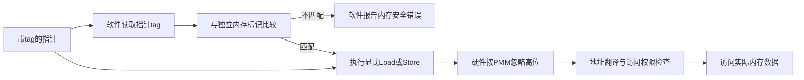
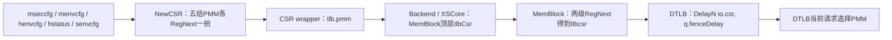
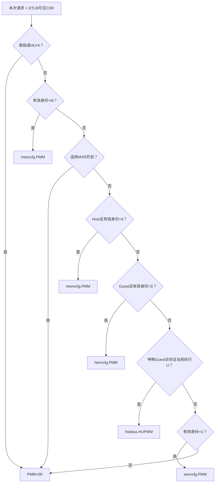
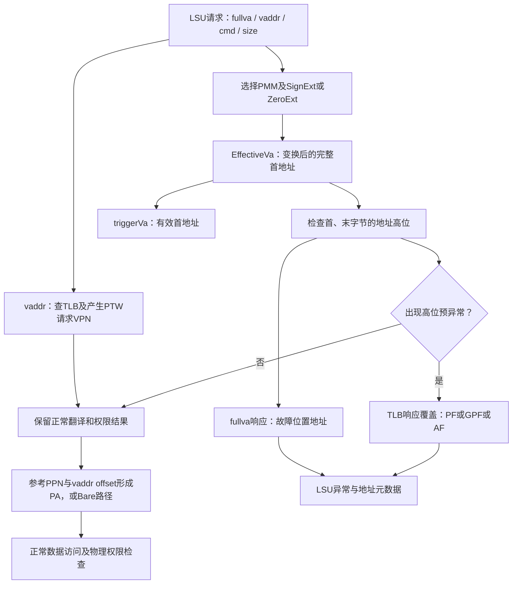
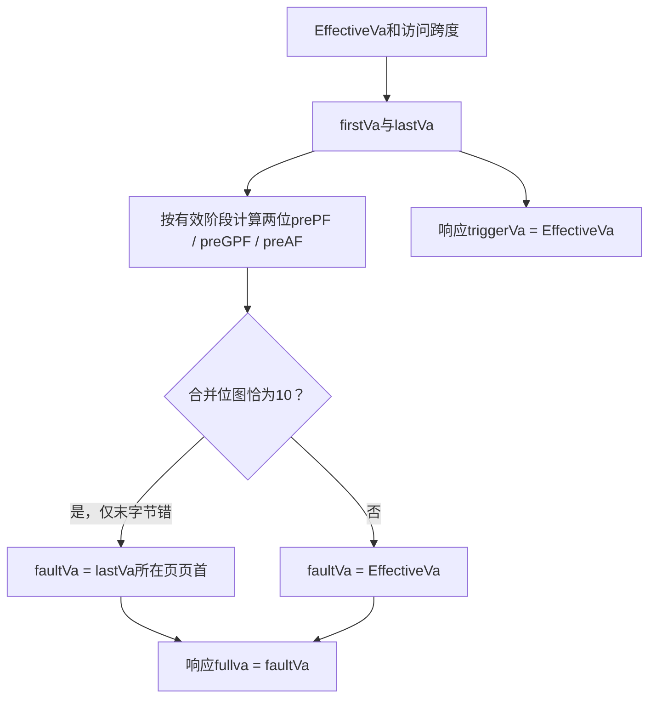
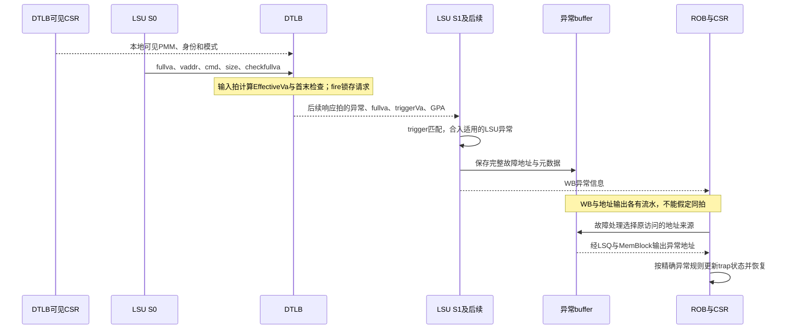

# V2 PMM 指针掩码：架构原理、应用场景与香山实现

PM（Pointer Masking，指针掩码）是一项地址处理特性，PMM是其模式控制字段。它决定一次显式访存是否忽略指针的部分高位，使软件可以把这些位用于附加标记。它处理的是地址：寄存器中的原始指针和Store数据保持原值；翻译、页权限与物理保护继续检查适用的访问。本特性可以降低带标记指针的使用成本，但不负责验证标记是否匹配。

## 版本元数据与阅读边界

| 项目 | 内容 |
|---|---|
| RTL版本 | 香山V2；不代表V3行为 |
| 分支 | `mem_ut_uvm_v2` |
| 核验commit | `264d54012bd97d0bc09f2cbdef4a4a2722d95864` |
| 上游版本路由 | V2 `branch_policy.md`与`memblock_rtl_profile.md`；本地当前Scala为实现依据 |
| 架构手册基准 | RISC-V官方`v20260120`文档集，Pointer Masking Extensions 1.0.0；对应Machine、Supervisor与Hypervisor章节 |
| 权威实现 | `NewCSR/{CSRDefines,CSRBundles,MachineLevel,HypervisorLevel,NewCSR}.scala`、CSR wrapper、`Bundle.scala`、`cache/mmu/{MMUConst,MMUBundle,TLB,TLBStorage}.scala`、`mem/MemBlock.scala`、LoadUnit、StoreUnit |
| 最后核验日期 | 2026-11-17 |
| 核验方式 | 架构手册与Scala静态追踪；本轮未修改源码、未重新生成RTL、未编译或仿真 |

下文用“架构规定”“当前V2实现”“待确认”区分证据层次。规范对显式原子、浮点、向量和CMO的适用要求不自动等于本轮已验证所有香山路径；主线详解普通标量及HLV/HLVX/HSV经LoadUnit/StoreUnit进入DTLB的行为。

本文新建为跨CSR与DTLB的地址处理flow：入口是CSR控制和LSU地址请求，出口是有效完整地址、预异常、异常地址与trigger地址。已有MMU文档的页表遍历/异常优先级与DTLB-L2TLB文档的请求生命周期保持原职责，通过交叉引用衔接。

## 1. 先理解这些术语

| 名词 | 本文含义 | 例子或落点 |
|---|---|---|
| PM、PMM、PMLEN | 指针掩码特性、CSR中的掩码模式、忽略的高位数量 | PMM=11对应RV64的PMLEN=16 |
| tag、untag | 指针高位附加标记、移除或忽略该标记 | tag用于软件内存安全检查，不是TLB的VPN tag |
| HWASAN | 使用指针标记与内存标记的软件内存安全检查器 | 可发现部分越界和释放后访问问题 |
| XLEN、VAddrBits、PAddrBits | 整数位宽、内部请求地址位宽、实现物理地址位宽 | 当前分析按RV64；不能把内部50位地址写成64位 |
| 有效地址、变换后地址 | 指令产生的原地址、经过PM忽略变换后的地址 | 架构术语“effective address”指前者，RTL的`EffectiveVa`指后者 |
| fullva、vaddr | DTLB完整地址、用于查表和分段的请求地址 | `TlbReq.fullva`为XLEN位，`vaddr`为VAddrBits位 |
| SignExt、ZeroExt | 由保留的最高位复制符号、在高位补零 | 虚拟地址与物理/GPA输入使用不同扩展 |
| 规范地址、NVBITS | 虚拟地址满足高位符号复制要求、仅用于合法性检查的高位 | Sv48要求bit63:48等于bit47 |
| CSR、WARL | 控制状态寄存器、允许任意写入但读回合法值的字段规则 | PMM的01为保留编码，不能自行解释成另一种PMLEN |
| M、HS、U、VS、VU | 机器态、Host内核态、Host用户态、Guest内核态、Guest用户态 | Guest/Host属性与U/S/M等级要分别考虑 |
| imode、dmode、dvirt | 当前执行等级、有效数据访存等级、有效数据访存虚拟化状态 | dmode/dvirt包含适用的MPRV/MPP/MPV处理 |
| SPVP、hyperinst、HLVX | 特殊Guest访存采用的U/S身份、特殊Guest访存属性、按执行权限读取的Guest指令 | SPVP=0表示U，1表示S；HLVX仍是数据读取 |
| MXR、vmxr、SUM | M/Host侧执行页可读控制、VS侧对应控制、S身份访问U页的控制 | MXR还影响PMM选择，SUM不选择PMM |
| S1、VS-stage、S2、G-stage | 普通/Guest第一阶段翻译、Guest物理翻译 | Guest可经过GVA→GPA→HPA |
| Bare、only-S2、all-stage | 对应阶段不翻译、只做G阶段、做两阶段 | vsatp=Bare时显式地址可能直接是GPA |
| VPN、PPN、GPA、HPA、PTE | 页号、物理页号、Guest物理地址、最终物理地址、页表项 | 已提交参考内存按最终PA/HPA索引 |
| prePF、preGPF、preAF | 由完整地址高位检查产生的页/Guest页/访问错误 | 不需要先发现PTE权限错误 |
| checkfullva、endpoint mask | 是否检查完整地址、首末字节错误位图 | 位0对应首字节，位1对应末字节 |
| triggerVa、vaNeedExt | trigger匹配地址、异常地址是否需按模式再次扩展 | 高位预异常时vaNeedExt=false |
| RegNext、RegEnable、DelayN | 延迟一拍、条件锁存、延迟N拍 | CSR配置可见拍不等于顶层配置改变拍 |
| fire、replay、redirect | valid与ready同时成立、重试、后端冲刷恢复 | 无新L2请求不代表访存未执行 |

## 2. 为什么需要PMM

### 2.1 一根指针同时携带地址和附加标记

例如软件希望保存指针`0xABCD_0000_0000_4000`，把高16位`0xABCD`当成标记，真正访问低位指向的位置。若每次访存前都由软件清理高位，就需要额外地址处理；PM允许适用访问直接使用带标记的指针。原指针仍可用于软件标记检查、传递和记录。[规范P1，§17.1.1]



图中是带软件标记检查的示例，不要求每一笔访问都执行同一段检查代码。PMM只承担“忽略高位”这个步骤；当前追踪的香山PMM数据路径没有在这里加入指针tag与内存tag的比较器。

### 2.2 应用场景及能力边界

| 场景 | PMM解决的问题 | 仍由软件或其它机制完成 |
|---|---|---|
| 内存安全检测 | 允许带tag指针直接参与适用访存 | 比较标记、报告越界/释放后访问、管理标记存储 |
| OS或Hypervisor访问带标记地址 | 按有效身份选择对应PM配置 | 设置CSR、保存恢复配置、检查用户输入及页权限 |
| 运行时对象元数据 | 允许软件探索高位保存对象标记的方案 | 对象类型、GC、沙箱等语义并非PM自动提供 |

本表后两行属于机制应用说明；不声明某个OS发行版或香山软件栈已部署这些功能。PMM不扩大虚拟/物理地址空间、不自动分配页、不赋予访问权限，也不为DMA或外设请求自动去除标记。[规范P1，§17.1.2.2、§17.1.2.6]

## 3. 架构规定：先变换地址，再按原规则访问

### 3.1 PMM编码和两种变换

| PMM | RV64的PMLEN | 忽略哪些位 | 保留哪些位 |
|---|---:|---|---|
| 00 | 0 | 不忽略 | bit63:0 |
| 01 | 保留 | 不定义正常掩码行为 | 不能当作第四种合法模式 |
| 10 | 7 | bit63:57 | bit56:0 |
| 11 | 16 | bit63:48 | bit47:0 |

编码来自Machine章节的PMM WARL表；实际实现可支持的组合还受扩展和有效位宽约束。[规范P2，§2.1.1.18、§2.1.1.19]

**虚拟地址：** 保留低`XLEN-PMLEN`位，并用最高保留位做符号扩展。**物理地址或输入GPA：** 保留同样的低位，高位补零。二者都是算术变换，不解析软件tag含义。[规范P1，§17.1.2.2]

```text
n = XLEN - PMLEN
虚拟地址：transformed = SignExt(original[n-1:0], XLEN)
物理/GPA：transformed = ZeroExt(original[n-1:0], XLEN)
PMLEN=0：transformed = original
```

下面是按公式独立计算的RV64示例：

| 原地址 | PMLEN | 虚拟地址结果 | 物理/GPA结果 |
|---|---:|---|---|
| `0xABCD_0000_0000_4000` | 16 | `0x0000_0000_0000_4000` | `0x0000_0000_0000_4000` |
| `0x1234_8000_0000_4000` | 16 | `0xFFFF_8000_0000_4000` | `0x0000_8000_0000_4000` |
| `0xFE00_0000_0000_4000` | 7 | `0x0000_0000_0000_4000` | `0x0000_0000_0000_4000` |

“完成掩码”不等于地址必然合法。例如Sv39只忽略高16位后，bit47:39仍然必须与bit38一致；后续规范性检查与权限检查继续适用。

### 3.2 哪些访问适用

| 对象 | 架构上的PM适用性 |
|---|---|
| 普通整数、浮点、原子等显式数据访问 | 在对应配置有效且无例外时适用 |
| HLV/HSV | 使用有效Guest身份对应的控制 |
| HLVX | 明确不适用，便于模拟Guest取指 |
| 指令取指、隐式页表访问 | 不适用 |
| SFENCE/HFENCE/SINVAL/HINVAL的地址参数 | 不自动掩码，软件提供适用地址 |
| CMO地址 | 需要遵守适用的PM规则；不在本轮逐条验证实现 |
| DMA/IOMMU/设备自行产生的访问 | 不属于CPU PM机制的自动处理对象 |
| 软件直接读写地址类CSR | CSR读写本身不执行PM变换 |
| 适用访存产生的硬件异常地址及地址trigger | 使用适用的变换后地址语义 |

前三类例外及CSR/trigger规则见规范P1的访问范围，HLVX例外另见规范P3的Guest访存指令章节。PMM不引入一条“掩码Load”新指令，普通适用指令由控制状态选择其行为。

### 3.3 由谁控制哪个身份

| 扩展/控制字段 | 主要控制对象 | 当前V2字段位置 |
|---|---|---|
| Smmpm：mseccfg.PMM | M有效身份的访问 | bit33:32 |
| Smnpm：menvcfg.PMM | 本实现具备S态时，S/HS有效身份的访问 | bit33:32 |
| Ssnpm：senvcfg.PMM | U/VU有效身份的适用访问 | bit33:32 |
| Ssnpm：henvcfg.PMM | VS有效身份的适用访问 | bit33:32 |
| Ssnpm：hstatus.HUPMM | 当前U态执行HLV/HSV，且访存采用VU身份 | bit49:48 |

扩展职责见规范P1，具体CSR和HLV/HSV选择见规范P2/P3/P4。Supm/Sspm描述执行环境向U/S软件提供PM能力，不应额外理解成香山内部另有一套同名地址计算器。

有效身份可以受MPRV或SPVP影响，不能只看执行指令时的等级。当前U态执行HLV/HSV还要先满足`hstatus.HU`等执行资格；选中某PMM来源不代表指令已经获得执行许可。[规范P3]

## 4. 香山控制路径：CSR如何到达DTLB

### 4.1 定义、复位与传递

`EnvPMM`定义合法值00/10/11；`mseccfg.PMM`、各`EnvCfg.PMM`与`hstatus.HUPMM`定义均复位为Disable。当前追踪没有发现单独名为`EnablePMM`的运行配置；字段及DTLB逻辑确实存在，但本文不据此替代完整ISA/profile能力声明。[源码S1/S2]

`NewCSR`将五组字段分别经一拍`RegNext`输出，CSR wrapper复制到`TlbCsrBundle.pmm`。该bundle是五个2位控制，不携带地址tag或新的访存UID。[源码S3/S4]



**功能职责：** 这条控制链向DTLB提供其当前可见的配置。它传递五个候选值，不提前按某条指令选出最终模式。

**按源码顺序的文字伪代码：** CSR保存合法配置；输出拍将PMM送出；wrapper和后端连接传给MemBlock；MemBlock延迟两拍；TLB再按`q.fenceDelay`延迟；当前请求使用本地`csr`选择模式。默认TLB参数`fenceDelay=2`，因此顶层MemBlock PMM输入到DTLB本地控制有四级寄存边界，NewCSR的PMM输出另有一级。不能把这些边界解释成每条访存必须等待固定五拍才完成。

### 4.2 有效身份与Guest属性

当前DTLB输入侧用于预检查的选择为：

```text
premode  = request.hyperinst ? (SPVP ? S : U) : dmode
useGuest = csr.priv.virt || request.hyperinst
```

`csr.priv.virt`连接的是CSR输出的`dvirt`。普通访问的dmode/dvirt已经包含适用的MPRV、MPP、MPV，以及debug/NMIE限制；不是让DTLB重新解释MPRV，也不是把dvirt当成当前执行V位。[源码S3/S4/S5]

例如，HS执行HLV且SPVP=0时，执行者仍是HS，但本次访存采用Guest U身份。普通HS的LD在无MPRV覆盖时采用Host S身份；即使原地址相同，也不能共用同一个身份结论。

## 5. 香山如何选择本次PMM

**功能职责：** `TLB.scala`的输入侧组合逻辑，为每个requestor按操作和有效身份选择五个CSR候选之一，或强制关闭掩码。这里不分配TLB entry，也不修改CSR。

源码位置：`TLB.scala:167–196`。顺序决定结果，先匹配的条件优先：

| 顺序 | 条件 | 输出 |
|---:|---|---|
| 1 | ifetch或request.hlvx | 00 |
| 2 | premode=M | pmm.mseccfg |
| 3 | useGuest时vmxr或mxr为1；非Guest时mxr为1 | 00 |
| 4 | 非Guest，premode=S | pmm.menvcfg |
| 5 | Guest，premode=S | pmm.henvcfg |
| 6 | hyperinst且当前imode=U | pmm.hstatus，即HUPMM |
| 7 | premode=U | pmm.senvcfg |
| 8 | 其它 | 00 |



**中文文字伪代码：** 先排除取指和HLVX，再选M身份控制。只有非M分支才用适用MXR关闭PM；余下访问先区分Host S和Guest S，随后判断U态执行的特殊访存，最后处理其它U身份。不能写成“MXR始终优先于mseccfg”，也不能写成“U执行HLV始终用HUPMM”：SPVP=S时已在前面的Guest S分支选中henvcfg。SUM/vsum不参与这棵选择树。

规范解释了HLVX/MXR例外与模拟取指的关系；当前RTL在MXR条件成立时不再按读/写命令区分，直接将本请求的PMM置零。即使Bare下MXR不改变页权限，仍不能擅自跳过该选择条件。

## 6. 香山地址数据路径：fullva与vaddr要分开

### 6.1 LSU发出两个地址视图

**功能职责：** LoadUnit/StoreUnit根据原指令、replay或非对齐分段来源建立DTLB请求。完整地址保留原高位，查表地址受VAddrBits约束，不以PMM结果修改整数源寄存器。

| 来源/字段 | 当前实现 |
|---|---|
| 原始标量请求fullva | src(0)加符号扩展立即数，结果进入XLEN位fullva |
| 原始标量请求vaddr | 同源地址进入VAddrBits位请求 |
| Load replay或misalign请求 | 从相应replay/分段通路选vaddr与fullva，不能假设仍与首次issue来源相同 |
| checkfullva | 新整数/向量请求开启，特定重放/非对齐后段不再次开启 |
| HLV/HLVX/HSV | 特殊操作沿Load/Store地址通路，地址操作数和Store数据是独立来源 |

源码：`LoadUnit.scala:391–392、693–748`，`StoreUnit.scala:142–218`。HLV/HSV框架使用`imm=0`是指令输入合同；PMM本身不是生成立即数的机制。

### 6.2 完整地址变换、首末检查和正常查表



图中是结果依赖关系，不表示RTL先串行算完预检查才启动TLB阵列。地址检查、TLB读和权限计算可并行，最终预异常分支覆盖响应。

**按源码顺序的文字伪代码：** 输入拍根据PMM生成EffectiveVa；在request fire时锁存请求，并将`req_out.fullva`覆盖为EffectiveVa；`req_out.vaddr`保留原请求值。并行检查EffectiveVa与末字节；下一响应拍将故障地址和trigger地址分别输出。正常查表从请求vaddr取得VPN，最终PA使用翻译PPN和该vaddr的页内offset；预异常成立时改写响应的异常和相关地址元数据。[源码S5/S6]

### 6.3 虚拟地址还是物理/GPA输入

当前实现的符号扩展条件是：

```text
signExtend = prevmEnable || (pres2xlateEnable && vsatp.mode != Bare)
```

`prevmEnable`表示Host有效翻译，`pres2xlateEnable`表示Guest环境存在受支持的有效阶段；两者还考虑身份等条件。Host/VS虚拟地址使用符号扩展；M/Bare或只有G-stage的输入使用零扩展。模式仅支持当前源码中的Sv39/Sv48及对应x4，不能因标准例子涉及Sv57就声称本V2支持Sv57。

### 6.4 首末字节预检查

**功能职责：** 在完整地址被截成查表地址前，对本次访问的两个端点检查合法性，避免非对齐后段不重复检查时漏报越界。它生成两位错误图，不执行页表遍历。

```text
checkSize = atomic命令或size>3 ? 0 : size[1:0]
firstVa = EffectiveVa
lastVa = firstVa + (2^checkSize - 1)     // 按RTL结果位宽运算
仅request.valid且checkfullva=1时更新prePF/preGPF/preAF
```

| 有效环境 | 首、末字节各检查什么 | 结果 |
|---|---|---|
| Host Sv39/Sv48 | 能否由bit38/47符号扩展回原完整值 | prePF |
| Guest存在VS-stage | 按vsatp的39/48位规范地址检查 | prePF |
| only-S2 Sv39x4/Sv48x4 | bit41/50及以上是否为零 | preGPF |
| 无有效翻译 | PAddrBits及以上是否为零 | preAF |

每类位图的位0是首字节、位1是末字节。只有末字节错误，合并位图等于二进制10时，上报`lastVa`所在页页首；其它情况上报EffectiveVa，包含首非法、末合法的情况。普通跨页但两端高位均合法不会仅因跨页而改写这里的地址。



**中文文字伪代码：** 先计算掩码后的首地址，再从请求size得到跨度；atomic或超出标量检查范围的编码按当前RTL令跨度为一字节。有效完整检查请求按当前阶段只选择适用的一类高位错误。保留两个端点，不能只查最后字节。最后根据错误图决定上报位置，trigger地址始终保留有效首地址。后续misalign请求的`checkfullva=0`不等于不做其余翻译权限检查。[源码S5]

### 6.5 高位预异常覆盖哪些响应

`TLB.perm_check()`在延迟后的任一预异常成立时，覆盖普通页权限结果：[源码S7]

| 字段 | 高位预异常分支 |
|---|---|
| pf/gpf/af | 分别来自prePF/preGPF/preAF，并按Load/Store命令分类 |
| 指令异常位 | 此分支不生成取指异常 |
| fullva | 前述faultVa |
| gpaddr | 同faultVa |
| isForVSnonLeafPTE | false，表示不是访问VS页表项导致的GPF |
| vaNeedExt | false，后端不应再次按正常宽度规范化该错误地址 |
| miss | false |
| triggerVa | EffectiveVa，与faultVa独立 |

这里的`miss=false`是响应覆盖结果，不足以证明内部绝对没有产生过PTW请求。`handle_nonblock()`还读取并行的`missVec`；因此不应把“预异常无需等待有效页表翻译”写成“任何预异常都保证无内部查表活动”。

### 6.6 正常GPF、trigger和最终异常地址

正常翻译的GPA构造仍可能需要`fullva`和分段`vaddr`：跨页时依据两者bit12的差异选择地址来源，数据leaf取其offset，nonleaf/fake取对应VPN索引与PTE位置，only-S2使用适用输入GPA。不能把所有正常GPF的GPA统一设成变换后VA。[源码S6]

普通非MAB Load/Store的trigger地址取`io.tlb.resp.bits.triggerVa`；MAB分支选择其分段vaddr。预异常可能把faultVa改为下一页页首，但不能因此把trigger匹配地址也改成下一页。[源码S8]

LSU把响应fullva、GPA、vaNeedExt和VS标记传给原异常记录。普通LSQ来源经Load/Store异常buffer、LSQWrapper选择后送MemBlock；MemBlock的`GenExceptionVa()`在vaNeedExt=false时保持输入完整地址，最后寄存输出给后端。ROB/CSR继续完成精确异常，不由PMM组合逻辑直接发redirect。特殊来源仍需按其原有地址覆盖链分析。顶层VA/GPA/VS标记这组输出不携带UID或独立响应valid，验证环境须按原故障归属和采样合同关联，不能直接与某拍WB强行绑定。[源码S9]



该图表示阶段与归属关系，不给出从issue到trap的固定总延迟；miss、replay、ROB排队和特殊来源会改变时间。

## 7. 虚拟化的关键边界：PMLEN可能覆盖GPA有效位

### 7.1 架构为何提到额外的两位

Sv48的虚拟地址宽度为48，Sv48x4的GPA宽度为50。当`vsatp=Bare`时，显式访存地址直接进入G-stage，PMLEN16保留48位，意味着原GPA的bit49:48也需要被忽略；这不是只忽略原本无意义的高位。[规范P3，§14.1.5.4]

```text
RV64 + only-S2 + Sv48x4 + PMLEN16：
原始GPA   0x0003_0000_0000_4000
保留低48位并补零
变换后GPA 0x0000_0000_0000_4000
                    ↑ 原bit49:48不再参与架构访问地址
```

这是架构算例，不是本轮DUT仿真结果。规范允许通过查表或回填侧处理来实现，但变换后的架构访问必须一致。

### 7.2 PMM改变与HFENCE.GVMA

规范P3列出：当henvcfg.PMM切换进入或离开会使`XLEN-PMLEN`小于Guest的GPA宽度的值时，Hypervisor应执行`HFENCE.GVMA rs1=x0`。当前V2相关组合是PMLEN16与Sv48x4；规范还列Sv57x4组合，但本轮不把它们当成V2能力。

因此不能概括成“PMM变化永远不涉及fence”，也不能反过来认为“硬件每次PMM写入都会自动全清TLB”。软件所需的同步动作、RTL真实flush条件、RM物理内存状态是三个不同层次。

当前TLB的`flush_mmu`由sfence.valid、satp/vsatp/hgatp.changed及virt_changed组成，没有直接比较五组PMM。PMM改变也不改变已经写入PA的数据。若软件按规则同时发出HFENCE，翻译状态按原fence流程失效；不应将其实现为清除已提交物理数据。[源码S5]

### 7.3 当前V2的已确认事实与待验证边界

已确认：本TLB只用EffectiveVa覆盖`req_out.fullva`；TLBStorage的VPN以及向PTW发送的VPN仍取请求vaddr。启用H且Sv48能力存在时，参数定义使VAddrBits可为50，PMLEN16覆盖的bit49:48可能仍存在于这条vaddr通路。`TLBStorage`与`TlbSectorEntry.hit()`的高位tag比较也需要一起考察。[源码S5/S6/S10]

普通VS/Host虚拟地址中，TLB高位不同有时只体现为额外entry或命中差异，不能仅由“tag不同”推断最终PA必错。**only-S2时，原GPA高两位是G-stage输入有效位；必须进一步验证它们是否在翻译输入或回填过程中得到符合规范的处理。** 本轮在MMU目录检索到的PMM选择/变换集中于TLB输入fullva处理，尚未得到这组边界的真实DUT端到端结果。

此项作为静态源码疑点记录，不在没有复现和责任分类review时登记RTL Buglist，也不把“端口和组合逻辑存在”表述成全组合架构合规证明。

## 8. 与RM/check方案怎样衔接

| 层次 | 应保存或推导什么 | 不应混淆什么 |
|---|---|---|
| 配置与观测 | 五组PMM及其真正可见拍、身份、翻译模式 | 顶层latest不一定是DTLB当前控制 |
| 地址参考模型 | 原始地址、完整变换地址、查表/分段地址、首末错误图 | 不把computed_vaddr全部替换成masked fullva |
| 正常结果检查 | 根据独立参考映射生成架构PA/数据，比较正常效果 | 不用DUT PA反填期望；不能把实现疑点固化成架构正确答案 |
| 异常检查 | cause、故障VA、适用GPA及VS标记 | 预GPF不是隐式VS页表GPF；actual地址不是expected来源 |
| 状态维护 | 旧访问保留旧配置与映射历史，物理数据按PA共享 | 配置改变不等于清除参考内存 |

既有[RM/check支持方案](../../../../plan/rm_plan/undo/memblock_v2_virtualization_rm_checker_support_plan_20261117.md)负责实施设计，本文提供架构与RTL依据。本轮不修改该plan的具体接口或实施状态。第7.3节的实现边界在未来RM落地时必须独立解决，不能因共用seq映射就省略架构语义核对。

## 9. 架构与当前实现的对照

| 问题 | 架构规定 | 当前V2核验结论 |
|---|---|---|
| PMLEN | 当前标准定义7/16，00关闭 | 枚举与组合逻辑支持00/10/11；01无专用正常分支 |
| VA与PA/GPA扩展 | 分别符号扩展和补零 | EffectiveVa逻辑明确区分 |
| HLVX/MXR | 取指模拟相关访问免于PM | HLVX在最高优先级关闭，非M的适用MXR随后关闭 |
| 有效身份 | 受MPRV/SPVP等影响 | 使用dmode/dvirt或SPVP及hyperinst |
| 地址权限 | 变换不赋予额外权限 | 继续经过既有S1/S2与PMP/PMA链 |
| 异常/trigger | 适用时使用变换后的地址语义 | fullva与triggerVa分开产生并由LSU消费 |
| GPA宽于保留位数 | 变换须影响这些有效GPA位，并考虑规定fence | fullva/vaddr分离已确认，only-S2高两位端到端行为待验证 |
| 其它显式访问 | 规范覆盖原子、浮点等及CMO | 共用DTLB不等于本轮已完成全部producer与异常分支验证 |

## 10. 源码证据与外部参考

### 10.1 源码定位

路径均相对仓库根目录；行号用于2026-11-17基线定位，后续源码变化以标识符为准。

| 编号 | 位置 | 支撑结论 |
|---|---|---|
| S1 | `src/main/scala/xiangshan/backend/fu/NewCSR/CSRDefines.scala:194`；`src/main/scala/xiangshan/cache/mmu/MMUConst.scala:157` | PMM编码、合法枚举与PMLEN常量 |
| S2 | `src/main/scala/xiangshan/backend/fu/NewCSR/CSRBundles.scala:73`、`MachineLevel.scala:334`、`HypervisorLevel.scala:243` | EnvCfg/mseccfg/HUPMM位域与复位 |
| S3 | `src/main/scala/xiangshan/backend/fu/NewCSR/NewCSR.scala:1452–1473` | SPVP、dmode/dvirt和五组PMM的RegNext输出 |
| S4 | `src/main/scala/xiangshan/backend/fu/wrapper/CSR.scala:293–307`；`src/main/scala/xiangshan/Bundle.scala:558–584`；`backend/Backend.scala:835`、`XSCore.scala:237` | wrapper、bundle与整核连接 |
| S5 | `src/main/scala/xiangshan/cache/mmu/TLB.scala:64–102、139–258` | CSR延迟、有效身份、PMM选择、扩展、首末预检查 |
| S6 | 同文件`:267、374–420、595–597`；`src/main/scala/xiangshan/cache/mmu/MMUBundle.scala:563–610` | 请求/响应位宽、VPN与PA/GPA、fullva/triggerVa分工 |
| S7 | `src/main/scala/xiangshan/cache/mmu/TLB.scala:510–528` | 预异常响应覆盖及vaNeedExt/VS标记 |
| S8 | `src/main/scala/xiangshan/mem/pipeline/LoadUnit.scala:391–392、693–748、1011–1043、1140`；`StoreUnit.scala:142–218、307、349、383–399` | LSU地址生产、响应消费与trigger |
| S9 | `src/main/scala/xiangshan/mem/lsqueue/StoreQueue.scala:136–141`、`LoadExceptionBuffer.scala`、`LSQWrapper.scala:253–259`；`src/main/scala/xiangshan/mem/MemBlock.scala:665–666、1874、1939–2033` | CSR前置延迟、异常记录与最终地址输出 |
| S10 | `src/main/scala/xiangshan/Parameters.scala:67、93、629–641`；`src/main/scala/xiangshan/cache/mmu/TLBStorage.scala:109–121`；`MMUBundle.scala:217–237` | H/Sv48能力下的VAddrBits与高位tag路径 |

### 10.2 架构手册

以下是官方版本化资料。本文为专题解释与源码对照，不复制整章手册。

- 规范P1：[Pointer Masking Extensions，Version 1.0.0](https://docs.riscv.org/reference/isa/v20260120/priv/zpm.html)：§17.1.1应用背景，§17.1.2.2变换，§17.1.2.6访问范围，§17.1.2.7扩展分类。
- 规范P2：[Machine-Level ISA](https://docs.riscv.org/reference/isa/v20260120/priv/machine.html)：`menvcfg`、`mseccfg`与PMM WARL编码表。
- 规范P3：[Hypervisor Support](https://docs.riscv.org/reference/isa/v20260120/priv/hypervisor.html)：`hstatus.HUPMM`、`henvcfg.PMM`、HLVX例外；§14.1.5.4两阶段翻译与PM交互。
- 规范P4：[Supervisor-Level ISA](https://docs.riscv.org/reference/isa/v20260120/priv/supervisor.html)：`senvcfg.PMM`对U态的控制。

## 11. 关联flow与知识修订记录

- [MMU GPF/AF异常优先级](mmu_gpf_af_exception_priority_flow.md)：预异常之后的翻译错误与LSU raw vector收敛。
- [DTLB-L2TLB请求与回复次序](dtlb_l2tlb_request_response_ordering_flow.md)：原翻译请求生命周期；其C−2上下文不能直接套成DTLB PMM的可见拍。
- [Memory trigger](memory_trigger_flow.md)：trigger地址匹配与后端动作；本文说明地址如何先经过PM。
- [Memory flushPipe](memory_flush_pipe_flow.md)：实际fence、CSR变化与流水恢复分工。
- [PMP/PMA检查](memory_pmp_pma_permission_flow.md)：物理权限仍检查适用地址；PM不提供权限豁免。
- [V2 RTL索引](../index.md)。

| 日期 | commit | 旧结论/文档边界 | 本次结论 | 原因与影响 |
|---|---|---|---|---|
| 2026-11-17 | `264d54012bd97d0bc09f2cbdef4a4a2722d95864` | 无PMM专题长期flow，MMU/trigger文档只概述高位检查和地址匹配 | 建立CSR→PMM选择→完整地址/首末预检查→异常及trigger输出的独立地址flow，记录only-S2高两位待验证边界 | 用户要求结合架构手册与香山实现整理专题文档；同步MMU/trigger的相关说明与索引 |

## 12. 待确认项

1. 第7.3节only-S2、Sv48x4、PMLEN16且原GPA bit49:48非零时，真实G-stage输入、回填与最终HPA是否完全符合ignore变换；建议分别检查冷miss、已有命中及PMM切换配合HFENCE的情况。本轮没有真实DUT复现，不作Buglist责任结论。
2. 原子、浮点、向量、CMO等producer虽然受架构PM要求约束，本轮未逐条完成输入字段、重试、trigger、特殊异常覆盖链的端到端核验；不能将表中架构范围当成测试通过清单。
3. 配置切换与CSR不同字段的具体可见拍，需在实际testbench clocking/sample合同中核对；本文记录寄存器边界，不宣称RM当前已保存这些字段。
4. 本轮未核验V3或RV32行为，也未核验发行版软件ABI和完整ISA能力声明；不得直接外推。
