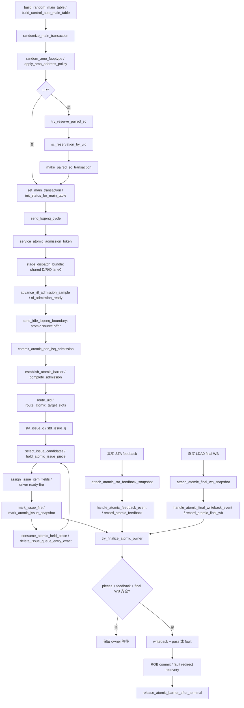

# MemBlock V2 AMO 激励与单 Owner 生命周期

本文依据 2026-11-04 独立 worktree 的最终验证代码，说明 AMO/LR/SC/CAS 的激励生成、共享 admission、
STA/STD 分片发射、真实反馈与最终写回、提交和异常收尾。完整 VCS/KDB 编译、LSQ/AMO 定向 soft test、
普通 real-dispatch smoke 和 AMO real-dispatch smoke 已通过，独立 implementation review 未发现 Blocker、
Major 或 Minor。本文不代表 RM 原子结果检查、功能覆盖率或全部异常/多 seed 专项矩阵已经完成。
source offer 以真实 driver launch 为锚点，pending reservation 在下一 DUT sample 前可由 reset 撤销。

## 1. 范围与术语

### 1.1 术语与抽象功能说明

| 英文术语 | 当前流程中的中文含义 | 代码对象/状态落点 | 示例 |
|---|---|---|---|
| `AMO opcode` | 此处统称 LR、SC、普通原子操作和 CAS 的 25 个操作编码 | `enumerate_fuoptypes()`、`MEMBLOCK_LSUOP_*` | 22 个 W/D 编码加 CAS W/D/Q |
| `LR/SC pair reservation` | 建表期对未来 SC UID 的预约，不是 DUT 的保留地址状态 | `sc_reservation_by_uid` | 距离 0 表示 SC 紧跟 LR |
| `owner / barrier` | 唯一活跃原子 UID 及阻止年轻 UID admission、其他 UID issue 的屏障 | `active_atomic_barrier_valid/uid` | 原子终态后才允许年轻指令推进 |
| `D/R/Q` | LSQ 与 AMO 共用的三级软件 dispatch bundle 暂存状态，不是三套独立 admission 通道 | `lsq_ctrl_model::shadow_{d,r,q}_*` | AMO 仅占 lane0，不能夹带 LSQ lane |
| `registered canAccept / credit` | 按完整控制采样更新的接纳门控与 LQ/SQ 额度，不是顶层 ready 信号 | `shadow_can_accept`、`shadow_lq_credit/shadow_sq_credit` | AMO 零分配仍须等待公共 gate |
| `source offer / launch anchor` | driver 在实际驱动边界发布的源端 fire 描述及目标采样标识 | `publish_lsq_source_offer()`、`target_sample_seq` | AMO fire 描述可伴随全零物理 enqueue 请求 |
| `pending sample / token` | 已 launch 的 LSQ reservation 或尚待共享 Q fire 采样确认的原子凭证 | `pending_sample_tokens`、`atomic_token_stage` | 二者不能当作已开放 issue 的 UID |
| `piece / slot / remaining mask` | 一条原子指令拆出的 STA 或 STD 片；slot 为指令内部编号；未 fire 的 required 位决定剩余片 | `uop_index`、`atomic_*_fired_mask/required_*_mask` | CAS Q 的 STA slot 为 0、2 |
| `held piece` | 已选中但尚未由真实握手消费的冻结片 | `atomic_held_piece_valid/atomic_held_piece` | ready 低时不得重新抽选 STD slot |
| `epoch / generation` | 区分 reset、redirect 和同 UID 不同动态发射实例的代际标识 | `control_reset_epoch`、`dynamic_epoch`、逐 slot `issue_epoch`、`replay_seq` | 旧实例反馈不能推进新 owner |
| `feedback / final WB` | STA 接收反馈与指令最终写回是两种独立事实 | `atomic_feedback_seen_count`、`atomic_final_wb_seen_count` | CAS Q 要 2 个 STA feedback 和 2 个 final WB |
| `terminal / UID+1` | 指令最终退出与异常后继续处理的 UID 前缀 | `terminal_done`、`finish_fault_head_terminal()` | fault UID 不重发，cursor 推到 UID+1 |

核心源码均在 `mem_ut/ver/ut/memblock/` 下：

- `seq/base_seq_help/memblock_dispatch_base_sequence.sv`：编码、地址与 LR/SC 建表。
- `env/plus.sv`、`seq/base_seq_help/seq_csr_common.sv`：配置定义、读取与校验。
- `seq/base_seq_help/memblock_op_behavior_util.sv`、`lsq_ctrl_model.sv`：行为派生、共享 gate 与 admission。
- `seq/base_seq/memblock_lsqenq_dispatch_base_sequence.sv`：原子 D/R/Q token 服务。
- `seq/base_seq_help/issue_queue_scheduler.sv`、`issue_field_assigner.sv`：分片、仲裁、字段赋值与 fire。
- `seq/base_seq_help/common_data_transaction.sv`、`status_transaction.sv`：owner、mask 与完成状态。
- `seq/base_seq_help/dispatch_monitor_event_adapter.sv`、`writeback_status_handler.sv`、`lsq_commit_handler.sv`：真实事件和终态收口。

## 2. 函数调用 Flow 图



### 函数调用 Flow 图整体文字伪代码

```text
建表先按 AMO 类别和 25 个 opcode 权重选择编码，再应用对齐/非对齐地址策略；
遇 LR 时，try_reserve_paired_sc 尝试预约未来合法 SC UID，命中该 UID 时消费预约生成同宽 SC；
所有主表项写完后创建初始 status，active/enq/issue_ready 尚未开放。

admission 调用 service_atomic_admission_token：等待全部更老 UID terminal，且无控制/原子屏障；
只向空的共享 D/R/Q 放入 lane0 原子 token，不立即创建 ROB owner；
共享 registered gate、Q 身份和 source offer 采样确认允许后，提交零 LSQ 分配的 active ROB 实例；
保存非 owning LQ/SQ 指针快照，置 lsq_deq，建立唯一 atomic barrier，再开放 issue route。

route_atomic_target_slots 将每个尚未 fire 的 STA/STD slot 放入对应队列；
select_issue_candidates 优先返回 held piece；否则按 order mode 和剩余 slot 选择一片并冻结；
仅在 STA0 或 STD0 端口真实 fire 后记录逐片 issue snapshot、置 fired mask、清 held piece、删除精确队列项；
未 fire 时不删队列、不推进 mask，也不重新随机。

adapter 把真实 STA feedback 绑定到 owner 的下一 STA fire slot，把真实 LDA0 WB 绑定到主 STA0 epoch；
handler 分别消费反馈和最终 WB，CAS Q 期待两次最终 WB；
每次 piece fire、feedback 或 WB 到达都会尝试汇总，但只有三类条件全部齐全才置 writeback/pass 或 fault；
正常提交后释放 barrier；fault 等公共 redirect recovery 完成再异常 terminal，cursor 前进到 UID+1。
```

## 3. 编码与配置边界

25 个编码为 `{LR,SC,AMOSWAP,AMOADD,AMOXOR,AMOAND,AMOOR,AMOMIN,AMOMAX,AMOMINU,AMOMAXU}.{W,D}`
及 `AMOCAS.{W,D,Q}`。主表统一使用 `fuType=MOU`、`lsq_flow=ATOMIC`、`numLsElem=0`；
`derive_op_behavior()` 产生 `need_alloc=00`、`uses_lq=uses_sq=0`、STA/STD 双路由和 normal ROB commit 分类。
AMO 类别默认权重为 0 是默认不抽样，不是能力禁用；CBO 和 vector LS 的禁用边界保持不变。

| 配置（省略 `MEMBLOCK_`） | 当前默认值 | 语义/范围 |
|---|---|---|
| `OP_CLASS_AMO_WT` | 0 | 非零时参与随机类别选择，不再强制为 0 |
| `AMO_FUOP_*_WT` | 原 22 项各 1；CAS W/D/Q 各 0 | 共 25 个 opcode 权重；类别启用时总和须非零 |
| `AMO_ISSUE_ORDER_MODE` | 0 | 0：STD 优先；1：STA 优先；2：每次新选片随机选 STA/STD |
| `AMO_STD_SHUFFLE_EN` | 0 | 0/1；每次新选 STD 时在剩余合法片中随机选择，而非一次性排列 |
| `AMO_MISALIGN_PERMILLE` | 1 | 0..1000；以千分率生成预期非对齐地址 |
| `AMO_LR_SC_PAIR_EN_1_WT` | 80 | 0..100；每个 LR 尝试配对的百分比 |
| `AMO_LR_SC_SAME_ADDR_1_WT` | 90 | 0..100；配对 SC 复制 LR 地址的百分比 |
| `AMO_LR_SC_DIST_FIXED_WT / DIST_FIXED_VALUE` | 0 / 0 | 固定距离分支权重及 0..100 的距离值 |
| `AMO_LR_SC_DIST_{0,1_5,6_10,11_100}_WT` | 各 1 | 四档距离权重，与固定分支不能全部为 0 |

配置沿 `env/plus.sv -> seq_csr_common::init() -> getter` 使用；启用 AMO 要求至少一个 STA 和一个
STD pipe。CAS Q 的 STA2 目的寄存器需要 `MEMBLOCK_PDEST_RANGE>=2`。这些是配置/字段合同，
不能据此宣称任意配置组合已通过验证。独立 RM 原子计算与比较不在本激励闭环的完成承诺内。

## 4. 建表、地址和 LR/SC 配对

### 4.1 `randomize_main_transaction()` / `apply_amo_address_policy()`

源码位置：`seq/base_seq_help/memblock_dispatch_base_sequence.sv`。

抽象功能描述：前者生成合法主表项，后者为 AMO 施加操作宽度对应的地址策略并记录预期对齐属性；
它们只负责构建期数据，不建立运行期 owner，也不提前断言 DUT 会报告哪一类异常。

真实逻辑摘要：

```systemverilog
if (tr.op_class == MEMBLOCK_OP_CLASS_AMO) begin
    apply_amo_address_policy(tr);
    tr.send_pri = 100;
    tr.send_pri_std = 100;
end
make_misaligned = $urandom_range(999, 0) <
                  seq_csr_common::get_amo_misalign_permille();
offset = make_misaligned ? $urandom_range(alignment - 1, 1) : 0;
address = aligned + offset;
tr.amo_expect_misaligned = make_misaligned;
tr.amo_alignment_bytes = alignment;
```

文字伪代码：

```text
randomize_main_transaction 先建立身份、ROB、操作模板和合法基础地址；
AMO 再调用 apply_amo_address_policy，按 W/D/Q 得到 4/8/16B 对齐要求；
先在配置窗口内收敛对齐基址，再按 permille 决定是否加 1..alignment-1 的偏移；
跨度越界或对齐结果与预期相反时 fatal；否则写 src_0、清 imm、更新 vaddr 和对齐元数据；
AMO 的 send_pri/send_pri_std 固定为 100，最后生成 delay 并做主表合法性校验。
```

边界候选矩阵中的 AMO 仅允许 `ALIGNED` 基础候选；最终非对齐仍由上述独立策略决定，不把
普通标量六类 boundary 权重解释为六类 AMO 专项已覆盖。

### 4.2 `try_reserve_paired_sc()` / `make_paired_sc_transaction()`

源码位置：同上。

抽象功能描述：前者把 LR 的宽度、地址策略和未来目标 UID 存为构建期预约，后者在目标 UID 消费
预约并生成 SC；不维护 DUT reservation，不保证 SC 成功，也不延长主表或移动控制 marker。

真实逻辑摘要：

```systemverilog
for (int unsigned attempt = 0; attempt < 16 && !reserved; attempt++) begin
    selected_dist = randomize_lr_sc_distance();
    candidate_uid = longint'(lr_tr.uid) + longint'(selected_dist) + 1;
    // 越界、已有 SC 预约或当前控制预约占位时继续尝试。
    // 合法位置保存到 sc_reservation_by_uid。
end
if (reservation.same_addr) begin
    tr.src_0 = reservation.lr_src_0;
    tr.imm = reservation.lr_imm;
    tr.update_vaddr();
    tr.amo_expect_misaligned = reservation.lr_expect_misaligned;
    tr.amo_alignment_bytes = reservation.lr_alignment_bytes;
end else begin
    apply_legal_addr_template(tr);
    apply_amo_address_policy(tr);
end
```

文字伪代码：

```text
LR 先按 PAIR_EN_1_WT 决定是否尝试配对；
randomize_lr_sc_distance 按固定/0/1..5/6..10/11..100 五档选择距离；
目标 UID = LR UID + 距离 + 1，最多尝试 16 次，失败则跳过，不扩表；
预约保存同宽 SC opcode，并按 SAME_ADDR_1_WT 决定是否复制地址；
目标 UID 到来时 make_paired_sc_transaction 保留其连续 ROB 身份、设置 MOU/ATOMIC/numLsElem=0；
same_addr 分支复制 LR 的地址和对齐元数据，否则独立生成地址，不能把独立抽样说成保证异址；
校验完成后删除已消费预约。
AUTO 构建先处理 CSR，再处理 SFence，再处理 SC 预约，最后才走普通随机构建；
后续控制预约撞到已有 SC 位置时取消 SC；SC 不能占末尾 check_store。
```

## 5. 共享 Admission 与单 Owner

### 5.1 `service_atomic_admission_token()`

源码位置：`seq/base_seq/memblock_lsqenq_dispatch_base_sequence.sv`。

抽象功能描述：该函数在共享 dispatch 模型内推进一个尚未拥有 ROB/LSQ 状态的原子 token，
待真实 source offer 的目标采样确认后才建立原子运行期实例；它不是零时间 non-LSQ 快捷入口。

真实逻辑摘要：

```systemverilog
if (data.dispatch_progress.terminal_done_uid != uid ||
    data.active_atomic_barrier_valid || data.active_control_barrier_valid) begin
    return 1'b0;
end
// stage_dispatch_bundle(atomic_uids, atomic_behaviors, 1'b1)
// 将单条原子 token 放入共享 D，后续进入共享 R/Q。
lsq_ctrl.commit_atomic_non_lsq_admission(
    atomic_token_uid, atomic_token_behavior, atomic_token_tr,
    lsq_ctrl.shadow_lq_enq_ptr, lsq_ctrl.shadow_sq_enq_ptr);
data.establish_atomic_barrier(atomic_token_uid);
complete_admission(atomic_token_uid);
```

文字伪代码：

```text
先尝试收口已完成 redirect recovery 的未 fire barrier；
reset/backend/baseline 代际改变时丢弃 pre-fire token，不能把 reset 清空 Q 当成成功 fire；
有效 redirect 覆盖 pre-fire token 时清 token，不创建 owner；
stage 0 等待 next UID 为 AMO、更老 UID 全 terminal、无屏障、共享管线和 pending 都为空；
stage_dispatch_bundle 只捕获 lane0，不分配 ROB 或 LSQ；
stage 1 在共享 Q 中校验唯一 lane0 身份，等待 registered gate、IQ hold 和其他 pending 条件放行；
stage 2 等实际 launch 锚点对应的下一采样边界确认后，才 commit_atomic_non_lsq_admission；
后者保存 shadow 指针快照，activate_uid(uid,0,0)，置 ENQ 和 LSQ_DEQ，但不扣 free count、不建 LQ/SQ map；
establish_atomic_barrier 建 required mask 和反馈/WB 计数，再由 complete_admission 开放 issue；
清 pre-fire token，所有权转给 active atomic barrier。
```

公共 gate 的注册额度、D/R/Q 与 software allocator 分工见 [LSQ admission 主流程](lsq_admission_flow.md)。
AMO 的 `needAlloc=00` 不绕过 gate，物理 `enqLsq` 保持 idle，source offer 则描述共享 Q lane0 fire。
不为 AMO 伪造 LQ/SQ reservation、cancel count、deq 或物理 LSQ enqueue。

### 5.2 `establish_atomic_barrier()`

源码位置：`seq/base_seq_help/common_data_transaction.sv`。

抽象功能描述：为已 admission 的原子 UID 建立唯一屏障和本条指令的完成合同；该屏障在 terminal
收口前持续有效，不因仅收到一次写回就释放。

真实逻辑摘要：

```systemverilog
status.atomic_required_sta_mask = behavior.atomic_sta_uop_count == 2 ?
                                  4'b0101 : 4'b0001;
status.atomic_required_std_mask = 4'((1 << behavior.atomic_data_uop_count) - 1);
status.atomic_feedback_expected_count = behavior.atomic_sta_uop_count;
status.atomic_final_wb_expected_count =
    memblock_op_behavior_util::is_amocas_q_fuoptype(
        get_main_transaction(uid).fuOpType) ? 2 : 1;
active_atomic_barrier_valid = 1'b1;
active_atomic_barrier_uid = uid;
```

文字伪代码：先验证没有其他原子/控制屏障且 UID active/enq、没有 LSQ map；再根据行为建立下表
的 mask 和计数，最后发布唯一 barrier。`control_barrier_blocks_admission()` 阻止年轻 UID；
`atomic_barrier_allows_issue()` 只允许 owner 本身发射。

| 操作 | STA slot / required mask | STD slot / required mask | STA feedback | final WB |
|---|---|---|---:|---:|
| LR/SC、普通 AMO W/D | 0 / `0001` | 0 / `0001` | 1 | 1 |
| CAS W/D | 0 / `0001` | 0、1 / `0011` | 1 | 1 |
| CAS Q | 0、2 / `0101` | 0、1、2、3 / `1111` | 2 | 2 |

## 6. 分片 Route、选择与真实 Fire

### 6.1 `route_atomic_target_slots()` / 字段构造

源码位置：`seq/base_seq_help/issue_queue_scheduler.sv`、`issue_field_assigner.sv`。

抽象功能描述：route helper 为 owner 尚未完成的 slot 创建精确队列项；field assigner 把稳定的
owner/slot 信息转换成物理 STA/STD payload，不把 slot 编号当作 pipe 编号。

真实逻辑摘要：

```systemverilog
if (target == MEMBLOCK_ISSUE_TARGET_STA) begin
    slot_list.push_back(0);
    if (behavior.atomic_sta_uop_count == 2) slot_list.push_back(2);
end else if (target == MEMBLOCK_ISSUE_TARGET_STD) begin
    for (int unsigned slot = 0; slot < behavior.atomic_data_uop_count; slot++)
        slot_list.push_back(slot);
end
// 对未 fire slot 构造 item，item.uop_index=slot，issue_pipe_index=0，再入队。
```

文字伪代码：`route_uid()` 识别 atomic 后直接进入专用分片入口，不经过要求 SQ owner 的普通
`route_target()`；`make_issue_item()` 保存动态身份和 non-owning 指针快照，`has_lqIdx/has_sqIdx=0`；
`push_issue_queue_item()` 按含 slot 的精确身份去重，分别写 `sta_issue_q/std_issue_q`。
`derive_atomic_std_data()` 对非 CAS 的 STD0 使用 `src_0`，CAS 则由 UID/src_0 派生稳定数据，
slot0/1/2/3 依次表示 compare low/new low/compare high/new high；这不是独立原子 RM。
`compute_atomic_sta_pdest()` 为 CAS Q 的 STA0/STA2 产生不同 pdest，不能因两片走同一端口而覆盖身份。

### 6.2 `select_issue_candidates()` / `hold_atomic_issue_piece()`

源码位置：`seq/base_seq_help/issue_queue_scheduler.sv`、`common_data_transaction.sv`。

抽象功能描述：scheduler 在 owner 内选择下一片并冻结到真实 fire；其随机化只发生在新选择点，
不改变尚未消费的 held piece。

真实逻辑摘要：

```systemverilog
choose_std = std_eligible.size() != 0 &&
             ((atomic_tr.fuOpType inside {MEMBLOCK_LSUOP_LR_W, MEMBLOCK_LSUOP_LR_D}) ||
              atomic_tr.amo_expect_misaligned || sta_eligible.size() == 0 ||
              mode == 0 || (mode == 2 && $urandom_range(1, 0) == 0));
if (seq_csr_common::get_amo_std_shuffle_en() && std_eligible.size() > 1)
    selected_idx = $urandom_range(std_eligible.size() - 1, 0);
// selected.issue_pipe_index = 0; data.hold_atomic_issue_piece(selected);
```

文字伪代码：

```text
全局 flush 先尝试清理未 fire 的 held piece，并返回空候选；
有 atomic barrier 时优先返回同一 held piece，身份或 eligibility 丢失则 fatal；
没有 held piece 时，仅收集 owner 的未 fire 合法 slot，STA0 未消耗前不允许 STA2；
根据 mode 选择 STA 或 STD，但 LR 与 amo_expect_misaligned 强制优先消耗剩余 STD；
选择 STD 时，shuffle=1 每片都从 remaining mask 对应的 eligible queue 中重抽；否则选最小 slot；
选择 STA 时选最小 slot；冻结选中片，本拍 LOAD 为空，STA/STD 合计最多一片且只用 pipe0；
无 fire 时保留 held piece，下一轮既不改 target 也不改 slot。
```

### 6.3 `mark_issue_fire()` / `mark_atomic_issue_snapshot()`

源码位置：同上。

抽象功能描述：只把 driver 返回的真实 fire 转成逐片状态，消费 held piece 并删除精确队列项；
普通 scalar target 的整目标删除和 generation token 不能代替原子逐 slot 完成状态。

真实逻辑摘要：

```systemverilog
if (!data.mark_atomic_issue_snapshot(item.uid, item.target,
                                     item.uop_index, issue_epoch)) return 1'b0;
data.consume_atomic_held_piece(item);
if (item.target == MEMBLOCK_ISSUE_TARGET_STA)
    status.atomic_sta_fired_mask[item.uop_index] = 1'b1;
else
    status.atomic_std_fired_mask[item.uop_index] = 1'b1;
status.atomic_piece_fire_count++;
void'(data.try_finalize_atomic_owner(item.uid, memblock_sync_pkg::get_dispatch_service_cycle()));
data.delete_issue_queue_entry_exact(item);
```

文字伪代码：driver fire mask 命中才进入；校验 slot 未重复 fire，保存该 slot 的 issue epoch，
核对并消费 held piece，再置 fired mask 和片数；删除的仅是这一片。同 target 仍有 queue entry 时
保持 queued=1、dispatched=0，最后一片才反转。STD fire 不合成普通 store 的 pass/WB。

## 7. 反馈、CAS Q 双写回与 Terminal

### 7.1 Adapter 与 writeback handler

源码位置：`seq/base_seq_help/dispatch_monitor_event_adapter.sv`、`writeback_status_handler.sv`。

抽象功能描述：adapter 为真实事件附上唯一原子 owner 的动态身份，handler 校验并更新反馈或
最终 WB 账本；二者不把 STA 接收反馈当作架构完成。

真实逻辑摘要：

```systemverilog
wb_event.source = MEMBLOCK_WB_EVENT_SOURCE_ATOMIC_WB;
wb_event.target = MEMBLOCK_ISSUE_TARGET_STA;
wb_event.has_lq = 1'b0;
wb_event.has_sq = 1'b0;
wb_event.issue_epoch = status.atomic_sta_issue_epoch_by_slot[0];
// handle_atomic_final_writeback_event -> record_atomic_final_wb
// handle_atomic_feedback_event -> record_atomic_feedback
```

文字伪代码：`attach_atomic_sta_feedback_snapshot()` 只认 port0 和 active owner，用
`peek_next_atomic_feedback()` 按 STA fire 顺序绑定下一 slot/epoch；反馈必须 hit。
`attach_atomic_final_wb_snapshot()` 从真实 LDA0 WB 的完整 ROB key 反查原子 owner，绑定主 STA0
epoch；CAS Q 两次最终 WB 都归同一个 owner，不按 LQ/SQ 或两个独立 UID 计算。
`handle_atomic_feedback_event()` 和 `handle_atomic_final_writeback_event()` 分别交给
`record_atomic_feedback()`、`record_atomic_final_wb()`；旧代际不推进计数，超出预期的 WB fatal，
异常向量汇总到 `atomic_pending_exception_vec`，每次有效事件都再尝试 finalize。

### 7.2 `try_finalize_atomic_owner()` / `release_atomic_barrier_after_terminal()`

源码位置：`seq/base_seq_help/common_data_transaction.sv`、`lsq_commit_handler.sv`。

抽象功能描述：前者汇聚原子全部完成事实为架构 pass/fault，后者只在指令 terminal 且退出 active
状态后释放屏障；fault 的释放还要求公共 redirect recovery 完成。

真实逻辑摘要：

```systemverilog
if (!status.active || status.issue_killed || status.flushed || status.redirect_pending ||
    status.atomic_final_wb_seen_count != status.atomic_final_wb_expected_count ||
    !atomic_feedback_complete(uid) || !atomic_all_required_pieces_fired(uid))
    return 1'b0;
status.atomic_finalized = 1'b1;
status.writeback = 1'b1;
// fault: fault/exception_pending=1, pass/success/terminal_done=0；否则 pass=1。
set_commit_cursor_uid(fault_head_uid + 1, "finish_fault_head_terminal");
```

文字伪代码：三项完成条件未齐全则保持 owner，CAS Q 第一笔 WB 即使带异常也不能提前收口。
齐全后置 writeback；有汇总异常则转 fault 并停止该 UID 的普通 pending work，否则转 pass。
normal ROB commit 走无 LSQ deq 等待的正常退休；fault 走公共 intent/redirect 仲裁及 recovery，
`finish_fault_head_terminal()` 推进 cursor 到 fault UID+1 后释放原子 barrier，不重新 admission
fault UID。`release_atomic_barrier_after_terminal()` 校验 terminal、inactive、feedback complete，
fault 还须 recovery complete，之后清 mask、计数和 held 状态。

已发生任一原子 piece fire 后，不能用普通 redirect 或非物理 reset 静默清空重试；相关路径
fail-fast。pre-fire token 可在 redirect/reset 时取消，未 fire barrier 只在 recovery 完成后释放；
这不是已支持任意中断点恢复的承诺。

## 8. 端到端行为总结

```text
普通 AMO：随机 opcode/地址 -> shared D/R/Q + registered gate -> 单 owner/barrier
  -> STA/STD pipe0 每拍一片 -> 真实 feedback + final WB + 全片 fire
  -> pass/writeback -> normal ROB commit -> terminal/inactive -> barrier 释放

LR/SC：LR 主表项 -> future SC reservation -> 同宽 SC 主表项
  -> 两条 UID 各自走单 owner 流程；建表同址不等于保证 SC 成功

CAS Q：STA mask 0101 / STD mask 1111 -> order mode + remaining STD shuffle
  -> held piece 跨无 fire 保持 -> 2 STA feedback + 2 final WB + 6 piece fire
  -> 最终 pass/fault，不由第一笔 WB 提前终结

fault：汇总异常 -> 公共 fault commit/redirect recovery -> terminal(skip fault UID)
  -> commit cursor=UID+1 -> 释放 barrier -> 年轻 UID 可 admission
```

端到端文字伪代码：正常路径必须同时取得片、反馈和最终写回三类证据；LR/SC 的构建期预约只决定
输入关系，实际成功/失败由 DUT 决定。CAS Q 采用单 owner、六片与双 WB 的合同，无 fire 轮次不得
改变冻结片。异常同样先收齐合同，再经过公共 recovery 收口到 UID+1，不伪造 LSQ 分配、deq、
普通 STD 完成或已通过的测试结果。
