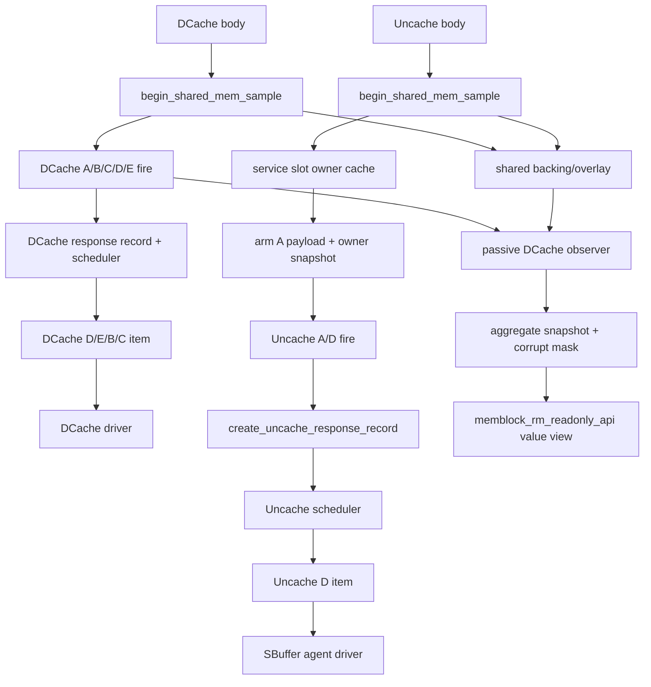
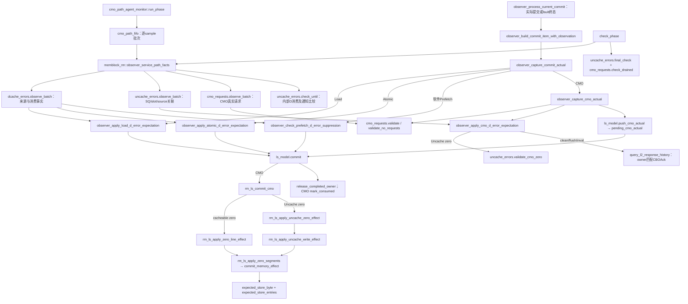

# DCache/Uncache Memory Responder Flow

## 1. 术语与抽象功能说明

本文描述 `mem_base_sequence.sv` 中两条 memory-facing responder 的公共边界：
`dcache_mem__access_base_sequence` 是 coherent DCache TileLink A/B/C/D/E responder；历史类名
`sbuffer_mem_access_base_sequence` 实际承接 V2 Uncache/MMIO 的 TL-UL A/D 端口。二者复用 shared
memory backend，但不共享协议 queue、timer、D hold、source、sink 或返回仲裁。

| 术语 | 当前含义 | 代码对象 | 说明 |
|---|---|---|---|
| `line choice` | 首次真实访问按权重冻结的 CLEAN/CORRUPT/DENIED 选择 | `l2_line_history_by_line` | CLEAN 同样立即登记，普通 DUT reset 不清除 |
| `response token` | 一次真实接受事务的唯一身份 | `l2_response_history_by_token` | source 重用不能复用 token |
| `source generation` | source 本次占用代次 | `l2_source_generation` | A、Release 两个方向分别管理 |
| `beat availability` | 指定 beat 已实际 D.fire 的时间事实 | `beat0/beat1` | 首 beat 可先于整笔完成查询 |
| `reqSource` | DUT 已有的请求来源编码 | `MEMBLOCK_REQ_CPU_*` | Store 来源包括 cacheable zero，固定正常响应 |
| `consumption_proven` | token 查询要求的 beat 已按 sample 送达 | readonly 值视图 | PA-only 诊断始终不提供该证明 |
| `shared memory` | 测试级 sparse backing 与 write overlay | `mem_access_base_sequence` static store | 只保存 memory-facing 访问，不是 RTL L2 cache |
| `response record` | 已 A/C fire、等待 D 返回的协议回复 | `dcache_rsp_q` / `uncache_rsp_q` | 两通道各自独立维护 |
| `eligible_cycle` | record 最早可被本通道 scheduler 选择的 service cycle | 两种 response record | 防止新入队 record 当拍返回 |
| `D hold` | 已选择但尚未 D.fire 的唯一 D payload | `current_d_record/current_d_valid` | D.ready=0 时 payload 不变 |
| `D-error snapshot` | 当前 Uncache D reply 的 `denied/corrupt` 固定值 | `uncache_response_record_t::denied/corrupt` | response record 创建时合并 backend/error weight；后续 scheduler 与 D hold 只读 |
| `admission` | 从真实 request fire 到允许进入返回仲裁的固定边界 | DCache `+3`，Uncache `+1` | 不是 `pre_pkt_gap/post_pkt_gap` |
| `scheduler timer` | 每个通道每轮返回前独立抽样的额外延迟计时器 | `*_rsp_timer_*` | 到期后才选 record |
| `ordered/reorder` | record 的返回选择模式 | `*_RSP_REORDER_EN` | 两通道分别配置 |
| `memory lifecycle owner` | 每 testcase 唯一清空与配置 shared memory 的入口 | real-smoke virtual sequence | responder 只在 legacy topology 未初始化时兜底调用 |
| `write batch` | 已确认 fire、下一 shared-memory sample 才提交的写集合 | `dcache_write_batch/uncache_write_batch` | 同拍固定先 DCache、后 Uncache |
| `readonly observer` | 在既有 DCache/Uncache 动作完成后记录 resident、C-data、writeback 与 corrupt 事实的旁路状态 | `mem_access_base_sequence` static observer | 不决定协议、batch 或 memory 写入 |
| `aggregate snapshot` | DCache owner 一次发布的 resident/pending/drain 值型摘要 | `dcache_aggregate_snapshot` | API 只复制已发布快照 |
| `corrupt mask` | 已观察到但不能正常比较的 overlay byte 范围 | `write_overlay_corrupt_byte_mask` | corrupt C response 置位；既有正常提交按 byte 清除 |
| `overlay readiness` | RM 查询 committed overlay 前必须满足的单一 DCache 门槛 | `dcache_overlay_read_ready` | `valid=1 && ready=1` 才允许读取 |
| `stop prepare` | UID 与公共 runtime work 已收敛、但尚未真正停止 responder 的准备阶段 | `global_stop_prepare_requested` | 由 `common_data_transaction` 启动 1us 静默窗口 |
| `quiet window` | 从最近一次 responder activity 起连续没有新请求或进展的最小等待时间 | `global_stop_prepare_last_activity_time` | DCache/SBuffer activity 会重新起算；稳定卡住的 record 不会重复重置 |
| `pre-stop A snapshot` | global stop 前已观察到、尚未完成 A.fire 的唯一 A payload | 两个 responder 的 `pre_stop_a_snapshot` | stop 后只允许这一笔保持 payload 一致后完成 fire |
| `slot generation` | 一个 LoadQueueUncache 物理 slot 从 `req_valid=1` 到再次归零的单次占用 | `uncache_slot_owner_state[16]` | redirect 不结束 generation；连续 valid 时 ROB 改变属于非法覆盖 |
| `frozen owner` | slot generation 首次可见时冻结的 UID、动态版本号、ROB、LQ 和 slot 身份 | `uncache_slot_owner_state[].owner` | active map 后续被 redirect 删除也不影响 DUT 旧 slot drain |
| `A-consumed slot` | 已参与真实 A.fire、但仍可能等待 writeback 保持 valid 的旧 generation | `uncache_slot_owner_state[].a_consumed` | source 可复用后排除旧 owner |
| `armed owner snapshot` | responder 准备驱动 A.ready 时按 A source 从 slot cache 复制的不可变 owner 集合 | `armed_a_owner_*` | A.fire 或 A.valid withdrawal 后与 armed payload 原子清除 |
| `armed slot mask` | 当前 A arm 精确捕获的物理 slot 集合 | `armed_a_owner_slot_mask` | A.fire 只消费 mask 中 slot；withdrawal 不消费 |
| `redirect-deleted owner` | 当前单代 redirect 删除 active LQ owner 前保存的短时旧身份 | `redirect_deleted_lq_owner_by_key` | 只在 slot 首次捕获且 active ROB miss 时按完整 ROB 唯一恢复 |
| `terminal idle` | responder 在所有瞬态协议 owner 收敛后发送的最后一个全零输出 item | 两个 responder 的 idle xaction | `send_*_xaction()` 完成最后 idle item 的交付后才置对应 `*_responder_done` |
| `drain audit` | responder 结束路径的只读残留检查 | `audit_*_responder_state()` 与 `audit_shared_memory_drain_state()` | 不清 queue；非空或未收敛状态报 `UVM_ERROR` |

## 2. 调用 Flow



### 2.1 函数调用 Flow 图整体文字伪代码

```text
两个 responder 都在自己的 drv_cb 边界复制握手快照，非reset先等待同边沿CSR sample锚点，再调用 begin_shared_mem_sample：
  提交上一拍已确认的 write batch；当前拍 read 只读取上一轮 committed overlay/backing view。

DCache：
  确认 A/C fire 后建立 coherent response record；
  以 DCache 自己的 admission、delay timer、选择模式和 D hold 返回 Grant/CBOAck/ReleaseAck；
  Grant 的 sink 在 E.fire 后才释放；E.fire 的 sink 在 hard X/Z 检查开启时必须先通过四态检查，未知值
  只报告错误并保留 owner；关闭检查时沿用原有二态匹配；Probe/C assembly 仍由 DCache 私有 owner 处理。

Uncache：
  slot 首次 req_valid 时冻结 Load owner，slaveAccept 后绑定 TileLink source；
  准备 A.ready 时按 source 复制不可变 owner snapshot；
  确认 A.fire 后先用白名单解码 PutFullData/PutPartialData/Get；
  真实 store 写入 Uncache write batch，Get 固化 merged read data；
  使用 armed owner snapshot 建立 AccessAck 或 AccessAckData record，不再回查 active ROB；
  用 Uncache 自己的 timer 和选择模式返回 D，D.ready=0 时保持 current D hold。

只读 observer：
  DCache map/C-data/batch 与 Uncache batch 都先完成既有动作；observer 随后记录事实并重算 aggregate；
  API 只读取已发布 snapshot、已建立 backing 或已经提交的 overlay，不等待、不提交 batch、不进行 lazy allocation。

任何一侧的 D.ready backpressure、timer、record 满或 GrantAck wait 都不直接阻塞另一侧。
```

## 3. 公共 Shared Memory 后端

### 3.1 `begin_shared_mem_sample()` 与 `shared_mem_access_task()`

抽象功能描述：公共后端维护 backing、overlay 与跨通道 write batch 的唯一生命周期。它不创建
TileLink response、不分配 sink，也不管理 DCache/Uncache scheduler。

```text
每个 sample：先提交上一拍 batch，固定顺序为 DCache C writeback -> Uncache store；
读：每个 byte 优先读 overlay valid byte，未命中 byte 才读取或懒初始化 backing；
写：不污染 backing main_mem，只把 mask/data 作为 DCache 或 Uncache write event 进入本拍 batch；
下一 sample：统一提交 batch 到 overlay。
```

`MEMBLOCK_MAIN_MEM_RANGES_EN=1` 时，DCache 与 Uncache 都受 `PADDR_BASE/RANGE` 严格范围检查；为
`0` 时两侧允许 48-bit physical address sparse lazy allocation。该开关不限制主表虚拟地址、TLB PPN
构造或任意 TileLink 字段宽度。

### 3.2 被动 observer 与 RM 只读 API

抽象功能描述：observer 在既有 DCache/Uncache shared-memory 写已经入队或已经提交后记录必要事实；
memblock_rm_readonly_api 只复制 observer 已发布的摘要或已有 memory map。二者不负责 response 调度、
不修改 batch，也不替 RM 等待下一 sample。

#### 3.2.1 `commit_shared_mem_write_batch()` 的提交后观察

源码位置：`mem_ut/ver/ut/memblock/seq/base_seq_help/mem_base_sequence.sv`。

抽象功能描述：该函数仍是既有 shared-memory batch 的唯一提交入口；新增调用只在 overlay 已被原路径
写入后记录 DCache/Uncache 的旁路事实，不改变 DCache 先于 Uncache 的提交顺序。

```systemverilog
foreach (dcache_write_batch[i]) begin
    apply_shared_mem_write(dcache_write_batch[i]);
    observe_dcache_write_committed(dcache_write_batch[i]);
end
foreach (uncache_write_batch[i]) begin
    apply_shared_mem_write(uncache_write_batch[i]);
    observe_uncache_write_committed(uncache_write_batch[i]);
end
```

中文伪代码：先让每个已入队 DCache event 按原有 helper 写入 overlay，然后 observer 把该 event 标记为
已经提交；随后按原有优先级处理 Uncache event，并只清除其实际覆盖 byte 的 corrupt 标记。两个 observer
均在 apply_shared_mem_write 之后执行，所以它们不能让数据提前可见，也不会重排 batch。

#### 3.2.2 `read_memory_map()`

源码位置：`mem_ut/ver/ut/memblock/seq/base_seq_help/memblock_rm_readonly_api.sv`，函数
`read_memory_map()`。

抽象功能描述：该 private helper 只检查既有 shared-memory lifecycle 和 byte map，返回 backing 或 committed
overlay 的独立 value view；它不调用 DUT memory-facing task，也不会创建 backing/overlay line。

```systemverilog
if (!mem_access_base_sequence::is_shared_memory_lifecycle_initialized()) begin
    return report_query_miss(overlay ? "committed_overlay" : "initialized_backing",
                             "shared-memory lifecycle is not initialized");
end
if (mem_access_base_sequence::write_overlay_corrupt_byte_mask.exists(line_addr) &&
    mem_access_base_sequence::write_overlay_corrupt_byte_mask[line_addr][byte_offset]) begin
    corrupt_hit = 1'b1;
    view.corrupt_byte_mask[i] = 1'b1;
end
```

中文伪代码：先确认 shared-memory lifecycle 已由现有测试框架建立；若不存在，统一报 UVM_ERROR 并返回
无效 value view。overlay 查询先检查 corrupt mask，再检查 byte-valid overlay；普通 miss 不回退 backing。
该 helper 从不调用 commit_shared_mem_write_batch 或 ensure_main_line。

#### 3.2.3 `get_dcache_overlay_readiness_for_rm()`

源码位置：`mem_ut/ver/ut/memblock/seq/base_seq_help/memblock_rm_readonly_api.sv`，函数
`get_dcache_overlay_readiness_for_rm()`。

抽象功能描述：该 public API 只复制已经发布的 aggregate readiness；它不访问 DCache 私有 map，也不会把
normal 未 ready 变成错误。

```systemverilog
if (!mem_access_base_sequence::peek_dcache_aggregate_snapshot(snapshot)) begin
    return report_query_miss("dcache_overlay_readiness",
                             "DCache owner or observer snapshot is not published");
end
view.valid = 1'b1;
view.ready = snapshot.dcache_overlay_read_ready;
return 1'b1;
```

中文伪代码：先读取已有 aggregate snapshot；owner 未发布或 observer 不可用时统一报 UVM_ERROR 并返回
valid=0。snapshot 有效但尚未 drain 时返回 valid=1、ready=0；只有 ready=1 才表示调用方可按自己的时机
读取 committed overlay。该查询不提交 batch、不初始化 memory。

#### 3.2.4 DCache observer 的值域

observer 的 resident count 只统计 `cached_line_by_addr` 中 `alias_valid=1` 的协议驻留 line，不表示
payload clean/dirty 或数据一定完整。C-data 首拍使 assembly pending，正常 64 B writeback 的低/高两个
32 B fragment 都由既有 commit 观察到后，才结束该 line 的 fragment pending；corrupt C response 置整条
64 B 的 byte mask。Uncache 后续 store 仅能清除自己已经提交的 byte，不能把未覆盖 byte 伪装成可比较。

aggregate 只有 owner 已发布且 observer 完整时才有效。其 `dcache_overlay_read_ready` 同时要求：无 resident、
无 pending writeback、无 fragment pending、无 assembly、无 corrupt byte；它不是 L2 flush DONE，也不承诺
将来不会再接受新的 Acquire/Uncache 写。

## 4. DCache Response Pipeline

详细 coherent A/B/C/D/E 行为见
`AI_DOC/mem_ut_flow_doc/dcache_l2_response_hint_probe_model_flow.md`。本节只说明与 Uncache 的公共
调度关系。

抽象功能描述：DCache responder 将 A Acquire/CBO 和 C Release 流程统一为最多 16 条 response record，
使用独立 scheduler 返回 D。GrantData、CBOAck、ReleaseAck 共用容量；Grant 的动态 sink 等待 E.fire
不再占用 D response record。

```text
Acquire/CBO/Release fire：建立 response record；
DCache fixed admission：record 最早在 accept_cycle + 3 参与 scheduler；
timer：按 DCache 四档 delay weight 抽一次；
timer 到期：按 DCache ORDERED/REORDER 选 record 为 current D hold；
最后 D.fire：释放 record；Grant 再转入 GrantAck wait；
E.fire：按 sink 释放 Grant owner 和 sink。
```

`MEMBLOCK_DUT_DCACHE_A_MAX_OUTSTANDING=16` 是 compile-time 结构上限，不能由 plus 改变。
`MEMBLOCK_L2_RSP_DELAY_*_WT` 和 `MEMBLOCK_L2_RSP_REORDER_EN` 只改变 DCache 返回调度。

## 5. Uncache Response Pipeline

### 5.1 Slot owner lifecycle

抽象功能描述：`service_uncache_slot_owner_cache()` 在每个非 reset responder sample 维护 DUT 16 个
LoadQueueUncache slot 的单 generation 身份。它只冻结 owner 和绑定 source，不建立 response、不执行
shared-memory 访问，也不消费 redirect 临时记录。

```text
slot req_valid=0：清除该 slot generation；
slot 首次 req_valid=1：按完整 ROB 查询 active UID，冻结 UID/epoch/ROB/LQ/slot；
active ROB 已被同代 redirect 删除：只从当前 redirect-deleted LQ owner 集合唯一恢复；
连续 req_valid=1：ROB 必须保持不变，否则 fatal；
slaveAccept 首次出现：绑定 slaveId/source；同 generation source 改变 fatal；
redirect：不清除 slot cache；reset：清除全部 slot cache。
```

准备驱动 A.ready 时，`capture_armed_uncache_load_owners()` 对 GET 按 source 只收集尚未 A-consumed 的
已绑定 slot owner，并冻结精确 slot mask；对 PUT 建立 owner count/mask 均为0的合法空snapshot。下一
sample真实A.fire把snapshot复制进response record，并只把mask中的slot标记为A-consumed；A.valid撤销时
不创建response、不消费slot，但payload、owner snapshot和mask仍由`body()`同时清除。

### 5.2 Response record

### 5.3 `decode_uncache_a_opcode()`

抽象功能描述：该函数只将已稳定的 Uncache A payload 分类为 store ack 或 load data，非法 opcode 在
建立 record 前 fail-fast。它不访问 memory，不推进 queue。

```text
PutFullData / PutPartialData -> STORE_ACK；
Get -> LOAD_DATA；
其它 opcode -> uvm_fatal，不创建 response record。
```

这避免旧逻辑将任何“非 Put”请求静默伪装为 `AccessAckData`。当前 V2 TL-UL edge 不支持在此
responder 中模拟 Arithmetic、Logical、Hint、Acquire 或 CBO transaction。

### 5.4 `create_uncache_response_record()`

抽象功能描述：该 task 仅消费真实 Uncache A.fire 和调用者提供的 armed owner snapshot，执行一次 shared-memory 读或写并建立语义固定、
当拍不可返回的 AccessAck/AccessAckData record。它不管理 timer，也不在 D hold 时重读 memory。

```text
先检查未超过 MEMBLOCK_DUT_UNCACHE_MAX_OUTSTANDING；
解码 opcode；先分配包含Store的唯一响应token/source-generation，Load仍要求冻结owner；
STORE_ACK：采集真实source entry nc，以 address/mask/data 创建 Uncache write batch并记录独立write-event token；NC后端拒绝在任何响应入队/注入之前fatal；record 记录 AccessAck；
LOAD_DATA：要求显式 owner count 大于 0，并把 frozen owner 复制进 immutable D-error ledger；
STORE_ACK：要求 owner count 等于 0；
LOAD_DATA：从当前 committed merged view 读取 64-bit data，record 记录 AccessAckData；
合并后端与参数错误后设置response_frozen，协议raw与写接受事实分开；
record.eligible_cycle = accept_cycle + 1；入 uncache_rsp_q。
```

在 record 创建点，`apply_uncache_d_error_injection()` 把 backend 结果与
`MEMBLOCK_UNCACHE_DENIED_WT/CORRUPT_WT` 的一次采样合并。`Get -> AccessAckData` 的 denied
命中强制 corrupt=1；`Put* -> AccessAck` 只允许 denied，corrupt 固定为 0；backend 给无数据
AccessAck 的 corrupt=1 会 fail-fast。scheduler 或 D hold 不得再次随机、访问 memory 或改写该快照。

### 5.3 `service_uncache_response_scheduler()` 与 D hold

抽象功能描述：该函数是 Uncache queue 到 current D hold 的唯一仲裁 owner。它只在没有 current D hold
时启动或消费 timer；D.ready=0 时它不改变 record 内容。

```text
无 current D hold 且有本拍前已存在的 eligible record：按 Uncache 四档权重抽 delay，启动 timer；
timer 到：ORDERED 选最早 eligible record，REORDER 在 eligible 集合随机选择；
移入 current_d_record，驱动 AccessAck 或 AccessAckData；
D.ready=0：保持 D.valid、opcode、source、size、data、denied、corrupt；
D.fire：清 current record，立即归还一条 Uncache response capacity。
```

`service_uncache_d_hold_watchdog()` 只在 D hold 持续 1000 个 driver 边界且无 D.fire 时输出一次
warning。它不超时删除 record、不改变 overlay、global stop、pass/fail 或 terminal。

## 6. 参数、容量与退出

| 项目 | DCache | Uncache |
|---|---|---|
| 编译期 response 上限 | `MEMBLOCK_DUT_DCACHE_A_MAX_OUTSTANDING=16` | `MEMBLOCK_DUT_UNCACHE_MAX_OUTSTANDING=16` |
| admission 最早可选拍 | A/C fire 后 `+3` | A fire 后 `+1` |
| runtime delay | `MEMBLOCK_L2_RSP_DELAY_ZERO/SMALL/MEDIUM/LARGE_WT` | `MEMBLOCK_UNCACHE_RSP_DELAY_ZERO/SMALL/MEDIUM/LARGE_WT` |
| 返回选择 | `MEMBLOCK_L2_RSP_REORDER_EN` | `MEMBLOCK_UNCACHE_RSP_REORDER_EN` |
| 默认分布 | SMALL `1`，其它 `0`，即 `1..10` | SMALL `1`，其它 `0`，即 `1..10` |
| E/sink | Grant 动态 sink，等待 GrantAck | 不使用 GrantAck sink |

两通道的停止分为以下顺序：

1. 所有 UID terminal、公共 runtime queue/map 已收敛时，`request_global_stop_if_done()` 只进入
   `global_stop_prepare_requested`，不会立刻关闭 DCache/SBuffer。
2. prepare 期间，DCache 使用有限的 A/C/E/flush、response/probe/assembly/CBO/flush 摘要，SBuffer 使用
   A、response queue/timer、D hold 和 pre-stop A 摘要。任何 A/B/C/D/E fire 或摘要变化都会刷新 1us
   静默窗口；持续不变的 D hold 或 queue 不会每拍重新计时。周期性 FlushSb producer 与 DCache 随机 Probe
   在 prepare 期间暂停创建新工作。
3. 连续静默满 1us 后才置 `global_stop_requested`。两个 responder 不再接受 stop 后新出现的 A；若 A 在
   stop 前已经可见的 PUT 只能通过 `pre_stop_a_snapshot` 的严格 payload 稳定性检查后完成那一次 A.fire；
   stop 前已经冻结的 GET slot generation 即使 stop 后才 bind source 或出现 A.valid，也可以按 frozen owner
   继续 drain。stop 后首次出现的新 slot generation 立即 fatal。
4. 所有本地 owner、response queue、timer、D hold 和 pre-stop snapshot 归零时，responder 先发送
   `terminal idle`，随后执行本地 `drain audit`，再置 `dcache_responder_done` 或
   `sbuffer_responder_done`。audit 不会调用 `clear_runtime_state()` 或 `.delete()`；残留状态只报
   `UVM_ERROR` 并保留现场。
5. 主 dispatch service 在两个 done 都置位后，额外运行一个完整 monitor service 边界，再检查 shared
   write batch 与 DCache fragment observer；scenario 的 `end_test_check()` 最后检查 raw/status 并关闭
   `dispatch_monitor_capture_en`。

DCache 还必须等待 GrantAck、Hint、Probe/C assembly 收敛；Uncache 还必须等待 slot owner cache、armed A 和
`uncache_rsp_q` 清空。任何一侧自然退出都不应清另一个 responder 的 shared memory 或协议状态。reset 会
取消尚未提交的 prepare timestamp，不能把 reset 前已经经过的时间继承到新 epoch。

## 7. 边界与修改类型总结

本轮把旧的 DCache 单 pending 与 Uncache 即时/单笔回复替换为两个独立的 response pipeline：

- 新增 DCache/Uncache response record、独立 timer、eligible boundary、ORDERED/REORDER 和 D hold；
- DCache 新增动态 sink 与多笔 GrantAck wait，ReleaseData 首 beat reservation；
- Uncache 新增 V2 opcode 白名单、16 笔容量和长 D.ready hold warning；
- shared memory 的 backing/overlay、byte mask、write batch 以及 DCache/Uncache 同拍写入顺序保持原
  有公共后端语义；
- 新增只读 observer 与唯一 `memblock_rm_readonly_api` class：只在既有动作完成后记录 resident、
  assembly、fragment、corrupt 和 aggregate；API 仅返回 value view，不接入 RM/checker、不驱动 DUT；
- 本 flow 的 D-error response snapshot 驱动合法Uncache D字段并保留独立只读历史；RM错误预测、写效果与通知比较由独立observer消费，不驱动主表、LSQ或terminal。多 Probe/toB、alias、CBO closure 和完整 L2 flush 仍必须由相应专项 plan
  在现有 response pipeline 上扩展，不能恢复旧的单 pending 状态机。

## 12. L2 首次行选择与逐 beat 历史（2026-11-11）

本节描述已落地的框架记录层；统一错误 RM 的消费观察接入仍按对应方案独立实施，不因框架完成而宣称带注错 RM 回归通过。

### 12.1 真实 A 接受与延期恢复

`dcache_mem__access_base_sequence::reserve_l2_a_history()` 的抽象职责是把真实 A 接受转成一次固定行选择和唯一响应 token，在数据读取、Probe 或别名等待之前完成。

中文文字伪代码：先按 opcode 确定 GrantData、Grant 或 CBOAck 能力；Acquire 依据已冻结的五位 reqSource 区分 Store 与 Load/Atomic/Prefetch。未知来源明确报错。查询该行首次选择；只有未见行才按当前类别权重先判断 denied、未命中再判断 corrupt，排除类直接 CLEAN。立即保存选择及非零 generation，再按本笔能力编码 raw 位并建立 token。Store 来源即使命中历史错误仍固定为正常，但不改旧选择。接受索引用 reset 代际、接受 sample、方向和 source 构成。

`dcache_mem__access_base_sequence::accept_dcache_a_request()` 的抽象职责是把固定接受身份交给既有响应/Probe 队列。

中文文字伪代码：检查容量、size、行对齐和范围，首次接受分配 token；别名冲突把该 token 和完整 request 副本保存在行上下文并启动 Probe。Probe 收敛后再次进入 helper 时显式传入原 token，仅恢复响应构造，不再随机或重复接受。普通响应、CBO 等待上下文均复制已冻结 raw 位。CBO 的 Probe 子记录引用原 token，完成后仍使用原结果建立 CBOAck。

### 12.2 B/C/E 与数据写回

`mem_access_base_sequence::register_clean_l2_access()` 的抽象职责是让无注入能力的真实 B/C 访问补齐首次 CLEAN 记录。

中文文字伪代码：在实际 B.fire 或首 C.fire 按行单 key 查询；缺失就登记 CLEAN，已存在则原样返回；不执行随机，也不读取或写入数据。Release/ReleaseData 在首 C.fire 建立独立响应 token，第二 beat 复用；Probe C 回复按子 token 单独记录真实 corrupt，绝不反写行注入结果。原有 C 数据收集和 shared memory 写批次照常执行，历史错误不作为拒绝 Store/zero 数据的条件。E.fire 通过既有 sink 队列引用已完整完成的 Grant token，检查代际后完成原 lifecycle，不建立新选择。

### 12.3 D.fire 与只读查询

`mem_access_base_sequence::publish_l2_response_beat_history()` 的抽象职责是发布每次真实 D.fire 的不可变事实。

中文文字伪代码：核对 token、reset/source 生命周期及 beat 未被发布，按冻结关键词顺序计算物理高低32B mask，保存当次 raw 与 sample，再原子置有效位。首 beat 完成立即可查，D hold 不调用。最后 beat 后调用完整完成入口核对预期 mask，标记 full_complete 并释放 source 活跃索引；历史不删除。

`memblock_rm_readonly_api::read_l2_response_for_rm()` 的抽象职责是按实际消费 token/beat 返回对应 sample 可见的事实。

中文文字伪代码：查询唯一 token 历史并核对物理行与 reset 代际；过滤晚于消费 sample 的 beat，要求指定 mask 全部已送达后才置 consumption_proven 并输出 raw 位。PA-only 的 read_l2_d_error_for_rm 仅输出首次选择诊断，denied/corrupt 始终为零，不能授权当前指令异常。owner 绑定按精确接受 sample 验证，不从当前 source 猜旧 owner。

### 12.4 生命周期与参数

取消 `MEMBLOCK_L2_D_ERROR_STICKY_EN`、getter 和所有 cfg 入口；记录能力始终存在，四个既有 L2 错误权重仍默认0。testcase/shared-memory 初始化清空所有选择和历史；普通 DUT reset 只递增响应代际、终止未完成 source，不清首次选择。redirect、Probe、替换均不重抽。

专用框架自测入口为 `basicTest / memblock_l2_line_history_directed_vseq`；真实响应驱动与 RM 带错误端到端验证由分阶段实施记录管理。

## 13. Uncache Store 错误与实际写效果（2026-11-11）

### 13.1 术语与职责

本节的`write-event token`是后端实际写批次身份；`response_frozen`表示A阶段结果已经固定；`slot merge`是DUT真实Uncache entry合并；`notification watermark`表示实际通知monitor已完成观察的sample；`MMIO/NC/CMO_ZERO`分别为同步Store、已提交后台Store和等待响应的zero分段语义。

### 13.2 后端写接受与响应完成

`mem_access_base_sequence::shared_mem_access_task()`的抽象职责仍是执行真实共享内存读写。中文文字伪代码：先推进同拍视图，后端拒绝直接返回无写；正常Uncache写建立write-event并记录接受sample/time与mask，入原write batch。下一拍原批次提交入口应用数据后设置该token的committed及生效sample/time，响应注错不会删除该写。

`create_uncache_response_record()`的抽象职责是冻结协议响应与后端结果。中文文字伪代码：真实A先建立唯一token/source-generation；读取同source真实entry nc；正常访问后端并保存拒绝原因、写接受及write token。NC真正后端拒绝明确fatal；MMIO/zero保留拒绝无写事实。随后按既有权重仅生成协议允许错误，AccessAck只有denied，AccessAckData可denied/corrupt。置response_frozen并发布不可变快照后才入返回队列；D.fire把完整事实存入唯一token历史，Load额外写已有owner索引。

### 13.3 被动请求关联与指令比较

`rm_uncache_error_observer::observe_batch()`的抽象职责是维护独立请求owner和真实传输因果链。中文文字伪代码：SQ enqueue冻结UID/epoch/ROB/SQ/finalop；SQ→Uncache接受沿完整ROB与常数两个SQ flag候选获得旧owner，即使NC提交后active map已删除仍可定位。按真实请求id匹配Uncache slot分配和merge，再将slot源集合绑定TL A source；TL D仅引用该次A保存的段列表。协议事实在生产水位覆盖后按精确A sample/source取得token，交叉检查真实payload、nc和raw。

`validate_cmo_zero()`的抽象职责是推导合法分段终态与确定写效果。中文文字伪代码：等观察/producer水位，按同owner最多8段校验行首开始每次+8B、size3、maskff和零值。每段必须有实际请求、对应token/D完成及后端写事件；首错后的任何请求失败，正常必须完整8段。已接受且已生效的段进入write mask，即使报错段先写入后被注入denied也保留其效果；后端拒绝段不写。统一映射Store AF或hardwareError，交核心唯一commit应用效果。

`apply_store_expectation()`的抽象职责是对普通同步MMIO Store形成错误及写效果期望。中文文字伪代码：按owner要求唯一请求/响应，独立比较item翻译PA、字节mask和主表数据，实际nc必须为0。错误映射位7/19与写接受事实分别返回，已接受写在异常终态仍应用；NC架构提交沿原逻辑且由后台服务检查通知。

### 13.4 错误通知

`observe_notification()`的抽象职责是采集实际通知及逐拍水位。中文文字伪代码：other_ctrl monitor只发布Uncache valid/bits和sample/reset，不恢复无关大事务；同地址连续两拍valid入两条实际事件。reset边界清未到期事件，空item只推进水位。

`check_until()`的抽象职责是独立比较每个Store D.fire应产生的输出。中文文字伪代码：只处理新增A/D有限事件队列；外D仅保存已送达token；DUT内部Uncache真实D消费后，沿source同generation核对冻结raw/Store资格及busError地址，raw有错且内部消费sample独立CSR enable有效，则建立内部消费+2的行对齐地址期望。生产和实际观察水位均越过目标sample后逐条核对地址、sample、reset及次数；缺失、多余、地址或拍数错配报告错误。服务不等待当前UID，不生成BEU/中断模型。

### 13.5 同边沿采样锚定

`dcache_mem__access_base_sequence::body()`与`sbuffer_mem_access_base_sequence::body()`的抽象职责新增约束：真实握手、写批次和被动monitor使用同一个DUT sample身份。中文文字伪代码：clocking事件后先复制valid/ready及reset快照；reset包含backend_done及L2TLB协调器。非reset调用既有同边沿anchor等待，只经过当前边沿NBA/delta，随后处理shared batch和A/D，再以该锚点推进producer水位。不能直接peek尚未由CSR同拍更新的上一sample，也不允许用地址或相邻sample容忍窗口修补错关联。

### 13.6 外D与Uncache内部消费端分离

`CMO_PATH_UNCACHE_CONSUME_D`专用probe采集内部D.valid/source/raw（ready在当前V2恒1），同时采实际Store cmd和busError valid/address作交叉检查。外部D已接受后只把原source/token放入等待内部消费集合；内部消费到来必须引用同source冻结generation，不能用当前地址拼接。外部D经过3级TLBuffer，反压可改变延迟；checker不猜固定偏移，顶层通知仅从内部消费开始固定延迟2拍。独立CSR输入读取同一内部消费sample，因为CSR也延迟2拍。

## 14. CMO 与统一错误 RM 的实际消费调用链（2026-11-11）

### 14.1 术语、源码入口与抽象职责

本章补充前述 responder 事实如何进入当前 V2 RM。下表中的身份和时间均来自被动采样或 readonly 值，不是 RM 创建的执行状态。

| 英文术语 | 本章中文含义 | 代码对象或状态落点 | 典型场景 |
|---|---|---|---|
| `CMO / final op` | 最终已经确定的缓存维护操作 | `cmo_op`、`rm_ls_decode_cmo_final_op()` | zero/clean/flush/inval 按主表最终操作比较 |
| `owner / dynamic epoch` | 当前动态指令的完整身份及框架提供的动态代 | UID、ROB、LQ/SQ、`item.dynamic_epoch` | 同地址、同 source 或同 ROB value 不足以关联旧响应 |
| `origin / slot version` | 响应错误的独立来源及真实阵列槽保存的来源版本 | `origin_t`、`origin_by_version`、`committed_version` | 命中错误来自实际 errorArray 槽，而非永久物理行摘要 |
| `direct / MSHR / hit` | Load 的 D 广播、缺失队列及阵列命中错误输入 | `forward_pending`、`hit_delay1/2` | 三项按真实有效资格分别贡献异常 |
| `gate / state6` | 原子错误门控及 AtomicsUnit 实际消费门控的状态 | `cache_error_enable`、`CMO_PATH_ATOMIC_LATCH_CONTROL` | 独立答案取 state6 前两拍顶层 CSR 输入 |
| `Prefetch / suppression` | 软件或硬件预取，以及响应错误的同步异常抑制 | `query_prefetch()`、`validate_prefetch_grant()` | 软件 LDA 与后台 GrantData 分别检查，不构造返回值 |
| `expected_store_byte / expected_store_entries` | RM 期望字节覆盖及最终逐笔写效果记录 | `ls_model.expected_store_byte`、`expected_store_entries` | 后续 Load 用前者；最终 Store-table 比较遍历后者 |
| `consumption sample / watermark` | 实际消费拍及已完整观察边界 | `fact.sample`、各 observer 的水位 | 水位未到允许等待，水位已到缺来源必须失败 |
| `terminal / drain` | 指令最终结果及环境结束时的残留检查 | `terminal_done`、`check_phase()` | fault CMO 不能仅凭 ROB commit 提前完成比较 |

源码入口位于 `mem_ut/ver/ut/memblock`：

- `subagent/cmo_path_agent/src/cmo_path_agent_monitor.sv`：复制内部只读 probe 并发布逐拍批次。
- `env/src/memblock_rm/memblock_rm.sv`：唯一消费批次，构造指令期望、采集真实写回并推进 core。
- `env/src/memblock_rm/rm_dcache_error_observer.sv`：维护真实 DCache 错误来源及消费事实。
- `env/src/memblock_rm/rm_cmo_request_observer.sv`：证明 CMO 请求确实经过指定 DCache 路径。
- `env/src/memblock_rm/rm_uncache_error_observer.sv`：关联 Uncache 分段、响应、实际写效果和独立错误通知。
- `env/src/memblock_rm/rm_ls_core.sv`：比较架构结果并唯一应用写效果。

### 14.2 函数调用 Flow



#### 函数调用 Flow 图整体文字伪代码

```text
1. cmo_path_agent_monitor在clocking边界复制固定物理口快照：
   正常拍等待同边沿CSR sample锚点，将整份批次写入唯一analysis FIFO；
   reset拍清事件并发布reset代际，不等待不存在的锚点。
2. observer_service_path_facts只取已经越过当前生产边界的批次：
   依次调用DCache、Uncache和CMO请求observer，建立独立来源及请求因果链；
   记录path_observed_sample，再推进Uncache通知检查。
3. observer_process_current_commit在DUT实际提交或合法fault终态后构造item：
   翻译、权限和PMA/PMP异常先计算；CMO使用最终op，epoch只读自框架。
4. observer_capture_commit_actual依指令分流：
   Load从真实LDA边界查询错误消费，原子从最终响应与state6查询raw和CSR；
   软件Prefetch只核对LDA身份及同步错误抑制；CMO从唯一当前owner的STA0采集终态。
   证据水位不足走有界等待；已覆盖后缺token/owner/请求直接报错。
5. CMO先证明指定路径真实请求，再进入共享错误入口：
   前置fault要求无数据请求；cacheable zero不注入L2响应错误；
   non-zero查询相同owner的已完成CBOAck；Uncache zero验证连续分段与确定写效果。
6. core commit比较期望、真实写回及框架terminal：
   正常cacheable zero一次应用64B；Uncache zero仅应用被证明已接受并生效的段；
   所有效果复用同一byte overlay、entry和SC覆盖底座，不逐段推进程序cursor。
7. 成功消费后释放DCache owner查询事实，并将已完成CMO请求标记consumed；
   check_phase再服务已到边界批次，核对协议/通知残留、请求未消费和程序游标。
   RM不生成redirect，不执行UID+1恢复，也不创建动态epoch。
```

### 14.3 `observer_service_path_facts()`：批次唯一消费与水位

抽象功能描述：本函数由 RM 轮询及结束检查调用，把被动事实交给三个 observer，并推进后台通知服务。它拥有 FIFO 出队顺序，不拥有 DUT 控制或框架恢复事件。

真实逻辑摘要：

```systemverilog
if(!tr.reset_active && tr.sample_seq>=memblock_sync_pkg::dut_sample_seq) break;
if(!cmo_path_fifo.try_get(tr)) break;
dcache_errors.observe_batch(tr);
uncache_errors.observe_batch(tr);
cmo_requests.observe_batch(tr);
path_observed_sample=tr.sample_seq;
```

文字伪代码：

```text
本函数负责同拍producer发布完成后的唯一事实消费。
先peek FIFO首项；正常项尚在当前全局sample时停止，不抢在同拍producer前关联。
取出一份批次，先建立DCache来源，再建立Uncache与CMO请求关联；各observer消费值副本。
更新path水位后，调用check_until：只处理其自身producer/通知水位均允许的事件。
FIFO项只出队一次；空批次仍推进观察边界，reset批次用于取消活跃关联。
```

### 14.4 `rm_dcache_error_observer::observe_batch()`：DCache 独立来源

抽象功能描述：本函数把真实 TL、errorArray、LoadPipe、MainPipe 和 AtomicsUnit 的被动事件转成可查询的错误消费事实。它只保存来源和身份，不保存数据、不模拟 tag 查找、命中、替换或新执行。

真实逻辑摘要：

```systemverilog
source.accept_sample=tr.sample_seq;
transport_by_source[event_item.id]=source;
// MainPipe响应先冻结，AtomicsUnit实际输入在下一拍才允许引用。
combined.atomic_proof[0]=main_atomic_registered_valid;
combined.atomic_proof[2]=main_atomic_registered.sample+1==tr.sample_seq;
// 逐批次末更新，空拍不会继续保留Main响应Valid。
main_atomic_registered_valid=has_main_atomic;
```

文字伪代码：

```text
本函数负责将物理来源沿真实流水冻结，避免source重用或新写污染旧访问。
reset或reset代际变化先清source、slot版本、流水及owner索引；重复旧sample不重新应用。
真实A按accept sample/source绑定不可变token；source复用只替换当前索引，旧origin保留值副本。
当前errorArray写从已冻结Main S3 refill取得来源；S0读逐way按当前写、前拍写、已提交槽选择。
Main首S1只冻结一次并跨stall保持；实际S2推进后才更新下一拍S3来源。
Load S1冻结forward身份，S2分别保存direct与MSHR贡献，S3结合真实延迟hit形成owner事实。
Main source2最终原子响应在批次末冻结一拍；miss/replay不形成最终事实。
真实Unit最终接受只引用前一拍Main来源，state6再核对上一拍Unit及CSR输入。
真实D.fire在最后推进已fire beat计数；Prefetch的实际GrantData逐beat核对token/raw/sample。
所有查询来源均来自本拍之前或当拍合法消费，不引用未来D.fire；缺有效来源不能当CLEAN。
```

内部关键子调用：`select_read_origin()` 负责真实 way 的来源选择；`resolve_offer()` 允许真实 valid、尚未 ready 的直转输入；`resolve_delivered()` 只证明已经送达且覆盖目标字节的 beat。各返回值的 `proven` 决定消费事实是否可供 RM 使用。

### 14.5 `observer_apply_load_d_error_expectation()`：Load 映射与数据读取边界

抽象功能描述：本函数在实际 LDA 写回边界取得独立错误期望。翻译/PMA 前置异常由原逻辑负责；响应错误不能从最终 DUT 异常倒推，也不能直接查永久物理行错误摘要。

真实逻辑摘要：

```systemverilog
if (item.expected_exception != '0) return 1'b1;
if (!dcache_errors.query_load_exception_bits(
    item.uid,item.dynamic_epoch,{item.rob.flag,item.rob.value[7:0]},
    {item.lq_flag,item.lq_value},access_sample,
    expected_af,expected_he,control_sample,proven,detail)) begin
    observer_pending_evidence=1; return 0;
end
item.expected_exception[5] |= expected_af;
item.expected_exception[19] |= expected_he;
```

文字伪代码：

```text
本函数负责在读数据模型前确定Load是否应有响应错误。
先检查实际access sample；已有翻译/PMA异常则保持该期望，不附加未执行数据路径的错误。
Uncache路径查询当前UID/epoch/ROB/LQ及地址范围的唯一响应历史；denied映射bit5，corrupt-only映射bit19。
普通cache路径调用共享消费查询：direct、MSHR和hit各项先执行denied优先映射，再合并AF/HE。
某项denied不会抹掉另一项corrupt-only贡献；本路径不使用原子的cache_error_enable门控。
未到消费水位设置pending；已到水位但proven为0立即失败。
调用者随后比较期望、LDA与terminal异常；仅三方无异常且匹配时才读取backing并比较数据。
首页split沿既有真实mabuf context和PA/mask/sample证明已执行前缀，不能补造未执行高页。
```

### 14.6 `observer_apply_atomic_d_error_expectation()` 与 `resolve_atomic_control()`

`observer_apply_atomic_d_error_expectation()` 的抽象功能描述：在最终原子 LDA 边界读取独立 raw 和有效门控，按 LR 或 Store 类形成响应异常期望；原子返回值与写效果仍由原 core 比较。

真实逻辑摘要：

```systemverilog
if(!dcache_errors.query(item.uid,item.dynamic_epoch,
    {item.rob.flag,item.rob.value[7:0]},8'b0,access_sample,1,
    raw,control_sample,proven,detail)) begin
    observer_pending_evidence=1; return 0;
end
if(control.enable) begin
    if(raw[1]) item.expected_exception[item.atomic_kind==RM_ATOMIC_LR ? 5 : 7]=1;
    else if(raw[0]) item.expected_exception[19]=1;
end
```

文字伪代码：

```text
本函数负责原子响应错误类别和CSR门控。
前置异常保持原期望；正常数据路径必须是合法cacheable原子路径且有实际写回sample。
按UID/epoch/ROB查询最终消费raw及control_input_sample；缺证据或独立CSR历史失败则停止比较。
门控1：denied对LR追加bit5，对SC/AMO/CAS追加bit7；否则corrupt追加bit19。
门控0：不追加响应异常，继续原子正常返回值及实际写效果比较，不能丢弃既有写效果。
```

`resolve_atomic_control()` 的抽象功能描述：将 AtomicsUnit state6 的实际消费拍转换为独立顶层 CSR 输入拍，并检查真实内部连接是否符合两拍传播。

真实逻辑摘要：

```systemverilog
if(latch_sample<=2) return 0;
input_sample=latch_sample-2;
if(!memblock_sync_pkg::read_cache_error_control(input_sample,control) || !control.valid)
    return 0;
if(control.enable!=actual_enable) begin
    fail("RM_ATOMIC_CSR_DELAY",$sformatf(
        "state6 sample=%0d top_input_sample=%0d expected_enable=%0d actual_enable=%0d",
        latch_sample,input_sample,control.enable,actual_enable));
    return 0;
end
```

文字伪代码：

```text
本函数负责独立CSR答案的精确采样时间。
state6 sample不足两拍时拒绝，防止无符号减法下溢。
读取state6前2拍的顶层CSR monitor历史；实际内部enable只用于核对连接与延迟。
顶层历史缺失或与内部采样不符均失败；query对外返回该顶层输入sample，调用者不重复减2。
例如Main响应C0、Unit接受C1、state6消费C2：使用C0顶层CSR，而非C1或C2的latest。
```

实际门控由 CSR producer 决定。普通 AUTO topology 的默认基线与专用 initial randomizer 是不同入口；只改变随机权重不代表当前 producer 会使用该字段。既有 DISABLED topology 启动的 `memblock_mmu_sv39_csr_sequence` 明确驱动门控1。验收应检查真实内部采样与独立历史，而非按命令行名称宣称覆盖。

### 14.7 Prefetch：实际传输与软件同步抑制独立服务

`validate_prefetch_grant()` 的抽象功能描述：按真实 L1_PREFETCH token 逐 beat 检查 GrantData 错误传输。它服务软件及硬件预取的后台响应，不创建 UID，不要求每条软件预取都产生下游请求。

真实逻辑摘要：

```systemverilog
// 底座要求非零beat mask；首次01只取record元信息，不以available决定当前beat。
if(!mem_access_base_sequence::query_l2_response_history(source.token,
    mem_access_base_sequence::mem_addr_t'(source.line_addr),sample,2'b01,response,available) ||
    !response.valid) begin
    return 0;
end
if(response.req_source!=MEMBLOCK_REQ_L1_PREFETCH) return 1;
required_beats=source.fired_beats==0 ? 2'b01 : 2'b10;
```

文字伪代码：

```text
本函数负责独立验证预取真实传输。
按source固定token以合法非零mask读取元信息；非预取来源保留原消费者通路。
预取按已fire数选择本beat，核对source/generation、实际beat送达性、raw和准确sample。
首查不以available推断当前beat；第二次必须检查对应01或10可用，未来beat不能授权。
无请求的预取丢弃或命中不构造token；真实错误refill仍保存到slot来源，后续需求Load继续正常核验。
```

`observer_check_prefetch_d_error_suppression()` 的抽象功能描述：在软件预取实际终态比较真实 LDA 身份和响应错误同步抑制，保持既有无数据效果提交语义。

真实逻辑摘要：

```systemverilog
if(!dcache_errors.query_prefetch(item.uid,item.dynamic_epoch,
    {item.rob.flag,item.rob.value[7:0]},{item.lq_flag,item.lq_value},wb.sample_seq,proven,detail)) begin
    observer_pending_evidence=1;return 0;
end
if(!proven || !rm_dcache_error_observer::prefetch_suppression_matches(wb.exception_vec)) begin
    ls_model.set_error(RM_LS_ERR_EXCEPTION_MISMATCH,
        $sformatf("软件预取响应错误抑制失败 uid=%0d sample=%0d exception=0x%h detail=%s",
            item.uid,wb.sample_seq,wb.exception_vec,detail));return 0;
end
```

文字伪代码：

```text
本函数负责软件预取的架构终态证据，不读取返回数据。
先读取当前ROB真实LDA，验证source/ROB/异常采样有效、无replay/flush及非零sample。
query_prefetch复用UID/epoch/ROB/LQ和水位检查，并要求真实终态记录带prefetch资格。
prefetch_suppression_matches仅核对响应错误不得追加同步bit5/19；不把软件预取当普通Load比较返回值。
软件WB可早于后台GrantData，故本检查不等待虚构的同拍响应；后台传输由上一helper继续独立服务。
硬件预取没有软件UID，不进入本函数，也不建立伪造的架构写回期望。
```

### 14.8 `observer_capture_cmo_actual()` 与共享错误入口

`observer_capture_cmo_actual()` 的抽象功能描述：冻结当前完整 owner 唯一最终 STA0，并联合真实请求链构造 core 可比较的 CMO 完成对象。

真实逻辑摘要：

```systemverilog
actual.source_sta0=wb.source_kind==2 && wb.lane==0;
actual.is_final=1; actual.flush_pipe=wb.flush_pipe;
actual.exception_vec=wb.exception_vec; actual.sample_seq=wb.sample_seq;
actual.normal_pass=status_v.sta_pass && !status_v.sta_fault;
actual.fault_terminal=status_v.sta_fault && status_v.terminal_done;
return ls_model.push_cmo_actual(actual);
```

文字伪代码：

```text
本函数负责完整owner的真实完成证据。
readonly按UID/epoch/ROB取唯一STA0；重复、stale或缺失与普通owner错配分别处理。
STA0接口没有replayInst字段；最终性来自真实STA0、owner以及normal/fault终态。
Uncache zero要求DCache CMO队列无请求，再验证Uncache真实段链；
其他路径要求没有意外Uncache请求，并验证cacheable zero或non-zero对应DCache真实请求。
调用共享错误入口后创建actual：保存STA0来源、最终op、flushPipe、异常及normal/fault资格。
fault必须等待terminal_done；normal与fault互斥，不能只凭ROB commit提前完成。
```

`observer_apply_cmo_d_error_expectation()` 的抽象功能描述：统一形成响应错误期望，CMO core 不另建错误表或重复异常映射。

真实逻辑摘要：

```systemverilog
if(item.cmo_pre_access_exception!=0) return 1;
if(item.cmo_path==RM_CMO_PATH_UNCACHE_ZERO) begin
    if(!uncache_errors.validate_cmo_zero(item,access_sample,detail)) begin
        observer_pending_evidence=uncache_errors.observation_pending();
        ls_model.set_error(RM_LS_ERR_D_ERROR_NOT_READY,detail); return 0;
    end
    return 1;
end
if(item.cmo_path==RM_CMO_PATH_CACHEABLE_ZERO) return 1;
// non-zero完成后，以owner匹配CBOAck的独立beat形成期望。
if(response.beat0.denied) item.expected_exception[7]=1;
else if(response.beat0.corrupt) item.expected_exception[19]=1;
```

文字伪代码：

```text
本函数负责CMO响应错误的唯一实现入口。
前置TLB/PMA/PMP异常不再查数据响应；相关路径validator要求没有实际数据请求。
Uncache zero委托共享分段validator，返回连续前缀、首错、异常与实际写效果集合。
cacheable zero属于生产端不注错类，保持正常完成及写效果；已有错误行不能绕过该限制。
clean/flush/inval要求同UID/epoch/ROB/SQ token的CBOAck已完成，再按denied优先映射bit7/19。
non-zero权限命令仍为read，zero为write；Store外显异常名称不改变权限查询命令。
```

### 14.9 `rm_ls_commit_cmo()`：唯一提交与两类 zero 效果

抽象功能描述：本函数由 core `commit()` 的 CMO 分支调用，把独立期望、请求证明、STA0 和 terminal 联合比较，并唯一落地已经证明的写效果。它不产生 DUT 请求，也不控制 redirect 或 epoch。

真实逻辑摘要：

```systemverilog
if (actual.normal_pass == actual.fault_terminal ||
    actual.fault_terminal != fault_expected ||
    (!fault_expected && actual.flush_pipe !== item.cmo_expect_flush_pipe)) begin
    rec.error_code = RM_LS_ERR_CMO_COMPLETION_MISMATCH;
end else if (item.cmo_path == RM_CMO_PATH_CACHEABLE_ZERO) begin
    if (fault_expected || item.cmo_request_count != 1 ||
        !rm_ls_apply_zero_line_effect(item))
        rec.error_code = RM_LS_ERR_CMO_EFFECT_MISMATCH;
end else if (item.cmo_path == RM_CMO_PATH_UNCACHE_ZERO) begin
    if (item.cmo_request_count > 8 ||
        item.cmo_request_count != $countones(item.cmo_segment_sent_mask) ||
        !rm_ls_apply_uncache_zero_effect(item))
        rec.error_code = RM_LS_ERR_CMO_EFFECT_MISMATCH;
end
```

文字伪代码：

```text
本函数负责最终比较与一次性效果提交。
先核对最终op、读写权限类别、数据归一化、路径、完整owner及STA0来源；再核对请求水位和token。
比较expected、STA0、terminal异常，确认normal/fault互斥，正常non-zero要求flushPipe，zero不要求。
前置fault无数据效果；cacheable zero正常完成后整行应用；Uncache zero按已验证段集合应用。
合法non-zero只消费请求/完成，无数据效果。失败保存具体history；成功标记completion_consumed并保存最终摘要。
外层commit只推进一次cursor；随后release_completed_owner释放Load/atomic查询索引，mark_consumed记录CMO完成。
```

`rm_ls_apply_zero_line_effect()` 的抽象功能描述：仅把合法正常 cacheable zero 转成同一行八个已验证的 8B 零写效果。

真实逻辑摘要：

```systemverilog
if (item == null || item.cmo_path != RM_CMO_PATH_CACHEABLE_ZERO ||
    item.expected_exception != '0 || item.cmo_pre_access_exception != '0) begin
    set_error(RM_LS_ERR_CMO_EFFECT_MISMATCH, "normal cacheable zero effect requires clean terminal");
    return 1'b0;
end
return rm_ls_apply_zero_segments(item, 8'hff);
```

文字伪代码：

```text
本函数负责正常cacheable整行效果入口。
验证cacheable zero且没有前置/响应异常后，将全8段mask交给公共zero段底座。
底座在无yield的同一次调用中写64个expected_store_byte，并生成8个8B expected_store_entries。
所有字节仍经过commit_memory_effect，保留SC无写义务被后续确定写覆盖的处理。
```

`rm_ls_apply_uncache_zero_effect()` 的抽象功能描述：只消费共享 observer 已证明的 Uncache zero 分段效果，不再次预测 denied/corrupt，也不叠加整行效果。

真实逻辑摘要：

```systemverilog
if (item == null || item.cmo_path != RM_CMO_PATH_UNCACHE_ZERO ||
    !item.cmo_effect_valid || item.cmo_pre_access_exception != '0 ||
    ((item.cmo_segment_write_mask & ~item.cmo_segment_sent_mask) != '0) ||
    item.cmo_segment_completed_mask != item.cmo_segment_sent_mask ||
    (item.expected_exception == '0 &&
     (item.cmo_segment_sent_mask != 8'hff || item.cmo_segment_write_mask != 8'hff))) begin
    set_error(RM_LS_ERR_CMO_EFFECT_MISMATCH, "Uncache zero effect lacks verified segment evidence");
    return 1'b0;
end
return rm_ls_apply_uncache_write_effect(item);
```

文字伪代码：

```text
本函数负责Uncache zero确定写集合的唯一落地。
确认路径、效果资格、已发/已完成集合以及write mask均由共享validator证明。
正常结果必须有8段完整完成及写效果；fault可以是连续前缀，但只写backend已接受且已生效的段。
公共Uncache写helper委托zero段底座，更新相同overlay和entries，不另建缓存，也不回滚已接受写。
即使第8段报错且此前已写满64B，也必须按异常完成；不能因数据全零把fault改成normal。
```

### 14.10 独立通知、reset 与结束边界

`rm_uncache_error_observer::check_until()` 的抽象功能描述：后台持续消费真实协议与内部消费事实，独立比较顶层 `io_uncacheError_ecc_error_valid/bits`。它不等待当前程序 UID，不与指令同步异常比较合并。

真实逻辑摘要：

```systemverilog
if((fact.denied || fact.corrupt) && ctrl.enable) begin
    expected_v='{sample:event_v.sample+2,reset_epoch:ctrl.reset_epoch,
        address:{fact.address[47:6],6'b0}};
    expected_notification.push_back(expected_v);
end
```

文字伪代码：

```text
本函数负责Uncache错误通知的独立逐事件比较。
外D只证明相同token已送达；CMO_PATH_UNCACHE_CONSUME_D证明内部真正消费该source-generation。
内部raw、Store资格及busError地址只交叉核对，答案仍来自框架冻结响应和独立CSR输入。
读内部消费sample的顶层CSR：通知与CSR在MemBlock同样延迟2拍，故期望内部消费+2。
外部TLBuffer延迟可变，不用固定外D+5、不用任意时间窗；同地址连续valid分别保留。
生产、path及实际通知水位覆盖后才逐条比较sample/reset/address/次数，缺失和额外事件分别报错。
```

`memblock_rm::check_phase()` 的抽象功能描述：在场景结束时核对已经授权运行的服务是否全部收敛，不通过清队列制造完成状态。

真实逻辑摘要：

```systemverilog
observer_service_path_facts();
uncache_errors.final_check(path_observed_sample);
void'(cmo_requests.check_drained());
if(ls_model.configured && ls_model.current_uid!=observer_main_count)
    `uvm_error("RM_PROGRAM_NOT_DRAINED",
        $sformatf("RM仍有未比较指令 current=%0d count=%0d",ls_model.current_uid,observer_main_count))
```

文字伪代码：

```text
本函数负责最终残留检查。
先服务已越过生产边界的最后批次；Uncache检查未解析TL、slot/source owner、通知及分配事实。
CMO最终允许一次请求历史检查，找出未取消且未消费的请求、等待TL CBO的请求和等待SB完成的zero。
核对程序cursor及最终Store比较pending；不产生额外flush或数据请求。
普通DUT reset清observer活跃source、slot版本、流水、未到期通知和owner查询索引；
CMO旧请求保存cancelled摘要，框架首次行选择与不可变历史按既有reset代际规则保留。
指令成功消费后释放对应DCache事实，已终态Uncache owner仍保留迟到请求检查身份。
RM仅比较真实flushPipe/异常及框架终态；UID+1恢复、年轻实例清理、重发和epoch创建仍归框架。
```

当前真实 VCS 定向已证明原子 gate1 的类别映射：AMO denied 为 `0x80`、AMO corrupt 为 `0x80000`、LR denied 为 `0x20`、SC denied 为 `0x80`，对应运行的 `UVM_ERROR/UVM_FATAL` 均为0。该结果证明上述映射与消费时序，不替代其他尚未执行组合的独立覆盖记录。
