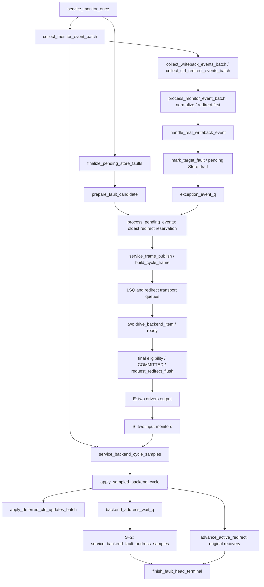

# V2 Fault / Exception Flow

更新日期：2026-11-17。本文描述后端周期帧与RM参考冻结衔接后的真实scheduler调用链；专项验收仍以implementation review的证据与待办为准。

## 1. 术语与抽象功能说明

| 术语 | 本流程中的含义 | 代码落点 | 示例 |
|---|---|---|---|
| UID、ROB key | 主表逻辑编号、完整ROB环形编号 | `status_transaction`及主表 | UID11重发时仍是11，ROB归属需独立核对 |
| dynamic epoch、issue epoch、replay sequence | 动态实例代次、目标发射代次、重试编号 | `dynamic_epoch/load_issue_epoch/sta_issue_epoch/replay_seq` | 旧发射结果不能归属新重试 |
| reset epoch、sample | 复位代次、全DUT公共物理采样编号 | `memblock_sync_pkg` | 相同sample数字也不能跨reset使用 |
| batch、semantic batch | 正常提交UID列表、同拍WB/IQ/违例语义事件组 | `commit_uids`、`events` | 一组正常Store可形成非零scommit |
| frame、projection | 一次完整后端发布对象、其中实际端口值 | `memblock_backend_cycle_frame_t/transport.head/tail` | rollback主帧与下一拍尾帧同item预装 |
| reservation、ready、COMMITTED | 未生效的准备预占、两driver已经持有item、最终确认未来边沿 | `backend_redirect_reserved/backend_release_by_id` | 准备时不递增flush epoch |
| E、S、S+2 | driver输出边沿、DUT实际输入采样、普通LSQ异常地址目标拍 | `edge_sample/input_sample/target_sample` | E11输出，S12采样，14采异常地址 |
| sampled-applied | 两路实际输入匹配后业务状态已记账 | `frame.applied` | 准备与finish_item都不开放RM比较 |
| owner、active map | 唯一恢复拥有者、ROB/LQ/SQ反查活跃UID的索引 | `active_redirect`及`uid_by_active_rob`等 | 恢复继续使用原cancel record |
| cursor、watermark、prefix | 提交游标、生产完成水位、连续终态进度 | `commit_cursor_uid/backend_*_watermark/terminal_done_uid` | 不每拍扫描历史主表 |
| fault head、fault token、terminal | 故障ROB队首、故障恢复私有记录、指令最终收口 | `fault_head_waiting`及终态状态 | fault的rob_commit并非正常退休 |
| rollback、reissue、cancel | 访存违例冲刷、重发旧UID、取消旧执行实例 | 原redirect恢复路径 | 违例指令无需成为fault head |
| sideband、level、pulse | 随附控制信号、保持值、单拍脉冲 | 类别/pending与scommit/flushSb | 清fault token不撤销异常类别保持值 |
| CANCELLED_RESET/CANCELLED_COVERED | 原公共恢复对尚未采到地址的合法复位/覆盖取消 | 地址frame.address_status及只读cancel_reason | 数据已消费后S+2前发生reset，地址责任按同实例取消 |
| raw、bounded history、FIFO | 原始采样、固定容量历史、按序队列 | `backend_*_by_sample`、运输队列 | 同值和零地址仍连续记录 |
| LSQ、LQ、SQ、STA、STD、WB、IQ | 访存队列、读/写队列、Store地址/数据目标、写回、发射反馈 | 原agent与handler | Store fault保持STA/STD真实WB屏障 |
| AF、PF、GPF、AMO、CMO、VLS | 访问/页/Guest页错误、原子、缓存块操作、向量访存 | `exception_vec/op_class` | AMO类别沿既有load-like规则 |
| flushSb、CSR | StoreBuffer排空请求、访问控制上下文 | 原flush请求、`issue_csr` | flushSb不随异常自动置1 |

抽象功能职责：原WB路径记录访问结果，scheduler协调真实后端输入边界，原提交与恢复路径完成状态和资源收口；monitor只保存事实。`backend_cycle_mode=0`的software-only及旧入口保持原兼容路径。

## 2. 函数调用 Flow 图



**函数调用 Flow 图整体文字伪代码：**

```text
1. service_monitor_once在原唯一服务循环内收集本拍WB/IQ/访存违例；原batch先完成身份归属和redirect-first选择。
2. 未被覆盖的真实fault由writeback handler落目标状态并送recovery队列；scalar Store先保存pending证据，双真实WB齐后才提升UID故障。
3. 同一collect_monitor_event_batch先处理已经实际采样的后端帧，再释放deferred deq/cancel；本拍准备的新帧尚不记账。
4. prepare_fault_candidate只选合法ROB故障队首，保存准备身份并提交原intent；process_pending_events仍按最老优先仲裁，选中只保存reservation。
5. service_frame_publish为两worker预装同一完整运输对象；等待双ready时观察和flushSb继续服务。
6. 双ready后最终核验身份与资格，固定未来E/S，才一次激活原redirect owner和accepted；两个driver在E输出，普通fault同S采样正确类别、指针、零提交和redirect。
7. 输入monitor连续保存事实；service_backend_cycle_samples在S样本完整匹配后才调用apply更新fault rob_commit、token与恢复放行标志。
8. 原恢复按drive回执、实际sampled-applied和真实cancel证据推进；S+2地址单独收集。fault最终收口等待必需地址完成，但不等待RM比较通过。
9. 访存违例保留原冲刷与重发范围，R主帧可带合法older提交，R+1预装阻塞尾拍；它不建立fault token，也不要求违例UID成为故障队首。
```

## 3. 真实故障证据：`handle_real_writeback_event()`

源码位置：`mem_ut/ver/ut/memblock/seq/base_seq_help/writeback_status_handler.sv`。

**抽象功能描述：** 原batch确认本拍事件可消费后，由该函数把真实故障写入对应目标状态并送恢复队列。它不驱动异常redirect或修改提交游标。

真实逻辑摘要：

```systemverilog
if (!data.mark_target_fault(uid, wb_event.target, issue_epoch, replay_seq, wb_event.exception_vec, wb_event.cycle)) begin
                `uvm_info("WB_STATUS", $sformatf("drop stale fault uid=%0d target=%0d", uid, wb_event.target), UVM_LOW)
                return 1'b0;
            end
            data.push_feedback_event(wb_event);
            return 1'b1;
```

**中文伪代码：**

```text
本段承担真实fault证据落表。先把UID、target及已归属的issue/replay身份交mark_target_fault；该函数拒绝旧实例时只记录drop并返回，不能推高新实例fault。
成功后push_feedback_event再次规范事件并写exception_event_q，然后返回成功。
mark_target_fault负责目标写回与故障证据；Store可先进入pending草稿，UID故障由原finalize在同实例双真实WB屏障后形成。
```

原normal STA路径的IQ成功前置条件、STD value-only双flag反查与迟到raw身份仍以[IQ/WB流程](iq_feedback_replay_v2_flow.md)为准。单侧Store故障不提前建立阻塞缺侧dispatch的fault准备。

## 4. 同拍消费顺序：`collect_monitor_event_batch()`

源码位置：`mem_ut/ver/ut/memblock/seq/base_seq_help/memblock_dispatch_base_sequence.sv`。

**抽象功能描述：** 该服务将已采样WB与后端输入按固定先后写入软件状态，确保deq/cancel释放资源前应用同拍提交。它仍由原dispatch服务调用。

真实逻辑摘要：

```systemverilog
monitor_adapter.collect_writeback_events_batch(events, sample_cycle, sample_cycle_valid);
    monitor_adapter.collect_ctrl_redirect_events_batch(events,
                                                       deferred_ctrl,
                                                       sample_cycle,
                                                       sample_cycle_valid);
    monitor_batch_handler.process_monitor_event_batch(events);
    if (memblock_sync_pkg::backend_cycle_mode)
        memblock_backend_cycle_scheduler::get().service_backend_cycle_samples();
    // 中文注释：semantic batch 已完成 redirect-first/feedback 处理后，才释放本拍
    // ctrl/deq 对应的 LQ/SQ mapping；失败的队首 raw 保留到后续 service tick 重试。
    monitor_adapter.apply_deferred_ctrl_updates_batch(deferred_ctrl);
    // STD late tombstone 只保存短时 redirect 前流水线残留的身份；每个 service
    // sample 清理有限关联表，避免 ROB wrap 后旧 key 长期遮蔽新实例。
    data.service_std_late_raw_tombstones();
```

**中文伪代码：**

```text
先收集WB/IQ及ctrl中的违例事件，ctrl deq只暂存不立即释放。
process_monitor_event_batch完成本拍语义规范化、redirect-first和目标状态更新。
backend_cycle_mode开启时，service_backend_cycle_samples只消费已经真实采到的两侧输入并应用批准状态。
随后apply_deferred_ctrl_updates_batch按原匹配规则释放LQ/SQ或处理cancel；最后清理有限STD迟到身份表。
adapter负责原事件运输，batch handler负责可消费事件选择，scheduler不替换它们的归属规则。
```


## 5. 故障准备：`prepare_fault_candidate()`

源码位置：`mem_ut/ver/ut/memblock/seq/base_seq_help/memblock_backend_cycle_scheduler.sv`。

**抽象功能描述：** 真实故障到达合法ROB前沿后，该函数预先建立候选与原redirect intent，使异常类别与redirect可以在同一未来输入边界发布。准备本身不提交指令。

真实逻辑摘要：

```systemverilog
if (!commits.select_fault_head_candidate(uid)) return;
        data.backend_fault_prepared = 1;
        data.backend_prepared_fault_uid = uid;
        data.backend_prepared_fault_key = data.get_status(uid).get_rob_key();
        data.backend_prepared_fault_epoch = data.get_status(uid).dynamic_epoch;
        redirect = '{default:'0};
        redirect.valid = 1;
        redirect.rob_key = data.backend_prepared_fault_key;
        redirect.flush_itself = 1;
        redirect.level = 1;
        if (!data.submit_redirect_intent(uid, redirect, auto_fault_intent_id)) begin
            `uvm_fatal("BACKEND_FRAME", "fault head could not prepare its redirect intent")
        end
```

**中文伪代码：**

```text
本函数只在周期模式且当前无在途帧时准备。已有准备若dynamic改变或被kill/flush则撤销auto intent与标志，然后返回。
无准备时调用select_fault_head_candidate：只有真实fault、合法head和Store双真实WB等前提满足才返回UID。
保存UID、完整ROB key和dynamic，构造level1、flush-itself的异常redirect，交submit_redirect_intent沿原公共队列参与后续最老仲裁。
无法提交必要intent属于协议错误并fatal；该阶段不修改rob_commit、不调用request_redirect_flush、不递增flush epoch。
```


## 6. 原仲裁中的准备预占：`process_pending_events()`

源码位置：`mem_ut/ver/ut/memblock/seq/base_seq_help/exception_redirect_replay_handler.sv`。

**抽象功能描述：** 原恢复handler继续选择最老redirect；周期模式将选中结果保存为准备预占，交scheduler最终激活。新的更老请求在准备期间仍可重新参与选择。

真实逻辑摘要：

```systemverilog
if (memblock_sync_pkg::backend_cycle_mode) begin
                // 中文注释：仲裁仍在原handler，reservation阶段不分配真实cancel owner。
                data.backend_redirect_reserved = 1;
                data.backend_reserved_redirect = redirect_event;
                requeue_events_not_flushed_by_redirect(events, redirect);
                return;
            end
```

**中文伪代码：**

```text
先推进原PTW等待和active redirect；已有active或旧owner窗口则返回，避免第二owner。
把已有reservation与新反馈一起参与原最老选择，过滤旧reset和未到eligible周期的intent。Store故障若尚无匹配prepared资格仍按原规则等待。
周期模式选中后保存backend_reserved_redirect并置backend_redirect_reserved；requeue_events_not_flushed_by_redirect将未被本次范围覆盖的事件放回，随后返回。
该预占使原pending检测和issue门禁看见待冲刷边界，但不分配cancel record；最终owner只在service_frame_publish中创建。
```


## 7. 主帧构造：`build_cycle_frame()`

源码位置：`mem_ut/ver/ut/memblock/seq/base_seq_help/memblock_backend_cycle_scheduler.sv`。

**抽象功能描述：** 该函数把原提交候选和获选redirect冻结为主帧，故障帧携带准确的异常地址选择类别。它也为rollback一次生成紧邻尾拍。

真实逻辑摘要：

```systemverilog
if (frame.has_fault) begin
                frame.commit_uids.delete();
                frame.transport.head.scommit = 0;
                frame.transport.head.pending_st = 0;
                frame.transport.head.pending_mmio = 0;
                frame.transport.head.pending_flag = data.backend_prepared_fault_key.flag;
                frame.transport.head.pending_value = data.backend_prepared_fault_key.value;
                frame.transport.head.store_exception = commits.fault_uid_is_store_exception(frame.uid);
            end
```

**中文伪代码：**

```text
先调用原build_lsqcommit_xaction获得候选、指针和pending值，再结合唯一reserved redirect。
fault匹配prepared UID和ROB且不属于memoryViolation时，清空正常提交列表、scommit与pending，指针固定fault head，类别按fault_uid_is_store_exception派生。
随后保存ROB/dynamic/issue/replay/exception与issue CSR；普通标量设置LSQ地址必需，AMO独立来源保留范围外标记。
rollback只保留仍合法且不在冲刷范围的older列表，tail复用主帧身份并清提交/pending/redirect，使用冻结后的真实next-head key。
frame_id和reset建立运输身份，不代表该帧已经被DUT采样。
```

`fault_uid_is_store_exception()`沿统一行为：普通Load为0，scalar Store/CMO为1，AMO继续既有load-like类别；不能按异常cause猜类别。

## 8. 最终确认：`service_frame_publish()`

源码位置：`mem_ut/ver/ut/memblock/seq/base_seq_help/memblock_backend_cycle_scheduler.sv`。

**抽象功能描述：** 该函数在原服务周期内等待两侧准备完成并批准共同未来边沿，只在这一步激活原恢复owner。它不会等待driver而阻塞观察服务。

真实逻辑摘要：

```systemverilog
if (frame.has_redirect) begin
                data.request_redirect_flush(frame.redirect_event.redirect);
                data.backend_redirect_sampled_applied = 0;
                data.backend_redirect_reserved = 0;
                if (frame.redirect_event.source == MEMBLOCK_WB_EVENT_SOURCE_REDIRECT) begin
                    data.mark_redirect_intent_accepted(frame.redirect_event.redirect_intent_id);
                    if (auto_fault_intent_id == frame.redirect_event.redirect_intent_id) begin
                        void'(data.consume_redirect_intent_accepted(auto_fault_intent_id));
                        auto_fault_intent_id = 0;
                    end
                end
            end
            frame.approved = 1;
```

**中文伪代码：**

```text
每次先服务flushSb并推进物理来源槽；无帧时构造一次并入两条运输队列。
已有帧先处理取消回执；未COMMITTED时检查当前获选intent及冻结UID资格，失效则取消整单，等待两worker退出后重建。
双ready未齐即返回；齐后要求worker在线且两monitor属于同一当前sample。
带redirect时调用request_redirect_flush一次分配原cancel owner和flush epoch，随后accepted只按原intent来源登记，清reservation。
批准后固定input_sample=C+2、输出边沿E=C+1、LSQ来源S-1；rollback来源S，故障同源使用S-1。预装地址目标S+2后发布committed。
check_backend_cycle_commit_eligibility保持发布前纯检查，apply不再执行能撤销已发scommit的资格重选。
```


## 9. 两侧真实驱动：`drive_backend_item()`

源码位置：`mem_ut/ver/ut/memblock/agent/lsqcommit_agent_agent/src/lsqcommit_agent_agent_driver.sv`。

**抽象功能描述：** LSQ driver持有整个主尾运输单元，在约定边沿写原LSQ端口；redirect driver按同一运输身份写原redirect端口。两者各自保持单写者。

真实逻辑摘要：

```systemverilog
tail = main_driven && tr.backend_cycle.has_tail;
        if (release_state.committed && edge_sample == release_state.edge_sample + (tail ? 1 : 0)) begin
            projection = tail ? tr.backend_cycle.tail : tr.backend_cycle.head;
            pkt.io_ooo_to_mem_lsqio_pendingPtr_flag = projection.pending_flag;
            pkt.io_ooo_to_mem_lsqio_pendingPtr_value = projection.pending_value;
            pkt.io_ooo_to_mem_lsqio_pendingst = projection.pending_st;
            pkt.io_ooo_to_mem_lsqio_pendingMMIOld = projection.pending_mmio;
            pkt.io_ooo_to_mem_lsqio_scommit = projection.scommit;
            pkt.io_ooo_to_mem_isStoreException = projection.store_exception;
            this.send_pkt(pkt);
            memblock_sync_pkg::acknowledge_backend_drive(tr.backend_cycle.frame_id, 0, tail, edge_sample);
```

**中文伪代码：**

```text
driver接到完整item先登记本侧ready，然后逐drv_cb边沿服务。reset、取消或运输身份失效时输出安全idle并登记finished返回。
正常等待期间每拍drive_active_idle保持pending/类别电平、清scommit；flushSb仍由本侧独立合成。
当公共边沿等于最终批准E时，选择主projection，写pending/head/category/scommit并登记driven；有tail时下一边沿直接选tail，不重新取item或等待ready。
redirect侧采用同样边沿合同只写redirect字段。错过已批准边沿属于运输错误，立即fatal。
两个monitor在下一实际输入拍S分别记录本侧字段；item_done或driven回执本身均不等价于输入已消费。
```


## 10. 实际输入确认：`service_backend_cycle_samples()`

源码位置：`mem_ut/ver/ut/memblock/seq/base_seq_help/memblock_backend_cycle_scheduler.sv`。

**抽象功能描述：** 该函数配对同一S的两路monitor值，匹配冻结projection后才调用提交handler应用业务状态。它同时推进独立地址采集。

真实逻辑摘要：

```systemverilog
actual = memblock_sync_pkg::backend_lsq_input_by_sample[sample_seq].value |
                 memblock_sync_pkg::backend_redirect_input_by_sample[sample_seq].value;
        expected = is_tail ? frame.transport.tail : frame.transport.head;
        if (actual !== expected ||
            memblock_sync_pkg::backend_lsq_input_by_sample[sample_seq].reset_epoch != frame.transport.reset_epoch ||
            memblock_sync_pkg::backend_redirect_input_by_sample[sample_seq].reset_epoch != frame.transport.reset_epoch) begin
            `uvm_fatal("BACKEND_FRAME", $sformatf("backend input mismatch frame=%0d tail=%0d sample=%0d actual=%h expected=%h", frame.transport.frame_id, is_tail, sample_seq, actual, expected))
        end
        if (!frame.applied) begin
            commits.apply_sampled_backend_cycle(frame);
```

**中文伪代码：**

```text
先消费到齐的required地址；当前无frame或尚未committed则返回。两driver主driven齐后仅一次mark_redirect_drive_done，保留原anchor/deadline合同。
目标样本为主S或已经应用主帧后的S+1尾拍；两路watermark未到目标则等待，到水位却缺历史就fatal。
把两侧互斥字段合成actual，严格比较expected和reset epoch；不一致立即fatal，不推进提交。
主样本匹配后调用apply_sampled_backend_cycle一次记账并保存保持projection；有tail则保护下一目标继续等待。
tail采样匹配且两侧finished后删除release、清输入保护水位和在途frame。地址历史可继续保留到S+2独立消费。
```


## 11. 故障记账：`apply_sampled_backend_cycle()`

源码位置：`mem_ut/ver/ut/memblock/seq/base_seq_help/lsq_commit_handler.sv`。

**抽象功能描述：** 已批准且实际采样确认的fault在这里开放原RM门槛并建立故障token，随后原恢复可以继续。它不把fault当作正常Store提交。

真实逻辑摘要：

```systemverilog
if (frame.has_fault) begin
            status = data.get_status(frame.uid);
            // 第三项RM方案在此rob_commit写入前接入值型参考快照；本项只保留实际身份。
            data.backend_fault_address_by_uid[frame.uid] = frame;
            if (frame.address_required) data.backend_address_wait_q.push_back(frame.uid);
            status.rob_commit = 1;
            status.last_event_cycle = $time;
            data.quiesce_fault_uid_pending_work(frame.uid, 0);
            fault_head_waiting = 1;
            fault_head_uid = frame.uid;
            fault_head_dynamic_epoch = frame.dynamic_epoch;
            fault_head_rob_key = frame.rob_key;
            fault_head_redirect_covered = 1;
            data.backend_fault_prepared = 0;
            data.try_retire_committed_uid(frame.uid);
        end
```

**中文伪代码：**

```text
本函数要求approved；已applied直接返回，保证重复服务不重复记账。正常批准列表和control先按各自原退休规则处理。
fault分支先保存完整frame到按UID地址记录，required时写等待队列，再置status.rob_commit并保持真实fault异常。
quiesce_fault_uid_pending_work只关闭本故障不再合法的待办；保存fault token完整身份并标记此redirect已覆盖，清prepared。
try_retire_committed_uid继续依赖真实资源条件；最后更新类别保持值、applied和backend_redirect_sampled_applied。
本项在rob_commit之前留有第三项RM值型快照接入位置；当前未宣称已经实现该后续快照。
```


## 12. S+2地址归属：`service_backend_fault_address_samples()`

源码位置：`mem_ut/ver/ut/memblock/seq/base_seq_help/common_data_transaction.sv`。

**抽象功能描述：** 该函数从连续raw历史提取已确认fault帧的指定地址sample，保留整组VA/GPA/VS非叶标记。地址数值本身不承担有效性或UID识别职责。

真实逻辑摘要：

```systemverilog
target_sample = frame.target_sample;
            if (memblock_sync_pkg::backend_address_watermark < target_sample) return;
            if (!memblock_sync_pkg::backend_address_by_sample.exists(target_sample)) begin
                frame.address_status = memblock_backend_cycle_frame_t::ERROR_MISSING_SAMPLE;
                `uvm_fatal("BACKEND_ADDRESS", $sformatf("missing fault address uid=%0d frame=%0d sample=%0d", uid, frame.transport.frame_id, target_sample))
            end
            frame.address = memblock_sync_pkg::backend_address_by_sample[target_sample];
            if (frame.address.reset_epoch != frame.transport.reset_epoch) begin
                `uvm_fatal("BACKEND_ADDRESS", "fault address crossed reset epoch")
            end
            frame.address_captured = 1;
            frame.address_status = memblock_backend_cycle_frame_t::CAPTURED;
```

**中文伪代码：**

```text
只处理未完成地址队列的队首，目标来自最终确认时的S+2。
生产watermark未到目标就返回；已到却无该sample则标记ERROR_MISSING_SAMPLE并fatal。
读取该sample的完整地址组，核对reset epoch，随后置captured/CAPTURED并出队，再把历史保护水位改为下一等待目标。
ctrl monitor每有效公共sample发布raw，因此零地址、重复同值不被丢弃；归属依赖冻结frame的UID/ROB/dynamic/issue/replay与指定sample，不能取latest。
固定64拍历史覆盖未消费目标前必须报错，不能静默覆盖或无限等待。
```


## 13. 原恢复与最终收口

源码位置：`mem_ut/ver/ut/memblock/seq/base_seq_help/exception_redirect_replay_handler.sv`。

**抽象功能描述：** advance_active_redirect保持原驱动/anchor/cancel生命周期，并加入真实输入已记账的必要门槛。故障最终游标推进仍由原提交handler完成。

真实逻辑摘要：

```systemverilog
if (data.backend_redirect_recovery_eligible() &&
            data.redirect_drive_done_for(redirect) &&
            data.cancel_redirect_scan_ready(redirect)) begin
            if (!data.apply_redirect_flush(redirect)) begin
                return;
            end
```

**中文伪代码：**

```text
已有active redirect时，先要求本帧backend_redirect_sampled_applied，再要求原drive_done及cancel_scan_ready。
三者满足才调用apply_redirect_flush沿原范围冲刷和重发；未满足则继续等待，原timeout只告警而非成功结束。
finish_fault_head_terminal另外检查backend_fault_address_ready，required地址未采完不推进fault游标；到齐后完成故障资源token、推进cursor并清私有fault token。
clear_fault_head_token只清私有生命周期，不撤销最近已发布的isStoreException保持值；新的fault或reset负责覆盖它。
```

reset_runtime取消运输、未完成地址、prepared intent及来源槽；原reset合法性约束仍有效。独立AMO来源不伪造成普通LSQ地址检查；segment在主表validate和公共behavior入口均被拒绝，当前不能通过合法生产路径到达scheduler，ADDRESS_SEGMENT仅预留。

## 14. 兼容路径、性能与后续接口

`backend_cycle_mode=0`时，旧LSQ/redirect sequence继续原finish_item后标记路径，供既有software-only与legacy使用；其行为不代表真实新周期帧的采样时序。真实auto-build主流程启动时要求两个worker和输入monitor启用，否则立即报配置错误。

每拍只处理一个在途帧、有限提交宽度、当前事件组及最多64拍采样历史；地址等待队列只保存尚未完成的故障，不扫描run级历史。正常结束继续使用原terminal前缀和runtime drain，新帧、运输队列、reservation及required地址均纳入排空。

后续RM方案将在实际apply且恢复前冻结参考输入，消费本项地址事实；本项不推导VA/GPA expected、不写trap CSR、不新增第二套恢复或TLB失效owner。

## 当前实现验证边界（2026-11-17）

当前`compile_backend12.log`成功，`run_backend_transport.log`的两真实driver/monitor专项81项通过，生产helper、两正常Store及真Store PF分别由`run_backend_helpers_final.log`、`run_backend_normal_final.log`、`run_backend_final_storepf_wave.log`通过，均UVM_ERROR/FATAL=0。日志位于`~/.tmp/memblock_virtualization_impl_20261117`。

运输自测无LSQ入队且scommit/pending为0，只证明共同E/S、紧邻尾拍、同值与准备取消；合法older业务前缀由生产helper验证，不能据此宣称真实访存违例端到端完成。波形检查由主代理继续，reset主尾/flushSb准备窗口等未另实测部分保留证据边界。详见[实现评审](../plan/test_framework/review_doc/undo/memblock_v2_backend_cycle_frame_implementation_review_20261117.md)。


## 2026-11-17：恢复前参考冻结与RM独立地址责任

抽象功能描述：`apply_sampled_backend_cycle()`在真实输入已经确认后，先保存fault访问的参考值，再开放原rob_commit门槛和恢复；RM另行消费地址，不成为资源恢复的新owner。

源码位置：`mem_ut/ver/ut/memblock/seq/base_seq_help/lsq_commit_handler.sv`。功能摘要：normal/fault批内先freeze后rob_commit；fault随后沿原quiesce、fault head与redirect放行流程。

```systemverilog
data.freeze_access_reference_for_rm(frame.uid);
data.backend_fault_address_by_uid[frame.uid] = frame;
status.rob_commit = 1;
data.quiesce_fault_uid_pending_work(frame.uid, 0);
```

中文伪代码：本段负责让恢复不销毁RM输入。帧获得实际sample确认后，普通批准UID逐个冻结参考再提交；fault把原UID/ROB/dynamic/issue/replay对应的完整CSR、首页及真实后页payload深复制，随后登记独立地址frame并置rob_commit，最后按原quiesce取消等待。freeze不计算expected、不延迟原资源回收；legacy mark入口为软件自测保留相同冻结时机。

抽象功能描述：`observer_service_exception_addresses()`对数据已经按原程序游标消费的异常item核对地址责任，不再执行Store commit。

源码位置：`mem_ut/ver/ut/memblock/env/src/memblock_rm/memblock_rm.sv`。功能摘要：读取frame已保存的四态整组输出，与独立VA/GPA参考比较。

```systemverilog
identity_ok=actual.sample_seq==actual.target_sample && actual.sample_seq==actual.input_sample+2;
if(guest_fault) mismatch |= actual.gpaddr !== item.expected_gpaddr;
```

中文伪代码：本段负责异常地址检查。数据compare/commit推进current_uid后，异常Load/Store item进入地址责任队列；服务只消费已经到齐的队首，未到齐则保留等待。readonly按UID/ROB/dynamic复制原frame事实；若required、有效且未capture/非missing的frame明确为reset/covered取消，并匹配冻结reset/issue/replay，RM仅删除地址责任；其他样本核对reset/issue/replay及S+2；独立预异常使用fault_report_va，普通VA按模式扩展，GPF从原S1 sector或onlyS2输入推导GPA与VS标记。VA/GPA使用四态不等，零地址和重复值不影响valid。到齐比较后删除该责任；终场仍缺必需样本则报错。frame读取不重新采样，GPA函数不从actual决定leaf/nonleaf或故障段。

端到端行为总结：真实fault WB→原fault head/frame→S实际采样→freeze参考→原rob_commit/quiesce/恢复；S+2样本仍由原公共采集器保存；RM数据比较与原内存游标只推进一次，地址责任另行到齐并比较，缺失或失败不会因框架terminal收口而自动变成通过。详见[RM实现评审](../plan/rm_review_doc/undo/memblock_v2_virtualization_rm_implementation_review_20261117.md)。


### 合法取消的独立地址责任

抽象功能描述：`observer_service_exception_addresses()`消费原恢复已经明确取消的地址责任，允许数据完成与地址收口跨拍；它不将缺样本默认视作取消。

源码位置：`mem_ut/ver/ut/memblock/env/src/memblock_rm/memblock_rm.sv`；只读字段来自`memblock_rm_readonly_api::read_backend_exception_address_for_rm()`。

```systemverilog
if(actual.canceled && actual.valid && actual.required && !actual.captured && !actual.missing &&
   actual.cancel_reason inside {int'(memblock_backend_cycle_frame_t::CANCELLED_RESET),
                                int'(memblock_backend_cycle_frame_t::CANCELLED_COVERED)})
    observer_pending_address.delete(index);
```

上面摘要省略了源码紧接的冻结reset/issue/replay身份条件；取消必须仍属于当前待检查item。

中文文字伪代码：本段负责在S+2前reset或覆盖发生时正确结束地址责任。服务先通过UID/ROB/dynamic索引取得原frame，未到齐则等待队首，终场仍缺则报错。frame合法reset/covered取消时要求有效、required、未capture、非missing，并核对冻结reset/issue/replay；满足才删除责任且不重做Store效果。其余样本必须满足目标S+2、同执行实例，并与独立VA/GPA/VS标记比较；缺证据及非法取消保留错误，不能因terminal_done而通过。

端到端文字伪代码：已消费异常item→地址队列→原frame合法取消→同实例核对→仅删除地址责任；地址仍需采样且没有取消→等待S+2事实→独立比较→删除责任；未有样本又未合法取消→最终报缺失。
