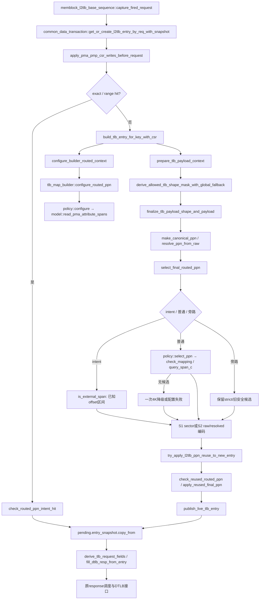

# L2TLB 可路由 PPN 生成函数流程

日期：2026-11-02。版本：V2。本文描述当前测试框架源码，不声明专项仿真已经通过。

关联方案：[L2TLB可路由物理页随机覆盖方案](../plan/test_framework/plan/do/memblock_l2tlb_routed_ppn_coverage_plan_20261102.md)。地址范围与实现边界见[地址合同分析](../analysis/framework_design/memblock_routed_ppn_address_contract_20261102.md)。

## 1. 术语与抽象功能说明

| 英文术语 | 当前流程中的中文含义 | 代码对象或状态落点 | 场景示例 |
|---|---|---|---|
| PPN / PA / VPN | 物理页号、物理字节地址、虚拟页号 | builder、lookup key | PA保留VA的低12位 |
| PMA / PMP | 物理属性表及权限保护表 | `memblock_pma_pmp_model` | PMA c位与总线译码分别判断 |
| PBMT | 生效的页面访问类型 | `effective_pbmt()` | 00遵循PMA，01为NC，10为IO |
| NC / IO / MMIO | 不缓存主存、IO属性、按PMA判定的设备访问 | DUT Uncache路径 | PBMT00+c0属于PMA-MMIO |
| generation / snapshot | 已提交表版本及只读历史副本 | `pma_history`、策略值型区间 | 后续CSR写不改变旧版本查询 |
| sample / replay / FIFO | 采样序号、顺序应用事件、待消费事件队列 | `apply_pma_pmp_csr_writes_before_request()` | C采集的CSR写到C+2成熟 |
| canonical / raw / resolved | 规范基页、响应编码、按输入VPN重组后的物理页 | `make_canonical_ppn()`等 | NAPOT编码不是最终PA |
| sector | S1响应中的八个页扇区 | `s1_valididx/s1_ppn_low` | 普通4K仅一个扇区有效 |
| shape / NAPOT | 映射覆盖形状、连续64K页编码 | level、PTE.N | 全shape需避开路由洞 |
| stage / GPA | 翻译阶段、S1输出的中间地址 | S1/S2字段、S2 tag | allStage只对S2最终PA做路由策略 |
| owner / intent | 公共状态管理者、主表预先登记的地址意图 | common data、`routed_ppn_intent_by_vpn` | UART低12位由上游保障 |
| hit / miss / reuse | 已有映射命中、新映射构建、完成页复用 | canonical表、PPN历史FIFO | 命中不重写映射；复用需重新检查 |
| token / UID | 一次L2请求身份、主表操作身份 | pending record、main table | 同VPN请求也各有独立token |
| reset / debug | 复位生命周期、调试访问属性 | 表清理、PMA查询参数 | 非debug访问调试区遵循模型默认拒绝 |
| A.fire | memory-facing请求valid与ready同时为1 | 窄窗口vseq被动观察 | 到达外部responder才是访问证据 |

抽象职责：本流程在普通合法翻译的新条目构造期间选择可送到UT外部响应端的物理映射。它读取观测驱动的PMA版本，保留安全cacheable候选，恢复NC/IO及PMA-MMIO地址多样性；不接管RM的数据与异常比较，也不模拟APLIC/UART寄存器。

## 2. 真实函数调用图



### 函数调用 Flow 图整体文字伪代码

```text
capture_fired_request接收真实request fire，保存VPN/s2xlate以及对应CSR快照；
get_or_create先应用该sample已成熟的PMA/PMP写入，再检查exact/range映射；
  命中时只校验可选intent与已存在映射是否矛盾，保持映射内容；
  未命中时创建builder，以请求sample选定PMA历史generation，传递原VPN对应intent；
  policy只复制解析后的属性区间，不消费CSR FIFO；
prepare固定stage/PTE/fault/PBMT；公共owner计算occupancy允许的shape；
finalize生成确定性候选，解析最终PA对应stage；
  strict、CSR权限专项、fault及非LEGAL路径保留既有构造；
  intent路径用主表已保证offset的目标物理页；
  普通路径用路由与PMA属性共同选择完整shape；
  普通大shape无候选时最多降到4K一次；显式shape不静默降级；
最终编码完成后，有界reuse FIFO中的候选再经过同类检查；
publish只发布一次，随后pending复制不可变payload；
请求自己的VPN重新派生resolved字段，沿既有调度向DTLB返回。
```

## 3. 请求边界与共享模型准备

源码：`mem_ut/ver/ut/memblock/seq/base_seq/memblock_l2tlb_base_sequence.sv`、`seq/base_seq_help/common_data_transaction.sv`。

### 3.1 `capture_fired_request()`与`get_or_create_l2tlb_entry_by_req_with_snapshot()`

抽象功能描述：真实响应端为每次请求取得规范翻译条目。公共数据层负责把模型推进到可用于本次构造的有效版本；命中条目保持只读，新条目构造成功后才发布。

真实逻辑摘要：

```systemverilog
if (pma_query_sample != 0 &&
    !apply_pma_pmp_csr_writes_before_request(pma_query_sample)) return 1'b0;
...
entry = build_tlb_entry_for_key_with_csr(request_key, csr_snapshot, pma_query_sample);
...
publish_live_tlb_entry(request_key, entry, csr_snapshot);
```

输入/输出：输入为VPN、s2xlate、CSR快照、request sample及reuse策略；输出为现有或新建entry、anchor key、命中类别。CSR FIFO只有既有回放owner消费，builder不消费。

文字伪代码：

```text
本函数为真实L2请求选择唯一规范条目；
检查CSR快照存在；有sample时先调用成熟写回放，失败直接返回；
生成request key，先检查exact，再查询已有range映射；
  若命中：校验intent，更新last_hit_cycle，返回同一entry；
  若未命中：调用build完成新payload；
如允许reuse：窄intent拒绝reuse，普通entry进入有界history资格过滤；
最后调用publish注册live表、range与父区域索引，返回新entry；
responder复制entry为本token快照，不再让后续构造改变它。
```

### 3.2 `configure_builder_routed_context()`

抽象功能描述：公共owner把已初始化模型的一个确定版本及原始VPN的可选地址意图传给builder，不为构造器另建PMA真源。

真实逻辑摘要：

```systemverilog
if (query_sample != 0) begin
    if (!pma_pmp_model.get_generations_before_sample(query_sample, pmp_gen, pma_gen))
        `uvm_fatal("L2TLB_ROUTED_PPN", "no effective PMA generation for request sample")
end else pma_pmp_model.get_current_generations(pmp_gen, pma_gen);
builder.configure_routed_ppn(pma_pmp_model, pma_gen, csr.priv_debug, intent);
```

文字伪代码：

```text
strict或CSR权限专项直接保留既有构造入口；
否则检查builder、CSR和模型已经初始化；
真实请求按sample取得有效generation，无sample兼容入口用当前已提交版本；
按原lookup VPN查询intent，不按allStage的中间GPA查询；
调用configure_routed_ppn冻结属性区间和intent，供本次构造读取。
```

## 4. PMA属性区间查询

源码：`seq/base_seq_help/memblock_pma_pmp_model.sv`、`memblock_routed_ppn_policy.sv`。

### 4.1 `read_pma_attribute_spans()`

抽象功能描述：将指定PMA历史版本导出为互不重叠的值型属性区间，保留既有first-match、默认属性及debug规则。输出不是内部表句柄，不修改UID上下文。

真实逻辑摘要：

```systemverilog
snapshot = get_table_snapshot(1'b1, generation);
if (snapshot == null) return 1'b0;
...
if (find_first_match(snapshot, span.first[47:0], 1, debug,
                     hit_index, matched_entry)) begin
    span.c = matched_entry.c;
    span.r = matched_entry.r;
    ...
end
```

文字伪代码：

```text
清空输出，未ready或历史版本缺失则返回失败；
收集0、2^48、debug区边界以及各entry的TOR/NA4/NAPOT边界；
OFF项compare_addr仍收集，因为它可能提供下一TOR项的下界；
排序去重，对每段起点调用既有first-match，size=1用于属性选择；
匹配成功复制c/r/w/x/atomic，无匹配保留全零默认；
合并相邻全部属性一致区间，返回值型队列；
该过程不执行scalar大size查询，不改变CSR表、版本或FIFO。
```

### 4.2 `configure()`、`query_c()`与`query_span_c()`

抽象功能描述：策略实例固定本次构造使用的c属性区间，并给候选地址和完整映射提供只读分类。

真实逻辑摘要：

```systemverilog
if (model == null ||
    !model.read_pma_attribute_spans(generation, debug, attributes)) return 1'b0;
...
if (first >= {15'b0, c_spans[idx].first} &&
    limit <= {15'b0, c_spans[idx].limit}) begin
    cacheable = c_spans[idx].c;
    return 1'b1;
end
```

文字伪代码：

```text
configure先清掉实例旧值，再读取指定版本属性；
把相邻同c区间合并，允许完整shape跨权限不同但c相同的边界；
保存本次generation，置configured有效；
query_c拒绝超48bit地址，再查询单字节区间；
query_span_c拒绝空区间或越界，只在整个区间同c时返回成功；
不使用static快照缓存，因此重新构造不会跨reset使用旧实例配置。
```

## 5. 构造阶段、最终PA及候选选择

源码：`seq/base_seq_help/tlb_map_builder.sv`、`memblock_routed_ppn_policy.sv`。

### 5.1 `prepare_tlb_payload_context()`与`finalize_tlb_payload_shape_and_payload()`

抽象功能描述：prepare固定新条目的CSR/PTE/fault/PBMT；finalize依据允许形状构造响应编码，物理地址策略只处理最终PA阶段。

真实逻辑摘要：

```systemverilog
entry.s1_entry_pbmt = choose_pbmt(1'b1, entry.s2xlate, csr_state);
...
if (prepared_entry.s2_stage_active && routed_policy_active(prepared_entry)) begin
    if (prepared_entry.s2_translation_mode_at_build == MEMBLOCK_SV39_MODE)
        s1_canonical_ppn[43:29] = '0;
    else s1_canonical_ppn[43:38] = '0;
end
...
if (!select_final_routed_ppn(prepared_entry, 1'b0, s2_input_vpn,
        directed_shape_override_valid, s2_canonical_ppn, address_fallback))
    `uvm_fatal("L2TLB_ROUTED_PPN", "no legal physical mapping for selected S2 shape/window")
```

文字伪代码：

```text
prepare依次冻结stage上下文、PTE模式和字段、有效fault，最后只随机一次各stage PBMT；
finalize按父区域occupancy允许集合选择shape；
生成S1候选并按原规则对齐/NAPOT编码；
  若S2有效，S1只是GPA，仅限制S2输入位宽，不套外设PA路由；
  若无S2，调用最终PA选择；
生成S1 sector与resolved字段；普通4K仅一个sector有效；
若S2有效，按S1 raw字段派生S2 tag，再生成S2候选并执行最终PA选择；
最后编码S2 38bit字段，冻结resolved值并检查payload一致性；
仅完整成功后才返回给公共owner发布。
```

### 5.2 `make_canonical_ppn()`与`select_final_routed_ppn()`

抽象功能描述：前者生成确定性原候选，后者把最终PA候选转换成与当前策略相容的映射；严格窗口、权限/fault专项不借地址修复改变原测试语义。

真实逻辑摘要：

```systemverilog
ppn = root_ppn ^ {6'b0, vpn} ^
      (s2 ? 44'h0000_005a_5a5 : 44'h0000_003c_3c3);
...
anchor = resolve_ppn_from_raw(canonical_ppn, input_vpn, level, napot);
if (routed_policy.select_ppn(canonical_ppn, anchor, shift,
        effective_pbmt(entry), seq_csr_common::get_l2tlb_ppn_region_random_wt(),
        seq_csr_common::get_l2tlb_ppn_region_id(), selected_ppn, region)) begin
    canonical_ppn = selected_ppn;
    apply_legal_napot_ppn_encoding(s1, level, napot, canonical_ppn, entry);
    ...
end
```

文字伪代码：

```text
make_canonical_ppn的strict分支沿用配置PA窗口；
普通sparse返回旧XOR候选；legacy_sparse分支仍压入历史512GiB窗口；
继续执行对应level对齐，不声称raw候选已可路由；
select_final先检查策略是否适用，不适用直接保留；
有intent时检查4K/N0及声明offset区间可路由，采用intent页；
否则解析最终anchor，调用policy选择完整shape；
  成功：写回canonical，恢复NAPOT合法编码并记录窗口/属性日志；
  无候选且显式shape或已为4K：返回失败，由母函数报错；
  普通大shape无候选：最终PA stage降到4K/N0，沿用首次anchor再试一次；
失败路径不无限重抽，不静默切换PBMT或把原c0类别换成c1。
```

### 5.3 `select_ppn()`与`check_mapping()`

抽象功能描述：policy按完整shape、真实外部译码、PMA c类别与窗口策略选择PPN。返回shape对齐canonical，后续编码者负责NAPOT。

真实逻辑摘要：

```systemverilog
constrain_c = pbmt == 2'b00 && query_c(anchor_pa, target_c);
...
if (fixed_id == -1 && candidate_ok) begin
    if (pbmt == 2'b00 && target_c) begin
        selected_pa = candidate_pa & ~(shape_bytes-1);
        selected_ppn = selected_pa[55:12];
        region_id = 0;
        return 1'b1;
    end
end
```

文字伪代码：

```text
检查配置、shape字节位数、PBMT及权重/窗口ID；
用64bit PA保留候选高位，以resolved anchor判断PBMT00原c类别；
超48bit anchor不截断查询，重选时不强加虚假的c类别；
check_mapping先验证完整shape外部可达，再为PBMT00检查整段同目标c；
  无定向窗口且安全PBMT00+c1：保留候选，不因随机权重收窄；
  其它安全候选：按region random权重决定保留或重选；
重选枚举指定窗口或全部命名窗口，与四段route及同c区间求交；
每段只保留完整shape对齐槽，先等权抽有槽的窗口，再按槽数抽内部位置；
无候选返回false；成功返回对齐canonical与窗口ID；
NC/IO不强求PMA c相同，但仍要求完整shape可路由；权限仍由原RM评价。
```

## 6. 插表前PPN复用

抽象功能描述：`try_apply_l2tlb_ppn_reuse_to_new_entry()`只对尚未发布的新4K条目使用已完成PPN历史；新增检查防止旧PPN绕过本次属性与路由策略。

真实逻辑摘要：

```systemverilog
if (l2tlb_ppn_history_q[idx].ppn_valid &&
    builder.can_apply_reused_final_ppn(entry, l2tlb_ppn_history_q[idx].ppn) &&
    builder.check_reused_routed_ppn(entry, l2tlb_ppn_history_q[idx].ppn)) begin
    candidate_indices.push_back(idx);
end
```

文字伪代码：

```text
仅扫描配置容量内的completed PPN FIFO；
每个record先通过原shape/stage/fault资格，再用当前冻结PMA版本检查route和c类别；
无候选直接不复用；有候选按原权重选择后只改新entry的最终PA；
不修改历史record、已有live entry或pending快照；
窄intent专项关闭reuse并拒绝不相容组合；
真实response completion才将本次PPN写入history，普通sfence不清历史，reset按旧规则清理。
```

## 7. 窄窗口随机主表与实际到达观察

源码：`seq/base_seq/memblock_main_dispatch_routed_ppn_sequence.sv`、`seq/virtual_sequence/memblock_l2tlb_routed_ppn_vseq.sv`。

### 7.1 `build_random_main_table()`与`register_routed_ppn_intent()`

抽象功能描述：专用主表为UART128B和部分页等目标生成合法offset，并在issue前固定VPN到物理页的关系。L2TLB接口只有VPN，无需扩展DUT接口。

真实逻辑摘要：

```systemverilog
if (order.size() == 0) begin
    for (int unsigned n = 0; n < 6; n++) order.push_back(n);
    order.shuffle();
end
...
tr.src_0 = va_base + (64'(idx) << 12) + pa[11:0];
...
if (!data.register_routed_ppn_intent(tr.vaddr[49:12], intent))
    `uvm_fatal(get_type_name(), ...)
```

文字伪代码：

```text
reset_all_tables清空旧主表与intent；
检查MAIN_VADDR能放入足够的独立Sv39正地址页；
每轮打乱六窗口次序，逐窗口随机8B对齐PA；
每笔使用独立VPN并复制PA低12位，生成普通LD；
intent记录物理页及本页内允许的完整字节范围，登记冲突或非法route报错；
全部意图登记后才初始化status并调用check_main_table_complete发布ready；
主表构造期间不创建TLB，不在response到来后修改VA。
```

### 7.2 `body()`、`start_core_dispatch_flow()`与`observe_external_a_fires()`

抽象功能描述：窄窗口vseq沿用真实smoke的agent与收尾流程，显式替换主表类型，并被动记录外部请求实际到达。

真实逻辑摘要：

```systemverilog
fork
    begin super.body(); finished = 1; end
    begin observe_external_a_fires(finished); end
join
```

文字伪代码：

```text
body先限制专项为静态Sv39单S1、4K/N0/PBMT00、无fault/动态控制/地址及PPN复用；
取得既有外部接口，父流程与被动观察并行运行；
start_core_dispatch_flow显式启动专用main、静态CSR与原LSQ/issue/commit/L2 responder；
issue与L2 responder继续等待原静态CSR barrier，不建立第二生命周期owner；
observer只在valid&&ready时按实际PA累计六窗口到达次数；
专项启动后发生runtime reset直接终止，防止清intent后继续旧主表；
结束输出实际到达次数，数据/异常正确性由原RM判断。
```

## 8. 端到端行为总结

```text
安全cacheable：真实L2 request → 成熟CSR回放 → miss builder → PBMT00+c1整shape安全
  → 保留原候选 → 编码 → 可选合法reuse → 发布 → 冻结response → DTLB。

历史B08：候选0x311368c0对应页 → PBMT00+c0或NC/IO → route拒绝
  → 从相容合法窗口抽样 → 发布安全映射 → 外部responder可接收。

大页无候选：普通shape → select_ppn无槽 → 最终PA stage一次4K降级
  → 仍无槽则fatal；显式directed shape首次失败即报错。

窄窗口：主表随机合法offset与独立VPN → 登记intent → 静态CSR barrier
  → L2 miss读取目标页 → 返回4K翻译 → DUT发出实际PA → observer记录A.fire。

已有hit：request → exact/range hit → intent一致性检查 → 复制已有payload
  → 保持映射，不按最新随机权重重新选择。
```

端到端文字伪代码描述：普通完成型映射由PMA属性和路由共同约束；cacheable安全候选保留原分布，Uncache候选避开洞。属性变化只影响新构造与复用检查，既有条目不被后台改写。窄窗口通过上游offset把整页不能表达的范围补齐，实际观察只提供到达证据；如需确认其执行成功，仍须查看真实仿真的RM与结束状态。权限/fault专项沿既有路径，不被新地址选择改写成正常访问。
