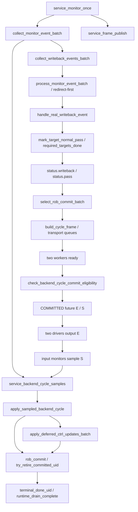

# V2 Normal Pass 与实际后端提交 Flow

更新日期：2026-11-17。正常WB仅记录目标完成；真实后端提交由共同周期帧在实际输入采样后记账。本文移除早期未落地的generation token/claim调用图，当前IQ/WB身份与排序合同参见[IQ/WB流程](iq_feedback_replay_v2_flow.md)。

## 1. 术语与抽象功能说明

| 术语 | 本流程中的含义 | 代码落点 | 示例 |
|---|---|---|---|
| UID、ROB key | 主表逻辑编号、完整ROB环形编号 | `status_transaction`及主表 | UID11重发时仍是11，ROB归属需独立核对 |
| dynamic epoch、issue epoch、replay sequence | 动态实例代次、目标发射代次、重试编号 | `dynamic_epoch/load_issue_epoch/sta_issue_epoch/replay_seq` | 旧发射结果不能归属新重试 |
| reset epoch、sample | 复位代次、全DUT公共物理采样编号 | `memblock_sync_pkg` | 相同sample数字也不能跨reset使用 |
| batch、semantic batch | 正常提交UID列表、同拍WB/IQ/违例语义事件组 | `commit_uids`、`events` | 一组正常Store可形成非零scommit |
| frame、projection | 一次完整后端发布对象、其中实际端口值 | `memblock_backend_cycle_frame_t/transport.head/tail` | rollback主帧与下一拍尾帧同item预装 |
| reservation、ready、COMMITTED | 未生效的准备预占、两driver已经持有item、最终确认未来边沿 | `backend_redirect_reserved/backend_release_by_id` | 准备时不递增flush epoch |
| E、S、S+2 | driver输出边沿、DUT实际输入采样、普通LSQ异常地址目标拍 | `edge_sample/input_sample/target_sample` | E11输出，S12采样，14采异常地址 |
| sampled-applied | 两路实际输入匹配后业务状态已记账 | `frame.applied` | 准备与finish_item都不开放RM比较 |
| owner、active map | 唯一恢复拥有者、ROB/LQ/SQ反查活跃UID的索引 | `active_redirect`及`uid_by_active_rob`等 | 恢复继续使用原cancel record |
| cursor、watermark、prefix | 提交游标、生产完成水位、连续终态进度 | `commit_cursor_uid/backend_*_watermark/terminal_done_uid` | 不每拍扫描历史主表 |
| fault head、fault token、terminal | 故障ROB队首、故障恢复私有记录、指令最终收口 | `fault_head_waiting`及终态状态 | fault的rob_commit并非正常退休 |
| rollback、reissue、cancel | 访存违例冲刷、重发旧UID、取消旧执行实例 | 原redirect恢复路径 | 违例指令无需成为fault head |
| sideband、level、pulse | 随附控制信号、保持值、单拍脉冲 | 类别/pending与scommit/flushSb | 清fault token不撤销异常类别保持值 |
| raw、bounded history、FIFO | 原始采样、固定容量历史、按序队列 | `backend_*_by_sample`、运输队列 | 同值和零地址仍连续记录 |
| LSQ、LQ、SQ、STA、STD、WB、IQ | 访存队列、读/写队列、Store地址/数据目标、写回、发射反馈 | 原agent与handler | Store fault保持STA/STD真实WB屏障 |
| AF、PF、GPF、AMO、CMO、VLS | 访问/页/Guest页错误、原子、缓存块操作、向量访存 | `exception_vec/op_class` | AMO类别沿既有load-like规则 |
| flushSb、CSR | StoreBuffer排空请求、访问控制上下文 | 原flush请求、`issue_csr` | flushSb不随异常自动置1 |

抽象功能职责：原WB路径记录访问结果，scheduler协调真实后端输入边界，原提交与恢复路径完成状态和资源收口；monitor只保存事实。`backend_cycle_mode=0`的software-only及旧入口保持原兼容路径。

## 2. 函数调用 Flow 图



**函数调用 Flow 图整体文字伪代码：**

```text
1. 原service收集真实WB/IQ及ctrl事件，batch先规范完整key和当前issue身份，并以redirect-first过滤被覆盖结果。
2. 合法normal WB只经mark_target_normal_pass更新target_writeback/pass；required_targets_done满足后才形成UID writeback/pass。normal pass不入exception_event_q。
3. 同拍已批准帧的实际输入先应用，再消费deferred deq/cancel，避免资源先释放使批准提交事后失效。
4. 后续service_frame_publish调用原select_rob_commit_batch，只从合法ROB前沿选择已完成的正常UID，冻结列表/ROB/dynamic、load/STA/STD issue epoch和replay及端口projection。
5. 两driver持有同一运输单元并ready后再最终检查，固定未来E/S；准备时不置rob_commit，不提前推进cursor。
6. E输出、S采样后，两路monitor事实必须完整匹配；apply_sampled_backend_cycle才一次更新rob_commit、watermark和cursor，并尝试原退休。
7. 后到真实deq继续推动终态；只有terminal前缀及所有原/新增在途工作排空，场景才可正常结束。
8. 更老redirect到达准备窗口可取消未发帧；COMMITTED后不再撤销已发scommit。rollback主帧允许合法older，下一拍预装零提交阻塞尾拍。
```

## 3. WB目标完成：`handle_real_writeback_event()`

源码位置：`mem_ut/ver/ut/memblock/seq/base_seq_help/writeback_status_handler.sv`。

**抽象功能描述：** 原WB handler在身份归属和batch选择后记录真实目标完成。它不产生正常ROB退休，也不为normal pass建立恢复事件。

真实逻辑摘要：

```systemverilog
if (event_is_normal_pass(wb_event)) begin
            if (!data.mark_target_normal_pass(uid, wb_event.target, issue_epoch, replay_seq, wb_event.cycle)) begin
                `uvm_info("WB_STATUS", $sformatf("drop stale pass uid=%0d target=%0d", uid, wb_event.target), UVM_LOW)
                return 1'b0;
            end
            // 中文注释：pending STA/STD fault 的 target normal WB 只完成对应 real-WB
            // 记录；UID 级异常仍由 batch finalize 在双 real-WB 屏障后统一提交。
            void'(data.finalize_pending_store_fault(uid));
```

**中文伪代码：**

```text
进入normal分支前，正常STA必须已有当前issue的IQ成功；不满足立即报告WB_STATUS_STA_ORDER。
mark_target_normal_pass用UID、target、issue/replay身份更新目标writeback/pass；过期事件拒绝并返回，不更新新实例。
随后finalize_pending_store_fault只为已存在的Store pending故障补齐双真实WB屏障，不把normal结果单独变成fault。
required_targets_done及原状态组合形成UID writeback/pass；该分支返回成功，不调用push_feedback_event，也不进入exception_event_q。
```


## 4. 每拍服务顺序：`collect_monitor_event_batch()`

源码位置：`mem_ut/ver/ut/memblock/seq/base_seq_help/memblock_dispatch_base_sequence.sv`。

**抽象功能描述：** 该函数将同拍真实结果、已采样提交和资源释放按固定顺序应用，保留原adapter及handler职责。

真实逻辑摘要：

```systemverilog
monitor_adapter.collect_writeback_events_batch(events, sample_cycle, sample_cycle_valid);
    monitor_adapter.collect_ctrl_redirect_events_batch(events,
                                                       deferred_ctrl,
                                                       sample_cycle,
                                                       sample_cycle_valid);
    monitor_batch_handler.process_monitor_event_batch(events);
    if (memblock_sync_pkg::backend_cycle_mode)
        memblock_backend_cycle_scheduler::get().service_backend_cycle_samples();
    // 中文注释：semantic batch 已完成 redirect-first/feedback 处理后，才释放本拍
    // ctrl/deq 对应的 LQ/SQ mapping；失败的队首 raw 保留到后续 service tick 重试。
    monitor_adapter.apply_deferred_ctrl_updates_batch(deferred_ctrl);
    // STD late tombstone 只保存短时 redirect 前流水线残留的身份；每个 service
    // sample 清理有限关联表，避免 ROB wrap 后旧 key 长期遮蔽新实例。
    data.service_std_late_raw_tombstones();
```

**中文伪代码：**

```text
先收集真实WB/IQ与违例，并暂存ctrl deq；process_monitor_event_batch在统一事件组完成redirect-first与WB状态更新。
周期模式接着service_backend_cycle_samples，确认此前输出的两路实际样本并应用批准提交。
最后apply_deferred_ctrl_updates_batch按原资源归属消费deq/cancel，清理有限STD迟到表。
这样同S合法提交能在对应deq释放active map前记账，同时同拍WB仍先于提交应用可见。
```


## 5. 正常候选：`select_rob_commit_batch()`

源码位置：`mem_ut/ver/ut/memblock/seq/base_seq_help/lsq_commit_handler.sv`。

**抽象功能描述：** 提交handler从真实ROB前沿选择当前有资格退休的有界连续UID列表，供后端帧冻结。选择不修改rob_commit。

真实逻辑摘要：

```systemverilog
if (data.issue_blocked_by_global_flush() || fault_head_waiting ||
            has_pending_monitor_redirect()) begin
            return;
        end
        rebase_framework_head_from_commit_cursor();
        uid = commit_cursor_uid;
        while (uid < data.main_trans_num && uids.size() < MEMBLOCK_COMMIT_WIDTH) begin
            if (data.get_status(uid).terminal_done) begin
                `uvm_fatal("LSQ_COMMIT", "normal commit selector saw terminal uid before head rebase")
            end
            if (uid_is_normal_commit_candidate(uid)) begin
                uids.push_back(uid);
                uid++;
                continue;
            end
            break;
        end
    endfunction:select_rob_commit_batch
```

**中文伪代码：**

```text
若global flush、fault token或pending/reserved redirect存在，返回空列表，阻止新年轻提交越界。
原rebase根据真实active ROB映射确定前沿；从commit_cursor_uid开始，最多MEMBLOCK_COMMIT_WIDTH个UID。
每个UID必须active、真实writeback/pass、required targets齐，且无fault/replay/redirect/flushed/killed/已commit；遇首个不合格立即停止。
列表只描述候选，不发送scommit、不更新cursor；后续最终资格核验仍在共同发布之前完成。
```


## 6. 冻结与批准：`service_frame_publish()`

源码位置：`mem_ut/ver/ut/memblock/seq/base_seq_help/memblock_backend_cycle_scheduler.sv`。

**抽象功能描述：** scheduler为正常候选创建完整运输帧，等待双ready后批准共同未来输出边沿，保护准备期间的候选身份。

真实逻辑摘要：

```systemverilog
if ((data.backend_redirect_reserved && (!frame.has_redirect ||
                    data.backend_reserved_redirect.redirect_intent_id != frame.redirect_event.redirect_intent_id)) ||
                !commits.check_backend_cycle_commit_eligibility(frame)) begin
                if (!frame.has_redirect && frame.commit_uids.size() != 0 &&
                    commits.check_backend_cycle_commit_eligibility(frame)) reserved_older_decision = frame;
                else reserved_older_decision = null;
                memblock_sync_pkg::backend_release_by_id[frame.transport.frame_id].canceled = 1;
                return;
            end
            if (release_state.ready != 2'b11) return;
```

**中文伪代码：**

```text
当前帧尚未committed时，检查是否出现不同获选redirect或冻结提交资格变化。
若改变，旧帧只标canceled，等待两worker finished再释放；合法older列表可作为未绑定来源拍的reservation保存，供rollback重建。
双ready未齐返回而不阻塞服务；齐后核对当前物理sample、worker和monitor，再绑定未来E/S并committed。
无在途帧时从原候选构造一次并同时入两运输队列；idle相同保持projection可不重复运输，scommit始终只消费一次。
check_backend_cycle_commit_eligibility只检查冻结UID/ROB/dynamic、load/STA/STD issue epoch和replay与normal资格、redirect覆盖，最终批准后apply不再重选或撤回。
```


## 7. 正常实际记账：`apply_sampled_backend_cycle()`

源码位置：`mem_ut/ver/ut/memblock/seq/base_seq_help/lsq_commit_handler.sv`。

**抽象功能描述：** 两路真实输入在S匹配批准帧后，该函数把冻结正常列表一次转成原rob_commit状态，并推进原提交前沿。它不要求所有指令先terminal_done。

真实逻辑摘要：

```systemverilog
if (!frame.approved) begin
            `uvm_fatal("BACKEND_FRAME", "sample application requires an approved frame")
        end
        if (frame.applied) return;
        foreach (frame.commit_uids[idx]) begin
            memblock_uid_t uid;
            uid = frame.commit_uids[idx];
            status = data.get_status(uid);
            status.rob_commit = 1;
            status.last_event_cycle = $time;
            if (!status.active_lq_mapped && !status.active_sq_mapped) status.lsq_deq = 1;
            data.try_retire_committed_uid(uid);
            if (data.is_atomic_uid(uid) && status.terminal_done && !status.active)
                data.release_atomic_barrier_after_terminal(uid);
        end
        if (frame.commit_uids.size() != 0) begin
            committed_rob_watermark = frame.commit_keys[frame.commit_keys.size()-1];
            committed_rob_watermark_valid = 1;
            set_commit_cursor_uid(frame.commit_uids[frame.commit_uids.size()-1]+1, "backend_sample");
            rebase_framework_head_from_commit_cursor();
        end
```

**中文伪代码：**

```text
未approved立即fatal；已经applied直接返回，避免重复应用。
逐个批准UID置rob_commit和事件时间，只有当前没有LQ/SQ映射时才补lsq_deq，然后try_retire_committed_uid沿原条件尝试终态。
原子若原终态已完成则释放原barrier；本项不改变其结果判断。
列表非空时用冻结最后ROB key更新watermark，以最后UID之后推进commit cursor，再按权威active映射rebase。
后续真实deq仍沿原路径完成资源回收；主RM原rob_commit门槛在此开放，准备、ready、driven和finish_item都不替代它。
```


## 8. 正常帧、违例与控制的边界

正常帧的`pendingPtr/pendingst/pendingMMIOld`来自原建表与提交head逻辑，driver在无新item时保持这些level，只清单拍`scommit`。`isStoreException`保持最近已发布异常类别，不随正常提交或token清除撤销。`flushSb`继续由原请求服务独立合成。

访存违例也有redirect。R拍可承接此前合法older决定；本实现只复用未消费、身份仍合法且不在冲刷范围的older预占，保守少提交允许，已发批次不能重复使用。R+1尾帧一次预装且清提交与pending，不能等待下一轮ready才补清。fault同步帧则明确零正常提交、正确fault head和类别，与rollback分开处理。

control由`select_control_head_candidate`选择，在同样实际S匹配后以control分支推进`rob_commit/lsq_deq`及原control终态；不产生普通Store效果。详细fault、rollback驱动与地址来源见[异常流程](fault_exception_flow.md)。

## 9. 终态、兼容入口与性能

正常成功仍要求原commit/deq及目标完成条件，随后`terminal_done_uid`前缀推进；fault可以合法非成功终态，不把success当作全局完成前缀。`runtime_drain_complete()`纳入`backend_frame`、两运输队列、reservation、prepared fault和required地址等待；不新增固定max_cycles作为正常退出。

每拍候选只访问当前提交宽度，输入历史固定64拍，原事件按当前组处理；不扫描所有主表或所有历史寻找待办。reset清理旧运输和缓存pending，原运行期reset合法性限制保持。

`backend_cycle_mode=0`的software-only与legacy继续旧sequence标记入口。当前真实auto-build拓扑显式开启周期模式，缺少两个worker或monitor会立即失败。本文只说明已接入的第一项；第三项访问参考快照将在sampled apply前冻结，现阶段不可把注释接入点写成已经完成的RM实现。

## 当前实现验证边界（2026-11-17）

当前`compile_backend12.log`成功，`run_backend_transport.log`的两真实driver/monitor专项81项通过，生产helper、两正常Store及真Store PF分别由`run_backend_helpers_final.log`、`run_backend_normal_final.log`、`run_backend_final_storepf_wave.log`通过，均UVM_ERROR/FATAL=0。日志位于`~/.tmp/memblock_virtualization_impl_20261117`。

运输自测无LSQ入队且scommit/pending为0，只证明共同E/S、紧邻尾拍、同值与准备取消；合法older业务前缀由生产helper验证，不能据此宣称真实访存违例端到端完成。波形检查由主代理继续，reset主尾/flushSb准备窗口等未另实测部分保留证据边界。详见[实现评审](../plan/test_framework/review_doc/undo/memblock_v2_backend_cycle_frame_implementation_review_20261117.md)。
