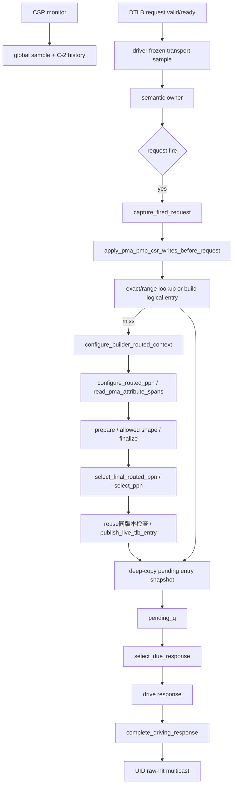
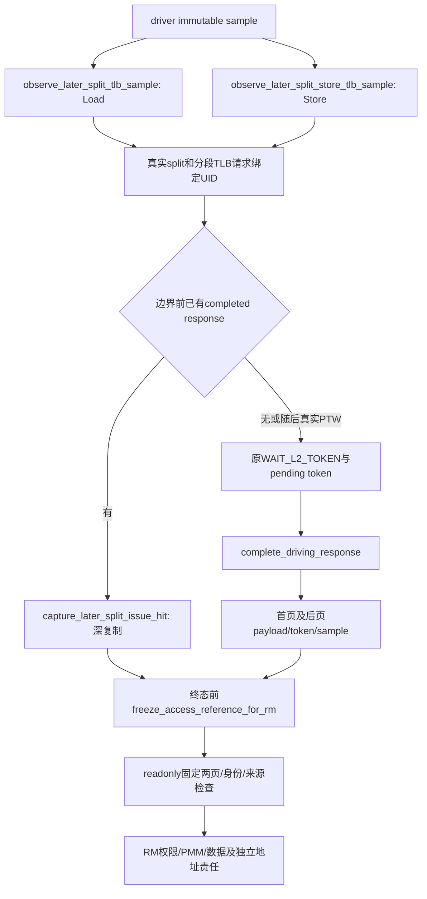
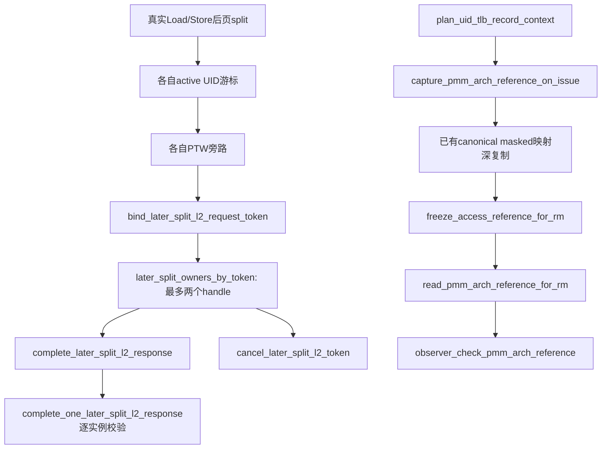

# V2 DTLB-L2TLB Responder Flow

本文描述当前 V2 `mem_ut` 的 `L2TLB_agent` responder。它接收 DTLB 到 L2TLB 的 request，并驱动 L2TLB 到 DTLB
的 response；它不是 L2Cache/PTW/memory 下游模型。接口 request 只有 `vpn/s2xlate`，ASID、VMID 与 translation
mode 从对应 sample 的 CSR history 获得。

## 术语与抽象功能说明

| 英文术语 | 当前 flow 中的中文含义 | 代码对象/状态落点 | 示例 |
|---|---|---|---|
| `request fire` | DTLB request 的 `valid && ready` 在真实 driver sample 成立。 | `sampled_req_fire`、`capture_fired_request()` | 同 key 的两次 fire 必须建立两个 token。 |
| `token` | 一次 request fire 对应的一笔 pending response 生命周期记录。 | `memblock_l2tlb_pending_req`、`pending_q` | 相同 lookup key 的 request 不合并 token。 |
| `frozen transport sample` | driver 在 `drv_cb` 固化的 interface 状态与 item provenance。 | `memblock_l2tlb_drv_sample_t`、mailbox wrapper | sequence 不重读 live VIF。 |
| `global sample` | CSR monitor 在每个 post-reset `mon_cb` 唯一推进的测试框架周期号。 | `dut_sample_seq` | monitor、driver、adapter 都只读同一编号。 |
| `C-2 CSR history` | V2 filter 实际可见的 CSR 历史项。 | `get_l2tlb_request_csr_history()` | request C 时 lookup 使用 CSR C-2。 |
| `issue-time CSR` | UID 建立 WAITING 时冻结的历史 CSR，不代表 request 最终 fire 时 DUT 使用的 CSR。 | `memblock_uid_tlb_record.csr_snapshot` | UID 在 CSR=A 下 issue、稍后在 CSR=B 下真正发 request。 |
| `request-fire CSR` | 本次 DTLB request `valid && ready` 成立时，V2 filter 实际可见的 C-2 CSR。 | `memblock_l2tlb_pending_req.csr_snapshot` | 用它构造本次 token 的 request lookup key。 |
| `UID request-fire marker` | WAITING UID 已被某次真实 request fire 覆盖的首个 global sample；0 表示尚未观察到请求。 | `uid_tlb_first_request_fire_sample_seq` | C4 只取消 marker 已建立且不晚于 C0 的旧等待实例。 |
| `logical UID bucket` | 相同`vpn/s2xlate`下等待翻译的ROB/LSQ逻辑UID候选集合，不等同于物理filter entry。 | `uid_waiting_by_vpn_s2xlate` | 33个同VPN UID可合并到少量物理请求。 |
| `flush barrier` | C0 fence/CSR event 到 C4 filter flush 的 lifecycle 记录。 | `barrier_q` | C0 fire 正常建 token，C4 才取消旧 pending token。 |
| `pre-ready baseline` | owner 首次开放 ready 前对历史 event 和空状态的启动校验。 | `owner_start_baseline_done`、`pre_ready_hold_until_sample` | 旧 event 只推进 cursor/hold，不建立新的 C0/C4 barrier。 |
| `reason overlap` | 同一 global sample 内同一 flush 来源被重复发布。 | `sample_producer_reason_mask` | CSR 与 FENCE 可合并；同一 reason 重复立即 fatal。 |
| `logical live entry` | canonical raw response payload 的缓存对象。 | `tlb_entry_by_key` | adapter 的 C4 delete 后重新 build。 |
| `adapter raw-fence owner` | 唯一可 pop/decode/schedule/apply raw fence 的 dispatch 组件。 | `dispatch_monitor_event_adapter` | responder sequence 不读取 `raw_sfence_q`。 |
| `owner` | 唯一拥有 responder token、ready、response 与 release 的 sequence 实例。 | `l2tlb_lifecycle_owner_*` | legacy default 和显式 vseq 不能并发启动。 |
| `mailbox` | driver 与 owner 之间的单槽 frozen sample 状态机。 | sequencer transport slot | owner ack 后 driver 下一 `drv_cb` recycle。 |
| `release grant` | parent 在所有 owner/adapter/fence proof 收敛后发送的一次释放许可。 | `grant_l2tlb_final_release()` | owner 不能自行 clear claim。 |
| `PMA generation / snapshot` | 按request sample选择的已提交物理属性表版本及只读副本。 | `configure_builder_routed_context()`、`pma_history` | 区别于lookup使用的C-2 MMU CSR。 |
| `PPN / shape / NAPOT` | 物理页号、完整映射覆盖范围、连续64K页编码。 | `tlb_map_builder`、`memblock_routed_ppn_policy` | 大页完整范围都需外部可达。 |
| `PBMT / NC / IO / MMIO` | 页面属性、不缓存主存、IO属性、按PMA判定的设备访问。 | `effective_pbmt()` | PBMT00+c0重选仍保持c0。 |
| `GPA / stage` | S1输出的中间物理地址及翻译阶段。 | S1/S2 raw/resolved字段 | allStage只限制最终S2 PA路由。 |
| `intent` | 上游在主表ready前固定的物理页和合法页内偏移约束。 | `routed_ppn_intent_by_vpn` | UART128B与外部部分页。 |

| `masked reference / token bucket` | issue时保存的独立掩码映射输入、一个原token关联的后页句柄组。 | `pmm_arch_reference`、`later_split_owners_by_token` | 参考槽不算第三实际页，桶最多Load/Store各一个。 |
| `RM access snapshot / obligation` | 最终实例固定两页参考输入、独立待比较责任。 | `rm_access_snapshot_by_uid`、RM地址队列 | fence删live后，旧UID比较仍使用旧页。 |
| `split / frm_mabuf` | 非对齐分段及来自MisalignBuffer的真实请求。 | Load/Store后页旁路 | STU0后页请求不等同原STA issue。 |


| 函数/task | 抽象功能描述 |
|---|---|
| `advance_dut_global_sample()` | CSR monitor 为当前 monitor sample 分配唯一 global sample；其它模块只能读取。 |
| `capture_fired_request()` | 将已 fire 的 request 与 C-2 CSR snapshot 转成独立 token，并冻结 entry snapshot。 |
| `mark_waiting_uid_records_on_request_fire()` | 用本次 token 的 request-fire C-2 CSR 为同 shape 的 WAITING UID 写 marker；不以 UID issue-time CSR 拒绝候选，也不绑定唯一 token。 |
| `select_due_response()` | 从到期 token 中按 ordered/reorder 规则选一笔 response；不创建 token。 |
| `complete_driving_response()` | 在真实 response sample 后完成 token，并以 response-visible CSR 对 waiting UID 做 raw-hit multicast。 |
| `handle_l2tlb_flush_event()` | 为当前 sample event 建 C0/C4 token/UID barrier；不消费 raw fence FIFO。 |
| `apply_due_l2tlb_flush_barriers()` | C4 取消仍 pending 的旧 token 和符合 marker 条件的 UID；不删除 live entry。 |
| `service_l2tlb_sfence_events()` | adapter 的独立 raw-fence service，在 C4 删除 logical live entry；不修改 token/UID。 |
| `release_l2tlb_lifecycle_owner()` | 在 final sample、mailbox recycle、response/adapter/fence drain 与 parent grant 全部成立后释放唯一 owner。 |

## 启动与单 Owner

`basicTest::initialize_l2tlb_testcase_lifecycle()` 在 testcase 启动时固定 responder mode、dispatch topology 与启动方式。
`MEMBLOCK_L2TLB_SEQ_EN=1` 且 connect takeover 无效时是配置错误；no-dispatch 是固定拓扑，不允许后续切换成
dispatch-active。

```text
启动 responder：
  sequence 检查 connect takeover 与 runtime enable。
  try_claim_l2tlb_lifecycle_owner(owner_name) 成功后才可以驱动 ready/response。
  另一个 default sequence 或显式 vseq 再 claim 时立即 fatal。
  首次开放 ready 前检查当前 transport、pending response、barrier 和 WAITING UID 均为空；启动期历史 event 只推进 cursor，
  不调用 active flush handler。
  每个新 event 必须是 owner cursor 的下一个连续 event_seq；缺号不允许静默跳过。

关闭 responder：
  global stop 只停止 routing。
  owner 在真实 drv_cb 结算已驱动 ready 窗口的 request fire，建立 admission close。
  driver 确认 RELEASE_STOP 和 RELEASE_FINAL_INACTIVE，owner/monitor/driver 分别完成 ack/recycle。
  parent 只有 release_grantable() 为真时才发 release grant，owner 再清 claim。
```

## Request 与 Response Flow



整体文字伪代码：

```text
1. CSR monitor 每个 post-reset monitor sample 先推进 global sample，再发布完整 CSR history。
2. driver 在真实 drv_cb 冻结 request valid/vpn/s2xlate、ready、response 和 metadata，写入单槽 mailbox。
3. owner 消费该 mailbox。request fire 时按当前 sample 的 C-2 CSR 创建 request lookup key，并为同
   `{vpn,s2xlate}` 的 WAITING UID 写 request-fire marker；UID issue-time CSR 只保留历史/debug，不能拒绝该 marker。
4. common-data在get/create之前使用request sample应用已成熟PMA/PMP写入；exact/range hit复用已有entry，
   只校验可选intent一致性，不重选已有映射。miss才固定该sample的PMA generation并构造新entry；
   prepare冻结PBMT，finalize对最终PA stage执行完整shape路由及PMA c类别选择，插表前reuse复用同版检查。
   所有分支最后深拷贝entry到token私有snapshot。
5. token 到 due sample 后按 ordered/reorder 选择 response。response fire 后才完成 token，并使用 response fire 拍 C-2 CSR
   对全部 WAITING UID 做 raw-hit multicast；token 不与唯一 UID 绑定。
6. response snapshot 已冻结，因此 live entry 后续被 SFENCE 删除不会改变已经接受的 response payload。
```

### Request capture

源码位置：`mem_ut/ver/ut/memblock/seq/base_seq/memblock_l2tlb_base_sequence.sv`，函数：`capture_fired_request()`。

抽象功能描述：该函数在唯一 owner 已观察到真实 request fire 后建立 token，冻结 request-time CSR、lookup result 与
response payload；它不处理 future fence raw 或直接驱动 response。

```text
读取 request 的 vpn/s2xlate。
在分配任何 token 或 UID marker 前检查 local/shared admission cutoff；close 后若仍观察到真实 fire 立即 fatal。
从当前 global sample 查询 C-2 CSR history；warm-up 未完成时 ready 保持 0，已 fire 后缺失 history 则 fatal。
调用 common_data 的 get_or_create lookup API，并传入sample_seq作为PMA查询边界；
公共owner先回放成熟CSR写，miss按该sample固定PMA generation并选择最终PA，hit保持条目不变；
随后逐字段 copy 到 token entry_snapshot。
调用 mark_waiting_uid_records_on_request_fire：只使用 token 保存的 request-fire C-2 CSR 在 ROB-bounded
{vpn,s2xlate} bucket 中确认候选 UID，并写首次 fire sample；不使用 UID issue-time CSR 做第二次 key 比较。
分配 request_token、due_sample 和 latency bucket，push pending_q。
```

### 新条目的可路由物理页构造（2026-11-02）

源码位置：`common_data_transaction.sv::configure_builder_routed_context()`、
`tlb_map_builder.sv::prepare_tlb_payload_context()/finalize_tlb_payload_shape_and_payload()/select_final_routed_ppn()`、
`memblock_routed_ppn_policy.sv::select_ppn()`。

抽象功能描述：公共owner为新映射提供按请求sample选择的PMA版本，builder将普通sparse的最终PA限制到实际外部路由集合；
lookup所用MMU CSR仍为C-2快照，PMA构造版本不替代RM动态访问上下文。

真实逻辑摘要：

```systemverilog
// capture_fired_request()中的普通入口，末参是本次request sample。
data.get_or_create_l2tlb_entry_by_req_with_snapshot(
    pending.vpn, pending.s2xlate, pending.csr_snapshot,
    ppn_reuse_en, ppn_reuse_wt,
    pending.request_lookup_key, pending.entry_anchor_key,
    pending.lookup_result, live_entry, created, sample_seq);
// common-data配置builder时按同一sample选已提交PMA版本。
if (query_sample != 0) begin
    if (!pma_pmp_model.get_generations_before_sample(query_sample, pmp_gen, pma_gen))
        `uvm_fatal("L2TLB_ROUTED_PPN", "no effective PMA generation for request sample")
end
builder.configure_routed_ppn(pma_pmp_model, pma_gen, csr.priv_debug, intent);
```

中文文字伪代码：

```text
真实request C传递sample=C，common-data先通过既有回放应用C时已成熟的写事件；
  CSR写在C0采集，到C0+2成熟；未成熟写不提前影响本次生成；
miss时configure_builder_routed_context按sample选PMA历史版本，按原始VPN读intent；
policy配置只复制值型属性区间，不自己消费raw FIFO；
prepare只随机一次各stage PBMT，之后依据occupancy允许集合选择shape；
普通sparse恢复旧XOR候选，对最终PA stage执行路由和同c检查；
  安全PBMT00+c1候选保留；c0候选只换到同c0；NC/IO可选外部合法全集；
  allStage只对S2最终PA选择，S1中间GPA仅满足S2输入模式位宽；
  intent只在静态4K专项按已保证offset选择物理页；
  strict、CSR权限专项、有效fault与非LEGAL路径保留原候选构造；
无候选的普通大shape最多降为4K一次，显式shape或4K仍失败则报错；
reuse在发布前按同一PMA版本及完整页路由过滤，不修改history或已有entry；
publish后pending复制冻结结果，后续CSR写和sfence均不改本token payload。
```

完整路由集合、部分页intent及实际到达观察见
[`l2tlb_routed_ppn_generation_flow.md`](l2tlb_routed_ppn_generation_flow.md)。
本补充描述源码入口，不将静态检查视为真实DUT专项通过。

### UID request-fire marker

源码位置：`mem_ut/ver/ut/memblock/seq/base_seq_help/common_data_transaction.sv`，函数：
`mark_waiting_uid_records_on_request_fire()`。

抽象功能描述：该 helper 在一笔 request 已实际 fire 后，为可能进入同一 DTLB filter request 生命周期的
WAITING UID 写入首个 fire sample。它只维护 UID cancel provenance，不把 token 归属到单个 UID，也不完成
response 回填或制造 redirect。

```text
request_key = pending.request_lookup_key  // 由 pending 的 request-fire C-2 CSR 构造
shape_key = {pending.vpn, pending.s2xlate}
遍历该 bounded bucket：
  跳过无效或非 WAITING record；
  用 pending.csr_snapshot + record.vpn/s2xlate 重建 request_candidate_key；
  若 request_candidate_key 不等于 request_key：跳过；
  禁止用 record.csr_snapshot 重建第二个 candidate key；
  marker 为 0 时，写入本次真实 request fire 的 sample。
```

该bucket的容量上界是`MEMBLOCK_ROB_SIZE`，用于发现逻辑UID生命周期泄漏；不能使用
`MEMBLOCK_DUT_L2TLB_DFILTER_SIZE`限制它。后者只限制DUT物理filter/pending request数量，相同
`vpn/s2xlate`请求可在RTL中合并，一个物理entry可扇出到多个逻辑WAITING UID。

最小例子：UID 在 CSR=A 下 issue，CSR 切换后 request 在 C-2 CSR=B 下 fire。此时 B 是 marker 的唯一
上下文；A 仅用于说明 UID 的历史来源。若因 A 与 B 不同而不写 marker，C4 cancel 和后续 UID 生命周期都会失去
已发生 request fire 的证据。

当前文档合同要求上述规则成立；源码中若仍把 `record.csr_snapshot` 作为硬匹配条件，则属于 P1 待修正项，
不能把该情况标记为已完成。

### Response completion

源码位置：`mem_ut/ver/ut/memblock/seq/base_seq/memblock_l2tlb_base_sequence.sv`，函数：
`select_due_response()`、`complete_driving_response()`。

抽象功能描述：前者只选择已到期 token，后者只在 driver sample 确认 response 后完成该 token 并进行 UID 回填。

```text
select：due 之前不选；ordered 模式先阻塞队头，reorder 模式可从所有 due token 选择一笔。
complete：确认 complete sample 不早于 due；读取 response sample 的 C-2 CSR；按 raw hit 更新零个、一个或多个 waiting UID；
          从 driving state 释放 token。没有 UID 命中是合法信息，不等同于 token 失败。
```

## Flush 与 Live Entry 分离

### Token/UID 生命周期

源码位置：`mem_ut/ver/ut/memblock/seq/base_seq/memblock_l2tlb_base_sequence.sv`，函数：
`handle_l2tlb_flush_event()`、`apply_due_l2tlb_flush_barriers()`。

抽象功能描述：owner 从 response event history 建立 C0/C4 barrier，C4 取消仍未完成的旧 token/UID。它不读取或消费
`raw_sfence_q`，也不删除 logical live entry。

```text
C0：记录 barrier，关闭后续 ready；同拍已发生的 request fire 仍建立 token。
C1-C3：旧 token 可以按正常 due 规则返回 response。
C4：禁止本拍新 response fire，取消仍 pending 的旧 token；只取消 first_request_fire_sample <= C0 的 waiting UID。
C5：无后续 barrier 时重新给 ready opportunity。
```

### Raw fence / live entry 生命周期

源码位置：`mem_ut/ver/ut/memblock/seq/base_seq_help/dispatch_monitor_event_adapter.sv`，函数：
`service_l2tlb_sfence_events()`。

抽象功能描述：dispatch adapter 是 raw-fence destructive owner。它将 C0 raw 转为 common-data pending invalidate，
并在 C4 删除 canonical logical live entry；它不创建或取消 token、UID。

```text
adapter 检查本 sample 的 CSR/fence producer watermark。
adapter 按 FIFO 执行 peek -> epoch/context 校验 -> decode -> schedule -> pop。
common_data 在 due=C0+4 时用 stage-aware matcher 删除命中的 canonical entry。
token snapshot 和 UID history 不被 adapter 修改。
```

两条 flow 使用同一个 C4 边界但不互相扫描队列。具体 stage matcher、raw context 与 C4 delete 见
[`sfence_flow.md`](sfence_flow.md)。

## 当前 Dispatch Service 调度

源码位置：`mem_ut/ver/ut/memblock/seq/base_seq/memblock_main_dispatch_auto_build_main_table_base_sequence.sv`，
task：`service_monitor_once()`。

抽象功能描述：此 task 是 dispatch topology 的单一 service tick。它先同步 runtime CSR，再恰好一次运行 raw-fence
adapter service；L2TLB responder 和 LSQ monitor batch 在之后各自消费所属状态。

```systemverilog
memblock_sync_pkg::tick_dispatch_service_cycle();
collect_runtime_context_events();
if (monitor_adapter == null) begin
    monitor_adapter = dispatch_monitor_event_adapter::type_id::create("monitor_adapter");
end
monitor_adapter.service_l2tlb_sfence_events();
if (memblock_sync_pkg::reset_backend_done !== 1'b1 ||
    memblock_sync_pkg::l2tlb_reset_active()) begin
    return;
end
monitor_adapter.drain_lsq_timing_sidebands();
collect_monitor_event_batch();
exception_redirect_replay_task();
monitor_adapter.service_lsq_timing_reconcile();
```

中文伪代码：每个 negedge service tick 先推进软件 cycle 并由 collector 同步 CSR。随后只在这里调用一次 raw-fence
service；collector 不再直接 pop raw FIFO。若 reset 未完成，adapter 只清本职责状态并返回，后续 LSQ batch 不能处理
stale raw。正常路径再处理 LSQ sideband、writeback/feedback batch、redirect/replay 与 cancel reconcile。

## Reset、Stop 与失败边界

- reset coordinator 为当前 epoch 收集 CSR、fence、monitor、response 与 adapter 的直接 writer ack。一个 writer 不能替另一个
  writer 清状态或写 ack。
- `raw_sfence_q` 与 live entry 属于 adapter；CSR context/history 属于 CSR monitor；token/UID/barrier 属于 semantic owner；
  transport mailbox 的 publish/recycle 属于 driver。
- 旧 reset epoch 的 raw/pending invalidate 只记录后丢弃；future epoch、context epoch 混用、sample watermark 逆序和
  迟到 active event 都是 `uvm_fatal`。
- no-dispatch 时 driver 保持 inactive。若 monitor 观察到 DTLB request valid 或 raw FIFO/live entry 非空，立即 fatal，
  不能把 ready=0 导致的“未 fire”误当成支持。
- `flushPipe` 是 fence uop 的 ROB 写回 sideband；standalone responder 不由它暂停 LSQ 或伪造 full-core redirect。

## 验证状态与后续

本次 SFENCE/HFENCE stage-aware 实现已通过静态检查和：

```text
make eda_compile tc=basicTest ts=virtual_base_sequence mode=base_fun
```

基础 `eda_run` 被远端 VCS KDB/NFS `SIGSEGV` 阻断，未进入 runtime。range/NAPOT exact-miss lookup、secondary index
注册/注销和 64 KiB NAPOT validation 已由
`AI_DOC/plan/test_framework/plan/do/mem_ut_v2_l2tlb_range_lookup_napot_plan_20260806.md` 完成；stage-aware C4 delete
通过统一 delete helper 同时删除 canonical map entry 与其 range index。


## 2026-11-02 端到端物理页行为补充

```text
cacheable新映射：request fire → 成熟CSR回放 → sample对应PMA版本 → miss builder
  → PBMT00+c1且完整shape可路由 → 保留旧XOR候选 → 发布 → 冻结response。

B08地址洞：request → 普通候选PA落APLIC洞 → select_ppn拒绝route
  → 按PBMT及原c类别选择合法窗口 → 编码发布 → 原DTLB响应调度。

已有映射：request → exact/range hit → intent一致性检查 → 冻结已有payload，
  不按新权重或新PMA配置后台重写canonical。
```

端到端文字伪代码：新条目才进入物理页策略，CSR FIFO由公共回放owner按成熟边界消费；属性版本固定后，
builder选择完整可路由形状并在发布前过滤reuse。已有命中沿原映射回复。UART等窄目标由上游主表保障offset，
DTLB接口不携带也不新增offset字段，真实访问证据仍需外部A.fire及原RM结束状态。


## 2026-11-17：标量虚拟化与RM两页参考衔接

本节只更新测试框架调用链；不改变本flow原DTLB上游responder/唯一owner合同，不更新V2 RTL知识库。新增源码与校验状态见[RM实现评审](../plan/rm_review_doc/undo/memblock_v2_virtualization_rm_implementation_review_20261117.md)。



整体文字伪代码：driver在原采样边界把Load/Store分段身份放入同一个运输结构；owner完成reset、样本锚定和同拍lifecycle门禁后才调用common观察器。真实split找到active ROB owner并仅对后页建record；真实分段TLB请求确认该owner后尝试取得边界前已完成的hit。真实PTW出现则用原token链完成，不伪造请求。原response完成保存首页及后页来源；提交或fault恢复前复制为两页终态参考。RM随后只读历史计算expected，既有ready、token、失效仍只由原owner管理。

### `capture_later_split_issue_hit()`与Store后页观察

抽象功能描述：这些common函数在真实分段请求边界保留已有翻译服务输入，补齐后页无新L2请求的hit及Store来源；它们不驱动响应或生成新映射。

源码位置：`mem_ut/ver/ut/memblock/seq/base_seq_help/common_data_transaction.sv`。源码摘要：

```systemverilog
record.request_lookup_key=first.csr_snapshot.make_lookup_key(record.split_vpn,record.s2xlate);
record.payload.copy_from(entry);
record.issue_hit=1;
```

中文伪代码：本段负责后页归属。split fire通过active ROB索引找到UID；非后页不建立第二页。Load沿原LU1请求链，Store从StoreMisalignBuffer fire与STU0有效frm_mabuf请求取ROB和地址，记录真实请求sample；Load/Store各保存单buffer UID游标供各自PTW常数时间反查。取得issue CSR后构造该页key，只查当前边界前的completed response，成功深复制payload与原token/sample/generation，记录hit；失败保持等待。后来真实PTW到达则清hit标记并进入原WAIT_L2_TOKEN，由既有`bind_later_split_l2_request_token`绑定每次fire；completion再保存实际最终来源。completed首页GPF出现真实补响应时更新原sector，不从DUT GPA构造参考。

`find_completed_tlb_response_for_issue`负责按请求key及既有range索引查已完成输入，返回值仅决定是否有hit候选；`copy_from`不携带live索引所有权。Store observer只读单buffer游标，不为每笔PTW扫描历史。新增被动信号没有驱动DUT的方向。

### 终态冻结与端到端行为总结

抽象功能描述：`freeze_access_reference_for_rm()`由正常/fault提交边界调用，把恢复前的参考输入保存到UID历史，供RM延后消费。

源码位置：同一common文件与`seq/base_seq_help/lsq_commit_handler.sv`。源码摘要：

```systemverilog
data.freeze_access_reference_for_rm(uid);
status.rob_commit = 1;
```

中文伪代码：本段负责把活跃记录转成最终比较输入。先限定普通标量及HLV/HLVX/HSV，同实例冻结幂等；复制完整issue CSR与原始地址、真实50位请求、两页可用来源；Bare/预异常可以没有PTE。只有冻结完成才沿原路径设置rob_commit、fault quiesce与恢复。readonly核对reset/ROB/dynamic/issue/replay、页面source/sample/generation，缺旧页不查future current。fence不删该UID历史，也不删RM物理数据；run表重置删除副本。

端到端文字伪代码：后页hit在真实请求时复制已有完成输入，终态freeze后RM可晚于fence比较；后页miss由真实PTW、原token和response完成后freeze；首段停止无真实后页时不造第二页，RM按独立首段规则停止。fault先freeze再cancel，因此旧hit和补GPA原sector不会因恢复消失。reset后readonly拒绝旧代，不能通过current重建它。


## 2026-11-17：同token后页并发及独立masked输入



函数调用Flow图整体文字伪代码：
```text
真实后页Load/Store分别保存自己的active游标；各PTW只查当前buffer实例。
原responder接受request后调用bind，固定核对两个游标和冻结CSR完整key，允许同VPN两实例入同token桶。
原response采样完成时调用complete，将同源payload经原逐实例校验发布给桶内记录；取消时按桶取消全部WAIT_RESPONSE，二者结束均删桶。
真实issue计划另外调用capture_pmm_arch_reference_on_issue，只保存已预定义的masked canonical输入。
终态恢复前freeze把该独立输入与CSR深复制；RM只读取得旧值并独立比较masked架构结果，不晚查当前表。
```

### 后页token归属函数

抽象功能描述：bind、complete和cancel函数在原responder生命周期中维护后页输入的归属关系，不拥有请求调度、ready或第二次token计数。

源码位置：`mem_ut/ver/ut/memblock/seq/base_seq_help/common_data_transaction.sv`。真实逻辑摘要：
```systemverilog
later_split_owners_by_token[request_token].push_back(record);
complete_one_later_split_l2_response(/* 原逐owner校验输入 */);
later_split_owners_by_token.delete(request_token);
```

中文文字伪代码：本段让同VPN的后页Load/Store均获得真实response。bind只读两个active游标，核对active/dynamic、WAIT_L2_TOKEN、VPN/stage和冻结CSR key，保存token/sample并转WAIT_RESPONSE。返回首handle使pending_req接口保持原状。complete要求token桶首项与原pending handle相同，逐项调用原逐owner helper核对实例、key、generation和replay后保存payload/sample；结束删除桶。cancel只读该token桶，取消所有WAIT_RESPONSE记录；只有handle仍是当前UID canonical记录时才清其游标，避免旧token影响新attempt。reset清桶和两个游标，正常完成历史保留供终态freeze，不进入每PTW全历史扫描。

### issue时独立masked参考

抽象功能描述：`capture_pmm_arch_reference_on_issue()`在真实issue计划阶段保存公共映射服务已有的架构参考输入；readonly最终只导出该旧值，不创建TLB条目。

源码位置：同common文件及`seq/base_seq_help/memblock_rm_readonly_api.sv`。真实逻辑摘要：
```systemverilog
masked_vpn=record.vpn[37:0];masked_vpn[37:36]=0;
record.pmm_arch_reference[slot].copy_from(entry);
snapshot.pmm_arch_reference[slot].copy_from(first.pmm_arch_reference[slot]);
```

中文文字伪代码：本段补only-S2、Sv48x4、PMM16使有效VPN高位改变时单payload范围不足的输入。issue记录已经冻结CSR后，对s2xlate=2/hgatp=9且VPN高两位非零的请求清bit37:36，只查existing canonical精确/range映射；不存在则保持缺输入，不构造映射。存在且generation非零则深复制到UID record；终态freeze再复制到snapshot。readonly共用reset/ROB/dynamic/issue/replay核对，按同一CSR和保存payload解析masked PPN。RM保留原实际请求结果，再独立判断架构PA、G权限、PBMT和PMA；相同结果MATCH，不同MISMATCH，缺参考报框架输入错误。测试必须在issue前预定义所需masked映射。

端到端行为总结：Load/Store同VPN后页→固定两个游标→一个真实token的两个归属handle→一次response完成、两个独立记录→freeze后逐UID比较；PMM独立输入→issue深复制→终态冻结→readonly→架构结果子检查。全程保留原唯一L2TLB owner与ready/失效合同。


### 最终跨页修正：固定两份masked参考

抽象功能描述：issue参考生产按完整标量范围冻结最多两页独立masked输入；RM在每个masked页入口读取相应旧值，不让首页范围及权限代替后页。

源码位置：`common_data_transaction::capture_pmm_arch_reference_on_issue()`、`memblock_rm_readonly_api::read_pmm_arch_reference_for_rm()`、`memblock_rm::observer_check_pmm_arch_reference()`。

```systemverilog
request_end=request_start+50'(size_bytes-1);
record.pmm_arch_reference[slot].copy_from(entry);
if(snapshot.pmm_arch_vpn[slot]!=masked_request_vpn) continue;
```

中文文字伪代码：本段修复only-S2/PMM16跨两张4K页时只留首页的缺口。issue使用公共标量分类及原size编码计算首末页，slot0保存首页，跨页时slot1保存末页；两项各自查已有canonical并深复制，不生成映射。reset/init清两项，record提交和终态freeze逐项复制。readonly新增masked_request_vpn输入，只在固定两槽按VPN选对应entry。checker在页入口重取该页输入并独立判G权限/PBMT/PMA，首fault即停止；首页D错误只核对已消费PA前缀。成功跨页必须取得两个需要的输入，缺后页仍报框架输入错误；无需后页的停止场景不强求后页。

端到端文字伪代码：预定义两张masked 4K输入→真实issue分别冻结→实际两页来源按原链完成→恢复前freeze→RM逐页选择独立参考→各页结果汇合；首fault/首段停止→仅消费前缀→不读取未执行后页。独立参考槽固定两项，不成为新TLB缓存或第三实际访问页。


### 最终B1/B2/B3合同与验证边界

抽象功能描述：独立masked参考仍由issue时的固定两槽提供，checker逐页解释其可观察结果；本节补充最终边界，不改变唯一L2TLB服务和token/ready生命周期。

源码位置：common的`capture_pmm_arch_reference_on_issue()`及RM的`observer_check_pmm_arch_reference()`。

```systemverilog
request_start={2'b0,record.vpn[35:0],main_tr.vaddr[11:0]};
request_end=request_start+50'(size_bytes-1);
pma_fault |= byte_access_fault;
```

中文文字伪代码：issue先mask首地址再按50位加末字节，固定两槽保存masked首末VPN，保留bit48新进位。RM每个可信PA字节立即累计PMA/PMP AF，完整size查询再OR，不能因首fault跳过完整查询而丢AF。换masked后页时，非对齐Load的NC位独立优先转bit4；IO的mmio受翻译fault门控，不能覆盖IO+GPF。翻译fault不查无效PA的PMA；成功后页PMA-MMIO必须由只读模型证明且无AF才走bit4。首fault与首页D错误停止只消费前缀，缺实际需要的后页参考仍明确报错。

端到端文字伪代码：issue masked首末范围→两份existing canonical深复制→终态freeze→readonly按VPN选择→逐页权限/PBMT→可信PA的PMA累计→独立cause/PA/路径比较。rm5 seed6111801自测95场景184检查通过，最终真实PMM/Guest矩阵及全部basicTest回归仍待结果；IO+GPF本轮仅静态核对，不声称独立动态覆盖。
