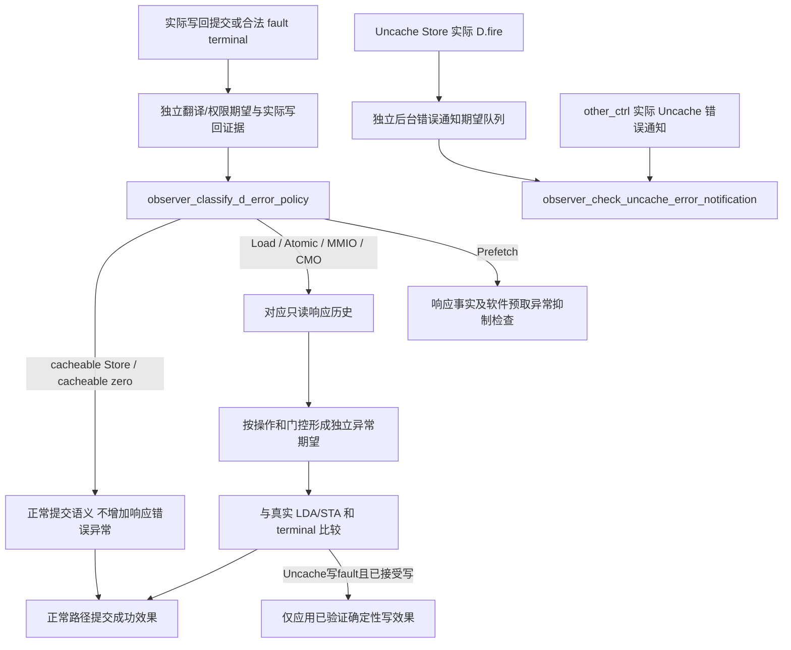

# V2 非向量访存 denied/corrupt 分路径检查与框架协同方案

- 状态：`DO`；编码、文档同步及必要验证完成（2026-11-11）；保留已复现的CMO故障后完整恢复排空集成阻塞，不表示全部DUT组合验收通过。
- 创建与修订日期：2026-11-10；按三方案评审补齐每beat消费、当前错误来源版本、SC覆盖副作用及NC后端边界。
- 评审基线：`AI_DOC/plan/rm_review_doc/undo/memblock_cmo_d_error_three_plan_minimal_adaptation_review_20261110.md`。
- 适用分支与版本：`mem_ut_uvm_v2` / V2。
- 方案归属：RM plan；框架只提供实际响应、身份、CSR 与错误通知事实，异常和结果判断由对应 RM 完成。
- 主要 RM 源码：`mem_ut/ver/ut/memblock/env/src/memblock_rm/memblock_rm.sv`、`mem_ut/ver/ut/memblock/env/src/memblock_rm/rm_ls_core.sv`。
- 框架数据源：`mem_ut/ver/ut/memblock/seq/base_seq_help/mem_base_sequence.sv`、`mem_ut/ver/ut/memblock/seq/base_seq_help/memblock_rm_readonly_api.sv`。
- 关联行历史方案：`AI_DOC/plan/test_framework/plan/do/memblock_l2_grantdata_first_line_weighted_error_plan_20261110.md`。
- 关联 CMO 方案：`AI_DOC/plan/rm_plan/do/memblock_cmo_blackbox_rm_coding_plan_20261103.md`。
- 本方案是 CBO/CMO denied/corrupt 获取、映射、比较及 Uncache zero 分段写效果的唯一实现归属；CMO RM 方案只定义接入，不复制实现。本方案不另建行选择表，也不授权 coding。

## 1. 术语、范围与职责

### 1.1 术语与抽象功能说明

| 术语 | 当前中文含义 | 状态或源码落点 | 例子 |
|---|---|---|---|
| denied / corrupt | 下游实际响应上的拒绝/数据损坏原始位 | L2/Uncache response record | 响应建立后冻结，实际握手后供 RM 查询 |
| CLEAN | 已登记且没有注入错误的首次行结果 | 行历史 `selected_state=NONE, valid=1` | 有 CLEAN 记录仍允许正常读写 RM 数据 |
| cacheable Store | 普通缓存写指令；已提交后由 SBuffer/DCache 向下游排出 | `commit_store()`、StoreQueue、SBuffer | 不是普通 cacheable Load |
| cacheable zero | 经 SBuffer/DCache 执行整行清零的 `cbo.zero` | StoreQueue 的 zero 特殊完成路径 | 不使用 non-zero CBOAck 错误映射 |
| Prefetch / demand | 预取请求 / 实际指令需求访问 | LoadUnit及DCache请求来源 | 预取响应可注错，但不按普通Load追加同步异常 |
| MSHR / allocation generation | 缓存未命中事务槽 / 每次槽分配的代次 | DCache MissQueue被动来源观察 | 同source复用要区分前后两次分配 |
| policy | RM按最终操作及路径选择的错误处理策略 | 计划新增分类函数返回枚举 | NC后台通知与MMIO同步异常分开 |
| non-zero CMO | `cbo.clean/flush/inval` 的最终操作 | CMOUnit、StoreQueue、CMO RM | CBOAck denied 对应 Store 类异常 |
| Uncache / NC / MMIO | 独立非缓存接口 / 非缓存普通存储路径 / 强顺序或 MMIO 路径 | Uncache、StoreQueue 和 LoadQueueUncache | NC Store 提交后发请求，MMIO Store 等响应完成 |
| LDA / STA | Load/Store 类实际写回接口 | DUT integer writeback observer | 原子操作复用 LDA，CMO 最终结果由 STA0 返回 |
| hardwareError | 当前指令异常向量第 19 位 | `uop.exceptionVec[19]` | 随 ROB 身份进入后端 |
| BEU / bus-error | 独立错误收集单元 / 面向该单元的错误地址通知 | `io_dcacheError`、`io_uncacheError` | 与指令的 exceptionVec[19] 是不同接口 |
| cache_error_enable | DUT 的错误上报控制字段 | CSR 输入完整 snapshot | 原子异常与 Uncache BEU 输出需要门控，不能统一套给所有路径 |
| owner / epoch | 动态指令身份 / 实例代际 | UID、ROB、SQ/LQ、dynamic epoch | source 重用不代表同一 owner |
| token / generation | 单次响应身份 / 该行首次选择或 source 复用代次 | 框架不可变完成历史 | 同一行不同响应不能相互冒充 |
| fire / beat | valid&&ready 实际握手 / 一次响应数据传输 | A/D 通道与 sample | zero 的 Uncache 路径按 8B 分段 |
| sample / beat availability | DUT全局采样编号 / 该beat实际送达时间 | token内beat事实 | 首beat已消费错误不等末beat |
| error input mask / attempt | 本次有效错误输入资格集合 / 一次真实请求尝试 | 被动LoadUnit/AtomicsUnit观察 | 全字节Store forwarding不自动屏蔽同时有效的DCache错误输入 |
| slot version / origin token | 物理缓存槽的被动来源版本 / 该版本的实际回填来源 | observer错误来源索引 | 正常新回填建立raw=0版本，旧版本不再支配新Load |
| reqSource | 现有TL A请求来源编码 | auto_inner_dcache_client_out_a_bits_user_reqSource | Store来源含合并Load仍保守正常 |
| SC obligation / shadowed | 失败SC无写检查 / 后续合法写覆盖字节 | 既有mark_sc_obligations_shadowed | zero覆盖后不能继续要求该字节保持SC之前原值 |
| backing / overlay | RM 初始字节数据 / 已提交期望写覆盖 | `backing_byte/expected_store_byte` | 正常路径先查 overlay 再查 backing |
| segment / segment index | Uncache zero 的8B分段 / 行内0～7编号 | owner绑定的被动请求与响应历史 | 第3段故障时不能假定剩余5段已经写零 |
| write event / effect result | 后端接受的确定性写事件 / RM预检查后的字节效果集合 | 既有写批次及计划新增统一效果对象 | 期望零值由RM产生，事件只证明接受地址和mask |
| monitor request queue | 被动monitor捕获的实际请求队列 | CMO方案的dcache/uncache请求观察接口 | 不用responder打算发送的记录替代DUT真实请求 |
| effect mask | 请求按后端既定策略实际接受写入的字节集合 | 计划补充的 response/write-event 事实 | denied 响应不自动意味着该集合为空 |
| pending / terminal / cursor | 已接受未完成 / 指令终态 / RM 程序顺序游标 | 响应 ledger、status、`current_uid` | 后台响应检查不阻塞程序 cursor |
| readonly / provenance | 只读接口 / 独立来源及时间身份依据 | observer API | 不从 DUT 最终异常反推出预期错误 |

### 1.2 明确的注入与检查范围

普通 cacheable Store 与 cacheable zero 不由测试框架注入 denied/corrupt。这是响应生成端的硬性排除，不是“仍注错但不比较”。这两类路径的响应原始错误位必须保持0，RM仍保留合法正常提交和数据效果。框架不得为它们补造同步异常、redirect/replay或BEU事件。

其它非向量请求按实际错误消费者分类：由MemBlock的Load/原子/StoreQueue/CMO/Uncache消费或转发错误的，框架必须支持协议允许的参数化错误注入，并由相应RM预测和比较；确实只由L2自身处理且无本方案MemBlock消费契约的响应不注错、不建立伪RM判据。不能笼统用“错误来自L2”排除Load、原子或non-zero CMO。

“支持denied/corrupt”按响应协议能力分别列出：有数据的GrantData/AccessAckData及当前CBOAck路径支持对应错误；无数据Uncache AccessAck按当前协议约束只支持denied，不能为了执行一个硬件防御分支而发出非法corrupt响应。该限制必须在参数说明和验收矩阵显式标注，不能静默声称覆盖了corrupt。

不模拟L1D Tag/Data ECC，不创建BEU、BEU寄存器、中断或NMI模型；但是实际Uncache错误通知`io_uncacheError_ecc_error_valid/bits`的采集与RM逐事件比较属于本方案必须实现范围。采集实际输出与模拟BEU是不同职责。

已由Load等合法注错产生的行历史不能因随后出现被排除Store/zero而删除。排除请求强制返回正常位且不重抽；相同物理行后续合法Load是否消费旧错误，仍由其实际响应/访问事实和sample决定，不能直接由当前selected_state推断。

### 1.3 执行时序

RM 的本地数据查找由 DUT 实际写回提交后触发；fault 操作使用合法异常完成与 fault terminal，不等待不存在的 normal pass。本方案不增加“防止 RM 先于 DUT 执行”的调度器。

但普通 Store/NC Store 的提交可以早于其后台总线响应。同步指令 RM 与后台响应 RM 必须分开推进，不能为收集后来才发生的错误而阻塞 `current_uid`，也不能把后台错误改成已提交指令的同步 trap。

## 2. 现有实现与明确缺口

| 项目 | 当前实现证据 | 本方案落点 |
|---|---|---|
| DCache Load | 现有函数仅按行/sample查首次错误，缺少具体消费来源 | 映射保留，改为当前attempt错误输入+token/beat或slot来源版本，禁止旧错误永久适用 |
| Uncache Load | 按 UID/epoch、ROB/LQ、地址和 sample 查询包括 CLEAN 的完成历史 | 复用，不以 L2 行记录替代 |
| LR/SC/AMO/CAS | `observer_apply_atomic_d_error_expectation()` 已查询行错误；尚未读取 cache_error_enable | 增加独立门控事实，并保留实际访问资格 |
| 普通 Store/cacheable zero 注入 | 当前GrantData注入只按opcode/全局权重，没有上游消费者分类，可能给这两类后台请求注错 | 在首次随机之前补可靠来源分类与强制正常过滤；RM不补造同步异常 |
| CMO | 框架已有CBOAck denied/corrupt权重，但`rm_ls_kind_e`仅OTHER/LOAD/STORE/ATOMIC | 必须补CMO错误消费和实际STA比较，不能把注错能力等同检查完成 |
| CBOAck | context 和 response record 保存错误位；完成后清空，无持久 owner 历史 | 按行历史方案增加 token 完成事实及 owner 关联 |
| Uncache Store | 已有全局denied权重，AccessAck corrupt固定0；`owner_count=0`导致完成循环无Store历史 | 保留合法denied注入并补Store类型/完成历史；NC后台检查不强求单条UID |
| Store 写数据后注错 | `create_uncache_response_record()` 先调用 shared-memory 写路径，再注入响应错误 | 保留真实策略事实，不把 denied 等价为未写 |
| CSR | 默认 cache_error_enable=1，但初始 profile 可按权重改为0；dynamic profile 保持原值；runtime TLB view 未暴露该位 | 从 CSR monitor 已采完整 payload 增加只读字段，不硬编码1 |
| 错误通知 monitor | other_ctrl 已接错误端口，但事务发布块注释 | 只增加有用的 Uncache 错误观测事件，不恢复整套无关事务发布 |

代码核对位置：

- `src/main/scala/xiangshan/mem/pipeline/LoadUnit.scala`：直接返回/回填转发的 denied、corrupt 映射。
- `src/main/scala/xiangshan/mem/pipeline/AtomicsUnit.scala`：`canTriggerCacheError` 门控。
- `src/main/scala/xiangshan/mem/lsqueue/StoreQueue.scala`：NC committed 后请求、MMIO 和 CMO 响应异常、zero 分段。
- `src/main/scala/xiangshan/cache/dcache/mainpipe/MainPipe.scala`：L2 错误不重复送 L1 BEU。
- `src/main/scala/xiangshan/cache/dcache/Uncache.scala`：Store D.fire 的独立 bus-error 输出。
- `src/main/scala/xiangshan/mem/MemBlock.scala`：两拍延迟、CSR 门控及对外接口。

以上仅用于本 RM/框架方案的接口行为依据，不更新 V2 RTL 知识库，也不修改 RTL。

## 3. 最终注入与处理矩阵

| 操作与实际路径 | 框架注入要求与参数 | 对应RM处理与比较 |
|---|---|---|
| DCache标量整数/浮点Load | 支持denied/corrupt，复用`MEMBLOCK_L2_GRANTDATA_DENIED_WT/CORRUPT_WT`两项 | denied→loadAccessFault[5]；仅corrupt→hardwareError[19]；比较LDA与terminal，异常不做普通load值比较 |
| LR，实际消费DCache response | 同上，但需来源/消费事实明确 | enable=1时denied→位5、仅corrupt→位19；enable=0不追加该类响应异常 |
| SC/AMO/CAS，实际消费DCache response | 同上，未产生下游请求的SC不能凭空构造下游响应 | enable=1时denied→storeAccessFault[7]、仅corrupt→位19；比较实际原子写回及终态；无有效响应错误输入不得凭地址推故障 |
| 普通cacheable Store | 明确不注入，实际回复位强制0；不得因同一行已有错误重新继承 | 保留合法提交overlay；不要求额外STA故障或DCache BEU |
| cacheable zero | 明确不注入，实际回复位强制0 | 合法正常zero特殊完成后一次64B清零，无L2错误gate取消该效果 |
| non-zero CMO | 支持CBOAck denied/corrupt，复用`MEMBLOCK_L2_CBO_ACK_DENIED_WT/CORRUPT_WT` | denied→位7、仅corrupt→位19；绑定CBOAck owner/token并比较STA0，fault无数据效果 |
| Uncache NC/MMIO Load | 支持AccessAckData denied/corrupt，复用`MEMBLOCK_UNCACHE_DENIED_WT/CORRUPT_WT` | owner完成历史→位5/19；比较实际LDA/terminal，CLEAN正常比较数据 |
| MMIO Store | 支持AccessAck denied，复用`MEMBLOCK_UNCACHE_DENIED_WT`；该响应不合法携带corrupt | owner响应→STA位7比较；实际Uncache通知还要单独核对 |
| NC Store | 支持backend已接受写后的参数化AccessAck denied；无数据Ack不注corrupt | 保留提交overlay及独立通知比较；真正backend拒绝属于本轮不支持配置，立即终止测试，见第4.7节 |
| zero的Uncache数据路径 | 不属于cacheable zero排除项；按逐笔AccessAck支持denied并受`MEMBLOCK_UNCACHE_DENIED_WT`控制 | 比较STA位7及终态、停止后续段、按独立接受事实处理部分写效果，并检查Uncache通知 |
| software / hardware Prefetch 实际产生的GrantData | 属于MemBlock侧实际消费路径，支持既有GrantData权重；不因没有普通Load值比较而取消注入 | software Prefetch校验不因该错误新增同步位5/19，不做普通Load值比较；hardware Prefetch无指令UID时仅按请求/token核对事实，不能伪造指令写回；后续demand实际消费错误仍按Load检查 |
| Grant/ReleaseAck等无当前MemBlock响应错误契约的交互 | 不新增错误注入，不把行错误强塞进无对应消费者的响应 | 保留协议完成与正常数据语义；不能用L2内部处理结果补造MemBlock异常 |

表中`*_DENIED_WT/CORRUPT_WT`写法表示现有同前缀的两个独立参数名，不新增带斜线的配置key。硬件中对非法AccessAck corrupt的防御分支可以用soft检查验证函数分类，但不标作真实DUT合法corrupt注入通过。

两个原始位同时为1时，单个响应的 denied 优先；不能为同一响应再额外叠加 hardwareError。跨行结果仍保留每行证据和原始位，再按实际操作的异常规则合并，不把一个响应的优先规则误用成吞掉其它行证据。

当前 `MainPipe.scala` 以普通 Store 整行 mask 产生 `full_overwrite`，`MissQueue.scala` 才选择 AcquirePerm/Grant；该无数据权限路径按实际来源保持 Store/zero 排除，不能把它误当新增 Load 数据响应注错入口。ReleaseAck 是释放完成确认，没有本方案同步数据错误消费契约；不发出协议不支持的错误组合。后续若版本新增其它 MemBlock 消费者，必须扩展能力矩阵，不能借当前“无契约”一概跳过。

本表讨论响应错误。翻译、页权限、PMP/PMA、地址对齐和 trigger 等原有检查继续独立执行；被更早异常阻止、无有效 PA 或没有实际数据消费的路径，不能附加无关行错误。

### 3.1 控制位与通知分类

- Load/Uncache Load 的上述 raw 响应错误映射不能直接套用原子的 cache_error_enable 门控；L1 内部 ECC 不在本方案范围。
- 原子单元的 raw 响应异常受 cache_error_enable 控制，必须使用输入观测事实。
- MMIO Store 和 CMO 响应异常分支没有同样门控；不能把 enable=0 当作它们忽略 denied 的依据。
- Uncache Store 错误通知经过 MemBlock 的 enable 门控；MMIO Store 可同时有 STA 异常与错误地址通知，NC Store 则没有对应的同步异常补写。
- `io_dcacheError_ecc_error_*` 的 L1 ECC 模拟和强制预期不在本方案实现；L2 denied/corrupt 不应强制匹配该输出。

### 3.2 参数入口、缺失能力补齐与默认值

六项既有错误权重继续经过`env/plus.sv -> seq_csr_common -> getter`，范围`[0:100]`、默认0；GrantData、CBOAck、Uncache分别消费自己的权重。取消sticky参数是既定方案，不因本次分类重新增加启用开关。

实现必须逐类核对本矩阵：只存在某个参数但生产路径未使用、实际D位未驱动、完成历史未发布或RM没有消费，都算该路径未完成。任何协议合法且当前缺失的注入分支必须补入真实response创建路径，并同步plus定义/解析、getter、default.cfg、相关preset和参数说明；先复用现有六项，不为同一语义重复造开关。

Uncache corrupt权重只作用于AccessAckData；AccessAck的denied受同一Uncache denied权重控制，不虚设不可执行的Store corrupt参数。启动配置摘要逐类打印适用响应和能力，不能让配置含义依赖testcase类名。被排除的cacheable Store/zero是无条件不注入，不允许通过全局权重或私有开关绕过。

### 3.3 基础注入分类复用现有 reqSource

现有A.user的 `auto_inner_dcache_client_out_a_bits_user_reqSource` 已贯通interface/xaction/monitor/connect，编码来自V2 MissQueue的 `MemReqSource`。补responder请求快照复制后，基础分类直接使用它：CPUStoreData（含cacheable zero及Store来源的合并Load）保守正常；CPULoadData/CPUAtomicData/L1DataPrefetch按GrantData能力和既有权重（权威utility枚举当前分别2/4/6，Store=3，统一协议常量定义见行历史方案）；CBO opcode独立使用CBOAck权重。未知/矛盾编码报告基础关联错误，不能默认为允许注错。

本轮不重建全MSHR来源、分配、合并消费者模型，也不强制Store来源合并Load后仍注错。该取舍只减少部分混合错误覆盖，四类合法请求仍可参数化注错。source generation由既有A/D传输生命周期分配，真实A.fire冻结reqSource与raw，之后合并不改变结果。RM本次消费来源仍需独立观察，reqSource不代替Load/原子的消费证明。

## 4. 框架需要提供的最小事实

### 4.1 行历史与实际响应

复用关联行历史方案并取消sticky参数，但在查行候选和随机之前先执行注入资格分类。首次由排除类触及时登记CLEAN且不采样权重；已存在错误选择时，排除类本笔仍强制正常，不能继承错误raw位、清除旧历史或建立第二套选择表。只有本矩阵允许的请求才能复用适用选择并形成实际错误响应；同一行不重抽。

行选择只控制是否重抽。无token的行查询返回诊断，不能产生本次指令error_active。每个真实D.fire立即发布同token的beat sample/raw/覆盖范围，末beat才标整笔完成；转发消费核对目标beat，不要求完整响应先完成。cache-hit来源由第4.8节被动版本索引取得；首次错误摘要不得直接参与异常预测。

### 4.2 响应身份

Load 复用 UID/ROB/LQ/epoch；CMO 使用 UID/ROB/SQ/epoch 加唯一响应 token；Uncache Store 扩展现有 is_load 二分记录为明确 kind，并保存响应 source、generation、地址、mask、A/D sample、nc、原始错误位。

NC Store 可能提交后合并并失去活跃 ROB 映射，后台 bus-error 检查以 source+generation+实际地址/sample 为主，不强求唯一 UID，也不按地址扫描整张主表猜 owner。可观察到上游 owner 时保存有界 owner 集合作诊断；MMIO Store 和 Uncache zero 的同步异常则必须在请求阶段保留其 SQ/ROB/epoch 或分段 token。

扩展既有 `io_mem_to_ooo_ctrl` 的只读 owner 侧带，捕获 SQ→Uncache 接受上下文与下游 source 的关联；复用现有 Load owner 侧带模式。不假设 TL A 携带完整 UID，不在 D.fire 时重新查当前已复用 owner。

### 4.3 CSR 事实

当前 CSR randomizer 的 static enable 只在初始 profile 抽取，dynamic profile 保持同一 cache_error_enable。利用 CSR monitor 已采集的完整 payload，新增具名只读 `cache_error_enable`、sample、reset epoch 及有效性，避免在 RM 中硬编码 payload bit offset 或读取 sequence 私有 rand 变量。

RM 在观察到 post-reset 配置并经过 DUT 两拍传播后，冻结当前 lifecycle 的有效 enable；0、1 都必须支持。该值不是新参数，不放进 plus 或 env cfg。未来若允许运行中改变 enable，需要另外定义生效 sample 历史与 consumer 时序，本方案不把查询时的 latest 当作过去操作的门控值。

### 4.4 Uncache 错误通知实际事件

复用已连接的 `other_ctrl` monitor，只发布 `io_uncacheError_ecc_error_valid=1` 的值型事件，携带地址、DUT global sample 和 reset epoch；同地址连续两拍 valid 是两条事件，不能按地址去重。

从每笔实际 Uncache 内部消费端 Store D.fire 独立构造后台通知期望：原始 denied||corrupt、对齐物理行地址及内部消费 sample。外部TL D到此端口之间存在TLBuffer，必须以source-generation/token关联真实内部消费，不从外部D固定偏移猜时间。MemBlock从内部busError开始为两拍 DelayNWithValid，使用同一 DUT sample 域核对输出；clocking block 采样相位通过一次边界验证固定，不能用任意 `#2ns` 替代两个 DUT 周期。

无需 BEU 模型，也不驱动 `io_uncacheError`；这里只比较 DUT 已有输出。enable=0 时核对不应输出该通知；不影响该响应是否被记录。

### 4.5 数据写入事实

保留当前“backend 接受写事件后，再注入响应错误”的顺序，新增每笔 Store 请求的 `backend_write_accepted`、地址和 byte mask 事实。MMIO/Uncache zero的backend范围/访问拒绝可导致未接受写入；运行期注入denied不撤销此前写事件，两类来源分别记录。NC Store仅支持后端正常接受后参数注错，真实后端拒绝按第4.7节立即报告不支持配置并终止。

写接受事实还保存对应 write-event token、接受 sample/写批次关联及实际生效边界，和响应 token 分开。backend拒绝不建立写接受事件；响应注错不回滚既有事件。若 reset/终止会取消尚未生效批次，必须保存取消/生效事实后再确认效果，不能把丢弃事件当作已写。

事实只说明哪些字节按既定策略被接受，不从实际最终内存值复制 RM 期望数据。RM 的写入值仍由主表 Store 数据或 zero 常量独立产生。该补充用于 MMIO/Uncache zero 的部分效果判断，不要求普通 cacheable Store 逐请求重做其已提交 overlay。

### 4.6 CBO 实际请求观察契约

CBO RM 方案负责 DCache/Uncache 对应 monitor 的真实请求采集、owner/sample/token 关联、队列查询和预期请求比较。统一错误方案复用这些已经验证的被动请求事实，再关联实际响应和后端写接受事实；两者必须属于同一动态指令及分段，不能只靠同地址拼接。

Uncache zero 的每段记录至少有 UID/ROB/SQ/epoch、segment index、真实请求地址/size/mask/data、接受 sample 和下游 source-generation。即使后端已保存响应，也不能省略 monitor 证明 DUT 确实发送该段。cacheable zero 从能表达 zero 的 SQ→SBuffer 接受事实，经真实 SBuffer slot-generation/合并来源关联到 SB→DCache 请求及其合法重试/完成证据；DCache命中不要求产生下游TL A，不以 TL Acquire opcode 冒充 CBO opcode。混合payload不能原样复制成RM期望，也不能把后续普通Store合并的DCache请求强制要求全零；请求字段与来源链由CMO方案单独比较。具体观察点及队列 API 由 CBO RM 方案唯一维护，本方案不创建重复采集队列。

### 4.7 NC Store 后端边界与最小功能范围

本轮NC Store支持已有“backend先接受写、再按Uncache权重注入denied”的完整路径：正常架构提交不回滚，后端数据已有确定写效果，raw denied独立触发通知期望。权重0/100及非端点都支持，不限制其它合法指令类型。

NC Store真正backend拒绝且未接受写属于本轮不支持的后端配置/激励组合，不能称为TL协议非法或DUT错误。地址生成/开放ready前能验证范围时提前验证；若在 `create_uncache_response_record()` 的backend检查返回后才发现，则在任何参数注入、response入队或D驱动前 `uvm_fatal` 终止测试，打印source-generation、地址、mask、nc和backend raw位。不能仅return后留下已接受请求，也不能继续旧overlay数据比较并登记通过。该失败不生成伪Uncache通知，不回滚已提交指令。

MMIO Store与Uncache zero继续完整支持backend拒绝和部分效果，不套NC限制。NC类型必须由真实上游请求/slot关联冻结，不能按TL Put opcode或地址猜；zero即使原PBMT为NC，实际SQ等待响应请求`nc=0`，仍归zero分段路径。

### 4.8 当前错误输入与被动来源版本

计划新增 `dcache_error_consume_fact_t`，唯一存于被动observer，按 `UID/ROB/LQ或SQ/epoch/attempt` 索引；冻结PA/byte范围、输入采样、每条raw输入及其独立资格mask、来源token/beat或slot版本。数据来源只作并列事实，不能因为SQ/SBuffer全字节forward就忽略同时有效的DCache错误输入；LoadUnit的D/MSHR转发输入与延迟DCache输入需分别按真实有效/kill/replay/active控制留档。只读snapshot不包含最终exceptionVec作为推导输入。

- D直转/MSHR转发：通过实际MSHR/source代次关联到L2 response token和物理beat。对每个有资格输入，将raw与同token已送达beat交叉核对；原始raw不等或beat尚未送达均失败，不能观察实际raw后自洽通过。
- DCache hit：被动observer维护 `error_origin_by_slot[array_set_idx,way]` 的当前来源版本，仅保存valid、单调slot generation、物理line、origin token、独立预期raw与有效sample。真实refill/错误元信息写把同token的独立raw装入版本；新正常refill明确建立raw=0版本。实际失效/替换/reset结束当前版本，但不删除已经冻结到在途访问的引用，不改变首次行选择。
- S0实际error-array read.fire保存索引及各way旁路来源，S1按真实hit way和该接口旁路/提交结果冻结消费版本；详见第6.13节。之后即使slot替换或RM延后处理，也按冻结引用查询。保留被引用版本至相关attempt/terminal和消费水位结束；未知版本不能静默当CLEAN。真实meta写的raw也与origin期望核对，以发现DCache吞错/多报。
- 普通非refill元信息更新不写error标志时保留原错误来源；Store数据写或zero命中不擅自清错。当前V2 error_flag_write只来自有效miss/refill链，出现非refill error写属于来源不变量失败，不虚设未定义来源。

这只是跟随实际事件的身份/错误来源索引，不保存cache数据、不做tag查找、不预测命中、替换或coherence。slot key使用实际阵列read/write idx和way，不从PA推算VIPT索引；数量用 `$bits(idx)`、`$bits(way_en)` 等既有接口宽度形成localparam，Load口数复用MEMBLOCK_DUT_LOAD_PIPE_NUM，当前errorArray写口固定1、读口为Load口数+1；不新增runtime镜像参数。CBO RM核心仍不建立cache模型。索引/消费事实由同一必要内部被动`cmo_path_agent`观察接口扩展，复用一套env连接，不再新增第二个agent；函数与采样落点见第6.13、6.14节。

### 4.9 现有队列单一消费与发布

复用env已有dcache/sbuffer/other_ctrl的mon2rm FIFO及RM blocking_get端口，在既有唯一get路径中归档必要事实。不得再为同一FIFO开启竞争consumer。新内部被动agent仅接一条必要事实流。恢复monitor发布时将这些事件路由至独立事实归档，不无条件沿旧pack路径向通用scoreboard推送无对应actual的expected事务。

producer发布sample全部事件后推进水位，adapter处理完对应新增事件后推进归档水位；水位未覆盖返回WAIT，已覆盖且应有来源/响应缺失返回FAIL。各服务按物理端口及既有batch预算处理增量，不每拍扫描完整主表/历史。

## 5. RM 分流与调用关系



整体顺序为：先取得当前合法操作的实际完成事实与有效地址，再分类该操作是否消费同步 D-error。排除的 cacheable Store/zero 不进入统一“有错就禁止写”的分支；其它同步路径独立预测并比较实际异常。NC Store 正常提交与后台通知检查分别推进，不能互相等待。查询、异常比较和本地数据效果可以在母函数中各执行一次，不在每 byte/helper 重复查同一历史。

## 6. 关键函数与接口计划

以下新增名称是计划名称，不能当作当前已实现 API；每个函数先明确职责，再给出控制流。

### 6.1 `memblock_rm::observer_classify_d_error_policy()`（计划新增）

**抽象功能描述：** 在当前 item 已确定操作和实际路径后，选择同步异常、正常提交或后台检查策略；不读取 DUT 最终异常来选择策略。

**输入/输出与副作用：** 输入 item、独立地址属性及实际访问资格，输出策略枚举；无全局数据副作用。

**源码级伪代码：**

```text
cacheable普通Store/cacheable zero：确认生产者本笔未注入，返回KEEP_COMMITTED_EFFECT。
Prefetch：返回 PREFETCH_RESPONSE policy，保留注错能力并校验同步异常抑制，不进入普通Load值比较。
Load：按 DCache/Uncache 路径返回对应 LOAD policy。
LR/SC/AMO/CAS：返回ATOMIC policy；标记实际最终响应错误输入是否存在，不能以写成功或数据返回证明。
MMIO Store：返回 STORE_RESPONSE_FAULT policy。
NC Store：返回 NC_BACKGROUND policy，不新增同步异常。
non-zero CMO：返回 CMO_RESPONSE_FAULT policy。
Uncache zero：返回 ZERO_SEGMENT policy。
未支持类型：返回 NOT_SUPPORTED，不能伪装为通过。
```

**中文详细伪代码：** 分类使用最终 fuOpType、翻译/PMA/PBMT 的独立结论和只读访问事实，不通过 exceptionVec 是否为0倒推类型。先分出用户排除的两类路径，其余进入对应 RM；策略是内部运行期枚举，不新增 cfg。与已确定最终路径矛盾时报关联错误，不猜测 cacheable/Uncache。

### 6.2 `memblock_rm::observer_apply_load_d_error_expectation()`：实际错误输入

**抽象功能描述：** 在已取得实际Load终态后，从本次有效attempt的独立响应来源构造错误期望；它不从最终exception或永久行摘要反推错误。

**源码级伪代码：**

```text
保留更早翻译/权限异常和有效PA门控。
Uncache：复用owner-bound完成历史，按请求范围/sample核对。
DCache：读取本次有效attempt的consume fact；按每条资格输入解析来源。
D/MSHR来源：按token/source generation/beat sample向L2事实交叉核对raw。
hit来源：按读取时冻结slot version取独立raw，核对actual raw及PA范围。
每个独立输入denied设bit5，否则corrupt设bit19；不同有效输入按既有LoadUnit分支合成。
不要求整笔GrantData已完成，不将未使用/已kill/replay的attempt混入。
无阻断异常且三方异常比较匹配后，才继续既有backing/overlay值比较。
```

**中文详细伪代码：** token或slot版本与指令身份必须一致，消费sample使用各输入真实时间而不是较晚WB时间。原有跨页首段provenance继续保留，并与当前终态的分段身份关联。数据全forward不自动排除DCache错误；错误资格mask来自实际有效控制，不来自final exception。输入缺失在完整水位后失败，不退回仅PA/sample查询。不同来源可分别贡献位5和位19，同一来源的denied优先。

### 6.3 `memblock_rm::observer_apply_atomic_d_error_expectation()`：最终响应与CSR门控

**抽象功能描述：** 从AtomicsUnit实际接受的最终DCache响应来源构造独立raw期望，再按CSR门控形成LR/SC/AMO/CAS异常，保持正常数据和写效果比较。

**源码级伪代码：**

```text
保留更早翻译/权限异常及合法原子路径。
真实resp.fire且miss=1,replay=1：仅记录重试，返回cache_req，不是最终消费。
真实resp.fire且miss=1,replay=0：继续等当前请求后续响应，不发布最终consume fact。
真实resp.fire且miss=0：取得与owner/attempt绑定的最终来源集合。
用MainPipe ack_miss_queue/s3_req.miss、miss_id区分refill贡献；不要用最终resp.miss=0推纯hit。
expected_tl_denied = applicable_refill_denied OR applicable_slot_flag_denied。
expected_tl_corrupt = applicable_refill_corrupt OR applicable_slot_flag_corrupt。
先逐来源查独立token或读时slot版本，再按bit OR，核对最终actual tl_error。
独立enable=1时：denied映射LR位5/其余位7，否则corrupt位19。
enable=0不追加响应异常，但继续返回值、CAS/SC结果及合法写效果比较。
```

**中文详细伪代码：** 当前 `AtomicsUnit.scala:347-366` 只有实际接受且 `!miss` 的响应被锁存作为最终结果。MainPipe最终 `tl_error` 来自本次refill raw与已有slot flag raw按bit OR（`:882`），两者独立来源先核对再合并，之后才做denied优先；不能分别映射后错误地同时制造两个cause。SC失败不代表未消费响应错误。miss/replay记录不推进终态；从原请求冻结owner到最终响应始终保留MainPipe miss_id/ack_miss_queue身份链。enable=0仍按相同来源核对raw，正常数据继续使用既有initialized backing，不复制数据源。

### 6.4 `memblock_rm::observer_capture_store_response_fact()`（计划新增）

**抽象功能描述：** 为 MMIO Store、Uncache zero 和 non-zero CMO 取得 owner 绑定的实际响应与 STA 完成事实，补齐当前 Store/CMO 响应检查入口；不承担恢复调度。

**源码级伪代码：**

```text
输入已分类 item 和当前 owner。
按 kind 选择 CBOAck token 或 Uncache Store/分段 token 历史。
验证 UID/ROB/SQ/epoch、地址范围、接受/完成 sample 及响应类型。
从同一实际 writeback observer history 查询 STA0 对应记录，不拿 status 代替实际写回。
STA 查询允许合法 fault/non-zero 的 flushPipe 元数据，不复用 Load 的 flush_pipe=0 过滤。
输出 response raw 位、STA exception 和必要 backend effect mask；不修改内存。
```

**中文详细伪代码：** 扩展已经采集 STA 的同一 observer 查询接口，不新建主动 driver。源端 token 在请求接受时冻结，响应后不借用新 owner；错 epoch/duplicate 无数据副作用。MMIO Store denied→bit7；仅 corrupt→bit19（当前Store AccessAck仅合法denied注入）。CMO 的映射统一委托第6.9节入口，本函数只收集事实；保留 read permission 与 Store 类异常外显的区分，不等待 flushAfter/exception redirect 才完成比较。

### 6.5 `memblock_rm::observer_process_current_commit()`：分流与唯一提交

**抽象功能描述：** 在实际写回提交或合法异常终态后协调当前指令检查，让不同错误路径使用对应模型，并保持程序顺序和数据副作用边界。

**源码级伪代码：**

```text
保留当前 framework ready、UID/ROB、configured、游标检查。
对 fault terminal 使用现有合法异常完成资格，不要求 normal pass。
独立构造 item 后调用 classify，决定本次 D-error 处理路径。
KEEP_COMMITTED_EFFECT：不追加L2响应异常，继续Store/cacheable zero合法提交；本笔若被框架错误注错，报注入策略错误而非吞掉错误。
LOAD/ATOMIC：调用对应错误期望函数，保留真实写回及终态异常比较。
PREFETCH_RESPONSE：读取实际响应事实，software Prefetch校验响应错误不形成同步异常，硬件预取无程序cursor消费。
STORE_RESPONSE_FAULT：capture_store_response_fact 后形成预期并比较；按已接受写事实由共享效果入口应用一次，fault也不擅自回滚已发生写。
CMO_RESPONSE_FAULT/ZERO_SEGMENT：先取得CMO monitor请求证据，再由统一CMO入口形成错误期望/分段效果结果；CMO commit唯一执行终态比较和效果应用。
NC_BACKGROUND：保持本次正常指令提交；后台服务独立消费响应。
通过正常数据前置检查后，执行既有 backing/overlay 读写。
Uncache zero fault仅经共享效果函数应用已验证的确定性分段，不走正常整行清零。
MMIO Store正常及fault接受效果与普通Store提交路径互斥，不重复写overlay。
合法 terminal 只消费一次。
```

**中文详细伪代码：** 将“统一先查错误”细化为先分类再查询适用事实，避免普通 Store/zero 被错误数组一刀切阻止。数据值仍由 RM 自己产生，不从 DUT 返回值反推。重复轮询不重复写零、提交 Store 或推进 cursor；实际错误比较失败沿既有诊断机制处理。后台响应不通过本 cursor 等待，也不触发框架重发。

### 6.6 `sbuffer_mem_access_base_sequence::process_uncache_d_fire()`：框架事实留存

**抽象功能描述：** 在实际 Uncache 响应完成时保存包括 Store 在内的不可变错误与写接受事实，供同步 Store RM 和独立后台检查读取。

**源码级伪代码：**

```text
将 current response 的 source/generation、kind/nc、A/D sample、raw 位复制为完成记录。
复制请求阶段冻结的 owner 或分段关联、地址、mask、backend_write_accepted。
Load 沿已有 owner history 发布。
Store 始终按 token/source-generation 发布，不因 owner_count=0 丢弃。
完成记录入只读容器后，按现有流程释放当前 response；不计算 expected exception。
```

**中文详细伪代码：** 扩展当前 ledger，避免只有 Load owner 循环才落历史。NC 可不绑定唯一 UID，MMIO/zero 同步路径必须有明确 owner；缺失身份单独诊断。框架只记录独立输入和响应选择，异常映射与通知判定仍在 RM 中完成。

### 6.7 `memblock_rm::observer_check_uncache_error_notification()`（计划新增）

**抽象功能描述：** 独立比较 Uncache Store 实际响应应产生的错误地址通知与 DUT 顶层通知，不模拟 BEU，也不改变指令提交。

**源码级伪代码：**

```text
使用独立响应 cursor 只读取新增完成记录，不扫描全部历史。
对每个 Store D.fire，根据 raw(denied||corrupt)、有效 enable 和真实 sample 建通知期望。
按固定两拍 DUT 延迟/已校准 monitor 采样边界，将期望放入 sample 对应队列。
消费 other_ctrl 的实际 Uncache valid/address/sample 事件，逐条匹配。
同 sample 同地址重复事件按次数处理，不按地址永久去重。
采样消费边界已越过目标 sample 后仍缺事件，或收到无期望事件，报告 mismatch。
reset 丢弃旧代际未到期通知；不清已完成历史用于诊断；测试结束执行一次 drain 检查。
```

**中文详细伪代码：** 不阻塞 `current_uid`，只在新增响应或通知事件上工作。enable=0 时不应有该类通知；MMIO 的同步异常检查独立执行。两拍延迟是当前 RTL 固定接口时序，不新增 runtime timeout 参数；若实际采样相位不一致，先修正 sample 映射，不能扩大任意容忍窗口掩盖丢事件。

### 6.8 `dcache_mem__access_base_sequence::classify_response_error_injection()`（计划新增）

**抽象功能描述：** 复用现有A.user_reqSource和CBO类别确定基础注入能力，避免把额外MSHR合并覆盖变成实现前提。

**源码级伪代码：**

```text
CBO opcode：使用CBOAck既有参数与合法能力。
普通Acquire：读取已接出的reqSource；Store来源返回EXCLUDED且禁止采样。
Load/Atomic/Prefetch来源使用GrantData权重；其它未知或矛盾来源报错。
调用者取得唯一首次行选择并冻结token、source传输generation和本笔raw。
Uncache按真实response kind及nc/zero分类，AccessAck仅denied，AccessAckData支持两权重。
```

**中文详细伪代码：** 同一实现入口由行历史plan维护，本文只规定消费矩阵；Store来源含合并Load仍正常，已选行结果不重抽。对响应生成不需要的MSHR内部消费者观察不添加；RM实际消费来源仍按第4.8节补必要只读事实，两者不能混同。

### 6.9 `memblock_rm::observer_apply_cmo_d_error_expectation()`（计划新增，统一归属）

**抽象功能描述：** 在 CMO RM 已取得真实请求证据与最终完成后，将适用响应错误转换为独立异常期望及确定性分段效果结果，交给唯一 CMO commit；不重复执行权限检查或提交数据。

**输入/输出与副作用：** 输入 CMO item、前置权限/翻译期望、已验证 monitor 请求集合、响应/写接受事实；输出证据状态、补充异常向量与分段效果对象。只构造值型结果，不修改 overlay、cursor、owner 或队列的唯一消费账。

**源码级伪代码：**

```text
前置异常且无合法请求：不查无关行错误，分段效果为空。
cacheable zero：确认本笔排除；不附加L2响应异常，不调用分段效果。
non-zero CMO：关联唯一实际CBO请求及owner-bound CBOAck token；denied设bit7，否则corrupt设bit19。
Uncache zero：读取同owner至终态sample的真实分段请求及响应，按第7章验证连续前缀。
  找到首个错误响应：denied设bit7，否则corrupt设bit19；后续段请求判不合法。
  从每个合法已接受段的写事件构造effect mask；不使用最终内存值。
  完成全8段且全CLEAN才允许正常整行完成；缺段/重复/错地址/错owner报证据错误。
把预期异常和已验证effect result交CMO commit，与STA0和terminal比较。
```

**中文详细伪代码：** 同一次 CMO 只能经过此错误入口一次，重复轮询复用同一 owner 的已构造结果，不重复增加 entry。CMO plan 保留最终类型、权限、monitor 请求与 STA owner 检查，调用本入口而不复制错误数组、异常映射、Uncache 通知 checker 或分段写函数。共享结果必须携带完整 owner、覆盖 sample、首错 segment/token 和数据路径；证据错误不能伪装成 CLEAN。无数据 AccessAck 的 corrupt 不产生真实注入，但函数按既有硬件 denied 优先规则解释记录并可做 soft 分类检查。

### 6.10 `rm_ls_model_t::rm_ls_apply_uncache_zero_effect()`（计划新增，薄封装）

**抽象功能描述：** 在CMO唯一commit验证合法normal/fault终态后，将已确认Uncache zero效果集合转换为既有8B内存效果，不复制字节写算法。

**源码级伪代码：**

```text
验证zero/Uncache路径、owner/epoch/terminal和effect result，排除stale/duplicate。
先对整个效果集合检查段身份、地址、mask、实际接受/生效事实和首错边界。
为每个合法接受8B段构造独立子item（同owner、size=8、8个PA、mask=ff、data=0）。
整组预检查通过后一次调用第6.11节公共薄封装应用各子item。
正常8段也只应用此函数一次，不再调用cacheable整行函数；fault不登记normal pass。
```

**中文详细伪代码：** 出错段backend已接受则纳入，未接受/未发送段不纳入；子item不推进程序cursor或新增指令history。8项entry的最终值仍从当前overlay取，后续Store可以覆盖；每段的SC shadow副作用由同一个既有底座处理，不能漏掉。空集合、前置异常、non-zero不增加条目。

### 6.11 `rm_ls_model_t::rm_ls_apply_uncache_write_effect()`（计划新增，公共薄封装）

**抽象功能描述：** 为合法MMIO Store及Uncache zero的确定性效果集合协调全量预检查与既有`commit_memory_effect()`调用，不建立第二套内存模型。

**输入/输出与副作用：** 输入已验证owner/terminal和8B或既有标量子item集合；通过既有底座共同维护SC覆盖、overlay、entry，外层CMO/Store commit唯一维护history/cursor/消费账。

**源码级伪代码：**

```text
核对整个集合的owner、地址、尺寸、mask、来源event token及接受/生效事实。
MMIO数据来自独立主表Store；zero来自常量0；不复制实际内存值。
为所有子item完成与commit_memory_effect相同的translation/PA/mask前置检查，预构造所需entry。
任一预检查失败：返回FAIL，无字节更新。
在无等待阶段依次调用commit_memory_effect(subitem, source_kind, data, full_mask)。
每次底座先mark_sc_obligations_shadowed，再更新byte overlay及entry；必须保留全部三项副作用。
整组完成返回成功，外层唯一commit再标记effect/request/completion已消费。
```

**中文详细伪代码：** 既有`commit_memory_effect()`支持最多16B连续合法效果，zero按8B子item适配即可。整组相同条件已预检查且调用期间无yield，不允许处理中途出现可恢复的mask/PA失败；若实现要复用预构造entry，则从既有函数抽一个统一已校验写底座供全部调用者复用，而不是复制byte/entry循环，SC shadow仍必经。在现有 `rm_memory_effect_kind_e` 尾部增加 `RM_MEMORY_EFFECT_CMO_ZERO`，两类zero共用；MMIO复用 `RM_MEMORY_EFFECT_STORE`，不新增同义Uncache枚举；不逐子项推进history/cursor。

MMIO响应fault但backend已接受写仍落确定性效果；正常MMIO也只落一次，不叠加普通Store路径。NC保留既有已提交overlay，因为本轮只允许backend已接受写的NC场景；真正NC后端拒绝由第4.7节终止，不在后台回滚。cacheable Store保持原底座。

### 6.12 `memblock_rm::observer_check_prefetch_d_error_suppression()`（计划新增）

**抽象功能描述：** 对已实际发生的预取响应错误核对其事实与异常抑制契约，补齐参数注错后的消费边界；不把预取当作普通读指令做返回值比较。

**源码级伪代码：**

```text
使用真实Prefetch来源token查询合法GrantData完成事实，核对raw位及sample。
software Prefetch：匹配当前动态指令终态，独立预期该响应错误不追加位5/19。
hardware Prefetch：按token消费响应事实，不创建UID或正常架构写回期望。
不读取RM backing构造预取返回数据；不删除实际错误activation。
后续需求Load实际消费同一数据错误时，仍走普通Load错误入口。
```

**中文详细伪代码：** 缺乏预取来源记录不能把其请求标为“仅L2处理”以绕过注入；应补被动请求分类事实。无真实下游请求的预取丢弃或命中路径不凭空构造响应，完整预取性能、训练和覆盖模型仍在本方案之外。需要比较的软件预取最终事实复用既有writeback/terminal接口，硬件预取token服务不阻塞程序cursor。

### 6.13 `cmo_path_agent_monitor::capture_dcache_error_origins()`（计划新增，共用内部被动agent）

**抽象功能描述：** 跟随当前V2真实错误元信息读写/旁路保存来源版本，为Load和原子提供独立raw来源；不预测命中、替换或缓存数据。

**源码落点与字段：** 同一内部agent观察 `DCacheWrapper.scala:1020-1021` 的errorArray（Load口数+1读、1写，enableBypass=true）、MainPipe miss/refill与meta/tag接受事实、LoadPipe S0读接受及S1实际命中way。`meta/AsynchronousMetaArray.scala:215-244` 给出真实旁路优先，不能改成统一先读旧值。字段含真实read idx、way、各write端口接受、s0/s1写来源、array已提交来源、slot generation、line及origin token。接口为Decoupled时只用fire。

**源码级伪代码：**

```text
将MainPipe有效refill来源与error_flag_write.fire绑定，按miss_id/传输代次取origin response token。
对每次错误元信息写，独立raw从该token已送达beat按位OR取得，核对actual写raw。
新写分配origin版本；s0 pending记录当前接受写，s1 pending记录上一拍延迟写，真实s1写提交更新array-slot来源。
S0每个errorArray read.fire锁存idx；对每way选择读旁路来源：同拍s0写匹配优先，其次上一拍s1写匹配，否则无寄存旁路。
保留每way旁路valid及被选版本，随真实读口进入S1；同拍s0/s1冲突按当前唯一写口的源码优先。
LoadPipe S1实际hit way确定且s1_fire时：有寄存旁路用锁存版本；无旁路用当拍array已提交slot版本。
MainPipe在GatedValidRegNext(s0_fire)的首个S1响应拍按实际s1_tag_ecc_match_way选择版本；S1停顿时像s1_extra_meta一样保持，直到s1_fire再向S2传递。
冻结实际消费版本后传到S2/S3；之后替换/失效不改已冻结引用。
非refill error写在当前V2无独立来源：报origin不变量FAIL；不写error的普通元信息更新不清原error来源。
coh失效/tag替换结束line当前有效版本；error-array来源仅按真实写提交改变，不把失效凭空当error清零。
reset结束当前slot/待写来源和活跃读口，保留被终态诊断引用历史；首次行选择不变。
```

**中文详细伪代码：**

1. 真实读启动在LoadPipe S0 `io.meta_read/tag_read.fire`，S1才有实际hit way；MainPipe原子对应读口使用相同S0旁路选择，但S1来源冻结遵循自己的s1_extra_meta保持规则，不统一等到s1_fire才取latest。用真实read idx，不按PA猜索引。
2. errorArray写接受后有s0/s1两个来源阶段，array在延迟s1写时更新。observer只保留物理写端口数量的待写版本及每slot已提交来源，不保存数据或另算替换；写raw的独立值来自L2 token，不能复制actual写raw当答案。
3. read接受拍逐way按RTL选择旁路：当前s0匹配优先于s1匹配。当前仅1写口；若未来改多口，则优先级需随权威profile重新核对，不能照搬当前代码。
4. S1按实际命中way选择第3步候选。已登记旁路来源保持不变；无旁路时 `resp=meta_array(latched_idx)` 是当前array输出，S1等待期间可随真实提交更新，因此在实际S1消费时取对应已提交来源，不能在S0统一冻结旧版本。
5. 监视采样相位以同一DUT global sample校准：采样该拍真实读/旁路与已提交array状态形成读取引用，再按该拍真实s1写提交推进下一采样的committed索引；s0旁路可直接引用同拍已建立但未commit的版本。同拍各事件先汇总后按此确定边界处理，不依赖UVM task执行先后。
6. MainPipe在 `GatedValidRegNext(s0_fire)` 为真时，从真实 `s1_tag_ecc_match_way` 选择第3步的来源；该首S1拍无旁路候选取当拍committed版本。之后即使S1等待、array继续变化，也像源码 `s1_extra_meta` 的保持分支一样保留此引用，直到s1_fire传S2，不能改成等待结束才取最新。
7. 同批line替换/失效与新refill先结束旧有效身份，再建立新origin/发布新版本；已冻结旧引用不删除，新版本不能又被同sample清理抹掉。MainPipe `refill_info.valid`由MissQueue与 `s2_req.miss` 约束，当前不存在独立非refill error写源。实际meta更新不写error时保存原来源；正常refill明确建立raw=0版本。失效记录只撤销当前行适用性，不抹掉仍可能留在实际errorArray的raw来源。
8. 保留已冻结读/响应引用至对应attempt/terminal及消费水位结束，再单调回收；未知有效hit版本明确FAIL，不默认为CLEAN。direct D/MSHR无需等待slot安装即可按beat来源比较。

### 6.14 `cmo_path_agent_monitor::capture_dcache_error_consumption()`（计划新增）

**抽象功能描述：** 被动保存当前动态指令实际接收的错误输入及其资格，供RM事后比较异常；它不读取最终exception来决定来源或expected raw。

**源码落点与字段：** 同一内部观察interface包含LoadUnit有效attempt、kill/replay/active/Prefetch控制、D直转/MSHR raw和来源id、LoadPipe延迟hit raw与实际读版本、AtomicsUnit实际接受DCache响应的owner、miss/replay及MainPipe ack_miss_queue/s3_req.miss、miss_id与两类raw来源。复用readonly动态身份/issue事实；真实接受时分配attempt序号，不使用仅valid未接受事件。

**源码级伪代码：**

```text
在真实Load/atomic请求接受时冻结ROB/LQ或SQ/epoch，建立物理pipe的attempt链。
沿实际流水接受/kill/replay事件传递链，不把重放attempt当终态。
分别保存D直转、MSHR转发、延迟DCache hit等错误输入的实际raw和独立资格mask。
原子miss/replay仅推进对应等待/重试状态；只有resp.fire&&!miss发布最终事实，并保存refill与slot flag两项贡献。
D/MSHR绑定对应token/beat/物理覆盖范围；hit绑定实际读时slot generation。
数据选择来源独立记录，不能用它一刀切关闭其它有效错误输入。
在该attempt最终有效完成时发布owner-bound消费fact；终态WB按真实attempt/sample匹配。
producer/adapter水位完整后仍缺少所需fact或origin，返回证据FAIL而非CLEAN。
```

**中文详细伪代码：** LoadUnit S2转发错误与S3延迟DCache错误可分别贡献异常；按实际RTL输入有效/active/预取门控捕获，不能复制final exception，也不能把未使用输入的raw混入。AtomicsUnit先按第6.3节区分miss/replay和最终响应，保留MainPipe原始miss/ack身份，最终raw按refill与slot flag逐位OR；不以SC是否写成功决定响应是否存在。跨页首段复用已有分段事实，当前plan不新增调度器；身份错代或重复发布按现有stale/duplicate边界处理。consumer fact只读，异常位映射仍唯一由第6.2/6.3节实现。

### 6.15 `sbuffer_mem_access_base_sequence::validate_uncache_backend_scope()`（计划新增）

**抽象功能描述：** 在Uncache响应生成过程中确认本轮支持的后端结果范围，防止NC未写却继续保留提交数据期望。

**源码级伪代码：**

```text
取得请求阶段已冻结的实际nc与zero/MMIO分类；缺分类为基础关联错误。
先沿既有backend访问得到raw与write_accepted，保留其既定写批次顺序。
实际NC Store且backend_denied||backend_corrupt：uvm_fatal并终止测试，不入response、不驱动D。
MMIO Store/Uncache zero后端拒绝：保留无写接受事实，继续合法响应生成。
正常后端结果：继续既有参数注入，NC denied可合法按权重产生且写不回滚。
```

**中文详细伪代码：** 能提前从配置/地址范围排除不支持NC组合时在发请求前校验；runtime仍保留此必要基础scope校验。fatal不是DUT异常模拟，也不是可恢复return；错误分类明确为测试配置/激励不支持。不会因corrupt权重非零就让Store AccessAck携带非法corrupt。

## 7. zero 与 Uncache 写副作用专项约束

### 7.1 正常 cacheable zero 与 Uncache zero 的分界

cacheable zero 生产端禁止 denied/corrupt 注入，沿用 CMO 方案的成功终态后一次64B expected overlay清零。权限/翻译等前置异常不清零，其它操作的历史行错误不取消该正常效果。该路径不新增 L1 ECC 或 BEU 检查。

Uncache zero 必须实际支持按8B分段处理，不能列为后续待定。每个 owner 最多8段，预期地址为 `line_base + 8*segment_index`、size=8B、mask=0xff、data=0，且 StoreQueue 等上一段响应后才发下一段。`nc` 使用该 zero 实际路径的请求事实，不能因原地址 PBMT 为NC就按普通已提交NC Store处理；当前 zero 走等待响应的 StoreQueue 路径。

### 7.2 分段事实及停止检查

由 CBO plan 的被动 monitor 队列获得各段真实接受事实，统一入口按完整 owner 和分段索引查询，响应按 token/source-generation 关联。最多处理8段及其对应响应，不扫描全历史。每段保留 A.fire、D.fire、raw 位、backend_write_accepted、mask 与 write-event关联；请求存在、响应完成和写已接受是不同事实。

RM 在最终STA/合法fault terminal处理该指令时验证：已发段必须是从0开始的连续前缀，不可重复/跳段/错地址；第n+1段接受不能早于第n段合法正常响应的消费边界。首错响应后不得再有此owner的新分段请求；检查的是后续真实接受事件，不要求DUT在同一拍组合撤回此前valid。故障后停止的观察范围延续至该owner退出及monitor消费边界完成，迟到的非法段也必须报错，不能随着commit释放检查身份。

正常完成要求8段请求、8段正常响应和完整合法写接受效果；缺段时不能只因STA无异常就清零整行。故障终态要求独立首错响应、STA与terminal异常一致，后续未发送段维持原值。权限/翻译先失败则没有分段请求和数据效果。

### 7.3 部分写效果与唯一应用

| 情况 | RM 数据约束 |
|---|---|
| 前置权限/翻译失败，尚未接受数据请求 | 不写任何 zero 期望字节 |
| 8段都接受且正常完成 | 用统一分段效果函数一次写入64B零值和8项8B entry |
| 若干段接受后出现响应错误 | 比较fault，按已确定写接受集合保留部分零值，禁止整行清零/整行回滚 |
| 出错段 backend 已接受，之后才注入denied | 该段也纳入效果集合，不能因错误响应自动回滚 |
| 出错段被backend拒绝 | 该段不纳入；此前合法接受段仍保留 |
| 未发送剩余段 | 不新增entry，不覆盖原overlay/backing期望 |

例如第0、1段正常，第2段收到注入denied且3段写事件均已接受：最终保留 `[line_base,line_base+23]` 的24B零值及3项entry；其余40B保持原期望。若第2段是backend拒绝，则只有前16B及2项entry。对第0段和第7段故障也适用此规则：最后一段fault可能已经产生64B零值，但仍须判fault，不能以数据已全零登记normal pass。

该例的结果由独立接受事实推导，不能读取DUT最终内存来复制答案，也不能拿“前面段数”猜出错段是否写入。错误后非法发送的段直接判请求行为失败，不把非法请求写入的结果追加成合法期望。重复记录、旧epoch、重叠mask均不能重复应用。

部分效果在合法fault终态确认后，由 `rm_ls_commit_cmo()` 调用统一 `rm_ls_apply_uncache_zero_effect()` 一次，随后load和最终Store-table都读取同一overlay。实际请求在前面已发生并不要求RM提前更新字节；保留既有事后处理时序。Uncache通知仍按每个Store D.fire由独立后台checker核对，不随fault提前退出而丢失。

### 7.4 与 CMO RM 方案的唯一实现边界

| 工作 | 唯一实现归属 | CMO RM 接入方式 |
|---|---|---|
| CBO真实请求monitor采集、队列及请求比较 | CMO RM方案 | 提供经过owner/路径/地址检查的真实请求集合 |
| CMO响应denied/corrupt查询与映射 | 本方案第6.9节 | 调用共享入口取得expected_exception，不另建CMO错误表 |
| Uncache zero部分效果推导/写入 | 本方案第6.9、6.10节及第7章 | 唯一CMO commit按共享结果调用一次；不另写分段清零 |
| Uncache错误通知采集与比较 | 本方案第4.4、6.7节 | 复用后台服务，不在CMO completion再建checker |
| CMO权限、最终STA0/flushPipe/terminal、唯一commit | CMO RM方案 | 消费本方案结果；fault仍不获得normal pass |

两份方案同步维护接入契约；同名函数只实现一次。正常cacheable zero整行函数和Uncache zero分段函数互斥，禁止成功路径重复增加16项entry。CMO方案中的“fault zero整行不变”收窄为前置异常且无已接受数据段的情形。

## 8. 实施范围与文档同步

| 文件或对象 | 后续修改范围 |
|---|---|
| `env/src/memblock_rm/memblock_rm.sv` | 路径分类、load/atomic复用、STA响应、独立Uncache通知检查 |
| `env/src/memblock_rm/rm_ls_core.sv` | CMO与Uncache子效果薄封装复用commit_memory_effect，保留SC shadow/overlay/entry与正常Store语义 |
| `seq/base_seq_help/mem_base_sequence.sv` | reqSource基础分类/排除、每beat历史、参数化真实响应、Uncache kind/token与写接受事实、NC backend范围校验 |
| `subagent/cmo_path_agent`（计划新增）及env既有FIFO/单一consumer | 共用必要内部请求观察，补slot错误来源版本与实际错误输入事实；不建第二agent，不复刻cache算法 |
| `seq/base_seq_help/memblock_rm_readonly_api.sv`、`memblock_rm_dut_writeback_observer.sv` | 只读CSR enable、Store/CMO响应查询、STA查询及事实有效性 |
| `common/memblock_common/src/memblock_sync_pkg.sv`、既有CSR/ctrl monitor与interface/connect | 有效输入控制位和最小只读身份/错误事件；不生成恢复动作 |
| `agent/other_ctrl_agent_agent/src/other_ctrl_agent_agent_monitor.sv` | 发布最小Uncache错误事件，不启用整套注释事务，不模拟BEU |
| `env/plus.sv`、`seq/base_seq_help/seq_csr_common.sv`、`seq/plus_cfg`及其它preset | 复用并检查六项权重的真实消费链；缺失合法注入新增参数时同步定义、getter、默认cfg与说明；删除sticky |
| 既有soft test/vseq及`AI_DOC/seq` | 新增实际子场景时分类登记，不添加不存在实现的通过状态 |

表内路径相对 `mem_ut/ver/ut/memblock`。若补充内部只读握手观察，按 agent 规则确认归属并补齐既有组件结构；不能直接硬编码任意内部层次作为 RM 的数据真源。不修改 RTL、不新增行为开关，不以测试框架中写 status.exception_vec 代替 DUT 实际异常。

本轮同步关联行历史plan及CMO RM plan：行历史plan明确注入资格和排除；CMO plan负责真实请求观察、权限、完成和唯一提交，响应错误及分段效果统一复用本方案。coding时按第7.4节分工实现一次，共享接口变动同步三份方案，不恢复“所有fault zero无效果”等冲突描述。不改写 RTL 知识文档。

## 9. 验证与验收

| 场景 | 必须验证的结果 |
|---|---|
| cacheable Store注入排除 | 错误权重设100也必须raw位0且不采样；RM保持正常提交，无额外STA位7/19或DCache BEU |
| cacheable zero注入排除 | 权重100或已有错误行时本笔仍raw位0；正常特殊完成后64B零效果一次，无伪异常/BEU |
| DCache Load/原子可控注入 | 参数0关闭、100定向命中、非端点按权重；分别检查位5或位7/19及门控，不能只有RM函数没有实际注入 |
| reqSource与合并 | Store来源含合并Load仍正常；Load/Atomic/Prefetch来源可注错；冻结后不变，无全MSHR重建依赖 |
| DCache Load denied / corrupt / 两位同时1 | 分别位5 / 位19 / denied优先；错误路径不比较普通load值 |
| Uncache Load 正常与错误 | owner历史存在，CLEAN放行，缺记录单独报错 |
| LR/SC/AMO/CAS enable=0/1 | 启用门控与对应异常类别正确；不凭错误行猜SC实际数据消费 |
| MMIO Store参数化denied | 参数0/100可控，独立STA/terminal位7比较；按backend真实接受保留确定性数据效果；Uncache valid/地址通知单独比较 |
| Prefetch实际注错及抑制 | 真实GrantData使用现有权重；软件预取不因响应错增加同步位5/19，硬件预取不伪造UID；后续需求Load消费按错误检查 |
| NC Store参数化denied | 后端已接受后注错，提交不回滚；响应留历史且通知逐事件比较 |
| NC真实backend拒绝 | 明确作为不支持配置uvm_fatal终止，不构造D、不悬挂继续、不登记数据或通知通过 |
| 首beat早消费 | 第二beat反压且首beat已消费错误，RM按首beat事实比较，不等末beat也不漏错 |
| 旧错误后正常refill | 旧版本失效，新Store正常refill建立raw=0版本；后Load不受永久摘要污染 |
| SC失败后zero/MMIO覆盖 | 仅实际写字节标记shadowed；未覆盖字节继续无写检查；entry与overlay仅更新一次 |
| 并行错误输入 | 全字节Store forward同时存在有效DCache错误时按真实输入资格处理，不简单随数据选择屏蔽 |
| non-zero CMO参数化denied / corrupt | 两项权重独立定向可达，位7/19比较；CBOAck绑定当前owner，无数据效果，比较不等待flushAfter |
| Uncache zero 前置异常 | 无数据请求和zero效果 |
| Uncache zero 首/中/末段denied | 真实请求按0～7顺序；合法AccessAck参数注错后后续段停止；分别核对出错段已接受/未接受的效果、STA及通知；最后段已写64B仍判fault |
| Uncache zero 正常8段及唯一效果 | 8个真实请求及正常响应齐全才提交64B/8项entry；不得同时调用整行函数重复提交 |
| Uncache zero 请求负向检查 | 跳段、重复、错误地址/mask/data、首错后追加段、缺响应、错owner均失败；不把非法段写入当合法期望 |
| CMO错误实现归属 | CMO调用共享错误入口及效果函数，无独立重复错误表/映射/checker；monitor请求队列与响应记录相互关联 |
| 无数据AccessAck corrupt能力 | 参数说明明确仅AccessAckData消费corrupt权重；不发非法Store Ack，不伪报真实corrupt覆盖 |
| backend拒绝与响应注错 | 前者未接受写、后者可能已经接受，记录和RM效果区分 |
| source重用/旧epoch/duplicate | 不污染新实例，不重复提交、通知或zero分段 |
| 通知enable=0、连续同地址、reset | 无错误通知误报/漏报，重复次数和代际正确 |
| CLEAN命中、跨行、旧sample | 正常数据通路不被记录存在阻断，未来错误不回溯 |

首/中/末段效果与停止检查先以soft分段事实覆盖；真实DUT使用既有权重、可复现seed和记录证明各首错位置，不增加违反协议的AccessAck corrupt，也不新增只为测试强行改响应的公共入口。

框架soft测试与真实DUT测试分别写入`AI_DOC/seq`的独立CSV，每个独立子场景一行。复用已有provenance与Uncache ledger vseq，不通过新增testcase分散默认sequence。当前无实现或运行结果，不登记通过。

实施顺序：先复用reqSource及既有FIFO单一消费，补每beat事实、被动slot来源版本和实际错误输入；再补CSR/STA/通知、NC后端边界；之后完成RM分流和复用commit_memory_effect的zero部分效果；最后迁移旧soft断言并执行远端编译、定向验证及必要标量/原子回归。只有获得明确coding授权后才执行代码修改，仿真在eda01执行。

验收标准：

1. 框架不新增L1D ECC、BEU或指令异常模拟；所有期望来自独立可追踪的响应/配置事实。
2. 普通cacheable Store/cacheable zero在生产端禁止denied/corrupt注入；权重100、历史错误及source复用均不能绕过，RM不伪造同步异常或取消正常效果。
3. 其它由MemBlock消费错误的非向量请求具备协议合法、参数可控的实际注入，并在对应RM补齐获取、处理和对比；不以函数占位或仅日志输出当闭环；NC backend自然拒绝按第4.7节范围立即终止，不宣称已支持该组合。
4. `cache_error_enable`不硬编码，不把原子门控传播为所有异常的统一开关。
5. Uncache Store和CBOAck完成后记录不丢失；补齐io_uncacheError_ecc_error_valid/bits实际采集和RM逐事件比较；无owner不按地址猜身份，证据缺失单独失败。
6. 指令同步RM依实际写回提交/异常终态运行，NC后台通知服务不阻塞程序cursor，不模拟redirect或重发。
7. 正常数据比较与确定性写效果保持独立；Uncache zero完整分段检查、首错后停止、部分overlay及entries、后续load/最终Store-table比较必须实际支持，不能用“全行原子无变化”掩盖；CMO错误逻辑仅在本方案实现一次。
8. 高频路径不扫描完整主表/历史；按key、独立新增记录cursor和有限事件队列处理，最终drain允许一次检查。
9. 首beat、错误后正常refill、SC覆盖、NC scope及reqSource五项评审问题均按本方案闭环；取得独立复审无必改项后才可coding，编码后完成必要验证再登记实现通过。

## 执行中补充/修正（IMPLEMENTATION_DELTA，Uncache 部分 2026-11-11）

- 当前状态：Uncache 响应/写接受事实、被动请求关联、MMIO/zero效果推导及通知checker已落代码，主agent正集成与远端验证；未登记仿真通过。
- [IMPLEMENTATION_DELTA] Producer不从Put或地址猜zero。协议历史显式区分LOAD/MMIO_STORE/NC_STORE并保留真实source entry nc；被动SQ段依独立冻结主表最终op将CMO_ZERO细分，并通过真实Uncache slot分配/merge→TL source关联同一响应token。两者分别表达协议路径与动态指令语义，不建立第二份响应真源。
- [IMPLEMENTATION_DELTA] NC后端拒绝必须在response入队前判断。沿已有`io_mem_to_ooo_ctrl`只读旁路增加16个真实Uncache.entries_n.nc字段；responder在真实A.fire按source读取稳定entry属性。cmo_path的Uncache TL_A同时采集该nc用于独立交叉核对，不按地址/异常反推。同步zero使用实际nc=0，不套普通NC提交路径。
- [IMPLEMENTATION_DELTA] 后端写批次为每笔Uncache写分配write-event token；接受和实际批次提交分别保存sample/time。响应token独立保存write-event引用，注入denied不撤销此前已接受写。普通reset继续既有批次提交顺序，不丢弃已接受数据；新testcase整体清空。
- [IMPLEMENTATION_DELTA] 增加`response_frozen`校验，真实A冻结后，producer D完成必须提供原token/reset/source-generation完整快照。旧Load自测的构造补齐位于soft_test内部，不在生产完成入口保留无token兼容分支。
- [IMPLEMENTATION_DELTA] 统一实现收敛至`rm_uncache_error_observer`，主RM仍为唯一FIFO消费者，逐拍调用`observe_batch/observe_notification/check_until`；CMO接入`validate_cmo_zero`，普通同步MMIO接入`apply_store_expectation`，前置fault及非Uncache CMO接入`validate_no_cmo_requests`。返回0后仅观察水位不足置`observation_pending=1`，水位覆盖后的证据错配立即失败。
- [IMPLEMENTATION_DELTA] two-cycle通知门控使用Store D sample的CSR输入：MemBlock错误与CSR输入同样延迟两拍，期望输出sample=D+2；没有任意时间延迟容忍窗口。同地址连续valid保留为多事件。
- [IMPLEMENTATION_DELTA] CMO真实STA0只读选择按采样时冻结UID/dynamic_epoch及flush代际；优先STA实例代际，fault允许同一status动态实例的active代际，不让ROB环绕旧写回伪造duplicate。
- [IMPLEMENTATION_DELTA] 首段上下文API拆出`try_read_first_split_access_context_for_rm(uid,epoch,rob,vaddr,bound_wb,context,pending)`。上下文本身没有物理PA字段，因此不保留无效line输入；它只检查真实结构/时间/owner，错误消费由独立DCache observer按token/slot来源证明，CLEAN或后发错误不影响结构资格。

- [IMPLEMENTATION_DELTA，独立源码review修复] 每个已验证CMO/MMIO owner冻结terminal sample；之后同owner任何迟到SQ→Uncache请求立即报错，防止RM已经提交后追加分段并在最终pending检查前收敛而漏检。soft用例先验证首错终态再发送迟到段，独立检出。

- [IMPLEMENTATION_DELTA，独立源码review修复] SQ owner保留当前value最近真实enqueue：同拍先缓存新enqueue，旧SQ请求使用上一代快照，然后应用新enqueue并清相反flag；已接受段独立复制owner，不依赖后来SQ重用。避免长随机ROB/SQ环绕造成双flag历史伪冲突。新增同sample复用、source/reset、两NC owner合并一通知soft验证。
- [IMPLEMENTATION_DELTA，首次运行修复] other_ctrl通知monitor将`reset_backend_done!==1`加入reset条件。t0在rst_n与L2TLB复位协调器完成初始化前不请求不存在的CSR锚点，不放宽全局sample校验。

## 执行中补充/修正（IMPLEMENTATION_DELTA，DCache 消费观察，2026-11-11）

以下内容来自当前 V2 生成 RTL 与实现联调，属于执行中修正，不是原始 plan 已覆盖的代码细节。

1. **真实 Valid 接口。** `errorArray.io_read/io_write` 和 Atomics DCache 响应在当前产物无 `ready`，采集真实 `valid`，不补造 `fire`。被动观察统一由 `cmo_path_agent` 的同拍批次承载，外部 TL A/D 仍取真实顶层端口；不恢复两个旧 monitor 的整包 scoreboard 流量。
2. **D 直转允许未握手广播。** 当前 DCache 直转输入由 GrantData `valid` 生成，不受 D.ready 门控。新增独立 `DCACHE_TL_D_OFFER` 探针；以冻结响应 token、source generation、当前真实 offer、关键词和该 token 已握手 beat 数证明物理半行。expected raw 来自框架独立冻结响应，不能用未来 D.fire 或 DUT 实际 raw 充当答案；MSHR/refill 仍仅使用已真实 D.fire 且覆盖访问范围的历史。
3. **Load 分项映射。** direct、MSHR、延迟 hit 各自按 denied 优先形成 AF/HE 后再合并，不能将不同来源 raw 先合并再全局 denied 优先。例如 direct denied 与 hit corrupt-only 可同时给出 AF 和 HE。RM 使用 `query_load_exception_bits()` 的独立两位期望。
4. **原子真实 CSR 拍。** AtomicsUnit 先在 state5 接收最终 DCache 响应，再在 state6 `s_cache_resp_latch` 使用 CSR。新增 `ATOMIC_LATCH_CONTROL`，将独立 raw 冻结到 state6，实际消费拍保留为state6 sample；MemBlock把顶层CSR束延迟2拍送入AtomicsUnit，故对外 `control_sample` 为state6 sample减2，独立读取顶层历史。真实内部enable仅交叉核对延迟连接，不作为期望答案；sample不足或顶层历史缺失明确证据FAIL。不能使用早一拍响应接受时间或未补偿延迟的当拍顶层输入。miss/replay 不发布最终事实。
5. **跨页首段与正常分段。** LoadUnit 向 MisalignBuffer 的真实返回为 Valid 接口。保存无 replay、非 NC/MMIO 的实际段 PA/mask/S2 data sample/S3 response sample；`query_first_split_error()` 要求与 readonly 首页 context 精确匹配，并覆盖独立翻译 prefix。正常两段仅在真实 finalSplit 到达后形成完整消费事实；首段错误提前终止时保留独立首页证据，不要求第二段发生。未增加数据或 split 调度模型。
6. **生命周期。** slot、S0 旁路和延迟写来源版本使用有界引用计数回收；S1 之后冻结纯值来源。owner 全部比较完成后由 RM 调用 `release_completed_owner()` 删除消费索引；reset 清空当前物理/owner 索引，L2 不可变 token 历史仍可供诊断。

源码：`env/src/memblock_rm/rm_dcache_error_observer.sv`、`subagent/cmo_path_agent`、`tb/cmo_path_agent_connect.sv`（路径均相对 `mem_ut/ver/ut/memblock`）。独立来源软测入口为 `rm_dcache_error_observer_soft_test::run()`，详见同日 DCache implementation review 与专项 CSV。

- [IMPLEMENTATION_DELTA，真实DUT最终数据验收] 静态Sv39的DISABLED control topology不能插入尾CHECK_STORE marker。新增仅覆盖check_phase的`tc_rm_cmo_uncache_final extends basicTest`，保留既有VSEQ/CSR/responder拓扑；先确认全部writer的最终item实际uncache_path、zero真实终态/效果已完成、memory responder已drain，再遍历现有expected_store_entries，沿readonly复制实际overlay并调用原`compare_overlay_store_entry`。它不放宽生产RM的cacheable读取gate，不新增数据写算法/CSR驱动或参数。正常与denied两个Uncache preset以该test完成最终整段或部分写验收；非Uncache writer或缺entry立即失败。

- [IMPLEMENTATION_DELTA，真实Uncachezero采样关联修复] 首轮真实DUT在`/tmp/cmo_uncache_zero_run_20261111.log`出现部分A缺独立token及随后D缺token，根因是producer在同posedge早于CSR sample发布时peek到上一拍，而被动monitor已等待本拍锚点。两个memory responder的真实clocking边界统一先等待同拍CSR锚点再处理A/D、写batch及历史水位。等待仅同边沿NBA/delta，不跨时钟；不放宽exact sample/source/token，不降级PA匹配。reset/协调器未就绪不请求不存在锚点。

### [IMPLEMENTATION_DELTA] 原子 CSR 顶层输入与内部消费拍区分（2026-11-11）

当前 `MemBlock.scala` 通过 `DelayN(io.ooo_to_mem.csrCtrl, 2)` 接入 `atomicsUnit.io.csrCtrl`。因此 `ATOMIC_LATCH_CONTROL` 的state6拍只是实际消费拍，RM独立CSR答案必须读取两拍之前的顶层输入历史。`consumption_t.sample` 保留实际state6完成边界；`control_input_sample` 保存state6减2；原子query的 `control_sample` 输出后者，root既有read接口不重复减拍。probe采内部enable仅用来核对顶层历史与连接延迟，不能直接决定期望异常。软测使顶层当拍与前2拍输入相反，覆盖0→1、1→0及sample<=2下溢边界；不新增动态CSR配置模式。

- [IMPLEMENTATION_DELTA，真实denied通知时序修复] 首轮真实zero denied在终表5项通过时发现通知期望181、实际184。当前V2外部Uncache D经`TLBuffer.chainNode(2) -> xbar -> TLBuffer`返回内部Uncache，外D.fire不等于Uncache消费端D.fire。新增最小内部D消费probe（source/raw、Store cmd和实际busError valid/address）；沿外D已固定token/source-generation严格关联内部消费，交叉核对raw及内部busError后，仅以内部消费sample+2和该sample CSR输入建立顶层期望。不得使用固定外D+5、拍数容差或按地址反查。zero/MMIO完成还要求相同token已经内部消费。soft加入可变buffer延迟0/3/7、双NC合并一通知与内部消费门控相反输入测试。

#### IMPLEMENTATION_DELTA：原子 MainPipe 到 Unit 的一拍寄存边界

当前 V2 `DCache.sv` 对 source2 的 MainPipe 原子响应寄存一拍再交给 AtomicsUnit。共享 observer 必须先冻结该拍独立 slot/refill 来源，仅下一拍 Unit 最终接受允许使用；不能要求两侧同拍，也不能跨空拍复用。Unit 后一拍 state6 再核验 owner/时序及顶层前两拍 CSR。Main miss/replay、其他 source、同拍旁路和重复 Unit 响应均不授权。该适配仅增加有限物理流水状态，不添加历史全表扫描；失败诊断逐项保留来源/owner/CSR/时序证明位。

#### IMPLEMENTATION_DELTA：预取实际传输与软件同步抑制闭环

软件预取保持现有 OTHER/no-data 提交语义，RM 在实际提交边界额外读取当前 ROB 的真实 LDA，用 UID/epoch/ROB/LQ 和 sample 匹配共享 Load 消费事实中的 prefetch 资格，并核对响应错误不得追加同步 bit5/19；不读 backing，不进行返回值比较。L1_PREFETCH 的真实 GrantData 则由共享 observer 逐beat按独立 token、source-generation、raw 和准确 sample 核验；硬件预取不创建 UID。软件 WB 可能早于后台 refill，因此两项核验独立服务，不绑定虚构的同一时刻，也不强求被丢弃或命中的预取产生请求。现有最终 responder/drain 边界保证后台事实服务完成。

### [IMPLEMENTATION_DELTA] 验证用例与源接口最终适配（2026-11-11）

- 软件预取使用实际LDA及同owner消费资格比较同步位5/19抑制，后台真实L1_PREFETCH GrantData按token/beat独立核对，不要求每条软件预取均产生下游请求。只读响应API拒绝零beat mask，首次合法01仅读取元信息，实际beat仍按01/10核对可用性；成功日志仅用于验证覆盖。
- 实际原子gate1使用既有DISABLED静态Sv39 CSR producer；AUTO默认gate0不能通过初始随机权重宣称gate1。实际gate1下AMO denied/corrupt、LR/SC denied已与独立RM异常比较通过。
- 实际冷目标nonzero CMO故障已命中位7/19；原包含年轻Store的恢复场景在后续flushSb排空出现停滞，保留原用例与失败记录。另加仅含年轻Load的独立隔离场景，复用现有权重、bootstrap及实际fault/first-kind覆盖检查，不更改生产恢复行为或首次选择规则。

## 实施收口记录（2026-11-11）

本轮按用户明确授权执行coding，并在执行前完成本地基线提交。三个方案共享的请求/响应/错误实现仅保留一套，使用subagent按首次行历史、CMO核心与真实请求、统一错误来源和通知、根RM集成顺序完成。功能分段本地提交包括`7e334444f1`、`472bceefe0`、`1c8089cb4e`、`f3f45501d1`、`4dc0fbb7b5`；最终集成与归档提交见git历史。

真实VCS编译及基础/dispatch smoke通过；core920、请求/重复完成39、生产翻译权限92、Uncache103项检查通过。四种cacheable CMO、Uncache zero完整/首段及中段错误部分效果、Load响应错、原子门控与LR/SC/CAS、真实软件预取错误、isolated nonzero CMO denied/corrupt均完成对应比较。完整命令、CSV、代码差异和验证边界见`AI_DOC/plan/rm_review_doc/undo/memblock_cmo_d_error_rm_integration_review_20261111.md`第5章。

**保留未满足项：** 原四指令CMO fault后年轻Store与CHECK_STORE完整排空场景保持BLOCKED。波形已确认SQ重入及指针异常，但pendingst真实BE契约与框架撤销时序的责任仍需复核，未修改RTL，未以精简测试替代该项验收。详见`AI_DOC/analysis/testcase_flow/memblock_cmo_cboack_fault_sq_reentry_flush_stall_20261111.md`。真实Uncache zero末段首错、动态CSR及全部随机组合的多seed验证未穷举，不能计入已通过。

归档仅表示本方案编码、同步文档、必要验证和源码review已完成，保留以上真实DUT集成阻塞及未覆盖项；关联review继续保留在undo。
