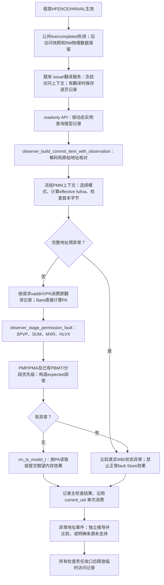

# MemBlock V2 虚拟化访存、PMM 与 RM 检查正式实现方案

- 创建日期：2026-11-17。
- 更新说明：补入 PMM 指针掩码的 CSR 快照、选择优先级、地址预检查、异常地址及数据检查方案；保留已有 `rob_commit` 门槛、CMO fault 例外和后台采集，不新增 replay 记账机制。
- 适用版本：V2，当前分支 `mem_ut_uvm_v2`。
- 状态：2026-11-17 已进入授权 coding；主体源码及文档已落地，rm5编译及95场景184检查自测通过，真实专项及整轮 basicTest 回归待最终收口。尚未归档。
- 授权边界：用户已授权顺序执行三份 plan 的 coding、配套文档、验证及逐项本地提交；本项不修改 RTL、不自动 push。
- 目标：HLV/HLVX/HSV 及普通 Guest 访存复用当前翻译服务和内存模型，补齐访问身份、权限、数据、异常和异常地址检查；普通 Host 与 Guest 标量访存共同接入 PMM 地址参考语义，HLVX按RTL禁用掩码。
- 主要约束：不重复建模两阶段页表遍历或 L2TLB；不建立第二套 HFENCE/HINVAL 失效 owner；翻译失效不清除已提交的物理内存期望。
- 激励方案：[虚拟化指令公共测试框架支持方案](../../test_framework/plan/do/memblock_virtualization_framework_support_formal_plan_20261117.md)。
- 公共时序依赖：[后端周期快照同步驱动与异常地址采样方案](../../test_framework/plan/do/memblock_v2_backend_cycle_frame_formal_plan_20261117.md)。

- 评审记录：[独立评审闭环记录](../../rm_review_doc/undo/memblock_v2_virtualization_rm_formal_plan_review_20261117.md)。

## 1. 专有名词与抽象功能说明

### 1.1 专有名词

| 名词 | 本文中文含义与代码落点 | 示例 |
|---|---|---|
| RM、checker、DUT | 参考期望模型、比较逻辑、被测 MemBlock；RM 核心为 `rm_ls_model_t` | DUT WB 数据不能用作 expected 数据 |
| HLV、HLVX、HSV | 特殊 Guest 读取、按执行权限读取、特殊 Guest 写入 | HLVX 仍产生 Load 类结果和异常 |
| fuType、fuOpType、op class | 执行类别、类别内操作码、主表操作类别 | MOU/AMOXOR 不能因操作码重叠被识别为 HLV |
| UID、ROB key、dynamic epoch | 逻辑编号、完整 ROB flag/value、动态实例代次 | 同 UID 重发后不能读取旧实例结果 |
| issue epoch、replay sequence、attempt | 发射代次、重试编号及某次访问尝试；沿用已有字段 | 同一动态实例内的失败尝试不产生第二次提交效果 |
| reset epoch、frame ID | 公共复位代次、后端周期帧运输身份 | 旧 reset 的地址样本不绑定新帧 |
| CSR snapshot、runtime latest | 某访问冻结的控制上下文、monitor 当前镜像 | RM 使用访问快照，不用提交时 latest |
| SPVP、dmode、dvirt | 特殊访存有效 U/S 身份、普通有效数据访问特权级、普通有效数据访问虚拟化属性 | HS 中执行 HLV 仍使用 Guest 翻译环境 |
| PMM、PMLEN | 指针掩码模式、忽略的地址高位长度；PMM来自CSR，PMLEN为0/7/16 | PMM=11时保留低48位后按当前地址环境扩展 |
| WARL、tag | CSR写任意值但读回合法值的字段约束、指针高位附加标记 | 直接驱动UT端口不自动经过CSR对PMM=01的约束 |
| HUPMM、imode | `hstatus`中的U态特殊访存掩码控制、当前执行特权级 | HUPMM选择还要看imode，不能只看SPVP |
| XLEN、VAddrBits、PAddrBits | 整数位宽、DTLB请求地址位宽、物理地址位宽 | 本V2的fullva为64位，vaddr按实际接口宽度截取 |
| fullva、vaddr、EffectiveVa | 完整请求地址、查表/分段请求地址、PMM处理后的完整地址 | TLB覆盖fullva，不同时覆盖vaddr |
| SignExt、ZeroExt、Bare | 按保留最高位做符号扩展、补零扩展、对应阶段不翻译 | 虚拟地址阶段与纯物理地址环境的扩展不同 |
| pre-fault、checkfullva、endpoint mask | 翻译前的地址错误、完整地址检查使能、首/末字节错误位图 | 位图10表示仅末字节非法，上报该末字节所在页首 |
| vaNeedExt、triggerVa | TLB地址结果的扩展属性、触发器使用的有效起始地址 | 高位预异常关闭后续VA扩展，triggerVa仍是有效首地址 |
| MXR、SUM | 允许从执行页读取、Supervisor 访问用户页的控制 | VS-stage MXR 合并 VS 与 M 两侧控制 |
| S1/VS-stage、S2/G-stage、s2xlate | 第一阶段、Guest 物理阶段及既有阶段选择编码 | all-stage 使用已有两阶段记录 |
| GVA、VA、GPA、HPA、PA | Guest 虚拟地址、虚拟地址、Guest 物理地址、最终物理地址 | RM 内存数据统一按 HPA/PA 索引 |
| PTE、VPN、PPN、ASID、VMID | 页表项、页号、物理页号、地址空间和虚拟机编号 | 权限按 PTE 与该访问控制共同计算 |
| L2TLB responder、token | 现有 DTLB 上游翻译响应服务、真实请求的独立运输记录 | RM 不新增翻译请求队列或 ready owner |
| readonly API、value view | 只读查询入口、复制出的值型视图 | RM 读取框架 PTE，不删除公共表 |
| canonical live entry、completed entry | 供未来请求查找的公共映射、框架可复用的已完成响应缓存 | fence 可以删除这些查询记录 |
| access record、history、entry generation | 某次访问的不可变记录、历史及表项版本 | 旧访问用旧记录，新访问用失效后的新映射 |
| split、provenance | 跨页/非对齐分段、记录来源及其时序身份 | 后页来源必须对应该次访问，而非事后 current 表 |
| backing、expected Store overlay | RM 底层物理数据、已提交写形成的参考数据覆盖层 | HFENCE 不删除 PA 上已写入的字节 |
| item、pending actual、history record | RM 比较对象、待消费实际结果、比较历史 | `items[UID]` 是访问对象，不是 TLB cache |
| obligation、消费进度 | 未完成检查责任、已有 `current_uid` 程序游标 | 主数据比较消费当前 UID 后推进游标，地址检查另行收口 |
| AF、PF、GPF、GAF、exceptionVec | 访问错误、页错误、Guest 页错误、G-stage 访问错误、异常向量 | HLVX 权限失败按 Load 类 cause 比较 |
| PMP/PMA、READ_EXEC、PBMT | 物理保护/属性、读加执行命令、页内存类型 | HLVX 物理检查需要读和执行两类结果 |
| fault head、sampled-applied、recovery | 故障队首、实际输入采样后业务记账、原恢复 | 本帧记账后才允许原资源扫描 |
| C−2、barrier | 已有L2请求在C拍采样时查询两拍前CSR的连接点合同、配置切换前后的访问屏障 | PMM按配置四拍稳定后issue冻结，不套用C−2 |
| S、S+2、raw sample、watermark | 实际输入编号、普通 LSQ 目标输出编号、原始样本、生产完成水位 | S+2 不等于 finish_item 后任意等两拍 |
| rollback、cancel、terminal | 违例冲刷重发、合法取消、逻辑指令最终收口 | rollback 不等同 AF/PF fault 终态 |
| HFENCE/HINVAL、flushPipe、owner | 翻译同步/失效操作、流水冲刷属性、唯一生命周期管理者 | 失效由既有公共框架拥有 |
| AMO、segment、misalign overwrite | 原子、向量 segment、非对齐地址覆盖来源 | 当前V2标量misalign覆盖关闭，仍必须LSQ地址检查 |
| map、queue、cursor、prefix、cache | 索引、队列、游标、连续进度、可复用保存状态 | 每拍不扫描全部主表寻找待比较事件 |

### 1.2 组件抽象职责

| 组件 | 本方案中的职责 |
|---|---|
| L2TLB seq 与 common data | 继续唯一管理映射生成、阶段结果、响应完成、公共失效和取消 |
| 既有访问记录提供方 | 保留该次访问实际使用的参考表项、控制快照与来源，覆盖 hit/miss 和后页；它不计算 DUT 数据期望 |
| CSR monitor 与runtime上下文 | 发布实际采样的五组PMM及身份/翻译控制，保留可关联到地址处理拍的历史；不计算RM期望 |
| `memblock_rm_readonly_api` | 将访问身份、完整CSR、地址来源、翻译记录、PMP/PMA 和实际结果复制给 RM，不推进框架状态 |
| `memblock_rm` | 构造比较对象，计算权限/异常，收集 actual，调度数据和地址检查 |
| `rm_ls_model_t` | 拥有按程序序提交的参考内存效果、Load 数据期望及比较历史 |
| DUT WB/地址 observer | 保存实际信号和身份，不将 actual 写成 expected |

## 2. 范围、复用边界与当前缺口

### 2.1 实现范围

覆盖 HLV.B/BU/H/HU/W/WU/D、HLVX.HU/WU、HSV.B/H/W/D，及普通 dvirt=1 访存对本公共权限路径的使用。普通 Host 访存、AMO、CBO 的既有结果保持明确分支，不因新增编码扩大其它类别的合法集合。

PMM作为本方案必需支持项：覆盖合法00/10/11模式、五个CSR来源、选择优先级、符号/零扩展、首末字节高位检查及其异常地址；PMM=00也执行适用的高位预检查。配置默认值保持关闭不等于checker可以省略非零PMM语义。

复用现有两阶段翻译结果；RM 只做地址几何消费、上下文一致性验证和权限/结果推导。HFENCE/HINVAL 继续由框架维护失效，RM 只保证自身历史与内存状态不被错误清理，不新增独立 fence 功能 checker。

完整 PTW/HPTW、HU/VS/VU 执行资格、MPRV/MPV 到上游 dmode/dvirt 的生成，以及 stval/htval/htinst 最终 CSR 写入均不在本方案范围。独立验证 DUT 是否漏失效属于后续专项目标，不能把本方案的数据比较或公共删表成功表述为已证明 DUT fence 实现正确。

### 2.2 当前代码检查结论

以下路径以 `mem_ut/ver/ut/memblock` 为基准，行号是 2026-11-17 的定位辅助。

| 对象 | 已有支持与缺口 |
|---|---|
| CSR interface/xaction/driver与`memblock_csr_config_state.sv` | 已有`pmm_mseccfg/menvcfg/henvcfg/hstatus/senvcfg`五组2位字段，配置默认全零，不需新增同名DUT端口 |
| `agent/csr_ctrl_agent_agent/src/csr_ctrl_agent_agent_monitor.sv` | 已采到PMM，完整payload包含它们，但给公共runtime/history的`raw_csr`未填入PMM；仅完整payload有字段不足以供RM消费 |
| `common/memblock_common/src/memblock_sync_pkg.sv`、`seq/base_seq_help/mmu_csr_runtime_state.sv` | raw/runtime缺PMM字段，初始化、变化比较、复制、历史发布链需同步补齐 |
| `seq/base_seq_help/memblock_rm_readonly_api.sv` | TLB上下文未暴露PMM；需补地址处理拍对应的五组控制，而非提交时latest |
| `env/src/memblock_rm/memblock_rm.sv:474`及构造入口 | 现有地址计算主要是src_0加立即数，后续多处按`computed_vaddr[63:12]`查询；需分离原地址、完整有效地址与真实请求VPN，不能只替换一个变量 |
| `env/src/memblock_rm/memblock_rm.sv:414` | scalar size 尚无特殊访存编码 |
| 同文件 `:481` | S1 privilege 直接用 dmode；Guest S1 MXR 仅取 vmxr，S2 也取 vmxr；无 HLVX 专用权限分支 |
| 同文件 `:738` 起 | 新操作尚不能形成完整 LOAD/STORE item，可能落入 OTHER/零宽度提前返回 |
| 同文件 `:915` 起 | 标量物理读取使用 READ，HLVX 未选择 READ_EXEC 并合入执行权限失败 |
| `seq/base_seq_help/memblock_rm_readonly_api.sv:241` | 上下文已有 SPVP、dmode/dvirt、MXR/SUM、两阶段配置，可复用 |
| 同文件 `:1384` 起 | 首页优先用 UID payload，后页仍回查当前 canonical 表，迟到比较遇 fence 重建时有历史来源风险 |
| `env/src/memblock_rm/rm_ls_core.sv:549` | 内部保存物理数据、已提交 Store、访问 item、实际结果和历史，无第二套可变 TLB 查询缓存 |
| `seq/base_seq_help/memblock_pma_pmp_model.sv:11` | 已有 READ_EXEC 和读/写/执行结果，复用命令与评估器 |
| `seq/base_seq_help/common_data_transaction.sv:9789` | 已有公共按生效边界删除 live/completed 翻译记录的实现 |
| `seq/base_seq/memblock_l2tlb_base_sequence.sv:1715` | 已有旧 token 取消和 hold 生命周期，不在 RM 重复执行 |
| `seq/base_seq/memblock_sfence_control_base_sequence.sv:127` | 当前 worker 固定 flushPipe=1，HINVAL 完整生成仍依赖激励方案实施 |

### 2.3 既有主比较门槛与后台采集

本方案保留 `observer_process_current_commit()` 的消费结构，不把 HSV 的每次发射或 replay 变成一次 RM 提交，也不将所有类别统一改为等待 `terminal_done`。

| 对象 | 当前主比较入口及本方案接入原则 |
|---|---|
| 普通 Load/Store、后续 HLV/HLVX/HSV | 等待该 UID 的 `status.rob_commit=1`，再构造期望、比较及按既有规则提交参考效果 |
| 普通 fault Load/Store | 同样由框架 fault `rob_commit` 记账开放比较；不是正常架构退休，也不意味着 DUT 发出正常 scommit。新统一帧实现后，该记账由实际 sample 的 sampled-applied 产生 |
| AMO | 沿用 `rob_commit` 门槛和已有实际证据等待，不增加 replay 提交入口 |
| CMO fault | 保留原例外：允许 STU/CMO 且 `terminal_done && sta_fault` 进入；CMO STA fault 未到 terminal 时仍等待，即使 rob_commit 已置位 |
| 控制项 | 保留原控制提交和游标消费，不为其构造 Store 数据效果 |
| WB、DCache/Uncache、CMO事实采集及计划扩展的地址采集 | 已有后台采集持续运行，新增地址采集也按对应公共方案持续发布，不等待 rob_commit；采集和已有协议检查不等于主数据比较或参考内存提交 |

当前判断位于 `env/src/memblock_rm/memblock_rm.sv:2117–2124`；轮询 `:2510` 先运行 `observer_service_path_facts()`，再尝试处理当前提交。必要实际证据尚未到齐时，即使 rob_commit 已成立也可能继续等待。

普通正常提交资格已经要求真实完成且没有 replay/redirect/fault/killed 等状态；RM 主入口继续核对残留状态。合法 replay 在框架内处理，尚未提交的尝试不进入 RM 正常 Store 记账。最终提交后，`rm_ls_model_t::commit()` 沿用原程序序消费并推进 `current_uid`，避免重复轮询再次处理同一 UID；`commit_memory_effect()` 自身没有通用 effect ID 去重，本方案不为 HSV 补建这一机制。

STD 数据在重发时保持一致由框架冻结输入保证。提交比较检查最终合法结果，不宣称逐次验证所有失败尝试的 STD；逐次发射数据一致性 checker 不属于本次新增范围。动态代次和 attempt 字段继续用于只读历史/actual 归属，不能据此扩展成 RM replay 状态机。

## 3. 目标检查 Flow



**函数调用 Flow 图整体文字伪代码：**

```text
1. 现有框架在真实访问和翻译边界建立执行身份，复用原TLB/PMP上下文。
   为该访问使用的页保留不可变记录；fence只影响未来查询，不销毁仍有consumer的历史。
2. 后台observer持续保存真实事实；主比较轮询按第2.3节等待当前UID的rob_commit，
   保留CMO fault例外。普通fault在新帧路径中由sampled-applied设置原rob_commit状态，
   准备帧或replay本身不开放比较。具备资格后按动态身份读取主表和记录。
3. 构造item时独立核对操作、宽度、imm=0、原始VA、CSR和翻译阶段；异常操作不能降为OTHER。
   先取得地址处理拍的完整控制，按PMM选择规则计算effective_fullva及首末字节预异常。
   预异常成立直接构造对应异常与地址，不能等待一笔可能根本未发生的L2请求。
4. 无预异常时按请求vaddr/VPN和真实分段来源读取实际使用页的PTE/PPN；Bare路径不强求PTE。
   局部计算SPVP/SUM/MXR/HLVX权限，不重新walk，也不用fullva替代全部查表key。
5. 翻译失败则按已有异常门控处理；可用PA上查询既有PMP/PMA，HLVX选择READ_EXEC。
6. 无异常Load按物理字节构造数据并比较WB；无异常Store按程序序单次提交内存效果。
   fault比较独立expected与真实异常，不按actual改写expected。
7. 地址observer保存的事件到齐后，地址checker用参考上下文另行计算VA/GPA/VS标记并比较。
8. 数据/异常/地址等责任结束或明确取消后释放临时引用；缺证据不能视为pass。
```

## 4. 参考输入与状态所有权

### 4.1 输入合同

| 参考输入 | 获取方式 | 禁止替代方式 |
|---|---|---|
| 操作与操作数 | 主表最终 fuType/fuOpType、src_0、imm、冻结 STD 数据 | 用 DUT data 生成期望 |
| CSR/访问身份与PMM | 地址处理拍对应的五组PMM、imode/dmode/dvirt/SPVP、MXR/vMXR及翻译配置；权限消费保持既有可见性合同 | 提交时latest，或将旧身份与新PMM拼成一个快照 |
| 地址输入与检查属性 | 操作数独立计算的raw address、请求fullva/vaddr来源、checkfullva、TLB cmd/size、分段身份 | DUT返回的PA/异常地址或以有效fullva统一替换所有VPN |
| 映射和 PTE | 框架参考映射及这次访问保留的 token/issue-hit 页面记录 | DUT 最终 PA 反填 expected PA |
| 翻译服务注入 fault | 框架冻结的服务输入事实；与权限派生 fault 分开 | DUT WB exceptionVec |
| PMP/PMA | 已有模型按这次访问有效身份、PA、size、命令查询 | 将 Host dmode 强塞给特殊访存 |
| memory data/错误来源 | 现有 backing、已提交写和独立响应/错误事实 | 将被比较的Load数据复制为backing |
| actual | 被动 WB、最终 Store 及异常地址事件 | status.success 代替真实观测 |

表项常量和只读基础类型允许复用，访问权限仍由 RM 计算。已有 PBMT request/response-visible 控制合同继续执行；历史快照不能抹掉当前已定义的 response-visible overlay，也不能直接采用 responder 的“允许访问”结论作为 RM 答案。

### 4.2 计划补齐的只读记录

扩展既有访问记录/后页 provenance，计划提供按以下身份查询的不可变页面视图；固定落点见第12章：

```text
reset_epoch + UID + dynamic_epoch + ROB key
    + 已有issue/replay/attempt身份 + VPN + s2xlate
    → 该次访问的CSR引用、参考PTE值、entry_generation、来源token/sample、
      已解析S1/S2 PPN/GVPN、记录状态
```

PMM相关记录还需分离以下值，字段名固定；原有字段可直接引用，不新增重复权威对象：

| 字段/记录 | 含义与生产责任 |
|---|---|
| `raw_address`/原`computed_vaddr` | 原始操作数地址；继续检查与主表VA一致，不能写成PMM结果 |
| `request_fullva`、`request_vaddr`、`lookup_vpn` | 本次原始/重放/分段请求的地址来源；由既有请求记录提供，RM按操作数和分段规则独立校验其几何 |
| `address_csr_snapshot`及sample引用 | DTLB执行PMM/预检查时可见的完整CSR；五组PMM、身份、MXR及翻译模式属于同一可追溯版本 |
| `selected_pmm`、`pmm_source`、扩展方式 | RM局部派生的选择结果及诊断信息，不是新增运行参数 |
| `effective_fullva`、`last_va`、三类endpoint mask | 掩码后首地址、按RTL位宽计算的末地址、prePF/preGPF/preAF两位错误图 |
| `fault_report_va`、`expected_gpa`及地址元数据 | 预异常或实际故障段对应的上报期望；与最终数据访问PA分开 |

地址控制必须能在没有新L2请求时取得。先用动态身份读取四拍稳定配置下的issue控制，再按需要查询页面记录；不得把取得CSR的前提设为“必须已有PTE/token”。现有C−2等历史对齐属于已有特定连接点的时序合同，本方案固定配置四拍稳定合同，实施以波形验证，不能把L2请求的偏移直接套到所有issue/hit/replay。动态配置继续等待monitor确认及原barrier后生效；缺少稳定配置或对应issue身份时报告输入证据错误，不能默认PMM=00。

这是历史证据索引，不参与未来 TLB 命中、不接受新翻译请求、不独立维护 fence 匹配规则。不能只用相同 key 的最新 generation 覆盖旧访问记录。entry generation 用于验证来源一致，不是每次 CSR snapshot 变化就清表的依据。

历史在原真实 response completion、已有 issue-hit snapshot 和后页可证明使用边界保存；TLB hit 没有新 L2 请求时复用此前真实完成的参考映射。不得为凑历史伪造一次 L2 request，不能用 DUT PA 作为参考映射。记录提供点和冻结查询接口固定见第12.2节；readonly只返回值，RM直接释放自己的副本，不新增retain/release公共状态修改接口。

### 4.3 完成状态与检查责任

主数据/异常检查与地址检查各自维护结果。状态固定为 PENDING、PASS、FAIL、CANCELLED、UNSUPPORTED；这些是运行期状态，不是 runtime cfg。

合法取消必须有原 reset/redirect/attempt 身份依据。UNSUPPORTED 必须包含来源和原因，只能说明该子检查未实现，不能变成整个访问“全部检查通过”。必需的普通LSQ地址样本缺失属于 FAIL，不得自动降为 UNSUPPORTED。框架恢复成功不依赖 RM 判断 pass，RM 也不修改框架 terminal/owner 来修正比较失败。

## 5. 操作、身份与权限语义

### 5.1 操作与结果矩阵

| 操作 | RM kind | size | 正常数据格式 | 物理命令 |
|---|---|---:|---|---|
| HLV.B/H/W | LOAD | 1/2/4 | 符号扩展到64位 | READ |
| HLV.BU/HU/WU | LOAD | 1/2/4 | 零扩展到64位 | READ |
| HLV.D | LOAD | 8 | 保持64位 | READ |
| HLVX.HU/WU | LOAD | 2/4 | 零扩展；整数结果 | READ_EXEC |
| HSV.B/H/W/D | STORE | 1/2/4/8 | 冻结STD低位数据和对应byte mask | WRITE |

特殊访存要求 imm=0、主表VA=src_0，RM验证该合同而不替生成器修正输入。HLV/HLVX不做浮点NaN boxing，HSV地址与数据是两个独立来源；现有slot0 override可作为冻结数据输入。

### 5.2 有效身份

```text
effective_mode = special_guest_memory ? (SPVP ? S : U) : dmode
use_guest      = dvirt || special_guest_memory
```

HS执行HLV时，dvirt=0也必须选择Guest环境。普通非特殊M-mode数据访问沿用既有bypass规则，不能把这条bypass套到HLV/HSV。PMP/PMA上下文登记及RM查询须使用同一effective_mode；若框架尚未提供正确上下文，报告依赖缺口，不在RM篡改已登记的权限结果。

### 5.3 分阶段权限

| 当前有效阶段 | Load允许条件的核心 | 身份/SUM与MXR |
|---|---|---|
| Host S1 | R或X与mstatus.MXR组合 | 普通有效身份、mstatus.SUM/MXR |
| VS S1普通读取 | R或X与合并MXR组合 | 特殊访存用SPVP；SUM用vsstatus.SUM，MXR用vsstatus.MXR或mstatus.MXR |
| VS S1 HLVX | X | 身份和SUM继续适用，不能由R或MXR代替X |
| G S2普通读取 | R或X与mstatus.MXR组合 | 不把S1的U/S/SUM模板再套一遍 |
| G S2 HLVX | X | HLVX要求同样影响G阶段 |
| 当前阶段写入 | W，结合A/D及相关有效性事实 | HSV仍是写访问 |

S1按既有U/S页规则检查，读取需要A，写入需要A/D。页表结构、无效/非叶子、reserved编码及服务返回fault按当前DTLB与上游服务边界分别处理；S2没有独立entry V字段，不虚构S2 V，也不把S1 leaf合法性公式原样复制到S2。S1 fake/nonleaf可能是隐式VS页表访问GPF来源，不能直接判为普通数据PF。

本方案不新增权限结果cache。每次访问使用冻结PTE和本次控制局部计算，SPVP/SUM/MXR变化不删除共享映射、不继承上一UID的权限结论。

### 5.4 PMP/PMA

HLVX使用已有READ_EXEC命令，合并读与执行方向的PMP/PMA失败，最终编码为Load AF，不能产生Instruction AF/PF。HLV使用READ，HSV使用WRITE。翻译错误时不对无有效PA继续猜测物理权限；首/后段与PBMT的既有优先级仍须保留。

### 5.5 PMM编码与选择优先级

| PMM编码 | PMLEN | 完整地址处理 |
|---|---:|---|
| 00 | 0 | 保持原fullva，仍做适用的高位检查 |
| 10 | 7 | 保留fullva[56:0]，扩展至64位 |
| 11 | 16 | 保留fullva[47:0]，扩展至64位 |
| 01 | 保留编码 | 不列为正常支持模式；CSR本身有WARL约束，直接驱动UT端口绕过了该约束 |

计划在配置/输入合法性边界拒绝01，报告具体CSR来源；若未来专测保留编码的端口行为，应另立输入合同，不能把它作为第四种合法PMLEN。X/Z由接口基础合法性检查报告。

以下优先级严格按当前V2 DTLB消费路径排列，命中即停止。`premode=hyperinst?SPVP:dmode`，`use_guest=dvirt||hyperinst`；这里SPVP需解释为U/S身份。

| 顺序 | 条件 | 选定PMM |
|---|---|---|
| 1 | ifetch或HLVX | 00；本RM只处理数据访问，保留HLVX分支 |
| 2 | premode=M | mseccfg.PMM |
| 3 | Guest环境下(vmxr或mxr)=1，或Host环境下mxr=1 | 00 |
| 4 | 非Guest且premode=S | menvcfg.PMM |
| 5 | Guest且premode=S | henvcfg.PMM |
| 6 | hyperinst且当前执行imode=U | hstatus.HUPMM，即接口pmm_hstatus |
| 7 | premode=U | senvcfg.PMM |
| 8 | 其它 | 00 |

因此不能简写成“MXR=1一律关闭PMM”：当前M身份分支先选mseccfg。也不能简写成“U执行HLV一律用HUPMM”：若SPVP=S，前面的Guest S分支已选henvcfg。普通Guest U走senvcfg，不能只因use_guest=1就套用HUPMM。vsum/SUM不决定PMM选择。

### 5.6 完整地址处理与查表地址分离

扩展方式取决于实际启用的地址翻译环境：`sign_extend = prevmEnable || (pres2xlateEnable && vsatp.mode!=Bare)`。两项enable需包含本V2支持的模式、有效身份及原debug配置约束，不是简单检查任意satp非零。存在有效Host/VS虚拟地址阶段时按保留最高位做符号扩展；纯物理或only-S2的输入GPA按零扩展。

```text
effective_fullva = request_fullva                     // PMM=00
PMM=10: effective_fullva = SignExt或ZeroExt(fullva[56:0], 64)
PMM=11: effective_fullva = SignExt或ZeroExt(fullva[47:0], 64)
```

例如PMLEN16下，`0xABCD_0000_0000_4000`变为`0x0000_0000_0000_4000`。若保留的bit47为1，符号扩展与零扩展会给出不同高位，因此必须分别覆盖。

RTL将`req_out.fullva`改为EffectiveVa，但不同时改`req_out.vaddr`。TLB查找及上游VPN仍从请求vaddr取得，翻译PA使用对应PPN与vaddr页内偏移；Bare按该路径vaddr做规定的扩展/截断。因此RM必须保留以下三条独立合同：

1. 原`computed_vaddr==main_vaddr`验证原始操作数地址，不受PMM修改。
2. 映射查询按实际VAddrBits、原请求/重放/分段来源推导`lookup_vpn`，消费原服务参考表。现有RM中直接用64位raw地址右移的查询点要逐一改用该地址视图；不能全局改成`effective_fullva>>12`。
3. 完整有效地址供首末字节高位检查、fullva相关异常及GPA偏移规则使用；最终PA由有效路径的参考PPN/offset或Bare规则独立建立，不从DUT PA反填。

PMM不改变低位byte offset与数据宽度，也不修改HSV的冻结STD。不同tag只有在按上述实际查表路径解析到同一PA时，才共享同一参考字节；不能仅因fullva掩码相同就强制制造同一映射。公共主表/TLB key生成方必须支持该区分，属于框架协同依赖。

### 5.7 首末字节预异常与上报地址

先计算PMM后的完整首地址，再按TLB请求的cmd/size计算末地址。标量HLV/HLVX/HSV使用1/2/4/8字节；RTL在atomic命令或size编码大于3时将检查跨度设为1字节，此处不借扩展改变AMO/向量语义。

```text
check_size_log2 = (atomic_cmd || request.size>3) ? 0 : request.size[1:0]
last_va = effective_fullva + ((1<<check_size_log2)-1)   // 按RTL结果位宽截取
checked_va = [effective_fullva, last_va]                // 位0首，位1末
```

只在原请求有效且checkfullva=1时生成预异常。Sv39/Sv48检查两个端点能否分别从bit38/47符号扩展回来；Sv39x4/Sv48x4检查bit41/50及以上是否为零；无有效翻译时检查PAddrBits及以上是否为零。每类形成两位位图：

| 实际阶段 | 检查 | 预异常 |
|---|---|---|
| only-S2 | hgatp选择的41/50位无符号GPA宽度 | preGPF |
| only-S1或all-stage | vsatp选择的39/48位虚拟地址规范形式 | prePF |
| Host S1 | satp选择的39/48位虚拟地址规范形式 | prePF |
| 无有效翻译 | 物理地址高位 | preAF |

不能在规范地址检查前先截掉高位，否则会把应报错的地址变成合法地址。若合并位图恰为二进制10，即只有末字节错误，`fault_report_va=last_va所在页页首`；其它情况保持effective_fullva，包括首字节错误而末字节反而合法的情形。按当前RTL加法结果位宽处理溢出，不引入无限精度整数语义。

高位预异常在TLB响应覆盖普通翻译结果：使用相应Load/Store PF/GPF/AF，`miss=false`、`vaNeedExt=false`、`isForVSnonLeafPTE=false`、`gpaddr=fault_report_va`；响应fullva为fault_report_va，而triggerVa仍为有效首地址。RM独立得到这组元数据，再沿已有LSU/异常buffer地址投影规则生成最终可见VA/GPA。vaNeedExt或triggerVa未对RM开放时，只验证已开放的结果，不假设顶层已有这些端口。

checkfullva=0的misalign后续请求沿用原首请求检查及分段合同，不把分段vaddr再次当作原始fullva重做掩码；后段真实翻译错误仍按自己的来源检查。预异常不要求出现新L2请求，不以无token判丢响应。

### 5.8 正常翻译故障的地址与数据效果

无预异常时继续复用原翻译记录。GPA构造仍区分数据leaf和隐式VS页表访问：RTL按fullva与请求vaddr的bit12是否不同选择跨页地址来源，leaf使用该来源的页内offset，nonleaf/fake使用相应VPN索引和PTE位置，only-S2直接使用适用的输入GPA。PMM结果必须进入fullva一侧，不能将所有GPA统一设为掩码后VA。

RM用参考entry的GVPN/level/leaf/fake和分段来源独立计算；隐式页表GPA由第12.4节原始S1参考payload独立计算，不能依赖故障时无效的request_gvpn。预GPF属于输入GPA宽度错误，不需要伪造VS页表记录，必须检查GPA等于本路径fault_report_va及VS标记为false。非GPF不强加Guest地址的架构含义。

正常数据检查最终仍按参考PA读取/写入，同PA的普通Load、HLV与HSV共享参考内存。PMM选错若导致不同规范性、故障地址或PA，应分别由异常、地址或数据检查捕获；不能看到DUT返回某PA再改变RM的地址路径。

## 6. 关键函数与接入逻辑

本章新增名字均是计划接口，不表示已有源码；现有函数保留真实名称。每个helper在当前页或活动事件上工作，不扫描完整主表。

### 6.1 `observer_decode_guest_access()`（计划新增）

**抽象功能描述：** 在RM构造访问对象时解释实际操作，产生特殊属性、宽度和结果格式，阻止特殊访存被OTHER路径跳过。它不分配LSQ资源，也不修改操作码。

**输入与输出：** 主表fuType/fuOpType/op_class、src_0/imm；输出LOAD/STORE、special/hlvx、size/signed、原始操作数VA及合法性结果，属于常数时间路径。

**源码级伪代码：**

```text
按fuType分隔编码空间，核对明确的HLV/HLVX/HSV白名单。
若是特殊读取：要求INT_LOAD/LDU，映射size和signed，要求整数写回语义。
若是特殊写入：要求STORE/STU，映射size和单STD数据语义。
若是其它类别：返回原普通/AMO/CBO分支，不按编码部分位误判特殊访存。
特殊访问检查imm=0和主表VA=src_0；失败报告，不修正输入。
已识别特殊操作却不能完成语义解码时直接报错，禁止退回OTHER/零宽度成功路径。
```

**中文文字伪代码：** 先以执行类别确定操作码含义，再得到读取、HLVX或写入。特殊读取核对主表整数类别并给出宽度和扩展方式，特殊写入使用冻结STD。检查地址合同失败时保留失败证据，不替框架调整地址。非特殊操作返回原分支，继续保留control/prefetch等既有OTHER语义，不能为了防漏检查把所有OTHER都拒绝。

### 6.2 `read_access_translation_snapshot_for_rm()`（计划只读入口）

**抽象功能描述：** 为RM按动态访问和页读取不可变翻译参考输入，保证比较迟到时仍对应访问当时的映射。它复用公共记录，不创建第二套TLB或失效模型。

**输入与输出：** 动态身份、VPN、所需阶段；输出值型页面记录和FOUND/PENDING/CANCELLED/MISSING结果。来源字段包含sample/token/generation及CSR引用。

**源码级伪代码：**

```text
核对reset/UID/ROB/dynamic及已有attempt身份。
优先定位该访问已有的页面记录：
  找到且来源一致时复制PTE、阶段结果和控制视图返回FOUND。
  真实记录仍在生产时返回PENDING，不用current表抢先替代。
  原生命周期已取消时返回带原因的CANCELLED。
只有当前仍合法的首次绑定可从既有issue-hit/completion流程取得参考entry并冻结。
若已跨过记录生产完成水位却无匹配历史，返回MISSING，禁止查新generation补旧访问。
同一次访问多个byte共享对应页快照；按实际页数查询，不为每byte复制完整对象。
```

**中文文字伪代码：** 查询先确认是同一次执行，再查原记录。已有冻结历史直接复制使用，尚在等待真实来源时让RM暂缓而不产生错误新映射。取消保留原原因。允许首次绑定时由既有框架记录提供方取得参考映射；RM自身不将live表变成第二权威。生产结束后缺记录必须报证据缺失，尤其不能在fence之后用相同VPN的新表项覆盖旧页。跨页每一实际使用页都具有对应记录；首段已失败、DUT不再访问后页时沿用原停止条件，不强求后页存在。

### 6.3 `observer_stage_permission_fault()`（修改）

**抽象功能描述：** 在已有翻译参考输入上计算当前访问的阶段权限失败，为异常模型提供局部结果，不生成或修改映射。

**输入与输出：** 当前页PTE视图、冻结CSR、操作访问属性、S1/S2；输出permission fault及必要阶段来源。HLVX属性须由6.1的实际操作解码传入。

**源码级伪代码：**

```text
阶段未激活则返回无该阶段权限失败。
取本阶段参考权限及已有结构/fault事实。
S1按use_guest选Host或VS控制，按special选择SPVP对应U/S或普通dmode。
  Host用mstatus.MXR/SUM，VS用(vsstatus.MXR|mstatus.MXR)/vsstatus.SUM。
S2读取采用mstatus.MXR，不采用vsstatus.MXR，不套用S1 SUM。
HLVX选X许可；普通读取选R或(MXR且X)；写入选W。
分别结合A/D、S1身份规则以及本来源真正拥有的有效性条件。
将局部permission failure返回调用者，不写回entry或共享CSR。
```

**中文文字伪代码：** 函数先过滤非活动阶段，再按来源选择控制。S1特殊访存用SPVP身份，Guest合并两侧MXR；S2使用M侧MXR。接着按HLVX/普通读/写选择权限，叠加适用A/D及身份条件。结构与上游fault由原来源合同约束，不能把其特殊表示当成普通leaf失败。输出只影响本item的异常推导，故同PTE上后续不同权限访问可以得到不同结果。

### 6.4 `observer_build_commit_item_with_observation()`（修改）

**抽象功能描述：** 在某条访问具备比较资格时，把操作、冻结翻译和物理属性构造成完整expected对象，为现有数据及异常比较提供输入。

**输入与输出：** 主表/status值型视图和只读API；输出含有效PA、格式、权限与expected异常的item，或明确的暂缓/错误。不推进框架commit cursor。

**源码级伪代码：**

```text
保留原CBO/AMO及普通路径，调用6.1解释特殊访存并核对主表一致性。
按当前动态身份及地址sample读取含PMM的控制；保留computed_vaddr与主表原地址比较。
调用6.10/6.11计算PMM完整地址与预异常；预异常可直接构造异常item，不等待PTE。
无预异常时，以独立地址视图的request vaddr/VPN读取6.2实际使用页记录；Bare不要求PTE。
保留rm_ls_decode_translation_path作为阶段/模式一致性检查，不重新walk。
使用已有S1/S2解析PPN/GVPN与请求vaddr对应offset形成各byte PA几何。
按6.3和参考服务fault、PBMT overlay构造当前页翻译异常。
保留原地址预检查、首段/后段和停止访问分支；错误翻译不进入正常数据路径。
PA有效时以effective_mode对应上下文调用read_pma_pmp_af_for_rm：
  HLV选READ，HLVX选READ_EXEC并合并读/执行AF，HSV选WRITE。
按已有V2优先级组合expected异常，不用WB异常填答案。
填充size/signed/fp_wen、冻结Store数据及byte mask，返回可比较item。
```

**中文文字伪代码：** 构造入口先完成解码和原始地址核对，再读取地址拍的控制，由6.10选择PMM、6.11生成完整有效地址和预异常。预异常直接进入异常比较，不因为缺少翻译token等待；正常翻译分支才消费已有历史映射。阶段解码只检查上下文自洽；实际PPN和几何来自该页记录。每页权限和服务fault先局部计算，随后按6.5的门控组合整笔异常，成功页才进入物理属性和数据处理。物理身份不能沿用特殊访存之外的Host dmode。最后填充期望对象，任何暂缓都只等待缺失来源，不重发DUT指令或改变表项。

### 6.5 异常构造与 `compare_arch_exception()`（核对并复用）

**抽象功能描述：** 异常模型由独立参考输入建立V2期望向量，比较入口按已定义cause和raw诊断策略核对真实结果。它不通过actual异常反向选择expected路径。

**输入与输出：** 6.4逐页局部结果、地址/PBMT/PMP/PMA及独立错误事实；输出expected vector/cause和比较结果。

**源码级伪代码：**

```text
先按6.11检查完整地址预异常；成立时使用TLB覆盖分支，不叠加普通PTE/PMP错误。
无预异常再区分服务翻译AF、普通S1权限PF、S2权限GPF和物理AF。
按当前V2消费边界组合：适用的翻译AF抑制普通页面权限结果，S1 PF门控S2 GPF；
  同时保留fake/nonleaf与隐式VS访问的专门来源。
逐访问段沿用既有PBMT、misalign、首段错误与后页fault优先级，不全局改为简单OR。
HLV/HLVX编码为Load类，HSV编码为Store类；HLVX不产生Instruction类异常。
由select_arch_exception_cause选择最终cause；compare_arch_exception沿用现有策略。
保留raw差异供诊断，不扩大“同cause即可”的范围掩盖新差异。
expected有fault则不构造正常Load数据或提交正常Store内存效果。
```

**中文文字伪代码：** 这里区分“构造向量”和“选择最终cause”。前者必须符合本路径的阶段门控，不能把所有参考错误无条件堆到向量；后者继续使用已有V2比较策略。HLVX只是读取许可选择了X，外显仍是Load故障。跨页和非对齐保留原实现的有效前置条件，物理/总线错误只在有实际合法访问依据时参与。最终再与真实WB及终态异常比较，不能因actual出现PF就将自己的expected改为PF。

### 6.6 数据比较与内存效果（扩展现有入口）

涉及 `build_load_expected()`、`memblock_rm_format_load_data()`、`commit_store()` 与 `observer_check_final_store()`。

**抽象功能描述：** 在翻译和权限已经确定后，按程序序读取参考物理数据或应用一次Store效果，并使用现有actual链比较DUT结果。

**输入与输出：** 已满足原提交门槛的冻结item、PA字节、真实WB/最终Store事实；输出数据/异常比较、参考内存更新及原程序游标消费结果，不新增 effect ID 或 replay 去重状态。

**源码级伪代码：**

```text
Load：先完成独立异常比较；无异常时按PA从已提交写覆盖层或backing读取字节。
  按5.1扩展格式化，HLV/HLVX整数结果不做FP NaN boxing。
Store：取得冻结STD slot0数据及mask，先比较异常。
  前置翻译/权限fault不产生正常Store效果；独立总线已接受效果保留原uncache合同。
  正常提交沿用commit_store → commit_memory_effect → commit返回后推进current_uid。
  尚未提交的replay不进入本段；提交完成后的下一次poll处理下一个UID。
  最终Store检查仍读取真实物理输出，不用框架pass标志代替。
不新增按issue/replay执行的内存写入、撤销或effect去重账本。
旧attempt数据按既有身份过滤，冻结STD在框架重发中保持不变。
```

**中文文字伪代码：** Load先确认异常一致，再由PA读取参考字节，结果扩展由操作决定。Store先确认故障，只有原模型允许的真实提交或已接受总线效果才能写入参考数据。对前置权限故障不制造正常写；对原uncache的已接受错误响应不随意回滚既有总线合同。所有正常HSV效果与普通Store共用同一物理参考内存，后续Host或其它Guest映射到同PA也能看到它。单次记账依赖原提交资格和程序游标，不能把 `commit_memory_effect()` 描述为已有通用去重器；本方案只核对HSV接入该原路径，不重建其提交机制。

### 6.7 `observer_check_exception_address()`（计划新增）

**抽象功能描述：** 对已确认归属的异常地址事件独立建立期望并比较，补齐WB异常之外的VA/GPA/VS标记检查。它不驱动redirect，不延迟框架恢复以等待RM通过。

**输入与输出：** 冻结fault身份、原访问和分段参考记录、实际frame/S/输出sample及raw地址；输出地址子检查结果和原因。

**源码级伪代码：**

```text
核对frame、UID、ROB key、动态/attempt及reset身份，与原fault cause对应。
对普通LSQ来源按公共S+2合同取得actual整组输出，不以邻拍/latest替代。
先判独立期望是否为PMM后高位预异常：
  是则用6.11的fault_report_va及vaNeedExt=false生成最终VA；
  预GPF要求GPA=fault_report_va、isForVSnonLeafPTE=false，不等待隐式页表来源。
否则用有效fullva、真实请求vaddr、故障段及既有VA扩展规则独立产生expected VA。
对可独立解析的数据访问GPF，按原S1结果或only-S2输入及5.8跨页来源得到expected GPA。
VS页表访问GPF按第12.4节由原始S1 payload、补GPA响应和请求来源独立计算；缺来源报告证据错误。
不把数据GPA当作页表GPA，不将actual GPA反填期望，不预先右移成htval。
记录PASS/FAIL/合法CANCELLED/明确UNSUPPORTED；必需来源缺样本为FAIL。
该子检查结束后释放自身引用，不重复推进程序内存提交或清理框架owner。
```

**中文文字伪代码：** 地址比较先验证事件属于原执行实例，再消费被动样本。VA从故障位置及地址处理语义独立计算，GPA按参考翻译来源计算，VS隐式访问需要足够来源资料；不能仅凭一个输出标记猜完整页表地址。特殊来源和缺参考分别明确报告支持边界，必需普通样本缺失则报错。数据检查可先完成并推进原RM程序序，地址检查保留独立责任，在最终report前收口，不能再次提交同一Store效果。

### 6.8 `observer_process_current_commit()` 与记录释放（修改）

**抽象功能描述：** 轮询入口保留原提交门槛与程序序消费结构，将新增虚拟化语义和异步地址检查接入已有比较流程。执行阶段 replay 仍由框架处理，本入口不新增 replay 记账或撤销。

**输入与输出：** 当前status、框架sampled-applied事实、RM current_uid及独立待检查队列；输出item/actual消费、数据检查进度和可释放记录身份。

**源码级伪代码：**

```text
沿用原程序游标选择当前UID，核对ROB/动态/reset身份。
按第2.3节保留原rob_commit门槛及CMO fault例外，不统一等待terminal_done。
  普通fault的新帧sampled-applied负责设置既有fault rob_commit；PREPARING不设置它。
继续原非CMO replay_pending/redirect_pending/issue_killed/flushed残留检查。
新动态实例不得复用旧item或actual；归属校验沿用原身份链，不新增replay状态机。
调用6.4构造对象及现有actual捕获，当前真实证据未完成则保持pending。
由原commit及其既有失败/等待策略消费当前UID并推进current_uid；不在外层再推进一次。
尚缺真实证据时沿用原等待行为，不反复执行已完成的参考内存提交。
所需地址责任独立排队并持有旧快照引用，不再次调用Store提交。
原取消/reset仅用于清理相应观测/历史归属，不引入“replay先写期望再撤销”的路径。
数据和地址两个消费位均完成后，由RM删除自己持有的值型副本；readonly层不新增修改公共状态的消费接口。
结束检查核对数据进度及地址责任队列，未完成必需检查不得整体pass。
```

**中文文字伪代码：** 后台采集先继续记录真实事实，主比较入口按原rob_commit及CMO fault门槛判断是否可消费当前UID；普通访存不必等待LSQ资源回收后的terminal_done。通过门槛后才读取原快照并构造expected，实际证据不足按原流程等待。原commit负责消费和游标推进，外层不能再次推进或提交同一Store；因此HSV不需要独立effect去重表。地址子检查可以晚完成，但持有原记录并在结束时统计。取消只清对应观测/历史，fence不等于replay或执行取消。RM只删除自身临时副本，不调用公共消费确认接口，不删除TLB映射或改变框架终态。

### 6.9 CSR采样与只读上下文链（修改既有生产入口）

**抽象功能描述：** CSR monitor、runtime更新及readonly适配器把实际配置完整送到访问记录，使RM在比较迟到时仍读取该访问地址处理拍的PMM控制。它们只传递参考输入，不选择PMM结果或生成数据期望。

**函数目的与路径：** 补齐已有字段在raw/runtime链中的缺失；每拍采样、事件更新及按需读取均为固定字段操作，不扫描主表。

**输入与输出：** 五个2位PMM信号及原身份/模式/sample；输出扩展raw/runtime/history/readonly值型上下文和原update_seq。初始化、相等比较、复制/clone、reset与重新发布使用同一字段集合。

**源码级伪代码：**

```text
monitor采样：将五个pmm_*填入raw，与原priv/mode数据一起标记本次sample。
raw_csr_payload_changed：比较五个PMM及原有语义字段，PMM单独改变也属于变化。
按原机制发布runtime latest与逐拍history；不新增独立PMM发布owner。
update_from_raw_csr/复制/只读导出：完整传递字段，保留原update_seq和来源sample。
reset/semantic clear：按既有重发条件重新建立有效快照，不复用旧local去重标志。
访问记录生产方：按经过核对的地址拍/CSR延迟绑定完整snapshot；hit与预异常也可绑定。
readonly查询：按动态实例和sample返回原snapshot；缺失时pending或报缺失，不取latest补零。
配置确认：PMM单独变化也纳入原配置相等/差异比较，monitor确认后才开放依赖它的新访问。
```

**中文文字伪代码：** monitor先把已经采到的五个PMM补入公共raw记录，因此只改变PMM时公共变化检测也能看到。runtime更新、历史复制和只读导出逐层保留相同字段与sample身份，不能只有完整payload包含PMM。复位或原语义清理后按现有规则恢复发布。访问生产方根据已核对的DTLB控制可见拍绑定上下文，不要求L2 token存在；RM查询缺历史时等待原生产方或报告缺失。配置确认沿用原barrier及monitor相等比较，不由RM驱动CSR，也不让RM判pass阻塞新配置。

### 6.10 `observer_select_pmm()`（计划新增纯计算）

**抽象功能描述：** RM构造item时从本次地址控制与操作属性计算所选PMM及其来源，供地址计算使用。它不修改CSR、翻译映射或权限记录。

**函数目的与路径：** 固定时间重现V2选择优先级，避免对HLVX、M、Guest S及U执行特殊访存使用同一默认来源。

**输入与输出：** 6.9的完整地址CSR、special/hlvx与有效身份；输出selected_pmm、source、合法性结果。

**源码级伪代码：**

```text
要求必要CSR字段有效；保留编码按5.5的输入合同报告。
premode = special ? SPVP对应U/S : dmode
use_guest = dvirt || special
if hlvx:                           return (00, HLVX_DISABLE)
if premode==M:                     return (pmm_mseccfg, MSECCFG)
if use_guest ? (vmxr||mxr) : mxr:   return (00, MXR_DISABLE)
if !use_guest && premode==S:        return (pmm_menvcfg, MENVCFG)
if use_guest && premode==S:         return (pmm_henvcfg, HENVCFG)
if special && imode==U:            return (pmm_hstatus, HUPMM)
if premode==U:                     return (pmm_senvcfg, SENVCFG)
return (00, DEFAULT)
```

**中文文字伪代码：** 函数先确认控制可用并解释特殊访存身份，然后HLVX直接关闭掩码。其余操作先判断M身份，再判断适用MXR是否禁止掩码，接着区分Host S与Guest S。只有前面都未选中时，才判断当前U态执行的特殊访存是否取HUPMM；剩余U身份取senvcfg。输出同时携带来源用于定位优先级错误，不保存跨UID的选择cache。

### 6.11 `observer_compute_pmm_address_check()`（计划新增纯计算）

**抽象功能描述：** item构造阶段用原始地址和冻结控制独立形成PMM完整地址、地址预异常及上报元数据，同时保留独立查表地址视图。它不生成PTE或L2请求，不读取DUT结果作为答案。

**函数目的与路径：** 将先前分散使用computed_vaddr的用途拆开，提供首末字节检查及异常地址的共同参考来源；固定时间计算，按本次分段数处理来源。

**输入与输出：** 操作数推导的原地址、请求/分段fullva与vaddr来源、原请求valid及cmd/size/checkfullva、6.10结果和地址CSR；输出4.2所列地址视图、预异常位图与最终可用状态。

**源码级伪代码：**

```text
保留raw_address；核对主表原地址合同，不把masked地址写回computed_vaddr。
按普通/重放/misalign来源独立确定请求vaddr、fullva及lookup_vpn。
用5.6的实际模式enable确定SignExt或ZeroExt；按PMM=00/10/11计算effective_fullva。
初始化三类预异常位图为零；原请求无效则不生成地址检查事件。
若为后续checkfullva=0请求：不重复首请求预检查，保留有效fullva和本段来源，返回。
按5.7确定检查跨度与RTL加法位宽，得到first/last两个地址。
原请求valid且checkfullva=1时，按实际阶段计算prepf/pregpf/preaf；未启用的检查保持零。
mask = prepf | pregpf | preaf
fault_report_va = mask==2 ? 页首(last_va) : effective_fullva
形成对应Load/Store预异常；有预异常时设置不需要翻译记录、VA不再扩展、VS标记false。
预异常GPA取fault_report_va；正常路径保留5.8所需fullva/vaddr来源，等待已有映射。
返回纯值型视图；正常PA稍后由6.4用参考映射或第12.5节修正后的Bare规则产生。
```

**中文文字伪代码：** 函数首先保护原始地址语义，依据真实请求来源分别建立fullva和vaddr。随后按翻译环境选扩展方式，只对fullva计算PMM结果。无效请求不产生检查事件。后续非对齐请求若关闭完整检查，沿用首请求检查合同并保留自己的分段地址；不是把分段地址重新当成原始指针。原始检查请求则计算首末端点并按阶段判断高位是否合法。只有末端点错误时将上报位置改为其页首，其余保持有效首地址；最后输出异常和地址元数据。该结果决定6.4是否需要查询PTE，6.7也用同一独立推导结果构造预期地址，不读取actual来选择故障位置。

## 7. HFENCE/HINVAL 与 RM 内部缓存

### 7.1 唯一失效模型

既有 `sfence_match_entry()`、`apply_due_sfence_invalidate()` 和L2TLB生命周期继续决定公共live/completed记录与待返回token的处理。RM不调用第二次删除、不另起C0/C4计数器、不清TLB表、不pop公共控制事件。HINVAL激励仍依赖测试框架补齐，不能因RM复用失效就声称worker已实现。

RM无需为此次扩展建立独立HFENCE/HINVAL命中模型。控制指令在主程序游标中的原提交/终态仍需自然消费；没有Load数据不等于新建一笔访存期望。

### 7.2 内部状态处理表

| 状态 | 索引/语义 | fence时处理 |
|---|---|---|
| `backing_byte/backing_valid` | PA底层参考数据 | 保留；不是TLB项 |
| `expected_store_byte/valid` | 已提交写形成的物理字节期望 | 保留；不按ASID/VMID拆成多份 |
| `expected_store_entries` | 已提交效果的事务历史，含原PA | 保留原PA，不用新映射重新翻译历史Store |
| `items[UID].pa_by_byte` | 某次访问的翻译结果快照 | 原已确定实例保留，新实例按身份重新取得，不能当未来查询cache |
| 待消费WB/地址/实际响应 | 动态实例事实 | 按原真实取消/代次处理；不因fence valid一刀切删除 |
| DCache/Uncache错误账本 | 物理传输、数据来源与错误版本 | 继续原响应/覆盖/reset生命周期，不能用翻译失效清零 |
| LR/SC reservation | 原子模型已有状态 | 不新增HFENCE自动清除规则；按既有已确认事件维护 |
| 访问页面历史 | 原参考PTE、PPN、CSR及generation | 仍有consumer则保留；不参加未来lookup |
| 公共live/completed索引 | 框架的可复用翻译记录 | 只由原框架按生效事件删除；RM读取未来访问的新绑定 |

### 7.3 物理数据保留示例

```text
旧映射：GVA A → HPA P1；HSV已经向P1写0xAA。
fence生效并建立新映射：GVA A → HPA P2。
后续HLV A的参考数据从P2取得；P1上的0xAA继续保留。
另一个Host/Guest地址映射到P1时，仍应观察P1的既有数据。
```

这说明不能在HFENCE时调用RM全局reset或清Store overlay。映射变化只改变后续访问的PA，不修改已经提交的数据事实。

### 7.4 迟到比较与后页历史

公共control barrier等待较老访问完成，不等于RM已经轮询消费完这些访问。框架不应被迫等RM判pass才允许fence；本方案依靠不可变参考历史消除比较延迟的影响。

当前后页canonical fallback需由6.2的页面历史查询替换其“对已确定旧访问重新查current”的行为。首次合法绑定仍复用原表及range-hit API；已完成旧访问只能消费旧generation。hit和miss都须覆盖，不能只缓存新L2 response而漏掉DTLB hit。历史可在fence后继续被旧consumer读取，但不能让新UID借此复用已经失效的公共翻译。

### 7.5 PMM变化对内部状态的影响

PMM变化更新后续访问的地址控制快照，不等同于一次HFENCE，也不直接更改PTE。它不清RM物理backing、已提交Store overlay、PA效果历史或错误账本；不清仍被旧访问引用的PMM/页面历史。旧访问延迟比较使用旧控制，新访问使用生效后的控制。公共映射是否失效仍只由既有changed/fence合同决定，不能因csr_update_seq增加就另行全局清表。

本方案不新增按PMM缓存的PA结果或权限cache。若为诊断保留选择结果，它仅属于本item，不能给未来访问命中。后续访问的请求VPN或输入合法性发生变化时，在既有查询路径处理，不通过reset RM实现切换；仅切换PMM本身不重写请求vaddr。

### 7.6 本次不增加的专项检查

本方案不独立证明DUT内部TLB失效范围和替换策略。不要求未匹配地址必然继续命中，也不以没有新L2 request直接判fence失败。若后续新增失效专项checker，需要独立事件及后续访问证据另立目标；不能用共享删表自证正确。

## 8. 异常地址、恢复与支持边界

普通LSQ的S+2只是实际输入/输出采样合同，expected地址仍需独立推导。fault sampled-applied先于原恢复扫描；RM地址比较不成为后端驱动或资源回收的新owner。冻结参考上下文及actual事件的保存期限可晚于mapping回收。

当前V2标量misalign覆盖固定关闭，普通及特殊标量非对齐必须LSQ S+2；AMO/segment为范围外独立地址来源，不扩大其既有支持声明。范围内UNKNOWN报告错误，不能以UNSUPPORTED通过。本范围内隐式VS页表访问GPF必须比较GPA和标记，原始S1 payload已提供独立计算来源；来源缺失报错，不以UNSUPPORTED结案。

按异常类型检查字段适用性，普通AF/PF不能无条件要求GPA具有Guest故障含义；零GPA合法与否由语义决定，不能拿非零值当valid。上游未暴露的HU/执行资格和最终trap CSR不在本RM伪造。

PMM及首末字节高位检查按5.5～5.8、6.9～6.11列为本次必需实现，不再作为未来可选审计项。普通标量、HLV/HLVX/HSV的必要控制缺失属于输入链未完成，不能降为UNSUPPORTED来宣称支持；专门来源仍按本章既有边界报告。预GPF不依赖隐式VS页表GPA，必须执行其地址与VS标记检查。本V2固定XLEN=64、VAddrBits=50、PAddrBits=48，支持Sv39/Sv48及Sv39x4/Sv48x4；分段与CSR四拍合同见第12章，实施用当前profile与波形验证，不跨版本套用。

## 9. 参数、性能与生命周期

### 9.1 参数

不新增第二组RM指令权重、翻译模式参数、fence偏移或权限覆盖开关。激励参数仍来自虚拟化框架方案；RM按实际操作和冻结配置检查，不按“某权重是否开启”判断是否消费已出现指令。

不新增`RM_PMM`选择或覆盖参数，RM始终解释真实采样配置。现有端口、xaction与手动配置可表达五组PMM；公共初始化/动态配置入口及可控地址生成需由框架协同接入。是否增加随机权重或plus入口另按参数规则在激励方案确定，本RM plan不杜撰参数名或默认非零模式。默认PMM保持00，仍必须能检查经合法入口输入的10/11。

保留已有RM、PMA/PMP及相关观测能力配置。所需能力缺失须在启动/消费时明确报告，不能跳过特殊操作并输出pass；独立来源子检查未支持按第4.3节记录。能力状态、generation、sample和待检查计数都是运行期状态，不放入plus/cfg。

### 9.2 性能与退出

- 解码、身份和权限判断为常数时间；翻译查询按本访问实际页数，数据循环最多当前标量访问字节数。
- 页面历史按活动访问/未消费事件索引和一次值型冻结管理，不按全部主表每拍重扫。
- 原物理Store历史供最终检查，不能为了清翻译记录而删除；优化其容量必须另按现有消费合同处理。
- fence事件不触发RM对所有UID/物理字节的清理扫描；原公共失效扫描继续只有一个owner。
- reset清理当前检查代次，跨代actual和引用隔离；报告中保留已发生错误，不将reset当作错误消失。
- 正常结束需主数据比较进度完成、所有必需子检查已结束或合法取消、活动临时引用排空；已有失败不得被正常排空覆盖。
- 无推进走原诊断/global-stop/UVM timeout，不增加固定max_cycles作为成功退出条件。
- 仅重复性诊断按既有debug规则门控；主结果正确性比较不因默认debug关闭而失效。

## 10. 修改对象与实施顺序

下列源码均为未来修改清单，本轮不写代码。框架依赖需与关联方案共同整理并获得对应coding授权，不能以RM plan隐式扩大到RTL或未确认框架行为。

| 顺序 | 对象 | 修改目标 |
|---|---|---|
| 1 | CSR monitor、`memblock_sync_pkg.sv`、`mmu_csr_runtime_state.sv`及`memblock_csr_config_state.sv` | 补齐PMM raw/runtime/history字段与初始化、复制、变化比较和配置确认；复用现有信号，不新增DUT端口 |
| 2 | `seq/base_seq_help/memblock_rm_readonly_api.sv`及既有访问记录提供方 | 动态身份、地址拍PMM/CSR、逐页历史、独立地址来源与RM本地消费状态；控制查询不依赖PTE存在 |
| 3 | `env/src/memblock_rm/memblock_rm.sv` | 特殊语义、SPVP/阶段权限、READ_EXEC、PMM选择和首末字节预检查；逐点替换raw地址兼作查询key的用途；先预检查再按需读映射 |
| 4 | `env/src/memblock_rm/rm_ls_core.sv` | 特殊item属性、数据扩展、原Store提交与游标接入、结果/异常及地址责任生命周期；不新增effect去重表 |
| 5 | readonly formatter、`memblock_pma_pmp_model.sv`必要接入 | 复用已有格式化与READ_EXEC；核对有效身份和执行失败合并，不重复建模PMP |
| 6 | `memblock_rm_dut_writeback_observer.sv`、`memblock_rm_observer_api.sv`及地址事件链 | actual代次、不可变保存、普通LSQ地址与frame/sample关联，必要时补强按ROB查询的身份过滤 |
| 7 | 既有common data/分段provenance及L2TLB协同接口 | 补PMM控制/地址来源与历史输入；核对主表、request VPN及range查询的位宽约定，不新建翻译表/失效owner，不改response调度 |
| 8 | RM结束检查和报告 | 区分PASS/FAIL/CANCELLED/UNSUPPORTED，统计缺失责任和清理临时引用 |

实施顺序先打通PMM控制和地址来源链，再实现纯计算，随后接入生产构造及异常地址比较，最后验证数据效果和普通路径。配置入口需要扩展时与框架方案同步；PMM单独变化必须能进入现有monitor确认与barrier。

编码前先确认共享操作码及框架HLV/HSV路由已具备，否则不能拿缺失的常量或错误PMP身份制造假验证。核心权限扩展与数据支持属于同一功能闭环，不能只实现数据扩展就宣布支持全部特殊访存。

## 11. 验收矩阵与后续验证

本章为后续实施的验收目标，不表示本轮新增或运行了测试。实际新增独立检查场景时按规则登记真实DUT与soft/framework分类CSV。

| 验证维度 | 必须验证的结果 |
|---|---|
| 13条指令及AMOXOR编码重叠 | 实际fuType/opcode分类正确，特殊操作不降为OTHER，FP路径无误入 |
| PMM编码与输入链 | 00/10/11合法，01与X/Z明确报告；只改变PMM时raw/runtime/history/配置确认均传播，缺控制不默认00 |
| PMM选择优先级 | 五个来源分别命中，M分支先于MXR，Guest S先于U执行特殊分支，HLVX始终禁用；Host/Guest MXR控制分别生效 |
| PMM扩展 | PMLEN7/16，bit56/47为0和1；Host/VS虚拟地址符号扩展，Bare/only-S2输入零扩展 |
| raw/fullva/vaddr分工 | 原始VA一致性不被PMM破坏，查询按实际请求VPN；tag变化后检查实际PA，不将所有masked VA相同强制合并 |
| 首末字节预检查 | 首合法末非法、首非法末合法、两者均非法/合法；Sv39/48、Sv39x4/48x4及PAddrBits边界；RTL位宽溢出与标量各宽度 |
| PMM预异常地址 | 仅末错误上报其页首，其他保持有效首地址；预GPF的GPA与VS标记false正确；不要求不存在的L2 token |
| PMM分段与正常GPF | checkfullva=0后段不重复首检查；GPA区分fullva/vaddr页与leaf/nonleaf来源，既有后段优先级保留 |
| PMM数据与切换 | 多tag实际同PA共享数据，HSV仍取STD；旧访问延迟RM使用旧PMM，新访问用新值，切换不清物理overlay |
| PMM=00回归 | 既有普通Host/Guest路径结果保持，高位非法仍报预异常，不因关闭掩码跳过检查 |
| 地址/宽度/扩展 | imm=0、VA=src_0；负值符号扩展和无符号零扩展正确；HSV数据与地址可独立 |
| SPVP=U/S与普通dmode | 同PTE上权限按每次身份计算；HS的HLV在dvirt=0时仍进入Guest环境 |
| VS/G两级MXR | VS按vmxr或mxr，G按mxr；同表项不同控制不污染后续UID |
| HLVX | R=1/X=0拒绝，适用X页可读；S1/S2分别失败；物理R/X分别失败均为Load AF |
| 翻译消费 | Bare、only-S1、only-S2、all-stage、超页/range hit、ASID/VMID隔离；不新增PTW |
| A/D、结构与fault | 真实服务fault和局部权限不混淆；fake/nonleaf不误按普通leaf PF |
| AF/PF/GPF及分段 | 正常Host、Guest和特殊访存各自异常类别正确，已有PBMT/非对齐/首段优先级无回退 |
| 数据与HSV写效果 | 与普通Load/Store共享PA内存，alias/重映射后旧PA数据保留；原commit/current_uid单次消费，无新增replay记账 |
| RM消费门槛 | 后台事实持续采集，主比较等待rob_commit并保留CMO fault例外；HSV replay阶段不提交期望，不逐次检查失败尝试的STD |
| fence影响 | 只框架删除公共翻译；RM backing/Store历史/error事实不清零，不新增LR/SC清除规则 |
| 延迟RM与后页 | 旧访问比较晚于fence/CSR切换仍使用旧页面快照，新访问不借旧历史恢复失效命中 |
| reset/重发/ROB复用 | 旧WB、旧item和旧地址事件不绑定新代次；较老已提交效果不被年轻rollback撤销 |
| 地址记录 | frame/UID/代次/sample匹配；参考VA/GPA独立，零地址/同值/迟到不误判valid |
| 不支持或证据缺失 | 子来源UNSUPPORTED可追踪；普通必需样本缺失明确失败，不影响其它必需比较继续报告 |
| 终态排空 | 数据与地址检查责任收口，引用释放；未完成或失败不能被单纯仿真结束掩盖 |

后续验证先做独立函数/生产入口的有效检查，再按项目远端EDA流程编译和真实DUT联合验证。只检查helper返回值不足以覆盖readonly到实际比较的接入，需通过生产构造路径验证，并选择能使不同PMM分支产生可区分异常、地址或数据结果的输入。补丁回归保留普通Host、FP、AMO、CBO、PBMT、uncache及错误来源相关既有检查。

## 12. 固定数据接口、记录冻结及完整检查合同

### 12.1 复用既有记录与最小新增结构

首段使用 `memblock_uid_tlb_record`，后段使用 `memblock_later_split_tlb_record`；标量1/2/4/8字节最多跨两页，新增保存量固定为两页。不建立全局每 attempt 版本历史、通用引用计数器或第三张可命中的 TLB cache。原 `uid_tlb_record_by_uid` 与 `later_split_tlb_record_by_uid` 继续是活跃来源，不改变 responder token/ready 归属。

新增 `memblock_rm_access_snapshot_t` 快照class，在现有 `memblock_tlb_entry.sv` 两种访问记录class之后定义，先于common_data编译。common data 持有它；对象内容显式深复制后只读，语义为值型快照。成员只使用已经定义的 `mmu_csr_runtime_state`、`memblock_tlb_entry pages[2]` 及原公共身份/provenance基础字段，不引用后定义readonly class的nested类型。readonly API随后逐字段转换为其既有nested view，不更改包include顺序。RM 首次读取后保存到现有 pending/item 状态。下表区分存储与导出语义：

| 字段组 | 固定含义与生产时机 |
|---|---|
| `valid/reset_epoch/uid/rob_key/dynamic_epoch/issue_epoch/replay_seq/issue_sample` | 原实际实例身份；真实issue建记录，终态冻结时核对 |
| `address_csr`、`csr_update_seq` | 存储为深复制 `mmu_csr_runtime_state`，导出时扩展现有 `tlb_request_context_view_t`，包含SPVP、imode/dmode/dvirt、模式/ID、MXR/SUM及五组PMM；稳定四拍后issue冻结 |
| `raw_address/request_fullva/request_vaddr/checkfullva/cmd/size` | 输入地址及标量首段几何；原始值不被PMM覆盖 |
| `pages[2]`、`page_count` | 存储为首后页 `memblock_tlb_entry` 深复制及基础provenance字段，readonly导出为 `tlb_entry_view_t`/`tlb_response_provenance_view_t`；不复制整张表 |
| `pmm_arch_reference_valid/pmm_arch_vpn/pmm_arch_reference` | IMPLEMENTATION_DELTA新增：issue时已有masked canonical参考的独立深复制，限定only-S2/Sv48x4高两位变化；不是第三实际访问页，不可供未来请求命中 |
| 每页 `vpn/s2xlate/request_key/entry_key/generation/response_token/response_sample/source` | 源于issue-hit、响应完成、后页hit或补GPA记录；source区分实际来源 |
| `fault_segment/first_segment_stopped/address_source` | 独立分段事实；不从最终WB异常反向选择expected |
| 实际地址事件（独立actual对象，不进入reference快照） | fault frame、S、S+2及原始整组输出；由后端正式方案采集，RM按实例关联，地址到齐可晚于数据 |

`tlb_entry_view_t` 保留原始 S1 entry.ppn、ppn_low[8]、level、N、V/R/W/X、PF/AF及S2字段。若 existing view 未导出，扩展现有 copy helper，不新建 responder payload 类型。故障时 `request_derived_valid=0` 不影响读取原始字段；不能要求 fault 具有正常 leaf 解析PPN。

### 12.2 `freeze_access_reference_for_rm()` 与查询接口

**抽象功能描述：** `common_data_transaction::freeze_access_reference_for_rm(uid,identity)` 在最终提交或异常恢复前保存该实例的参考输入，允许 RM 稍后比较；它不推导数据期望，不改变公共映射。

**目的和阶段：** 解决 fault cancel 清除 WAITING/issue-hit 字段以及 fence 重建后页映射的问题，属于离散提交/故障事件路径。

**源码级伪代码：**

```text
普通标量及HLV/HLVX/HSV正常batch：apply_sampled_backend_cycle内，对每个冻结批准UID
  在其rob_commit更新之前调用freeze_access_reference_for_rm
fault：同一apply_sampled_backend_cycle内，在fault rob_commit更新与原cancel/range恢复之前调用
control/AMO/CMO不接本新增标量snapshot，保留原参考记录路径
读取uid_tlb_record的CSR、原payload及已完成provenance；Bare/预fault不要求PTE
确有第二页访问时：读取later_split记录，若为hit则使用其冻结issue-hit值
后页首次hit/Store来源在既有分段发射或request关联时即时绑定，不能在RM消费时查current
补GPA响应在原completion回填相应页记录；不能被cancel清空后再冻结
无真实后页（首段终止）不要求后页记录
实例身份冲突或已知生产结束却缺必需记录：报告错误，不从新canonical generation补旧记录
显式逐字段copy为memblock_rm_access_snapshot_t，标记frozen；重复同实例冻结幂等
```

**中文详细伪代码：** 冻结函数先确认当前执行实例，然后复制首后两页的既有参考来源。每页在首次实际绑定时就保存 payload 和 generation，因此提交时只复制已存在的值，不重新查询未来映射。Bare 与高位预异常仅需要控制和地址，不能因无 token 拒绝。原 L2 completion 已有 payload 回填，后页命中和 Store 的缺口通过同一个 later-split 记录补齐。fault 的等待补 GPA 记录必须在真实 fault WB 能终态前完成；若未完成则缺证据而非默认通过。复制完成后原恢复可释放活跃表，RM不成为恢复gate。

**抽象功能描述：** `memblock_rm_readonly_api::read_access_translation_snapshot_for_rm(uid,identity,vpn,...)` 从冻结值读取某页输入，供 RM 构造 expected；它不修改 common data。

**源码级伪代码：**

```text
按UID索引冻结bundle，核对reset/ROB/dynamic及issue身份
bundle生产中返回PENDING；真实取消返回CANCELLED；生产完成仍缺返回MISSING
匹配pages[0或1].vpn/s2xlate，逐字段copy为原context/entry/provenance view
禁止对旧已完成访问使用resolve_tlb_entry_for_rm后页current canonical fallback
返回FOUND；RM将bundle保存在当前item，后续逐byte共用一页视图
```

**中文详细伪代码：** 查询只访问当前 UID 和两页，不遍历历史。完成但缺页不回查当前表；真正尚在生产时让原 RM 轮询等待。命中返回原已有值型 view，既有 `resolve_tlb_entry_for_rm()` 改为优先读取冻结 bundle，其旧后页 fallback 仅保留给仍合法的首次绑定生产路径，不能给终态 expected 使用。`try_read_completed_later_split_response_for_rm()` 复用为生产来源；后页hit增加显式来源标记，不伪造L2请求sample以通过旧miss专用门槛。

生命周期固定为：实际页绑定→终态前冻结→RM数据消费→可选地址消费→RM删除副本。common data 的冻结终态输入随该 UID 原主表历史保留至当前 run 结束；这份每 UID 最多两页实际来源、另有最多两个masked架构参考的固定保留量不增加每拍扫描，避免新增消费确认通道。RM活跃待检查副本按其两个完成位释放；reset/合法被冲刷的未提交旧实例直接沿原动态代次取消，不撤销较老已提交物理效果。

### 12.3 CSR 控制快照的固定时序

**抽象功能描述：** 原 CSR monitor、`mmu_csr_runtime_state` 及 readonly copy 将完整控制沿同一 snapshot 链传递；配置 barrier 保证访问期间控制稳定，使真实 issue 快照就是该访问 DTLB 可见控制。

**源码级伪代码：**

```text
dispatch_raw_csr_t增加五组bit[1:0]pmm字段
CSR monitor每sample填充raw、latest与history；changed检测加入五字段
runtime update/copy/reset/readonly逐字段同源；make_runtime_payload/differs_from同样补齐
动态单拍changed先确认；clean level清协议位后连续四个不同sample_seq相等才生效
初始配置也四拍稳定；重复读取latest不推进计数；owner/reset失效取消
旧访问和必需fault地址排空前不修改配置；后续issue开放后完整snapshot冻结
```

**中文详细伪代码：** 五组字段沿现有 raw/runtime/history 传递，PMM-only 变化必须递增已有语义版本。稳定计数以不同公共 sample 为单位，不能以 `#1ns` 循环次数代替。changed 是单拍协议事件，先用原 runtime 完成合同验证，清零后再比较保持 level；不能要求带 changed=1 的目标稳定四拍。此四拍为顶层到 DTLB 的两级加 fenceDelay 两级；L2 request C−2 是另一连接点，原 token 仍沿原合同。无需再建立 per-attempt CSR 历史服务；issue-hit与预异常也有完整控制，不依赖token。

### 12.4 `observer_compute_guest_fault_address()`：隐式页表GPA

**抽象功能描述：** 新增 RM 纯函数根据参考 S1 原始 payload、请求几何和补GPA响应独立计算可见Guest故障地址与VS非叶标记；不读取 DUT GPA 作为答案。

**目的和输入输出：** 普通及特殊标量 GPF 必须完整检查。输入冻结 fault 页、有效 fullva、请求vaddr/VPN、VS模式和实际翻译返回来源；输出 expected GPA/VS标记及参考来源有效性。

**源码级伪代码：**

```text
preGPF: GPA=fault_report_va; VSnonLeaf=false，直接返回
onlyS2: GPA=crossPageVaddr（effective_fullva.bit12与request_vaddr.bit12不同则取request_vaddr，否则取effective_fullva）
其它Guest GPF:
  isLeaf = V && (R||W||X)
  isFake = !V && !s1PF && !s1AF
  isNonLeaf = V && !(R||W||X) && !s1PF && !s1AF
  VSnonLeaf = isFake || isNonLeaf
  vpn = request_vaddr>>12
  canonical_ppn = Cat(s1_entry_ppn_raw, s1_ppn_low[vpn[2:0]])
  gvpn = isNonLeaf ? canonical_ppn : 按level/N及vpn解析的S1 genPPN
  vpn_idx = isFake ? (Sv39?2:3) : ((level-1)按原2bit位宽回绕)
  crossVa=(effective_fullva.bit12 != request_vaddr.bit12)?request_vaddr:effective_fullva
  offset = isLeaf ? crossVa[11:0] : ((crossVa>>(12+9*vpn_idx)) & 0x1ff)<<3
  GPA = (gvpn<<12) | offset，按真实GPA宽度投影
补GPA使用冻结的该次响应原payload，不用request_gvpn有效位替代
```

**中文详细伪代码：** 高位预GPF不读PTE，直接使用已独立计算的故障位置。only-S2输入已经是GPA，按当前nonblocking TLBRead的跨页规则选择。其余分支先判断叶、fake和非叶；故障时不能使用 `derive_tlb_request_fields()` 早退后无效的 request_gvpn，必须直接解析原 S1 sector payload。非叶使用原PPN与当前sector低位形成页基址；其余按现有纯 PPN 解析器的level/N公式计算，解析器可复用常量与位操作，但期望权限仍局部独立计算。fake从VS根层索引，非fake取level减一的原位宽值；非叶offset是该层9位VPN索引乘8，叶offset为故障字节位置。这样GPA与VS标记均来自独立服务输入，不会因actual标记为1而换成页表GPA。

当前 MemBlock 的 load/store/prefetch DTLB 均为 `TLBNonBlock`，`Block=false`；`handle_block` 直接refill分支不可达，不为其新增expected分支或监控。TLBRead、p_hit/bypass及补GPA统一按上述crossPageVaddr公式。实际补GPA响应仍保存其独立token/sample/payload归属，不能由actual GPA提供参考。

### 12.5 Bare 与 PMM 请求地址一致性

**抽象功能描述：** `rm_ls_program_item_t::set_bare_identity_geometry()` 根据已完成预检查的地址视图建立物理字节位置，允许合法tag地址；高位非法由架构异常模型处理，不能归类为RM输入错误。

**源码级伪代码：**

```text
先observer_compute_pmm_address_check：保持raw computed_vaddr，计算effective_fullva和preAF
若preAF成立：构造expected AF，不调用正常Bare字节几何，不报输入不合法
若无preAF：按请求vaddr的实际PAddrBits扩展/截断和每字节低位形成PA
size/mask仍原合法范围；每字节写pa_by_byte/pa_valid_mask
不能再用computed_vaddr[63:48]非零拒绝合法PMM访问
```

**中文详细伪代码：** 原函数将 raw 地址当作物理地址并拒绝高位，PMM后不成立。先计算有效完整地址和高位预异常；有异常就交原比较路径，没有异常再按实际 Bare 请求路径构造PA。原始主表VA核对仍使用 computed_vaddr，不改变Store操作数。

only-S2 + Sv48x4 + PMLEN16 必须保留，不屏蔽 bit49:48 非零组合。当前 RTL fullva 掩码而 vaddr 不同时变化，因此本方案分开两种结果：

1. **MemBlock 实现结果比较**：从实际 DTLB→L2TLB请求建立的独立参考映射与冻结原始payload推导PA、权限和数据，验证所建接口模型与当前输入消费一致；绝不改 responder key 掩盖差异。
2. **PMM 地址语义一致性检查**：由原操作数和选定PMM独立计算应参与有效地址的GPA；在 only-S2 的这组有效位被忽略时，将输入参考的masked VPN与真实请求VPN/既有命中访问几何核对。原 vaddr 的bit49:48继续影响架构访问时报告 `PMM_ADDRESS_SEMANTIC_MISMATCH`，该子检查失败使本次不能整体PASS。不能因为实现结果比较通过就声称架构tag别名正确，也不能自动查表/改PPN制造期望别名。

一致性检查不新增PMM开关，不重新walk或创建第二映射。冷miss比较被动请求VPN；hit使用原issue已绑定的独立参考key与预期有效key，同时正常数据检查核对该映射结果。仅内部缓存tag不同而实际地址与架构结果相同的情况不直接宣称DUT错误；报告键差异诊断，并以独立参考数据/错误权限可区分的访问证据确认架构结果。不从DUT返回PA反填期望。当前静态差异是待实现仿真验证点，本轮不登记RTL Bug、不改RTL。

### 12.6 actual 归属、数据消费与清理

**抽象功能描述：** 原 `observer_process_current_commit()` 保留主程序序门槛，后台服务独立收集actual，新增地址责任不重复提交Store。`memblock_rm_dut_writeback_observer` 提供对应动态实例的真实WB。

**源码级伪代码：**

```text
每轮先observer_service_path_facts收集实际WB/物理访问/地址
按原current_uid核对rob_commit；保留STU/CMO terminal_done&&sta_fault例外
读取最终实例冻结bundle；未完成则等待，必需证据缺失则错误
Load actual优先使用adapter已归属的值型WB：UID/ROB/dynamic/reset/issue与最早sample匹配
若沿用read_latest_load_by_rob：增加同样身份过滤，不能仅ROB latest
构造item：操作解码→PMM/预fault→按需两页参考→权限/PMP→expected异常/数据
调用原commit并由原current_uid单次推进；HSV只取冻结STD，formatter只改输入语义
fault数据/异常消费后保留地址责任；地址到齐独立比较，不再次commit_store
数据/地址完成位满足后释放RM临时值；结束检查任何FAIL/MISSING未清不能整体PASS
```

**中文详细伪代码：** 主比较仍等待 rob_commit，CMO例外不变；terminal_done不是所有指令的新门槛。正常 fault 的 rob_commit由统一帧采样应用设置，后台WB/address早已采集。普通Load按ROB读取latest不够，必须用已归属的实例或额外过滤旧reset/代次/时间。HSV复用Store单次程序序提交，冻结STD不与src_0地址混用；原formatter接收正确size/signed/fp_wen=0即可，不修改格式化算法。fault不产生正常Store效果，replay仍不进入提交主流程，因此不新增effect账本。所有完成状态和释放按当前UID/两个责任位，不每拍扫主表。


## 13. 关联规则与源码依据

- 文档：`AI_DOC/project_management/ai_doc_file_management_rule.md`、`ai_doc_language_rule.md`。
- 授权与运行期结构：`code_modification_authorization_rule.md`、`mem_ut_test_framework_logic_build_rule.md`，均位于`AI_DOC/project_management`。
- L2TLB职责：`mem_ut/ver/ut/memblock/rule/memblock_l2tlb_agent_rule.md`及`version/v2/l2tlb_interface_profile.md`。
- 数据与权限：`mem_ut/ver/ut/memblock/env/src/memblock_rm/memblock_rm.sv`、`rm_ls_core.sv`。
- 只读/模型：`mem_ut/ver/ut/memblock/seq/base_seq_help/memblock_rm_readonly_api.sv`、`memblock_pma_pmp_model.sv`。
- PMM依据：`src/main/scala/xiangshan/backend/fu/NewCSR/CSRDefines.scala:194`、`src/main/scala/xiangshan/cache/mmu/MMUConst.scala:157`、`TLB.scala:73、162–258、374–420、510–528`（TLB.scala位于`src/main/scala/xiangshan/cache/mmu`）；请求地址来源见`src/main/scala/xiangshan/mem/pipeline/LoadUnit.scala`、`StoreUnit.scala`，请求字段见`src/main/scala/xiangshan/cache/mmu/MMUBundle.scala`。
- V2接口消费依据：`src/main/scala/xiangshan/cache/mmu/TLB.scala:90、95、461`、`src/main/scala/xiangshan/mem/pipeline/LoadUnit.scala:1225`、`src/main/scala/xiangshan/backend/fu/PMP.scala:405`、`src/main/scala/xiangshan/mem/MemBlock.scala:1996`。这些引用只支撑本RM方案，不更新V2 RTL知识库。

本轮只更新本文档，新增PMM的RM/check方案；未修改源码、未新增测试或运行仿真。已有虚拟化激励与同步驱动方案保持各自职责，后续共同实施时同步控制/地址接口，不把本方案扩展成第二套L2TLB/fence服务。

## 与初步 plan 差异说明

本章只服务评审；初稿保留供对照全部功能要求。

| 修改目的 | 修改前中文伪代码 | 修改后中文伪代码 | 影响 |
|---|---|---|---|
| CSR上下文可coding | 待核对每attempt地址拍历史 | 配置排空并观察clean level稳定四拍，issue冻结完整控制 | 复用原barrier，五PMM全链补齐 |
| 避免过度历史设计 | 通用逐页/每attempt记录及引用释放服务 | 复用uid/later_split两页，终态前值型冻结，readonly纯读取 | 不增第二TLB/通用引用计数 |
| fault恢复不丢参考 | cancel后再获取可能已清字段 | sampled-applied内先冻结，后恢复，RM晚读不阻塞恢复 | 保留原恢复锚点 |
| 隐式VS GPF完整检查 | 缺GPA参考可UNSUPPORTED | 原始S1 sector与补GPA来源独立推导GPA/标记 | 范围内不能降级通过 |
| 合法PMM Bare地址 | raw高位非零时报RM输入错 | 先预AF，合法再按有效请求几何生成PA | PMM10/11可走正常数据路径 |
| onlyS2边界不自证 | 模拟fullva/vaddr实现即可能宣称完整支持 | 实现比较和独立PMM语义责任都保留，差异不屏蔽 | 静态差异需真实证据，不能假PASS |
| ROB复用actual | 仅ROB取latest WB | UID/动态/reset/issue/sample过滤或用adapter归属值 | 不增加replay记账 |

新增 `freeze_access_reference_for_rm()` 的抽象职责是保存恢复/重映射前的参考输入；添加原因是现有cancel可清字段。详细中文伪代码：在正常提交或fault应用前定位首后两页，复制原CSR与payload；Bare/预fault不要求PTE；有后页则核对实际来源，缺失不回查新generation；保存一份最终实例值并标记冻结，原恢复随后继续。RM消费只读值，不新增公共consume/retain/release服务。

新增 `read_access_translation_snapshot_for_rm()` 的抽象职责是按动态实例返回被冻结的页。详细中文伪代码：查当前UID、核对身份，生产中返回等待，合法取消返回取消，生产结束缺记录返回错误；仅从两页中匹配并复制view，不插入映射。

新增 `observer_compute_guest_fault_address()` 的抽象职责是计算范围内Guest故障地址。详细中文伪代码：先处理预GPF和onlyS2；其余从原S1位判断leaf/fake/nonleaf，解析sector PPN与level索引，按固定TLBRead跨页规则选择crossVa，以叶字节offset或非叶PTE offset形成GPA，输出VS标记；不读DUT GPA，缺来源报错。

修改 `set_bare_identity_geometry()` 的抽象职责保持为建立无翻译物理几何。修改前：逐字节使用raw computed_vaddr，高位非零即返回失败。修改后：先由独立PMM预检查形成AF或成功值，成功才按请求物理路径填PA；高位合法tag不报输入错误。

修改 `observer_process_current_commit()` 前：原rob_commit/CMO门槛、构造item、原commit消费。修改后：保留门槛和commit单次消费，在构造前取冻结两页和完整控制，actual增加实例过滤；地址独立责任晚完成，不重做Store提交。formatter算法、物理backing/Store overlay、error历史、LRSC及L2TLB/HFENCE唯一owner不变。


## IMPLEMENTATION_DELTA：2026-11-17 实现差异与待闭环项

本章以当前工作树实际源码为准。前文“计划新增”“未实施”保留为原始设计基线，不代表本章实现状态；验证记录由集成方补入，未有日志的项目不得记为通过。

| 原方案要求 | 实际实现 | 差异、理由与验收影响 |
|---|---|---|
| 首后两页固定值型历史 | `memblock_rm_access_snapshot_t`、common 的 UID map/get/freeze，首后页深复制，sampled normal/fault及legacy normal/fault在rob_commit/cancel前冻结 | 不新增TLB服务、引用计数或ready owner；fence不删历史，run表重置删除。过代readonly返回取消，不能向live回退 |
| 完整身份与五PMM | issue record冻结完整CSR；snapshot保存reset/UID/ROB/dynamic/issue/replay/sample、hyperinst、raw/fullva及真实50位请求几何 | `request_vaddr`用零扩展50位，页VPN零扩展38位；异常报告另按模式扩展；不以高tag raw地址查页 |
| 后页hit/miss与Store来源 | Load请求时冻结已有completed response；真实PTW可替换候选hit。Store增加既有L2TLB agent被动13字段，按split fire/STU0/PTW0绑定同later record | 单StoreMisalignBuffer使用active UID游标；未新增response调度。没有独立Store kill wire：当前请求kill固定false，使用真实valid/frm_mabuf/active实例 |
| GPF补GPA的原始payload | completed首页GPF在后续真实response完成时刷新payload/token/sample，后页真实PTW继续用原token链；readonly保留S1 ppn_low[8] | aggregate responder口没有getGpa字段，不伪造该字段；补响应实际时序仍需专项验证 |
| 冻结查询不晚查current | readonly统一identity helper，所有snapshot context/翻译入口核对reset/ROB/dynamic/issue/replay；FOUND必须有source/sample/generation/key证据 | Bare/预异常读取控制不强求页；无真实issue的旧soft人工构造保留原接口 |
| PMM、权限、数据与地址 | 两纯PMM helper、13op、SPVP、VS/G MXR、HLVX READ_EXEC、首末预异常、Guest GPA推导、独立地址队列，普通Store/HSV共用原提交路径 | `EnbaleTlbDebug`是编译profile，不把runtime priv_debug误当DTLB模式门控。AMO/CMO保留原预检查分支 |
| only-S2+Sv48x4+PMLEN16独立架构语义 | 同一冻结范围可覆盖时原helper直接证明；否则消费issue时已有canonical masked映射的独立深复制，重新比较PA、G权限/异常、PBMT和PMA路径 | 测试输入必须在issue前预定义所需masked参考；缺失报告框架参考输入错误并禁止整体PASS。参考不同不自动判错，以可观察结果为准；不晚查current、不创建新walker、不改responder key |
| 首段停止与分段来源 | 实际算法保留原first-split数据错误事实、按首个参考fault段选VA/GPA，不从actual反选 | snapshot的`first_segment_stopped/fault_segment/address_source`目前为预留默认字段，不宣称已有完整生产赋值；应以算法和已有事实为准 |
| 测试与文档 | 新RM生产构造soft自测与CSV、implementation review、原flow及接口矩阵增量 | 编译/仿真及全部basicTest结果待主代理补入。PMM tagged跨页首D-error已按低50位修复，仍需专项确认 |

### 差异函数抽象职责与实现说明

`validate_access_snapshot_identity_for_rm()` 的抽象职责是在任何冻结参考消费前确认同一执行实例，不更改common状态。详细中文伪代码：先检查对象有效及请求身份；reset与当前代次不同返回取消；读取当前UID的status和主表；ROB或dynamic不同返回取消；按fuType选择LOAD或STA issue，核对issue/replay；全部匹配才允许复制CSR或页面。页面入口另外核对来源枚举、sample非零、generation及key同源；token零合法。

`observe_later_split_store_tlb_sample()` 的抽象职责是把真实Store分段旁路转为现有后页参考来源，不接管DUT请求。详细中文伪代码：split fire通过active ROB map定位UID，仅跨页才建立record和单buffer游标；STU0的有效frm_mabuf请求与ROB、地址匹配后记录请求拍并尝试冻结已完成hit；PTW0到来仅查询该游标，匹配VPN和当前实例才转入原WAIT_L2_TOKEN；原completion保存payload和来源供终态freeze。

`rm_ls_check_pmm_stage2_reference()` 的抽象职责是以原冻结G-stage范围证明掩码地址，区分结果相同、已证明不同和缺参考。详细中文伪代码：按level/N得到该范围可忽略的VPN低位；分别检查原VPN和masked VPN是否都属于原reference前缀；任一不覆盖返回MISSING；都覆盖则分别将各VPN低位拼入原PPN，投影48位PA并比较，返回MATCH或MISMATCH。生产保留原映射结果比较，数据游标消费后根据该独立状态报告；MISSING不是RTL错误结论，但不允许本次整体PASS。PMLEN16改变VPNbit37:36，单个现有payload通常不足；此时继续消费issue阶段已冻结的独立masked参考，完整链路见下节。未预定义该参考时报告框架输入缺失。

PMM tagged首段D-error几何补充：common首段/后页识别改比较vaddr[49:12]；readonly先将原地址截为50位再按既有size规则对齐，request的page/line/对齐比较仅看低50位。原始主表VA一致性仍比较完整64位，request/data/response之间保留同源完整扩展值比较；兼容connect对bit49符号扩展。

### [IMPLEMENTATION_DELTA] 联合验证后补齐的参考、并发及取消逻辑

本节是第三项实现期间的明确补充。第二项框架提交遗漏的LSQ agent局部白名单由第三项联合验证发现并在本项修复；不将该修复描述为第二项原提交已经完整覆盖。

新增术语：`masked reference`为issue前已定义、在issue时深复制的掩码后GPA映射输入；`token bucket`为一个既有L2 token关联的后页记录句柄集合，最多Load/Store各一个，既不是第二个请求调度器，也不是第三个实际访问页。`CANCELLED_RESET/CANCELLED_COVERED`分别表示复位及已有覆盖事件合法取消尚未采到的地址责任。

#### 独立masked参考生产和只读导出

`capture_pmm_arch_reference_on_issue()`的抽象功能描述：真实issue计划阶段从公共canonical映射服务保存已存在的独立masked输入，供终态RM延迟比较；它只保留输入，不创建PTE、不发送请求、不改变实际请求VPN。

实现逻辑与中文伪代码：
```text
本函数负责保存only-S2高位掩码所需的独立输入。
若record/冻结CSR缺失，或不是s2xlate=2、hgatp=Sv48x4，或VPN[37:36]已为零，直接返回。
将实际VPN的bit37:36清零，得到masked VPN。
调用find_existing_l2tlb_entry_by_req_with_snapshot：按同一冻结CSR查询预先定义的canonical映射，允许已有range命中；查询不建表。
若不存在映射或其generation为零，保留reference_valid=0；终态checker必须报告缺输入。
否则深复制entry，并保存masked VPN和valid；原实际VPN及issue-hit输入保持原值。
后续commit_context_prechecked深复制该输入；freeze_access_reference_for_rm再复制到最终snapshot。
```

`read_pmm_arch_reference_for_rm()`的抽象功能描述：RM只读取得当前实例在issue时已保存的独立参考与同源CSR；它复用冻结身份核对，不查询当前TLB。

实现逻辑与中文伪代码：
```text
本函数负责把冻结masked参考导出为既有只读context/entry视图。
先按UID取最终snapshot，并调用统一identity helper核对reset、ROB、dynamic、issue及replay。
若没有有效参考、payload或非零generation，返回false；不能以current表补齐。
复制同一snapshot中的完整CSR、地址和身份，将返回视图的request VPN/key改为masked VPN对应值。
复制保存的entry，并由derive_tlb_request_fields仅根据该payload和同一CSR解析masked请求PPN/GVPN。
将derive是否成功写入request_translation_valid，返回输入可用；权限fault可在PPN无效时独立判定。
```

字段`pmm_arch_reference_valid/pmm_arch_vpn/pmm_arch_reference`在UID record初始化/复位清空，重新issue按新上下文生产；record提交及终态snapshot均深复制。它是最多两个独立架构参考槽，不计入实际两页page_count；fence不替换旧snapshot内的副本。

#### 独立架构语义比较

`observer_check_pmm_arch_reference()`的抽象功能描述：生产item完成实际请求参考结果后，用已冻结的masked输入独立核对其架构可观察结果；它不覆盖原数据期望、实际PA列表或responder key。

实现逻辑与中文伪代码：
```text
本函数负责only-S2 PMM16改变有效VPN高位时的独立比较。
若没有此类地址差异，直接返回；先前同一冻结范围已能证明的结果继续保留。
调用readonly导出issue时masked输入；没有输入则保留MISSING，禁止晚查live。
取得输入后先把结果置MISSING，并要求only-S2、Sv48x4及真实S2参考。
按Store/HLVX/普通Load选择WRITE/READ_EXEC/READ，独立判断PBMT保留值、GAF/GPF及G-stage权限。
没有翻译fault时必须能解析正常PPN；然后按最多8字节使用level/N和raw PPN构造masked PA。
需要PMA/PMP时复用原只读模型，以完整size判断AF，以逐字节查询判断cacheable/mmio路径。
按既有优先级合并非对齐和访问错误；比较本阶段可独立决定的cause位。
两边成功访问时，再比较逐字节PA、PBMT、cacheable和uncache路径；同结果为MATCH，可证明不同为MISMATCH。
下游D错误继续由原错误证据链检查；数据游标只消费一次，独立责任MISSING/MISMATCH使本条整体失败。
```

测试构造必须在真实issue前定义所需masked映射。只有原输入和masked输入的可观察结果一致才允许别名PASS；缺参考是框架输入错误，不是已证明的RTL错误。

#### 后页并发与活跃窗口

`bind_later_split_l2_request_token()`的抽象功能描述：把原responder已经接受的token关联到当前活跃的后页Load/Store记录，允许同VPN合法并发；它不拥有ready和响应调度。

实现逻辑与中文伪代码：
```text
本函数负责建立真实token与至多两个后页实例的归属。
要求非零sample，拒绝同一未完成token重复绑定。
固定检查Load/Store两个active游标；不扫描历史UID表。
对每个当前WAIT_L2_TOKEN实例核对VPN/stage、active/dynamic，以及其首页冻结CSR生成的完整key。
匹配时保存token、sample与key，将该记录转WAIT_RESPONSE，并将handle加入token bucket。
无匹配返回null；有匹配返回首handle，原pending_req接口不变。
```

`complete_later_split_l2_response()`的抽象功能描述：一次responder完成事件向其已关联的所有后页owner发布同源payload，保持原token单次记账。

实现逻辑与中文伪代码：
```text
按token找到bucket，并要求原pending保存的首handle与bucket首项相同。
对最多两个handle调用complete_one_later_split_l2_response：复用原实例、replay、key、generation校验，保存各自最终payload/sample。
全部处理后删除bucket；不重复完成responder token。
cancel_later_split_l2_token同样只读对应bucket，取消其中WAIT_RESPONSE记录后删除bucket。
只有取消handle仍是UID当前canonical记录时才清active游标，避免晚取消旧replay token误清新attempt。
```

Load与Store的真实后页split分别设置`active_load_later_split_uid/valid`和`active_store_later_split_uid/valid`；各自PTW只读本buffer游标。UID取消及reset清相应游标，reset清token bucket；完成历史仍按UID保留供freeze，无每拍全历史扫描。

#### 合法取消地址责任及LSQ白名单补漏

`observer_service_exception_addresses()`的抽象功能描述：独立收口数据已消费的地址责任，包括真实到齐比较与原恢复已经决定的合法取消；它不重做Store提交。

实现逻辑与中文伪代码：先通过readonly按UID/ROB/dynamic取得原frame；未到齐则停在队首，终场缺失报错。若frame标记合法reset/covered取消，且required、未capture、非missing，并与冻结reset/issue/replay身份匹配，则仅删除此地址责任；不能把任意missing当cancel。其余必须满足S+2及身份合同，按四态比较VA、GPF的GPA及VS标记，最后删除责任。

LSQ局部白名单的抽象职责是让agent按已经确认的LDU/STU身份接纳这13种标量特殊操作。真实HLVB联合探针在issue前暴露旧宏缺`0x10`；现LDU宏加入16..22、29、30，STU宏加入16..19，driver原fuType核对继续生效。没有扩大MOU/AMO接纳范围，修复随本第三项提交，并纳入专项与普通回归。

### [IMPLEMENTATION_DELTA] 独立masked参考扩为固定两槽

最终只读review发现单个masked参考不能覆盖合法跨4K页访问：即使masked首页/后页均已预定义，逐字节checker使用同一4K范围仍会在后页报缺输入。本节替换上文中“单个masked参考”的实现细节，保持实际访问仍最多两页，不新增TLB、walker或晚查机制。

`capture_pmm_arch_reference_on_issue()`的抽象功能描述：真实issue计划阶段按标量完整范围保存最多两份已存在的masked参考，允许后页权限与物理映射独立。

详细中文伪代码：先复用公共behavior按fuType/op确认标量读写；依据原size低两位编码取得1/2/4/8字节。先由record VPN低36位与主表地址低12位形成零扩展的masked首地址，再以50位加法得到末地址；slot0取masked首页，跨页时slot1取masked末页，保留末地址的新bit48进位，不对加法结果再次清高位。用同一issue CSR调用existing查询；缺输入保留该valid为零，存在且generation非零才深复制。三字段名变为`pmm_arch_reference_valid[2]/pmm_arch_vpn[2]/pmm_arch_reference[2]`；构造、reset、init、commit及终态freeze均固定两项处理。

`read_pmm_arch_reference_for_rm(uid,dynamic_epoch,rob_key,masked_request_vpn,context,entry)`的抽象功能描述：只读导出指定masked页在issue时保存的参考，保持同实例身份隔离。

详细中文伪代码：先按原identity helper验证snapshot；固定检查两个slot，要求请求VPN相等、valid、payload存在且generation非零。找到则复制同源CSR与该entry，生成masked request key，标明range_hit，并仅从保存payload解析该请求PPN；缺项返回false，不读live。

`observer_check_pmm_arch_reference()`的抽象功能描述：逐页选择相应冻结masked输入，独立形成整个实际消费范围的架构结果，首fault或首段D错误均不强求未执行后页。

详细中文伪代码：先从原PA有效前缀识别首页独立D错误停止，仅检查已消费字节，并把D denied从翻译cause临时比较值剥离。逐byte计算masked VPN，首次或换页时调用readonly选择对应slot，独立检查该页PBMT/GAF/GPF与权限；首次fault即停止，不要求后续PPN/参考。正常字节按该页level/N拼PA，累计可缓存/PBMT/uncache及PMA属性；首页立即异常或不支持非对齐时停止。仅全部PA成功取得时查询完整size PMA，其他按前缀/首字节合同；最后比较独立cause与成功访问PA/路径。缺首页输入时只有原payload真正覆盖两地址的既有证明可保留；已消费前页后缺后页必须MISSING。两页参考允许不同4K映射，不限定superpage、不屏蔽跨页组合。


### [IMPLEMENTATION_DELTA] 专项真实PMM入口与既有自测适配

本节记录最终代码冻结时新增的测试源码与入口适配，状态全部以最终同版日志为准。`fixture`指软件自测手工建立的最小前置状态，不是DUT驱动或RM答案；`factory instance override`指仅在指定sequence实例路径替换测试子类，其他生产worker继续复用。

| 测试入口 | 输入与目标 | 当前证据边界 |
|---|---|---|
| `memblock_pmm10_real_vseq` | Bare LD→HSVD→LD→HLVD，高7位不同、低57位同地址，PMM10；HSV数据明确冻结为AABBCCDDEEFF0011 | rm5编译通过，真实运行待复测 |
| `memblock_pmm11_real_vseq` | 同组输入，PMM11，普通与特殊访问共享HPA数据 | rm5编译通过，真实运行待复测 |
| `memblock_pmm00_preaf_real_vseq` | 相同tag且PMM00，三条Load类与一条HSV分别按Load/Store AF检查恢复及地址 | rm5编译通过，真实运行待复测；实际四条为LD、HSVD、LD、HLVD |
| `memblock_pmm_s2_alias_real_vseq` | Host普通LD走Bare，HLV/HSV走only-S2 Sv48x4/PMM11；原VPN与masked VPN独立canonical输入映到同HPA | rm5编译通过，真实运行待复测 |

以上入口位于`seq/virtual_sequence/memblock_pmm_real_vseq.sv`，由`seq_pkg.sv`include并在`seq.f`说明登记，`basicTest::vseq_starts_l2tlb()`和`vseq_supports_control_worker_topology()`两处白名单均同步四类，确保AUTO dedicated worker与唯一显式L2TLB owner。真实CSV从30扩为34个场景；soft CSV先从81扩为89项（最终B1/B2/B3再增6项，共95），其中8项针对两4K页、后页权限/PBMT/fault/缺失以及首fault/首页D错误停止。全basicTest清单保留原89组合并追加4入口，共93组合/50入口，暂存清单仅作回归调度输入，不能代替结果。

`memblock_pmm10_real_vseq::pre_body()/body()`的抽象功能描述：专项vseq在自己的两个准确子实例位置选择测试输入生产方，并在父生命周期结束后证明目标输入确实被执行；不复制生产调度主循环。

实现逻辑与中文伪代码：
```text
pre_body先执行父初始化，随后对get_full_name()+.initial_csr_seq及.main_seq建立精确instance override。
initial子类只覆盖本场景CSR候选，PMP初始化、真实驱动、monitor确认与四拍稳定沿用父类。
main子类通过既有manual table import构造四条明确opcode/imm/src0/STD输入，AUTO dedicated生命周期仍沿父类运行。
only-S2 initial子类在父body完成后零时间publish预定义原VPN和masked VPN，之后其他worker下一次#1轮询才开放issue。
body先运行完整父生命周期，再要求main数量为4；逐条核对opcode、imm、raw地址形状和terminal/cause，避免默认随机主表恰好4条冒充覆盖。
数据、异常值及PMM子责任仍由生产RM检查，专项检查不读DUT值来生成expected。
```

`build_later_split_pending_owner()`的抽象功能描述：旧ROB admission软件自测通过正式split observer/token bind构造pending场景，现补齐真实issue形状的CSR前置输入，保持生产key完整检查。

实现逻辑与中文伪代码：先由主表确定后页地址和ROB；建立Sv39、有效S身份的issue CSR，用`init_context`保存首页VPN/CSR/sample并写入原UID record位置；随后调用正式Load split/PTW observer构造后页owner，再用同一CSR的`make_lookup_key`生成后页key并调用正式bind；最后检查返回owner UID/token/WAIT_RESPONSE。该适配不放宽生产断言，不另造token完成，不改变原admission调度。

`check_tagged_first_split()`的抽象功能描述：PMM首段几何自测临时建立一致的active ROB归属，调用正式observer后恢复原测试状态。

实现逻辑与中文伪代码：保存旧active map及status.active，写入测试ROB owner时同步把active置1；执行低50位几何、tag和bit49符号扩展检查；结束后恢复原map和active。旧版只写map未置active，导致生产正确报stale active rob map；修复仅限新fixture，不放宽生产lookup。

### 验证事实与待完成项

旧`virt_rm3_20261117`编译版本的30组真实虚拟化矩阵已全部通过；该证据早于最终固定两槽、四个真实PMM入口及fixture适配，不能作为这些最新改动的通过结论。

同旧版RM selftest在seed6111801报active map/status不一致，原seed debug复现同错；责任已登记[W47测试框架缺陷](../../../buglist/rm/v2/rm_buglist_2026-W47_20261116.md)。`check_tagged_first_split`修复已落源码，rm5原seed95场景184检查自测通过；旧ROB admission定向、34组真实专项以及整轮93组合basicTest等待主代理最终日志和统计；待测不记PASS。Buglist最终状态由主代理根据原seed复测结果更新。


### [IMPLEMENTATION_DELTA] B1/B2/B3最终闭环与PMM bootstrap

本节覆盖独立复查发现的三个架构参考计算缺口及真实PMM测试启动遗漏；是最终源码合同，替代前述较早的简化内部步骤。修复只影响已有固定两槽参考/checker及测试主表初始化，未新增walker、TLB、ready owner或RTL修改。

| 编号 | 原缺口 | 最终实现与边界 |
|---|---|---|
| B1 | 首字节独立PMA/PMP AF使完整size查询跳过，原累计AF可能保持零 | 每个可信PA字节立即OR累计AF，完整size查询存在时继续OR；不能覆盖首fault；翻译fault仍不查无效PA的PMA |
| B2 | 后页NC与翻译fault优先级简化，且把NC/IO混同 | misaligned Load后页PBMT=NC独立覆盖为bit4；IO的mmio受翻译异常屏蔽，IO+GPF/GAF保留翻译fault；成功翻译的PMA-MMIO由独立模型证明且无AF才可委托非对齐 |
| B3 | 原地址先加末字节再清高位，会丢失masked地址的新bit48进位 | 先构成零扩展48位masked首地址，再以50位加size-1，直接取首末VPN，不再次mask末地址 |
| PMM测试bootstrap | 测试专用build_main_table只import，遗漏正式control runtime reset握手 | 先ensure_dispatch_runtime_helpers，import后按uses_control_barrier_topology调用既有initialize_control_runtime_bootstrap；不手置ready/done、不删四拍确认、不多建随机表 |

`observer_check_pmm_arch_reference()`最终抽象职责：从issue时两份独立masked输入重建实际消费范围的架构结果，区分翻译fault、PMA/PMP、NC和IO的条件，并与原实现参考结果比较。

源码支撑位置：`mem_ut/ver/ut/memblock/env/src/memblock_rm/memblock_rm.sv`，同名函数。

```systemverilog
if(i>0 && !store_access && misaligned && reference.s2_entry_pbmt==1) begin
    reference_exception=0;reference_exception[4]=1;break;
end
pma_fault |= byte_access_fault;
if(i>0 && !store_access && misaligned && byte_mmio && !pma_fault) begin
    reference_exception=0;reference_exception[4]=1;break;
end
```

详细中文伪代码：本函数先限制到only-S2高位差异责任，保存原实现cause；若首页独立D错误已停止，按PA有效前缀限制字节数。每个masked页入口从readonly固定两槽选择同CSR旧输入，先独立形成该页GAF/GPF/PBMT/权限fault；后页misaligned Load的NC位独立存在，因此NC优先转bit4后停止。其他翻译fault先终止，不查无效PA的PMA；IO在此不覆盖翻译fault。正常PA逐字节查询只读PMA/PMP，将byte AF立即OR累计；首页另保存first_pma_fault/first_mmio，成功后页只有独立证明PMA-MMIO且无已知AF才转bit4。完整size PA全部可用且门禁允许时再查询完整size AF，并OR进已有结果，不能覆盖逐字节已证明AF。最后按原非对齐/访问异常规则合并cause，成功访问另比较PA和缓存路由；缺实际需要输入保持MISSING。各helper只解释冻结输入，不采DUT值作为期望。

`capture_pmm_arch_reference_on_issue()`最终抽象职责：issue时按masked有效地址范围保存最多两份已有canonical映射，确保末字节进位和checker's effective_fullva+byte一致。

源码支撑位置：`mem_ut/ver/ut/memblock/seq/base_seq_help/common_data_transaction.sv`。

```systemverilog
request_start={2'b0,record.vpn[35:0],main_tr.vaddr[11:0]};
request_end=request_start+50'(size_bytes-1);
masked_vpn=slot==0?request_start[49:12]:request_end[49:12];
```

详细中文伪代码：复用公共标量分类和原size编码；先从原VPN低36位、页内offset组成零扩展masked首地址，再做50位末字节加法。首页和末页不同才保存第二槽，每槽直接取masked VPN，保留新产生的bit48。按同一冻结CSR只读existing精确/range输入，缺输入保持valid=0；非零generation的payload深复制。readonly按请求masked VPN选择固定两项，record与snapshot生命周期保持前述全链合同。

`memblock_pmm_main_sequence::build_main_table()`最终抽象职责：专项构造四条主表后完成生产控制服务的正式启动前置，后续真实CSR确认与流量开放仍归父生命周期。

源码支撑位置：`mem_ut/ver/ut/memblock/seq/virtual_sequence/memblock_pmm_real_vseq.sv`。

```systemverilog
ensure_dispatch_runtime_helpers();
// 构造四条确定输入。
import_manual_main_table();
if(memblock_sync_pkg::uses_control_barrier_topology())
    control_barrier_service.initialize_control_runtime_bootstrap();
```

详细中文伪代码：进入测试build时建立父类运行期helper；构造四条既定访存并导入，保持主表数量/opcode/STD不变；只有既有控制拓扑开启才调用幂等bootstrap，正式清action并请求当前epoch的真实多路driver/monitor ack。initial CSR继续等main ready/runtime ready，随后真实驱动PMP/PMA、等待四个连续CSR样本再置initial_done。未绕过等待，未伪造ready/done，未扩超时。初次PMM10 seed6111900超时发生在任何真实issue之前，责任已登记W47测试框架缺陷，修复后的四真实PMM已通过最终rm5复测（seed6111900..6111903）。


### 最终同版验证快照（2026-11-17，rm5）

- `virt_rm5_20261117`最终编译完成；seed6111801、`basicTest ts=memblock_virtualization_rm_selftest_vseq cfg=default`的95个场景通过，共184个检查，日志末有`TEST CASE PASSED checks=184`及`UVM_ERROR=0/UVM_FATAL=0`。
- 权威日志：`/nfs/home/lixiangrui/.tmp/memblock_virtualization_impl_20261117/rm5_selftest/status/seed_6111801.final.log`。报告有2条被catch的预期UVM_ERROR，来自故意错误地址sample/GPA的负例，测试分别要求恰好捕获一次；它们不属于被忽略的未知错误。
- 该同版自测覆盖固定两槽跨4K、首fault/首页D错误停止、后页NC+GPF优先级、独立对齐Load/Store PMP AF与差异，以及mask后跨bit48进位捕获。IO+GPF门控本轮为源码独立核对，未另加独立动态断言，不宣称该子组合已动态通过。
- 旧rm3的30组真实Guest矩阵通过仅是早期版本证据；最终rm5的30 Guest矩阵和4组真实PMM入口均已通过（seed6111810..6111839、6111900..6111903）。旧ROB admission入口、整轮93配置组合/50入口basicTest最终结果等待集成方统计；不得据soft PASS推定这些结果。
- 文档/源码格式检查通过；最终plan继续留在undo，不提前归档或提交。全任务完成仍需真实专项、普通回归和已登记缺陷原seed闭环。

### 验证记录

- 静态格式检查：实施期间 `git diff --check` 通过；最终提交前须重复。
- 新增Store旁路：已逐字段核对V2生成RTL内部wire及interface/xaction/driver/connect链；monitor通过driver不可变运输结构接收。
- rm5编译与RM生产自测结果见上节；定向DUT专项和全部basicTest仍待主代理写入实际命令、日志、统计及失败闭环。
- 未闭环项不得因已有通过子测试或回归自然结束而改写为整体完成。

### [IMPLEMENTATION_DELTA] ROB自测首页等待索引完整性

抽象功能描述：既有ROB admission自测的后页构建helper提供完整的首页冻结CSR输入，供正式token匹配；其WAITING记录必须同时加入正式等待反查索引，保持后续redirect原子计划的前置条件。

```systemverilog
data.uid_tlb_record_by_uid[uid]=first_record;
data.add_waiting_uid_to_index(uid,first_record);
```

中文伪代码：构造并发布首页WAITING记录后，调用正式索引API校验uid/key/state、清过期成员、拒绝重复并加入唯一成员，再继续原后页observer/token绑定。仅修改软件fixture，生产检查与激励不变。该遗漏由原seed6111999及带波形复现确认，独立责任和最小方案review通过，见W47 Buglist；重新编译后必须原参数复测。

## 最终提交验收记录

第三方案源码与配套文档已完成，主代理独立检查diff、关键调用链及冻结/恢复边界，无已知blocker。独立整体review为 `/nfs/home/lixiangrui/.tmp/rm_final_independent_review.md`，B1/B2/B3独立复核及ROB索引最小修复review均通过。

验证：95场景184项RM检查、34个真实虚拟化/PMM组合、空vseq与普通dispatch smoke全部通过。ROB fixture索引修复后已重编译，同原seed6111999复测通过，结果目录 `/nfs/home/lixiangrui/.tmp/memblock_virtualization_impl_20261117/rm5_rob_retest`；原四个redirect迟到completion场景通过。最后重编仅增加旧软件fixture的一次正式索引登记，不改变生产RM、真实专项输入或DUT。所有结果已核验稳定summary/results、UVM_ERROR/FATAL=0和remote_unknown_jobs=0。

plan按实现完成归入do，implementation review保留undo。用户要求的93组合/50入口全部basicTest将用同版simv继续执行，结果单独更新；此处不把尚未运行的回归标成通过。IO+GPF目前仅有静态独立核验，不宣称独立动态场景覆盖。未修改RTL，未push。
