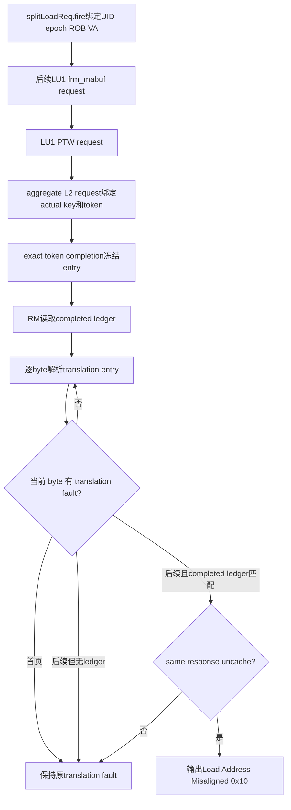

# Sv39 后续 split uncache 与翻译 fault 优先级 RM 修复正式方案

## 2026-10-28 mother production-only 集成约束

本轮集成目标分支为 `codex/memblock-csr-prefix-fix-20261025`。用户明确要求优先完成
`basicTest` 母任务，不修复或扩展 `soft_test` testcase，因此本轮以原 r19 方案的 production 路径为
设计来源，但执行范围收敛为：真实 L2TLB interface/driver/xaction/XMR 观测、UID-bound later-split
ledger、readonly API、RM exception priority、closure seed artifact 与本 Bug 文档。

明确排除：`soft_test_tc_rm_pbmt_effective_fault.sv` 的 testcase 修改、其专用 record copy/compare helper、
caught-fatal directed closure，以及任何 RTL/Scala 修改。原方案中涉及 software-only testcase 的章节仅作为
历史设计证据，不属于本轮 staged patch 或验收结论。

由于移除了 software-only deterministic checks，本轮提交前必须以真实 DUT 门禁替代：known5、fresh
random30、closure10、`pbmt0_non_nc` 和 `strict_nc` 邻接各自严格 PASS；每个 final log 必须 raw/caught/
demoted `UVM_ERROR/UVM_FATAL=0`，并完成独立 production-only implementation review。

## Plan 定位、专有名词与抽象功能说明

### Plan 定位

本 plan 修复 V2 memblock RM 对跨 4K 非对齐 scalar Load 的异常优先级建模，并修订为 response-provenance
驱动的实现。允许修改 RM、L2TLB 测试框架观测面和 RM 专项 software-only 验证；不改变 DUT 激励、RTL
或 Scala。测试框架必须记录真实 split/LU1/L2 request-response 生命周期，不能从 canonical entry 状态推断
later-split response 已发生。

当前失败日志：

```text
/nfs/home/lixiangrui/work/memblock_ut/XiangShan_V2/.codex_ppn_reuse_fix_20261025/mem_ut/ver/ut/memblock/sim/ppn_reuse_determinism_fix_20261025/log/tc=basicTest_ts=memblock_dispatch_real_smoke_vseq_cfg=tc_dispatch_real_mmu_sv39_smoke_seed=212889620_rtl_eda_reg_20261025_222249_1455268_6736.log
```

关键正向事实为 seed `212889620` UID462：VA `0x86ef7fff`，DUT/status 为 `0x10`，RM 原为 `0x2000`。
关键负向边界为 seed `1969964361` UID542：VA `0x88a11fff`，canonical 后续页同时有 S1 PF 与 effective
PBMT 非零，但没有足够的当前 UID/reissue later-split response provenance；DUT/status 为 `0x2000`，仅凭
canonical entry 的旧 RM 错误输出 `0x10`。因此最终谓词必须证明 exact dynamic response ownership。

### 专有名词与抽象功能说明

| 名词 | 当前中文含义 | 代码落点 | 场景示例 |
|---|---|---|---|
| `first-byte/page fault` | 访问首页第一个实际 byte 所在翻译响应已经携带的 S1 PF/AF 或 S2 GPF/GAF；它代表访问一开始即 fault | `observer_build_commit_item()` 的逐 byte translation loop | VA `page+0xfff` 的 byte0 已为 S1 PF，RM继续预测 PF |
| `later-split fault` | 首页无翻译异常，跨页非对齐访问在后续 byte/page 才遇到的 S1 PF/AF 或 S2 GPF/GAF | 同一逐 byte loop 中 `byte_index > 0` 且 VPN 已变化的 entry | UID462 的第二页 entry 同时 S1 PF 与 PBMT-NC/IO |
| `later-split is_uncache` | 发生 later-split fault 的实际 `splitLoadResp` 保留 NC/MMIO 分类；最终 override 只接受 DUT 在 fault response 上真实保留的 NC 证据 | RM readonly response view；DUT `splitLoadResp.nc/mmio` | PBMT-NC fault response 保留 `nc=1`；PBMT-IO fault response 的 `mmio` 被抑制 |
| `fault provenance` | 当前 UID/reissue 的真实 later-split request-response 归属 | UID-bound ledger：split fire、LU1 request、LU1 PTW、L2 token、completion | 区分 seed 212889620 的真实 split response 与 1969964361 的 canonical-entry-only 假阳性 |
| `request key` | aggregate L2 实际 request VPN+s2xlate/context key | ledger `request_lookup_key` | range hit 时仍是请求 VPN，不等于 entry anchor |
| `entry anchor` | canonical exact/range lookup 命中的 entry key | ledger `entry_anchor_key` | superpage/range hit 可与 request key 不同 |
| `translation fault` | 本 plan 覆盖的 S1 PF/AF、S2 GPF/GAF；不包含 `entry.pma_af` 或独立 PMA/PMP AF | `entry.fault_effective_*`、`entry_stage_one_fault`、`entry_stage_two_fault` | S1 permission PF 或 S2 GAF |
| `exception override` | 仅在严格条件满足时，用 Load Address Misaligned bit4 替代 later-split translation fault bits | `observer_build_commit_item()` 最终 exception 编码 | later-split uncache+PF 输出 `0x10`，不输出 `0x2000` |
| `closure fixed seed` | 每次权威 closure 都必须显式包含的历史复现 seed，不依赖随机生成碰撞 | 版本控制的单列 seed 文件，经现有 `run_eda_regression.sh --seeds` 输入 | `tc_dispatch_real_mmu_sv39_smoke` 的 10-seed 行用 `212889620` 替换原第十个随机 seed |

### 关键函数抽象职责

`memblock_rm::observer_build_commit_item()` 在 RM 比较前读取冻结的 transaction、CSR/TLB 和 PMA/PMP 视图，
生成单个 `rm_ls_program_item_t` 的 PA geometry、path classification 和 expected exception。本 plan 扩展其
跨页 translation loop 的 fault provenance 和最终 Load exception 选择，并新增 readonly ledger 查询；RM
只读 ledger，不拥有或推进 request-response 状态。

`common_data_transaction::observe_later_split_tlb_sample()` 负责两阶段绑定 split owner 与后续 LU1 request/PTW；
`bind_later_split_l2_request_token()` 绑定实际 request key 与 exact token；
`complete_later_split_l2_response()` 仅在 exact token/key/generation 匹配后冻结 payload 并完成 ledger。

`soft_test_tc_rm_pbmt_effective_fault::publish_secondary_tlb_entry()` 为 software-only directed case 发布指定
第二页 canonical TLB entry。本 plan 扩展它或新增同职责 helper，使第二页 entry 可显式携带 effective
PBMT 与一种 S1/S2 fault；它不制造 DUT token，也不修改生产 TLB responder。

`soft_test_tc_rm_pbmt_effective_fault::check_rm_production_commit_path()` 通过真实 RM production helper 构造
main/status/TLB view 并检查 expected exception。本 plan 在现有矩阵后增加 later-split fault 正向矩阵和
保持旧语义的负向矩阵。

## 目标功能 Flow 总览



函数调用 Flow 图整体文字伪代码：

```text
observer_build_commit_item 先读取当前 UID 的冻结 request context，并解析 scalar Load/Store 的 VA 和尺寸。
对每一个实际访问 byte，resolve_tlb_entry_for_rm 按首页 UID record 与后续 canonical entry 取得 response-visible entry；该 helper 只读当前冻结上下文，不重绑 token 或 generation。
observer_get_effective_pbmt 从该 entry 和冻结 PBMTE 状态选择同一 split response 的 effective PBMT。
RM分别计算当前 entry 的 S1/S2 translation fault，不立即丢失 byte/page 来源。
若 fault 位于首页，记录 first fault，保持原有 translation fault 终止语义。
若首页无 fault 而 fault 位于后续 split 页，记录 later fault；同时记录该 fault response 的 effective PBMT 是否非零，然后停止继续解析。
进入最终 exception 编码时，先判断严格 later-split override 条件。
只有 misaligned scalar Load、首页无 translation fault、fault 来自后续 split 且同 response 为 uncache 时，清除本次 later-split translation fault cause并输出 bit4。
所有其它路径按现有顺序编码 translation fault、PMA/PMP AF、PBMT-IO Access Fault 和普通 address-misaligned。
```

## 状态字段与语义

`observer_build_commit_item()` 保留局部 fault 状态，同时测试框架新增每 UID 一个 later-split ledger：

| 计划字段 | 语义 | 设置位置 | 清理方式 |
|---|---|---|---|
| `first_byte_translation_fault` | byte0 entry 是否存在 S1 PF/AF 或 S2 GPF/GAF | 逐 byte loop 的 byte0 当前-entry fault 计算后 | 每次函数调用初始化为 0 |
| `later_split_translation_fault` | 首页无 fault 时，后续 split 页是否遇到 translation fault | `byte_index > 0` 且当前 VPN 与首页不同、当前-entry fault 为真 | 每次函数调用初始化为 0 |
| `later_split_is_uncache` | later-split fault 所在同一个 entry 的 effective PBMT 是否非零 | 与 `later_split_translation_fault` 同一分支原子设置 | 每次函数调用初始化为 0 |
| `later_split_fault_stage_one` | later-split 是否包含 S1 PF/AF 类 cause | 从当前 entry 的 effective fault 与 permission fault 得出 | 每次函数调用初始化为 0 |
| `later_split_fault_stage_two` | later-split 是否包含 S2 GPF/GAF 类 cause | 从当前 entry 的 effective fault 与 permission fault 得出 | 每次函数调用初始化为 0 |
| `later_split_fault_s1_af_or_s2_gaf` | later-split 是否包含目标 S1 AF 或 S2 GAF；明确不吸收 `entry.pma_af` | 从当前 entry 的 `fault_effective_s1_af`/`fault_effective_s2_gaf` 得出 | 每次函数调用初始化为 0 |
| `uid/dynamic_epoch/rob_key/split_vaddr` | split fire 的唯一动态 owner | split fire 时一次冻结 | redirect/reset/reissue cancel |
| `split_fire_sample_seq` | 真实 split fire 证据 | split fire | record cancel/reset |
| `lu1_request_sample_seq` | 后续 LU1 frm_mabuf、kill=0、同 ROB/VA 请求证据 | 独立后续 sample | record cancel/reset |
| `lu1_ptw_sample_seq` | LU1 PTW 请求证据 | 同 split VPN 的 direct requestor-1 PTW | record cancel/reset |
| `request_lookup_key/response_token` | 实际 aggregate L2 request key 与 exact token | request fire | token cancel/reset |
| `entry_anchor_key/entry_generation/payload` | response 命中的 canonical anchor 与冻结 payload | exact token completion | record cancel/reset |

字段名称 coding 时可在不改变语义的前提下按现有命名风格微调，但必须保持单一来源：这些字段只由当前
entry 的已解析 fact 写入，禁止从 DUT status、main transaction legacy sideband 或历史 token 反推。

不新增 plusarg、cfg 或全局参数。ledger 是测试框架 provenance 状态，RM 通过 readonly API 查询。
closure fixed seed 文件是回归输入，
不参与 RM 运行时逻辑，也不要求 `run_eda_regression.sh` 增加新的 parser 或 consumer。

## 主流程实现 Flow

### 修改 `memblock_rm::observer_build_commit_item()`

抽象功能描述：该函数继续作为 RM Load/Store expected 的唯一 production 构造入口。本次修改在既有逐 byte
解析过程中保留最小 fault provenance，并在最终异常编码处复刻 `LoadMisalignBuffer` 对 later-split
uncache response 的优先级；它不改变 readonly 查询、PA 生成或 Store 预测。

输入：现有 `main_view`、`status_view`，以及通过 `memblock_rm_readonly_api` 读取的冻结 TLB/PMA/PMP view。

输出/副作用：填充现有 `item.expected_exception`、PA/path 字段和 trace；不修改 common data、TLB entry、
token、generation、UID record 或 epoch。

源码级伪代码：

```text
initialize first_byte_translation_fault = 0
initialize later_split_translation_fault = 0
initialize later_split_is_uncache = 0
initialize later_split_fault_stage_one = 0
initialize later_split_fault_stage_two = 0
initialize later_split_fault_s1_af_or_s2_gaf = 0
remember first_vpn = computed_vaddr[63:12]

for each byte_index in access size:
  resolve current entry with existing readonly API
  select current effective_pbmt with observer_get_effective_pbmt
  compute current_s1_pf/current_s1_af/current_s2_gpf/current_s2_gaf
  compute current_stage_one_fault/current_stage_two_fault
  current_target_translation_fault = current_s1_pf OR current_s1_af OR
                                     current_s2_gpf OR current_s2_gaf OR
                                     current_stage_one_fault OR current_stage_two_fault
  compute current_entry_translation_fault with the existing broader stop condition,
    including entry.pma_af, without treating entry.pma_af as an override candidate

  if byte_index == 0 and current_target_translation_fault:
    first_byte_translation_fault = 1

  if byte_index > 0 and current_vpn != first_vpn and
     !first_byte_translation_fault and current_target_translation_fault:
    later_split_translation_fault = 1
    later_split_is_uncache = effective_pbmt != 0
    later_split_fault_stage_one = current_stage_one_fault
    later_split_fault_stage_two = current_stage_two_fault
    later_split_fault_s1_af_or_s2_gaf = current_s1_af OR current_s2_gaf

  update existing aggregate fault bits for unchanged paths
  preserve existing PA generation and stop rules
  if current_entry_translation_fault:
    break

later_split_uncache_override =
  item.kind == LOAD &&
  misaligned &&
  !first_byte_translation_fault &&
  later_split_translation_fault &&
  later_split_is_uncache

if later_split_uncache_override:
  expected_exception = 0
  expected_exception[4] = 1
else:
  execute existing translation/PMA/PBMT/misaligned exception encoding unchanged
```

中文文字伪代码：

```text
函数开始时把所有 provenance 局部字段清零，并保存首页 VPN；这些字段只活在本次 expected 构造中。
逐 byte 解析继续调用 resolve_tlb_entry_for_rm，使用冻结 UID context 解析首页，并用同一 context 查询跨页 canonical entry；查询失败仍按现有 RM error 结束。
取得 entry 后继续调用 observer_get_effective_pbmt，该 helper 根据 S1/S2 active stage 和冻结 PBMTE 状态返回 response-visible memory type，不读取 DUT 最终异常。
在把 fault OR 进整笔 aggregate 之前，先从当前 entry 计算当前 byte/page 的 S1 PF/AF、S2 GPF/GAF 和 permission-derived fault。
若 byte0 已 fault，只记录 first_byte_translation_fault；后续最终编码继续保持原 translation fault 优先级。
若 byte0 无目标 S1/S2 fault，当前 byte 属于不同 VPN 的后续 split 页并且当前 entry 存在目标 S1/S2
fault，则一次性记录 later_split_translation_fault、同一 response 的 uncache 属性和 fault 类别。
`entry.pma_af` 只继续参与既有 aggregate/stop/Access Fault 路径，不能设置 later_split_translation_fault。
记录后仍使用原有 entry_translation_fault break，禁止继续查询 DUT不会访问的更后 byte。
逐 byte loop 结束后构造 later_split_uncache_override；它必须同时满足 scalar Load、misaligned、首页无 fault、后续 split fault和同 response PBMT非零。
override 为真时只写 Load Address Misaligned bit4，复刻 LoadMisalignBuffer 的 isUncache 分支清除 split exception 后委托软件处理的行为。
override 为假时完整执行现有 exception encoding，因此首页 fault、后续 cacheable fault、aligned fault、Store、首页 PBMT-IO 和 PMA/PMP AF 均保持当前语义。
```

### 异常优先级矩阵

| 访问条件 | 首页 translation fault | 后续 split memory type | 后续 split translation fault | 预期 |
|---|---:|---|---:|---|
| misaligned scalar Load | 0 | PBMT-NC | S1 PF/AF 或 S2 GPF/GAF | `0x10` |
| misaligned scalar Load | 0 | PBMT-IO | S1 PF/AF 或 S2 GPF/GAF | 保持后续 PF/AF/GPF/GAF；fault response 未提供 `mmio=1` provenance |
| misaligned scalar Load | 1 | 任意 | 不查询或不影响 | 保持首页 PF/AF/GPF/GAF |
| misaligned scalar Load | 0 | cacheable/PBMT-PMA | S1 PF/AF 或 S2 GPF/GAF | 保持后续 PF/AF/GPF/GAF |
| aligned scalar Load | 0 | PBMT-NC/IO | S1 PF/AF 或 S2 GPF/GAF | 保持 PF/AF/GPF/GAF |
| misaligned scalar Load | 0 | PBMT-NC/IO | 仅 `entry.pma_af` 或独立 PMA/PMP AF | 保持现有 Access Fault/组合语义 |
| misaligned scalar Load | 首页 PBMT-IO cause | 不适用 | 不适用 | 保持 Load Access Fault |
| scalar Store | 任意 | 任意 | 任意 | 保持现有 Store 异常语义 |

## 专项 soft test Flow

### 扩展 `publish_secondary_tlb_entry()`

抽象功能描述：该 helper 继续发布后续 VPN 的 canonical TLB entry，并增加显式 fault 注入参数，使 directed
case 能在同一个第二页 entry 上组合 PBMT-NC/IO 与一种 S1/S2 fault。它只写 software-only canonical
entry，不生成 token，也不改变 responder production flow。

输入：现有 record、secondary vaddr、effective PBMT；新增明确的 fault kind enum 或等价参数。

输出/副作用：通过现有 `publish_live_tlb_entry()` 发布一个 generation 正确的第二页 entry；entry fault 与
PBMT 都来自测试参数，case 结束后仍由现有 delete helper 清理。

源码级伪代码：

```text
validate fault_kind and choose an S1-shaped or S2-shaped directed context

if fault_kind is S1_PF or S1_AF:
  build the first-page UID record with the existing S1 translation context
  derive the secondary S1 lookup key from that record's frozen CSR snapshot
  build a legal S1 canonical entry with the existing builder
  clear all S2 payload and all unrelated raw/effective fault fields
  set the selected S1 effective PBMT and S1 resolved PPN
  set exactly one effective S1 PF/AF cause

if fault_kind is S2_GPF or S2_GAF:
  construct the first-page UID record with frozen context s2xlate=2 before publishing it
  require the first-page UID record itself to be a coherent stage-two translation record
  derive the secondary S2 lookup key from that frozen s2xlate=2 UID context and the later-page address
  build an S2-shaped canonical second-page entry using the S2 lookup key
  populate s2_entry_pbmt, the S2 resolved PPN and exactly one effective S2 GPF/GAF cause
  clear inactive S1 PBMT, S1 resolved PPN, S1 PTE/payload and every S1 raw/effective fault bit
  require selected/active stage to remain S2; do not convert an S1 record after construction

publish the selected S1-shaped or S2-shaped entry through publish_live_tlb_entry
```

中文文字伪代码：

```text
helper 先验证 fault kind，再选择完整的 S1 或 S2 directed construction；非法输入立即 fatal，避免测试静默构造错误场景。
S1 PF/AF 继续使用既有 S1 first-page UID record、S1 lookup key、S1 PBMT 和 S1 resolved PPN，并清空 S2 非活动载荷。
S2 GPF/GAF 不得复用或事后篡改 S1 record：case 必须先用冻结的 s2xlate=2 CSR context 建立 first-page UID record，再从该 record 推导 later-page S2 lookup key。
S2 second-page entry 必须是 S2-shaped：写入 s2_entry_pbmt、S2 resolved PPN 和唯一 GPF/GAF cause，同时清空 inactive S1 PBMT、S1 resolved PPN、S1 PTE/payload 与全部 S1 fault。
两种形状都清除 builder 可能生成的无关 fault，并且每个 case 只激活一种目标 fault，防止矩阵标签与实际 payload 不一致。
最后调用 publish_live_tlb_entry；该 helper 负责把 entry 放入 canonical live table，后续 observer_build_commit_item 通过 readonly API 读取。
```

如果当前 helper 的参数形状不能同时承载两种 translation context，则新增
`publish_secondary_tlb_fault_entry()`，并让 caller 在建立 first-page UID record 前选择 S1/S2 分支。S2 分支
必须从 `s2xlate=2` frozen context 开始，不能把已发布的 S1 record 转换成 S2；不得改 production L2TLB
agent。

### 扩展 `check_rm_production_commit_path()`

抽象功能描述：该 task 继续验证 RM production commit helper 的真实异常编码。本 plan 新增 PBMT-NC 四项
正向矩阵、PBMT-IO 四项 fault-gated 负向矩阵和其它负向边界，确保修复只覆盖有实际 NC response
provenance 的 later-split fault，而不是全局把 misaligned 提升到 translation fault 之上。

输入：software-only 构造的 main/status view、首页 UID TLB record 和后续 canonical entry。

输出/副作用：通过 `uvm_fatal` 机械验证 expected exception；每个 case 清理自己的 secondary entry 和 UID
record，结束后恢复 `pma_pmp_model_en`。

源码级伪代码：

```text
for pbmt in {NC}:
  for fault_kind in {S1_PF, S1_AF, S2_GPF, S2_GAF}:
    build misaligned cross-page scalar Load
    if S1 fault kind:
      publish fault-free cacheable S1 first-page UID record
      publish S1-shaped later-page entry with selected S1 pbmt/fault
    else:
      publish fault-free first-page UID record with frozen s2xlate=2 context
      derive S2 later-page lookup key from that UID record
      publish S2-shaped later-page entry with s2_entry_pbmt, S2 resolved PPN,
        selected GPF/GAF and inactive S1 payload cleared
    call observer_build_commit_item
    require expected_exception == 0x10
    require uncache_path reflects later-page PBMT
    cleanup secondary entry and UID record

for pbmt in {IO}:
  for fault_kind in {S1_PF, S1_AF, S2_GPF, S2_GAF}:
    build the same exact response provenance
    require the fault response does not prove splitLoadResp.mmio=1
    require original PF/AF/GPF/GAF exception
    cleanup secondary entry and UID record

negative first-page fault:
  build misaligned Load whose first entry has each fault kind
  require original PF/AF/GPF/GAF cause, not 0x10

negative later-page cacheable fault:
  build misaligned cross-page Load with PBMT-PMA later page and each fault kind
  require original PF/AF/GPF/GAF cause

negative aligned fault:
  build aligned Load with PBMT-NC/IO and each fault kind
  require original PF/AF/GPF/GAF cause

negative non-target access fault:
  build misaligned cross-page Load with later-page PBMT-NC/IO
  inject entry.pma_af or the existing independent PMA/PMP AF path
  require the existing Access Fault/combined cause, not the later-split 0x10 override

negative first-byte PBMT-IO:
  retain existing test and require Load Access Fault
```

中文文字伪代码：

```text
正向矩阵用首页正常 entry 和后续 split entry 组合 NC 与四种 translation fault，共四项；每项都必须通过 observer_build_commit_item 的 production path 得到唯一 bit4。PBMT-IO 与四种 fault 的四项是 fault-gated 负向矩阵：DUT 在已有 translation exception 的 split response 上不保留 `mmio=1`，RM 必须保留原 PF/AF/GPF/GAF。
其中 GPF/GAF case 的 first-page UID record 必须在发布前已经冻结为 s2xlate=2，并使用 S2 lookup key、
s2_entry_pbmt、S2 resolved PPN 和 S2-shaped second-page entry；检查 inactive S1 payload/fault 全为零，禁止
用 S1 record 加几位 S2 fault 伪造 stage-two case。
每项同时检查 uncache_path，证明 case 不是仅修改 exception literal，而是确实使用后续页 PBMT 属性。
首页 fault 负向矩阵把相同四种 fault 放到 byte0 entry，要求保持原 fault cause，证明 first-byte/page优先级未改变。
后续 cacheable fault 负向矩阵只把第二页 PBMT改为PMA，要求保持原 fault cause，证明 override 依赖同 response uncache。
aligned fault 负向矩阵取消地址 misaligned 条件，要求保持原 fault cause，证明 override 不扩散到普通 aligned Load。
非目标 Access Fault 负向分别覆盖 `entry.pma_af` 与既有独立 PMA/PMP AF 路径，要求保持当前 Access Fault
或既有组合 cause，证明本 plan 没有把“所有 later-split fault”错误扩大成 bit4。
首页 PBMT-IO 继续复用现有 case并要求 Access Fault，证明旧 PBMT-IO cause 修复没有被本 plan 覆盖。
每个跨页 case结束时调用 delete_live_tlb_entry_by_anchor_key 清理第二页 canonical entry，防止 case之间共享状态。
```

## 验证与回归 Flow

### 静态门禁

1. `git diff --check -- AI_DOC mem_ut/ver/ut/memblock` 必须通过。
2. coding diff 只允许 RM、RM 专项 soft test、固定 seed 文件
   `mem_ut/ver/ut/memblock/scripts/closure_seed_lists/tc_dispatch_real_mmu_sv39_smoke.seeds`、Buglist/plan/review
   文档；禁止 RTL/Scala。
3. `run_eda_regression.sh` 已原生支持 `--seeds`，本问题不得修改该 runner，也不得新增新的 runner seed-file
   parser/consumer。若后续发现现有 `--seeds` 无法消费下面定义的固定列表，必须先修订 plan 并重新 review，
   不能在 coding 阶段临时扩大脚本范围。
4. `observer_build_commit_item()` 不得新增 token/generation/UID record/epoch 写操作。

### 编译与 directed 验证

1. 使用最终源码重新编译 VCS/KDB simv。
2. 运行 `soft_test_tc_rm_pbmt_effective_fault`，要求新增 4 项 PBMT-NC 正向、4 项 PBMT-IO fault-gated
   负向和全部其它负向 case 无
   `UVM_ERROR/UVM_FATAL`。
3. 日志必须能机械区分每个 `PBMT × fault_kind × boundary` case；若现有日志不足，增加 directed case
   marker，但不得用 DUT status 作为 RM expected 真源。

### 固定与随机 seed

1. 原失败 `tc_dispatch_real_mmu_sv39_smoke` seed `212889620`：要求 UID462/UID463 RM 与 DUT/status 均为
   `0x10`，整 seed PASS。
2. 历史 seed `399662848`：要求旧 PBMT-NC 与 PMA/PMP AF 共存语义仍 PASS。
3. 新增至少 30 个不同随机 seed，保持原 cfg、`basicTest`、`MEMBLOCK_MAIN_TRANS_NUM=1000`，要求 30/30
   PASS，且每条 `rc=0`、`UVM_ERROR=0`、`UVM_FATAL=0`。
4. 邻接复测至少覆盖 `tc_dispatch_real_mmu_sv39_pbmt0_non_nc_100k`、
   `tc_dispatch_real_mmu_sv39_strict_nc_100k` 和 PBMT CSR gate NC/IO software cases。

### 永久 closure seed

coding 阶段新增并版本控制以下唯一 seed artifact：

```text
mem_ut/ver/ut/memblock/scripts/closure_seed_lists/tc_dispatch_real_mmu_sv39_smoke.seeds
```

文件 schema 为 ASCII 十进制正整数，每个非空行一个 seed，不允许注释、前后字段、重复值或空白 seed。
文件顺序就是权威执行顺序；coding/review gate 必须验证恰好 10 行、10 个唯一值，且每个值位于 runner
现有合法范围 `1..2147483646`。权威 10-seed 行固定为：

```text
206535281
74066548
1204471176
816526774
1635809821
1757490812
45715612
1058598674
1630228062
212889620
```

前九个 seed 保持 2026-10-25 closure 结果的原顺序；历史失败 seed `212889620` 替换原第十个随机 seed
`15132925`，因此该 cfg 的权威行仍然是 10 个 seed，不增加到 11 个。重复值在 artifact review 时直接判为
失败；不依赖 runner 的去重行为改变数量或顺序。

现有 runner 没有 `--seed-file`，但已经支持 `--seeds <list>`，并按首次出现顺序归一化和去重。权威执行
使用以下既有接口，不新增 runner consumer：

```bash
seed_file=mem_ut/ver/ut/memblock/scripts/closure_seed_lists/tc_dispatch_real_mmu_sv39_smoke.seeds
mapfile -t closure_seeds < "$seed_file"
test "${#closure_seeds[@]}" -eq 10
test "$(printf '%s\n' "${closure_seeds[@]}" | sort -u | wc -l)" -eq 10
./mem_ut/ver/ut/memblock/scripts/run_eda_regression.sh \
  --tc basicTest \
  --ts memblock_dispatch_real_smoke_vseq \
  --cfg tc_dispatch_real_mmu_sv39_smoke \
  --seeds "$(IFS=,; printf '%s' "${closure_seeds[*]}")" \
  <其余既有 closure 参数>
```

artifact 改动只负责回归输入，不修改 cfg 语义、DUT 激励内容或 seed 内部行为。不得把某次结果目录的
`seeds.txt` 当成永久输入。验收时必须逐行比较 artifact 与结果目录 `seeds.txt` 完全一致，并记录结果目录
绝对路径。

## 禁止修改与风险边界

- 禁止复用 key-only completed-response cache 证明 later-split provenance。
- ledger 必须绑定 UID+dynamic_epoch+ROB+split VPN+actual request key+exact token；redirect/reset/reissue 失效旧 epoch。
- split fire 与 LU1 frm_mabuf request 必须按两阶段采样，禁止假定同拍。
- 所有 precheck/completion mismatch fatal 后必须立即 return，caught fatal 不得修改 record/payload。
- 禁止修改 RTL、Scala、DUT exception priority 或接口。
- 禁止把所有 misaligned Load 全局提升到 PF/AF/GPF/GAF 之前。
- 禁止让 later-split PBMT 属性反向改变首页 fault。
- 禁止让 `entry.pma_af` 或独立 PMA/PMP AF 进入 later-split uncache override。
- 禁止让本 plan 的 Load override 进入 Store exception 预测。
- 禁止通过 `IFERROR` 类兜底、忽略 compare 或接受 DUT status 作为 expected 来掩盖 RM 错误。
- RM provenance 只能来自 completed UID-bound ledger；canonical entry inspection 仅提供冻结 payload，不能单独授权 override。

## 文档与 Review 门禁

1. 本 plan 保留在 `AI_DOC/plan/rm_plan/undo`，直到 coding、专项验证和必要 review 全部完成。
2. coding 前至少完成一轮独立 RM plan review；review 必须检查 LoadMisalignBuffer 对照、首页/后续页边界、
   NC/IO × 四种 fault 矩阵和禁止修改范围。
3. coding 后生成 RM implementation review 到 `AI_DOC/plan/rm_review_doc/undo`，不得未经用户明确要求移到
   `do`。
4. Buglist 必须依次更新为“已 review 待 coding”“已修复待验证”“验证通过”，不得提前记录 PASS。

### 独立 plan review 记录

- Reviewer：`Mencius`。
- Reviewer session：`01a175ea-1366-7a90-b287-c65ac046cc90`。
- Review 日期：`2026-10-26`。
- Review 结论：首轮 `REVIEW_FAIL` 后获得 `REVIEW_PASS` 进入 coding；implementation review 又发现
  PBMT-IO 语义、ROB identity、stale/reset gate 和 final-source 验证 blocker。当前源码已统一为“只有实际
  `splitLoadResp.nc/mmio` response provenance 才可 override；PBMT-IO fault response 保留 translation fault”，
  并补齐 ROB identity、gate 顺序、replay attempt 生命周期和 r19 exact-completion 门禁，等待最终独立
  rereview。
- Review 追踪路径：本正式 plan
  `/nfs/home/lixiangrui/work/memblock_ut/XiangShan_V2/.codex_sv39_split_uncache_rm_fix_20261025/AI_DOC/plan/rm_plan/undo/memblock_rm_sv39_later_split_uncache_fault_priority_formal_plan_20261025.md`
  的本节，以及 W43 Buglist 同名 issue 的“Review 门禁与状态”小节；reviewer 未生成独立 review 文件，
  因此以 reviewer identity、session id 和上述绝对路径共同作为可追踪记录。
- Blocker 1：永久 seed closure 未定义 artifact 路径、schema、consumer、去重/顺序和 10/11 数量语义。
  本版已改为固定单列 artifact，经现有 `--seeds` 输入；`212889620` 替换原第十个 `15132925`，总数保持
  10，runner 不修改。
- Blocker 2：S2 GPF/GAF construction 把 S1 record 与 S2 entry 混用。本版已要求从 frozen
  `s2xlate=2` first-page UID record 开始，推导 S2 lookup key，写入 `s2_entry_pbmt`、S2 resolved PPN 和
  S2-shaped second-page entry，并清空 inactive S1 payload/fault。
- Blocker 3：Buglist responsibility review 不可追踪。本版已补齐 reviewer、日期、结论、session 和
  绝对 review 追踪路径。
- implementation blocker closure：同拍 split/LU1 假设、caught-fatal 后继续修改、range anchor/request VPN
  混用、key-only completed cache 无 UID ownership、ROB identity 和 stale/reset gate 均已修复。cacheable
  replay response 的 exact duplicate 会建立新 attempt；旧 attempt 的迟到 L2 completion 只有在完整 replay
  provenance 匹配时才被丢弃，其它 stale handle 继续 fatal。r19 进一步规定：无 L2 request 的明确 TLB-hit
  attempt 可使用 response-only provenance；一旦观测到 L2 request，只有 exact completed token、matching
  generation、matching translation fault 与严格 sample ordering 同时成立才允许 override。新增
  `later_nc_wait_response`、`later_nc_generation_mismatch`、`later_nc_tlb_hit` 三项 production-path 测试。
  r19 final-source 已完成 directed、5 个历史/失败 seeds、fresh random30、权威 closure10 和四项邻接验证。
  独立 reviewer `Russell`（agent/session `01a1780d-c931-7da1-8781-f3d0e073d6cb`）于 `2026-10-26`
  对最终 diff 与证据完成只读复审，明确结论 `APPROVED`，无 blocking finding。

## 与初步 plan 差异说明

本次正式 plan 直接来源于已确认责任和用户指定约束，没有独立的初步 plan 文件；以下差异用于说明当前
实现相对现有 RM 行为的精确变化。

修改目的：

```text
修复跨页非对齐 scalar Load 在后续 split response 同时 uncache 与 translation fault 时的异常优先级。
保持首页 fault、后续 cacheable fault、aligned fault、Store和首页PBMT-IO的现有行为。
```

函数名：`memblock_rm::observer_build_commit_item()`

修改原因：当前函数只保留整笔 `stage_one_fault`/`stage_two_fault`，无法知道 fault 来自首页还是后续 split，
也无法知道 fault response 同时为 uncache。

抽象功能描述：该函数仍负责从冻结 RM view 构造 expected item；修改只增加局部 fault provenance 和一个
严格的 Load exception override。

修改前文字伪代码：

```text
逐 byte 解析 effective PBMT 与 entry fault。
把所有 byte/page 的 S1/S2 fault OR 到整笔 aggregate。
遇到任一 translation fault立即停止继续解析。
最终只要 aggregate S1/S2 fault为真，就输出PF/GPF；address-misaligned分支不会执行。
因此后续 split response即使同时 uncache，也被聚合 fault覆盖。
```

修改后文字伪代码：

```text
逐 byte 解析时先记录当前 fault来自首页还是后续 split，并在后续 split fault分支保存同 response effective PBMT是否非零。
继续维护现有 aggregate fault，保证所有非目标路径可复用原编码。
最终若严格满足misaligned scalar Load、首页无fault、后续 split fault且同 response uncache，则输出唯一bit4。
否则完全执行现有PF/AF/GPF/GAF、PMA/PMP、PBMT-IO和misaligned编码。
```

差异影响：只改变目标 Load 角落的 RM expected；不改变 readonly API、PA geometry、token/UID生命周期、
参数默认值或 DUT 激励。每次访问仍为 O(size_bytes)，没有新增全表扫描。

函数名：`soft_test_tc_rm_pbmt_effective_fault::publish_secondary_tlb_entry()` 或等价新增
`publish_secondary_tlb_fault_entry()`

修改原因：现有 helper 只能发布无 fault 的第二页 PBMT entry，不能稳定构造同一后续 split response 的
PBMT 与 fault 组合。

抽象功能描述：helper 在 software-only directed case 中发布带指定 PBMT 与唯一 fault kind 的第二页
canonical entry，不进入 production responder。

修改前文字伪代码：

```text
构造第二页lookup key。
清除所有fault。
写入effective PBMT并发布entry。
```

修改后文字伪代码：

```text
构造第二页lookup key并生成合法entry。
清除随机fault后写入effective PBMT。
按唯一fault kind写入S1 PF/AF或S2 GPF/GAF及selected stage；非法kind立即fatal。
通过现有publish helper发布，并由case结束逻辑删除。
```

差异影响：只扩展 RM 专项 directed 构造能力，不改变 production entry 生成和随机 cfg。

参数和配置差异：

```text
不新增RM运行时plusarg/cfg。
新增固定 seed 文件
mem_ut/ver/ut/memblock/scripts/closure_seed_lists/tc_dispatch_real_mmu_sv39_smoke.seeds，
通过既有 run_eda_regression.sh --seeds 输入；权威行仍为10个seed，212889620替换15132925。
不修改run_eda_regression.sh，不新增seed-file consumer。
```

行为边界差异：

```text
新行为仅为：首页正常的misaligned scalar Load在后续 split uncache+translation fault时输出0x10。
其余异常优先级与现有实现保持一致。
```
