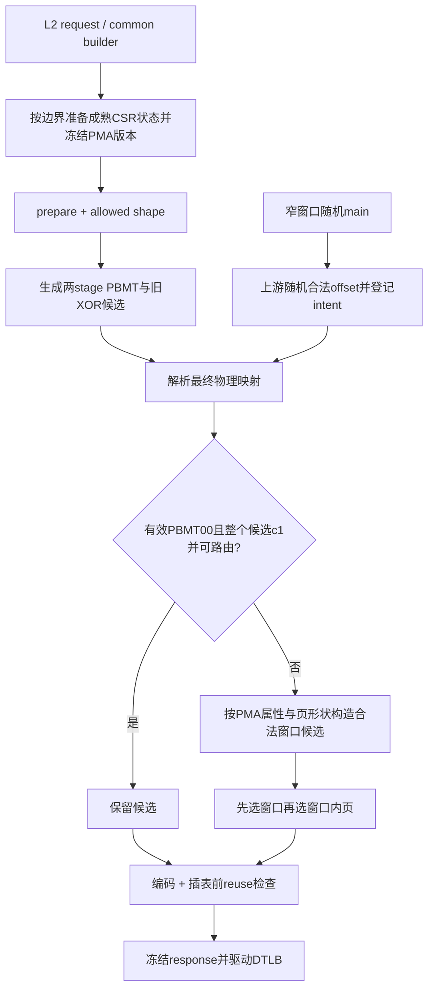

# L2TLB 可路由物理页随机覆盖方案

日期：2026-11-02。版本：V2；工作区 `.codex_mother_integration_20261028`，分支 `codex/memblock-csr-prefix-fix-20261025`。
状态：方案、实现和结果已独立评审；代码、文档及16次计划验收完成，按第8章限定范围归档。评审记录：`AI_DOC/plan/test_framework/review_doc/undo/memblock_l2tlb_routed_ppn_plan_review_20261102.md`。本轮用户已授权方案完善、subagent review、按执行规则 coding、专项测试和本地 Git commit，不执行 push。

## 1. 定位、术语与抽象功能说明

本方案修改测试框架的物理页生成。复用观测驱动的 PMA 状态，保留普通 cacheable 候选，恢复 NC/IO 和 PMA-MMIO 地址多样性，避免 B08 空洞。PMA 新接口只提供现有模型的只读属性，不修改 RM 期望算法或 RTL。

| 英文术语 | 当前中文含义 | 代码落点 | 示例 |
|---|---|---|---|
| DUT | 本 UT 实例化的 MemBlock 硬件 | `build/rtl/MemBlock.sv` | 内部 crossbar 仍有地址译码 |
| PPN / PA / VPN | 物理页号、物理字节地址、虚拟页号 | `tlb_map_builder` | 普通 PA 为 PPN 与页内偏移拼接 |
| PBMT | 页访问类型；00遵循PMA、01为NC、10为IO | `s1_entry_pbmt/s2_entry_pbmt` | 两阶段取S1非零值，否则S2 |
| PMA / PMP | 物理属性及访问权限 | `memblock_pma_pmp_model` | c位不表示总线可达性 |
| NC / IO / MMIO | 不缓存主存属性、IO属性、按PMA判定的设备访问 | LoadUnit与现有RM | PBMT00+c0仍保持MMIO |
| generation / snapshot | 已提交配置版本及不可变副本 | `pma_history` | 后来的写入不改变旧查询 |
| sample / replay / FIFO | 采样序号、顺序应用写事件、待消费队列 | `common_data_transaction` | C采集写于C+2成熟 |
| canonical / sector | 共享翻译条目及S1编码的页扇区 | `memblock_tlb_entry` | 普通4K只有一个有效sector |
| shape / NAPOT | 翻译覆盖形状、连续页编码 | existing level/N | 512GiB页必须整体可路由 |
| intent | 上游已构造合法偏移的目标地址意图 | 本方案新增by-VPN表 | UART页偏移在0..127内 |
| reuse / token / epoch | 复用PPN、一次真实请求、重执行代际 | existing history/lifecycle | 不改写已命中的条目或冻结响应 |

关键职责：地址策略从候选翻译和指定PMA快照产生一个可路由最终物理映射；公共owner准备配置快照；窄窗口场景在主表阶段构造偏移；responder继续只响应DTLB请求，不模拟真实外设寄存器。

## 2. 目标功能 Flow 总览



函数调用Flow图整体文字伪代码：公共owner在创建新entry之前通过既有事务消费已成熟写，取对应sample的PMA版本。builder先固定两stage合法PBMT，构造原XOR与原shape候选。对最终PA对应stage判断是否能保留；否则从真实外部路由与PMA属性交集选择映射。原PBMT00+c0候选只能换到c0区域，不搬到c1。intent优先指定窄窗口的物理页与上游合法偏移；该专项固定4K/N0、无reuse。编码后候选检查完成才插表；exact/range hit保持只读，复用不能绕过相同合法性规则。

## 3. 权威地址合同、字段与行为边界

### 3.1 V2实际外部路由

权威为 `build/rtl/TLXbar_6.sv:123-177` 的out1，而不是粗粒度SoC.APLICRange。合并后四个闭区间：

| 起点 | 终点 |
|---|---|
| 0 | 0x31107fff |
| 0x31120000 | 0x31127fff |
| 0x31140000 | 0x38021fff |
| 0x38022080 | 0xffffffffffff |

两个APLIC洞不选。0x38022000..0x3802207f走内部DCacheCtrl并有错误注入控制副作用，不归普通memory随机。0x38022080..0x38022fff仍属外部合法区域，必须用已知offset的窄窗口随机场景覆盖，不能宣称整页排除后已全覆盖。

使用独立V2 profile描述静态路由与命名抽样窗口；静态检查脚本把profile与实际RTL谓词归并结果比较。不存在运行时新建万能responder。

### 3.2 命名窗口与全集

窗口包括外部全集、DRAM、APLIC M、APLIC S、UART所在可路由页、TIMER、PLIC。命名窗口只提高抽样概率，全集保持其余合法区域可选。UART的4K页整体可由UT responder响应，不等同于真实UART128B窗口；真实128B及部分页由intent场景随机偏移验证。

所有普通映射保护其完整4K/64K/2M/1G/512G shape，避免后续range hit落洞。不能把shape当PMA查询size传入现有仅支持1..8B的scalar查询；新增span属性查询独立处理覆盖区间。

### 3.3 配置边界

`MAIN_MEM_RANGES_EN=1`保留已有严格窗口路径。sparse路径采用新策略，不保留无条件512GiB固定窗口。缓存属性以monitor回放的PMA表为准。strict路径、`csr_special_sequence_active`权限专项、有效翻译fault、pmaAF及response-only非法PTE旁路新策略，保留旧B08安全候选/原构造行为。仅普通随机新entry参与重选；其重选后可能改变权限命中，既有RM按最终地址检查，不承诺原候选与新地址的RWX/atomic/PMP等价，也不篡改预期异常。

两stage同时有效时，仅约束最终PA对应的S2；S1的GPA和S2 tag关系保持原编码。allStage中间GPA使用独立输入宽度约束：Sv39x4只保留29位PPN、Sv48x4只保留38位PPN，再进行既有level/NAPOT编码；此约束不查询外设路由，最终PA策略只修改S2。只查最终有效PBMT，PBMT11仍非法。

## 4. 参数与配置 Flow

新增公共参数经 `plus.sv → seq_csr_common → getter`：

| 参数 | 默认 | 语义 |
|---|---:|---|
| MEMBLOCK_L2TLB_PPN_REGION_RANDOM_WT | 50 | 对NC/IO或PBMT00+c0的合法候选，主动从合法窗口重选的百分比；非法候选总重选 |
| MEMBLOCK_L2TLB_PPN_REGION_ID | -1 | -1为窗口随机；0为外部全集，1 DRAM，2 APLIC M，3 APLIC S，4 UART页，5 TIMER，6 PLIC；非负为明确定向覆盖 |

普通PBMT00+c1的安全候选不因随机权重被压缩。定向ID允许显式选择新的合法地址，仅限专项cfg。权重0..100、ID -1..6，合法集合为空报告失败，不允许无界重试。命名窗口等权选择有候选者，再在窗口内均匀选页，不按全空间字节数吞没小窗。

窄窗口专项另用既有4K/PTE_N/reuse/operation参数，新增场景vseq类和cfg，不为DTLB接口增加offset字段。用户MAIN_VADDR与严格PA参数语义不混用。

## 5. 主流程实现 Flow

### 5.1 PMA观测与查询版本

抽象功能描述：公共owner为本次entry构造提供已成熟且固定版本的属性来源。读取者不消费raw队列，不改RM上下文。

```text
有真实request sample：在get/create之前通过现有request-bound replay应用成熟前缀；
获得该sample对应generation（effective sample小于等于请求sample）；创建builder时传入model与generation及debug；
兼容直接公共build入口：使用当前已提交版本，不能新建或重置模型；
生成期间所有查询使用冻结generation，查询失败立即终止该构造。
```
中文文字伪代码：responder在准备请求时先对齐成熟CSR事件，失败则不创建token或entry。公共builder接收只读版本；没有真实sample的既有软件/构建入口使用已初始化模型版本。查询不借用UID检查接口，避免DTLB无UID时伪造访问身份。

### 5.2 `tlb_map_builder::finalize_tlb_payload_shape_and_payload`

抽象功能描述：在既有occupancy允许形状内构造完整响应，物理页策略只影响新entry的最终PA。

```text
保持已有PTE/fault/shape决策；在prepare阶段先生成两active stage PBMT并做CSR gate检查，finalize不再二次随机；
make_canonical_ppn恢复原XOR候选，level对齐和NAPOT编码保持；
S1-only解析S1最终映射；S2/allStage解析S2最终映射；先以56/64bit宽地址验证候选，不截成48bit后再查；普通超48bit或S2接口位宽候选直接重选，原anchor不可表示时不强行定义目标c（可在任意满足配置的合法集合选择）；最终策略完成后才执行S2 38bit编码；
若配置为strict、CSR权限专项、有效fault、pmaAF或response-only非法PTE：保留原有候选和语义；
若有intent：校验4K/N0、最终物理页与允许offset范围，使用指定页；
否则调用routed策略选择目标页；本次resolved anchor决定目标c，保留需完整shape同c且可达；
若普通随机形状没有地址候选：沿用可解释的4K fallback合同，将active stage收敛到level0/N0、重新构造候选一次，设置forced_4k并保留统计；显式directed_shape_override不降级，不相容则报配置错误；4K仍无候选则报明确错误；
页改变时重建对应raw/sector/resolved字段；allStage不得改写S1 GPA；
记录所选窗口、PMA版本与动作，完成既有一致性检查并返回。
```
中文文字伪代码：先完成访问类型与形状决策，再决定候选是否需要替换；route检查与PMA属性检查分别执行。重选保持PBMT和原本的PMA c类别，不把权限负例改为正常允许。S1重新编码sector，S2更新raw PPN并保留原S2 tag，最后响应使用同一份canonical结果。

### 5.3 `common_data_transaction`插表与复用

抽象功能描述：在canonical插入前接入地址策略，并保证旧条目和已发响应不被新策略修改。

```text
exact/range hit维持现有条目；
miss创建builder，配置PMA快照与可选intent；
reuse候选使用新entry当前PBMT、同一PMA版本、完整shape重新校验；strict/权限fault旁路同样跳过新reuse过滤，保留原专项资格；
候选不兼容则从history候选池跳过，不改候选历史；
完成全部构造后只插入一次。
```
中文文字伪代码：现有history是有界FIFO，仅对复用候选增加纯读取资格过滤。动态PMA可能改变访问类型，因此不能把“曾完成”当作对新entry永久合法的凭证。当前slot/tokens/reset/reissue结构不新增第二owner。

### 5.4 窄窗口随机场景

抽象功能描述：上游构造有明确设备目标的正常scalar Load，并使L2TLB响应物理页与该偏移一致，覆盖无offset的L2接口不能独自表达的子页范围。

```text
专用main sequence生成主表；固定普通4K、N0、reuse0、无跨页boundary、单一S1/Sv39、固定SATP/ASID；禁用动态CSR与主表地址复用，独立无重复VPN；
逐transaction均衡选择UART128B、APLIC M/S、TIMER、PLIC、外部部分页；
在所选窗口内随机合法PA与对齐访问，VA使用独立不重叠VPN并复制PA低12位；
登记by-VPN intent={physical_page,offset_first,offset_last}；
intent登记完成后发布main_table_ready，随后沿用真实dispatch/commit/responder；
模型插表前仅在命中intent时选指定页，权限与数据仍由原有RM独立检查；
本专项不注入runtime reset；如发生reset则终止本次专项并重新完整初始化，不允许清intent后继续旧主表；
结束记录实际发送窗口，不以“选择过窗口”冒充DUT真实请求覆盖。
```
中文文字伪代码：该专项从主表端保障offset可用，绝不在responder到来后修改VA。intent在reset时清空，重复VPN冲突直接报错；专项所有地址独立4K且没有大页/reuse，避免旧range命中吞掉意图。普通main不创建intent，其全页安全映射不承诺访问部分页；全集中的部分页由本专项随机覆盖。

### 5.5 `memblock_l2tlb_routed_ppn_vseq::body`及主表构建

抽象功能描述：复用real-smoke的真实agent调度与收尾，以专用main提供窄窗口随机输入，不新建responder生命周期。

```text
vseq继承memblock_dispatch_real_smoke_vseq；pre_body设置main sequence定向factory override，随后复用父pre_body；
body核对窄专项约束；父body启动DCache/SBuffer/redirect responder；
父start_core_dispatch_flow在virtual sequencer启动专用main，同时启动静态Sv39 CSR；
main独立构造主表、offset和intent，最后一次性发布main_table_ready；
issue与L2 responder复用原静态CSR barrier之后启动；LSQ/commit沿用父流程；
main走原service_real_dispatch_flow到终态；等待memory responder自然drain，完成原end_test_check；
正常退出后恢复factory override，不在reset期间继续旧intent。
```
中文文字伪代码：专用main继承auto main，只替换build_random_main_table的输入构造，init_status和check_main_table_complete在intent登记完成后执行。不得先调用父完整build发布ready再补意图。每笔VA使用MAIN_VADDR内独立4K页；目标偏移与操作尺寸对齐，选择窗口后生成PA并复制低12位。专项采样窗口采用随机排列的循环，保证每轮涵盖所有窗口而非声称每笔都命中全部窗口。

## 6. 关键 helper 细节

### 6.1 `memblock_pma_pmp_model::read_pma_attribute_spans`

抽象功能描述：从指定历史版本导出按优先级解析后的物理属性区间，不返回可变内部表句柄，不更新模型。
目的：复用PMA真源，避免策略复制TOR/NAPOT/优先级算法。
输入：generation、debug；输出：互不重叠半开区间及c、r/w/x/atomic属性。

```text
历史版本不存在：返回失败；
收集0、48bit上界、DEBUG_START=0x38020000、DEBUG_END+1=0x38021000以及32个entry的TOR/NAPOT边界，排序去重；
逐相邻边界调用已有first-match语义，生成有效属性或默认属性；
相邻相同属性可合并；返回值型区间队列。
```
中文文字伪代码：此函数只在新entry构造时运行；最多32表项、固定规模边界，不扫描主表或UID历史。边界使用49bit以表达2^48。default、debug区和OFF项遵循原模型。scalar evaluate保持原逻辑不变。

### 6.2 `memblock_routed_ppn_policy::select_ppn`

抽象功能描述：以访问类型、PMA属性和最终shape为条件，从外部可达集合产生合法PPN，不修改CSR或PTE权限。

```text
计算shape覆盖大小与对齐要求；
取得本次冻结PMA spans；以可表示的本次resolved anchor确定目标c，以完整shape检查是否同c及可路由；不可表示的原anchor不做截断查询，同c筛选关闭而直接在合法集合选择；
安全PBMT00+c1候选且无fixed ID：直接返回原页；
其他安全候选根据random weight决定保留还是重选；
对每个窗口交集PMA span与四段外部路由，筛选同c（PBMT00）及可容纳完整shape者；
先等权选有候选的窗口，再按可用页槽数量选窗口内位置；
无候选返回false，由普通finalize执行一次4K fallback；显式fixed shape冲突和4K仍不相容才报错，不静默改PBMT、不无限重试；
返回canonical页及选择描述，编码者继续执行现有NAPOT处理。
```
中文文字伪代码：命名子窗口与全集可以重叠，重叠只用于有意提升目标概率。页对齐必须在区间内部选择，不能先取地址后向下对齐越界。允许的PMA权限结果由RM继续检查，本策略不以结果PASS为选择条件。

### 6.3 `memblock_routed_ppn_policy::check_mapping`

抽象功能描述：判断完整最终物理覆盖是否满足外部路由及目标属性，供初选和reuse共用。

```text
拒绝超过48bit或溢出的区间；逐外部区间检查完整包含；
查指定PMA版本覆盖，PBMT00要求目标c类别一致；
普通mapping按全shape检查，intent按已声明且上游保障的offset范围检查；
返回合法性，不消费FIFO、不修表、不改变history。
```
中文文字伪代码：该判断使同一个安全规则覆盖新PPN与复用。部分页只在显式intent下允许；未知偏移的通用4K不映射到含内部控制器的页。

### 6.4 `tlb_map_builder::make_canonical_ppn`

抽象功能描述：生成尚未决定是否可用于最终映射的确定性候选，不消费PMA FIFO。

```text
strict：沿用配置范围映射；
sparse普通：恢复root_ppn XOR vpn XOR stage salt；
旁路专项：保留旧512GiB候选；
allStage S1：先把候选限制到S2输入模式可编码宽度；
继续level对齐，返回raw canonical候选，最终stage合法化交给select_ppn。
```
中文文字伪代码：候选与安全输出不再混为同一职责；旧软件测试需要调用最终策略检查，不再断言任何raw候选都在B08窗口。

### 6.5 `common_data_transaction::register_routed_ppn_intent`

抽象功能描述：主表构建阶段登记稳定的VPN到窄窗口目标页关系，供后续miss只读查询。

```text
检查4K普通形状专项配置和PA范围；
同VPN已存在而内容不同：fatal；相同则保留；
写入值型intent；reset_all_tables清空；builder使用该VPN的意图；
exact/range hit若与意图矛盾则报告框架输入冲突，不改写已发布条目。
```
中文文字伪代码：意图表是生成约束而非RM期望表，不以DUT数据或异常决定字段。只在窄场景产生；其余场景无此状态。所有生成先完成再开放issue。

## 7. 文件范围与验证验收

生产修改：PMA模型只读接口；新增route profile/policy；tlb_map_builder；common_data_transaction；L2 responder构造边界；plus/seq_csr_common/default；专用窄窗口main/vseq及cfg；package include。不会修改RTL/Scala、agent接口、RM比较算法、已有无关脏文件。

验证按顺序：
1. profile静态脚本与实际RTL route谓词一致；边界、两个洞、内部128B及部分页明确区分。
2. 软件专项：明确CSR采集C、查询C+1旧表/C+2新表；DEBUG区边界；普通无候选shape的一次4K降级与显式shape冲突；c1保留与高位、c0同类重选、NC/IO各窗口、S1/S2/allStage、4K/NAPOT/大页、无候选、版本缺失、成熟C+2、reuse防绕过、窄窗口意图生命周期。
3. 重新VCS编译；基础 `basicTest/virtual_base_sequence`；既有PPN reuse和PMA FIFO软件相邻专项。
4. 历史B08原入口 `basicTest/memblock_dispatch_real_smoke_vseq/tc_dispatch_real_smoke`、1000笔、seeds1242164593/165489856/898041954/37617171。
5. 新真实窄窗口随机场景至少3seed；UART实际PA在128B内、APLIC有效域、TIMER/PLIC、部分页都有真实memory-facing A.fire，零UVM_ERROR/FATAL且正常完成。
6. 普通cacheable、PBMT NC/IO随机邻接，各至少一个真实seed；不把软件PASS冒充DUT覆盖。
7. 独立源码review无阻断；同步flow/analysis和旧B08文档的历史注记；生成implementation review；plan归档do，本地commit。

无覆盖率checker/covergroup新增；实际请求统计仅作激励到达证据。运行结果及原tc/ts/cfg/seed保存在独立mode/result目录。基础设施失败如实记录并排除，不伪报PASS。

## RM 协同支持

本plan不实现RM/checker/scoreboard算法。只读PMA查询复用现有模型匹配规则；原RM继续用真实动态访问冻结的generation计算最终地址权限与数据。地址生成时的snapshot不是延迟写回检查的新权威。

## 功能覆盖率协同支持

本plan不实现coveragent/covergroup。输出窗口ID、最终物理范围、PBMT、PMA generation与重选/保留动作，供未来功能覆盖率消费；专项用真实A.fire日志证明实际到达，不把软件选择记录当DUT覆盖。

## 与初步 plan 差异说明

修改目的：恢复cacheable及设备地址覆盖，同时保持当前UT的实际地址可达性。
修改前逻辑行为：无条件把sparse hash压入固定512GiB；仅改PBMT条件的初步建议仍把PMA-MMIO搬成cacheable。
修改后逻辑行为：PMA快照提供属性；route profile提供接收路径；保留安全cacheable候选，其他候选按同类合法集合选择；上游intent专项随机覆盖小窗口与部分页。
差异影响：增加只读span查询、route策略及窄窗口意图；PBMT和权限不被静默改写，strict路径不变。新增helper详细逻辑见第5/6章；不会新增RTL responder或复制PMA配置权威。实现中如需调整，按IMPLEMENTATION_DELTA单列并再次review。


关键函数修改前后文字伪代码：

- `make_canonical_ppn`：修改前strict按配置、sparse统一B08窗口再对齐；修改后strict不变，普通sparse恢复XOR候选，由最终策略判定；权限/fault旁路保留旧B08候选，allStage S1仅做S2位宽约束。
- `finalize_tlb_payload_shape_and_payload`：修改前在每stage产生PPN后随机PBMT；修改后prepare先冻结PBMT，finalize解析候选及PMA版本，最终stage保留/重选后重新编码；普通shape无解只降级一次4K，显式shape不静默降级。
- `get_or_create_l2tlb_entry_by_req_with_snapshot`：修改前hit直接返回、miss构造后按history复用并插表；修改后先由request owner准备成熟版本，miss把版本与intent交builder；hit仍不改，intent冲突不覆盖旧映射。
- `try_apply_l2tlb_ppn_reuse_to_new_entry`：修改前按shape/fault和接口位宽挑history；修改后额外校验同一PMA快照下的最终路由与PBMT/c类别，intent拒绝reuse；FIFO消费与完成写入规则不变。

参数差异：新增随机重选权重与定向窗口ID；default分别50/-1。不新增PMA属性镜像参数，不把MAIN_VADDR当PA配置，不把物理路由范围改成runtime拓扑旋钮。


## 执行中补充/修正（IMPLEMENTATION_DELTA）

[IMPLEMENTATION_DELTA] 场景调度：原plan使用临时main factory override；实现改为窄vseq覆写`start_core_dispatch_flow`，保留父场景同一agent启动链，仅替换main类型。原因是UVM type override没有无副作用的标准删除入口，避免恢复为自身引发警告或影响其它场景。父body仍拥有background responder启动、drain与end_test_check，未建立第二生命周期owner。

[IMPLEMENTATION_DELTA] allStage地址fallback：原plan伪代码写active stage全部降到4K；实现仅将最终PA对应stage降到level0/N0。S1 GPA/tag已经冻结时不回改它，S2为4K足以令最终覆盖成为4K；既有range index根据实际最终fields推导。只降级一次，显式shape不降级。


[IMPLEMENTATION_DELTA] 地址fallback保持原类别：4K候选使用第一次resolved anchor，不重新hash地址。原因是重新hash可能把原c0变成c1，违背MMIO同类重选。原anchor超位宽时依然不截断；可表示anchor的c类别在fallback前后保持。专项覆盖动态小c0区域的大页无解→4K。


[IMPLEMENTATION_DELTA] basicTest场景能力登记：真实窄vseq新增到`vseq_starts_l2tlb`与`vseq_owns_static_mmu_csr`白名单。首次真实专项暴露responder topology未启用；新增场景仅有继承关系不会自动进入既有名称能力表。登记保持唯一static CSR producer和L2 lifecycle owner，不改变其它vseq能力。

[IMPLEMENTATION_DELTA] 专项工程接入：旧PPN reuse软件专项要求重复构造同VPN保持候选，以隔离reuse行为；其cfg将新区域随机重选权重固定0、ID固定-1并增加getter断言，原强断言不变。新的软件base/vseq按sequence规则分别放入base_seq/soft_test和virtual_sequence/soft_test，seq_pkg使用后者相对include，seq.f补充文件索引而不重复编译。此项只调整测试隔离与目录接入，不改变生产策略。

## 8. 执行结果与验收边界（2026-11-02）

已完成：指定PMA版本只读属性导出、恢复普通XOR候选、最终stage完整shape路由/属性筛选、合法cacheable保留、NC/IO/PMA-MMIO窗口选择、reuse一致过滤、一次4K降级、小窗口主表意图、两个公共参数、专项/相邻测试及有效文档同步。

最终VCS r6编译通过；静态profile与实际RTL精确一致，三项边界负向突变被拒绝。计划验收16次全部PASS：新软件3seed、真实窄窗口3seed、历史B08四个原seed每个1000笔、cacheable/NC/IO各120笔、旧reuse、PMA FIFO及默认启动。窄窗口每seed六类各10次真实A.fire，共180笔完整8B访问。默认启动仅为骨架检查，不冒充真实访存。详见`AI_DOC/plan/test_framework/review_doc/undo/memblock_l2tlb_routed_ppn_implementation_review_20261102.md`第5章逐seed参数、结果及SHA256。

额外混合NC场景seed21102101在原real_smoke cfg触发迟到WB owner关联错误；原参数波形复现同错。其合法PA已经进入responder，无历史B08地址洞证据；责任尚未分类，不能称既有/无关bug，更不能把纯LD对照通过称原场景已修复。该额外探索保留PAUSED_ANALYSIS，未据此修改RTL/adapter或未经分类登记Buglist。独立评审确认没有已证实要求回改本地址方案的blocker；本plan按上述16项具体验收限定完成，不宣称所有混合异常压力回归通过。
