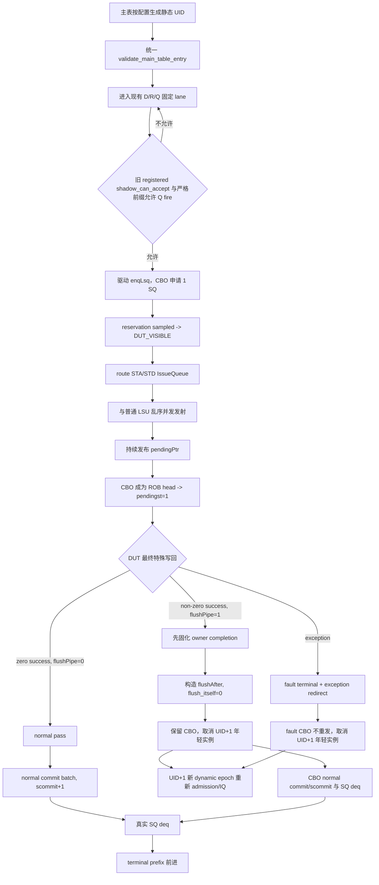

# V2 CBO/CMO 主动指令测试框架特性专项 Coding Plan

| 项目 | 内容 |
|---|---|
| 状态 | `undo`，待 coding、编译、专项仿真和 implementation review |
| 目标版本 | V2，分支 `mem_ut_uvm_v2` |
| 基线文档 | `AI_DOC/analysis/rtl/v2/flows/cbo_instruction_memblock_backend_flow.md` |
| 方案定位 | 在当前 real-dispatch 模拟后端框架上，以最小改动开放 `cbo.zero/clean/flush/inval` 主动生命周期 |
| 主要原则 | 复用现有主表、LSQ reservation、STA/STD IssueQueue、writeback、redirect、commit/deq 和 DCache responder；不新建第二套 CBO 调度器 |
| 创建日期 | 2026-11-03 |
| Admission 适配基线 | 2026-11-09 已对照主线提交 `0a6e6fbec4`；公共 D/R/Q、registered `canAccept`、source offer 和 redirect/cancel 回补已经实现，本 plan 不再新增第二套 credit helper |

## 1. Plan 定位、专有名词与抽象功能说明

### 1.1 Plan 定位

本 plan 只实现测试框架对 CBO 架构指令的生成、后端接口驱动、运行期状态推进和 redirect 恢复。
它不实现 RM、checker、scoreboard、cache metadata 或 MemBlock 内部 CMO 状态机。

目标是直接修改 real-dispatch 模拟后端测试框架的公共运行期路径，使其能够生成、驱动和完成 CMO。
`memblock_dispatch_real_smoke_vseq` 作为现有完整拓扑和专项验收入口，继续启动既有 LSQ、Issue、
Commit、L2TLB、DCache、SBuffer 和 Redirect sequence；本 plan 不为 VSEQ 新增能力声明或启动前检查。

框架级支持遵循以下边界：

1. 公共运行期逻辑不得判断具体 VSEQ 名称，也不得只在 real-smoke 类中实现 CMO 状态推进。
2. VSEQ 是否启动完整 real-dispatch topology 继续由现有场景设计负责，本 plan 不修改 `basicTest`、
   VSEQ factory 创建时序或现有 topology 白名单。
3. CMO 支持全部落在公共主表、admission、issue、writeback、redirect、commit/deq 和 responder 路径中。

现有完整 real-dispatch topology 应能真实驱动以下公共生命周期：

```text
主表生成 CBO
  -> 进入现有 LSQ D/R/Q 固定 lane
  -> 由旧 registered shadow_can_accept 和严格有序前缀决定 Q fire
  -> 分配 1 个 SQ entry
  -> reservation 到达 DUT_VISIBLE
  -> 进入 STA/STD IssueQueue 并按普通 LSU 规则乱序发射
  -> ROB head 发布 pendingPtr/pendingst
  -> DUT 最终特殊写回
  -> zero 正常提交，或 non-zero flushAfter，或 fault exception redirect
  -> normal commit/scommit、SQ deq、terminal
  -> redirect 后 UID+1 年轻静态 transaction 以新 dynamic epoch 重建
```

### 1.2 专有名词

| 术语 | 中文含义 | 当前代码或状态落点 | 场景示例 |
|---|---|---|---|
| CBO | `cbo.zero/clean/flush/inval` 架构指令 | `MEMBLOCK_OP_CLASS_CBO`、`MEMBLOCK_LSUOP_CBO_*` | 主表 UID 12 为 `cbo.flush` |
| CMO | MemBlock 内部向 DCache 发出的 cache-management 请求 | DUT `cmoOpReq/cmoOpResp`，测试环境由 DCache responder 响应 | `cbo.clean` 在 DUT 内转成 CBO A request |
| registered `lsqCanAccept` shadow | 测试框架已实现的后端 Dispatch 公共 LSQ 寄存许可 | `lsq_ctrl_model.shadow_can_accept`、`rtl_admission_ready()` 和 D/R/Q 固定 lane；本拍 deq 不组合旁路成本拍许可 | CBO 在 Q 中按普通 store 类别等待旧 `shadow_can_accept`，不能用当前 software free count 直接放行 |
| admission batch | 同一拍由 LSQ enqueue sequence 预览并 launch 的连续 UID 候选集合 | `collect_lsq_candidates()` 的本地 queue 和 `pending_sample_tokens` | 一拍选择 load、store、CBO，共累计 LQ 1、SQ 2 |
| reservation | 软件 LSQ owner 从 launch 到 DUT 可见的生命周期 | `MEMBLOCK_LSQ_RESERVATION_LAUNCHED_PENDING_SAMPLE`、`DUT_VISIBLE` | CBO SQ key 在下一 DUT sample 后可进入 issue |
| `DUT_VISIBLE` | LSQ request 已跨过 DUT 采样边界 | `status.lsq_reservation_state` | redirect 在此之前发生时，本次 CBO 不得进入 IQ |
| dynamic epoch | 同一静态 UID 每次重新 admission 的动态实例编号 | `status.dynamic_epoch` | CBO redirect 清除 UID 13 后，UID 13 从 epoch 2 重新 admission |
| `pendingPtr` | 模拟 ROB 当前顺序 head/watermark 的持续 sideband | `lsq_commit_handler::modeled_rob_deq_ptr` | CBO 尚年轻时仍指向更老 UID |
| `pendingst` | 当前 modeled ROB head 是 scalar store/CBO 的 level sideband | `build_lsqcommit_xaction()` | CBO 成为 head 时置 1，但不表示已经提交 |
| `scommit` | 本拍 normal commit batch 中 scalar store/CBO 的提交计数 | `build_lsqcommit_xaction()` | 成功 CBO 真正进入 commit batch时加 1 |
| STD payload | 后端通过 STD issue 端口送入 StoreQueue 的 data operand；当前框架没有独立 `std_data` 主表字段，而是直接复用静态 `main_tr.src_0` | `issue_field_assigner::assign_std_main_fields()` | CBO 的地址仍由 STA 使用 `src_0+imm`，STD payload 按 CBO 类型归一化为 0 |
| 最终特殊写回 | CBO 完成后从 STA0 真实写回端口返回的 owner 绑定结果 | `dispatch_monitor_event_adapter` 的 STA0 raw writeback | non-zero CBO 写回携带 `flushPipe=1` |
| `flushAfter` | 保留 redirect owner，仅清除更年轻动态实例的 redirect | `memblock_redirect_payload_t.flush_itself=0` | non-zero CBO UID 12 保留，UID 13 起重建 |
| fault exception redirect | fault CBO 完成 exception terminal 后的恢复 redirect | 现有 scalar store fault token/redirect 流程 | fault UID 12 不重发，UID 13 起重建 |
| terminal prefix | 从 UID 0 开始连续进入终态的进度 | `dispatch_progress.terminal_done_uid` | 主动 flow 以该 prefix 到达 `main_trans_num` 正常退出 |
| responder | 对 DUT 已发出的 memory-facing request 提供协议响应的 sequence | `dcache_mem__access_base_sequence` | CBO hit 执行 Probe 后返回 CBOAck |
| main-sequence hook | real-smoke 公共 core topology 中用于替换静态主表 builder 的 virtual task | 计划新增 `start_main_dispatch_sequence()` | directed CMO VSEQ 只覆盖该 hook，不复制整个 core fork |

### 1.3 关键对象的抽象职责

| 对象 | 抽象功能职责 |
|---|---|
| `memblock_dispatch_base_sequence` | 构建并校验静态主表；它决定 CBO class、fuOpType、地址和普通派生字段，不推进运行期 owner。 |
| `memblock_dispatch_real_smoke_vseq` | 复用现有完整 real-dispatch 拓扑，并通过可覆盖的 main-sequence hook 允许 directed 场景替换主表而不复制并发 worker。 |
| `lsq_ctrl_model` | 维护软件 LQ/SQ owner，同时已经维护 D/R/Q、registered credit/`canAccept`、source offer 和 redirect/cancel shadow；本 plan 只复用并检查 CBO 分类，不新增 credit gate。 |
| `memblock_lsqenq_dispatch_base_sequence` | 从连续 admission prefix 构建本拍 batch，驱动 LSQ request，并在 DUT sample 后开放 issue。 |
| `issue_queue_scheduler` | 把已 admission 且 `DUT_VISIBLE` 的 CBO路由到现有 STA/STD queue，并按普通 target 仲裁发射。 |
| `issue_field_assigner` | 把主表静态字段和运行期 SQ owner投影到真实 issue xaction；本 plan 在此将 CBO STD payload归一化为 0，同时保持 STA 地址源不变。 |
| `dispatch_monitor_event_adapter` | 将真实 STA0 CBO writeback 绑定到当前 UID/ROB/SQ/epoch，并把 `flushPipe` 投影成 completion 或 `flushAfter` 事件。 |
| `dispatch_monitor_batch_handler` | 先固化 redirect owner 的 CBO completion，再按 redirect-first 规则取消被覆盖的年轻事件。 |
| `exception_redirect_replay_handler` | 驱动 redirect、冻结 admission/issue、调用公共 redirect flush，并恢复年轻 UID admission。 |
| `lsq_commit_handler` | 持续发布 `pendingPtr/pendingst`，选择 normal commit batch，更新 `scommit`，并消费真实 LQ/SQ deq。 |
| `dcache_mem__access_base_sequence` | 只响应 DUT 实际出现的 non-zero CBO request；不生成 CBO 指令，不替 CBO 宣告写回或提交。 |

## 2. 当前缺口与最小改动边界

### 2.1 当前已有能力

1. `memblock_op_behavior_util::derive_op_behavior()` 已把 CBO 分类为 STU、1 SQ/0 LQ、STA/STD 双 target、scalar store commit。
2. `memblock_dispatch_base_sequence` 已具备 CBO class/fuOp 枚举、权重 getter、模板和 `random_cbo_fuoptype()`。
3. 公共 LSQ admission 已实现 D/R/Q 固定 lane、registered credit/`shadow_can_accept`、严格有序前缀、source offer、redirect t1/t2/t3 和 deq/cancel 回补。
4. CBO 的现有 behavior 分类已经是 `need_alloc=2'b10`、`uses_sq=1`、`uses_lq=0`、`num_ls_elem=1`，可复用普通 scalar store 的 D/R/Q 与 SQ admission。
5. LSQ reservation 已具备 launch token、DUT sample、`DUT_VISIBLE`、redirect cancel 和 live SQ map。
6. STA/STD 已有独立 IssueQueue、pipe 配额、ready/valid、replay、epoch 和 owner 检查。
7. `lsq_commit_handler` 已有持续 `pendingPtr`、store `pendingst`、normal commit `scommit` 和 SQ deq/terminal。
8. 公共 redirect 已能清理年轻 ROB/IQ/LSQ owner，递增 `dynamic_epoch` 并从最老被清 UID 重建 admission prefix。
9. DCache responder 已实现 non-zero CBO miss direct Ack，以及 hit 的 `Probe(toB/toN) -> CBOAck` 闭环。
10. STD payload 不是发射时重新随机：`main_control_transaction.src_0` 在建表时随机一次，随后会被地址模板改写并静态保存；`assign_std_main_fields()` 当前直接把同一个 `main_tr.src_0` 驱动到 STD。

### 2.2 当前 blocker

1. `seq_csr_common::validate_and_clamp()` 强制 `MEMBLOCK_OP_CLASS_CBO_WT=0`。
2. `validate_main_table_entry()` 在合法 CBO template 检查前直接 fatal。
3. `issue_field_assigner::check_target_futype_fuoptype()` 的 STU 分支显式拒绝 CBO。
4. `memblock_wb_event_t` 没有保存 `flushPipe` 语义，STA0 CBO `flushPipe=1` 在 adapter 中直接 fatal。
5. redirect-first batch handler 会跳过 selected redirect event 自身的 normal writeback状态更新；non-zero CBO 必须先完成 owner，再启动 `flushAfter`。
6. 当前没有 CBO 主动 flow directed cfg 和验收场景。
7. real-smoke 的 `start_core_dispatch_flow()` 当前硬编码 auto main builder；派生 directed VSEQ 无法只替换主表，必须复制整个 core fork，容易与公共拓扑漂移。
8. CBO 没有架构 store-data source，但当前 `assign_std_main_fields()` 仍把地址基址 `main_tr.src_0` 当作 STD data 驱动；方案尚未定义按 CBO 类型归一化 STD payload 的规则。

### 2.3 最小改动范围

本 plan 修改现有公共路径，不新增 CBO 专用 agent、driver、IssueQueue、LSQ allocator、redirect engine 或 DCache responder：

```text
主表：解除合法 CBO 门禁，保留统一 template 校验。
Admission：复用已经实现的 D/R/Q、旧 registered shadow_can_accept、严格有序前缀和 source-offer 路径；只补 CBO 分类与计数不变量，不新增 helper/state。
Issue：允许合法 CBO 复用 STU STA/STD 生命周期；STA 继续使用地址源，STD payload 通过统一 helper按操作类型归一化，CBO 四类均驱动 0。
Writeback：给 semantic event 保留 flushPipe，并把 non-zero CBO 转成 flushAfter。
Redirect：复用公共 cancel/epoch/reissue；只增加 CBO owner completion 顺序处理。
Commit/deq：复用 scalar store 逻辑，只补 CBO 不变量检查。
场景：复用 real-smoke vseq 和现有 DCache/SBuffer/redirect responder。
扩展点：给 real-smoke core topology 增加可覆盖 main-sequence hook，directed 场景只替换主表 owner。
```

上述“复用 real-smoke”只表示它是首个完整实现和默认专项入口，不表示公共 CMO 逻辑依赖
`memblock_dispatch_real_smoke_vseq` 类名。LSQ、issue、writeback、redirect、commit 等改动仍位于公共
helper/handler 中；其它使用相同公共路径的完整 real-dispatch 场景自然获得相同 CMO 处理能力。

### 2.4 明确不实现

- 不实现 RM、checker、scoreboard 或参考内存 CBO 数据语义。
- 不复制 `deqCanDoCbo`、StoreQueue `mmioState`、SBuffer drain、DataBuffer、Uncache beat、CMOUnit FSM。
- 不实现 cache valid/dirty/coherence metadata。
- 不复制 StoreUnit cache-line RAW CAM、LoadUnit nuke 或 LoadQueueRAW oldest selection。
- 不为 CBO 建立全局 LSU barrier；不阻止无冲突的年轻 load/store 投机发射。
- 不给内部 `cmoOpReq` 重复执行 registered `lsqCanAccept` admission。
- 不新增 runtime 物理 LQ/SQ 宽度、容量或 6/4 credit 参数。

## 3. 动态配置参数

### 3.1 参数链与单一权威

所有公共动态参数继续使用：

```text
env/plus.sv
  -> seq/base_seq_help/seq_csr_common.sv 冻结、校验和 getter
  -> seq/plus_cfg/default.cfg 公共默认值
  -> seq/plus_cfg/<专项>.cfg directed preset
```

sequence/helper 只读 `seq_csr_common::get_*()`；不得直接读写 `plus::MEMBLOCK_*`。专项场景通过
`basicTest + VSEQ_MAIN + cfg=<cfg_name>` 运行，不在 testcase 或 vseq 中重写 plus 静态变量。

### 3.2 复用参数

| 参数 | 功能 | 本 plan 行为 |
|---|---|---|
| `MEMBLOCK_OP_CLASS_CBO_WT` | CBO class 动态生成权重；0 表示关闭主动 CBO | 删除当前“必须为 0” fatal；仍要求非负，并参与 op class 总权重合法性检查 |
| `MEMBLOCK_CBO_FUOP_ZERO_WT` | `cbo.zero` 子操作权重 | 保持现有 getter；CBO class 打开时四类权重不能全 0 |
| `MEMBLOCK_CBO_FUOP_CLEAN_WT` | `cbo.clean` 子操作权重 | 同上 |
| `MEMBLOCK_CBO_FUOP_FLUSH_WT` | `cbo.flush` 子操作权重 | 同上 |
| `MEMBLOCK_CBO_FUOP_INVAL_WT` | `cbo.inval` 子操作权重 | 同上；最终实际 fuOpType 仍以主表字段为准 |
| `MEMBLOCK_L2_CBO_ACK_DENIED_WT` | 对实际 non-zero CBOAck 注入 denied | 复用现有 responder；不作为 CBO 指令生成开关 |
| `MEMBLOCK_L2_CBO_ACK_CORRUPT_WT` | 对实际 non-zero CBOAck 注入 corrupt | 复用现有 responder；不主动伪造 response |
| `MEMBLOCK_ENQ_PER_CYCLE*` | admission batch 大小与随机分布 | 继续控制候选 slot 数；不改变现有 D/R/Q、registered credit 和严格前缀算法 |
| `MEMBLOCK_STA_PIP_NUM_LIMIT`、`MEMBLOCK_STD_PIP_NUM_LIMIT` | 本 testcase 使用的 STA/STD pipe 数 | CBO 与普通 store 共用，不新增 CBO pipe 参数 |
| `MEMBLOCK_DISPATCH_ISSUE_NONBLOCKING_EN` | issue ready 非阻塞模式 | CBO 与普通 STA/STD 共用 |

### 3.3 不新增参数的结论

本 plan 不新增 `MEMBLOCK_CBO_ACTIVE_EN`、`MEMBLOCK_CBO_FLUSH_AFTER_EN`、`MEMBLOCK_CBO_WAIT_ROB_HEAD_EN`
或 `MEMBLOCK_LSQ_CAN_ACCEPT_RESERVE_*`。原因如下：

1. `MEMBLOCK_OP_CLASS_CBO_WT=0/非0` 已能表达动态关闭/开启。
2. 四类 fuOp 权重已能构造单类或混合 directed 场景。
3. `flushAfter`、fault redirect、`pendingst` 和 registered LSQ admission 是必须复刻的后端行为，不允许用 knob 关闭。
4. LQ/SQ 容量、enqueue width 和 pipe 数属于编译期物理结构，不能建立 runtime 镜像。

### 3.4 专项 cfg

计划新增以下 cfg；它们只设置已有参数，不引入第二参数来源：

| cfg | 目标 |
|---|---|
| `tc_dispatch_real_cbo_zero.cfg` | CBO class 只生成 zero，关闭 CBOAck error，混入年轻 load/store 验证无 CBO flushAfter |
| `tc_dispatch_real_cbo_nonzero.cfg` | clean/flush/inval 非零权重，zero=0，验证三类 `flushPipe -> flushAfter` |
| `tc_dispatch_real_cbo_fault.cfg` | 复用现有翻译/PMP/PMA fault profile 和 responder error 权重，验证 exception redirect |
| `tc_dispatch_real_cbo_mixed.cfg` | load/store/CBO 混合、multi-enqueue 和 nonblocking issue，验证 D/R/Q registered admission、严格前缀与并发 |

`default.cfg` 保持 `MEMBLOCK_OP_CLASS_CBO_WT=0`，避免默认 smoke 在专项验收完成前改变行为。
使用 `memblock_dispatch_real_cbo_directed_vseq` 的 directed preset还必须显式设置
`MEMBLOCK_CONTROL_WORKER_TOPOLOGY_MODE=0`；随机 real-smoke preset是否使用其它已支持 topology由各 cfg
自行声明。

## 4. 目标功能 Flow 总览



关键顺序：

```text
non-zero CBO 最终写回
  -> 当前 CBO owner 先记录真实 writeback/pass
  -> 创建 flushAfter redirect
  -> drive redirect 并按 LSQ sample anchor 对账
  -> 只清 UID+1 及之后年轻动态实例
  -> 当前 CBO 后续进入 normal commit batch，scommit 加 1
  -> 年轻静态 UID 以新 dynamic_epoch 重新 admission
```

## 5. 主表生成与合法性开放

### 5.1 `seq_csr_common::validate_and_clamp()` 修改

**抽象功能职责：** 在 testcase 启动时冻结公共参数并拒绝非法组合；它只校验配置，不生成 CBO transaction。

**真实源码落点：**
`mem_ut/ver/ut/memblock/seq/base_seq_help/seq_csr_common.sv`

**详细中文顺序伪代码：**

```text
删除 MEMBLOCK_OP_CLASS_CBO_WT 非零即 fatal 的临时门禁。
保留 AMO 尚未完成的独立门禁，不连带开放 AMO。
检查 CBO class weight 和四类 fuOp weight 都是非负冻结值。
如果 CBO class weight != 0：
  检查 ZERO/CLEAN/FLUSH/INVAL 四类权重至少一项非零；
如果 CBO class weight == 0：
  允许四类子权重保留默认非零值，但它们不产生 CBO。
不新增 LQ/SQ capacity 或 6/4 runtime 参数。
不新增 CMO 专属 sequence enable 联动检查；现有 sequence enable与 topology配置语义保持不变。
```

**状态副作用：** 只改变配置合法性；不修改运行期主表、owner、queue、cursor 或 epoch。

### 5.2 `memblock_dispatch_base_sequence::apply_op_class_template()` 修改

**抽象功能职责：** 根据已经选中的 op class 填充 CBO 的最小静态 transaction 模板，供后续地址与派生字段逻辑使用。

**真实源码落点：**
`mem_ut/ver/ut/memblock/seq/base_seq_help/memblock_dispatch_base_sequence.sv`

**详细中文顺序伪代码：**

```text
当 op_class == MEMBLOCK_OP_CLASS_CBO：
  fuType = MEMBLOCK_FUTYPE_STU；
  fuOpType = random_cbo_fuoptype()；
  lsq_flow = MEMBLOCK_LSQ_FLOW_CBO；
  numLsElem = 1；
  保持 enqueue 输入 uop.flushPipe=0；最终 flushPipe 只能来自 DUT 特殊写回；
  使用现有地址生成流程提供 rs1/imm/vaddr，不把 CBO 强制成控制 marker；
  不把 main_tr.src_0 清零；该字段仍是 STA 地址基址，CBO STD data 在 issue_field_assigner 中单独归一化；
  使用现有 send_pri/delay 字段，不建立 CBO 专用优先级。
```

**状态副作用：** 只写当前 `main_control_transaction` 的静态字段。

### 5.3 `memblock_dispatch_base_sequence::validate_main_table_entry()` 修改

**抽象功能职责：** 在建表完成前拒绝不可能由 V2 CBO 后端路径产生的 transaction 组合。

**真实源码落点：** 同上。

**详细中文顺序伪代码：**

```text
删除“任意 CBO class/flow/fuOpType 都 unsupported”的临时 fatal。
保留统一 validate_main_transaction()、ROB 范围和 vector LS 拒绝。
对 CBO 要求：
  op_class == CBO；
  fuType == STU；
  lsq_flow == CBO；
  fuOpType 属于 CBO_ZERO/CLEAN/FLUSH/INVAL；
  derive_op_behavior() 返回 kind=CBO、need_alloc=2'b10、uses_sq=1、uses_lq=0；
  route_sta=1、route_std=1、num_ls_elem=1、commit_is_store=1；
  enqueue template 的 flushPipe 必须为 0，禁止把最终动态 flushPipe 静态写入主表。
```

**状态副作用：** 无运行期副作用；失败时在建表阶段 `uvm_fatal`。

## 6. 复用现有 Registered `lsqCanAccept` 与 CBO SQ Admission

### 6.1 现有 `lsq_ctrl_model` Registered Admission 合同

**抽象功能职责：** 复用已经实现的后端 LSQ 源端投影，按 D/R/Q 固定 lane、旧 registered `shadow_can_accept`、严格有序前缀和 redirect/cancel 时序决定 CBO 是否能够从 Q 发出；本 plan 不建立第二套 admission 判定。

**真实源码落点：**
`mem_ut/ver/ut/memblock/seq/base_seq_help/lsq_ctrl_model.sv`

**详细中文顺序伪代码：**

```text
CBO 由 derive_op_behavior() 分类为：
  need_alloc=2'b10、uses_sq=1、uses_lq=0、num_ls_elem=1、is_atomic=0。
stage_dispatch_bundle() 把 CBO 当作普通 scalar store 类别放入现有 D lane。
D/R/Q 按固定物理 lane 推进，不压紧 lane，也不绕过前部阻塞 UID。
Q 发出前必须满足 rtl_admission_ready()：
  shadow_baseline_valid=1；
  使用上一拍寄存的 shadow_can_accept=1。
本拍 DUT deq 只回补 next shadow credit，不得组合旁路成为本拍 CBO 许可。
redirect t1/t2/t3、cancel restore 和 shadow_iq_recompute_hold 继续使用现有公共实现。
不新增 modeled_lsq_can_accept()，也不直接读取 lq_free_count/sq_free_count 计算 CBO Q fire。
```

**状态副作用：** 本 plan 不改变现有 shadow 状态机；CBO 只作为现有 D/R/Q 中的 store 类 lane 内容流动。

### 6.2 `collect_lsq_candidates()` 复用并补 CBO 不变量

**抽象功能职责：** 从现有 Q 固定 lane 选择能够真实 launch 的有序前缀，并确认 CBO 只贡献一个 store flow 和一个 SQ 申请；它不新增 CBO 专属候选队列或 credit 算法。

**真实源码落点：**
`mem_ut/ver/ut/memblock/seq/base_seq/memblock_lsqenq_dispatch_base_sequence.sv`

**详细中文顺序伪代码：**

```text
如果 Q 尚无 valid：
  从 next_new_admit_uid 捕获连续、合法、需要 LSQ allocation 的 source bundle；
  CBO 与普通 load/store 一起调用 stage_dispatch_bundle()，不走 atomic token。
如果 Q 已有 valid：
  先检查 rtl_admission_ready()、shadow_iq_recompute_hold 和公共 flush/recovery block；
  沿固定 lane 从老到年轻构造前缀，首个阻塞 lane 后不得继续选择；
  复用现有 load/store enqueue width 检查；
  复用 shadow_conserve_flow_total[lane] 与对应 shadow credit 的严格大于检查；
  CBO 的 uses_sq=1，因此累计 store_elem_count 加 1，并推进临时 SQ key 一项；
  CBO 的 uses_lq=0，因此不增加 load_elem_count，也不推进临时 LQ key。
对 CBO 增加防御性检查：
  kind=CBO、need_alloc=2'b10、uses_sq=1、uses_lq=0、num_ls_elem=1；
  若分类漂移则立即 fatal，不能降级到 non-LSQ 或 atomic admission。
```

**状态副作用：** Q fire 前只构造本拍候选和预览 key；不直接修改软件 owner。被旧 `shadow_can_accept` 或前缀条件阻塞时，Q lane 原位保持。

### 6.3 Source Offer、真实 Launch 与 SQ Owner

**抽象功能职责：** 在真实 driver launch 后冻结本拍 source offer，并在后续 DUT sample/软件 reservation 路径中只为 CBO 建立一个 SQ owner。

**真实源码落点：** 同上，以及
`mem_ut/ver/ut/memblock/seq/base_seq_help/lsq_ctrl_model.sv`。

**详细中文顺序伪代码：**

```text
构造 enqLsq xaction 时：
  CBO 对应 slot 的 needAlloc=2'b10；
  fire_mask 只标记实际选中的固定 Q lane；
  accepted_lq += 0；
  accepted_sq += 1；
  source offer 的 need_alloc_nonzero=1。
driver 真实 launch 后才发布 source offer，禁止预先扣 shadow credit。
confirm_lsq_candidates()：
  逐候选复核预览 key；
  CBO 调用现有 commit_allocate()，建立唯一 UID->SQ map；
  建立 pending reservation，不创建 LQ owner。
后续 DUT sample：
  复用 pending sample、DUT_VISIBLE 和 reset/redirect cancel 流程；
  只有 reservation 到达 DUT_VISIBLE 后才允许 CBO 进入 STA/STD IssueQueue。
```

**状态副作用：** 成功 launch 后 CBO 占用一个软件 SQ owner；shadow credit 只由现有 sample 状态机扣减，软件 reservation 只由现有 deq/cancel owner 路径回收。

### 6.4 明确不新增的 Admission 行为

**抽象功能职责：** 固定 CBO 与现有公共 admission 的边界，防止 coding 时重复实现已经落地主线的 LSQ 准入逻辑。

**详细中文顺序伪代码：**

```text
不新增 modeled_lsq_can_accept() 或其它 current-free-count 查询 helper。
不把“LQ>=6 且 SQ>=5”写成 CBO Q fire 当拍的无状态条件。
不让 CBO 走 AMO 的隔离 non-LSQ token、lane0 独占或 atomic barrier。
不在 CBO admission 后因 shadow_can_accept 后续降低而阻塞 STA/STD issue；
  admission 与 issue 是两个阶段，issue 继续只受 owner、DUT_VISIBLE、target ready和 redirect约束。
不在 DUT 内部 cmoOpReq/cmoOpResp 再执行一次 backend admission gate。
```

**状态副作用：** 无；本节只定义禁止形成第二套 helper、state、token 或 credit source。

## 7. STA/STD IssueQueue 发射与 LSU 并发

### 7.1 `issue_field_assigner::check_target_futype_fuoptype()` 修改

**抽象功能职责：** 在构造 issue xaction 前检查 target、fuType、fuOpType 和 behavior 路由一致，不负责选择发射时机。

**真实源码落点：**
`mem_ut/ver/ut/memblock/seq/base_seq_help/issue_field_assigner.sv`

**详细中文顺序伪代码：**

```text
STU 分支允许两类合法输入：ordinary store 或 CBO。
共同要求：
  target 只能是 STA 或 STD；
  route_load=0、route_sta=1、route_std=1；
  live SQ owner 存在；
  behavior.kind 与 fuOpType 分类一致。
ordinary store 要求 is_store_fuoptype=1 且 is_cbo=0。
CBO 要求 is_cbo_fuoptype=1、behavior.kind=CBO、behavior.is_cbo=1。
不把 CBO 的 issue uop.flushPipe 置 1；最终 flushPipe 只能来自 DUT writeback。
```

**状态副作用：** 无；只做 payload 构造前 fail-fast。

### 7.2 `issue_field_assigner::derive_std_issue_data()` 计划新增，并修改 `assign_std_main_fields()`

**抽象功能职责：** 在 STD issue xaction 构造阶段，根据最终主表操作类型产生稳定的 data operand。它不改变主表地址字段，不在每次发射或 replay 时重新随机，也不承担 CBO 架构数据效果判断。

**真实源码落点：**
`mem_ut/ver/ut/memblock/seq/base_seq_help/issue_field_assigner.sv`

**接口草案：**

```systemverilog
function bit [63:0] derive_std_issue_data(
    input main_control_transaction main_tr,
    input memblock_op_behavior_t behavior
);
```

**详细中文顺序伪代码：**

```text
检查 main_tr 非空，并确认 behavior 与最终 fuOpType 分类一致。
如果 behavior.kind == CBO：
  要求 fuOpType 属于 CBO_ZERO/CLEAN/FLUSH/INVAL；
  返回 64'h0；
  其中 zero 的 0 与 RTL StoreQueue 强制零语义一致；
  clean/flush/inval 的 data 在 RTL 中没有架构意义，统一驱动 0 作为确定性的 don't-care 规范值。
如果 behavior.kind == ordinary STORE：
  返回现有静态 main_tr.src_0，保持本 plan 之外的普通 Store 行为不变。
其它 behavior 调用本 helper 时直接 fatal。
```

修改 `assign_std_main_fields()`：

```text
不再无条件把 main_tr.src_0 写入 issueStd.src_0。
先通过 lsq_ctrl_model::derive_op_behavior(main_tr) 得到只读 behavior，不修改主表或运行期状态。
先调用 derive_std_issue_data(main_tr, behavior)。
两个 STD pipe 都驱动该 helper 的返回值。
STA pipe 仍使用 main_tr.src_0 和 imm 计算 CBO 地址，不受 STD data 归一化影响。
redirect/replay 后同一静态 UID 重新发 STD 时再次得到相同结果，不重新随机。
```

**状态副作用：** 只改变本次 STD xaction 的 data 字段；不修改 Main table、状态表、SQ owner、issue queue item 或 dynamic epoch。

### 7.3 `issue_queue_scheduler::prepare_issue_route_for_uid()` 复用并补不变量

**抽象功能职责：** 只在当前动态实例已 admission 且 LSQ reservation 对 DUT 可见时，把 UID 放入对应 target queue。

**真实源码落点：**
`mem_ut/ver/ut/memblock/seq/base_seq_help/issue_queue_scheduler.sv`

**详细中文顺序伪代码：**

```text
复用 is_uid_route_ready() 的 active/enq/epoch/live owner 检查。
如果 behavior.kind == CBO：
  要求 uses_sq=1、active_sq_mapped=1；
  要求 lsq_reservation_state == DUT_VISIBLE；
  route_target(STA)；
  route_target(STD)。
每个 item 保存同一 SQ key、当前 dynamic_epoch、replay_seq 和 target issue epoch。
不等待 ROB head，不读取 pendingPtr，不设置全局 LSU block。
```

**状态副作用：** 向现有 `sta_issue_q`、`std_issue_q` 各插入一项；不创建新 queue。

### 7.4 `select_issue_candidates()` 与 driver 无 CBO 特判

**抽象功能职责：** 按现有 target queue、pipe limit、ready、ROB 年龄和 send priority 选择本拍发射项。

**真实源码落点：**
`issue_queue_scheduler.sv`、`memblock_issue_dispatch_base_sequence.sv`

**详细中文顺序伪代码：**

```text
Load、STA、STD 继续独立选候选。
CBO STA/STD 与普通 store 竞争现有 pipe，不增加专用优先级。
ready=0 时按现有 blocking/nonblocking 模式保持 item。
全局 redirect freeze 时统一停止 issue。
局部 replay 只重建对应 target item。
同一时刻存在 CBO 不阻止其它 load/store 候选发射。
```

**状态副作用：** 只按现有规则更新 dispatched/issue epoch、删除或保留 queue item。

## 8. `pendingPtr`、`pendingst`、最终写回与正常提交

### 8.1 `lsq_commit_handler::build_lsqcommit_xaction()` 复用并补 CBO 检查

**抽象功能职责：** 每拍从 modeled ROB head 构造持续的 commit sideband，并选择连续 normal commit batch。

**真实源码落点：**
`mem_ut/ver/ut/memblock/seq/base_seq_help/lsq_commit_handler.sv`

**详细中文顺序伪代码：**

```text
pendingPtr：
  始终来自 modeled_rob_deq_ptr 或合法 committed watermark；
  CBO 尚年轻时绝不跳过更老 UID。
pendingst：
  modeled head 是 CBO 且 active/enq、非 fault head、未被 pointer block 时置 1；
  zero/non-zero 使用同一 scalar store 分类。
scommit：
  只遍历 select_rob_commit_batch() 已选出的 normal commit_uids；
  behavior 是 scalar STORE 或 CBO 时加 1；
  fault CBO、仅 writeback 未进入 batch 的 CBO不计数。
```

**状态副作用：** 驱动 LSQ commit agent xaction；commit 状态在 driver 返回后由现有 mark helper 更新。

### 8.2 `memblock_wb_event_t` 字段扩展

**抽象功能职责：** 在 monitor semantic event 中保留真实 writeback 的 `flushPipe` 元数据，使 adapter、batch handler 和 debug 使用同一冻结值。

**真实源码落点：**
`memblock_dispatch_types.sv`、`common_data_transaction::make_empty_wb_event()`。

**计划新增字段：**

```systemverilog
bit flush_pipe_valid;
bit flush_pipe;
bit completion_before_redirect;
```

**详细中文顺序伪代码：**

```text
make_empty_wb_event() 默认全部清零。
只有实际携带 `flushPipe` 字段的 raw writeback 设置 flush_pipe_valid。
completion_before_redirect 只由合法 non-zero CBO STA0 特殊写回设置。
字段不进入 RM，不作为 enqueue 静态 uop.flushPipe 的替代。
```

**状态副作用：** 只扩展事件快照，不直接改 UID 状态。

### 8.3 `dispatch_monitor_event_adapter::check_attached_int_wb_metadata()` 修改

**抽象功能职责：** 在 raw STA0 已绑定当前 live owner 后，按最终 CBO fuOpType纯校验 `flushPipe` 合法性；它不修改 semantic event，不创建 redirect。

**真实源码落点：**
`mem_ut/ver/ut/memblock/seq/base_seq_help/dispatch_monitor_event_adapter.sv`

**详细中文顺序伪代码：**

```text
只在 source=STA、port=0、owner op_class=CBO 时进入 CBO 分支。
复核 UID/ROB/SQ/issue_epoch/replay_seq/dynamic_epoch 都属于当前实例。
要求 raw.flush_pipe_valid=1。
按最终 fuOpType 分类：
  CBO_ZERO：
    success writeback 必须 flushPipe=0；
  CBO_CLEAN/FLUSH/INVAL：
    success writeback 必须 flushPipe=1；
如果 writeback 带 exception：
  只检查 raw字段有效性和 owner，不要求构造正常 CBO flushAfter；
  后续继续走现有 scalar store fault/exception redirect owner。
非 CBO STA0 flushPipe=1 继续 fatal。
```

**状态副作用：** 无；只做 fail-fast 校验。

### 8.4 `dispatch_monitor_event_adapter::apply_cbo_flush_pipe_semantics()` 计划新增

**抽象功能职责：** 在纯校验完成后，把当前 live CBO 的真实 `flushPipe` 快照写入 semantic event；仅对无异常 non-zero CBO 构造 `flushAfter`。

**真实源码落点：**
`mem_ut/ver/ut/memblock/seq/base_seq_help/dispatch_monitor_event_adapter.sv`

**接口草案：**

```systemverilog
function void apply_cbo_flush_pipe_semantics(
    input memblock_sync_pkg::dispatch_raw_int_wb_t raw,
    ref memblock_wb_event_t wb_event
);
```

**详细中文顺序伪代码：**

```text
如果不是 STA0 或 owner 不是 CBO：
  只复制 raw事件实际提供的 flush_pipe_valid/flush_pipe；返回。
复制 raw.flush_pipe_valid/raw.flush_pipe 到 wb_event。
如果事件有 exception：
  不创建正常 CBO flushAfter；返回。
如果最终 fuOpType 是 CBO_ZERO：
  保持 redirect_valid=0、completion_before_redirect=0；返回。
如果最终 fuOpType 是 CBO_CLEAN/FLUSH/INVAL：
  通过已绑定的 lsq_commit_handler 检查该 UID/ROB key仍是 modeled ROB head；
  检查当前拍 pendingPtr 应指向该 owner，且 CBO 属于 scalar store pending语义；
  设置 completion_before_redirect=1；
  设置 redirect_valid=1、redirect.valid=1；
  设置 redirect.flush_itself=0；
  设置 redirect.level=1，表达 V2 flushAfter；
  设置 redirect.is_vls_exception=0；
  设置 redirect.rob_key=当前 CBO ROB key。
其它 CBO fuOpType 直接 fatal。
```

在 `convert_raw_int_wb()` 中的调用顺序固定为：

```text
绑定 current issue snapshot
  -> check_attached_int_wb_metadata() 纯校验
  -> apply_cbo_flush_pipe_semantics() 构造事件
  -> normalize_v2_int_wb_key()
```

**状态副作用：** 只修改本次 `wb_event`；不立即更新 UID 状态或启动 redirect。

### 8.5 `dispatch_monitor_batch_handler::process_redirect_owner_completion()` 计划新增

**抽象功能职责：** 对“同一真实 writeback既完成当前 CBO又触发 flushAfter”的事件，先固化保留 owner 的 completion，再把原 redirect 交给公共 recovery。

**真实源码落点：**
`mem_ut/ver/ut/memblock/seq/base_seq_help/dispatch_monitor_batch_handler.sv`

**接口草案：**

```systemverilog
function bit process_redirect_owner_completion(
    input memblock_wb_event_t redirect_event
);
```

**详细中文顺序伪代码：**

```text
如果 completion_before_redirect=0，直接返回 true。
要求事件是 non-zero CBO STA0、real_wb_valid=1、无 exception、无 replay。
复制一份 completion_event。
清除 completion_event.redirect_valid 和 completion_event.redirect.valid；
保留相同 UID/ROB/SQ/issue epoch/replay seq/dynamic epoch。
调用 writeback_handler.handle_real_writeback_event(completion_event)。
要求当前 CBO owner 已记录 STA writeback/pass；失败或 stale 时不得启动 redirect。
返回成功。
```

随后修改 `process_monitor_event_batch()`：

```text
选出 oldest redirect 后，先调用 process_redirect_owner_completion(selected_redirect_event)。
成功后才把原 redirect event push 到 recovery queue。
同 batch 对 owner 自身的其它合法 target completion 不按 younger redirect 丢弃。
被 flushAfter 覆盖的年轻事件继续按 rob_need_flush() 丢弃。
```

**状态副作用：** 当前 CBO 的 STA target先完成；redirect 尚未开始时不清理年轻 owner。

### 8.6 zero 正常提交

**抽象功能职责：** 让成功 `cbo.zero` 沿用普通 scalar store 的 pass、normal commit、SQ deq 和 terminal 路径。

**真实源码落点：** `writeback_status_handler.sv`、`lsq_commit_handler.sv`、`common_data_transaction.sv`。

**详细中文顺序伪代码：**

```text
zero 最终 STA0 writeback flushPipe=0，按 real writeback 更新 STA target。
STD target 仍按现有真实 issue/writeback生命周期完成。
UID 只有 required targets 全完成、pass=1、无 fault/replay/redirect 时成为 normal commit candidate。
进入 commit batch时 scommit 加 1。
mark_rob_commit_uid() 设置 rob_commit，但不伪造 SQ deq。
真实 SQ deq monitor释放 SQ map/free count。
rob_commit && lsq_deq 后 try_retire_committed_uid() 设置 success/terminal_done。
不生成 CBO flushAfter。
```

## 9. Non-zero `flushAfter` 与 Fault Redirect 恢复

### 9.1 non-zero CBO `flushAfter`

**抽象功能职责：** 保留完成 CBO owner，只取消其后的年轻动态实例，并让静态 UID 从 owner `UID+1` 重新 admission。

**真实源码落点：** 复用 `exception_redirect_replay_handler.sv` 和 `common_data_transaction::apply_redirect_flush*()`。

**详细中文顺序伪代码：**

```text
adapter 生成 redirect.flush_itself=0、rob_key=CBO owner。
recovery handler 请求 active redirect，递增 dispatch_flush_epoch 并冻结 admission/issue。
redirect driver 把 payload送入 DUT redirect interface。
等待 redirect monitor/LSQ sample anchor 和 cancel record 对账边界。
apply_redirect_flush_range() 使用 rob_need_flush()：
  当前 CBO ROB key 与 redirect 相同，但 flush_itself=0，因此不清当前 CBO；
  只把 ROB 更年轻的 active UID 加入 reissue_uids。
对每个年轻 UID：
  删除 IQ item和 live ROB/LQ/SQ map；
  记录 LSQ cancel；
  清除旧 writeback/pass/replay/fault 状态；
  dynamic_epoch++；
  active/enq/issue_ready 清零；
  静态 main transaction 保留。
把 max_enqueued_uid 回退到最老被清 UID-1。
解除 flush 后，get_next_new_admit_uid() 返回最老被清 UID，即 CBO UID+1。
年轻 UID 重新分配 ROB/SQ/LQ、重新到 DUT_VISIBLE、重新进入 IQ。
当前 CBO 不重新发 STA/STD，也不再次产生 CMO request。
```

**状态副作用：** CBO owner 保持当前 `dynamic_epoch`；UID+1 及之后的被覆盖实例 epoch 增 1。

### 9.2 fault CBO exception redirect

**抽象功能职责：** 让 fault CBO 进入 fault terminal，并从静态 `fault UID+1` 恢复年轻 transaction；fault CBO 自身不重新发射。

**真实源码落点：** 复用 scalar store fault 的 `writeback_status_handler`、`lsq_commit_handler`、fault token 和 redirect recovery。

**详细中文顺序伪代码：**

```text
STA/STD fault writeback绑定当前 UID/ROB/SQ/epoch。
mark_target_fault() 和 pending store fault 屏障收敛 required target real writeback。
fault UID 到 modeled ROB head后走 fault commit/terminal，不进入 normal commit batch，不增加 scommit。
exception redirect owner 为 fault CBO ROB key。
fault UID 的 SQ 资源按真实 deq/cancel disposition 回收。
redirect flush 清除所有更年轻 UID；fault UID 自身不进入 reissue_uids。
恢复 admission frontier 为 fault UID+1。
UID+1 及之后以新 dynamic_epoch 重建 owner和 IQ item。
旧 epoch 迟到 writeback、LSQ、TLB、responder completion 按现有 tombstone/owner map 丢弃。
```

**状态副作用：** fault CBO `success=0`、`terminal_done=1`；年轻实例 epoch 增 1。

### 9.3 UID+1 恢复边界不变量

计划在 `apply_redirect_flush_range()` 的低频 redirect precheck 中增加 CBO 专项诊断，不增加高频全表扫描：

```text
如果 redirect 来源是 CBO flushAfter：
  owner UID 必须仍 active，ROB key匹配，op_class=CBO，fuOpType 为 non-zero；
  owner 不能出现在 reissue_uids；
  最老被清 UID 若存在，必须等于 owner UID+1；
  若 UID+1 尚未 admission，则允许无 active 被清项，但 admission frontier 仍不能回到 owner UID。
如果 redirect 来源是 fault CBO：
  fault owner必须 terminal/ fault token一致；
  最老年轻恢复 UID 同样是 owner UID+1。
```

该检查发生在 redirect 中频事件路径，只扫描当前 active ROB window；不进入每拍 service loop。

## 10. SQ Deq、Terminal 与退出

### 10.1 `commit_dut_sq_deq()` 与 `try_retire_committed_uid()` 复用

**抽象功能职责：** 用真实 DUT SQ deq释放软件 SQ credit，并在 ROB commit与资源回收都完成后推进终态。

**真实源码落点：** `lsq_commit_handler.sv`、`common_data_transaction.sv`。

**详细中文顺序伪代码：**

```text
SQ deq raw 先按 sq_deq_ptr/count 预检 owner顺序。
CBO 与普通 store 一样从 uid_by_sq map定位，不按 op class另建 deq table。
commit_dut_sq_deq() 调用 lsq_ctrl.release_sq(count)。
清除 CBO active SQ mapping，设置 lsq_deq。
normal CBO：rob_commit && lsq_deq && pass 后进入 terminal success。
fault CBO：按 fault disposition 等待 exception terminal和真实资源回收。
redirect 重建的旧 owner不得被迟到 deq释放新实例 SQ。
```

**状态副作用：** SQ free count增加、owner map删除、`lsq_deq`/`terminal_done` 更新。

### 10.2 主动 flow 退出

正常退出继续使用：

```text
dispatch_progress.terminal_done_uid >= main_trans_num
且 global stop 已发布
且 DCache/SBuffer/redirect responder 无 inflight
```

不新增固定 `max_cycles` 作为正常退出。长时间无推进继续由现有 no-progress error 和 UVM timeout 兜底。

## 11. DCache CBO Probe Responder 复用

### 11.1 复用边界

`dcache_mem__access_base_sequence` 已实现：

```text
CBO clean hit       -> Probe(toB) -> C response -> CBOAck
CBO flush/inval hit -> Probe(toN) -> C response -> CBOAck
CBO miss            -> direct CBOAck
```

本 plan 不修改其 owner/token/Probe queue 设计。主动 CBO flow 只负责让 DUT 有机会真实产生 CBO A request。

### 11.2 必须保持的协议约束

1. responder 只在实际 CBO A `valid && ready` 后建立 context。
2. denied/corrupt 在 request accept 时冻结到该 owner，不得跨请求复用。
3. CBOAck 只完成下游协议，不直接写主表 pass、ROB commit 或 `scommit`。
4. `cbo.zero` 不应由 non-zero CBOAck 路径伪造完成；其数据请求由 DUT 选择 DCache/SBuffer 或 Uncache 路径。
5. responder 的 idle-stop 必须等待 CBO context、Probe token和 pending D response 全部为空。

## 12. Directed 场景与 Virtual Sequence 接入

### 12.1 场景拓扑

`memblock_dispatch_real_smoke_vseq` 作为首个完整参考拓扑和默认专项入口，不新增 testcase。运行入口：

```text
tc=basicTest
ts=memblock_dispatch_real_smoke_vseq
cfg=<CBO 专项 cfg>
```

现有 vseq 已显式启动 LSQ enqueue、issue、LSQ commit、L2TLB、DCache、SBuffer 和 redirect sequence，
本 plan 只修改这些 sequence 使用的公共框架逻辑，不修改 `basicTest` 或 VSEQ topology 判定。

### 12.2 `memblock_dispatch_real_smoke_vseq::start_main_dispatch_sequence()` 计划新增

当前 `start_core_dispatch_flow()` 在 fork 分支内硬编码创建并启动
`memblock_main_dispatch_auto_build_main_table_base_sequence`。这使派生类无法只替换主表 owner，必须复制
完整 core fork。计划新增以下 virtual hook：

```systemverilog
virtual task start_main_dispatch_sequence();
```

**抽象功能职责：** 在 real-smoke 公共 core topology 内启动唯一主表构造 sequence；父类提供 auto builder，
派生 directed VSEQ 只覆盖此 task 选择另一主表 builder，不改变其它 worker 和 responder 生命周期。

**详细中文顺序伪代码：**

```text
父类 start_main_dispatch_sequence()：
  创建 memblock_main_dispatch_auto_build_main_table_base_sequence；
  使用 uvm_do_on(..., p_sequencer) 启动；
  不直接启动 agent sequencer。

父类 start_core_dispatch_flow()：
  保持 LSQ enqueue、issue、commit、L2TLB、CSR/Fence 并发分支不变；
  start_main_sequence 分支只调用 start_main_dispatch_sequence()。

派生 directed VSEQ：
  不复制或重写 start_core_dispatch_flow()；
  只覆盖 start_main_dispatch_sequence()；
  在 p_sequencer 上启动 directed main sequence。
```

**状态副作用：** 父类和派生类都只允许一个主表 owner；hook 不改变 responder stop 条件、worker fork/join
或公共运行期状态机。

### 12.3 directed 主表要求

若随机权重无法稳定构造精确 UID 相邻关系，计划新增一个派生 vseq
`memblock_dispatch_real_cbo_directed_vseq`，只覆盖主表构造，不复制父类 responder/worker 拓扑。

同时新增 directed main sequence：

```text
memblock_main_dispatch_cbo_directed_sequence
  extends memblock_main_dispatch_auto_build_main_table_base_sequence
```

**真实源码落点（计划新增）：**
`mem_ut/ver/ut/memblock/seq/base_seq/memblock_main_dispatch_cbo_directed_sequence.sv`

该 main sequence 必须只覆盖 virtual `build_main_table()`，复用父类 `body()`、
`service_real_dispatch_flow()`、`service_monitor_once()`、global-stop 和 terminal audit。禁止实现成“建表后立即
退出”的普通 sequence，否则 STA0 writeback、redirect、commit/deq和 terminal 无持续 service owner。
新增文件必须同步接入 `seq_pkg.sv`/`seq.f` 的既有编译顺序。

**抽象功能职责：** 构造少量固定 UID 排列来验证 CBO owner 与年轻恢复边界，并复用父类 real-smoke 全部并发 sequence。

**真实源码落点（计划新增）：**
`mem_ut/ver/ut/memblock/seq/virtual_sequence/memblock_dispatch_real_cbo_directed_vseq.sv`

**详细中文顺序伪代码：**

```text
继承 memblock_dispatch_real_smoke_vseq。
不重写 background responder 或 core dispatch topology。
要求 MEMBLOCK_CONTROL_WORKER_TOPOLOGY_MODE=0；该固定表不构造 CSR/SFence reservation或最终
check-store，禁止在 AUTO/MANUAL control topology下运行。
只覆盖 start_main_dispatch_sequence()，创建并在 p_sequencer启动
memblock_main_dispatch_cbo_directed_sequence。
directed main sequence只覆盖 build_main_table()，通过现有 transaction helper/manual table API构造：
  第一步调用 ensure_dispatch_runtime_helpers()，初始化/复位 LSQ model、issue scheduler、
  monitor adapter、writeback/commit/redirect handler和 control service；
  然后调用 clear_manual_main_table()；
  UID 0：older ordinary load/store；
  UID 1：目标 CBO；
  UID 2..N：年轻 load/store，至少包含同 line和不同 line；
  后续 UID：保证 redirect 后仍有可重建工作。
按 cfg 选择 zero、non-zero 或 fault profile。
所有 transaction 仍调用 validate_main_table_entry()。
build_main_table() 最终按公共 API发布 main_table_ready，不自行启动 monitor/service loop。
父类 body在建表返回后继续执行 service_real_dispatch_flow()直到公共退出条件满足。
正常退出仍等待 terminal prefix和 responder idle。
```

**状态副作用：** 只替换静态主表内容，不新增运行期 owner。

### 12.4 专项用例矩阵

| 场景 | 主表关键排列 | 必须观察的框架行为 |
|---|---|---|
| zero success | older store -> zero -> younger load/store | zero 有 1 SQ、STA/STD 可提前发射；STD payload 固定为 0；最终 `flushPipe=0`；无 CBO flushAfter；normal commit `scommit+1`；真实 SQ deq 后 terminal |
| clean success | older op -> clean -> 两条年轻 LS | STA/STD 不等 ROB head；STD payload 固定为 0 且不作为数据效果；head 时 `pendingst=1`；CBOAck 后 STA0 `flushPipe=1`；owner保留；UID+1 新 epoch重建 |
| flush success | 同上，DCache line hit | 复用 Probe(toN)；CBOAck 不提前；flushAfter 边界同上 |
| inval success | 同上，DCache line hit/miss 各一组 | 最终实际 fuOpType 为 inval时按 non-zero；flushAfter 同上 |
| translation/PMP/PMA fault | fault CBO 后跟年轻 LS | fault 不计 `scommit`；fault UID terminal；年轻 UID从 fault UID+1 重建 |
| CBOAck denied/corrupt | non-zero CBO，error 权重定向 | responder error绑定 owner；进入 fault flow，不产生正常 non-zero flushAfter |
| mixed admission | load/store/CBO 同 D/R/Q bundle | 复用旧 `shadow_can_accept`、固定 lane 和严格有序前缀；CBO source offer 只贡献 0 LQ/1 SQ |
| low credit backpressure | registered shadow credit 接近边界，CBO 已停留在 Q | `shadow_can_accept=0` 时 Q lane 原位保持；本拍 deq 不立即旁路放行，直到后续 registered 许可更新后恢复且不跳 UID |
| LSU concurrency | CBO 年轻/年老附近混合 LS | CBO 存在期间其它 target queue仍可发射；只受共享资源、ready、redirect影响 |
| stale event | non-zero redirect 后注入/等待旧 epoch迟到事件 | 旧 UID+1 instance writeback/LSQ/TLB event被丢弃，不污染新 epoch |

## 13. Coding 顺序

1. 参数门禁：修改 `seq_csr_common::validate_and_clamp()`，解除 CBO weight必须为 0 的临时限制，
   校验 CBO/fuOp权重基本合法性，保持 default CBO weight为 0。
2. 主表开放：删除 CBO temporary fatal，补齐 template/validator 不变量。
3. Admission 适配：不新增 helper/state；确认 CBO 以 `need_alloc=2'b10` 的普通 scalar-store 类别复用现有 D/R/Q、旧 registered `shadow_can_accept`、严格前缀和 source-offer 路径，并补分类/计数防御性检查。
4. Issue：放开合法 CBO STU STA/STD 生命周期，新增 `derive_std_issue_data()`；CBO 四类 STD payload 均为 0，普通 Store 保持现有静态 payload，并执行 owner 检查。
5. Event 类型：扩展 `memblock_wb_event_t` 和 empty initializer。
6. Adapter：校验 zero/non-zero `flushPipe`，生成 non-zero `flushAfter` semantic event。
7. Batch handler：实现 redirect owner completion-before-flush。
8. Redirect：增加 CBO UID+1 中频诊断，复用公共 cancel/epoch/reissue。
9. Commit/deq：补 CBO pending/scommit/terminal 不变量，不建立专用状态机。
10. 公共扩展点：real-smoke 增加 `start_main_dispatch_sequence()`；directed VSEQ 只覆盖该 hook。
11. Directed main：继承 auto main，只覆盖 `build_main_table()`，保留持续 service loop。
12. Directed cfg/vseq：添加四组 cfg；需要精确 UID 排列时新增派生 directed vseq。
13. 编译、smoke、directed 仿真和 implementation review。

## 14. 验收标准

### 14.1 静态检查

```bash
git diff --check -- AI_DOC mem_ut/ver/ut/memblock
```

必须确认：

- `MEMBLOCK_OP_CLASS_CBO_WT` 的唯一读取链仍为 `plus.sv -> seq_csr_common -> getter`。
- 没有新增 LQ/SQ width/capacity/6/4 runtime 参数。
- 没有新增 `modeled_lsq_can_accept()`、current-free-count admission helper、第二套 registered credit 或 CBO 专属 token。
- 没有第二套 CBO IssueQueue、SQ owner map 或 redirect state。
- 高频 admission/issue/commit 路径没有扫描 `0..main_trans_num-1`。
- 所有新增检查函数使用 `check_` 前缀；构造/应用函数不误用 `check_`。
- `basicTest`、VSEQ factory创建时序和现有 topology白名单没有因 CMO支持发生修改。
- real-smoke 的 core fork 只通过 `start_main_dispatch_sequence()` 启动主表 owner，directed VSEQ 未复制
  LSQ/issue/commit/L2TLB/CSR worker topology。
- directed main sequence继承 auto main，只覆盖 `build_main_table()`，未复制或截断
  `service_real_dispatch_flow()`；覆盖实现第一步调用 `ensure_dispatch_runtime_helpers()`。
- CBO STD data 只由 `issue_field_assigner::derive_std_issue_data()` 归一化，不新增第二个随机源，不在 issue/replay 时重新随机，也不修改 STA 使用的 `main_tr.src_0+imm` 地址语义。

### 14.2 编译与基础回归

从 `mem_ut/ver/ut/memblock/sim` 执行：

```bash
make eda_compile tc=tc_sanity mode=base_fun
make eda_run tc=tc_sanity mode=base_fun
```

默认 cfg 的 CBO weight 保持 0，现有 `tc_sanity` 和 real-smoke 非 CBO 行为不得回归。

还必须以 `CBO_WT=0` 运行现有 real-smoke 场景，确认公共框架修改不影响普通 load/store行为。

### 14.3 CBO 专项验收

每个专项 cfg 至少一个固定 seed通过，并检查日志/波形：

1. CBO 主表字段为 STU、CBO flow、1 SQ/0 LQ、enqueue `flushPipe=0`。
2. CBO 经过现有 D/R/Q 固定 lane，不走 AMO 隔离 non-LSQ token；Q fire 使用旧 `shadow_can_accept` 和现有严格有序前缀条件。
3. `shadow_can_accept=0` 时 CBO Q lane 保持；同拍 deq 不组合旁路立即放行，后续 registered 许可恢复后才可 launch。
4. CBO source offer 的 `need_alloc_nonzero=1`、`accepted_lq=0`、`accepted_sq=1`，launch 后只建立一个 SQ owner。
5. SQ reservation 在 `DUT_VISIBLE` 前无 STA/STD issue；reset/redirect 竞争复用现有 pending-sample cancel，不遗留 owner。
6. CBO 四类 `issueStd.src_0` 都为 0；STA 的 `src_0/imm` 仍构成原主表地址，STD 归一化没有改写地址。
7. replay 或 redirect 后重新发射同一静态 CBO 时 STD payload 仍为 0，没有重新随机。
8. CBO STA/STD 与普通 LSU 可乱序并发，不存在 CBO 全局 LSU freeze。
9. CBO 成为 modeled head 时 `pendingPtr` 指向 owner且 `pendingst=1`。
10. zero 最终写回 `flushPipe=0`，无 CBO flushAfter，normal commit时 `scommit+1`。
11. non-zero 最终写回 `flushPipe=1`，当前 owner先完成，再产生 `flush_itself=0` 的 flushAfter。
12. non-zero redirect 不清当前 CBO；最老年轻恢复 UID 为 CBO UID+1。
13. fault CBO不计 `scommit`，fault terminal后最老年轻恢复 UID为 fault UID+1。
14. 年轻 UID 重建后 `dynamic_epoch` 增 1，重新分配 ROB/LSQ owner并重新进入 IQ。
15. 当前 CBO UID不重新发射，不出现第二笔由同一动态实例产生的 CMO request。
16. normal/fault CBO 的 SQ credit都只由真实 deq/cancel回收，terminal prefix最终到达主表末尾。
17. DCache CBO hit/miss继续复用既有 Probe/CBOAck owner，denied/corrupt不跨 owner。

### 14.4 框架级 CMO 支持验收

1. `memblock_dispatch_real_smoke_vseq + CBO_WT>0` 完成完整 CMO flow，证明现有真实 topology可直接使用
   修改后的公共框架路径。
2. `memblock_dispatch_real_cbo_directed_vseq` 只覆盖 `start_main_dispatch_sequence()`，其它
   core/background sequence仍由 real-smoke公共拓扑启动。
3. directed main sequence只覆盖 `build_main_table()`，持续 monitor/writeback/redirect/terminal service仍由
   auto main父类执行。
4. directed CMO cfg固定 `MEMBLOCK_CONTROL_WORKER_TOPOLOGY_MODE=0`；使用其它 mode时在建表前 fatal。
5. implementation review确认 CMO处理没有形成第二套主表、IssueQueue、LSQ owner、redirect或commit状态机。

### 14.5 性能与状态生命周期检查

| 路径 | 允许的遍历 | 禁止项 |
|---|---|---|
| 每拍 admission | 当前最大 enqueue slot batch | 全主表扫描 |
| 每拍 issue | 当前 target queue/pipe limit | 从主表重建候选 queue |
| 每拍 commit | commit cursor 起的有限 commit width | 全状态表找 ROB head |
| redirect | 当前 active ROB window、cancel queue | 把 redirect scan 放入每拍循环 |
| end/debug | 允许全表审计 | 用 debug 扫描代替正常退出 prefix |

## 15. RM 与功能覆盖率协同支持

### 15.1 RM 协同支持

本 plan 不实现 RM/checker/scoreboard。后续 RM 可消费以下既有或计划补齐的观测信息：

- 最终 CBO fuOpType、UID/ROB/SQ owner和 dynamic epoch。
- 最终特殊写回的 exception、`flushPipe` 和真实 writeback identity。
- non-zero `flushAfter`、fault redirect和 normal commit/scommit事件。
- SQ deq、terminal和旧 epoch stale-drop日志。

RM 不应要求测试框架提供内部 cache metadata、Probe 命中预测、SBuffer/DataBuffer 状态或 RAW CAM 结果。

### 15.2 功能覆盖率协同支持

本 plan 不实现 coveragent/covergroup。后续覆盖率可采样：

- 四类 CBO fuOpType。
- zero/non-zero/fault 三类 completion。
- hit/miss、Probe cap、CBOAck denied/corrupt。
- CBO 的 D/R/Q 固定 lane、旧 registered `shadow_can_accept`、严格前缀、0 LQ/1 SQ source offer 和低信用保持。
- CBO 与年轻 LSU并发、redirect 前投机完成和新 epoch重建。
- `flushPipe`、redirect kind、`scommit`、SQ deq和 terminal交叉。

## 16. 剩余风险

1. `cbo.zero` 的 cacheable 与 NC/MMIO 完成延迟差异由 DUT 内部决定；测试框架只能等待最终特殊写回，不能按固定拍数判断。
2. non-zero CBO completion 与 STD target真实写回的先后顺序需要波形确认；当前方案允许 owner在 flushAfter期间继续接收不被该 redirect覆盖的自身合法 completion。
3. CBOAck corrupt 对最终 exception bit的具体映射属于 DUT/RM 检查范围，本 plan只保证 responder owner和 fault生命周期可达。
4. 如果 DUT 顶层 redirect monitor无法观察由 standalone 后端模型驱动的 CBO flushAfter anchor，需要在现有 redirect cancel reconcile flow 中补同源 anchor，不得绕过 cancel对账直接清表。
5. 当前普通 Store 的地址源与 STD payload仍共用静态 `main_tr.src_0`；本 plan 只修正 CBO 的 don't-care data 归一化，不扩展成普通 Store 独立 data 字段重构，后者如有需要应另立专项方案。
