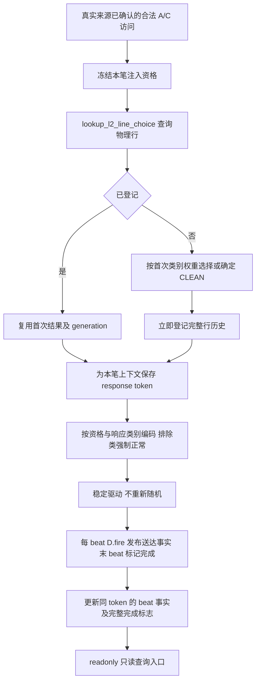

# V2 L2 全访问首次行结果冻结与 RM 只读查询方案

- 状态：`UNDO`，方案阶段，尚未修改或验证实现代码。
- 创建与修订日期：2026-11-10；按三方案最小适配评审修复首 beat、错误来源与基础分类契约。
- 评审基线：`AI_DOC/plan/rm_review_doc/undo/memblock_cmo_d_error_three_plan_minimal_adaptation_review_20261110.md`；复审状态由配套闭环评审记录，不以本文宣称实现通过。
- 适用版本与分支：V2 / `mem_ut_uvm_v2`。
- 方案类型：测试框架 L2 responder 响应建模、访问历史与只读观测契约。
- 主要源码：`mem_ut/ver/ut/memblock/seq/base_seq_help/mem_base_sequence.sv`。
- 只读接口：`mem_ut/ver/ut/memblock/seq/base_seq_help/memblock_rm_readonly_api.sv`。
- RM 协同源码：`mem_ut/ver/ut/memblock/env/src/memblock_rm/memblock_rm.sv`、`mem_ut/ver/ut/memblock/env/src/memblock_rm/rm_ls_core.sv`。
- 前置方案：`AI_DOC/plan/rm_plan/undo/memblock_rm_l2_dcache_sticky_error_ledger_plan_20260828.md`。
- 错误注入及 RM 分流的统一方案：`AI_DOC/plan/rm_plan/undo/memblock_nonvector_d_error_path_classification_plan_20261110.md`；CMO denied/corrupt、Uncache zero 分段效果及 Uncache 通知比较由该方案唯一实现。
- CMO 协同方案：`AI_DOC/plan/rm_plan/undo/memblock_cmo_blackbox_rm_coding_plan_20261103.md`。
- 保留当前文件路径；本次内容已由 GrantData 可选模式扩展为 L2 全访问统一行历史，取消 sticky 参数。本文取代前置方案中可关闭账本、正常行不登记、同一行后续重新抽取或升级错误的约定。

## 1. 定位、术语与抽象功能说明

本方案统一登记模拟 L2 的真实行访问。先按请求来源确认注入资格，仅当该物理行从未被登记且请求允许注入时，才按对应权重选择 CLEAN/CORRUPT/DENIED；首次排除请求直接登记 CLEAN。选择立即保存，后续访问不再随机；实际响应完成后保存事实，供 RM 在 DUT 写回提交后查询。

普通 cacheable Store 和 cacheable `cbo.zero` 在响应生成端无条件排除 denied/corrupt，实际 raw 位强制为0；已有错误行也不能绕过。其余由 MemBlock 消费错误的合法响应按统一方案支持参数化注入。Uncache zero 不属于此排除项，其逐段响应及部分写效果归统一方案处理。

测试框架本体实现响应生成、合法驱动、记录与查询，不实现 DUT 异常预测或数据正确性 checker。RM 的协作顺序、可消费字段及数据访问约束统一放在第 9 章；不在框架中反向读取 DUT 最终异常生成期望错误。

### 1.1 专有名词与抽象功能说明

| 术语 | 当前中文含义 | 代码对象或计划落点 | 示例 |
|---|---|---|---|
| physical line / cache line | 以物理地址 `PA[47:6]` 为键的 64B 行 | `dcache_line_addr_t` | `0x1000` 与 `0x1038` 属于同一行 |
| CLEAN | 已登记且首次选择无注入错误 | `L2_D_ERROR_NONE`，记录 `valid=1` | 后续同一行禁止再次随机 |
| CORRUPT / DENIED | 首次选择的数据损坏/拒绝响应属性 | `L2_D_ERROR_CORRUPT/DENIED` | 对应响应类别再编码为实际两个错误位 |
| weight | 某错误的百分比权重，范围 0～100 | `seq_csr_common` 的既有 getter | GrantData 与 CBOAck 分别使用原有权重 |
| GrantData / Grant | AcquireBlock 的数据响应 / AcquirePerm 的权限响应 | `dcache_response_record_t.kind` | GrantData 当前为两个数据 beat |
| CBOAck / ReleaseAck | CBO 操作完成响应 / 释放行的应答 | `DCACHE_PENDING_D_CBO_ACK/RELEASE_ACK` | CBOAck 自身错误要保留响应身份 |
| Probe / Release | L2 探测与 DUT 缓存行释放交互 | B/C 通道及 Probe/Release 完成路径 | C 通道上报的 corrupt 来源于 DUT，不是 L2 随机结果 |
| line history / map | 全生命周期的首次行选择记录数组 | 计划新增 `l2_line_history_by_line` 关联数组 | 正常行和错误行都保留 |
| pending / activated | 结果已选定尚未送达 / 相应响应已完成握手 | 行选择与分响应类别生效字段 | pending 已阻止重抽，但不构成已返回错误 |
| response snapshot / token | 单笔不可变响应快照 / 唯一响应编号 | 扩展 `dcache_response_record_t` | source 复用后，token 仍可区分两次响应 |
| generation | 该行首次选择的编号 | 共享单调计数器 | 同一行不同 token 复用相同 generation |
| source / alias | 总线请求身份 / 缓存别名元数据 | response、deferred request | 不作为物理行 key |
| A.fire / C.fire / D.fire | 相应通道 `valid && ready` 的真实握手 | responder 接受及完成路径 | 仅 valid、资源预检查不占首次选择机会 |
| beat / backpressure | 一拍数据传输 / 接收方未准备好而保持响应 | `beat_idx/beat_count/current_d_record` | D.ready hold 不重抽错误位 |
| sample / beat availability | DUT 全局采样序号 / 某 beat 已真实送达的时刻 | 每 beat 事实 | 首 beat 可消费不等待整笔响应完成 |
| data/error consumption / slot version | 本次数据或错误输入消费 / 被动缓存槽来源版本 | 统一错误方案的 observer | 正常新回填结束旧错误适用范围，首次选择仍保留 |
| deferred / alias conflict | 别名冲突处理后延后建立响应 | `deferred_acquire`、`complete_probe_record()` | 保存已分配 token，不把同一请求二次登记 |
| eligibility / provenance | 本笔注入资格 / 被动观测的请求来源依据 | 计划新增来源分类快照 | AcquireBlock 不能单凭 opcode 判断是 Load 还是 Store |
| reqSource / MSHR / transport generation | 既有请求来源字段 / 未命中事务槽 / 总线 source 本次占用代次 | A.user_reqSource、既有 A/D 生命周期 | Store来源即使合并Load仍保守正常，不重建完整MSHR来源 |
| owner / epoch | 当前指令动态身份 / 实例代际 | readonly UID、ROB、SQ/LQ、dynamic epoch | CBOAck 通过响应 token 关联当前 CMO |
| backing / overlay | RM 初始字节数据 / 程序顺序期望写效果 | `backing_byte/expected_store_byte` | 两类数据访问均在错误查询之后 |
| readonly / ledger_ready | 只读查询 / 账本是否初始化 | RM API / shared-memory lifecycle | 取消模式开关仍保留初始化状态 |
| lifecycle / reset / eviction | testcase 共享内存生命周期 / DUT 复位 / 缓存行移出 | 共享初始化与 responder runtime 清理 | redirect、Probe、eviction 不清首次选择 |

### 1.2 执行时序前提

RM 的本地数据查找由 DUT 实际写回并提交后触发，不存在 RM 在该指令尚未执行时提前读取或修改本地数据模型的设计。当前 `observer_process_current_commit()` 先检查 `status_view.rob_commit`，再捕获实际写回，之后才读取 backing、构造数据或提交写效果。

因此 RM 消费的是已执行操作的事后事实，不需要复制请求调度器或为了“RM 先行”新增等待状态机。fault 操作使用框架已有合法异常终态与实际异常完成证据，不能等待不存在的 normal pass；具体 fault 入口沿用对应 RM 方案。

该前提不取消按 sample 查历史：RM 可能较晚处理较早指令，当前数组里较晚生效的错误仍不能套用到较早访问。正常写回提交也不意味着该 Store 之后的所有后台 L2 写回均已完成，后台响应必须按自身身份记录，不反向伪造该指令的同步异常。

## 2. 当前缺口、目标及全访问边界

当前存在以下缺口：GrantData 正常候选不登记；账本可由 sticky 参数关闭而 responder 仍能注入错误；CBOAck 只保存临时字段，完成后清空；GrantData 缺少上游消费者资格过滤，可能错误地给普通 cacheable Store/cacheable zero 注错；Store/CMO 分路径处理与 Uncache 通知比较尚未闭环。现有 Load/原子路径的行查询与 Uncache Load 的 owner 历史不能等价于全路径覆盖。

目标：

1. 删除 `MEMBLOCK_L2_D_ERROR_STICKY_EN` 配置及所有关闭分支，行历史始终启用。
2. 所有被模拟 L2 实际接受的物理行访问都登记；先确定首次请求的消费者资格，允许注入时按对应权重选择结果；普通 cacheable Store/cacheable zero 及其它排除类型首次登记 CLEAN，不调用随机。
3. 后续同一物理行只复用结果，禁止 CLEAN 变错误、CORRUPT 升级 DENIED 或因 source/alias 改变再次随机。
4. 包括 CLEAN 在内的历史保存至 testcase/shared-memory 初始化；错误行不会因临时 response 被释放而丢失。
5. 框架提供按行、响应类别、sample 以及必要 response token 的只读查询。RM 按实际路径接入该契约；排除类型不被其它消费者的行错误阻断，具体见第 9 章和统一方案。

### 2.1 各通道登记规则

| 访问或事件 | 首次登记点 | 首次结果来源 | 后续处理 |
|---|---|---|---|
| 允许注入的 AcquireBlock → GrantData | 合法 A.fire 后建立响应 reservation，来源事实已有效 | 原 GrantData 两个权重 | 复用行结果，冻结实际 GrantData 位 |
| Store-origin（含 cacheable zero） → GrantData | 同一真实接受点 | 首次直接 CLEAN，不随机 | 已有错误选择仍回复 `0/0`，不覆盖旧选择 |
| CBO → CBOAck | 合法 CBO A.fire，Probe 等待之前 | 原 CBOAck 两个权重 | 保存 token；真实 CBOAck D.fire 后保留完成事实 |
| AcquirePerm → Grant | 合法 A.fire | 当前full_overwrite Store来源，首次登记 CLEAN | 按Store/zero排除保持正常，无数据响应不套GrantData corrupt |
| Release/ReleaseData → ReleaseAck | 首个已接受 C beat 建立请求上下文时 | 当前无该类随机注入，首次登记 CLEAN | 完整 C 收敛后构造 Ack，完成时保留事实 |
| ProbeAck/ProbeAckData | 与既有 Probe token 匹配的首个 C.fire | 仅登记/引用行历史，不随机 | DUT 上报 corrupt 单独记录，不能改变首次注入结果 |
| L2 主动 Probe 的 B.fire | 关联既有行和 Probe token | 引用已有记录；历史缺失按 CLEAN 补登记，不随机 | 不因探测或回复创建第二次选择 |
| E.fire / 缺少独立行地址的应答 | 由既有 source/sink/token 反查原行 | 引用原记录 | 不重新随机或生成新行身份 |

所有登记只发生在真实被接受的访问上下文，不能在 `can_accept`、仅看到 valid、随机选址、读取 backing 或 RM 查询时创建。多拍 C 请求只登记一次。alias conflict 的实际 A.fire 已固定结果和 token，延后路径复用，不能把内部重新进入接受 helper 当作第二次 A.fire。

### 2.2 跨响应类型复用的明确语义

行选择是测试框架施加的固定错误策略，单笔响应 raw 位是实际送达 DUT 的协议事实，二者分别保存：

| 响应类别 | CLEAN | CORRUPT | DENIED |
|---|---|---|---|
| 允许注入的 GrantData | `0/0` | `0/1` | `1/1` |
| Store-origin（含 cacheable zero） 的 GrantData | `0/0` | `0/0`，不继承错误 | `0/0`，不继承错误 |
| CBOAck | `0/0` | `0/1`，使用现有 corrupt 驱动能力 | `1/0`，只注入 denied |
| Grant、ReleaseAck、Probe、E 等无本方案注入能力的交互 | 保留原有实际位 | 不把行结果强塞进该响应 | 不把行结果强塞进该响应 |

表中数字顺序为 denied/corrupt。CBOAck 由原先两位独立采样改为 denied 优先的三类选择；两个权重非零时不再额外产生第四种随机组合。这里规定的是框架注入策略，具体错误如何在 DUT 外显由 RM/RTL 专项确认，不在框架内硬编码为同一异常。

例如首次 ReleaseData 已登记 CLEAN，后续 GrantData 不再抽错误；首次 CBOAck 选 DENIED，后续允许注入的 GrantData 复用 DENIED；Store-origin 的 GrantData 仍回复正常；首次 GrantData 选 CORRUPT，后续 ReleaseAck 仍保持原有合法 Ack，而不是携带不支持的 corrupt。每次实际响应字段另存，RM 不根据行选定状态猜测某次响应位。

### 2.3 复用 reqSource 的基础分类

直接使用既有 `auto_inner_dcache_client_out_a_bits_user_reqSource`。当前权威枚举位于`utility/src/main/scala/utility/TLUtils/BusKeyField.scala`：CPULoadData=2、CPUStoreData=3、CPUAtomicData=4、L1DataPrefetch=6；在现有公共协议类型处定义一次编译期枚举复用，不新增runtime plus镜像，禁止各helper散落magic number。该字段已经在 interface、xaction、monitor 与 connect 接出；在 responder 的 A 采样快照补足复制。Acquire opcode和source编号仍不能单独分类，不能按地址扫描主表猜来源。

- `CPUStoreData`：包含cacheable zero及可能合并Load的Store来源请求，均强制正常，不随机。
- `CPULoadData/CPUAtomicData/L1DataPrefetch`：响应协议允许时复用GrantData权重。
- CBO opcode：独立使用CBOAck能力和权重；未知或矛盾来源编码明确报协议/关联错误，不默认为允许注入。

请求在真实A.fire冻结 `reqSource`、source当前传输generation和结果，代次由既有A接受/D完成生命周期分配，DCache/MSHR内部来源关系不作为基础注入前提。Store-origin保守正常只减少部分合并场景的错误覆盖，不取消Load/原子/预取各类注错能力。A.fire后任何合并都不改变本笔冻结raw位。

本轮不实现“Store来源在接受前合并Load也必须注错”的额外覆盖，也不增加该模式参数；若未来明确新增此目标，另补最小需求消费者事实。RM判断本次错误仍需实际消费来源，不能用reqSource替代该证明。Uncache使用独立接口、权重与owner历史，不合并进L2行选择集合。

## 3. 参数删除与按权重首次选择

### 3.1 取消 sticky 参数

后续 coding 同一轮删除以下内容，不保留 runtime 兼容开关：

- `env/plus.sv` 的 `MEMBLOCK_L2_D_ERROR_STICKY_EN` 定义和解析。
- `seq_csr_common.sv` 的同义字段、赋值及 `get_l2_d_error_sticky_en()`。
- `seq/plus_cfg/default.cfg`、所有 preset、`seq/seqlib`、`seq/csr_scalar_stress/cfg` 等实际引用中的旧 key。
- 共享账本的 `l2_d_error_sticky_enabled`、reset 的开关入参、query 的开关输出，以及 readonly view 的 `sticky_enabled` 字段和日志。
- prepare、commit、query、responder 中关闭记录或逐笔重抽的分支。

初始化状态 `ledger_ready` 独立保留；未初始化属于查询/生命周期错误，不等于历史未命中。权重仍默认 0，不新增 env cfg、user_ctrl、编译宏或新的启用参数。参数说明同步到 `AI_DOC/project_management/mem_ut_parameter_management.md` 等现有引用；本轮只修改本方案，源码与规则同步列为 coding 工作。

### 3.2 复用既有权重

| 首次请求类别 | denied 权重 D | corrupt 权重 C |
|---|---|---|
| 允许注入的 GrantData | `MEMBLOCK_L2_GRANTDATA_DENIED_WT` | `MEMBLOCK_L2_GRANTDATA_CORRUPT_WT` |
| CBOAck | `MEMBLOCK_L2_CBO_ACK_DENIED_WT` | `MEMBLOCK_L2_CBO_ACK_CORRUPT_WT` |
| 普通 cacheable Store/cacheable zero 及无注入能力访问 | 0（不采样） | 0（不采样） |

权重通过既有 `plus.sv -> seq_csr_common -> getter` 读取，范围均为 `[0:100]`，默认均为 0。首次类别决定采用哪组权重；之后即使响应类别变化，也不重新读取另一组权重进行抽取。

```text
先用真实消费者来源确认本笔注入资格；未知来源报告关联错误。
只有行历史不存在时：
  按 D 权重判断 denied；命中选择 DENIED。
  denied 未命中时，按 C 权重判断 corrupt；命中选择 CORRUPT。
  两者未命中选择 CLEAN。
  无注入能力的首次访问直接选择 CLEAN。
  立即保存选择、首次类别、sample 和 generation。
已有行历史：直接复用，不执行任何错误权重采样。
本笔排除：实际 raw 位始终0，不因复用错误选择而注错，也不改写既有选择。
```

概率为 `P(DENIED)=D/100`、`P(CORRUPT)=(1-D/100)*C/100`、`P(CLEAN)=(1-D/100)*(1-C/100)`。D=10、C=20 对应 10%、18%、72%。D=C=0 全部 CLEAN；D=100 全部 DENIED；D=0、C=100 全部 CORRUPT。

“一次随机”指每行一轮有条件的选择，最多调用两次既有 `sample_d_error_enable()`；0/100 权重保持确定返回。命中行历史时两次采样均跳过。

## 4. 数据结构、历史数组与生效边界

### 4.1 单一完整行历史

`l2_line_history_by_line[dcache_line_addr_t]` 是首次选择唯一真源，替代原pending/live两张选择map。每行保存 `valid/selected_state/line_generation`、首次类别/sample/source/reqSource及权重来源；CLEAN也立即登记。reset、失效、替换和新正常refill均不改变此选择。

按类别的首次完成/首次错误sample可以保留作日志摘要，但不得直接输出“本次Load/原子应fault”。错误是否适用由统一方案的实际消费事实及来源版本决定，不能以 `first_error_sample <= WB_sample` 代替。

### 4.2 单笔响应与每 beat 历史

扩展既有 `dcache_response_record_t`：保存单调唯一response token、reset epoch、source传输generation、line generation、接受sample、reqSource/排除原因及冻结raw位。line generation表示首次选择代次，不能代替source传输generation。

在唯一 `l2_response_history_by_token[token]` 中保存请求身份、固定大小beat数组/有效mask和整笔完成标志。GrantData当前最多2个beat；每个beat保存实际D.fire sample、物理半行/byte mask、实际raw位及echo关键词顺序。首beat实际接受即发布该数组元素；末beat再标记整笔完成，不另建一套错误选择表或重复payload历史。

`beat byte mask` 按当前 beat 序号和冻结 `echo_isKeyword` 对应的真实物理半行计算，不能固定第0beat必为低32B。有效位和raw位在每个D.fire后原子发布；D hold不发布新事件。普通单beat Ack同次更新beat元素和完成标志。

CBOAck在真实CBO请求接受时复用CMO被动请求链，冻结UID/ROB/SQ/epoch与token索引；不能在D.fire借用当前source猜owner。Probe回复使用单独子token与父Probe/CBO关联，不能覆盖CBOAck历史；B/E仅引用原上下文。

完整记录随临时response释放仍保留。按token/generation/beat查询为常数次访问；历史不每拍全表扫描。正常refill记录也保留，以便统一observer建立raw=0的新来源版本。

### 4.3 登记、驱动、beat送达与整笔完成

```text
真实A/C接受 → reqSource/类别确定资格 → 查唯一行选择 → 未见行立即选择或登记CLEAN
分配token/source传输generation → 冻结raw与关键词顺序 → 稳定驱动
每次真实D.fire → 同token对应beat有效、sample/覆盖范围/raw可查询
最后beat → 在既有beat事实基础上标记完整response完成
RM事后按实际消费token/beat/sample查询，或由cache-hit来源版本引用这些事实
```

首beat已完成是实际送达事实，不能把它与尚未送达的pending候选混同；Load可以先于末beat消费错误。完整response未完成不阻止已送达beat被查询。仅valid、A.fire候选或D hold均不构成已消费错误。

DUT reset终止未完成传输、标记reset代际；已送达beat保留诊断但不得授权新代际访问，首次行选择继续保留。新testcase/shared-memory初始化才清空选择、响应历史及索引。失效/clean替换如何结束旧数据错误适用范围归统一observer，只改变消费来源版本，不清行选择。

## 5. 测试框架主流程



整体文字伪代码：

```text
真实请求被接受前取得有效来源，接受点冻结注入资格，再查行历史及进行首次选择；后续数据与 Probe 调度只消费冻结结果。
GrantData、CBOAck、Grant 及 C-channel 首次上下文使用同一个物理行查询入口。
未命中时按首次类别取得权重并完成选择，在任何等待或 fork 前登记；命中就复用。
为每笔请求保存token、行选择generation、source传输generation、reqSource、方向、接受sample与必要owner关联。
按本类能力构造 raw 位：排除类强制 raw 位0，无注入能力的其它响应保持合法字段，不新增错误、不重抽。
CBO hit 的 Probe 和 alias conflict 的 deferred 请求保留原 token，不二次登记。
每beat实际接受就保存送达事实；末beat标记整笔完成。临时response释放不影响历史；方向和类别不能互相冒充。
readonly 查询只读取已生效事实，不随机、不创建记录、不推进 DUT 或 RM。
```

## 6. 关键函数修改计划

本章函数的新增名称均标注“计划新增”；描述的是未来实现，不宣称当前源码已实现。生产路径保持单 key map 查询和既有有界队列，不引入每拍完整历史扫描。

### 6.1 `mem_access_base_sequence::sample_d_error_enable()`：复用

**抽象功能描述：** 在首次行结果选择期间，根据既有百分比权重产生布尔候选；它不保存行历史，不判断是否允许重新随机。

**源码级伪代码：**

```text
weight > 100：报告参数错误。
weight=0/100：分别返回 0/1。
其它权重：std::randomize(enable)，使用 enable dist {1:=weight, 0:=100-weight}。
随机失败报告错误，否则返回 enable。
```

**中文详细伪代码：** 保持原有 helper。调用者只在物理行未登记时使用它，先判断 denied，再按需判断 corrupt；命中历史时完全跳过两个采样调用，不增加三类等概率选择器。

### 6.2 `mem_access_base_sequence::lookup_l2_line_choice()`（计划新增）：统一首次登记

**抽象功能描述：** 由真实接受路径在建立访问上下文时调用，为当前物理行取得全生命周期唯一选择，并阻止后续访问再次采样。

**输入/输出：** 输入物理行、首次访问类别、实际接受 sample/source 及已选候选；输出 choice、generation、needs_candidate。为便于复用既有两阶段调用，candidate_valid=0 表示先查询是否需要选择。

**源码级伪代码：**

```text
要求 ledger_ready 和合法物理行 key。
若 line_history.exists(key)：返回已有选择及 generation，needs_candidate=0。
若无候选：needs_candidate=1，返回，不插入默认 CLEAN。
否则要求候选属于 CLEAN/CORRUPT/DENIED，分配非零 generation。
保存 valid、首次类别、sample/source 和候选，立即 line_history[key]=record。
返回所选结果；本函数内无时钟等待。
```

**中文详细伪代码：** 未命中才授权调用者使用当前类别权重生成候选；两阶段调用和中间采样连续完成，不插入 driver、等待或 fork。本笔排除或无注入能力类别直接提供 CLEAN。CLEAN 与错误都分配 generation 并插入；不能把 NONE 当成未访问。把原 `prepare_l2_d_error_for_grant()` 的首次选择逻辑迁入本入口，更新所有生产/自测调用，不保留另一套 GrantData 私有真源。

### 6.3 `dcache_mem__access_base_sequence::accept_dcache_a_request()`：统一 A 请求上下文

**抽象功能描述：** 在真实 A 请求接受后，取得固定行结果并建立带身份的响应上下文，后续由现有队列或 Probe/deferred 流程完成驱动。

**源码级伪代码：**

```text
保留合法性与资源检查；采样既有A.user_reqSource并验证编码。
真实A.fire按既有传输生命周期分配source generation，冻结reqSource分类，随后按物理行lookup。
若需要候选：允许类按 GrantData/CBOAck 对应 getter 选择；Store-origin/Grant 直接 CLEAN；立即登记。
建立 response token，保存接受 sample、行 generation、reqSource与owner关联。
按本笔资格和响应能力编码 raw 位；排除类无条件为0，旧行错误不覆盖此限制。
alias conflict：把选择与 token 放入 deferred 上下文；Probe 后只恢复响应构造。
CBO：在启动 Probe 前冻结 context 及响应 raw 位，沿用 token。
普通响应：按能力编码 raw 位并 enqueue，之后调度和 D hold 均不重新随机。
```

**中文详细伪代码：** 行结果确定前不进入会等待的 Probe 或别名路径。deferred helper 再次调用内部构造流程时带已有 token，不能再次执行“真实接受”登记；真正新请求即使同 source 也分配新 token。`enqueue_pending_cbo_ack()` 只将 CBO context 转为 response record，复制行选择、token 和原始错误位，不在此补随机。

### 6.4 `dcache_mem__access_base_sequence::accept_dcache_c_beat()`（计划新增）：统一 C 访问登记

**抽象功能描述：** 在首个已接受的 C beat 建立或关联访问身份，使 Release/Probe 回复也参与行访问历史；完整数据仍由原有收集路径处理。

**源码级伪代码：**

```text
首 beat：解析实际物理行，关联 Probe/Release owner。
查询 lookup；未访问行提供 CLEAN 候选并立即登记，不调用错误随机 helper。
保存本次上下文 token；后续 beat 复用，聚合实际 C corrupt 字段。
收齐后交给 complete_probe_c_assembly/complete_release_c_assembly 处理原数据写回。
需要 ReleaseAck 时复制 token 和 generation；不把 C corrupt 写成首次注入结果。
```

**中文详细伪代码：** 接入现有 C-channel fire/assembly 路径，不能等末 beat 才登记，从而防止期间同一行 A 请求抢先抽错。DUT→L2 的 C corrupt 记录方向，不成为 L2→DUT 的 denied/corrupt 期望。Probe 回复优先引用已有 Probe/行身份，B/E 沿已有 token 关联，不另建随机入口。

### 6.5 `mem_access_base_sequence::complete_l2_response_history()`（计划新增）：整笔完成

**抽象功能描述：** 在响应最后一次真实握手后，确认同token的各beat事实齐全并封闭完整记录；不决定Load何时已经消费数据错误。

**源码级伪代码：**

```text
核对token、reset/source generation与当前响应上下文一致。
要求预期beat有效mask齐全；重复完整完成则报告基础生命周期错误。
保存full_complete与最后D.fire sample，不覆盖此前beat sample/raw。
更新只用于诊断的首次类别完成摘要，释放临时response。
```

**中文详细伪代码：** `process_d_fire()`先经第6.9节发布当前beat，再在末beat调用本函数。CBOAck同样留下完整历史后才能释放context；旧的仅GrantData commit wrapper迁入此路径。完整记录与首beat可消费事实分别表达不同阶段，不能把最后sample写回所有beat。

### 6.6 `mem_access_base_sequence::query_l2_line_history_at_sample()`（计划新增）：只读选择与传输事实

**抽象功能描述：** 查询首次行选择的诊断状态，以及指定响应token/beat在目标sample是否实际送达；不以永久行摘要预测本次指令异常。

**输入/输出：** 输入line、类别、sample与可选token/beat mask；返回query_ok、line_seen、beat_found/full_complete、raw与各beat sample。没有token的行查询只返回选择/诊断，标记 `consumption_proven=0`。

**源码级伪代码：**

```text
未初始化/参数非法：query_ok=0。
line不存在：line_seen=0，不创建记录。
line存在：返回固定选择与generation，仅供诊断。
未指定token：consumption_proven=0，不输出本次指令error_active。
指定token：按key验证line、方向、类别、reset/source generation与必要owner。
逐个请求beat核对有效mask、实际覆盖范围与beat_sample<=consume_sample。
未送达beat或错身份：返回明确缺失/错配；已送达CLEAN也是合法事实。
返回该token相应beat原始位，不要求整笔full_complete。
```

**中文详细伪代码：** 对D/MSHR转发，统一RM用实际消费来源token/beat调用本入口；对cache hit，由统一observer的slot来源版本引用origin记录。`read_l2_d_error_for_rm()`改为该无开关事实包装；旧的仅PA/sample布尔错误接口不得继续作为异常oracle。CBOAck查询要求整笔完成，Uncache仍走独立owner/token历史。

### 6.7 `mem_access_base_sequence::reset_l2_line_history()`（计划新增）：初始化与清理

**抽象功能描述：** 在 testcase/shared-memory 初始化边界开始新的行选择生命周期，清空完成事实和关联索引；不作为逐笔事务、redirect 或普通 DUT reset 的清理入口。

**源码级伪代码：**

```text
清空 line_history、response_history、owner→token 索引。
重置行 generation 和 response token 分配器，标记 ledger_ready=1。
initialize_shared_memory_state 清理共享数据后调用本函数，不传 enable 参数。
普通 DUT reset 只中止未完成 response 上下文并标记代际，不删除已选行结果。
```

**中文详细伪代码：** 取代带开关的 `reset_l2_d_error_ledger()`，同步改结构字面量和所有测试入口。`clear_shared_memory_state()` 仍可整体清空并标记未初始化；只有完整初始化后才能接受请求。旧 reset 代际的响应不能发布为新 owner 的事实；保留行选择确保复位后也不重新抽取。

### 6.8 `dcache_mem__access_base_sequence::classify_response_error_injection()`（计划新增）：复用既有来源

**抽象功能描述：** 在接受点根据既有reqSource和响应类别确定注入资格与权重，避免重建MSHR合并模型。

**源码级伪代码：**

```text
先识别合法CBO opcode，返回CBOAck权重与协议能力。
普通Acquire：验证已接出reqSource编码。
CPUStoreData：返回EXCLUDED，不调用随机，raw强制0。
CPULoadData/CPUAtomicData/L1DataPrefetch：返回GrantData既有权重与能力。
其它无注入能力响应保持正常；未知/矛盾编码明确报错。
调用者查唯一首次行选择并冻结本笔结果及传输generation。
```

**中文详细伪代码：** responder补复制现有A.user_reqSource即可支持基础分类；generation沿既有A/D传输生命周期。Store来源包括已合并Load的情况仍保守正常，不增加混合注错参数。分类与CMO被动owner队列不同职责，后者仍用于真实请求及响应比较。

### 6.9 `mem_access_base_sequence::publish_l2_response_beat_history()`（计划新增）

**抽象功能描述：** 在每个真实D.fire时发布已送达beat的不可变事实，使RM可以核对早于末beat的错误消费。

**输入/输出与副作用：** 输入冻结响应上下文、beat序号和真实sample；只更新同token预分配beat元素及有效mask，不修改选择、内存或指令状态。

**源码级伪代码：**

```text
核对当前响应token/source generation/reset epoch，计算真实物理beat覆盖范围。
当前beat已有效：报告重复D.fire；否则复制raw、sample、beat mask并置有效位。
按token原子发布；已发布元素不能因D hold/调度重入而变化。
若本次是末beat，交complete入口核对全mask并封闭；否则保持partial记录可查询。
```

**中文详细伪代码：** 使用冻结关键词顺序映射高低半行；同sample内先写完元素再推进发布水位，RM只在生产者水位已覆盖时判记录缺失。首beat实际fire后即可核对相应Load，无需等第二beat；尚未fire的另一半行仍不可查询。与统一方案的被动实际消费observer共享token关联，不复制payload或新增调度器。

## 7. 框架验证与兼容迁移

本章只验证激励与记录的合法性、自洽性。RM 协同检查在第 9 章，不以 DUT 是否外显某个异常作为本章通过标准。

| 检查项 | 构造方法 | 框架判据 |
|---|---|---|
| Store/zero 硬排除 | GrantData 权重100，Store-origin 首次及命中已有错误行 | raw 位0且不采样；首次登记 CLEAN，已有选择不覆盖 |
| reqSource与合并请求 | 四类reqSource、Store来源合并Load、source复用 | Store来源保守正常，其它按能力；代次匹配，不需MSHR合并观察 |
| 同行不同实际响应 | 旧错误响应后，同PA Store来源正常refill | 选择保持；两个token各自raw可查，正常记录不继承旧响应位；RM消费版本检查见协同方案 |
| 无开关账本 | 不传 sticky 参数，GrantData 错误权重非零 | 仍登记选择和实际完成错误；不存在关闭记录分支 |
| 全 CLEAN / CORRUPT / DENIED | D/C 分别 0/0、0/100、100/任意 | 首次按权重得到确定结果 |
| 非端点权重 | 多个新行 D=10、C=20 | 顺序百分比语义 10%/18%/72%，不等概率三选一 |
| CLEAN 即时登记 | 第一笔正常，完成前再接受同一行 | 复用 CLEAN 和 generation，不再次随机 |
| 错误即时登记 | 第一笔错误尚在等待 Probe 或 D.ready | 任何同一行后续访问都复用选择 |
| 首次类别权重 | 分别以 GrantData、CBOAck 首次访问 | 使用对应 getter；后续换类别不再抽取另一组权重 |
| 无注入能力首次访问 | Grant 或 ReleaseData 首次触及该行 | 登记 CLEAN，后续 GrantData 不再随机 |
| 跨类编码 | CBOAck DENIED 后 GrantData；GrantData CORRUPT 后 ReleaseAck | 复用语义，实际 raw 位按第 2.2 节生成 |
| C/B/E 关联 | 多 beat C、Probe 回复、GrantAck | 每个上下文一次登记，方向与原 token 正确 |
| alias conflict | A.fire 后等待 Probe 再构造 deferred response | 保留首次 token，不二次接受或抽错 |
| 重排/source重用 | 同行多笔响应重排 | token及source代次唯一，每笔beat事实保留，不相互覆盖 |
| hold/多beat | 首beat已fire、第二beat长时间反压 | 首beat事实立即可查，另一beat不可查；完整完成仍等末beat |
| CBOAck 留存 | D.fire 后释放 CBO context | token 完成记录仍可查询，正常和错误都保存 |
| 时间查询 | 消费sample早于/等于/晚于目标beat | 按各beat实际送达过滤，末beat晚于WB不吞首beat错误 |
| CLEAN查询 | 指定正常响应token与已送达beat | line_seen=1且该token raw=0；仅行诊断不能冒充消费证明 |
| 查询失败 | 未初始化、错 token、错 owner/generation | 明确错误或证据缺失，不静默当正常 |
| 生命周期 | reset/redirect/Probe/eviction 后访问；新 testcase 初始化 | 前者不重抽，新 testcase 清空重新选择 |
| Uncache 隔离 | 相同 PA 在独立 Uncache 接口访问 | 继续按原 owner 历史返回，不混用 L2 行错误 |

保留既有 `soft_test_rm_provenance_followup_sequence`、`memblock_rm_provenance_followup_directed_vseq` 作为可复用自测入口。纯测试 wrapper 放在 soft test 内，不向公共 helper 添加只为测试服务的控制 API。确定性检查涵盖行命中不再采样；非端点概率不要求小样本严格等于理论百分比。

旧自测中的 CORRUPT→DENIED 升级、generation=0 直接 commit、reset(enable) 和 sticky 关闭分支必须迁移：不同错误用不同物理行，先登记再实际完成，同一行冲突结果作为负向框架检查。检索范围包含所有调用者和结构字面量，不只改一处测试。

实际新增子场景时按规则更新 `AI_DOC/seq`：soft/framework 与真实 DUT 使用独立 CSV，逐项登记用途与执行状态；可复用现有清单，否则后续新增本 feature 的分类 CSV。本轮只修改方案，不创建不存在实现的通过记录。

## 8. 实施文件、顺序与验收

| 对象 | 后续 coding 工作 |
|---|---|
| `mem_ut/ver/ut/memblock/seq/base_seq_help/mem_base_sequence.sv` | 首次随机前来源分类与硬排除、统一所有 L2 访问登记、首次权重选择、跨类响应编码、token 完成历史、无开关查询与 lifecycle |
| `mem_ut/ver/ut/memblock/seq/base_seq_help/memblock_rm_readonly_api.sv` | 删除开关字段，暴露行/响应类别/sample/token 只读事实，保留 Uncache owner 查询 |
| `mem_ut/ver/ut/memblock/env/plus.sv`、`mem_ut/ver/ut/memblock/seq/base_seq_help/seq_csr_common.sv` | 删除旧参数、getter、赋值和解析；保留现有百分比权重 |
| `mem_ut/ver/ut/memblock/seq` 下所有 cfg/preset | 删除旧 sticky key，包含 seqlib 和 csr_scalar_stress 等非 plus_cfg 目录 |
| 既有 soft test、vseq 与 `AI_DOC/seq` | 迁移旧调用/断言并增加实际实现子场景记录 |
| CMO framework 与 RM 关联文档 | 同步响应 token、错误获取契约及第 9 章的提交后查询顺序 |
| 前置 sticky 文档与参数说明 | 同步账本始终启用、首次正常也冻结、响应类别及历史查询语义 |

实施先复用reqSource分类和既有source生命周期，再建立统一行历史和 token 生命周期，再改 A/C/deferred/Probe 与所有完成入口，然后删除参数及关闭分支、接 readonly API，最后迁移测试。RM 侧按第 9 章的接口契约在对应 RM coding 范围落实；当前 CMO、Vector 与完整预取性能模型不能因新增 API 就标记已支持；Prefetch 响应注入及错误抑制按统一方案完成。

后续源码修改须取得明确 coding 授权，编译仿真遵循 eda01 远端规则。本轮不编译或仿真。实现后先运行框架自测，再验证真实响应驱动及既有标量/原子路径，结果写入相应 CSV。

验收要求：

1. 代码和 cfg 不再存在 sticky 启用参数、getter 或绕过记录的运行期分支；账本未初始化仍可明确诊断。
2. 所有 L2 行访问都参与统一历史，首次按对应类别权重或确定 CLEAN 选择，后续无论类型/source/alias 均不重抽。
3. CLEAN、CORRUPT、DENIED 都保留，临时响应完成或 reset 不丢首次选择，不存在第二套独立选择表。
4. 普通 cacheable Store/cacheable zero 无条件不注入，权重100或已有错误行不能绕过；reqSource在A.fire冻结，Store来源含合并消费者也保守正常。实际响应位与类别匹配；CBOAck、GrantData 等完成事实均保留，DUT→L2 corrupt 不冒充 L2 注入。
5. 行选择与响应实际完成分离，RM 查询按 sample/类别/token 返回正确事实，不能只返回当前选定状态。
6. 初始化失败、明确应有响应记录缺失与正常未命中可区分；没有“DUT 收到错误但记录机制关闭”的配置组合。
7. 运行期按单 key 或既有有界队列操作，无每拍历史全表扫描；完整token与beat事实一致，行摘要不冒充消费资格。
8. 参数删除、自测迁移、CSV 和相关方案/说明同步完成后，执行必要远端验证才登记实现通过。
9. 第 9 章的 RM 接口契约与后续 RM 方案一致，特别是 CLEAN 放行、读写前查询、实际异常比较和操作类型区分。

## 9. RM 协同支持：写回提交后先查错误，再访问数据模型

本测试框架 plan 不实现 RM/checker/scoreboard 的异常预测算法；本章是已确认的后续 RM 接入契约，提供观测字段、消费顺序及覆盖清单。框架完成记录能力不等于所有 RM 操作已经实现，需要与对应 RM coding 同步闭环。

### 9.1 分路径消费契约

RM 在实际写回提交或合法 fault terminal 后，取得当前 owner、翻译/权限结论及实际路径，再查询适用的已完成响应。正常数据访问之前完成适用的错误处理；这不要求普通 Store/cacheable zero 消费其它请求的错误行。NC Store 后台响应检查使用独立服务，不阻塞已提交指令的程序游标。

框架提供query_ok、line_seen、每beat有效mask、sample/token/source代次及full_complete；无消费token的行查询只能返回诊断。CLEAN响应正常放行；本次消费资格由统一observer证明，不能依据首次行状态或永久activation推断；明确应有响应却缺记录时单独报告证据缺失，不能反读 DUT exceptionVec 当作预期。历史查询不随机、不创建记录、不推进 DUT 或 RM。

### 9.2 协同范围与唯一归属

| 操作 | 框架提供的事实 | 对应 RM 落点 |
|---|---|---|
| DCache Load / 原子 | 同token每beat送达事实、实际消费owner/attempt/sample与被动slot来源版本，独立CSR enable | 统一 denied/corrupt 方案；保留跨行/跨页来源 |
| 普通 cacheable Store/cacheable zero | 排除资格与本笔正常 raw 位、合法完成事实 | 保留正常数据语义；不以其它请求行错误取消写入 |
| non-zero CMO | CBOAck owner→token 及完成 raw 位、STA事实 | 统一 denied/corrupt 方案唯一处理响应错误，CMO plan 接入结果 |
| Uncache Load/Store/zero | 独立请求/响应 token、owner/分段、后端接受 mask、D.fire sample | 统一方案实现异常、分段效果及 Uncache 错误通知比较，不用 L2 行表替代 |
| Prefetch | 实际来源及允许注入的GrantData token/raw位 | 统一方案处理软件预取异常抑制及硬件预取事实，不取消参数注错 |
| Vector 等 | 记录真实来源，不冒充已支持模型 | 本方案不宣称完成其完整 RM |

普通 cacheable Store/zero 排除只约束对应请求；基础分类按reqSource，Store来源的合并消费者也保持正常；不把额外混合注错覆盖作为基本前置。查询时不能仅凭当前 selected_state 认定本笔收到了错误。

### 9.3 数据效果与错误通知衔接

本 plan 不需要实现 RM/checker/scoreboard。响应异常映射、原子门控、STA/terminal 比较、Uncache zero 部分写效果和 `io_uncacheError_ecc_error_valid/bits` 逐事件比较均归统一 denied/corrupt 方案，本文仅提供可消费事实。

成功 cacheable zero 保持一次64B overlay。Uncache zero 错误时，独立后端写接受事实决定已确定的8B分段效果，不能套用“fault整行不变”；框架保留逐段请求、响应和写事件关联，不在 responder 中生成 expected exception。响应结果选择与真实写效果分别记录。

RM 不生成 redirect、`UID+1` 恢复、epoch 或重发。实际实现和用例验收分别归对应 RM plan，框架完成记录能力不能标记为 RM 已完成。

## 10. 功能覆盖率协同支持

本 plan 不需要实现 coveragent/covergroup。后续组件可使用首次类别、首次行结果、权重、跨类复用、真实 raw 位、token/owner 关联和beat availability等字段；不把覆盖率命中作为框架激励合法性判据。
