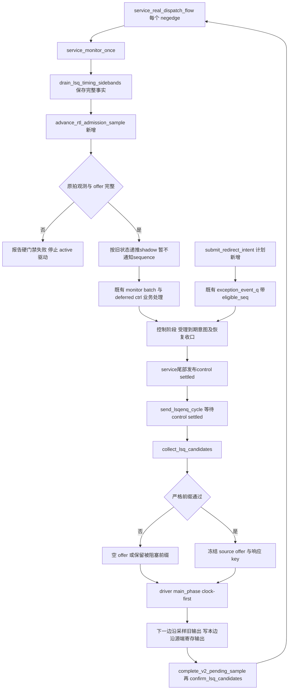

# MemBlock V2 真实 RTL 等价 LSQ 准入正式方案

状态：2026-11-02补充取消路径方案，本轮独立静态review通过；未coding、未编译、未仿真。原两项阻断已转成第3.4、5.5、6.4/6.5章的确定设计：按采样编号统一受理flush、service尾部发布控制结算、按真实流水回补并与软件释放分离。本轮保持既有单飞单脉冲redirect范围，不宣称框架已支持多次取消重叠；该扩展及动态验收未完成，不能标整个框架等价PASS。创建日期：2026-10-31。

基线：工作区 `.codex_mother_integration_20261028`，HEAD `e275e8819b11b2329f01f9788c47655e8711d107`。本轮只写本文档，不新增worktree、不改生产代码或已有脏文件，不git add/commit。已完成B05动态报告为`AI_DOC/analysis/framework_design/memblock_b05_rob_sq_lifecycle_recheck_20261031.md`（Mencius），第8/10章引用其证据限制；报告不能替代本方案两项门禁。

## 1. 定位、术语与抽象功能职责

本方案构建被 MemBlock 单元测试裁掉的上游 LSQ 准入行为，生成真实 Scala/RTL 路径能够产生的请求序列。模拟对象是 `NewDispatch` 的标量 LSQ 投影与 `LsqEnqCtrl` 的逐拍状态机，不预判当前故障根因。

| 术语 | 本文中文含义与状态落点 | 例子或约束 |
|---|---|---|
| LSQ / LQ / SQ | 访存队列及加载、存储资源，宏容量分别 72、56 | 入队宽度分别 6、4，总槽数 6 |
| admission | 上游接受有序前缀并产生下一流水级请求 | 不等于找到空位 |
| credit / shadow | 计划新增上游寄存信用 `shadow_lq_credit/shadow_sq_credit` | 对应 RTL counter，不能直接取软件 free |
| registered canAccept | 上一拍条件计算后寄存的许可 `shadow_can_accept` | 本拍 deq 不能组合旁路成为本拍许可 |
| accepted alloc | 源端当前边沿真正接受的 LQ/SQ 元素数 A_L/A_S | 只在许可且无 redirect 分支扣减 |
| toLsq | 源端寄存输出，即 MemBlock 当前周期输入 | 下一边沿才由 MemBlock 采样 |
| batch / prefix | 单次接受的有序请求组及首阻塞槽前的前缀 | 不越过阻塞 uid 挑选后项 |
| iqAccept | 原设计 rename 槽为空或 fire 的资格 | 首个 false 决定累加边界 |
| needAlloc | LQ/SQ 类别编码，与 req.valid 分开寄存 | 1=LQ，2=SQ；t2_update 检查输入全零 |
| launch / sample | driver 边沿后写 VIF / 下一边沿 DUT 采样 | item_done 只说明 launch |
| reservation | 既有 `lsq_ctrl_model` 软件预留和资源 key 所有权 | launch 扣一次，真实 deq 或取消终结回收一次 |
| pending sample / token | 已 launch 未经过下一采样的单深度批次及实例标识 | 复用 `pending_sample_*`、`{uid, launch_epoch}` |
| owner / active map | 资源 key 到仍持有物理资源实例的既有映射 | 已提交 SQ 等待排空仍有 owner |
| epoch | 既有 flush 或 reservation launch 代际 | 不能替代真实 sample_seq |
| sample_seq / edge | 同一 DUT 采样边沿共享单调编号 / 真实边沿 | CSR monitor 拥有编号权威 |
| raw ctrl / deq | DUT 每拍控制快照 / 真实物理出队 | 采用 lqDeq/sqDeq，不用 ROB commit 预测 |
| t1/t2/t3 | LsqEnqCtrl 的 redirect/更新流水级 | 全部读旧状态后同时提交 |
| cancel record | 既有按 redirect 实例归属的取消记录 | 软件回退和源端 t3 回补分别只做一次 |
| cursor | 既有 admission/commit 有序游标 | 高频只看至多 width 个候选 |
| B05 resolver | STD value-only写回身份解析，见probe_std_candidate/resolve_std_uid_by_rob_value_only | 与deq/cancel的资源owner解析链分开，本方案均不修改 |
| idle / bubble | 无源端接受请求的真实空拍 | 仍推进信用、许可、redirect、sample |
| offer / bundle | 当前边沿的冻结源端输入 / 保持稳定的原始槽窗口 | bundle有valid但IQ阻塞时，offer.req.valid仍可全零 |
| lane / pipe / capture | 固定物理槽 / rename到dispatch的寄存组 / 合法边沿捕获新组 | partial只清对应valid，不移动uid或bits；新组须canAcc |
| renameIn / renameOut | 前级解码类别投影 / rename后送PipeGroupConnect的输入 | 本受限标量轨迹选择无fusion/move、资源可用，使有效槽与类别逐lane对应 |
| R / Q / D | 前级decodePipeRename寄存投影 / PipeGroupConnect固定lane状态 / 本边沿前级decode输入 | R的valid清零时bits保持，D无效槽明确给非Store |
| phase / settled | 输出有效性阶段 / 同sample全部字段已冻结完成 | 不是TLB barrier的新增参与者 |
| VLS / AMO / STD | 向量访存 / 原子操作 / store数据发射目标 | 本文不扩VLS；STD屏障保持原语义 |
| cancel sample / level | 指定边沿采到的取消量 / DUT持续保持数值 | 是否回补由t3_update决定，不要求计数数值变化或软件新事件 |
| intent / cutoff | 尚未生效的redirect意图 / 按采样编号确定的本轮受理截止 | 复用exception_event_q；sample n期间提交的意图最早N[n+1]受理 |
| shadow settled / control settled | 硬件状态递推已完成 / 本轮业务与flush仲裁也已完成 | 前者不能唤醒下一offer；后者由service尾部发布 |
| single-flight / pulse | 当前只允许一个redirect恢复在途 / 外部valid有效一个采样拍 | 下一意图等待本次硬件流水与软件owner均收口，不按cancel数值去重 |

抽象职责：sequence 负责候选、源端接受后的既有资源 reservation 以及 sample 后开放 issue；driver 负责每个真实边界的采样事实与输出；shadow 只负责源端信用、许可及输出的 RTL 状态转移；既有 commit/recovery 链继续拥有资源 owner 的出队和取消回收。后文章节中的新增名称均为计划新增，不声称已经实现。

## 2. 源码事实与两层接口契约

### 2.1 权威来源

| 依据 | 已读位置 | 约束 |
|---|---|---|
| `src/main/scala/xiangshan/backend/dispatch/NewDispatch.scala` | 166、447–451、514–534、540–557、599–706 | allFire推导、ready/fire、redirect一拍、物理deq与保守前缀 |
| `src/main/scala/xiangshan/backend/PipeGroupConnect.scala` | 21–55；生成`build/rtl/PipeGroupConnect.sv:2060–2082` | canAcc、flush/capture/ready优先级、lane保持、不压缩 |
| `src/main/scala/xiangshan/backend/CtrlBlock.scala`；`backend/rename/Rename.scala` | 前者582–585、694–706；后者166、288、344、420–421 | renameIn不是pipe输出；固定合法前级输入后由renameOut捕获，不凭空生成fromRename |
| `build/rtl/PipelineConnectPipe.sv` | 266–267、368–375、422、605–606 | R只在leftFire捕获bits；valid可清而bits保持 |
| `src/main/scala/xiangshan/mem/lsqueue/LSQWrapper.scala` | 58–63、156–163、339–433 | 联合许可、源端逐拍信用及输出寄存 |
| `src/main/scala/xiangshan/mem/lsqueue/VirtualLoadQueue.scala` | 90–154、167–198 | LQ 入口、取消、物理 deq 延迟 |
| `src/main/scala/xiangshan/mem/lsqueue/StoreQueue.scala` | 292–299、338–353、369–420、1495–1541 | SQ 入口、已提交项不取消、出队与取消延迟 |
| `build/rtl/LsqEnqCtrl.sv` | 549–664、1040–1122、1639–1672 | 容量 72/56、寄存状态与 +6/+4 比较 |
| `build/rtl/NewDispatch.sv` | 3986–4042 | 混合前缀寄存器及逐槽严格大于比较 |
| `src/main/scala/xiangshan/mem/MemBlock.scala` | 405–410、1433–1434、1524–1527 | rawRedirect 寄存及 LSQ/反馈连接 |
| `build/rtl/MemBlock.sv` | 372 起 enqueue 端口 | 输入型 Valid 请求，无逐槽 ready/accept 返回 |
| `mem_ut/ver/ut/memblock/cfg/memblock_compile_params.svh` | 17–37、128–129 | 容量、宽度、HAS_ACCEPT_RESP=0 |

### 2.2 上游源端精确状态方程

令 C[n] 为边沿 E[n] 前稳定状态，R[n] 为该周期 `LsqEnqCtrl.io.redirect.valid`，D_L/D_S 为 E[n] 前已经在 DUT 输出线上有效的 `lqDeq/sqDeq`。所有右值读取旧状态，下式在 E[n] 同时提交。

```text
P_L/P_S = 当前 req.valid 与 fuType 对应 numLsElem 的槽前缀和；
A_L/A_S = PriorityMux((!iqAccept :+ true), (0 :+ P_L/P_S))；
U2 = t2_redirect && 当前源端 needAlloc 全零；
next_can = (credit_L >= A_L + LSQLdEnqWidth)
        && (credit_S >= A_S + LSQStEnqWidth) && !U2；
若旧 t3_update：
  next_ptr = ptr - 旧 t3_cancel；
  next_credit = credit + D + 旧 t3_cancel；
否则若 !R && 旧 shadow_can_accept：
  next_ptr = ptr + A；next_credit = credit + D - A；
否则：
  next_ptr = ptr；next_credit = credit + D；
next_t1 = R；next_t2 = 旧 t1；next_t3_update = U2；
next_t3_cancel = 当前 DUT cancel count；
next_toLsq.needAlloc = 当前源端 needAlloc；
next_toLsq.iqAccept = 当前源端 iqAccept；
next_toLsq.req[i].valid = req[i].valid && !R && 旧 shadow_can_accept；
next_toLsq.bits/index 仅在上述 do_enq 成立时锁存，其余保持旧值。
```

这里A是RTL的lqAllocNumber/sqAllocNumber组合结果，成为accepted alloc还须满足普通接受分支；NewDispatch用fire生成req.valid，许可低时正常投影A为零。不能先将本拍D加入credit再计算next_can，也不能用上一批toLsq元素数替代当前A。

容量复位为 72/56、指针为零。Scala 361 行 `val canAccept = RegInit(false.B)` 未用于实际输出；输出由 415 行未指定 reset init 的 RegNext 驱动，生成 RTL 664、1113 行 `io_enq_canAccept_REG` 也无 reset 分支。不能声称真实输出复位时保证 false。模型以“许可尚未有效”启动，经一个完整、已知的 reset 后空拍计算首份 next_can，再允许 active 输入。

NewDispatch 518 行将它接到的 redirect 再寄存一拍；MemBlock 405 行生成 rawRedirect。必须按各端口事件锚点建模，不能将软件 flush epoch 直接冒充两个硬件寄存级。

### 2.3 MemBlock 实际入口

物理入口许可来自指针距离：LQ 空位至少 6 且 SQ 空位至少 4。两者相互连接，load-only 也受 SQ 限制，store-only 也受 LQ 限制；有效且未被同拍 redirect 取消的请求触发 must accept 约束。它们不是顶层 backpressure 端口，driver 不等待不存在的 ready，不把 DUT assert 当正常仲裁。

6/4 是物理采样周期的联合前置条件。上游 `RegNext(credit >= 当前 alloc + 最大分配宽度)` 包含历史状态与流水级；二者不能合并为无状态 free 常量门槛。

### 2.4 NewDispatch 的严格混合前缀

609–633 行累计整个槽前缀，标量 load/store 每项贡献 1，向量 unit-stride 贡献 2，其余向量贡献 16；不是分别统计 load 与 store。673–679 行检查当前项对应队列的 `free > conserveFlowTotal(i)`，严格大于，并与前槽 allowDispatch 相与。结构数量限制另外检查 load<=6、store/AMO<=4、vector load pipeline 数；不能与混合 flow 前缀混为一件事。

标量反例：旧信用 LQ=2、SQ=20、许可为真，候选依次 store、load。store 的混合前缀为 1，可接受；load 的混合前缀为 2，2>2 不成立，必须阻塞，即使 load 本类需求只有 1。LQ=6 的六个连续标量 load 同样只能通过前五项，不能因为 6<=free 而全收。

657–662 行 `conserveFlowTotal` 本身为寄存值，`toRenameAllFire` 决定从 renameIn 还是当前 fromRename 更新。精确投影必须保留这层对齐；不能默认当前候选的即时前缀永远等于旧寄存前缀。

`PipeGroupConnect.scala:32–49`规定canAcc=allFire||empty；partial只清对应lane valid，bits原地保持。637行rename分类是`(valid && isLoad(bits)) || isStore(bits)`，故invalid Store仍贡献1。外部空D输入明确给非Store的FuType.alu；R清valid后保留的旧Store bits不能改成alu，必须照式计入RenamePrefix；Q侧DispatchPrefix则按其有效lane计数。

## 3. 唯一逐拍入口与复用边界

### 3.1 时钟所有权

唯一 shadow 推进入口定为既有 `memblock_main_dispatch_auto_build_main_table_base_sequence::service_monitor_once()`，由 `service_real_dispatch_flow()` 每个negedge调用。顺序固定为reset/context处理、原207行collector保存同sample事实、shadow递推、原业务handler、到期redirect意图仲裁及恢复收口，最后发布control settled；禁止在collector前读取history末项。不新增全局监测线程、独立sampler、第二时钟或通用事件总线。原业务中的请求flush改为提交意图；实际freeze/epoch变更只能在本service控制阶段发生，见3.4/5.5。

既有 CSR monitor 368 行仍是 `advance_dut_global_sample($time)` 唯一发布者。ctrl monitor 640 行已等待该 anchor，675–694 行每个 sample 发布 held cancel（含零）；696–700 行 semantic raw ctrl 仅在非零 deq 等条件发布。因此不能仅靠 raw_ctrl_q 是否有元素判断“本拍已收齐”。

最小必要观测复用每拍 `dispatch_raw_cancel_snapshot_t` 既有发布链，扩展同一快照携带 lqDeq/sqDeq（含0）、有效控制/count的已知位、实际MemBlock顶层redirect采样、物理reset已知值、backend_done、control_reset_epoch、sample_seq/cycle及complete。原字段是bit，必须在转换前从logic采样值检查X/Z。reset期间不得把旧快照当新基线；reset后首个有效sample重新初始化，首份许可计算完成前不发active。

ctrl monitor沿用640行等待CSR anchor，取得seq后在同一mon_cb采样域冻结上述字段，全部写完再发布complete快照，发布位置不受696行的非零事件条件限制。顶层redirect从现有redirect VIF的mon_cb采样投影取得，连接在env内复用既有VIF，禁止读取driver待发送变量冒充已采样输入。seq由CSR发布者产生，cycle=$time，epoch来自既有control reset来源；mmio_sample_seq不得复用。

`dispatch_raw_ctrl_t`只有cycle，没有通用sample_seq；其业务FIFO保持事件驱动。service在原207行先执行`drain_lsq_timing_sidebands()`，由原`add_cancel_snapshot()`保存完整快照，再读取本sample的历史末项，调用唯一shadow入口；不得从semantic raw缺席推断deq=0。该快照本身complete且匹配CSR seq即为本地ctrl settled证据，缺失则报错停active。不增加TLB producer位、不扩CSR/fence barrier、不让monitor导入seq_pkg、不另建全局FIFO。

collector只pop原始sideband并保存不可变事实，不release、不cancel、不推进shadow、不改变业务owner；既有每service第二次drain保留，但不能再次advance。首个drain后必须核对末项seq等于刚结束posedge的CSR seq、cycle等于该采样时间、reset epoch相同且complete；history为空或末项仍旧均报错，不等到未来sample补当前输入。

启动/reset合同：沿用service的物理reset分支和control reset握手撤销未接受offer，保持VIF idle并使shadow许可无效；CSR在reset期间不发布sample，不能虚构reset sample_seq。capture先开启，ctrl monitor在首个CSR有效anchor后发布完整基线（即使该拍只做原reset ack，零deq快照也须发布），service先collector再校验基线。只在已知物理reset完成、队列空且期间无launch的条件下允许以该首份seq定基址；随后seq必须逐拍连续，收到完整空拍计算许可后才解除active门。错过reset/已有资源活动时拒绝满信用初始化，禁止mid-run重基准。

适用scope包括auto主流程及继承该service的手工main/control主流程：manual_main_table_sequence第11/42行继承并调用service，manual_control_main_table_sequence第11/51行经前者继承并调用同一service。它们统一走上述启动与collector顺序，不另复制时钟循环。override绕过父service、单独启动LSQ agent、关闭必要CSR/ctrl monitor或capture的拓扑显式不支持：active启动前报告fatal，不能退回旧常量准入。

### 3.2 边沿和半拍调度

```text
negedge N[n-1]：service已提交C[n]并完成本轮控制仲裁，发布control settled；
  sequence随后冻结将供E[n]使用的源端offer及本轮已生效flush epoch；
posedge E[n] 前：D[n]、R[n]、旧 toLsq[n] 已稳定；旧 toLsq 在 E[n] 被 DUT 采样；
posedge E[n] 后：clock-first driver 按冻结 offer、旧许可、实际 R[n] 写 next_toLsq；
  这个写入模拟源端输出寄存，E[n+1] 才被 MemBlock 采样；
negedge N[n]：唯一入口消费E[n]快照、源端offer及driver实际launch；
  先递推C[n+1]，仅标记shadow完成，尚不通知sequence；
  原业务处理后按截止点受理到期意图、完成flush/恢复控制，最后发布control settled；
  sequence只在control settled后构造供E[n+1]使用的下一份offer。
```

driver不推进shadow，只提供实际launch事实。helper在半拍后重演同一源端边沿；do_enq与launch不符仍属合同错误，不能事后改alloc。通过3.4统一写者和截止点，冻结offer至目标posedge期间不允许非reset控制状态变化；旧driver的flush/epoch检查改为核对冻结合同，不再把临时abort当正常流控。已生效flush由sequence在冻结前转成不fire输入；已经launch的旧输出仍记录下一拍sample，再按实际硬件redirect取消，禁止用软件epoch抹掉它。

同negedge防丢通知仍用持久settled_seq/settled_epoch与sample_settled事件，但发布者改为service尾部而非shadow helper。settled_seq表示control settled，settled_epoch表示物理/runtime reset代际；另冻结已生效dispatch_flush_epoch，两者不能混用。shadow helper只提交last_sample_seq；service核对该seq已推进且控制阶段已关闭后才更新settled并通知。producer即使在同negedge较晚运行也只能排入未来意图，不能再写freeze/epoch。consumer按持久条件循环等待；reset使旧offer失效，不以reset伪造普通redirect abort。

```text
consumer：while settled_epoch==目标epoch && settled_seq<目标seq：
  wait(settled_epoch!=目标epoch || settled_seq>=目标seq)；
检查epoch仍相同且settled_seq==目标seq，失败则撤销旧offer或报错；
读取本seq提交后的C，构造并在N[n]后、E[n+1]之前一次性冻结offer及target_seq；
driver在E[n+1]只读取此前冻结且target_seq匹配的offer；
  本边沿后仅写launch事实，不在E+delta补造/修改旧offer；
迟到item或未发布的offer属于合同错误；明确预置的空offer才允许作为idle。
```

中文文字伪代码：先读持久序号再决定是否等待，通知早到或晚到都以条件为准。冻结输入只使用上一negedge的硬件及控制结算结果；driver不能追溯改源端输入。sample_settled表示本轮控制决策已关闭，不表示所有业务资源已经释放；旧owner未释放仍可形成合法停顿。

control/non-LSQ可维持原零时间处理，但只修改未冻结的下一offer草稿；每目标边沿一次冻结，冻结后不覆盖，不递推C、不把多个control当多个周期。无fire时在边沿前冻结req.valid=0、needAlloc=0；Q空才允许iqAccept全1，Q非空IQ停顿时必须iqAccept=!Q.valid（有效槽0）；一般情况为!Q.valid||fire。缺失offer不能事后默认为空；idle、control、flush、deferred等待期间仍每sample推进一次。

### 3.3 仅两组不同语义状态

| 状态 | 保留/新增与唯一写者 | 权威输入 |
|---|---|---|
| 软件 reservation、free、key、owner | 原有 lsq_ctrl_model；既有 allocate/release/cancel 路径 | launch、业务 deq 成功消费、软件取消记录 |
| 上游 RTL shadow | 同一 lsq_ctrl_model 内一组计划新增字段；仅 advance_rtl_admission_sample 写 | 源端 offer、原拍物理反馈、寄存时序 |

shadow 字段限于 credit、源端 enq ptr、can_accept/有效位、t1/t2/t3_update、t3_cancel、混合前缀寄存快照与 last_sample_seq；复用现有 pending_sample 表示输出在途批次，不再复制 uid 主表、owner map 或物理占用账本。源端 ptr 与 reservation ptr 用途不同，在 launch 正常推进时对应相同响应 key，在取消软件结算早于/晚于 t3 时允许暂时不同。

同helper保存redirect投影及R/Q各<=6槽的{valid,uid,类别bits}，offer冻结D和IQ资格；renameIn=旧R，renameOut由旧R按已声明标量条件推导，不独立赋两套输入。R/Q只在唯一advance入口按7章变化，sequence不能把主表直接写成fromRename；不是新增资源账本，禁止运行中重置满信用。

分开有必要：handler 1213–1218 行可因 STD real-WB 未齐而延迟 SQ deq，raw 反馈早已产生。shadow 在原物理边沿增加信用一次；业务 handler 日后只更新 reservation，禁止 release_sq/release_lq 再修改 shadow。取消同理，软件取消只回 reservation；shadow 只在旧 t3_update 使用旧 t3_cancel 回补，held cancel 非零多个周期不能反复加。

reservation未结算导致key不可用时，候选以外部IQ/框架生命周期阻塞形成源端未fire前缀，不伪造物理信用不足、不绕过既有deq/cancel owner链强行删owner；B05只解析STD写回身份。这是合法上游停顿下的精确LSQ投影，不宣称复现整核最大吞吐量。

### 3.4 Flush意图、截止点与唯一控制写者

抽象功能说明：producer只表达需要redirect的原因和动态身份；主service是普通运行期freeze/epoch、active redirect及实际驱动队列的唯一决策者。复用`exception_event_q`和已有oldest仲裁，不新增全局总线或第二条无界队列。reset沿用原reset owner，是独立中止边界，不受普通意图截止限制。

| 对象 | 计划新增/修改的语义 | 唯一写者及使用者 |
|---|---|---|
| `memblock_wb_event_t`控制元数据 | 增加`control_reset_epoch`、`control_eligible_seq`、`has_control_seq`、`redirect_intent_id`；真实WB标志不伪造 | 公共入队入口冻结，转发/重排队保留，不反复改目标拍 |
| `submit_redirect_intent()`（计划新增） | 把定向vseq和fault-head请求转成已有事件格式，附UID/完整ROB/动态代际/原因，返回意图编号 | producer调用；只入队，不改flush/epoch、不push驱动payload |
| `push_feedback_event()`（修改） | 原归一化及redirect-first事实保留；含redirect的事件首次排队时同样附控制元数据 | monitor/batch handler调用；重排不重新归一化为新实例 |
| `request_redirect_flush()`、`apply_redirect_flush()`、`push_redirect_drive()`（限制既有调用） | 保留原取消record/owner语义，但普通运行期只允许到期意图的控制仲裁阶段调用 | service控制阶段；外部直接调用属于合同错误 |
| `settled_seq/epoch` | 当前sample的全部控制决策已关闭/对应reset代际，不是单纯shadow完成 | service尾部；sequence只读 |

确定截止规则：在CSR当前有效sample编号为n期间首次提交的意图，其`control_eligible_seq=n+1`；service N[n]只受理同reset代际且eligible<=n的意图。故同一negedge的producer无论先于或后于service运行，都不能改变本轮决定，只能最早在N[n+1]生效。monitor事实的原始cycle/动态身份保持不变，eligible只表示控制生效拍，不冒充原始观测时间。没有已建立sample基线时不接受active意图；复位后旧代际意图按原取消/终止规则明确收口，不重标为新请求。

队列含非redirect反馈时保留其原处理语义；到期筛选扫描既有有界活动事件窗口，未来意图不得卡住后面的到期事件。active redirect期间按既有覆盖/oldest规则保留或丢弃事件；未受理的意图是runtime work，必须计入global-stop/no-progress判定，禁止提前退出或因等待期间每拍重复入队。

控制顺序：N[n]先采集及递推shadow、处理本拍raw/业务，再由唯一控制阶段消费eligible<=n的意图并更新epoch、active record和驱动请求；原业务新生成的意图最早n+1。控制阶段关闭后发布settled，后续线程只能追加未来意图。只有已到期/已生效的稳定控制视图可以使下一offer停顿；eligible>n的意图只计未完成工作，不通过实时队列非空、producer pending位等旁路改变本轮fire，否则会重新引入先后顺序竞态。flush生效前不提前删R/Q或回退指针。控制阶段不得含时钟等待，不能跨到下一个posedge继续修改本轮控制状态。

调用点迁移必须覆盖：`exception_redirect_replay_handler::process_pending_events()`的当前直接调用、`lsq_commit_handler::request_fault_head_redirect()`、`memblock_dispatch_real_cancel_reconcile_vseq::drive_directed_redirect_when_ready()`，以及源码检索发现的其它运行期直接入口。已有`request_redirect_flush()`退为owner内部生效操作；外部只能提交意图。fault-head提交成功仅表示排队，新增pending标志去重；原`fault_head_redirect_covered`必须在仲裁真正生效并建立record后置位，不能在提交返回时冒充已覆盖。定向vseq等待意图受理/真实drive和monitor anchor，不以submit成功替代drive完成；其victim issue hold沿用场景控制并持续至受理，避免延后一轮后目标提前执行而失去原取消场景。

本轮受限投影允许这段确定的控制等待，不宣称复现整核redirect最短延迟；它不改变已观察WB事实，不撤销已接受请求。新旧调度的延迟差异必须在专项用例中明确验证，不通过改seed或放宽原检查掩盖。

## 4. 正式主流程

图中带“新增”的名称均为计划新增，其余为已有入口；图内的 sample_seq 为 CSR monitor 发布的同一真实边沿编号。



### 函数调用 Flow 图整体文字伪代码

```text
每个真实 posedge 由现有 monitor 冻结 D、cancel、redirect 和 CSR sample 编号；
下一 negedge 的 service_monitor_once 先取齐该编号的原拍快照；
  调用 advance_rtl_admission_sample：重演刚结束边沿的旧状态运算，结算许可和信用，但不唤醒下一offer；
  观测缺失、次序错或 launch 不匹配时报告错误并停止 active，不补零继续；
随后原业务链保留redirect-first事实保护；STD由B05解析，deq由独立owner链解析，STD未齐可留队；
所有新flush意图只排入既有exception_event_q，sample n提交者最早N[n+1]受理；
service控制阶段受理已到期意图、推进既有取消record及恢复条件，统一更新freeze/epoch；
service关闭本轮控制写权限后发布持久control settled，sequence才可构造下一offer；
LSQ sequence随后调用collect_lsq_candidates：形成满足混合前缀及当前控制条件的源端offer；
  若无法 fire，提交空 offer，不推进 uid、不扣资源；
driver 下一 posedge 先让 DUT 采样上一输出，再写本边沿源端寄存输出；
  complete_v2_pending_sample 记录上一批 sample，confirm_lsq_candidates 预留新 launch；
循环中无请求、control 或非 LSQ 早返回都不影响独立存在的唯一 service 时钟入口。
```

## 5. helper 的职责与可执行伪代码

### 5.1 `lsq_ctrl_model::advance_rtl_admission_sample()`（计划新增）

抽象功能描述：由唯一service入口在每个真实采样后调用，依据原拍硬件反馈和源端冻结输入结算上游RTL状态；只产出shadow结果，不发布允许构造下一offer的通知，不回收软件owner、不消费业务raw、不做RM结果比较。

目的/输入/输出：消除sequence调用次数与硬件时钟错位；输入为同sample四态快照、旧shadow、冻结offer及launch事实；输出为next shadow、last_sample_seq和源端接受数，不输出control settled。复杂度O(width)，空拍O(1)。

源码级伪代码：
```text
advance_rtl_admission_sample(sample, offer, launch):
  require sample.seq == last_sample_seq + 1 或显式 reset 后首份基线；
  require sample.complete && 所有有效控制/count 已知，否则 fatal；
  old = shadow；读取本 sample 的冻结 offer，缺少 offer仅在已明确发布空输入时合法；
  raw_bundle=old.Q固定lane；重算停顿拍有效lane的IQ不接收，req.valid/needAlloc均为0；
  按槽宽 prefix 累计 req.valid 对应 flow，在首个 iqAccept=0 前取 A_L/A_S；
  u2 = old.t2_redirect && reduce_or(offer.needAlloc 全槽全部位)==0；
  next.can = old.credit_L >= A_L+LD_WIDTH && old.credit_S >= A_S+ST_WIDTH && !u2；
  do_enq[i] = offer.req[i].valid && !sample.source_redirect && old.can；
  require do_enq 与该边沿 driver launch 的槽、key、epoch 一致，否则 error 并停止；
  若 old.t3_update：ptr减旧 t3_cancel，credit加本拍 D及旧 t3_cancel；
  否则若 !sample.source_redirect && old.can：ptr加 A，credit加本拍 D减 A；
  否则：ptr不变，credit只加本拍 D；
  next.t1=sample.source_redirect；next.t2=old.t1；next.t3_update=u2；
  next.t3_cancel=sample.cancel；输出 needAlloc/iqAccept 无条件寄存、valid 按 do_enq；
  local_all_fire = 所有槽(!raw_bundle.valid[i] || offer.fire[i])的逻辑与；
  canAcc=local_all_fire || !any(raw_bundle.valid)；renameIn=old.R，按7章条件推导renameOut；
  next.conserve = local_all_fire ? RenamePrefix(old.R) : DispatchPrefix(old.Q)；
  RenamePrefix逐槽用(valid&&isLoad(bits))||isStore(bits)，R中invalid旧Store也计1；
  每lane的next.valid按flush->0、renameOut.valid&&canAcc->1、outReady->0、否则保持的优先级；
  next.bits仅在renameOut.valid&&canAcc时捕获renameOut.bits，否则保持；uid跟随同一次捕获；
  全部右值读old状态，禁止压缩lane或用next.Q重算本次next.conserve；
  R.ready=!old.R[0].valid || canAcc（本投影资源可用且不walk）；leftFire=D.valid&&R.ready；
  next.R.valid按PipelineConnectPipe的flush/leftFire/ready式，bits只在leftFire捕获D；
  capture后及partial后各一拍IQ停顿，从原位有效lane重算conserve；见7章连续表；
  require credit 在容量内且 key范围合法，失败报错，禁止饱和截断；
  原子提交next与last_sample_seq，不写control settled、不触发sample_settled；
  由service在本轮业务和控制仲裁全部结束后发布3.2的持久条件及事件。
```

中文文字伪代码：先核对原拍完整性并保存旧状态，再从固定lane计算分配与needAlloc；用旧credit算许可并按t3优先更新信用。随后从旧fire求allFire/canAcc，按冻结前级输入选择寄存前缀，并按flush、捕获、清valid、保持的优先级更新每lane；partial后的旧前缀滞后一拍通过IQ停顿重算。最后只原子提交shadow；业务release/cancel不参与信用递推，通知由service控制阶段完成后发布。

### 5.2 `collect_lsq_candidates()`（修改既有函数）

抽象功能描述：从已结算pipe的固定lane构造标量fire前缀、响应key及下一组前级捕获输入；只读shadow，不改pipe，不建立reservation。

目的/输入/输出：替换仅本类需求<=软件 free 的判断；输入为旧许可、混合前缀寄存快照及现有生命周期约束，输出为冻结 offer，仍复用原队列、behavior 推导与 key 算术。

源码级伪代码：
```text
清空本批局部候选；检查 source cycle 已结算，未结算则等待而非递推；
pipe非空时只遍历原lane，invalid洞跳过但保留位置，不从cursor补洞或移位；
Q/R均无有效项且无恢复阻塞时，从get_next_new_admit_uid取至多min(runtime_enq,physical_slots)项，
  沿用control barrier、ROB room、active/exception/replay检查，冻结D待输入组；
D先在一拍leftFire捕获进R，下一拍renameOut再由canAcc捕获进Q；其间不LSQ launch、不扣资源；
调用 derive_op_behavior：从当前 transaction 得到 LQ/SQ类别与元素数；
非当前支持的标量 numLsElem=1 立即明确报错，不当成无工作跳过；
累计混合 flow F_i，每个标量 load/store 加1，另累计 load/store结构数量；
partial后的重算拍不fire；其余有效lane用旧shadow.conserve[i]严格比较对应队列credit；
F_i只供本轮DispatchPrefix更新和已对齐核对，不能覆盖旧寄存conserve[i]；
任一前项被阻塞、结构宽度超限、软件 key不可用时停止前缀，禁止越项；
只有旧 can_accept有效且为真且源端redirect未阻塞时，源端 fire前缀可成为请求；
由 shadow 源端ptr与已接受各类前缀计算两个响应key；
调用 advance_lq_key/advance_sq_key：仅推进本批局部 key，保留现有环回语义；
返回冻结 offer，其中所有 needAlloc 位明确赋值，未 fire槽按真实源模型清零。
构造driver item时assign_lsqenq_slot(tr,原lane,...)，禁止按uids队列下标压紧；
invalid洞req.valid=0/needAlloc=0/iqAccept=1，保存旧bits但不产生分配；
valid未fire槽iqAccept=0，后续有效槽不得越过；fire槽才进入confirm的uid/token列表。
```

中文文字伪代码：已有Q保留槽号和空洞，按旧寄存前缀选有序fire；Q/R空时将cursor候选冻结成D，经R再Q的真实边沿后才成为fromRename。capture或partial后等待一次原位重算，不能移动剩余uid。driver按原lane赋槽，confirm只收实际fire列表；key及生命周期检查复用，前级捕获不扣资源。

### 5.3 `service_monitor_once()` 与 driver 边界（修改既有调用点）

抽象功能描述：service 将每个真实 sample 交给 shadow 一次，driver 将冻结源端结果变成下一采样的 VIF 值；两者通过原 sample 语义衔接，不新增时钟发布者。

目的/输入/输出：保证 idle/control 时仍推进，防止新 offer 使用尚未递推的旧状态；输入为现有每拍快照和 offer，输出为结算通知与实际 launch 事实。

源码级伪代码：
```text
service_monitor_once：
  沿用 reset/context 处理；存在物理/runtime reset时撤销未接受offer并重建基线；
  原drain_lsq_timing_sidebands先将每拍快照存入data历史，再读取刚结束pos的完整sample；
  调用 advance_rtl_admission_sample：按该边沿原始输入结算一次shadow；
  随后沿用原monitor batch/deferred事实处理，不移动raw归属机会或redirect-first保护；
  业务新flush请求只提交带eligible的意图，不直接改变freeze/epoch；
  打开唯一控制写权限，按5.5受理到期意图、推进原恢复、回收已完成软件record；
  再核对6.4的硬件流水和软件条件，尚未就绪时保持恢复阻塞；
  关闭本轮控制写权限，写settled_seq/reset_epoch后再触发sample_settled；
  发布后本轮freeze/epoch不再变化，独立vseq只能提交未来意图。
driver main_phase：
  每个drv_cb先记录上一输出被采样事实，再取已按旧状态准备好的item；
  使用已冻结控制快照及同sample源端redirect计算do_enq；
  核对target_seq/reset_epoch/dispatch_flush_epoch与已发布合同，非reset差异是错误；
  既有泛flush/epoch abort不再作为正常撤销路径，合法flush应已在冻结offer中形成不fire；
  调用send_pkt写源端寄存输出或drive_idle写空输出，返回实际launch结果；
  不调用shadow递推，不通过wait_lsq_can_accept等待不存在的ready。
send_lsqenq_cycle：
  新offer前按3.2持久seq/epoch条件等待唯一service结算，匹配后在下个posedge前冻结；
  control/nonLSQ早返回只推进原业务游标，不推进shadow或伪造sample；
  start_item/finish_item返回后，先结算旧pending_sample，再确认本次launch。
```

中文文字伪代码：service先结算上一边沿硬件事实，再消费业务raw，最后统一受理到期控制意图并关闭控制写权限，之后才通知sequence准备下一输入。driver在同一真实边沿记录旧sample并写新输出，不把item_done当sample；flush已生效时在源端输入表达不fire，不由driver临时改账。reset单独撤销未接受工作，已接受/已采样的普通redirect路径依6.4记账。

### 5.4 `confirm_lsq_candidates()` / `complete_v2_pending_sample()`（复用）

抽象功能描述：前者只为实际 launch 建立既有 reservation；后者只为上一批记录 sample 并在 epoch 有效时开放 issue。二者不拥有 shadow 信用或取消回补。

源码级伪代码：
```text
confirm：冻结offer中未fire的uid继续等待，不建立reservation；
  预期active但未launch仅物理/runtime reset可中止；普通epoch abort属于控制合同错误；
  launch成功后沿用preview_allocate核对软件key，commit_allocate预留软件资源；
  begin_lsq_reservation_launch生成token，写单深度pending_sample；禁止第二次扣shadow；
complete：没有旧pending则返回；有则先mark_lsq_reservation_sampled保存真实sample；
  epoch仍有效时complete_admission开放issue，否则只抑制开放；
  clear_v2_pending_sample仅清过程态，不调用cancel、不回credit。
```

中文文字伪代码：launch 的资源副作用仍只有原 allocate 一处，sample 的副作用仍只有可见性和 issue 开放；redirect 后失效批次也记录真实采样事实，再由既有 recovery/cancel record 回退，不能由 pending 清理额外取消。

### 5.5 Redirect意图提交与控制阶段（计划新增入口及既有入口修改）

#### `common_data_transaction::submit_redirect_intent()`（计划新增）

抽象功能描述：供fault-head和定向vseq表达尚未生效的redirect请求，复用已有事件队列保存原因及动态身份；不启动硬件redirect、不分配取消record、不改flush或资源。

源码级伪代码：
```text
核对sample基线、reset代际、payload和调用者所指动态实例；
通过make_empty_wb_event取得中性事件，填redirect、完整ROB、UID及动态代际；
  保持real_wb_valid/iq_feedback_valid为0，不把意图伪装为真实写回；
以当前CSR sample n设置control_eligible_seq=n+1，记录reset代际及意图编号；
通过既有push_feedback_event的归一化入口保存到exception_event_q；
  公共入口为monitor redirect首次入队补同样元数据，已有元数据的重排队原样保留；
返回排队凭证；调用者仅标pending，不能标drive_done或redirect_covered；
同动态实例同原因已有pending时复用其凭证，不能每拍再提交一条。
```
中文文字伪代码：先证明意图来源和动态身份，再构造不带真实写回含义的事件。公共入队处统一冻结最早受理拍及reset代际，重排不推迟它。返回值只证明已排队；提交方保留待办身份以去重，原取消记录只能在实际仲裁生效后建立。

#### `exception_redirect_replay_handler::process_pending_events()`与service控制阶段（修改）

抽象功能描述：在唯一主service的控制阶段选择本轮可生效的redirect，沿用已有覆盖、oldest和单飞恢复规则；既有WB事实仲裁不被延后生效的意图代替。

源码级伪代码：
```text
在service当前sample n及reset代际内，读取既有有界exception_event_q；
保留eligible>n的未来redirect；其存在计入未完成工作，但不改当前已发布合同；
对已到期意图复查UID/完整ROB/动态代际，旧实例按原规则丢弃并通知pending持有者；
原有active redirect尚未收口时，照原覆盖规则保留/丢弃，不创建第二个active；
无active且6.4允许下一代时，沿用select_oldest_redirect选择唯一到期请求；
对选中者先调用store_redirect_waits_fault_commit，保留现有fault Store提交屏障；
  若该Store已有fault但尚未ROB提交，原eligible和动态身份不变，保留该意图及其它事件；
  本轮不建record、不增加epoch、不发redirect；原fault提交流程继续推进，不改选更年轻意图；
  非redirect fault事实仍按原handler消费，不能因redirect等待而丢掉其提交依据；
仅在此owner写权限内调用request_redirect_flush，建立epoch、freeze和cancel record；
随后调用push_redirect_drive把同一payload交原responder，不再由producer直接调用；
fault-head只有此处确认record已建立后才标redirect_covered，pending完成或转为该record；
apply_redirect_flush仍按原业务门禁处理owner，但不得单独解除6.4的admission恢复阻塞；
未来意图、active record、输出pending或硬件流水尚未完成时均不得全局收尾；
service完成所有控制写操作后关闭权限，再发布control settled。
```
中文文字伪代码：未来请求保持队列等待，本轮只从到期且动态身份仍有效的候选中选最老者。当前恢复未完或选中fault Store尚未提交时，保留原意图和其它事件，继续处理原fault提交依据，不增加epoch、不改选年轻者；下一轮仍以同一eligible重新核对。真正通过屏障的受理者才统一建record及驱动payload，并通知fault-head/vseq更新pending状态。最后service一次性发布稳定控制结果，之后只能追加未来意图。

相关实现范围包括`memblock_dispatch_types.sv`及事件默认初始化/拷贝、公共入队、recovery handler、fault-head token、定向vseq及停止条件；这些都是后续获授权后的代码修改点，本轮不修改。soft_test路径只做调用清单审计，不启动用户已排除的soft_test修复；若共享API迁移会影响其可编译性，必须在coding前列为显式范围，不静默绕过owner约束。

## 6. 逐拍边界、回补与输出保持

### 6.1 共同 redirect 采样映射

新增源码依据：`CtrlBlock.scala:704–706,772` 将同一`s1_s3_redirect`送NewDispatch与输出；`Backend.scala:792`送MemBlock。NewDispatch 518行和MemBlock 405行各延迟一次，因此同一外部输入在两个内部端点具有共同一拍延迟，不是串联两拍。

下表各列均为边沿前值；E0是外部redirect脉冲被采样的边沿，源端needAlloc在恢复窗口为全零，K是本次新取消数，deq独立可非零。物理队列R与源端R都等于上一边沿外部有效值。

| 边沿 | 顶层外部valid | 源端R / LSQ rawRedirect | 旧t1 / t2 / t3_update | U2 | cancel输出/本边沿动作 |
|---|---|---|---|---|---|
| E0 | 1 | 0 / 0 | 0 / 0 / 0 | 0 | 顶层脉冲进入两处寄存；外部阻塞停止新源端fire |
| E1 | 0 | 1 / 1 | 0 / 0 / 0 | 0 | 既有项及同拍toLsq取消贡献被锁存；源端do_enq=0 |
| E2 | 0 | 0 / 0 | 1 / 0 / 0 | 0 | 边沿后物理cancel输出更新为K |
| E3 | 0 | 0 / 0 | 0 / 1 / 0 | 1 | 物理enqPtr回退K；源端t3_cancel锁存K，next_can=0 |
| E4 | 0 | 0 / 0 | 0 / 0 / 1 | 0 | 源端ptr回退旧t3_cancel=K，credit加D+K，不扣alloc |
| E5 | 0 | 0 / 0 | 0 / 0 / 0 | 0 | 恢复普通分支；是否fire取决于旧can及外部生命周期门 |

E4的next_can仍使用E4前旧credit，不包含本次K或D；不保证E5立即恢复。表中E3的U2检查所有源端needAlloc位，若任何位非零就不生成该U2，后续必须照真实输入递推，禁止强行按固定三拍恢复。多周期redirect逐边沿重复输入可产生多个t3事件，不能把valid长高一律压成一个脉冲；每次都严格消费对应边沿的cancel样本，不按数值变化去重。

以共同内部redirect首拍为E0，R[n]为内部有效值、K[n]为边沿前cancel输出，源码给出：U2[n]=R[n-2]且needAlloc全零[n]；T3[n]=U2[n-1]；T3为真时回补K[n-1]。needAlloc持续全零时，R=101对应E3/E5消费K[2]/K[4]；R=1110对应E3/E4/E5消费K[2]/K[3]/K[4]。K可以相同或为0，不另设软件new_count使能。该公式适用于shadow逐拍递推；本轮真实刺激仍按6.5单飞单脉冲产生，不能把公式已确定写成框架已具备多record重叠恢复能力。

source_redirect由上一份完整顶层采样投影寄存得到，不依赖driver调度先后。driver在E[n]使用service此前算好的R[n]；E[n]采到的外部valid只影响R[n+1]。外部当拍对NewDispatch的阻塞属于source fire资格，需同拍外部采样事实核对，不能拿当前软件flush flag无条件截断旧toLsq。

### 6.2 raw deq 与 deferred 业务消费

`VirtualLoadQueue.scala:143–153`中commitCount、lastCommitCount、lqDeq依次寄存；`StoreQueue.scala:340–353`中sqDeq为真实sqDeqCnt寄存输出。ctrl快照的deq是边沿前线路值，正是上游本边沿输入，不能从ROB commit、writeback或STD状态预测。

```text
E[n]观察sqDeq=1：唯一shadow入口在N[n]执行credit_next += 1；
业务apply_raw_ctrl_deq因STD未齐返回false：raw仍在deferred FIFO，reservation不释放；
E[n+1]观察sqDeq=0：shadow只按0递推；
较晚handler成功：commit_dut_sq_deq只调用release_sq回软件free并删旧owner；
  禁止从release_sq回调shadow，禁止再把此raw的1加到当前credit；
后续key可用时重新允许source offer，保留原owner解析和STD屏障。
```

取消的来源也分开：software_cancel_count仅为reservation取消量；shadow每拍锁存原线路cancel样本，旧t3_update为真时只回补旧t3_cancel。禁止用软件record的计数覆盖该样本、缺样时取last nonzero、用level差分或数值变化推导回补使能；相邻redirect相同K仍按各自t3边沿消费。held值可以被真实t3选中，不能因它不是软件新事件而拒绝或漏加；没有匹配sample_seq或reset代际属于观测合同错误。软件owner归属检查与硬件递推分别记录，不能反向改变RTL方程。

### 6.3 输出与物理入口

do_enq=false时，req.valid下一拍变低，req.bits及索引寄存器保持旧值；phase/owner/分配只看valid有效的槽，不从旧payload推断在途请求。needAlloc与iqAccept无条件RegNext；明确空offer产生全零needAlloc，下一输出拍会清零，不能保持上批needAlloc。

DUT内部LQ/SQ canAccept只作为独立验证证据，不作为driver控制、停发条件、握手或shadow初始化输入。联合6/4合同由源端模型与合法停顿保证；若内部验证不符，记录源端状态、在途批次、原拍D/R/K并报错，不临时等ready掩盖模型偏差。

### 6.4 发送阶段、取消归属与恢复放行

抽象功能说明：本节规定普通redirect不能追溯更改的发送事实，以及硬件恢复和软件资源结算的衔接。source shadow继续只按原拍输入递推；取消record只记录其消费凭证，不反向使能或禁止硬件回补。

| 请求阶段 | Flush发生后的处理 | 禁止行为 |
|---|---|---|
| 仅在D/R/Q等待，尚未源端接受 | 已生效freeze使新offer不fire；实际顶层redirect采样后按真实pipe规则清valid | 提交意图时就假装已取消，或提前退回未分配资源 |
| 目标边沿前已冻结但尚未接受 | 普通控制状态从settled至该posedge稳定；晚意图只能下轮受理，reset另行中止 | 在同边沿修改epoch并让driver正常abort以对账 |
| 已接受/launch，等待DUT下一采样 | reservation及输出事实保留；下一边沿仍标sample，按实际redirect覆盖决定后续issue和取消 | 仅因epoch变化清除已发送VIF或免记sample |
| DUT已采样，持有物理资源 | 从真实取消采样及原owner归属完成回补/软件释放 | 用ROB提交、软件flush计数代替硬件取消反馈 |

硬件信用路径：shadow在每个真实seq保存K；旧t3_update为真时仅加旧t3_cancel并回退源端ptr。原拍deq同样只加一次。软件路径：`apply_pending_lsq_cancels()`继续依据已最终确认的软件取消量回退reservation，`release_lq/sq`及`cancel_lq/sq`不得再改shadow。零K也必须有消费凭证，不能因计数为0而跳过恢复状态。

在既有`memblock_lsq_cancel_record_t`上计划增加`shadow_restore_consumed`和`shadow_restore_sample_seq`，由唯一service在shadow推进后依据已绑定的redirect anchor、U2及T3序号写一次；不新增另一套取消资源账本。单飞范围内旧T3须可绑定本代anchor；K取真实上一拍样本，不取record的软件计数。此凭证写入必须早于原record的pop条件；原记录回收条件增加shadow已消费和流水已排空，避免软件先结束导致硬件回补无归属。重复T3、缺样、未来reset代际或找不到对应单飞anchor均保留原始事实并报告合同错误，不能改K、改指针或猜一个record。

service统一计算下一offer的恢复阻塞：
```text
在原flush/owner窗口条件之外，当前代还必须满足：
  redirect已真实采样并有anchor，软件取消已最终确认且仅应用一次；
  对应shadow_restore_consumed已置位，cancel record核对已完成；
  顶层及源端redirect均低，t1/t2/t3_update均已排空；
  无上一代未采样输出，恢复阶段needAlloc和输出valid已清；
  本轮shadow与控制状态已结算，候选软件key/owner可用；
才解除本代恢复阻塞；实际fire仍要通过旧寄存canAccept和普通前缀门控。
```
中文文字伪代码：每拍先正常推进硬件状态和业务资源，各自完成后核对同一代anchor和消费凭证。只有输出及redirect流水均排空、软件取消及旧owner窗口均收口，才允许结束本代恢复并受理下一代；解除阻塞不等于立刻发送，下一offer仍遵循寄存许可。恢复条件不等待cancel输出变零，因为它可合法保持旧值。

`apply_redirect_flush()`可以完成原业务状态扫描，但其清除公共flush标志不能单独放行LSQ。`lsq_allocating_admission_blocked()`还须包含本代恢复未完成；新record受理和global-stop也用同一完成条件。service先应用已就绪的reservation取消再核对record回收，不能依赖正在被阻塞的LSQ active发送来完成取消，避免等待形成环。

### 6.5 单飞范围、连续请求及扩展边界

本轮保持既有单代owner窗口：同一时刻最多一个已受理redirect，外部valid为一个真实采样拍；producer可连续提交意图，但下一意图等待6.4完成后才受理。未受理者没有cancel record和生效epoch，不把排队时间冒充硬件取消时间。后续到期请求沿用oldest/覆盖规则；已被前一redirect取消的旧动态意图失效时明确通知producer，不为它发第二次硬件redirect。

既有`memblock_redirect_dispatch_base_sequence::drive_redirect_payload()`负责将已受理payload发给原driver，下一边沿必须回安全idle；配置为DRV_0，实际pulse宽度由monitor确认，`mark_redirect_drive_done()`仍只代表发送完成，不代替anchor。启动下一代前需证明上一代恢复已完成；不能仅检查`active_redirect.valid`已清或驱动item已返回。驱动等待和记录等待继续由既有responder/service负责，不新增独立时钟线程。

验证分两类且不得混记：
- 真实DUT范围：连续意图被正确串行化；两代取消量相同也分别回补；长时间held非零但无T3不回补；并行deq及软件延迟结算均不双加。
- 模型公式边界：对R=101、R=1110及K相同/为0等保存的输入序列检查6.1递推，若采用合成快照只属于软件模型验证，不计真实DUT回归PASS或功能覆盖率。真实顶层多周期高/重叠redirect不在本轮支持范围；意外出现时保留逐拍事实并显式拒绝，不压缩脉冲后继续。

完整后端可以出现的多次取消重叠属于后续扩展，不能宣称本轮已覆盖。若目标cfg需要该能力，必须先另行完善多record/owner代际及归属review，再扩大支持范围，不通过删除原单飞保护放行。

## 7. 精确投影范围与性能边界

当前只支持既有标量load/prefetch/store且numLsElem=1。VLS、向量unit-stride/segment/FOF、AMO的完整NewDispatch投影不新增，不把向量flow简化为标量1；遇到超出当前生产者合同的请求明确报错。合法page/access/misaligned异常仍可构造，不能因可能异常禁发。

受限连续轨迹固定无fusion/move、rename资源可用且不walk，故CtrlBlock:582–585的renameIn=旧R，Rename:420的renameOut.valid=旧R.valid，288/421保持访存类别对应。只在Q/R均空时提交新D；Q非空期间D.valid=0，外部D.bits.fuType=FuType.alu，冻结后不改。全fire边沿不并发替换新组，允许合法前级停顿；不声称整核最大吞吐复现。

```text
每拍从旧Q求fire和allFire=AND(!Q.valid||fire)，canAcc=allFire||Q.empty；
next.conserve=allFire ? RenamePrefix(旧R) : DispatchPrefix(旧Q)；
Q.valid优先级：flush清0；renameOut.valid&&canAcc捕获1；outReady清0；否则保持；
Q.bits/uid仅随该lane实际捕获更新；partial只清fire lane valid，不移动/补洞；
R.ready=!R[0].valid||canAcc；leftFire=D.valid&&R.ready；
next.R.valid=!前级flush && (leftFire || (!R.ready&&R.valid))；
R.bits/uid仅leftFire时捕获D，否则逐lane保持，包括valid已经为0的旧Store；
RenamePrefix=sum((R.valid&&isLoad(R.bits))||isStore(R.bits))的逐lane前缀；
DispatchPrefix=sum(Q.valid&&(isLoad(Q.bits)||isStore(Q.bits)))的逐lane前缀；
每槽iqAccept=!Q.valid||fire，req.valid=fire，needAlloc只在fire时赋1/2；
capture或partial后下一拍全体有效lane IQ不接收，使旧Q原位重算进入conserve。
```
中文文字伪代码：同一边沿的pipe及前缀均读旧输入；新D先进入R，再由真实canAcc捕获进Q。partial只删对应valid，下一拍先停IQ重算保留lane；无效R的旧Store仍影响allFire分支，不能清payload或强制前缀归零。

| 边沿前状态/输入 | 本边沿动作 | 边沿后Q与conserve（前三lane示例） |
|---|---|---|
| Q空，R空且bits未初始化；D=[S,L,S] | 只leftFire捕获D进R | Q仍空，conserve可能未知，保持IQ不接收 |
| Q空，R=[S,L,S]；D空非Store | canAcc=1，renameOut捕获进Q，R清valid留bits | Q=[S,L,S]，conserve=[1,2,3] |
| Q=[S,L,S]；R无效旧bits；先停IQ一拍 | 用旧Q重算，不fire | Q原位不变，conserve=[1,2,3] |
| Q=[S,L,S]；只fire lane0 | partial；canAcc=0 | Q=[洞,L,S]，conserve仍[1,2,3] |
| Q=[洞,L,S]；停IQ一拍 | 旧Q重算，保留lane1/2 | Q=[洞,L,S]，conserve=[0,1,2] |
| Q=[洞,L,S]；fire lane1/2 | allFire=1；R已无效但bits仍[S,L,S] | Q空，conserve=RenamePrefix=[1,1,2]，不是0 |
| Q/R空；D给新组B | 先捕获B进R，下一边沿才捕获进Q | 中间前缀保留旧R的[1,1,2]，随后按B的R位确定 |

reset只清R/Q.valid，不将data bits假定为alu，不新增dummy指令或先前训练轨迹。初始无效bits按未知类别保留，RenamePrefix可能未知；Q空或刚捕获/partial后的重算拍禁止IQ接受，故不使用该未知前缀生成fire。下一拍由有效Q及其明确类别计算DispatchPrefix后才开放IQ；无效Q项由valid屏蔽。新B无效R lane同样保留旧bits和已知性，禁止归零或要求未初始化payload已知；有效控制/count缺失仍按基础合同报错。

不在ROB active窗口内的旧已提交SQ owner可以继续排空；`StoreQueue.scala:1495–1499`已有!committed取消条件，不能新增“ROB标签过旧则禁止入队/出队”的绝对规则。ROB admission room只约束新uid；既有deq/cancel owner链继续决定资源实例归属，B05的STD value-only写回解析独立保持。

每拍只处理一个快照、一份宽度<=6的offer和一个pending批次，主表读取O(width)，不扫历史main table。deferred FIFO、cancel history、owner窗口继续按既有有界结构消费；新增快照读取用末项索引，禁止每拍遍历全部历史。debug二次一致性检查按既有debug开关，缺sample/XZ/越界/非法请求属于基础合同错误，不能静默drop或补零。

## 8. 实现前硬门禁与主审项目

本节列出进入coding前必须由主审与实测分工确认的具体证据；本文未执行仿真，不把未观测事项写成已验证通过。

| 门禁 | 必须具备的最小证据 | 不满足时的确定行为 |
|---|---|---|
| 时钟相位（静态已确定） | mem_ut/ver/ut/memblock/cfg/verif/project_cfg.mk:126–129定义setup/hold=1step；interface:258–260,499–501同posedge；service:107为negedge | 移出coding blocker；有INTERFACE_ADD_DELAY用显式skew，无该宏用clocking默认input#1step/output#0，均先采旧再写新；不声称已动态验收 |
| settled/冻结 | 3.2/3.4规定service尾部control settled、sample n意图最早n+1受理，覆盖auto/manual及并行vseq | 迟到/覆盖/绕过owner显式拒绝，禁止E+delta补输入；未验证不称动态PASS |
| 每拍完整性 | 扩展既有cancel快照每拍含零deq、sample/reset/complete；service取得同seq末项 | 缺失或跳号立即报告停止，不借MMIO seq、不扩TLB barrier |
| 源端连续映射 | D经R再Q捕获、partial lane原位、旧R无效Store计数、capture/partial后停IQ重算 | 禁止凭空补组/压紧lane/无效payload归零 |
| redirect | 6.4绑定anchor/restore消费凭证，硬件回补与软件reservation分开；6.5保持单飞单脉冲 | 不以软件epoch/数值变化代替硬件使能；超范围保留事实并拒绝，不宣称完整后端等价 |
| launch合同 | 6.4区分未接受、已launch、已sampled；旧driver epoch检查只核对冻结合同 | 普通flush不走临时abort；reset独立收口；违反合同不得事后改alloc |
| 软件资源 | raw先加shadow、业务稍后只回reservation，取消同样分别单owner | 发现双加/双取消立即报错，不修改B05 resolver自救 |

主审重点：原两项问题已落实为3.4、5.5和6.4/6.5的设计约束，需独立review以下执行合同，不以方案已补充冒充实现通过。B05报告第5章的132个请求边沿及365.700ns首例保持原证据含义，不能用运行PASS追认激励合法。

| 原问题 | 最终采用的方案 | 后续review/验收必须证明 |
|---|---|---|
| 冻结后flush与driver abort分歧 | producer只入意图，统一eligible=n+1；owner控制阶段更新flush/epoch，尾部settled；已launch不追溯撤销 | 全部运行期直接写者均迁移；vseq同negedge先后顺序不影响本轮决定；fault pending不冒充covered；停止条件包含队列 |
| 回补与软件恢复归属不清 | shadow严格消费旧T3/旧K，原record增加消费seq；软件只回reservation；恢复条件取两路交集 | 零K也有凭证，record不提前pop，不重复回补/释放，软件取消不依赖新active发送；两代相同K可闭环 |
| 重叠redirect支持范围混淆 | 保留单飞单脉冲，连续意图串行；真实多周期/重叠不是本轮扩展目标 | 明确本轮受限轨迹，不用合成样本PASS冒充真实DUT支持；需要扩展者先补独立方案 |

这些是后续实现及验证门禁，不再把“统一写者如何做”“哪个cancel样本生效”留给coding猜测。独立review有必须修改项时继续完善本文件；无review结论或无当前coding授权时不得改生产文件。真实多周期扩展未完成不等于本轮单飞设计已经实现；两种范围分别给结论。

## 9. 专项矩阵与验收

以下为后续获coding授权后的验收要求，本轮均未执行。复用现有vseq/monitor/handler；新增directed场景用继承virtual_base_sequence的专项vseq，由basicTest的ts入口选择，uvm_do_on启动必要子sequence，不新增独立testcase或随机default流。

| 场景 | 构造与必须观察的结果 |
|---|---|
| 冷启动/idle | 空队列已知基线后首份许可生效；连续空拍seq连续且credit不漂移 |
| collector/唤醒 | auto/manual/control均先collector后advance；事件早到/晚到不丢唤醒；晚freeze、旧epoch、旧快照均失败 |
| 同拍flush截止 | producer分别在service前后及settled后提交sample n意图，都最早N[n+1]生效；已冻结offer不被改写 |
| 控制唯一写者 | handler/fault-head/vseq都只能提交意图；外部直接改freeze/epoch或push驱动payload明确失败 |
| pending与停止 | fault-head提交只标pending，受理后才covered；取消/失效通知清pending；排队及流水未完成不得global-stop |
| fault Store提交屏障 | 已到期的最老fault Store意图在rob_commit=0时保留队列、eligible及其它事件，不提前redirect、不越过发年轻意图；提交后再受理 |
| 发送三阶段 | 未接受可停、已launch仍须记sample、已sampled按实际redirect取消；普通epoch abort不能吞请求 |
| control/nonLSQ | 多个零时间return之间不增加shadow拍数；每个真实边沿只递推一次 |
| 混合严格前缀 | LQ=2、SQ=20，store/load只收store；保留阻塞load且不越项 |
| pipe连续捕获 | D进R再Q；partial lane不变，item保留洞；新组仅空pipe后捕获；禁止单拍凭空换组 |
| invalid Store/寄存前缀 | R.valid=0而bits=Store仍计1；外部D空输入给非Store；partial当拍用旧Q，下一停顿拍重算 |
| 宽度和边界 | LQ信用6的六load只收五；SQ信用4的四store只收三；分类6/4与混合前缀同时检查 |
| registered许可 | credit低且本拍D>0：本拍旧can不变，next_can不计D，后续拍才体现 |
| 上下拍流水 | 连续批A/B交替：E[n]样A与接受B不同计数，pending不覆盖，不对A重复扣alloc |
| 联合物理入口 | load-only时SQ不足4、store-only时LQ不足6：源端轨迹不得生成违规采样；内部ready只记录验证 |
| 业务延迟 | sqDeq先到、STD稍后：shadow原拍回一次，deferred成功时只回reservation |
| 普通取消 | E0–E4完整锚定；E4仅一次加K，pending清除不再cancel |
| needAlloc/旧payload | valid=0但needAlloc非零时U2不成立；旧bits保持不生成新分配；空offer下一拍needAlloc=0 |
| held level | cancel输出连续保持K而无新U2：不重复加；相邻不同实例同K不得用数值去重 |
| 连续意图/同K两代 | 真实DUT按单飞顺序执行，上一代流水及record收口后再启动下一代，相同K仍各回一次 |
| 多拍/背靠背公式边界 | 6.1的R序列逐拍检查旧T3/旧K；合成快照只计模型验证。真实重叠输入为超范围拒绝，不计DUT支持PASS |
| 恢复交集/record尾部 | shadow先回补而软件晚释放及反向次序均不早放行；K=0仍记消费seq，record不提前pop，无互等 |
| reset/停止尾拍 | reset代际切换重建基线，不消费旧raw；global_stop结算最后pending与shadow再退出 |
| key环回/旧SQ | flag/value按72/56环回；已提交旧ROB标签SQ仍能按既有owner正常deq |
| 非支持/异常 | VLS明确拒绝且无标量化；标量合法fault仍可发；不改变RM或B05判定 |
| 规模/错误注入 | 大主表每拍至多width项；故意缺样、XZ、跳号、重复递推必须显式失败 |

通过标准：每拍可从旧credit/alloc/D/R/U2/t3重算next；源端接受、driver launch、DUT sample与owner生命周期各有唯一事实；没有必需快照缺失，没有人为ready等待，没有静默饱和或fallback零；既有RM/B05差异不能通过更改它们消除。测试框架自身检查仅判激励和生命周期自洽，DUT结果正确性继续由原组件负责。

## 10. 端到端行为与交付状态

```text
正常标量：D经R/Q合法捕获 -> 固定lane严格前缀/partial原位重算 -> driver寄存输出 -> reservation
  -> 下一sample记DUT可见 -> 原issue -> raw deq原拍加shadow -> 业务消费回reservation；
空拍/control：源端输入明确为空 -> 每拍快照发布0或真实deq -> 唯一service递推 -> 不生成owner；
flush意图：各producer只排队 -> eligible到期由service统一生效 -> 尾部control settled -> 冻结下一offer；
redirect：真实单脉冲样E0 -> 共同内部R于E1 -> cancel于E2后 -> U2于E3 -> t3回补于E4；
恢复：硬件restore凭证及流水排空 + 软件取消/owner收口 -> 才准受理下一代及按寄存许可恢复发送；
deferred：raw原拍信用递推 -> 原STD屏障留FIFO -> 较晚业务成功 -> 只释放软件owner。
```

端到端文字伪代码：正常路径先经真实前级及pipe捕获建立lane状态，partial后保留洞并停IQ重算；按旧寄存前缀接受后建立软件预留，下一sample才开放issue。空拍推进时钟，旧Store bits照源式影响前缀但不产生分配；redirect和deferred仍各按原拍硬件反馈与原业务owner分开结算。

2026-11-02本轮补充：保留固定lane及R/Q连续捕获；取消路径改为带明确截止的统一意图入口、尾部control settled、按发送阶段保留事实、硬件回补与软件释放分账及联合恢复。本轮实际改动仅本文档，不改此前review/状态表的历史结论；旧文档中“两项待补齐”描述对应本次补充前版本。

已只读复核文首引用的Mencius报告：seed1545815340为1/1 PASS，但共132个有request边沿不满足pre-edge联合准入，首例365.700ns；旧已提交SQ驻留与背压有动态证据。本次补充不改变这些事实，不追认历史激励合法，也不表示新方案已仿真通过。

最终交付为取消路径设计已补充、本轮独立静态review通过的方案。Mencius（01a1910d-2d84-75e2-acc6-8b16275386fd）首轮指出受理前必须显式保留store_redirect_waits_fault_commit屏障，已在5.5及9章补齐；末轮复核确认无必须修改项，主agent最终检查发布顺序、截止点及分账规则一致。未coding、未仿真、未更新AI_DOC/analysis/**/v2知识库；不把文档或静态review通过写成实现/动态等价验收PASS，后续仍需当前方案的明确coding授权及专项验证。

只读核查遵循AGENTS及指定六份管理规则，并补读code_review函数/伪代码约束；未启用brainstorming、planning-with-files或writing-plans。后续coding须同步lsq_admission_flow等受影响现有flow；本轮不提前将计划函数写成已实现。

## 与初步 plan 差异说明

本章只供review，不作独立coding依据；未指定独立初步plan，基线取当前源码行为。新增函数完整抽象职责与详细伪代码见5.1、5.5；service控制阶段复用既有handler，不另建通用调度架构。

```text
修改目的：恢复当前缺失的真实上游寄存准入时序，保留既有资源/实例生命周期。
修改前逻辑行为：
  collect_lsq_candidates按分类需求<=软件free截前缀；can_allocate只检查单请求需求；
  driver clock-first写请求，confirm用commit_allocate立即扣软件free；
  complete在下一driver边界开放issue；control/nonLSQ可零时间return；
  raw deq业务预检成功才release，取消由apply_pending_lsq_cancels回软件资源。
修改后逻辑行为：
  原service每真实sample唯一调用新增advance_rtl_admission_sample结算旧状态；
  原业务flush直写改为已有事件队列中的意图，按eligible截止由唯一service生效；
  shadow提交不唤醒sequence，service统一控制处理完成后才发布control settled；
  collect经D到R再Q捕获，只从原lane按旧寄存混合前缀、严格大于及旧can构造offer；
  partial清对应valid留bits，次拍IQ停顿重算；新组不得填洞或绕过canAcc捕获；
  driver保持clock-first并精确输出本边沿接受的寄存请求，confirm/complete仍管reservation；
  can_allocate保留本请求资源合法性，不承担源端许可；raw原拍只回shadow；
  deferred业务release及软件cancel只回reservation，t3按上一拍原线路cancel样本回shadow；
  record保留硬件restore凭证，硬件流水和软件owner共同收口后才恢复及受理下一代；
  idle/control同样推进硬件时钟，禁止只在send_lsqenq_cycle推进shadow。
差异影响：
  增加受限标量RTL投影、事件控制元数据及原record消费凭证，不新增cfg/plus/资源账本/全局监测架构；
  迁移已有flush生产者并增加确定等待，真实redirect保持既有单飞单脉冲，不宣称重叠恢复已支持；
  保留lane位置及R无效Store旧bits的真实前缀效应，增加捕获/partial后停顿，不修改RM、B05、VLS范围；
  只读分析不证明当前root cause；任何源端/采样映射硬门禁失败都不得宣称等价或吞错。
```
