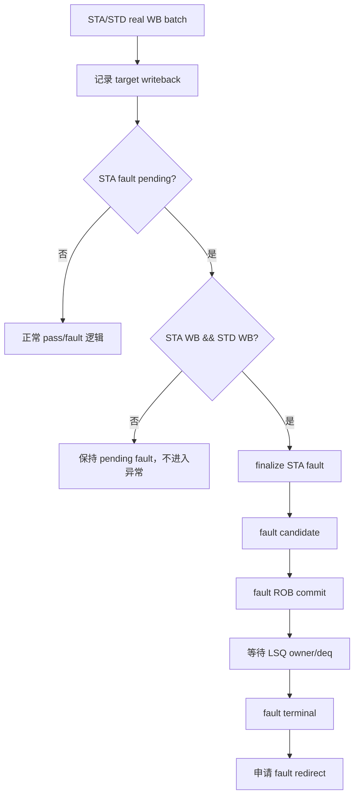

# V2 STA/STD 双真实写回异常与 Redirect 屏障 Plan

## 1. Plan 定位、术语与抽象功能说明

### 1.1 Plan 定位

本 plan 用于修复 V2 `mem_ut` 测试框架中普通 scalar store 的生命周期顺序：同一动态实例的 STA 和 STD
都收到真实 int writeback 后，才允许确认异常、进入 fault ROB commit、完成 fault terminal，并申请该 fault
自身的 redirect。本 plan 只修改测试框架状态机、事件归属和 commit/redirect 门控，不修改 DUT RTL、接口、
参数或 RM 算法。

### 1.2 专有名词与抽象功能说明

| 术语 | 本 plan 中的含义 | 代码落点 | 示例 |
| --- | --- | --- | --- |
| `real writeback` | DUT int writeback monitor 采到的当前 issue epoch 的真实 STA/STD 完成事件；IQ feedback 不等价于它。 | `sta_writeback`、`std_writeback`、`writeback_status_handler` | STA fault raw 仍算 STA real writeback |
| `pending fault` | 已观察到 STA 异常、但等待同一动态实例 STD real writeback 的暂存异常。 | `pending_sta_fault_by_uid` | STA fault 先保存 exceptionVec，不置 UID fault |
| `fault finalize` | 双写回满足后，将 pending fault 正式写入 `sta_fault/fault/exception_pending` 的动作。 | `finalize_pending_sta_fault()` | STD WB 到达后提交 STA fault |
| `fault candidate` | 位于 modeled ROB head、可发送 fault commit 的 UID。 | `uid_is_fault_terminal_candidate()` | 双写回后才能被选择 |
| `fault terminal` | fault commit、LSQ owner 释放并完成非成功终态收口。 | `consume_fault_retire()`、`sync_modeled_head_after_fault_terminal()` | `terminal_done=1, success=0` |
| `fault redirect` | 当前 fault UID 在 real dispatch topology 中申请的 level-1、flush-itself redirect。 | `request_fault_head_redirect()` | 只在 fault terminal 后发出 |
| `batch finalize` | 当前 monitor batch 的所有 raw event 完成归属和 target writeback 记录后，再统一提交 pending fault。 | `service_monitor_once()` | STA fault 与 STD WB 同拍时不依赖事件排列 |

抽象功能说明：`pending fault` 负责隔离“异常已观察”和“异常可进入后续生命周期”两个边界；
`fault finalize` 只负责状态落表，不负责 ROB commit 或 redirect；commit handler 负责顺序提交，
redirect handler 负责已有 redirect owner 的仲裁和驱动。

## 2. 当前问题与目标 Flow

当前正常 store commit 通过 `required_targets_done()` 间接要求 STA/STD 的 pass/fault target 都完成，
但不严格要求两个真实 writeback。fault 路径则只要 `sta_fault` 置位即可成为 fault candidate；
STA fault 后的 STD normal writeback 还会被 `mark_target_normal_pass()` 的 `fault/exception_pending`
前置条件拒绝。

目标流程如下：



`STA fault` 和 `STD real WB` 同一 monitor batch 到达时，必须先完成整个 batch 的 target 记录，再执行
`finalize_pending_sta_fault()`，避免 raw event 排列造成非确定性。

## 3. 状态与函数修改方案

### 3.1 pending STA fault 状态

修改 `common_data_transaction`，新增按 UID/dynamic epoch 管理的有限 pending fault 记录，至少保存：

```text
valid、uid、dynamic_epoch、issue_epoch、replay_seq、exception_vec、cycle、rob_key、sq_key
```

该状态只服务当前 active dynamic instance；UID 被 redirect/flush、terminal 或 reset 时必须清理。
不新增 plusarg，不建立运行期参数入口。

新增 helper：

- `capture_pending_sta_fault()`：记录 STA real-WB fault，不设置 UID 级 fault。
- `pending_sta_fault_matches()`：校验 UID、dynamic epoch、issue epoch、ROB/SQ identity。
- `finalize_pending_sta_fault()`：仅在 STA/STD real-WB 屏障满足后设置 STA fault、UID fault、
  `exception_pending` 和 exception vector，并清理 pending record。
- `store_real_writebacks_done()`：对 STU/MOU 返回 `sta_writeback && std_writeback`；对 LDU 返回
  `load_writeback`，供 commit/fault selector 使用。
- `clear_pending_sta_fault()`：redirect、terminal、reset 或 dynamic epoch 失效时幂等清理。

抽象功能描述：这些 helper 维护 STA fault 的暂存和正式落表边界，不拥有 issue queue、LSQ owner、ROB
cursor 或 redirect cancel record。

### 3.2 writeback 事件处理

修改 `writeback_status_handler::handle_real_writeback_event()`：

1. 对正常 STA/STD real WB，继续按现有 issue epoch/replay identity 写入 target writeback/pass。
2. 对 STA fault real WB：设置 `sta_writeback=1`，调用 `capture_pending_sta_fault()`；若 STD real WB
   尚未完成，不设置 `sta_fault/fault/exception_pending`。
3. 对 pending STA fault UID 的 STD normal WB：允许写入 `std_writeback/std_pass`，不能因 pending fault
   被旧的 normal-pass guard 丢弃。
4. 对 pending STA fault UID 的 STD fault WB：记录 `std_writeback/std_fault`，但 UID 级 fault 仍由
   `finalize_pending_sta_fault()`统一提交。
5. 每个 monitor batch 的所有事件处理完成后调用 finalize pass；同一 batch 中若 STA fault 和 STD WB
   同时存在，最终按双写回条件一次性落表。

抽象功能描述：writeback handler 负责将当前 batch 的 raw event 转为 target 状态；它不直接申请
ROB commit 或 redirect。

### 3.3 normal pass 和 target completion

保留 `required_targets_done()` 的 target 语义，但新增 commit 专用的真实写回门控：

```text
normal store commit = status.writeback && status.pass
                       && required_targets_done(uid)
                       && store_real_writebacks_done(uid)
```

这样 STA IQ feedback 即使能够设置 `sta_pass`，也不能替代真实 STA writeback；STD 仍只能由真实
STD int-WB 完成。

### 3.4 fault candidate、fault commit 和 terminal

修改 `uid_is_fault_terminal_candidate()` 和 `mark_fault_rob_commit_uid()`：

1. 普通 store fault candidate 必须满足 `store_real_writebacks_done(uid)`。
2. STA fault pending、但 STD 尚未真实写回时，返回不可提交，不设置 `fault_head_waiting`。
3. `mark_fault_rob_commit_uid()` 再做一次相同门控，防止 candidate 快照过期后错误提交。
4. `try_retire_committed_uid()` 的 fault 分支也保留双写回检查，防止 fault terminal 绕过屏障。
5. `sync_modeled_head_after_fault_terminal()` 在 terminal/redirect 前复查双写回；未满足时保持 fault token
   或 pending fault，不推进 cursor、不调用 `request_fault_head_redirect()`。

抽象功能描述：commit handler 只允许已完成双真实 writeback 的 fault UID进入 ROB/terminal 生命周期，
并确保 redirect 只能建立在已完成异常收口的 UID 上。

### 3.5 service 顺序

在 `service_monitor_once()` 保持现有 raw batch 收集顺序，但明确增加：

```text
collect_monitor_event_batch
  -> writeback/redirect normalize and target update
  -> finalize all pending STA faults
  -> exception_redirect_replay_task
  -> LSQ timing reconcile
```

`finalize_pending_sta_faults()` 只遍历 pending fault 的有限 active map，不扫描完整 main table。

## 4. 关键伪代码

### 4.1 `capture_pending_sta_fault()`

抽象功能描述：保存当前 STA fault 的不可变身份和异常信息，等待 STD real WB；不设置 UID fault，也不
删除 STD issue item。

```text
校验 UID active、target 是 STA、STA real WB 已成立、dynamic epoch/issue epoch/replay_seq 与当前状态一致；
若已有相同 pending record，校验 exception/ROB/SQ identity 后幂等返回；
若已有不同 dynamic epoch 或 key，报告 fatal；
否则写入 pending record，保留 exception_vec 和采样 cycle；
返回记录成功。
```

### 4.2 `finalize_pending_sta_fault()`

抽象功能描述：将满足双真实 writeback 的 pending STA fault正式转为UID级异常状态；不提交 ROB、不释放
LSQ owner、不创建 redirect。

```text
读取 pending record；若不存在直接返回；
校验当前 status 仍是同一 dynamic epoch 且未被 redirect/flush/terminal；
若 sta_writeback 或 std_writeback 未同时成立，保留 record 并返回；
设置 sta_fault=1、fault=1、exception_pending=1、exception_vec；
清除 normal pass/success/terminal_done；
清理 pending record；
调用 quiesce_fault_uid_pending_work(uid, 0)，只撤销 LOAD/STA/replay，保留 redirect 前未 fire STD；
返回 finalize 成功。
```

### 4.3 `store_real_writebacks_done()`

抽象功能描述：为 commit、fault candidate 和 terminal 提供统一的真实写回屏障；只读状态，不修改状态。

```text
根据主表 fuType 判断 LDU 或 STU/MOU；
LDU 返回 load_writeback；
STU/MOU 返回 sta_writeback && std_writeback；
其它 fuType 报 fatal；
```

### 4.4 fault selector/commit gate

抽象功能描述：阻止 STA-only fault 越过 ROB head commit 和 fault redirect 生命周期。

```text
沿用 active、ROB head、redirect、replay、flush、issue_killed 等既有检查；
若 UID 是 STU/MOU 且 store_real_writebacks_done() 为假，返回不可选；
只有双写回完成后才返回 fault candidate；
mark_fault_rob_commit_uid() 再次检查同一条件，失败时不修改 rob_commit/fault token；
```

## 5. 不变量与边界

1. STA fault raw 本身计入 `sta_writeback`，但不等价于已进入异常生命周期。
2. STD normal/fault real WB 在 pending STA fault 存在时都必须可被当前 dynamic instance 归属。
3. pending fault 未 finalize 前，不允许 `fault_head_waiting`、`rob_commit`、`terminal_done` 或 fault redirect。
4. `sta_pass/std_pass`、IQ feedback、issue accept 均不能替代对应 real writeback。
5. 已存在的更老外部 redirect仍按 redirect-first规则优先处理；本 plan 约束当前 STA fault派生的异常链路。
6. redirect/flush/reset/dynamic epoch 失效时必须清 pending record，避免旧 fault 影响新实例。
7. 高频路径只访问当前 UID或有限 pending map，不对 `main_trans_num` 做每拍全表扫描。

## 6. 验证计划

### 6.1 静态检查

- 检查所有 `uid_is_fault_terminal_candidate`、`mark_fault_rob_commit_uid`、`try_retire_committed_uid`、
  `request_fault_head_redirect` 调用点均经过双真实 writeback门控。
- 检查 `mark_target_normal_pass` 不再错误丢弃 pending STA fault UID 的 STD real WB。
- 检查 pending record 的 reset、redirect/flush 清理和 dynamic epoch 校验完整。
- 执行 `git diff --check` 和旧 helper/字段残留检索。

### 6.2 定向场景

1. STA fault 先到、STD WB 延迟：异常状态和 redirect 必须等待 STD WB。
2. STD WB 先到、STA fault 后到：STA fault 到达后可立即 finalize，但仍必须确认两个 writeback bit。
3. STA fault 与 STD WB 同一 batch：结果不依赖 raw event 排列。
4. STD fault 与 STA fault 同时存在：两个 target writeback 均记录，UID 级 fault 只 finalize 一次。
5. 正常 STU/MOU：只有 STA/STD 两个真实 WB 后才允许 normal commit。
6. redirect/flush 后旧 fault pending：必须清理，不能污染重新 admission 的 dynamic epoch。

### 6.3 指定仿真

```bash
cd mem_ut/ver/ut/memblock/sim
make eda_compile tc=basicTest ts=memblock_dispatch_real_smoke_vseq mode=base_fun cfg=tc_dispatch_real_mmu_sv39_smoke
make eda_run tc=basicTest ts=memblock_dispatch_real_smoke_vseq mode=base_fun cfg=tc_dispatch_real_mmu_sv39_smoke seed=666666
```

验收条件：日志出现 `TEST CASE PASSED`，且 `UVM_ERROR=0`、`UVM_FATAL=0`；同时检查 STA fault UID 的
异常落表、fault commit、terminal 和 redirect 时间均晚于该 UID 的 STD real writeback。

## 7. 文档与 Review

代码完成后同步更新：

- `AI_DOC/mem_ut_flow_doc/fault_exception_flow.md`
- `AI_DOC/mem_ut_flow_doc/rob_commit_lq_sq_deq_flow.md`
- 本 plan 的实施状态和验证结果
- `AI_DOC/plan/test_framework/review_doc/undo/memblock_sta_std_writeback_fault_redirect_barrier_implementation_review_20260922.md`

本 plan 不新增参数，不修改 `plus.sv`、`seq_csr_common.sv` 或 testcase preset cfg。

## 8. 执行中补充/修正（IMPLEMENTATION_DELTA）

### 8.1 pending fault 从单 target 扩展为 STA/STD 任一 fault 证据

- 原 plan：只描述 STA fault pending。
- 实际调整：新增按 UID 保存的 `memblock_pending_store_fault_t`，STA/STD 任一 target fault
  均先记录，只有 `sta_writeback && std_writeback` 后统一 finalize。
- 原因：STD fault 先到时同样不能绕过双 real-WB 屏障；同批 raw event 不能依赖事件排列。

### 8.2 初始 SQ deq 清理策略的修正

- 初始调整：`release_uid_sq_mapping()` 曾无条件删除未 fire 的 STD queue item，并让缺少
  `active_sq_mapped` 的 STA/STD 均不可重新入队或发射。
- 证据：最终 UID31 动态实例在 `9337.8ns` SQ deq 时为
  `sta_dispatch/wb=1/1`、`std_dispatch/queued/wb/pass=0/1/0/0`、`pending_fault=1`。因此该 STD
  不是 stale item，而是双 real-WB 屏障唯一尚未完成的一半。
- 最终实现：普通无 owner STD 仍删除且不得重新路由；只有匹配当前 pending store fault 且
  `std_writeback=0` 的已排队 STD 保留，具体边界见 8.5。
- 结论：本项不是扩大 SQ deq 后的 issue 权限，而是撤销对唯一 barrier STD 的错误清理。

### 8.3 redirect sideband 的既有仲裁边界

batch handler 和 recovery handler 保留 scalar-store redirect 在 fault commit 前的单飞等待逻辑，
防止 sideband 直接抢占 fault token。该逻辑不是 UID31 卡死的根因，也不在本计划中新增 redirect intent、
generation 表、额外 token 阶段或新的 requeue 机制。它仍沿用既有 `exception_event_q` 与 oldest redirect
仲裁；本次验收只要求它不能绕过双 real-WB 后的 fault commit/terminal/redirect 顺序。

### 8.5 SQ deq 早于 STD real-WB 时保留唯一 barrier STD

- [IMPLEMENTATION_DELTA]
- 来源：指定 seed 的 UID31 最后一代动态实例诊断。
- 原 plan/8.2 实现：SQ deq 时无条件删除未 fire 的 STD item，并让缺少
  `active_sq_mapped` 的 STA/STD 均不可 route/issue，避免已释放 owner 的旧 item 永久滞留。
- 实际证据：UID31 在 `9337.8ns` 的状态为
  `sta_dispatch/wb=1/1`、`std_dispatch/queued/wb/pass=0/1/0/0`、
  `pending_fault=1`。因此最后动态实例已收到 STA fault、STD 尚未发射；无条件删除
  `queued_std` 后，双 real-WB 屏障永远不能满足，fault commit 合法地保持不可选。
- 实现调整：`release_uid_sq_mapping()` 仅在不存在匹配的 pending store fault 或 STD 已 real-WB 时
  删除 STD item。匹配 `pending_store_fault && !std_writeback` 时保留唯一已有 queue item；
  `issue_queue_scheduler` 不允许 SQ deq 后重新 route/new item，只对该既有 item 放宽 live SQ owner 检查，
  并校验 UID、dynamic epoch、当前 ROB key、`lsq_deq`、STA 已 writeback、保存的 SQ key、`queued_std`、
  未 dispatched/未 writeback 和 pending record。STD raw monitor 也在
  相同条件下允许使用 active ROB、issue epoch、flush epoch 与 status 保留 SQ key 归属，不再强制查询
  已释放的 live SQ map；统一 `normalize_feedback_event()` 在 UID/ROB 已匹配后同样使用该历史 SQ
  identity，避免第二次 map 反查丢弃事件。普通 STA、普通 STD、redirect/flush 后旧代 item 仍不得在无
  SQ owner 时发射、重新路由或归属写回。
- 原因：该例外不是把 SQ deq 后的任意 STD 重发，而是完成同一动态实例在 STA fault 已采到后
  必须具备的第二个真实 writeback。STD writeback 到达后，既有
  `mark_target_normal_pass() -> finalize_pending_store_fault()` 路径删除 pending record，后续 fault
  commit/redirect 仍使用原有门控；因此该例外不会扩展到 terminal、redirect 或重新 admission。
- 验收：UID31 必须出现 `STD` issue fire 和 normal/fault real-WB；
  `STORE_FAULT_BARRIER finalize`、fault ROB commit、`request scalar fault redirect uid=31` 和
  `fault retire uid=31` 均只能发生在该 STD WB 之后。

## 9. 执行与验证记录

- `git diff --check`：通过。
- `make eda_compile ... cfg=tc_dispatch_real_mmu_sv39_smoke seed=666666`：通过，VCS/Verdi 均为
  `0 error(s), 0 warning(s)`。
- 指定 `eda_run partcmp_op=off`：最新代码已完成完整仿真，仿真结束时间为 `2454647.800ns`。
  UID31 关键顺序为：`SQ deq 9337.8ns`、`finalize sta_wb=1 std_wb=1 9362.8ns`、
  `fault terminal_done=1 9370.3ns`、`request scalar fault redirect 9370.3ns`。
  `global stop committed` 出现在 `2454617.8ns`，最终 `UVM_ERROR : 0`、`UVM_FATAL : 0`。
- 日志没有单独打印 `TEST CASE PASSED` 字符串，但已正常 `$finish` 且 UVM 汇总为 0 error/0 fatal；按当前
  `basicTest` 流程可判定用例通过，plan 仍保留在 `undo`，等待用户后续归档决定。
- 独立复查：`REVIEW_PASS`。补充确认 scheduler 仅允许 `lsq_deq && sta_writeback && !std_writeback` 的当前
  dynamic epoch/ROB barrier STD，SQ deq 后不会重新 route/new item；普通无 owner、跨 UID/旧 epoch 和 key 复用
  场景均拒绝。上述边界已回写源码与 review。
