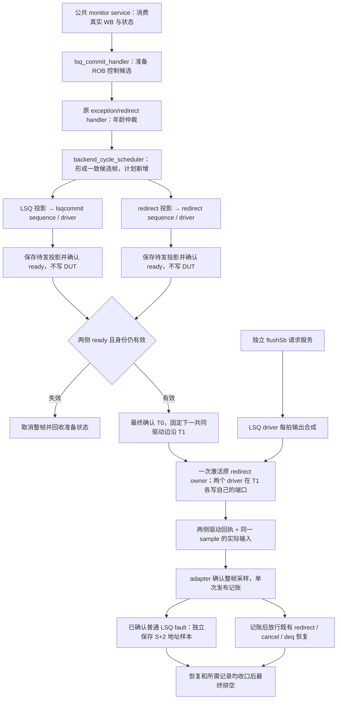

# MemBlock V2 后端周期快照同步驱动与异常地址采样方案

- 创建日期：2026-11-16。
- 更新日期：2026-11-16。
- 适用分支：`mem_ut_uvm_v2`，使用 V2 profile。
- 状态：初步方案，未实施；已通过三路 subagent 静态独立适配评审及修改后复查，不等同于正式可 coding plan 整理或仿真验证。
- 本轮授权：用已确认的后端周期快照方案替换本文件内容，不包含源码、配置或 RTL 修改。
- 定位：在现有公共框架中模拟后端各来源级数对应的周期 ROB 控制和 redirect 输出，并记录其实际输入和异常地址消费边界。
- 文件入口：保留原文件名，正文以本版整组同步方案为准。
- 关联方案：[MemBlock V2 虚拟化指令公共测试框架支持方案](memblock_virtualization_framework_support_plan_20261109.md)。

## 1. 专有名词与抽象功能说明

### 1.1 专有名词

| 名词 | 本方案中的含义与代码落点 | 示例 |
|---|---|---|
| DUT、RTL、profile | 被测 MemBlock、硬件实现及版本差异基线；本方案使用 V2 | 驱动端口以 `build/rtl/MemBlock.sv` 为准 |
| UVM、agent | 验证框架及接口组件 | 保留 LSQ commit、redirect、ctrl agent |
| transaction、item、projection | driver 传输对象及完整快照中属于一个 agent 的字段投影 | 同一帧投影成两个 item |
| sequence、vseq、driver | 运输序列、顶层调度序列及接口驱动组件 | vseq 在真实 agent sequencer 上启动两个运输序列 |
| clocking block、`drv_cb`、`mon_cb` | interface 的驱动与采样边界，包含调度区及输入/输出偏移 | driver 回执不等于 DUT 实际采样 |
| ROB、LQ、SQ、LSQ | 重排序队列、Load 队列、Store 队列及访存队列总称 | 同步异常本身不计入正常 scommit |
| ROB key | `flag/value` 组成的完整 ROB 标识 | `pendingPtr` 必须与 pending 队首一致 |
| UID、`dynamic_epoch` | 主表逻辑指令编号及其动态执行代次 | 同 UID 重发后的事件不能与旧样本关联 |
| reset epoch、`reset_epoch` | 复用当前 redirect 生命周期的 `get_l2tlb_current_reset_epoch()`；与独立 control topology 的 reset 编号不混比 | 一侧 ready 后发生 reset，应取消整帧 |
| backend cycle frame、周期快照 | 同一 MemBlock 输入周期的不可变 ROB 控制与 redirect 组合，分别保存来源决策拍，计划类型 `memblock_backend_cycle_frame_t` | 同步 fault 帧中 redirect 有效、正常提交数量为零 |
| `frame_id` | 周期快照的运输身份，与 reset 代次合用 | 两个 driver 的回执必须指向同一帧 |
| candidate、prepared、ready | 尚未提交的候选快照、已装载待发投影、driver 已保留该投影的准备确认 | 两侧 ready 之前不发布新字段 |
| armed、committed、drive edge | 已准备驱动、已经最终确定目标边沿、实际驱动边沿 | 不能在一侧已经驱动后单独撤销另一侧 |
| T0、T1、R | T0 为帧最终确认拍，T1 为共同输出边沿；R 为讨论真实后端 rollback 的输出周期 | 同步 fault 两投影同源；rollback 的 LSQ 投影可来自 R-1 |
| tail、强制尾拍 | rollback发布单元中预先装载的紧邻下一周期阻塞输出，随主帧一起准备和提交 | R+1不用重新等待双侧ready |
| source decision、pipeline、rollback | 字段来源决策拍、有界寄存级状态、访存违例冲刷重发；计划用 `lsq_source_seq/redirect_source_seq` 记录 | rollback 不建立 AF/PF fault token |
| AF、PF、GPF | 访问错误、页错误和 Guest 页错误；以真实 WB exception 为准 | 单有预期 PF 配置不能生成 fault redirect |
| control head、batch、reservation、preflight | 控制指令队首、一组正常提交、准备预占、发布前只读检查 | Fence 完成后通过 control 分支推进 cursor |
| recovery eligible、address source | 允许恢复扫描的记账门槛、实际地址优先来源 | fault sampled-applied 后才放行恢复；AMO 不读裸 LSQ 样本 |
| S、`sample_seq`、anchor | DUT 实际消费输入的公共采样编号及观测锚点 | 两个输入 monitor 的样本必须属于同一个 S |
| S+2、地址消费窗口 | 当前 V2 普通 LSQ 路径、边沿前采样约定下的目标地址样本 | 不用邻拍或 latest 替代指定样本 |
| fault head、fault token | 异常队首及框架保存的该次身份/生命周期 | token 保存 UID、ROB key 和执行代次 |
| STA、STD、WB | Store 地址、Store 数据与真实写回 | 准备 Store 异常帧仍需满足既有真实 WB 门槛 |
| redirect、payload、intent | 冲刷控制、硬件字段集合、待仲裁请求 | 继续由原最老仲裁选出获胜请求 |
| exception event | 与 fault token 及 intent 绑定的异常上下文 | 地址记录关联到具体异常代次 |
| sideband、level、pulse | 附随控制、电平保持、单拍脉冲 | 等待时保留 pendingPtr，但不能重复发送 scommit |
| flushSb、Fence | StoreBuffer 排空输入及其上游控制单元 | flushSb 不因异常帧存在而自动置位 |
| monitor、adapter、handler、scheduler | 原始采样、样本关联、状态处理和本方案周期发布协调器 | scheduler 不新增一套 redirect 年龄仲裁 |
| snapshot、CSR | 冻结状态及控制寄存器上下文 | 引用已有 issue CSR snapshot，不另建镜像 |
| active map、owner、cursor | 当前资源索引、资源所有者和顺序推进位置 | 回收 mapping 后仍需保留不可变事件记录 |
| queue、map、inflight | 待处理队列、关联索引、已发出未完成状态 | 有界保存帧和短期原始样本 |
| terminal、recovery、replay | 最终完成、异常恢复及重试 | reset/覆盖取消与正常恢复分别收口 |
| VA、GVA、GPA、PTE | 虚拟地址、Guest 虚拟地址、Guest 物理地址、页表项 | GPA 也可能表示隐式 VS 页表访问地址 |
| HLV、HLVX、HSV | 特殊 Guest 读取、按执行权限读取、特殊 Guest 写入 | 对应公共标量路由具备后复用异常帧 |
| AMO、segment、VLS | 原子操作、向量 segment 和向量访存 | 独立异常地址来源不能直接套普通 LSQ 来源假设 |
| RM、checker、scoreboard、coverage | 独立参考结果、正确性判断与覆盖率组件 | 本方案只记录实际样本，不推导 expected GPA |

### 1.2 关键组件抽象职责

| 组件 | 抽象功能职责 |
|---|---|
| `lsq_commit_handler` | 选择正常提交与异常队首，形成候选 ROB 状态，区分异常准备、发布记账和恢复收尾 |
| `exception_redirect_replay_handler` | 复用原年龄规则仲裁 redirect，提供唯一获选请求及其上下文 |
| `memblock_backend_cycle_scheduler`（计划新增） | 将一致的 ROB 状态和获选 redirect 组成周期快照，协调双投影准备和共同边沿发布 |
| `common_data_transaction` | 保存帧、不可变上下文、回执及既有资源状态，不重复实现 ROB/LSQ allocator |
| 两个 agent sequence | 将同一帧的各自投影运输到真实 sequencer，不独立重算后端决定 |
| LSQ commit driver | 唯一驱动原有 LSQ 控制和 `isStoreException`；独立合成 flushSb |
| redirect driver | 唯一驱动原有 `io_redirect_valid/bits`，与另一侧在同一目标边沿发布 |
| 输入 monitor、ctrl monitor | 记录实际输入快照、地址输出和公共采样序号，不推导 UID 或结果正确性 |
| `dispatch_monitor_event_adapter` | 关联两侧输入回执、实际样本及地址窗口，发布记录完成或明确取消状态 |

## 2. 目标、边界与当前实现

### 2.1 目标

本方案在 MemBlock 输入边界按完整周期帧同步发布 ROB 相关控制和 redirect。普通 ROB 队首同步 fault 的两组输出来自同一决策拍；访存违例 rollback 的 redirect 与 ROB 寄存输出有不同来源级数，必须分别保存来源拍，再组合为同一目标输入周期，不能声称所有来源均为同一决策拍。T0 表示最终确认帧的拍，T1 表示双方共同输出边沿。

这里的“同拍”是同一目标采样边界上的一致状态，不要求所有信号同时为 1，也不要求所有电平都跳变。类别提前正确并保持在功能上可以成立，但默认整核时序模拟应发布一份完整、可归属的周期快照。

本版不采用单信号驱动归属迁移。`isStoreException` 继续属于 `lsqcommit_agent`，redirect 继续属于 `redirect_agent`；同步由公共周期调度保证。

### 2.2 当前实现的问题边界

2026-11-16 检查的现有公共路径是：

```text
build_lsqcommit_xaction
  → LSQ item finish_item 返回
  → mark_fault_rob_commit_uid
  → request_fault_head_redirect / submit_redirect_intent
  → 原异常处理器仲裁
  → redirect sequence / driver 后续发布
```

因此，当前可以先发布类别及 LSQ 状态，后发布异常 redirect。不能仅据此判定 DUT 功能错误，但该路径不满足本方案声明的整组后端同周期发布目标。

如果直接在这个顺序上增加“LSQ driver 等待 redirect driver ready”，会因 redirect 请求尚未生成而循环等待。准备阶段必须在双边正式发布之前完成。

### 2.3 实际 DUT 端口边界

当前 V2 生成的 `build/rtl/MemBlock.sv` 中，本方案驱动的 ROB 相关端口是：

- `io_ooo_to_mem_lsqio_scommit`。
- `io_ooo_to_mem_lsqio_pendingMMIOld`。
- `io_ooo_to_mem_lsqio_pendingst`。
- `io_ooo_to_mem_lsqio_pendingPtr_flag/value`。
- `io_ooo_to_mem_isStoreException`。
- `io_redirect_valid` 及当前实际暴露的 `bits`。

Scala 中存在 `lcommit/commit/pendingld/pendingVst/pendingPtrNext` 等成员，但当前生成顶层没有对应端口。本方案可在模型内部表达必要语义，不添加虚构连接，不修改 RTL 以恢复这些端口。

`io_ooo_to_mem_flushSb` 物理上仍由 LSQ commit agent 驱动，逻辑上属于独立 Fence 请求，不是 ROB 异常帧字段。

### 2.4 范围

实现公共快照构造、双边运输、共同边沿发布、实际输入观测、普通 LSQ 异常地址记录和既有恢复衔接。不新增指令集合、SPVP/fence 权重、RM 地址推导、功能覆盖率模型或 RTL 代码。

HLV/HLVX/HSV 在公共路由支持后复用对应标量规则。AMO、segment、misalign overwrite 的独立地址来源与 VLS 特殊恢复按既有约束处理。地址记录按来源分开配置内部生命周期：仅已证明普通 LSQ 来源需要本方案 S+2 记录；其余来源标记为本轮不记录，不创建永远不能完成的地址等待，不宣称已支持对应地址检查。

## 3. 后端状态快照的源码合同

本章只记录测试框架方案需要的接口依据，不更新 V2 RTL 知识库。

| 依据 | 源码落点 | 框架约束 |
|---|---|---|
| ROB 同步异常建立 `exceptionHappen`，类别用 `RegEnable` 保存 | `src/main/scala/xiangshan/backend/rob/Rob.scala:651` | 只有本次已确定异常才能更新类别；其余保持 |
| ROB flush valid/bits 在 CtrlBlock 寄存一拍 | `src/main/scala/xiangshan/backend/CtrlBlock.scala:104` | 对应异常 redirect 和类别在 T1 提供同一事件 |
| `lcommit/scommit/commit/pending*/pendingPtr` 各自由同一 ROB 拍寄存 | `src/main/scala/xiangshan/backend/rob/Rob.scala:838` | 正常提交、pending 和指针必须来自一致决策快照 |
| 普通同步异常阻止正常提交 | `src/main/scala/xiangshan/backend/rob/Rob.scala:781` | 异常帧的正常提交数量和对应 pending 标志为 0 |
| 类别直接取异常包 commitType 的低位 | `src/main/scala/xiangshan/backend/Backend.scala:838`、`src/main/scala/xiangshan/package.scala:174` | 不把该位当独立异常 valid，不脱离访存异常语境解释 |
| 顶层连接没有再增加独立 LSQ 输入延迟 | `src/main/scala/xiangshan/XSCore.scala:235` | 以 MemBlock 顶层输入定义同步边界 |
| flushSb 来自 Fence 接口 | `src/main/scala/xiangshan/XSCore.scala:228` | 不与 ROB fault 的发生或完成互相替代 |
| pendingst 和 pendingPtr 被联合比较 | `src/main/scala/xiangshan/mem/lsqueue/StoreQueue.scala:851` | 不得 pending 描述 A、指针却描述 B |
| 类别寄存后选异常缓冲，地址再寄存输出 | `src/main/scala/xiangshan/mem/lsqueue/LSQWrapper.scala:253`、`src/main/scala/xiangshan/mem/MemBlock.scala:1996` | 普通地址记录使用明确采样合同 |
| redirect 输入在 MemBlock 内再寄存 | `src/main/scala/xiangshan/mem/MemBlock.scala:405` | 缓冲失效与输出保存的先后关系不能混淆 |

## 4. 各类周期快照的字段规则

### 4.1 普通同步访存异常

```text
pendingPtr        = 故障队首 ROB key
isStoreException  = 故障访存操作类别
scommit           = 0
pendingst         = 0
pendingMMIOld     = 0
redirect.valid    = 1
redirect.robIdx   = 故障队首 ROB key
redirect.level    = flush
```

模型内部如保存 `lcommit/commit`，该普通同步异常拍同样为 0。这里不把异常指令计入正常提交，也不通过 pending 标志触发异常访存继续执行。

### 4.2 正常提交与 pending 等待

| 场景 | 快照规则 |
|---|---|
| 正常提交 | 按既有正常提交 batch 生成实际 scommit 数量；pending 与 pendingPtr 来自同一队首快照 |
| 队首 Store 尚未完成 | 可存在 pendingst=1、scommit=0；不能把 pendingst 当作正常提交完成 |
| MMIO Load 等待 | pendingMMIOld 与 pendingPtr 对应同一待处理队首 |
| 没有新异常 | `isStoreException` 保持上一次已发布值，不跟随普通 Load/Store 候选改变 |
| 无新驱动帧的空闲拍 | 保持必要电平，清除单拍脉冲；不重复提交上一帧 |

### 4.3 访存违例 rollback 帧

当前框架的 `MEMBLOCK_WB_EVENT_SOURCE_MEMORY_VIOLATION` 是冲刷重发，不是 AF/PF trap。即使来源名称相同，仍须保留其 `rollback_subtype` 和真实 `level/flush_itself`，不得统一改成 flush-itself。来源包括 LoadUnit、uncache 和 RAW nuke，不能只处理 Store/Load RAW 一种。

真实后端 R 周期中，`CtrlBlock.scala:764、772` 将同一个 redirect 送到 ROB 和 MemBlock，`Backend.scala:792` 直连输出；ROB 因 R 的 redirect 阻止当拍提交，但 `Rob.scala:843–853` 的 LSQ 输出是寄存值。因此必须区分：

| MemBlock 输入周期 | redirect 投影 | LSQ 投影及框架约束 |
|---|---|---|
| R | 原 memoryViolation 仲裁出的 payload | 来自 R-1 的 ROB 决策，可保留已经合法决定的 older commit；pending/head 也取其对应来源拍 |
| R+1 | 无新请求时 valid=0，类别保持 | 体现 R 的提交阻塞，scommit=0、pendingst=0、pendingMMIOld=0，pendingPtr 为 R 的队首 |
| 后续 walk/recovery | 服从既有恢复 owner | 在恢复门槛解除前不重新构造新正常提交；独立 flushSb 继续服务 |

scheduler 保存一个有界的前级 ROB 决策槽及来源编号。R 帧直接消费已保存的 R-1 决策，不在看到 redirect 后用 R 的 current head 重算替换；当前没有合法前级提交时可以是零提交，但不能为追求全零而取消已经实际驱动或已合法锁定的 older batch。最终发布前逐项确认该 batch 不在 `rob_need_flush()` 范围，失败则在任何输出前取消候选、重新仲裁；不得先发 scommit 再只撤销软件记账。

R+1 强制尾拍随 R 主帧作为同一个双边运输 item 的两段内容预装载，最终 COMMITTED 前两侧 ready 均确认主帧和尾拍齐备。主帧取共同目标边沿，尾拍固定取其下一物理边沿，不重新排队或等待第二轮 ready；普通候选不能覆盖尾拍。尾拍带自己的 `frame_id`、主帧引用及目标 sample，用于独立观测和排空；不生成第二次 redirect intent/accepted/cancel owner。其 LSQ 内容为零 scommit/零 pending、冻结的 R 决策队首；redirect.valid=0、类别保持。两个 driver 在尾拍驱动完成后才各自结束本运输 item；主帧的回执和采样记账仍按主帧时刻发布，不等待 item_done。reset 撤销整个发布单元。尾拍之后若仍处于 recovery/walk，driver保持阻塞投影的电平直至合法新帧替换。

尾拍指针从 R 来源决策的权威队首取得；存在 R-1 older batch 时，按该批决策后的 active status/ROB key 映射保存下一队首，不能复制 R 主帧的旧 pendingPtr、读取尚未应用的软件 cursor 或按 UID 算术推导 ROB key。尾拍不携带主帧的提交 UID 列表、control/fault 状态更新；尾拍采样仅完成运输观测，不再次执行 `mark_rob_commit*`、fault token 更新或恢复 owner 激活。

rollback 帧不要求 redirect UID 成为 fault head，不创建 fault token、不设置该 UID 的 fault `rob_commit/terminal`，不更新 `isStoreException`，不预约 S+2 异常地址。按原 redirect 范围释放/保留 owner，需重发的 UID 使用原动态代次推进和 issue 恢复。

### 4.4 控制指令与其他来源

control head 保留独立候选和采样后提交分支：沿用 `select_control_head_candidate()` 的终态资格，发布不产生正常 Store scommit 的控制帧，随后按原 `mark_control_rob_commit_uid()` 的语义推进 cursor。不能因改造旧 LSQ sequence 而删除该分支；Fence 的 flushSb 请求仍单独服务。

branch、纯 flushPipe 和中断不在本轮新增周期复刻范围内；保留既有专用语义，若进入共同运输必须先提供对应来源映射，不能默认为 AF/PF 或 rollback。中断不强行消费 LSU 地址。

### 4.5 AF/PF 异常与地址来源

普通 Load/Store AF/PF 从真实 WB 的异常信息进入 status，等待原正常提交前沿到达该 UID，再准备同步 fault 帧；只有预期配置不能代替 DUT 真实 exception。Store 的 STA/STD 真实 WB 门槛继续保留；尚缺另一侧 dispatch 时遵循 `head_pending_ptr_blocked()` → `store_fault_blocks_pending_ptr()` 的既有例外，使缺侧可继续入队和写回，不因单侧 fault 提前全局冻结。来源为普通标量 LSQ 且无高优先地址覆盖时，`address_record_required=1`，以实际 S 记录 S+2。

AMO 沿用当前框架 load-like 类别，即 `fault_uid_is_store_exception()` 返回 0；不得因为 exceptionVec 是 storeAF/storePF 就反推类别 1。其控制帧和恢复可复用同步 fault 分支，地址来源标为 ATOMIC。misalign overwrite、segment 同样单列来源。上述独立来源在本轮无明确观测合同时使用 `address_record_required=0`、`address_record_status=NOT_CAPTURED_BY_THIS_PLAN`，继续原异常恢复，不伪造普通 LSQ 地址记录；后续若扩展观测需另补来源与时序合同。

不能确认普通 LSQ 来源时不得默认声明记录成功。`address_source` 必须来自既有路由/可确认的来源事实，无法判定则标 UNKNOWN、本轮不记录；这属于明确支持边界，不作为地址正确性通过。


## 5. 公共数据与所有权

### 5.1 周期快照

计划在公共 sequence types 中增加 `memblock_backend_cycle_frame_t`，包含：

| 字段组 | 语义 |
|---|---|
| `frame_id`、reset 代次 | 运输身份，拒绝复位前后的旧消息串接 |
| 决策类型、上下文版本、来源拍 | 区分正常提交、pending、control、同步 fault、memoryViolation rollback；分别保存 `lsq_source_seq/redirect_source_seq` |
| ROB 队首 key、提交 UID 列表 | 保存本帧决策时的身份，不从发布后的 cursor 重新读取 |
| LSQ 投影 | scommit、pendingst、pendingMMIOld、pendingPtr、isStoreException |
| redirect 投影 | valid、robIdx、level、isVlsException 等实际端口字段 |
| 可选 fault 上下文 | UID、动态代次、既有 intent 身份及已有 CSR/issue 上下文引用 |
| 地址记录状态 | `address_source`、`address_record_required` 和完成/未支持状态，独立于恢复资格 |
| 恢复发布状态 | 原 intent/cancel owner 身份、`sampled_applied`、`recovery_eligible`，不另建第二套 owner |
| 目标驱动边沿 | 两侧准备完成后最终确定，提交后不可各自修改 |
| rollback强制尾拍 | 同一运输item预装主帧与尾拍；尾拍另有frame身份及冻结R队首，目标固定为主帧下一边沿 |

业务字段在形成候选投影后不可由任一 driver 修改。若重新仲裁或队首变化导致内容失效，取消未提交帧并建立新 `frame_id`，不原地修改已经准备好的投影。目标边沿在最终提交时只填写一次。

### 5.2 下层运输元数据

两个 agent 的 xaction 增加不随机化的同步元数据：

```text
frame_valid
frame_id
reset_epoch
projection_kind
```

目标边沿及双边状态通过公共运输记录关联。底层 driver 只接触基础运输身份和自己的端口字段，不引用 `seq_pkg` 中的 UID 或复杂上下文，避免 package 依赖环。

`reset_epoch` 统一取当前 redirect 恢复采用的 `get_l2tlb_current_reset_epoch()`；已有事件字段虽名为 `control_reset_epoch`，此路径也按该公共编号匹配，不能调用仅限 control topology 的 getter 或将两个 reset 域数值比较。

共同物理驱动边沿编号由唯一协调任务维护。它不是 dispatch service cycle，也不是给 CSR/L2TLB monitor 另建一套采样编号；实际 DUT 观测仍复用既有 `sample_seq`。

### 5.3 发布生命周期

```text
CANDIDATE：候选状态和获选控制原因已经组成一致快照
  → PREPARING：投影运输到两个 driver
  → READY：两侧均已保留待发数据，没有写到 DUT
  → COMMITTED：重新核对身份后，固定下一共同驱动边沿
  → DRIVEN：该边沿两侧均实际执行驱动并返回回执
  → SAMPLED：同一个实际 sample 观察到两侧一致输入
  → RECORDED / DONE：需要的地址记录及原恢复均收口
```

PREPARING/READY 仅占用轻量 reservation，不调用会建立 active_redirect、flush epoch 和 cancel record 的 `request_redirect_flush()`，不发送 accepted；因此最终提交前取消只撤销准备状态和 intent 预约。

最终确认和原 owner 激活在唯一 scheduler 的同一次无阻塞状态转换内完成：完成来源/年龄/提交 preflight 后，恰好调用一次原 `request_redirect_flush()`，绑定既有 intent/cancel record，并送 accepted，再置 COMMITTED。最终确认失败则不分配 active owner；不得为取消 prepared 帧回滚一个已经激活的真实恢复 owner。

READY 之前或最终提交之前可以整体取消。COMMITTED 后不能因迟到请求只撤销一侧；除 reset 等使整个边界失效的情况外，应完成该次发布，再按后续帧/恢复规则处理新事件。单侧缺失属于框架错误，不能把另一侧延后一拍补发并声称成功。

### 5.4 数据保存边界

`common_data_transaction` 保存完整帧和不可变业务上下文；公共 sync 通道保存底层 ready、共同边沿、驱动回执和 raw 采样。原有 redirect owner、cancel record、LSQ allocator 仍是资源处理权威。

准备中的帧通过轻量 reservation 阻止同一提交候选重复使用，但不提前把它写成实际已发布/已采样。不得在等待 driver 时推进正常提交 cursor 或向 RM 声称实际输入已经生效。

获选 redirect reservation 同时填补 intent 离开队列到 COMMITTED 激活 owner 之间的空窗：现有 `has_pending_monitor_redirect()` 等门槛必须能读到它，禁止新提交跨过待冲刷边界。route/issue 对其覆盖范围采用既有 pending redirect 的抑制语义；真实 WB、monitor 收集、原取消事实及独立 flushSb 仍持续服务，不能将观察事件丢弃。已经合法保存且不被覆盖的前级 older batch 保留。最终提交前 arrival 的更老 intent 仍进入原仲裁并可整体取消旧准备；未提交 reservation 不递增 flush epoch、不改变 dynamic_epoch。


## 6. 目标功能流程

### 6.1 流程图



**函数调用流程图整体文字伪代码：**

```text
1. 主 service 按完整 sample 收集事实，先关联已驱动帧并完成其采样记账，
   再处理依赖这些状态的 deq/恢复扫描；真实 WB 按原顺序更新 status。
2. commit handler 准备正常提交或 fault head 候选；准备只保留资格和身份，
   不先驱动 LSQ item，也不以 item_done 作为产生 redirect 的前提。
3. 原异常处理器完成年龄仲裁；只预占获选请求。scheduler 按来源级数构造帧：
   同步 fault 使用同源状态，rollback 使用有界前级 LSQ 决策，control 保留独立分支。
4. 两个现有 sequence 向各自真实 sequencer 运输同一帧的投影。
   两个 driver 保存待发字段并返回 ready，等待共同发布，不提前改变输出。
5. scheduler 在共同边沿前重新检查 reset、代次、候选、提交范围和仲裁结果。
   失效就取消准备；有效则一次激活原 redirect owner，固定下一共同驱动边沿，记为 T0。
6. 两个 driver 在下一边沿 T1 执行各自投影，保持单一端口写入者并分别发布回执。
7. monitor 记录实际输入 sample。adapter 配对同一帧和同一 sample，
   满足后才完成该帧唯一的实际发布/采样记账，不重复应用提交数量。
8. 先以 sampled-applied 放行恢复；地址记录独立以实际 S 保存指定样本。
   不等待 S+2 才记账；最终收尾等待原恢复和需要的地址记录都完成。
9. flushSb 请求由独立公共服务持续推进，只在 LSQ driver 最终输出合成时汇入，
   不因异常帧存在而自动产生，也不因等待同拍准备而停掉请求服务。
```

### 6.2 双边准备和共同边沿

共同边沿必须在两侧 ready 后选择，不能发送两个 item 后凭经验假定它们会在同一拍被取走。

协调任务可以在两侧 ready 后的共同 `negedge` 完成最终确认，并固定下一 `posedge` 为目标。driver 已经处于逐拍服务待发状态，因此该目标边沿是未来边沿，不依赖同一 delta 内的事件唤醒顺序。两侧 `drv_cb` 使用同一物理时钟和相同输出偏移。

两侧 item 的随机 pre/post gap 不再改变同步帧的目标边沿；需要延迟的运输只能发生在最终提交之前。driver 的等待采用逐拍非阻塞状态处理，不在主循环里阻塞等待另一侧，从而允许 reset、idle 及独立 flushSb 持续服务。

### 6.3 发布与实际采样

T1 表示 driver 输出边沿，S 表示后续 monitor 实际观察到 DUT 消费该组输入的编号。driver 回执记录边沿时间及帧身份；adapter 根据既有物理采样锚点把该时间映射到预期输入 sample，拒绝驱动之前的旧电平记录。

同一 frame 的两侧输入必须属于同一 S。只看到两侧数值最终相同但 sample 不同，不能判定同步发布成功。连续两帧字段完全相同也必须根据运输身份及目标 sample 分别处理，不依赖输入跳变。

## 7. 关键函数与 task 修改逻辑

新增名称均标为计划接口，不表示当前代码已经存在。各函数采用公共 map/queue 或当前活动窗口，不扫描整个主表。

### 7.1 `lsq_commit_handler::prepare_backend_cycle()`（计划新增）

**抽象功能描述：** 在模拟后端决策准备阶段，根据当前提交前沿产生可用于仲裁和快照构造的 ROB 候选状态，保留对应身份，不执行接口发布或最终提交记账。

**输入与副作用：** 输入当前 status、cursor、已确认 WB 和控制状态；输出正常 batch 或 fault 候选及其上下文版本，建立必要的候选 reservation。

**源码级伪代码：**

```text
读取当前合法提交前沿，按原规则选择正常 batch、control head 或 fault head。
维护有界前级 ROB 决策槽，用于 rollback 对应的 LSQ 寄存输出；不全表重算。
普通 batch 保存 UID 列表、旧 head key 和本次提交数量。
fault 候选检查异常资格、ROB key、执行代次和 Store 双真实 WB。
Store 尚缺另一侧 dispatch/WB 时，不创建阻塞它的 fault reservation；
  沿用原 pending_store_fault barrier 和缺侧 dispatch 例外，继续发布合法 pending/head。
  保留 SQ owner、STA late tombstone 和动态身份，不提前 terminal。
AMO 沿用 final WB/atomic feedback/required pieces fired/atomic finalized 资格。
将上下文标记为 prepared，关闭该候选被重复选择的入口。
control 候选冻结原完成资格及 UID/key，保留后续独立提交分支。
为 fault 提交既有 redirect intent；不要求先完成 LSQ item。
返回候选；不推进正常 cursor，不发布新类别，不记录 actual sampled。
```

**中文文字伪代码：** 当前 `mark_fault_rob_commit_uid()` 中资格检查与身份保存需拆到准备阶段。原来“先完成 LSQ item 才能生成 redirect”的依赖删除。异常候选保存期间只保留必要状态，最终是否发布由仲裁及共同边沿确认决定；候选被取消时回收 reservation，不能留下虚假的提交完成。

### 7.2 `exception_redirect_replay_handler::process_pending_events()`

**抽象功能描述：** 继续按既有年龄规则处理控制请求，将唯一获选 redirect 及其原因交给周期调度器，并维护既有恢复 owner 边界。

**输入与副作用：** 输入原事件队列及 prepared fault 上下文；输出获选请求，不再独立推动本次 redirect 提前发送。

**源码级伪代码：**

```text
按原 reset、动态代次、年龄规则过滤并选择 redirect。
Store fault 仍需真实 WB 和合法 fault head 资格。
将原 store_redirect_waits_fault_commit 门槛拆解：
  准备资格未满足时继续等待；
  仅 UID、ROB key、dynamic_epoch 全部匹配且真实 WB 齐备的 prepared fault 可放行，
    不再等待尚未发生的 LSQ item_done 或正式发布记账；不能用全局prepared位代替匹配。
  其余 Store redirect 保持原资格门槛。
获选结果绑定原 intent/ROB key 和 prepared 上下文，交给 scheduler。
本阶段只保存获选 intent 与 prepared 身份，不调用 request_redirect_flush、
  不置 active_redirect/flush epoch、不分配 cancel record、不发 accepted。
COMMITTED 时才激活原 owner；advance_active_redirect 除原 drive/anchor/cancel 门槛外，
  还须等待本帧 sampled_applied/recovery_eligible。
不创建第二条绕过 frame 的 redirect 驱动请求。
```

**中文文字伪代码：** 修改的关键是消除循环等待，同时保留 Store fault 不能绕过真实完成门槛的约束。外部 monitor redirect 的历史覆盖、原子恢复和 covered fault 继续使用既有记录，不能为了形成帧而重建第二份 cancel owner。仲裁结果在正式提交前变化时，应取消未提交候选并重建。

### 7.3 `memblock_backend_cycle_scheduler::build_cycle_frame()`（计划新增）

**抽象功能描述：** 将一致状态版本的 ROB 候选和已获选控制请求组合成完整快照，为两个 driver 提供属于同一输入周期的两侧投影。

**输入与副作用：** 输入候选 ROB 状态、仲裁结果、已发布类别及版本信息；输出一份新 frame 及两侧投影，不修改实际端口。

**源码级伪代码：**

```text
确认候选与仲裁结果属于同一有效状态版本。
普通同步 fault 使用异常帧：故障 head、正确类别、零正常提交及零对应 pending。
正常 batch/pending/control 使用冻结资格和对应来源拍的队首快照。
memoryViolation 使用 rollback 帧及已保存前级 LSQ 决策，不要求 fault head；
  冻结 level/flush_itself/subtype/dynamic_epoch，并预约下一拍的阻塞输出。
其他已支持来源按专用映射合成；未定义来源不能冒充本轮支持。
按实际路由标记 address_source；仅明确普通 LSQ 来源预约 S+2。
没有新异常包时沿用已发布类别。
生成新 frame_id，复制业务字段与上下文引用。
分别生成 LSQ、redirect 投影，保留相同 frame_id/reset。
不将 flushSb 请求身份或脉冲并入 ROB 决策字段。
```

**中文文字伪代码：** pendingPtr 从构造该帧时保存的 head 取得，而不是等 driver 发送时再读已移动 cursor。旧类别由“上一次真实已发布帧”提供，不能由未获选 fault 候选覆盖。改变已 prepared 内容必须换新帧，不能让两个投影在不同时间看到不同值。

### 7.4 `memblock_backend_cycle_scheduler::service_frame_publish()`（计划新增）

**抽象功能描述：** 协调同一帧两侧准备状态，选择共同未来边沿，并确认发布回执；它不直接写 DUT，也不另行仲裁 redirect。

**输入与副作用：** 输入两侧 ready、reset 与状态版本；更新完整帧状态和共同目标边沿，产生提交或取消通知。

**源码级伪代码：**

```text
缺任一 ready 时维持 PREPARING，不发布任何半帧。
两侧 ready 后，在最终确认点复核 reset、动态代次、head 和获选请求。
失效则发布整帧 cancel，等待两侧解除准备后回收该帧。
有效则完成 batch 覆盖范围 preflight；有 redirect 时在同一无阻塞转换中
  一次调用原 request_redirect_flush，绑定该 frame/intent/cancel owner 并发 accepted。
确定下一共同驱动边沿，更新为 COMMITTED；该边沿不可由单侧调整。
收集两侧实际驱动回执，要求 frame/reset/edge 一致。
rollback主帧与预装尾拍分别确认：两者固定相邻边沿，尾拍不得再次等待ready。
主帧驱动回执收齐即可进入主帧采样和恢复门槛；最终排空还需尾拍确认。
若只有一侧发布、目标边沿被错过或身份不符，报告框架错误，不补发邻拍。
两侧真实驱动回执收齐后，统一路径仅调用一次 mark_redirect_drive_done，
  保留原 anchor deadline、cancel record 和真实驱动时刻；无redirect则不调用。
两侧驱动完成后进入实际输入 sample 确认阶段；原 sequence不再单独mark drive done。
```

**中文文字伪代码：** T0 是最终决定所属拍，准备等待不被计作已经完成的后端决定。只要帧尚未最终提交，更老事件可以使它失效；帧提交后新事件由后续帧或合法 reset 边界处理，不能半途只撤销一个 driver。正常流水可准备后续候选，但必须受现有前沿和有界运输容量约束，不能重复使用尚未确认的提交项。

### 7.5 两个现有公共运输 sequence

涉及 `memblock_lsqcommit_dispatch_base_sequence::send_lsqcommit_cycle()` 及 `memblock_redirect_dispatch_base_sequence::drive_redirect_payload()` 等入口。

**抽象功能描述：** 两个 sequence 负责将 scheduler 提供的投影运输到各自真实 agent，不再各自决定本拍控制行为。

**输入与副作用：** 输入 frame 投影；输出对应 xaction，保留相同运输身份。原有主表和异常状态更新改由统一发布路径完成一次。

**源码级伪代码：**

```text
取得自己负责的一个 frame 投影。
复制实际端口字段和 frame_id/reset/projection_kind。
同步 item 不随机改变业务字段，也不通过随机 gap 改变目标边沿。
通过各自 start_item/finish_item 运输。
item_done 仅在该侧发布单元全部边沿驱动完成或明确取消后配对一次；ready不提前完成。
rollback主帧回执在主帧边沿发布，尾拍回执在紧邻边沿发布，item_done在尾拍之后。
item_done 不单独推进提交 cursor、fault terminal 或 mark_redirect_drive_done。
删除旧的“LSQ finish_item 后才生成本次 redirect”分支。
取消或 reset 后，不把旧投影当普通 item 继续发送。
```

**中文文字伪代码：** 两个 sequence 仍运行在 `p_sequencer.lsqcommit_sqr` 和 `p_sequencer.redirect_sqr`。实际字段选择在 scheduler 中完成，因此不需要把类别迁移到 redirect xaction。双方仍能打印自己的投影，但最终提交应用、故障资格与资源收尾不再因其中一侧先返回而提前推进。

### 7.6 两个 driver 的准备与逐拍驱动

涉及两个 `main_phase()`、`send_pkt()`、active idle 和 reset 路径，计划增加各自的 prepared frame 状态。

**抽象功能描述：** 每个 driver 保留自己的唯一端口写入权，暂存待发投影，并在共同目标边沿执行一次输出。等待期间继续提供必要的空闲和独立控制服务。

**输入与副作用：** 输入投影及公共发布状态；输出本 agent 的端口、ready 与实际驱动回执。

**源码级伪代码：**

```text
收到同步投影时保存字段；rollback投影必须连同强制尾拍完整保存才发布ready。
不立即 send_pkt；普通帧一个发布边沿，rollback发布单元两个连续边沿。
每个 drv_cb 都处理 reset/cancel、待发状态及本 agent 本拍输出。
若当前是已提交帧的目标边沿：
  将本投影字段一次性写入各自 clocking 输出；
  发布 frame_id/reset/实际边沿回执；
  确保同一帧只执行一次。
若当前是预装的 rollback 尾拍目标边沿：
  两侧写入该尾拍各自投影并发布其独立回执；主帧到尾拍之间不再等待运输。
  此尾拍优先于新普通候选，不能被idle保持旧pending值的逻辑覆盖。
否则：
  保持已发布的必要 level；
  正常提交数量和 redirect.valid 等 pulse 使用安全空闲值。
LSQ driver 同一最终赋值位置合成独立 flushSb 值。
reset 使两个 prepared 状态和公共帧一起失效，输出安全默认值。
```

**中文文字伪代码：** driver 不能阻塞在等待另一侧的 task 中，也不能在同一边沿先驱动 prepared 数据又被旧 idle 分支覆盖。每个端口每个边沿只有一次最终赋值。目标边沿和 clocking 输出偏移相同，因此两侧在 DUT 边界同步；metadata 仅用于框架运输，不增加 DUT 端口。

类别缓存仍保留在 LSQ driver，只在实际异常帧发布或 reset 时更新。清理 fault token、等待仲裁、普通 redirect 和 idle 都不清零已经发布的类别。

### 7.7 `service_flushsb_request()`（计划公共服务入口）

**抽象功能描述：** 继续运输既有独立 flushSb 请求，并向 LSQ driver 提供每拍待合成值，不依赖后端帧是否就绪。

**输入与副作用：** 输入既有 flushSb 请求队列和当前在途状态；输出独立请求的本拍值及驱动回执，不改变 ROB 帧。

**源码级伪代码：**

```text
沿用现有请求唯一 owner 和队列顺序。
没有请求时本拍 flushSb 为 0。
有合法待发请求时准备独立发送记录，交给 LSQ driver 本拍输出合成。
等待双边帧 ready 时，该服务仍由持续公共 service 推进。
收到实际发送回执后，沿用原等待 sbIsEmpty 和请求完成流程。
同一请求不得因 frame cancel、retry 或同一电平保持而重复发送。
```

**中文文字伪代码：** 当前 `send_lsqcommit_cycle()` 内部附加 flushSb 的逻辑需要解耦，避免该 sequence 阻塞于同步 item 时把 Fence 排空请求一起停掉。公共 service 只准备请求，LSQ driver 仍是物理写入者；不在其他 task 增加第二个 force 或直接写 interface。

### 7.8 monitor 原始发布与 `service_backend_cycle_samples()`（计划 adapter 入口）

**抽象功能描述：** monitor 保存实际输入事实，adapter 将同一个 frame 的双边回执与同一目标 sample 配对，完成生成/运输自洽确认。

**输入与副作用：** 输入两个 `mon_cb` 样本、公共采样编号及回执；输出 frame sampled 状态，不判断 DUT 运算结果。

**源码级伪代码：**

```text
LSQ monitor 每拍发布 ROB 输入字段，包括零提交数和保持电平。
redirect monitor 发布本拍 valid/bits，并支持同步帧的零 valid 观测。
两个 monitor 都使用既有公共 sample anchor，不各自启动计数器。
每路 raw 标记本 sample 已发布/已完成；adapter 未到齐时有界等待，
  不能因第一次service只收到一侧就报错；双方已完成却缺失或sample越界才报错。
不修改 L2TLB 专用 producer barrier 的参与者位图；新增两路完成水位单独管理。
adapter 先聚合同一 sample 的事实，再根据 frame 回执确定预期输入 sample。
要求两侧同 frame/reset/sample，字段符合冻结目标。
不以 callback 先后顺序、字段跳变或 latest 值替代身份和采样匹配。
确认后先按被冻结候选应用一次发布记账，再开放本帧 recovery_eligible。
同 sample 的 deq/cancel raw 先缓存，不能在发布记账前回收该帧需要的 owner。
缺失或错拍报告框架运输错误，不用邻拍事实补齐。
```

**中文文字伪代码：** 正常帧也可能 redirect.valid=0，因此不能只在 redirect 有效时观察。连续两帧同值时，监控应通过运输记录和目标 sample 区分，而不是靠边沿识别。当前两个通用 monitor transaction 的部分发布被注释，需要补齐轻量 raw 通道，避免全量无关字段每拍复制。

### 7.9 `apply_sampled_backend_cycle()`（计划公共入口）

**抽象功能描述：** 按确定的实际采样事实收口本帧提交记账，保持 cursor、fault token 和原恢复流程单次、有序推进。

**输入与副作用：** 输入已确认 frame 及其原候选身份；完成正常 batch 或 fault 的实际发布状态，解除对应 reservation，保留后续恢复所需记录。

**源码级伪代码：**

```text
确认该帧未应用过，reset 和冻结身份一致。
正常 batch 使用最终 preflight 的冻结 UID/key/代次和原 survivor 提交语义，
  再次验证不会取消已真实提交的 pulse；不重新发信号、不以新candidate重选。
control 按原 mark_control_rob_commit_uid 终态语义应用一次，推进 cursor。
fault 使用已验证的准备 token 设置 rob_commit/已采样状态，保持 STA/STD 门槛；
  拆出原 mark_fault_rob_commit_uid 的状态更新，不经过其 global-freeze早退。
  只允许本帧已绑定的 freeze，其他 owner 冲突不能笼统绕过。
rollback 仅提交原先合法的 older batch（如有），不将 rollback UID标为fault终态。
资格检查位于准备阶段；不能发布后又因当前 head 已改变而重选另一个 UID。
释放准备 reservation 并记录 applied，一次调用只消费一帧。
置 sampled_applied/recovery_eligible，之后才允许 apply_redirect_flush/range scan。
现有全局冻结可能已由本帧 redirect 建立，不能因此拒绝已合法发布帧的回执。
```

**中文文字伪代码：** `mark_fault_rob_commit_uid()` 需拆为准备与发布阶段，原 Store fault 门槛和 RM 提交观察时机应分别保持明确语义，不能把准备状态误用为真实采样完成。准备中的正常候选也不能提前推进实际提交前沿。已驱动但尚未采样确认的状态独立保留，不能通过重复驱动补做记账。

### 7.10 普通 LSQ 地址记录与 fault 收尾

涉及计划 adapter 地址关联入口及既有 `sync_modeled_head_after_fault_terminal()`、`finish_fault_head_terminal()`、`clear_fault_head_token()`。

**抽象功能描述：** 为已采样的普通异常帧保存指定窗口的地址观测，并在原资源恢复完成后安全清理其身份。

**输入与副作用：** 输入 frame 的实际 S、独立地址 raw 样本、冻结 fault 身份及原 recovery 状态；输出记录完成/明确取消和最终可收尾状态，不推导 expected 地址。

**源码级伪代码：**

```text
ctrl monitor 连续发布 reset/sample_seq/VA/GPA/VS 标记的轻量 raw 样本。
仅 address_record_required 的普通 LSQ fault 在输入确认后建立 sample=S+2。
AMO/misalign/segment/UNKNOWN 本轮不建立 LSQ 等待，明确标记未记录及原因。
精确取该样本，一次性保存整组输出及 frame/UID/ROB key/执行代次。
sampled-applied 后原 cancel/deq 和 owner 回收继续进行，事件记录独立存活；
  不等 S+2 才设置 fault rob_commit，不推迟原 cancel 快照。
reset 或确无本次独立消费的合法覆盖明确标记取消。
原恢复完成且所需记录完成或明确取消后，才最终清理 token/上下文。
不因数值未变化、地址为零或服务迟到而改取邻拍。
```

**中文文字伪代码：** 地址 raw 无 UID，归属来自已确认的同步帧和指定采样合同。S+2 是当前普通 LSQ 路径的采样约定，实际实现必须用 clocking 偏移和波形确认；不能按 sequence 任意等待两次 posedge 后读线。AMO、misalign overwrite、segment 等独立来源须使用明确来源合同，不能自动套此记录流程。原始样本历史按最早未完成目标 sample 和有界延迟保留；目标样本缺失须报记录错误，不无限等候或用 latest 替代。

## 8. 调度接入、取消与性能约束

### 8.1 唯一协调任务

新增周期 scheduler helper，由公共后端周期协调 task 持有；持续 monitor service、现有年龄仲裁仍保持原唯一 owner。协调 task 从 vseq 既有并发结构启动一次，使用现有虚拟 sequencer 及已配置 interface 时钟，不用 `uvm_top.find()` 或硬编码 sequencer 路径。

两个 agent 的场景 sequence 仍在真实 sequencer 上运行。不能同时启用旧自主生成驱动路径与新的 frame 消费路径；安全默认/专项旧入口如需兼容，必须明确互斥启动边界，不能在同一 active flow 中争抢端口。

### 8.2 取消、复位与迟到事件

- 最终提交前，reset、代次失效或更老请求使候选无效时，取消整帧、回收两侧准备状态并配对完成两侧 UVM item；本阶段尚无 active cancel owner。
- 取消期间不推进 cursor、不重复 normal commit、不泄露新异常类别。
- frame key 与 reset 代次联合识别，旧 ready、回执和 sample 不能重启新帧。
- COMMITTED 后单侧缺失不是可正常补发的情况，应报告错误；不能转到相邻边沿声称同步。
- reset 对两侧 prepared、公共调度状态、inflight、回执及原始样本等待有统一清理边界。
- 已经被更老 redirect 覆盖的 fault 使用原覆盖与重发逻辑，不伪造它自己的异常帧或地址消费。

### 8.3 正常退出与性能

继续使用已有 terminal prefix 和全局排空。退出条件补齐未消费帧、prepared、COMMITTED、回执及地址记录均排空或明确取消。固定 `max_cycles` 不作为正常退出条件，无推进使用既有诊断与 UVM timeout。

每拍只访问当前活动帧、有界队列及 map。帧和样本窗口受实际未完成量约束，不保留主表全历史。正常后续候选无需等待上一笔 fault 的全部地址语义检查；实际发布仍受已有恢复、资源和顺序门槛约束。实现时应检查常态发送能力，避免每帧临时创建跨 agent 阻塞等待而增加不必要空拍。

基础运输合法性检查属于框架自洽；额外重复诊断按既有 `MEMBLOCK_MAIN_PERMISSION_DEBUG_CHECK_EN` 门控，不增设一套 debug 参数。

## 9. 配置与修改清单

本方案不新增 runtime 同步偏移、权重、地址来源开关或随机 gap 配置；地址来源及是否记录属于运行期路由状态，不归参数系统。共同边沿是默认后端周期合同，物理端口和宽度直接服从 V2 compile profile。继续使用已有 LSQ commit、redirect 开关；本同步 topology 缺少任一必要 driver/sequence 时在启动检查中明确报错。

下列路径以 `mem_ut/ver/ut/memblock` 为基准。

| 修改对象 | 计划修改 |
|---|---|
| `seq/base_seq_help/memblock_dispatch_types.sv` | 周期 frame、投影类型和候选/提交/采样状态 |
| `seq/base_seq_help/memblock_backend_cycle_scheduler.sv`（计划新增） | 一致快照构造、双侧准备、共同边沿及取消协调 |
| 公共后端周期协调 task/sequence（计划新增） | 持续运行 scheduler；从既有 vseq 并发入口启动一次 |
| `seq/base_seq_help/common_data_transaction.sv` | 帧/候选 reservation、事件上下文、回执、最终激活原 cancel owner、sampled-applied恢复门槛和排空 |
| `seq/base_seq_help/lsq_commit_handler.sv` | 拆分准备、发布记账和恢复，保留 normal/control/fault 三分支和 STA/STD资格 |
| `seq/base_seq_help/exception_redirect_replay_handler.sv` | 保留年龄仲裁，消除 fault prepare 与发布之间循环等待，输出获选帧原因 |
| 两个现有公共 dispatch sequence | 从独立生成转为运输同一 frame 的各自投影 |
| 两个 agent 的 xaction/driver/monitor | 增加非随机化运输元数据、逐拍 prepared 处理、同边沿发布及实际输入观测 |
| `common/memblock_common/src/memblock_sync_pkg.sv` | 基础运输状态、ready、边沿约定、raw 回执/样本及 reset 清理 |
| 独立 flushSb 公共服务 | 从阻塞的 LSQ item 路径解耦，保留原请求 owner 和 empty 握手 |
| ctrl monitor、`dispatch_monitor_event_adapter.sv` | 同 sample 输入帧关联、地址 raw 记录和生命周期衔接 |
| `seq_pkg.sv`、`seq.f`、必要公共包/filelist | 新增 helper/task 的依赖与编译接入，避免 agent 引用 seq_pkg |
| 现有 vseq 公共并发 hook | 唯一启动协调任务，保留两个 agent 与原 memory/monitor owner |

`isStoreException` 的 interface/connect 归属不迁移，也不新增第二个 force。仅在检查共同 clocking 时确认现有两个 interface 的时钟及输出偏移一致。若实际需要新增公共 interface 组件，再按 agent 完整结构规则另行展开，不随意散落组件。

本方案涉及编译接入或拓扑变更时，应同步检查 env handle、sequencer 连接和旧模式互斥，不在 `virtual_sequencer` 中保存场景状态或直接驱动。

## 10. 框架验收与后续实施要求

### 10.1 验收矩阵

本表是后续验证目标，不表示本轮新增或执行了测试。

| 验证点 | 生成与运输应满足的结果 |
|---|---|
| 普通正常提交 | 两侧表达同一帧，scommit 只作用一次，pending/head 不混用新 cursor |
| Store/MMIO pending 等待 | pending 与指针对应同一 head，不把 pending 误记为正常提交 |
| Load/Store fault 交替及连续同类 fault | 异常帧类别正确；零正常提交控制与异常 redirect 在同一输入 sample |
| 一侧 sequence/driver 晚准备 | 最终提交前整帧等待；无类别提前更新、半帧或提交 pulse 泄露 |
| 仲裁变化与旧帧取消 | 取消两侧 prepared 状态，不能旧投影配新 redirect |
| reset 发生于准备/提交边界 | 旧回执和旧样本不跨代配对，退出无遗留等待 |
| 访存违例 R/R+1 | 主帧/尾拍预装且连续发布，R保留合法前级older batch及原level，R+1零pending/提交；不建立fault token/地址等待 |
| fault与rollback竞争 | 原年龄仲裁单一获胜；被覆盖fault不再自发redirect，不能误当fault终态 |
| 非head rollback及两种level | 保留flush-self/flush-after的原范围，按原规则重发，不等待fault head |
| prepared reservation窗口 | intent已出队仍阻止年轻提交越界，允许必要WB和更老请求到达并重新仲裁 |
| Store缺侧dispatch/WB | 资格不足时不冻结缺侧服务，不提前释放SQ owner或推进fault终态 |
| Uncache NACK帧取消重建 | 只对最终获选有效实例应用原retry boost，不因取消重复增加 |
| 单侧monitor先到 | 等两侧sample完成水位后判定，无callback顺序误报 |
| control head/Fence | 保留control采样后提交及cursor推进；flushSb服务不依赖帧ready |
| fault采样与恢复同窗口 | 先写fault rob_commit/token，再开放range scan；保持cancel原采样锚点 |
| AMO/misalign/segment地址来源 | 控制和原恢复继续；未支持来源明确不记录，不等待LSQ S+2 |
| 普通redirect与正常提交交错 | 按明确来源时序生成，不用任意redirect统一清零模板 |
| flushSb 单独发生或与帧相邻 | 独立服务持续推进，不自动触发、不重复发送、不因双边等待自锁 |
| 两帧值完全相同 | 按 frame 和 sample 区分，不依赖信号跳变 |
| 地址样本迟到消费 | 读取指定历史 sample，原 owner 回收后仍保留归属 |
| 全局停止 | 两侧运输、frame、回执、恢复和需保存的记录一起排空 |

### 10.2 实施前与实施后验证

1. 正式化时复核 normal/control/pending、同步 fault、rollback R/R+1来源映射和共同采样服务顺序；独立评审记录见下节，本初步方案不等同正式可 coding plan。
2. 获得明确 coding 授权后，按项目 plan 执行规则修改，先检查现有工作区并保护无关修改。
3. 静态检查端口唯一写入者、同步 metadata、字段 copy/compare/print、reset/gap/idle 分支和循环等待。
4. 在远端真实编译/仿真流程中，用实际波形确认 T0/T1、driver 输出偏移、同一输入 S 及普通地址 S+2。
5. 补必要的框架验证和已有正常/异常回归，不把邻拍或最终同值当作同步成功。
6. 后续新增真实 DUT 或 soft/framework 独立验证场景时，按规则同步分类 CSV；本轮文档替换不提前登记未实现用例。
7. 本轮未执行编译、仿真、波形验证或源码修改。

### 10.3 关联文档

原虚拟化支持方案第 10.2 节关于 fault head 地址记录与恢复的表述，在两个方案共同实施时必须同步为“统一后端帧、同拍输入、实际 S 和指定地址样本”合同。该方案继续负责指令、CSR 和 fence 扩展，本文件负责本次控制输入边界，不混入另一套指令生成逻辑。

实际 coding 时同步所涉 flow、源码 review 和公共驱动使用说明。当前仅替换本方案文档，不更新 V2 RTL 知识库，不移动 plan 到 do。

### 10.4 当前两类 redirect 的接入依据与评审边界

下列源码路径以 `mem_ut/ver/ut/memblock` 为基准；结论来自静态源码分析，尚未通过编译和波形验证。

| 路径 | 当前处理链与依据 | 接入本方案的必要改变 |
|---|---|---|
| 访存违例 | `dispatch_monitor_event_adapter.sv:1594` 转换真实 memoryViolation并冻结UID/代次/level；`exception_redirect_replay_handler.sv:265` 仲裁；`common_data_transaction.sv:5966` 建立owner | 保留原事件及重发语义；增加rollback来源级数；准备期只预约，最终提交才激活owner |
| Load AF/PF | `writeback_status_handler.sv:73` 处理真实异常；`lsq_commit_handler.sv:490` 选择fault head；现有LSQ sequence在 `:163` 先记fault后申请redirect | 将资格、驱动和记账拆开；fault帧同步发布；采样后记账先于恢复扫描 |
| Store AF/PF | 上述fault链并受 `store_fault_real_wb_pending()` 与 `store_redirect_waits_fault_commit()` 门控 | 保留STA/STD真实WB，等待条件改为prepared资格，不能等待本帧发布完成再准许仲裁 |
| AMO AF/PF | `lsq_commit_handler.sv:590` 使用load-like类别；`common_data_transaction.sv:6207` 保留已提交fault head，原子恢复另有门槛 | 复用控制发布，保留atomic barrier与原恢复；本轮不声称捕获独立atomic地址 |
| 控制队首 | 现有LSQ sequence `:135、165` 有control候选和提交；`lsq_commit_handler.sv:887` 推进控制指令终态 | 新帧路径保留该分支，防止Fence/CSR等永久停在commit cursor |

rollback的强制尾拍属于同一预装发布单元，保证真实下一物理输入周期的阻塞；不能只把它排为一个以后再准备的普通帧。

必须保留的既有恢复顺序是：真实驱动回执 → 实际输入anchor S → 本帧采样记账 → 原cancel/deq条件与range scan → 原恢复完成。地址记录是独立分支；仅最终清理同时等待其完成，不改变原cancel快照时刻。已有 `terminal_fault_head` 判定要求 `status.rob_commit`，所以交换记账和range scan会导致AF/PF被误判为普通重发，AMO还可能触发不可重复发射保护。

独立评审发现的必须修改项已纳入正文：准备期不激活owner、rollback级数、恢复前记账、control分支、reset域一致、特殊地址来源及运输item完成语义。2026-11-16 完成三路独立评审：周期发布合同、访存违例适配、AF/PF适配；根据反馈修改后分别复查，最新一轮均无必须修改项。结论为方案方向合理、两类路径可按正文分支适配，现有代码尚未实现这些改造。补充的尾拍指针和单次记账约束用于避免实现歧义。本轮不修改测试框架代码，不把静态适配结论标为仿真通过或正式可 coding 整理完成。

## 11. RM 协同支持

**本 plan 不需要实现 RM/checker/scoreboard。** 对外可提供 frame 身份、决策原因、正常提交 UID 列表、fault UID/ROB key/动态代次、reset 代次、实际输入 S、独立 flushSb 回执和异常地址记录。

框架确认输入字段与生成快照一致，属于激励运输自洽；VA/GPA/VS 标记是否正确，需要后续组件的独立参考结果。不得从 DUT 输出回填 expected，或把“地址已记录”当作 RM pass。现有 RM 对提交事件的接入点需随准备/发布拆分核对，但本方案不展开 RM 算法。

## 12. 功能覆盖率协同支持

**本 plan 不需要实现 coveragent/covergroup。** 后续可使用正常提交、pending、fault、redirect 来源、类别切换、双边准备等待、取消/reset、同值连续帧、flushSb 独立发生及地址来源等标签，不实现 coverage bin，也不以覆盖率命中替代本帧运输完成。
