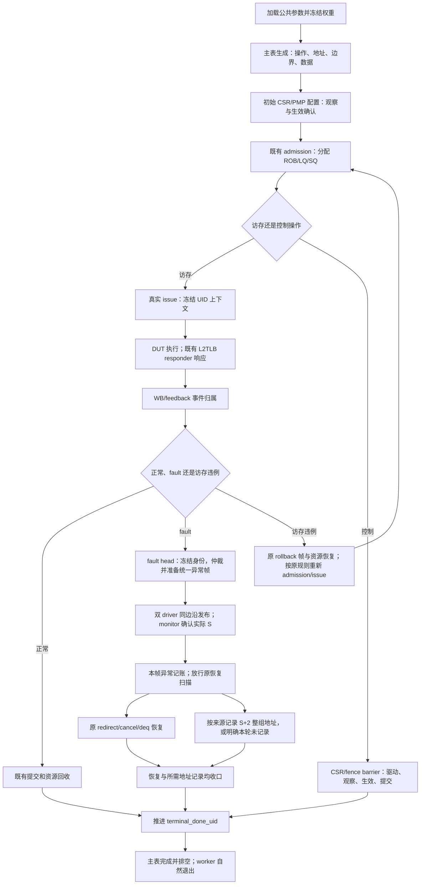

# MemBlock V2 虚拟化指令公共测试框架正式实现方案

- 创建日期：2026-11-09。
- 更新日期：2026-11-17。
- 更新说明：保留已确认的五类 fence 权重及主表失效范围；异常地址记录改为接入统一后端周期帧，补齐 Guest 执行上下文、CSR 切换屏障、精确采样、来源边界和取消收尾。
- 适用分支：`mem_ut_uvm_v2`。
- 状态：正式可 coding 方案；2026-11-17 独立复审及主代理最终自查通过，无必须修改项。尚未实施。以本文件及两份关联正式方案作为后续 coding 依据。
- 范围：公共测试框架的激励生成、CSR 配置、调度、驱动、响应建模、事件记录和异常恢复。
- 不包含：定向 testcase/vseq、专用场景 preset、RM/checker/scoreboard 算法、功能覆盖率模型、RTL 修改。
- 授权边界：本轮仅完善方案与评审；后续源码修改仍须明确 coding 授权。
- 公共控制依赖：[MemBlock V2 后端周期快照同步驱动与异常地址采样方案](memblock_v2_backend_cycle_frame_formal_plan_20261117.md)。该方案负责双 agent 同边沿发布、实际输入采样和恢复门槛，本方案负责特殊访存属性及 Guest 上下文接入。

- 评审记录：[独立评审闭环记录](../../review_doc/undo/memblock_v2_virtualization_backend_formal_plan_review_20261117.md)。

## 1. 专有名词与抽象功能说明

本方案扩展现有标量访存和控制操作主流程，不建立第二套调度、CSR 镜像或 L2TLB 生命周期。

| 名词 | 当前含义与代码落点 | 示例 |
|---|---|---|
| DUT、RTL | 被测 MemBlock 硬件及其实现；权威生成产物是 `build/rtl/MemBlock.sv` | HLV 由真实 LoadUnit 执行 |
| UVM、transaction | 验证框架及传输对象；主表对象为 `main_control_transaction` | 一笔逻辑访存的操作码和操作数 |
| UID | 主表逻辑指令编号 | 同一 UID 重放仍属于同一逻辑操作 |
| ROB、LQ、SQ、LSQ | 重排序队列、Load 队列、Store 队列及访存队列总称；框架由 allocator/commit handler 模拟后端输入 | HSV 分配 SQ，发射 STA 和 STD |
| STA、STD、WB | Store 地址、Store 数据、真实写回事件 | 地址和数据独立发射并等待各自真实完成 |
| `dynamic_epoch`、reset epoch | 同一 UID 的动态执行代次、复位代次；用于旧事件过滤 | redirect 后旧代次 WB 不绑定新实例 |
| `sample_seq`、S、S+2 | 公共 monitor 采样编号；S 为实际输入锚点，S+2 为普通 LSQ 路径在边沿前采样约定下的目标地址样本 | driver 返回时刻不能当作 S |
| backend cycle frame、周期帧、`frame_id` | 公共同步方案保存的一次 MemBlock 输入周期控制及其运输身份 | HSV fault 帧同时发布类别、零正常提交和异常 redirect |
| prepared、ready、sampled-applied | 准备资格、框架内部 driver 准备确认、实际采样后完成单次业务记账 | ready 不表示 DUT 有 redirect ready 端口 |
| reservation、recovery eligible | 发布前的轻量预占、允许原恢复扫描的门槛；沿用公共同步方案 | 未应用本帧 fault 状态时不能开始恢复扫描 |
| raw sample、anchor、history、readonly | monitor 原始样本、关联锚点、有界历史及只读记录接口 | adapter 晚处理仍取指定 sample，不能取 latest |
| AF、PF、GPF、exceptionVec | 访问错误、页错误、Guest 页错误及真实 WB 异常向量 | 以真实 exceptionVec 确认异常，不能用主表预期配置代替 |
| address source、`address_record_required` | 地址输出的实际来源及本轮是否要求记录，属于运行期状态 | 本 V2 标量非对齐沿普通 LSQ S+2 |
| rollback、terminal、cancel record | 访存违例回滚重发、逻辑指令终态及原恢复 owner 的取消记录 | rollback 不生成 fault 地址记录 |
| AMO、segment、misalign overwrite | 原子操作、向量 segment、非对齐缓冲异常地址覆盖来源 | 本范围标量无来源合同属于错误 |
| CSR、snapshot | 控制状态及某采样边界实际观察到的状态副本；运行时权威为 `mmu_csr_runtime_state` | UID 保存 issue 时的 SPVP |
| Host/Guest、HS/VS/VU | 管理虚拟机的一侧/虚拟机一侧；Host 内核/Guest 内核/Guest 用户 | HS 执行 HLV 访问 Guest |
| SPVP、dmode、dvirt | 特殊访存使用的 U/S 身份、普通访存有效特权级、普通访存有效虚拟化属性 | MemBlock 的 `priv.virt` 是上游提供的有效 dvirt |
| SUM、MXR、PMP/PMA | 页面访问控制、执行页读取控制、物理保护/属性；此方案负责配置和快照运输 | 两阶段权限位交给 DUT 消费 |
| GVA/GPA/HPA | Guest 虚拟地址/Guest 物理地址/最终 Host 物理地址 | GVA 经 VS-stage、G-stage 得到 HPA |
| VS-stage/G-stage、S1/S2 | Guest 页表翻译和 Guest 物理地址翻译；响应中的两阶段结果 | `vsatp/hgatp` 控制相应阶段 |
| PTE、VPN、PPN、ASID、VMID | 页表项、虚拟页号、物理页号、地址空间编号、虚拟机编号 | 同 VPN 在不同 VMID 下可有不同映射 |
| TLB/DTLB/L2TLB、PTW/HPTW | 翻译缓存/数据侧翻译缓存/下一级翻译服务、页表遍历器/G-stage 遍历器 | 当前 agent 接管 DTLB 与 L2TLB 的交接处 |
| token、outstanding、owner | 每次真实请求握手的独立响应记录、尚未完成请求、生命周期唯一管理者 | 同 key 两次握手保留两个 token |
| key、live entry | 查询键、公共表中当前有效映射 | key 包含 VPN、s2xlate 和有效 ASID/VMID |
| barrier、worker、candidate | 后续操作不能越过的控制屏障、运输控制操作的 sequence、尚未提交的候选配置 | CSR 被观察并生效后才提交 candidate |
| `sfence_scope` | 主表中一笔 fence 的失效范围枚举，不参与后续随机 | 自动建表固定全地址、全 ID，手工建表可指定地址和 ID |
| payload、profile、preset | 运输字段集合、配置/生成策略、运行配置文件 | fence payload 包含地址、ID、hv/hg、flushPipe |
| monitor、adapter、handler | 采样、事件适配、状态处理组件 | monitor 记录原始事件，adapter 关联 UID |
| replay、redirect、fault head | 访存重试、冲刷控制、位于模拟提交前沿的异常指令 | fault head 采样记账后放行恢复，地址记录独立完成 |
| C−2、C0/C4 | 既有 V2 请求 CSR 历史对齐；顶层控制事件采样/四拍后 filter 生效边界 | responder 不以 latest 替代请求所需历史 |
| map、queue、cursor、prefix | 关联索引、待处理队列、顺序游标、连续完成前缀 | `terminal_done_uid` 用于正常结束 |
| RM/checker/scoreboard、covergroup | 独立结果判断和覆盖率组件；不属于本方案实现 | 后续通过 readonly 接口消费记录 |
| vseq、cfg、plusarg | 顶层 virtual sequence、参数文件、运行参数 | 复用既有 vseq 启动公共 worker |

## 2. 目标与支持边界

### 2.1 公共操作支持

| 操作 | 主表及路由表达 |
|---|---|
| `HLV.B/BU/H/HU/W/WU/D` | `INT_LOAD`，LQ、Load issue、整数写回 |
| `HLVX.HU/WU` | `INT_LOAD`，LQ、Load issue、整数写回 |
| `HSV.B/H/W/D` | `STORE`，SQ、STA、STD |
| `HFENCE.VVMA/GVMA` | 现有 `SFENCE_CONTROL` 的不同 payload，`flushPipe=1` |
| `HINVAL.VVMA/GVMA` | 同上，`flushPipe=0` |

普通访存在 `priv.virt=1` 时使用 Guest 翻译，也复用相同调度和上下文机制。

### 2.2 独立 MemBlock 验证边界

输入为后端已译码操作和上游计算完成的有效 CSR 状态。HU、VS/VU 执行资格、MPRV/MPP/MPV 到 dmode/dvirt 的生成，以及 stval/htval/htinst 的最终写入属于后端、CSR 模块或整核验证，不在框架中伪造对应硬件实现。

L2TLB agent 模拟下一级翻译服务返回给真实 DTLB 的结果，不模拟 PTW 到 L2Cache/memory 的真实页表遍历。真实 PTW/HPTW 集成属于后续独立方案。

本方案通过公共后端周期帧处理 HLV/HLVX/HSV 的异常控制发布，不另外建立异常 owner、redirect 年龄仲裁或地址采样时钟。普通 LSQ 地址记录以第 10 章的来源前提为准；特殊来源未记录时必须显式标记，不能据此宣称全来源异常地址已支持。

本方案不新增定向用例、具体测试子场景或场景 CSV 行；后续实际新增用例时另按 CSV 管理规则登记。公共参数默认配置同步属于实现范围，不等同于新增专用用例 preset。

## 3. 当前实现基础与缺口

以下是 2026-11-09 源码检查结果，尚未应用到源码。

| 模块 | 已有基础 | 扩展内容 |
|---|---|---|
| `memblock_dispatch_types.sv` | 普通操作常量、CSR 参数结构、控制 payload | 13 个特殊访存常量、SPVP 参数、fence 的 flushPipe 记录 |
| `memblock_dispatch_base_sequence.sv` | 操作枚举、权重、边界及地址关联 | 特殊访存候选、宽度、操作数规范化和合法性检查 |
| `memblock_op_behavior_util.sv` | LOAD/STORE/CBO/AMO 单一行为分类 | 特殊访存归入已有 LOAD/STORE 行为 |
| `memblock_csr_randomizer.sv` | MXR/SUM、virt/dmode 等随机生成 | 初始及动态 SPVP 生成、保持、变化条件 |
| `memblock_csr_config_state.sv` | SPVP 默认值、完整 payload 打包 | `differs_from()` 补 SPVP |
| `mmu_csr_runtime_state.sv` | 已比较、保存和复制 SPVP | 复用现有镜像和快照，不另建一套状态 |
| `memblock_dynamic_csr_change_sequence.sv` | 候选配置、HS 映射维护 | Guest 映射切换、传播和失效协议 |
| `common_data_transaction.sv` | UID 上下文、翻译表、请求关联 | fuType 联合识别、特殊访存有效 PMP 身份 |
| `memblock_l2tlb_base_sequence.sv` | 两阶段、多 outstanding、C−2 历史、reset/flush | 复用并补齐上下文衔接 |
| `memblock_sfence_control_base_sequence.sv` | flushSb、fence 发送和完成确认 | 完整可控 payload、HINVAL |
| ctrl monitor、adapter、commit handler | 已接异常地址、fault head 和 redirect，地址 raw 闭环尚缺 | 接入统一后端帧；冻结 Guest 身份、实际 S、指定地址样本和独立收尾 |

关键源码事实：

1. `is_hypervisor_tlb_inst()` 目前只检查 fuOpType 部分位。MOU 的 AMOXOR 等操作码与 HLV 存在位型重叠，必须联合 fuType 判断。
2. 专用动态 CSR `body()` 明确拒绝旧或新 `priv.virt=1`；`hs_mapping_fence_required()` 和 `complete_hs_mapping_fence()` 仅覆盖 HS 映射维护，不能只新增 SPVP 参数后删除拒绝条件。
3. UID/PMP 上下文登记的多个入口直接传 `priv_dmode`，特殊访存需要以 SPVP 派生有效 U/S 身份。
4. fence worker 固定 `rs1=1、rs2=1、flushPipe=1`；公共解码后的 `memblock_sfence_payload_t` 尚无 flushPipe 字段。
5. 顶层 VA/GPA/`isForVSnonLeafPTE` 已接到 interface，但通用 monitor transaction 的相应发布语句仍被注释，不能视为已有有效异常记录闭环。

## 4. 端到端功能流程



**函数调用 Flow 图整体文字伪代码：**

```text
1. 公共生成器冻结参数、构建主表，初始配置经 monitor 确认后进入 admission。
2. 访存真实 issue 时保存访问上下文；DUT 执行并由既有 responder 提供响应。
3. WB/feedback 经原 adapter/status 逻辑归属执行实例：
   正常完成则走原提交；访存违例走原 rollback 范围及重发流程。
4. 真实 fault 等到故障队首并满足资格后，准备及仲裁统一异常帧。
   公共 scheduler 协调两个 driver 发布，monitor 确认实际 S 后单次应用异常记账。
5. 记账后放行原恢复；地址记录同时按来源决定是否读取指定 S+2 样本。
   原恢复和所需记录都结束后清理故障上下文，推进对应终态。
6. 控制操作持有原 barrier，等待旧访问/地址目标，再驱动并观察 CSR/fence 生效。
7. 主表终态前缀完成且运输、原恢复和记录均排空后，各公共 worker 自然退出。
```

现有主表、状态表、真实握手和 monitor 事件继续作为权威。不得以发射成功替代真实 WB，也不得以合法异常为由判定激励非法。

## 5. 指令生成、分类与操作数

### 5.1 操作码和路由

在公共 types 中增加 HLV/HLVX/HSV 常量，编码以当前 V2 `src/main/scala/xiangshan/package.scala` 为依据。具体编码与数据语义如下。常量命名为 `MEMBLOCK_LSUOP_` 加表中去点指令名；因此仅看数值不能区分执行类别。

| 指令 | fuOpType 十进制 | 字节数 | 整数读取扩展 | 执行类别 |
|---|---:|---:|---|---|
| HLV.B | 16 | 1 | 符号扩展 | LDU |
| HLV.H | 17 | 2 | 符号扩展 | LDU |
| HLV.W | 18 | 4 | 符号扩展 | LDU |
| HLV.D | 19 | 8 | 原64位 | LDU |
| HLV.BU | 20 | 1 | 零扩展 | LDU |
| HLV.HU | 21 | 2 | 零扩展 | LDU |
| HLV.WU | 22 | 4 | 零扩展 | LDU |
| HLVX.HU | 29 | 2 | 零扩展 | LDU |
| HLVX.WU | 30 | 4 | 零扩展 | LDU |
| HSV.B | 16 | 1 | 不适用 | STU |
| HSV.H | 17 | 2 | 不适用 | STU |
| HSV.W | 18 | 4 | 不适用 | STU |
| HSV.D | 19 | 8 | 不适用 | STU |

`INT_LOAD` 枚举增加 HLV/HLVX，`STORE` 增加 HSV，`FP_LOAD` 保持原有候选。不能因当前 INT/FP 共享枚举分支而把 HLV 带入 FP_LOAD。

`derive_op_behavior()` 继续产生现有 LOAD/STORE kind：HLV/HLVX 申请一个 LQ element；HSV 申请一个 SQ element并发射 STA/STD。写回、commit 分类和 `numLsElem` 不创建同义字段。

### 5.2 公共识别入口

涉及对象：`memblock_op_behavior_util`，以及委托它的 `common_data_transaction::is_hypervisor_tlb_inst()`、主表和 issue 校验。

**抽象功能描述：** 公共识别在建表、发射和上下文登记阶段解释操作类型，返回该操作是否为特殊 Guest 访存，不保存运行时状态。

**输入与输出：** 输入 fuType、fuOpType；输出特殊访存、特殊读取、HLVX 等分类。函数属于常数时间路径。

**源码级伪代码：**

```text
LDU 且 opcode 属于明确 HLV/HLVX 集合：返回特殊读取
STU 且 opcode 属于明确 HSV 集合：返回特殊写入
其余：返回非特殊访存
HLVX 属性只在 LDU 且 opcode 为 HLVX.HU/WU 时成立
```

**中文文字伪代码：** 先用执行类别分隔编码空间，再在该类别的白名单中判断。既有 TLB 登记入口委托公共分类结果，不重复保留位型判定。对 MOU、CBO、预取和其它类别不产生特殊 Guest 属性。主表不新增独立随机的 hyperinst/hlvx，DUT 仍从实际操作码派生这些信号。

### 5.3 `memblock_dispatch_base_sequence::normalize_guest_memory_address()`（新增）

**抽象功能描述：** 地址模板或地址关联确定目标 VA 后，将其转换成所选操作允许的源操作数，保证最终主表字段与接口语义一致。

**目的和阶段：** 建表期统一处理无立即数的特殊访存，防止地址复用和 fallback 重新引入非零 imm。

**输入：** 已选操作的 transaction、目标 VA。**输出/副作用：** 更新 src_0/imm/vaddr；最终宽度和边界标签随后由已有公共入口重新派生。

**源码级伪代码：**

```text
若分类结果为 HLV/HLVX/HSV：
    src_0 = 目标 VA
    imm = 0
否则：
    沿用普通访存的地址分解规则
调用 update_vaddr()，从最终 src_0 和 imm 重新计算 vaddr
调用已有宽度/边界分类，刷新最终标签
调用主表合法性检查，只检查激励字段的一致性
```

**中文文字伪代码：** 先依据已确定的操作选择源操作数表达方式；特殊访存直接把目标地址放到 src_0 并清零 imm，普通访存继续按已有规则分解。随后 `update_vaddr()` 根据输入操作数重算地址，宽度和边界分类根据最终 opcode/地址重算标签，主表校验验证它们一致。所有可能改操作码或地址的模板、关联、宽度收敛和 fallback 路径都经过该规范化过程，不以结果应成功还是异常筛选地址。

HLV/HLVX 必须选择整数写回，HSV 沿用单 STA/单 STD 和现有 slot0 数据 override；重放不得重新随机 STD 数据。跨页和非对齐沿用既有 scalar 边界生成与恢复机制。

## 6. 参数与 SPVP 配置流程

所有公共参数通过 `env/plus.sv → seq_csr_common 冻结快照/getter → consumer`。参数只控制生成，不保存实时 CSR。

| 计划新增参数 | 默认值 | 含义 |
|---|---|---|
| `MEMBLOCK_LOAD_FUOP_HLVB_WT` | 0 | INT_LOAD 下 HLVB 候选权重 |
| `MEMBLOCK_LOAD_FUOP_HLVBU_WT` | 0 | INT_LOAD 下 HLVBU 候选权重 |
| `MEMBLOCK_LOAD_FUOP_HLVH_WT` | 0 | INT_LOAD 下 HLVH 候选权重 |
| `MEMBLOCK_LOAD_FUOP_HLVHU_WT` | 0 | INT_LOAD 下 HLVHU 候选权重 |
| `MEMBLOCK_LOAD_FUOP_HLVW_WT` | 0 | INT_LOAD 下 HLVW 候选权重 |
| `MEMBLOCK_LOAD_FUOP_HLVWU_WT` | 0 | INT_LOAD 下 HLVWU 候选权重 |
| `MEMBLOCK_LOAD_FUOP_HLVD_WT` | 0 | INT_LOAD 下 HLVD 候选权重 |
| `MEMBLOCK_LOAD_FUOP_HLVXHU_WT` | 0 | INT_LOAD 下 HLVXHU 候选权重 |
| `MEMBLOCK_LOAD_FUOP_HLVXWU_WT` | 0 | INT_LOAD 下 HLVXWU 候选权重 |
| `MEMBLOCK_STORE_FUOP_HSVB_WT` | 0 | STORE 下 HSVB 候选权重 |
| `MEMBLOCK_STORE_FUOP_HSVH_WT` | 0 | STORE 下 HSVH 候选权重 |
| `MEMBLOCK_STORE_FUOP_HSVW_WT` | 0 | STORE 下 HSVW 候选权重 |
| `MEMBLOCK_STORE_FUOP_HSVD_WT` | 0 | STORE 下 HSVD 候选权重 |
| `MEMBLOCK_CSR_INIT_SPVP_0_WT/1_WT` | 1/0 | 初始 SPVP 分布 |
| `MEMBLOCK_CSR_CHANGE_SPVP_EN` | 0 | 是否允许动态修改 SPVP |
| `MEMBLOCK_CSR_CHANGE_SPVP_0_WT/1_WT` | 1/1 | 允许修改时的目标分布 |
| `MEMBLOCK_SFENCE_VMA_WT` | 1 | SFENCE.VMA 类型权重 |
| `MEMBLOCK_HFENCE_VVMA_WT` | 1 | HFENCE.VVMA 类型权重 |
| `MEMBLOCK_HFENCE_GVMA_WT` | 1 | HFENCE.GVMA 类型权重 |
| `MEMBLOCK_HINVAL_VVMA_WT` | 0 | HINVAL.VVMA 类型权重 |
| `MEMBLOCK_HINVAL_GVMA_WT` | 0 | HINVAL.GVMA 类型权重 |

表中的斜线组合是同组参数简写，不是一个包含斜线的实际 key。保持默认特殊指令权重为 0，原有默认分布不变。单值选择通过相应组仅保留目标权重实现，不新增同义固定值入口。

参数校验沿用 `seq_csr_common`，权重不得为负；启用类别必须有可选候选。对扩展候选集合使用足够宽的累计值，避免权重求和溢出；FP_LOAD 的合法候选独立校验，不能被 HLV 权重掩盖空集合。动态 SPVP 必须参与“至少一个允许字段真正变化”的约束；没有可变化解时明确报告，不无限重试。

### 6.1 CSR randomizer 和配置比较

**抽象功能描述：** `memblock_csr_randomizer` 在初始或动态 action 构造阶段产生一份完整目标配置，配置比较入口识别有效字段变化；均不提前修改 monitor 维护的 runtime 状态。

**输入与输出：** 冻结参数、当前 committed 配置；输出含 SPVP 的候选 transaction。`differs_from()` 只返回不同与否。

**源码级伪代码：**

```text
configure：读取参数；动态阶段保存当前 SPVP
初始求解：按 INIT_SPVP 两个权重选择 SPVP
动态求解：
    CHANGE_SPVP_EN=1：按 CHANGE_SPVP 权重选择
    否则：SPVP 固定为当前值
dynamic_must_change：SPVP 的允许变化加入有效变化项
apply_to_transaction：把选择结果赋到已有 priv_spvp 字段
复制/打包/配置比较：保留并比较同一 SPVP 字段
日志：打印选择值、阶段和权重
```

**中文文字伪代码：** 初始配置使用初始分布；动态配置先冻结旧值，只有明确允许变化时才选择新值。约束把 SPVP 与其它允许变化字段并列判断，保证动态 action 表达真实改变。transaction 填充、完整 payload 和日志都使用本次同一结果；`differs_from()` 补入 SPVP，不能把只改这一 bit 的 action 判为无变化。现有 driver、monitor、运行时镜像已经携带该字段，直接复用。

## 7. CSR barrier 与 Guest 映射切换

### 7.1 配置变化与映射维护分离

权限/身份变化负责配置驱动、观察和传播确认；不因 SPVP、SUM、MXR 或 snapshot 序号变化自动删除所有软件映射。翻译映射上下文更新通过实际 fence 事件维护公共 live entry。

当前统一 changed 脉冲合同与映射维护分开处理。本方案保留既有四项统一单拍changed运输合同，并单独验证其事件观察；它不替代entry级公共失效或显式维护步骤。稳定传播比较使用清协议位后的clean level。

### 7.2 动态 CSR action 主流程

涉及 `memblock_dynamic_csr_change_sequence::body()`、原 HS 映射维护和 `memblock_control_barrier_service` 的候选完成确认。

**抽象功能描述：** 控制操作持有 barrier 期间，把一份候选配置及必要映射维护完整送入 DUT；只有实际观察与生效条件完成，才将其提交为下一阶段配置。

**输入：** 原 owner、reset epoch、committed 配置、候选配置。**输出/副作用：** 发出真实配置/fence 操作，成功后提交 candidate；失败不放行后续访问。

**源码级伪代码：**

```text
等待控制操作到现有提交前沿，绑定既有 owner
保留后续发射 barrier
在任何 CSR/PMP/fence 副作用前，按第 7.4 节等待旧访问及异常地址上下文排空
等待期间继续运行 WB、周期帧发布、monitor、原异常恢复及独立 flushSb 服务
复制 committed，生成 target
依据旧/新翻译配置构造有界维护步骤
按步骤驱动 CSR、PMP/PMA 和 fence
每次副作用前核对 owner/reset，等待对应 monitor observation
等待最终配置传播及必要失效生效
stage candidate，交由现有 service 比对观察事实后提交
成功后开放控制 commit 和后续访问
reset/owner 失效或 watchdog：保留失败，不伪造完成
```

**中文文字伪代码：** 控制服务先证明该操作已位于原有提交前沿，再按第 7.4 节确认旧访问和待记录异常已经收口，由唯一 owner 运输候选配置。等待这项条件时不能停掉使旧访问完成的公共服务。配置生成只修改候选对象。维护步骤使用旧、新配置决定，运输后分别等待 monitor 事实与生效边界。现有完整 payload、PMP/PMA 写回放及 candidate 提交机制继续承担完成确认，driver 返回不视为配置已生效。失败走原有生命周期处置，不借用新 reset epoch 使旧 action 复活。

### 7.3 Guest 映射维护的第一版保守协议

需要清理 Guest 映射上下文时，采用有界串行步骤：

```text
旧上下文下：全地址、全 ASID 的 HFENCE.VVMA
    → 等待该事件生效
更新目标 CSR，并确认目标配置传播
目标上下文下：全地址、全 ASID 的 HFENCE.VVMA
    → 等待该事件生效
全地址、全 VMID 的 HFENCE.GVMA
    → 等待该事件生效
提交配置并释放 barrier
```

VVMA 使用各自事件采样时的 VMID；GVMA 清理 G-stage 上下文。上述是框架的保守串行维护策略，不宣称架构要求每次配置改变都执行三条指令。HS SATP 映射更新继续执行相应 HS 维护步骤。SPVP 单独变化不进入这组 Guest 映射维护。

复用已有 owner 和 fence 观察槽逐步预约、消费，不新建并行 owner；C0/C4、总四拍 hold 与请求取消合同遵循 V2 profile。传播等待依据实际 DUT 时钟采样，不用任意 `#1` 循环次数冒充硬件周期。

只有协议和完成条件具备后，才移除动态 CSR 的 `virt=1` 拒绝条件。步骤分类、状态及调用入口固定见第 13 章，不增加 Guest owner。

### 7.4 异常地址捕获与 CSR 切换屏障

**抽象功能描述：** 动态 CSR action 在开始配置或映射副作用前，确认旧执行环境中的访存和异常地址记录已完成必要消费，保证后续切换不会影响仍在使用的异常地址上下文。本节扩展既有控制 barrier 的放行条件，不新增并行 CSR owner。

**输入与副作用：** 输入既有控制 owner/reset、旧上下文的活动访问计数和第 10 章地址记录状态；条件不足时保留当前配置并等待，满足后允许进入原配置流程。运行期采用现有 active map、未完成计数和有界事件队列，不每拍扫描全部主表。

**源码级伪代码：**

```text
已取得原控制操作资格和后续发射 barrier。
每次准备发出 CSR/PMP/fence 副作用前检查 owner/reset。
若 owner/reset 失效，按原控制取消流程退出，不提交 target。
若旧上下文仍有较老的在途访存、prepared/已发布未应用的 fault，
  或 address_record_required 且尚未记录/合法取消的异常事件：
    保持实际 CSR 和映射环境，暂不开始配置或 fence 副作用。
    继续等待公共服务推进 WB、异常帧、记录和原资源恢复；不占住这些服务的锁。
否则：按第 7.2 节进入配置、映射维护、实际观察和传播确认。
若旧事件已报缺样本等框架错误，转原失败/global-stop流程，不能按成功排空放行。
```

**中文文字伪代码：** 本屏障保护实际硬件仍要使用的旧上下文。issue 快照用于追溯原访问身份，但不能替代地址输出逻辑正在使用的实际 CSR。控制 action 到提交前沿后，先读取已有未完成状态；存在旧访问或需要捕获的异常时，保持旧配置，继续让相关 WB、frame 发布、monitor 和恢复自然完成。普通 LSQ 的目标地址样本已保存或该事件合法取消后，地址捕获才不再阻塞切换；原控制前沿、资源恢复等其它门槛仍须满足。这里不修改 L2TLB 的既有请求/响应历史对齐，也不因为 snapshot 序号变化而清表。

## 8. 发射、PMP 上下文与翻译响应

### 8.1 UID 访问上下文

**抽象功能描述：** issue 和翻译关联路径为真实执行实例登记输入上下文，使后续响应记录、恢复和只读 consumer 可追溯到当时的访问身份。

**源码级伪代码：**

```text
真实 issue fire：解析 UID、执行代次和完整 ROB/LQ/SQ key
通过公共 fuType/opcode 分类得到特殊访存属性
取得已同步的 CSR snapshot
effective_mode = 特殊访存 ? U/S 编码的 SPVP : dmode
use_guest = snapshot.priv_virt || 特殊访存
保存实际 opcode/fuType、特殊访存/HLVX 属性、有效身份及已有 CSR snapshot 身份
调用已有 UID TLB 登记入口，保存该快照和请求上下文
调用既有 PMP/PMA context plan/commit 入口，以 effective_mode 冻结身份
首次翻译请求关联/补登记同样使用该 UID 的操作属性和该请求快照
```

**中文文字伪代码：** 只有真实握手才建立执行实例的有效记录。公共分类先分隔编码空间，再确定特殊属性；同一份 CSR 快照既用于翻译登记，也用于访问身份。PMP/PMA 现有 plan/commit 接口继续拥有表代数和提交职责，调用者只把正确有效特权级传入。所有 issue、首次 request 关联和补登记入口都同步修改，避免 hit 无 request 与 miss 路径使用不同身份。异常事件引用与该动态实例匹配的既有 issue 上下文；重放/重发按现有 issue epoch、replay sequence 和 dynamic epoch 关联，不能在 fault head 阶段用最新 CSR 替换原快照。保存的是实际访问环境，不从 exceptionVec 反推 SPVP 或 hyperinst。

### 8.2 L2TLB responder 生命周期

继续使用现有 `memblock_l2tlb_base_sequence`：

```text
实际 request fire
    → 冻结 vpn/s2xlate
    → 按现有 V2 C−2 历史取得请求 CSR
    → 用有效 ASID/VMID 建 key 并查询公共表
    → 冻结 token 响应
    → 按既有 latency、ordered/reorder 和 ready 规则调度
    → 在真实 response sample 后登记 completion
```

不得用 current/latest 替代已有请求 CSR 历史对齐。现有响应时 PBMTE 处理继续沿用目标响应 sample 的 C−2 历史及 token 私有 overlay，不因“冻结上下文”而删除已有 response-visible 语义。

每次握手建立独立 token；同 key 不合并。权限按 stage 返回，不能为某条 UID 临时改共享 entry 让它成功。S2 没有 entry V 字段，不新增虚构字段。Guest fault 补 GPA 触发的再次请求走同一 lifecycle。filter 内部已有 getGpa 维护，不凭名称向接管口添加不存在的字段。

reset/flush 取消显式记账，沿用唯一 ready owner、四拍 hold 和首次 snapshot 门禁。框架不重建下游 PTW/memory 模型。

## 9. HFENCE/HINVAL 公共控制

### 9.1 类型选择：五个公共权重

沿用 `SFENCE_CONTROL`，类型选择使用第 6 章列出的五个权重。默认 `1/1/1/0/0` 保持既有 SFENCE/HFENCE 三类等权选择，默认不产生 HINVAL。主表自动插入的开关和 UID 间隔继续由现有 `MEMBLOCK_SFENCE_CONTROL_ENABLE/MIN_INTERVAL/MAX_INTERVAL` 提供，不增加第二套插入频率参数。

- 只有一个权重非零：固定选择对应类型。
- 多个权重非零：按相对权重混合选择。
- 权重为 0：该类型不进入候选集合；权重为负非法。
- 启用自动 fence 类型生成时，五项不得全为 0；累计权重使用 `longint unsigned`，采样区间不得经 32 位随机接口截断。
- 每笔逻辑控制操作首次构造 action payload 时选择类型一次并冻结；同一操作的运输重试复用已选类型，不能重复求解。
- 类型只生成合法的 `(hv,hg)` 组合：SFENCE 为 `(0,0)`，VVMA 为 `(1,0)`，GVMA 为 `(0,1)`。
- `flushPipe` 由类型派生：SFENCE.VMA、HFENCE.* 为 1，HINVAL.* 为 0；不增加可独立覆盖该关系的随机参数。

这些权重只控制公共 SFENCE_CONTROL 的自动类型选择。第 7 章中 CSR 映射维护所需的显式 fence 按维护步骤确定类型，不受上述权重影响；否则仅启用一种类型时可能破坏 CSR 切换协议。

### 9.2 失效范围：由主表保存，不在 worker 随机

在 `main_control_transaction` 增加非随机字段：

```systemverilog
memblock_sfence_scope_e sfence_scope;
```

在 `memblock_dispatch_types.sv` 计划新增四值枚举，构造默认值为第一项：

| 枚举值 | 地址选择 | ID 选择 | 接口 rs1 | 接口 rs2 |
|---|---|---|---:|---:|
| `MEMBLOCK_SFENCE_SCOPE_ALL_ADDR_ALL_ID` | 全地址 | 全 ID | 1 | 1 |
| `MEMBLOCK_SFENCE_SCOPE_ADDR_ALL_ID` | 指定地址 | 全 ID | 0 | 1 |
| `MEMBLOCK_SFENCE_SCOPE_ALL_ADDR_ID` | 全地址 | 指定 ID | 1 | 0 |
| `MEMBLOCK_SFENCE_SCOPE_ADDR_ID` | 指定地址 | 指定 ID | 0 | 0 |

自动建表路径始终将 `sfence_scope` 设为 `MEMBLOCK_SFENCE_SCOPE_ALL_ADDR_ALL_ID`。手工建表可在主表最终校验之前设置其它枚举值；`post_manual_config()`、主表校验和控制 action 构造必须保留设置结果，不重新套用自动默认值。范围字段不声明为 `rand`，不提供全地址/指定地址、全 ID/指定 ID 的运行期权重或范围随机开关。

| 范围 | VVMA 目标语义 | GVMA 目标语义 |
|---|---|---|
| 全地址、全 ID | 当前事件 VMID 下所有 ASID | 所有 VMID 的地址映射 |
| 指定地址、全 ID | 当前事件 VMID 下指定 GVA 对应映射，忽略 ASID | 指定 GPA 对应映射，忽略 VMID |
| 全地址、指定 ID | 当前事件 VMID 下指定 ASID 的映射；global 项按既有规则处理 | 指定 VMID 的地址映射 |
| 指定地址、指定 ID | 当前事件 VMID、指定 ASID、指定 GVA；global 项按既有规则处理 | 指定 VMID、指定 GPA |

上述是输入事件的目标语义，DUT L1 DTLB 可以按 V2 实现扩大地址失效范围。VVMA 的“当前 VMID”来自 monitor 对该事件的实际上下文采样，不在主表中额外保存一个可独立覆盖的当前 VMID。

`rs1/rs2=1` 表示对应源寄存器编号为 x0，即忽略地址/ID，不是原始地址或 ID 数值为零。只有枚举决定通配位；不得依据 `addr==0` 或 `id==0` 推导通配。因此指定地址 0、指定 ID 0 与全地址、全 ID 都能区分。

### 9.3 指定地址和 ID 的主表运输

前述范围字段只选择四种组合；指定地址和 ID 的数值沿用本方案规划的主表控制 payload。为使手工建表入口明确，使用主表原始运输字段 `sfence_addr`（50 位）和 `sfence_id`（16 位），不复用普通访存的 `src_0/imm` 推测其含义；主表成员固定为 `sfence_addr`（`bit [49:0]`）和 `sfence_id`（`bit [15:0]`），不再包一层可变对象。

- 自动主表为全地址、全 ID，默认把被忽略的 addr/id 置 0，不再为被忽略值随机求解。
- 手工主表选择指定地址时，必须同时在控制 payload 中给定原始 addr；VVMA 运输 GVA，GVMA 运输 GPA>>2。未提供的数值默认为 0，0 是合法指定值，不作为缺失哨兵。
- 手工主表选择指定 ID 时，控制 payload 的 id 为目标 ASID（VVMA）或 VMID（GVMA）。GVMA 按版本的 14 位有效 VMID 合同处理，不能悄悄截断一个超出合同的手工目标。
- SFENCE.VMA 使用相同范围枚举，地址与 ID 按其 S/VS 上下文解释；HINVAL.* 与对应 HFENCE.* 使用相同范围编码。
- worker 不随机生成、替换或修复指定地址/ID。目标映射不在 live table 中仍是合法失效输入，不强制把它改成命中已有映射的目标。
- 主表最终确认后，scope 和原始 addr/id 随控制操作复制到 action，之后整个 owner 生命周期冻结；不能因等待、重试或 latest CSR 更新改写这些主表输入。
- GVMA 的原始 addr 在既有公共解码处只恢复一次 GVPN，不在主表到 action、worker 到 driver 过程中重复左移。

本轮用户只要求范围由主表控制；不引入固定值/范围随机/live-entry 选择等后续自动地址生成策略。

### 9.4 主表构造和 worker 的职责

涉及 `make_control_main_transaction()`、`validate_control_main_table_entry()` 和 `memblock_sfence_control_base_sequence::configure_sfence_control_xaction()`；不建立第二套 worker 或范围字段权威。

**抽象功能描述：** 主表构造阶段保存一笔控制操作的失效范围和原始目标；worker 根据公共权重确定操作类型，并将主表目标转换为接口字段。后续运输只复用冻结结果，不重新生成范围或目标。

**输入与输出：** 输入主表范围/原始 addr/id、五项冻结权重和有效控制上下文；输出唯一 action payload 和同源 expected observation。不修改 runtime CSR，也不判断 DUT 失效是否正确。

**源码级伪代码：**

```text
自动主表构造：
    scope = ALL_ADDR_ALL_ID
    主表 sfence_addr/sfence_id = 0
手工主表构造：
    保留调用者设置的 scope、addr、id
最终主表校验：
    检查 scope 属于四值枚举，不修复或覆盖输入
进入控制 action：
    从所属主表项复制 scope、addr、id，保存到 action
    若该 action 尚未冻结类型：
        按五项权重选出一种合法类型并冻结
    将 scope 纯转换为 rs1/rs2
    根据类型派生 hv/hg 和 flushPipe
    检查类型相关的输入可编码性，不随机改写目标
    由上述同一份字段构造驱动 item 和 expected observation
运输重试：
    复用 action 已冻结字段
```

**中文文字伪代码：** 自动生成入口只写默认全范围；手工入口保留用户选择。最终校验只拒绝枚举非法等基础输入问题，不把手工指定范围退回全范围。构造 action 时复制主表目标，再按权重选择一次操作类型；范围到通配位是确定映射，类型到 hv/hg/flushPipe 也是确定映射。驱动字段与预期运输观察来自同一 action，避免 worker 后续随机结果偏离主表。重试继续使用同一份冻结 payload，没有随机范围、地址或 ID 的分支。

### 9.5 worker 与完成流程

**抽象功能描述：** fence worker 运输同一份已冻结 payload，并向原控制 owner 提供发送事实；控制 service 继续负责失效生效后开放 commit。

**源码级伪代码：**

```text
控制操作到最老可执行位置
通过既有 flushSb 请求队列请求排空
等待真实 sbIsEmpty completion
读取主表 scope、原始 addr/id；按 9.4 构造并冻结 action
运输 payload，并预约相同字段的 expected observation
monitor 记录实际事件和上下文
既有 matcher 和生效队列按事件上下文处理失效
等待对应 effective observation 后完成控制操作
```

**中文文字伪代码：** service 先按 owner 排空 Store 路径，再由 worker 发送已冻结事件。发送与 expected observation 必须同源。adapter 保留事件时的 VMID、地址、ID 和 flushPipe，失效时不重新读取 current CSR。HINVAL 保留失效和在途请求取消，只关闭其 flushPipe 属性。已有 C4 队列拥有软件表删除，不由 worker 直接清表。

模型中的语义失效与 DUT L1 扩大地址失效范围分别处理；框架不能把未出现新请求当成失效失败，也不把所有未匹配地址强制规定为必须继续命中。DUT 正确性判定留给后续组件。

## 10. 异常地址采样、记录与恢复

本章依赖[后端周期快照同步驱动与异常地址采样方案](memblock_v2_backend_cycle_frame_formal_plan_20261117.md)的公共发布合同。正常提交、control、AF/PF/GPF fault 和访存违例各自保留原语义；本方案只补特殊访存与 Guest 上下文，不复制 scheduler、redirect owner 或 LSQ allocator。

### 10.1 公共事件记录与字段责任

扩展既有 fault token、status/raw 和 readonly 运输链。字段职责及成员名以关联后端正式方案第11.5节的 `memblock_fault_address_event_t` 为唯一合同，不另建同义类型；这些字段尚未实现。

| 字段组 | 权威来源和用途 |
|---|---|
| UID、完整 ROB key、`dynamic_epoch`、reset epoch | 来自已确认故障动态实例；区分重发、ROB key 复用和复位。reset 复用当前 redirect 生命周期采用的 `get_l2tlb_current_reset_epoch()`，不与独立 control topology 的 reset 编号混比 |
| 实际 fuType/opcode、特殊访存/HLVX 属性 | 通过公共操作分类冻结，区分 HLV/HLVX/HSV 和普通访存，不由异常类型反推 |
| issue CSR 上下文引用 | 引用该执行实例已有的 snapshot 身份及内容，保留 SPVP、dmode/dvirt、有效 U/S 身份、Guest 属性、相关 satp/vsatp/hgatp、ASID/VMID 和权限控制；不建立另一份可独立更新的 latest 镜像 |
| 真实 exceptionVec、WB 目标和身份 | 沿用真实 WB/status 记录；已有 issue epoch/replay sequence 继续用于过滤迟到反馈，主表预期 AF/PF/GPF 配置不作为异常已发生的证据 |
| intent、frame ID、目标驱动边沿、实际输入 S | 来自统一发布流程；区分准备、实际驱动、实际采样，不以 sequence 返回替代输入采样 |
| 地址来源与记录状态 | `address_source`、`address_record_required`、指定输出 sample 和完成/取消/未支持/错误状态，属于运行期事件状态，不新增 plus/cfg 开关 |
| 原始地址输出 | 同一样本的 `vaddr/gpaddr/isForVSnonLeafPTE`；保留原始位宽和值，记录状态单列 |
| 恢复与最终收尾状态 | 引用原 cancel owner 和资源恢复状态；独立保存 sampled-applied 与记录完成，mapping 回收后仍保留不可变事件上下文 |

`frame_id` 管理运输身份，UID/动态代次管理业务身份，两者均需保存。`pendingPtr` 只表达后端队首控制，不是按 ROB key 查询异常地址的端口。地址 raw 不含 UID，也无独立响应 valid；任何数值，包括零和与上一拍相同的地址，都不能作为记录存在或属于某 UID 的判据。

### 10.2 fault head 与统一发布流程

涉及既有 `lsq_commit_handler`、`exception_redirect_replay_handler`，以及公共同步方案计划增加的 scheduler 和 `apply_sampled_backend_cycle()`。这些入口的详细运输实现只在公共同步方案中维护。

**抽象功能描述：** 异常处理在真实 WB 确认和队首资格成立后，保存该次 Guest 访问身份并接入统一异常帧；实际输入采样后完成业务记账，再允许原恢复流程推进。地址记录与恢复分别完成，最终共同收尾。

**输入与副作用：** 输入真实 WB/status、原提交前沿、issue 上下文及仲裁结果；输出统一异常帧、实际 S、地址记录请求和恢复资格。准备不代表正常提交，不提前推进 cursor，不建立第二个异常 owner。

**源码级伪代码：**

```text
真实 WB/status 保存异常及 UID/ROB key/动态代次，关联原 issue 上下文。
原提交选择器选到合法 fault head，核对该执行实例和 reset。
HLV/HLVX 复用 Load 资格；HSV 复用 Store STA/STD 双真实 WB 资格。
  尚缺另一侧 dispatch/WB 时继续原 pending/head 和缺侧服务，不提前冻结。
准备 fault context，提交原 redirect intent 并按原年龄规则仲裁。
  PREPARING 只预占；同 UID/ROB key/代次的 prepared Store fault 可放行，
  不等待本帧尚未发生的 LSQ finish_item 或实际发布记账。
scheduler 冻结统一 fault 帧：故障 head、正确类别、零正常 scommit/对应 pending、
  对应异常 redirect；HLV/HLVX 类别为 Load，HSV 为 Store。
两侧 ready 后最终复核身份，一次激活原 redirect owner，按共同边沿发布。
monitor 确认两侧属于同一个实际输入 sample S。
apply_sampled_backend_cycle 按冻结身份完成一次 fault 发布记账。
  该状态沿用框架 fault rob_commit 语义，不向 DUT 增加正常 scommit。
  本帧 sampled-applied 成立后，才允许原 redirect/cancel/deq 恢复扫描。
若已确认 address_record_required，预约目标地址 sample=S+2；
  其余来源按第 10.4 节明确标记本轮未记录，不创建普通 LSQ 等待。
原恢复与指定地址记录独立推进；两者满足各自结束条件后才清理 fault context。
```

**中文文字伪代码：** 首先由真实 WB 确认异常，复用已有 key/代次解析定位执行实例并引用其原 CSR 上下文。提交选择器到达该 fault head 后检查原完成门槛，HSV 不能绕过双真实 WB，也不能在缺侧尚未入队时阻塞它。随后准备和仲裁 redirect，由公共 scheduler 将两组输入一起发布；准备阶段不假装接口已经生效。实际 sample S 确认后，公共记账入口先设置本次 fault 状态，恢复扫描才可识别并保留故障队首。地址记录另按指定窗口取得原始输出；不用等地址记录完成才申请 redirect，也不等 S+2 才设置恢复所需 fault 状态。最终上下文清理由第 10.5 节约束。

访存违例沿用公共同步方案的 rollback 分支，包括 R/R+1 来源级数和预装尾拍，不建立本章 fault 地址请求、不把违例 UID 记为异常终态。被更老 redirect 覆盖的 fault 使用原覆盖收尾，不再伪造一次自己的异常帧。

### 10.3 monitor 与 adapter 的精确样本关联

**抽象功能描述：** ctrl monitor 连续记录实际输出事实；adapter 将已采样 fault 帧的冻结身份与指定地址样本配对，形成只读异常事件。二者不计算期望 VA/GPA，也不通过地址值推断异常是否发生。

**输入与副作用：** 输入共同 sample anchor、当前 reset、原始地址和已确认的 fault 帧；输出有界 raw 历史、指定样本记录及其完成或错误状态。输入和输出 monitor 共用现有 `sample_seq`，不另建私有拍号。

**源码级伪代码：**

```text
ctrl monitor 每个有效采样周期记录 reset/sample_seq 和整组 VA/GPA/VS 标记。
保留有界原始历史；在未产生 fault 请求之前也持续采样，不在 WB 后临时抓一拍。
adapter 先等待同 sample 两侧输入 producer 的完成事实，确认统一帧实际 S。
  第一侧 raw 先到时继续有界等待，不以 callback 先后判缺失。
仅对明确普通 LSQ 来源建立 target_sample=S+2 的待记录事件。
按 reset/target_sample 查询历史，命中后一次复制整组原始输出，
  附加该事件的 frame/UID/ROB key/动态代次及 issue CSR 上下文引用。
处理合法 reset/覆盖取消时保留取消原因，不移绑到后续 UID 或新代次。
目标输出 sample 的 ctrl producer 已完成、或其后采样水位确认越界，
  但该目标样本仍缺失时报告框架记录错误；不能因输入 S 已完成就判 S+2 缺失，
  不改取邻拍/latest，不无限等待，不将缺失标为成功。
按最早未完成目标及有界运输延迟回收历史，全部依赖释放后删除临时记录。
```

**中文文字伪代码：** monitor 先持续提供没有 UID 的客观样本，避免 adapter 得到异常身份时目标样本已经丢失。adapter 获得统一输入 S 后，依据公共流水合同确定唯一目标编号，再用该编号读取历史。只有该次 fault context 提供 UID，raw 数值本身不参与身份反查。相邻 fault、连续同值地址和服务迟到都按帧与 sample 分开保存；样本不存在时报告运输/记录错误，不能伪造响应 valid。状态查询使用当前活动事件的 map/queue，历史长度受未完成窗口及有界延迟约束，不保留主表全历史。

当前 V2 普通裸 LSQ 路径，在输入和输出均按边沿前 `mon_cb` 采样的约定下，采用 S+2：S 后类别选择寄存更新，下一边沿后顶层地址寄存更新，S+2 边沿前样本看到对应输出。该合同来自公共同步方案的静态分析，实际 coding 后仍须以当前 clocking 偏移及波形确认；不能把 driver 输出边沿、DUT 输入采样 S 和寄存器边沿后值混成一个时间编号。

### 10.4 地址来源和 Guest 字段的解释边界

| 来源/情况 | 本方案记录合同 |
|---|---|
| 已确认普通标量 LSQ，且无高优先来源覆盖 | HLV/HLVX/HSV 和普通 Guest Load/Store 共用 S+2；设置 `address_record_required=1` |
| 本 V2 标量非对齐 Load/Store（含 HLV/HLVX/HSV） | 两个 MisalignBuffer 的 `overwriteExpBuf.valid` 固定为 0，实际仍使用 LSQ；必须记录 S+2，不能按 misalign 标签跳过 |
| AMO、segment 独立覆盖来源 | 保留现有控制和恢复；不扩展其地址来源合同，明确 `NOT_CAPTURED_BY_THIS_PLAN`，不计入本次标量全功能完成范围 |
| 本范围标量来源无法确认 | 属于框架来源链错误，报告失败；不得以 UNKNOWN/未支持宣布支持完成 |
| 普通 AF/PF | 保存整组 raw；不能无条件把 gpaddr 和 VS 标记当成有效 Guest-page-fault 信息 |
| GPF | 原始 GPA 和 VS 标记与真实 exceptionVec、Guest 访问属性一起记录，供后续独立解释 |

来源必须取既有操作路由和可确认的来源事实；当前 V2 标量非对齐覆盖已静态关闭；coding 前检查生成 RTL 与本源码基线一致，基线改变须更新来源合同。来源字段和记录状态不作为新的 DUT 信号，也不作为新增 runtime 参数。特殊来源未记录不表示故障指令不可执行，只表示本轮未完成该来源的地址观测支持。

`gpaddr` 保存 MemBlock 原始值，不在框架中预先右移两位当作 htval；stval/htval/htinst 等最终 trap CSR 写入仍属于后端/CSR或整核验证边界。`isForVSnonLeafPTE` 按原样保存，不能脱离真实异常类型就认定某次 GPA 一定是最终数据访问地址或一定是隐式 VS 页表访问地址。不以 GPA 是否为零决定是否有效，也不从 VA/GPA 反推异常原因。

### 10.5 取消、恢复与最终清理

**抽象功能描述：** 公共 fault 收尾在原恢复 owner 完成资源处理后，结合地址记录生命周期释放事件身份；正常恢复、合法取消、未支持记录和记录错误分别留有明确结果。该收尾不重复驱动 redirect 或取消资源。

**输入与副作用：** 输入 frame 采样记账状态、原恢复进度、地址记录状态和 reset/覆盖事实；输出最终可清理条件及取消/错误原因。资源 mapping 与不可变异常记录分别维护，mapping 回收不自动删除后者。

**源码级伪代码：**

```text
若 PREPARING 阶段被 reset 或更老请求取消：
  取消整帧准备和预约，完成两侧运输取消，不建立本帧地址采样成功记录。
若已实际采样：
  先完成 sampled-applied，再允许原 cancel/deq 和恢复扫描。
  地址记录使用冻结上下文继续存活，原 owner 可以按既有规则回收 mapping。
若 reset 使地址目标不可消费：标记 CANCELLED_RESET 并隔离旧 reset 样本。
若原覆盖仲裁证明本次 fault 没有独立消费：标记 CANCELLED_COVERED。
  不能因为 owner 已删除、sample 迟到或数值未变化就当作合法覆盖取消。
若来源本轮未支持：保持 NOT_CAPTURED_BY_THIS_PLAN，不预约普通 LSQ 等待。
若指定样本缺失：标记 ERROR_MISSING_SAMPLE，报告错误并走统一失败停止流程，
  不将其当作正常成功记录，也不作为正常CSR切换放行依据。
原恢复完成，且所需记录已 CAPTURED 或具有明确合法取消后：
  按原 helper 解除资源/故障 token，推进对应终态；只清理一次。
required=0 的明确未支持记录不阻塞原恢复终态，但保留未记录标签。
```

**中文文字伪代码：** 准备帧还未发布就失效时，只撤销准备与预约，不制造输出事件。实际发布后先完成框架异常记账，再走原资源恢复；此时地址事件已经持有稳定身份，不能因 active map 被清除而改绑或丢弃。reset 与确无独立消费的覆盖分别记录原因；其它缺样本情况作为错误退出，不伪装成取消。最终清理等待原恢复和需要的记录都结束；特殊来源不需要本轮记录时仍允许原异常终态收口，同时对外说明观测未支持。

第 7.4 节 CSR 切换屏障至少覆盖仍在使用旧环境的访问及未完成地址目标，不能仅凭 issue 快照已经保存就修改实际配置。这里保护的是捕获前的实际环境；记录完成后 readonly consumer 可以晚读取，不必为其读取时间继续冻结硬件配置。

## 11. 公共启动、状态生命周期与性能约束

不新增定向 testcase/vseq。现有顶层 vseq 继续通过 `p_sequencer` 统一启动已有 issue、LSQ、CSR、fence、L2TLB 和 memory responder；参数和公共配置决定是否生成特殊操作。不得把 agent phase default_sequence 作为新增功能启动入口。

- UID 状态由现有 activate、issue、WB、commit/terminal、reset/redirect 维护；新增字段在相同入口初始化和清除。异常事件的不可变上下文独立于 active mapping 存活，直到第 10.5 节收口，不能在资源回收时提前删除。
- CSR monitor 继续唯一维护逐拍 baseline、runtime latest；sequence 不直接把期望配置写成 runtime 真值。
- 参数读取和操作识别为常数时间；事件通过 UID/key map 定位。
- 请求 token 数量受现有 compile 上界约束；不建立同义 runtime 物理宽度。
- fence 仅在事件生效时扫描当前 live entry，不每拍扫描完整主表。
- 高频路径使用既有 queue/cursor/prefix；正常结束为主表终态前缀完成，并排空统一帧、prepared 运输、回执、原恢复及所需地址记录。旧上下文未完成数量用活动记录/计数维护，不每拍遍历全部 UID。
- watchdog/no-progress 只用于失败诊断；不增加固定 max_cycles 作为正常结束条件。
- 二次防御检查遵守 `MEMBLOCK_MAIN_PERMISSION_DEBUG_CHECK_EN`；基础协议和归属合法性检查仍属必要检查。

## 12. 后续实施拆分与验收边界

| 顺序 | 公共逻辑改动 | 框架侧验收目标 |
|---|---|---|
| 1 | 常量、权重、分类、宽度、地址规范化 | 13 个特殊访存可经公共生成器合法构造和路由；FP/MOU 无误分类 |
| 2 | SPVP 生成、保持、变化条件和比较 | 单字段变化不丢失，默认行为保持，合法无解明确报告 |
| 3 | UID/PMP 上下文和请求关联 | hit、miss、重放及补登记有明确访问身份和快照来源 |
| 4 | Guest 动态 CSR 与维护协议 | 观察、生效、candidate 提交和失败处置具有唯一 owner；旧访问和所需异常地址捕获前不切换相关实际环境 |
| 5 | 五类类型权重、主表四值范围、完整 fence payload 与 HINVAL | 单非零类型固定、多非零按权重选择；自动范围全地址/全 ID、手工范围不被 worker 改写；运输和恢复完整 |
| 6 | 统一异常帧、地址记录和恢复 | HLV/HLVX/HSV 复用公共 fault 流程；实际 S、来源和 S+2 目标明确，采样记账先于恢复扫描；无旧代次误绑定 |

异常路径还须验证以下框架合同：

| 验证点 | 框架侧应满足的行为 |
|---|---|
| HLV/HLVX/HSV 真实异常及交替类别 | 以真实 WB 为依据，冻结原 issue CSR；正常提交清零的 fault 帧与异常 redirect 属于同一实际 sample |
| HSV 缺侧 dispatch/WB | 不提前建立阻塞缺侧的 fault 准备，继续原 pending/head 服务与双真实 WB 门槛 |
| 同 UID 重发、ROB key 复用、reset | 以动态代次/既有 issue 身份和 reset 隔离旧 WB/raw，不移绑新实例 |
| 连续同值或零地址、adapter 延迟 | 整组字段取指定历史 sample，不用数值变化、非零值或 latest 判断完成 |
| fault 与更老 redirect 竞争 | 保留原最老仲裁和覆盖收尾；访存违例不建立 fault 地址请求 |
| 地址捕获期间动态 CSR action | 开始配置/fence 副作用前等待旧访问及目标捕获；等待不阻塞 WB、frame、恢复和独立 flushSb |
| 特殊来源、UNKNOWN、缺样本 | 范围外来源明确不记录；范围内UNKNOWN或缺样本报错误，不能正常放行或伪装为成功 |
| 最终退出 | fault 恢复和所需记录均收口，运输/样本等待无遗留；不重复释放资源 |

完成标准区分“可生成、可驱动、可记录、可回收”和“DUT 行为正确”。前者为本方案目标，后者依赖独立 RM/checker/覆盖率工作，不能把发射或仿真结束当作正确性通过。

本稿只定义框架验收合同，不新增具体定向用例或其实现。后续 coding 的必要编译/仿真使用 `sim` 下远端 eda01 flow；实施后先完成 `make eda_compile tc=tc_sanity mode=base_fun` 与 `make eda_run tc=tc_sanity mode=base_fun`，再按第 12 章矩阵验证新增能力；本轮不运行仿真。

待同步的公共文件包括：

- `mem_ut/ver/ut/memblock/seq/base_seq_help/memblock_dispatch_types.sv`。
- `main_control_transaction.sv`、`memblock_op_behavior_util.sv`、`memblock_dispatch_base_sequence.sv`、`issue_field_assigner.sv`。
- `memblock_csr_randomizer.sv`、`memblock_csr_config_state.sv`、`seq_csr_common.sv`、`common_data_transaction.sv`。
- `seq/base_seq/memblock_csr_initial_config_sequence.sv`、`memblock_dynamic_csr_change_sequence.sv`、`memblock_sfence_control_base_sequence.sv`。
- ctrl monitor、同步包、adapter、status、commit handler 和 readonly 接口的必要字段链；异常帧/运输/恢复门槛复用关联公共同步方案的修改清单，不另建 scheduler。
- 原动态 CSR/control barrier 完成条件接入旧上下文排空和地址记录状态；仍由既有 owner 维护配置生命周期。
- `env/plus.sv`、公共 `default.cfg` 及既有 preset 的兼容检查。

上述简写文件按原有目录管理；新增文件才调整 `seq_pkg.sv/seq.f`。参数文档、sequence/L2TLB 规则及既有相关 plan 的同步清单按各公共规则执行；本次落盘不修改这些源码或规则。

## 13. 固定实现入口与最小改动合同

### 13.1 新增数据及全链复制

`memblock_op_behavior_util` 新增三个无状态纯函数：`is_guest_load(fuType,fuOpType)`、`is_guest_store(...)`、`is_hlvx(...)`。抽象功能描述：它们供建表、issue 和 RM 统一解释类别内编码，不承担状态保存。目的、输入输出及逐分支算法即第 5.2 节；三者只返回布尔值。现有 `is_load_fuoptype/is_store_fuoptype` 可扩展白名单，但所有跨类别 consumer 必须先检查 fuType。`derive_op_behavior()` 复用 LOAD/STORE，不增加新 kind。

主表只新增 `sfence_scope/sfence_addr/sfence_id` 三个非随机字段；构造函数默认全范围及零目标。将三字段加入现有 copy、print、manual finalize 与 action 构造链。action 沿用现有 `memblock_sfence_control_action_t`，增加 `type_frozen` 及完整 `memblock_sfence_payload_t`。payload 增加 `flushPipe`；raw fence、decode、expected matcher、日志均传递该字段。没有 payload automation 的类用显式逐字段复制，不依赖默认 clone。

访问身份由既有 `memblock_uid_tlb_record` 的操作和 CSR snapshot 派生，不增加可独立随机的 mode/guest 真源。异常 frame 使用关联正式方案定义的字段，主方案不再次定义其状态机。

### 13.2 生成链与合法性入口

**抽象功能描述：** `enumerate_fuoptypes()`、`apply_minimal_op_template()`、`apply_boundary_addr_template()`、`apply_addr_reuse_window()` 和最终校验共同保证每个生成出口能表达所选操作；地址规范化只服务自动生成，不修复手工输入。

**目的与输入输出：** 构建期消费主表类别、权重和目标地址，输出可直接分配/发射的最终主表；不读 DUT 结果。

**源码级伪代码：**

```text
enumerate_fuoptypes(INT_LOAD): 原普通读取 + 正权重HLV/HLVX白名单
enumerate_fuoptypes(FP_LOAD): 只原FP候选
enumerate_fuoptypes(STORE): 原普通写 + 正权重HSV白名单
apply_minimal_op_template: 按同一类别候选求解；FP分支不能借用含HLV集合
每个自动地址出口获得target_va后：
  若special，normalize_guest_memory_address(tr,target_va)
  否则保留原立即数拆分
  若宽度fallback改变opcode，重新确认类别/宽度，再规范化最后目标VA
手工post_manual_config: 保留输入，不调用自动修复
validate_main_table_entry: fuType/op_class/opcode/整数写回/宽度/imm/VA一致性
```

**中文详细伪代码：** 枚举按类别提供候选，最小模板和 fallback 使用同一类别约束。边界模板原有负立即数拆分仅用于普通指令；特殊指令把最终目标 VA 全放入 src_0 并清零 imm。地址复用窗口选定目标后也做同一转换，不能复用旧非零立即数。最后重新派生宽度和边界标签。手工输入在最终校验处不一致就报告错误，不能静默修改。现有 `validate_*` 保留名字；新增校验统一以 `check_` 开头。

`normalize_guest_memory_address(tr,target_va)` 的抽象职责和完整算法见第 5.3 节，固定调用位置为 `apply_legal_addr_template()`、`apply_boundary_addr_template()`、`apply_addr_reuse_window()` 及改变宽度/操作的自动 fallback 最终出口。普通操作原地址分解与 AMO 地址策略保持原样。

### 13.3 SPVP、PMM 与实际配置生效

**抽象功能描述：** `memblock_csr_randomizer::configure()/apply_to_transaction()` 和 `memblock_csr_config_state::differs_from()/make_runtime_payload()` 将完整候选送入原控制生命周期；配置生效确认由 monitor/barrier 承担。

**源码级伪代码：**

```text
configure: 保存当前priv_spvp；读取五项SPVP参数；其它配置沿用旧随机器
约束: 初始按1/0，动态关闭则保持、开启则按1/1；加入must-change表达式
apply_to_transaction: 写priv_spvp；动态PMM保持当前完整目标，不被静态默认00覆盖
differs_from: 旧字段 || SPVP不同 || 任一五组PMM不同
make_runtime_payload: 旧字段 + SPVP + pmm_mseccfg/menvcfg/henvcfg/hstatus/senvcfg
动态changed脉冲按原runtime合同确认；另将target清协议位得到clean
完整full snapshot连续四个不同且相邻sample_seq与clean相等，才标记传播完成
```

**中文详细伪代码：** 初始 SPVP 由初始权重求解，动态配置先复制旧状态再按允许变化字段求解；单改 SPVP 必须产生 action。五组 PMM 已有完整配置字段，默认仍为 00，手工目标通过第13.5节明确的配置hook输入；不新增 PMM 随机 plus、sequence 或 RM override。动态求解不得把未参与随机的 PMM 清成零。合法 PMM 为 00/10/11，01 在基础输入校验处拒绝。`make_runtime_payload()` 与完整 payload 比较都传递这五字段，具体 raw/runtime/readonly 扩展由 RM 正式方案唯一列项。

CSR 顶层观察点到 DTLB 消费为 MemBlock 两拍加 TLB `fenceDelay=2`，合计四拍。沿用已有结构合同，不新增 runtime 延迟参数。初始配置同样完成传播后开放首次 issue。控制操作持有原 barrier，先排空旧在途访问、prepared/未应用帧和必需异常地址目标；等待时继续 WB、frame、恢复和 flushSb 服务。新配置的单拍changed先按原runtime合同确认；target清协议位形成clean后，用完整full snapshot观察clean，连续四个不同且相邻sample_seq相等才开放。重复读取latest不计数，采样号不连续或clean payload不相等重置稳定计数；reset/owner失效则失败取消。因此真实 issue 冻结的完整 snapshot 与访问期间 DTLB 可见控制一致；不建每 attempt CSR 历史系统，也不把 L2 请求 C−2 当 PMM 延迟。

### 13.4 动态维护分类与复用函数

控制权始终属于既有 CSR action owner；`memblock_control_barrier_service` 继续提交 candidate。使用一个局部、最多六步的维护列表，每一步只有一份原 fence 观察槽，完成后复用。

| 配置变化 | 固定维护步骤 |
|---|---|
| 仅 SPVP、SUM/MXR、imode/dmode、PBMTE、普通 PMM | 排空旧访问→写目标→观察与四拍稳定；不清软件映射 |
| HS SATP mode/root 改变且新旧至少一侧非 Bare | 原 HS 目标写入与传播→全范围 SFENCE.VMA；保留已有顺序 |
| VSATP mode/root/ASID、HGATP mode/root/VMID 或 dvirt 改变，且新旧任一有 Guest 翻译配置 | 旧 VMID 下全范围 VVMA→目标写入与传播→目标 VMID 下全范围 VVMA→全 VMID GVMA |
| HS 与 Guest 映射同时改变 | 旧 Guest VVMA→目标写入与传播→目标 HS SFENCE→目标 Guest VVMA→GVMA；同类步骤合并 |
| henvcfg.PMM 进入/离开 PMLEN16，且新旧任一 HGATP=Sv48x4 | 目标写入与传播→全地址 GVMA；若上一行已有 GVMA，合并一次 |

Guest 三次维护是本框架保守策略；只对映射字段变化使用，不因 update_seq、权限或 SPVP 改变触发。PMM 特殊 GVMA 属于软件配置维护策略，不是 RM 清内存。普通 SATP ASID-only 沿已有上下文规则，不额外宣称根表发生改变。

**抽象功能描述：** 新增 `memblock_dynamic_csr_change_sequence::build_mapping_maintenance_steps(old,target)` 根据两份完整配置构造有界串行副作用顺序，供 `body()` 执行。它不更改 runtime 镜像。

**源码级伪代码：**

```text
计算hs_root_change、guest_mapping_change、pmm_gpa_width_transition
依据上表追加PRE_FENCE / WRITE_TARGET / POST_FENCE步骤，去掉重复全GVMA
body: 取得原owner；等待旧访问和地址目标排空
逐步骤:
  检查owner与两种reset各自有效（不比较不同域编号）
  WRITE_TARGET: 先drive_mapping_csr_item发送完整target CSR level与单拍changed
    再仅在PMP/PMA变化开启时drive_write_plan发送PMP/PMA beats（零条也合法）
    由原runtime检查changed事件，随后等待完整clean level相等与四拍稳定
  FENCE: complete_mapping_fence(data,payload,owner,reset)，成功后进入下一步
全部完成: 现有stage candidate→service观察确认→控制提交；失败不sendover
```

**中文详细伪代码：** 构造器只比较表列出的字段，先决定旧上下文维护，再插入唯一目标写入，最后插入目标上下文维护。执行器每步验证原 owner，写目标必须先运输完整 CSR item，再按开关发送 PMP/PMA 写计划和等待原观察计数；fence 每次都预约原槽并等待对应 C0/C4，再清槽进入下一步。只有全部完成才让既有 service 提交 candidate；不能先更新 committed 再等待 fence。原 `body()` 的 Guest 拒绝分支在这条完整路径接入后删除，legacy `run_legacy()` 保留原启动与完成流程，只补字段保持、合法性与稳定传播；不强迫其创建special committed/profile/candidate/owner。Guest映射切换通过现有special公共CSR配置路径运行，不能绕过该维护流程。

**抽象功能描述：** 由 `complete_hs_mapping_fence()` 改成 `complete_mapping_fence(...,payload,...)`，在原 CSR owner 下运输指定的全范围维护事件并等待生效。

**源码级伪代码：**

```text
要求payload全地址/全ID且类型为HS_S1、VS_S1或G_S2中的合法一种，flushPipe=1
arm_csr_mapping_fence(owner,payload): 保留原owner/reset/空槽检查；放开仅HS限制
按payload填rs1/rs2/addr/id/hv/hg/flushPipe，驱动原fence sequencer
等待匹配C0与event_seq，再finish_csr_mapping_fence等待C4并清预约槽
失败输出false；成功输出true，不推进CSR candidate
```

**中文详细伪代码：** helper 消费上一步构造的确定 payload，不读取五类随机权重。预约函数只放开合法 target-stage 与 hv/hg 组合，保留原 owner 和观察槽检查。driver 完成只证明运输，仍等待同一事件号的 C4。已有 finish 函数清空观察槽后下一步才能预约，因此无须 Guest owner、并行 fence 队列或额外状态机。

### 13.5 手工完整配置目标入口

**抽象功能描述：** 新增公共可覆盖函数 `memblock_csr_initial_config_sequence::customize_target(target)` 与 `memblock_dynamic_csr_change_sequence::customize_target(committed,target)`，在已有配置序列产生候选后、任何副作用之前应用手工配置意图。默认空实现；子类可设置已有五组PMM或其它已支持字段，不直接驱动接口。

**目的与输入输出：** 为无随机plus的PMM提供真实可用入口，复用现有sequence继承方式；输入原候选，输出被手工调整的同一完整CSR对象。不向action增加重型target，不增加新worker。

**源码级伪代码：**

```text
初始body: defaults→原randomizer→customize_target(tr)→基础合法性检查
  清协议位→完整CSR item→PMP/PMA写计划→full snapshot四拍稳定→原publish/startup done
动态special body: copy committed
  use_manual_target()=false: 执行原randomizer及must-change→customize_target(committed,target)
  use_manual_target()=true: 跳过randomize与随机PMP profile，直接customize_target(committed,target)
    保留current_region；手工PMM-only不依赖任一随机变化开关
  基础合法性与has_change检查（differs_from或region不同）→构造维护步骤→唯一目标发送→PMP/PMA可选写入
  原changed事件确认→clean四拍稳定→步骤fence全部完成→stage candidate/sendover
默认use_manual_target返回false，默认hook不写字段；手工派生dynamic覆盖use_manual_target返回true并只设置五PMM合法00/10/11
legacy不调用special专用配置对象；仍沿旧配置链，保留未改的PMM字段
```

**中文详细伪代码：** 初始hook在随机候选后调用一次；动态先用新增虚函数 `use_manual_target()`（默认返回false）区分随机和手工目标模式。手工模式直接从committed复制后调用hook，不运行randomize或must-change，不调用随机make_region_profile，区域配置保持current_region。随机模式保持原随机必变约束，再调用默认空hook。因此PMM-only目标在所有动态随机开关关闭时也能构造，不被预先无解阻断。hook返回后统一做原基础合法性及新增PMM编码检查，动态检查 CSR level不同或target_region与current_region不同（含PMP/PMA-only合法变化）；非法或两者均无变化报告构造错误，不自动换值。不能仅以differs_from判无变化，因为它不比较PMP/PMA区域profile。之后按同一运输、传播、维护和candidate流程完成，hook不能自己宣布配置生效。派生sequence通过既有vseq/CSR真实sequencer运行，不新增定向用例、不改变默认PMM=00。需要手工覆盖时仅派生该公共配置sequence并覆盖hook，实例仍由原入口启动。

### 13.6 PMP 身份与 fence 运输函数

**抽象功能描述：** `common_data_transaction::register_uid_tlb_record_on_issue()` 及 request 补登记入口，将访问身份送入既有 PMP/PMA context plan/commit，保证 hit/miss 使用一致身份。

**源码级伪代码：**

```text
对每个真实UID及snapshot：special由fuType+opcode解释
effective_mode = special ? (spvp ? S : U) : priv_dmode
替换原四处plan_uid_context_capture的mode实参；plan/commit其余步骤不变
issue两处：当前common_data_transaction 10368/10386
request补登记两处：当前10877/11036
不从latest重写已冻结UID的身份；真实重发沿原动态实例更新
```

**中文详细伪代码：** issue 和 request 补登记都通过同一纯身份计算，改实参而不重建 PMP 模型。原 snapshot 决定 SPVP，原 model 继续处理表代数、区域和生效；普通操作仍传 dmode。编码初稿中的行号只用于定位，实施按函数调用检索四个生产位置。

**抽象功能描述：** `configure_sfence_control_xaction()`、`decode_raw_sfence()` 和 `control_sfence_payload_matches()` 分别负责确定主表输入的运输、采样解码与运输自洽确认。

**源码级伪代码：**

```text
首次action: 从主表复制scope/addr/id；64位无符号权重随机一次，冻结type
scope映射rs1/rs2；type映射hv/hg/flushPipe；按14位VMID等合同检查可编码性
raw→decoded: 完整复制flushPipe；GVMA恢复地址单位只做一次
matcher: 原字段相等 && flushPipe相等
worker: 保留flushSb及sbIsEmpty等待→同一payload驱动→C0/C4→原owner终态
```

**中文详细伪代码：** 只在首次构造 action 时选类型，重试保留原值；手工 scope 和零地址/ID不被改写。匹配链加入 flushPipe 后 HINVAL 能与 HFENCE 区分。失效范围仍由原公共匹配和生命周期处理，不增加 HINVAL 独立失效器。字段初始化、复制、reset、打印及全部 raw consumer 在同一补丁内同步。


## 14. RM 协同支持

本 plan 不实现 RM/checker/scoreboard。后续独立 RM 方案可通过 readonly API 消费实际操作码、冻结 CSR/PMP 身份、翻译 entry/响应来源、UID/执行代次、WB 和异常地址记录，以及 frame/实际 S/目标 sample、地址来源、CAPTURED/取消/未支持/错误标签。这里只提供原始值和归属，不从 DUT 输出回填 expected，也不把记录完成当作结果正确。

RM 的 SPVP 权限解释、VS/G 两级 MXR、HLVX 执行权限、PMP R/X、结果扩展和异常优先级属于后续 RM 方案；本稿不在框架主路径推导期望值，也不关闭现有 RM 检查以冒充功能支持。

## 15. 功能覆盖率协同支持

本 plan 不实现 coveragent/covergroup。后续可使用操作类型、SPVP、有效身份、翻译阶段、ASID/VMID、fence payload、请求 token 生命周期、异常地址来源及记录状态、实际采样和 CSR 切换等待作为采样或交叉维度。字段存在不等于覆盖已完成。

## 16. 参考规则与源码入口

以下路径均以仓库根目录为基准。

- `AI_DOC/project_management/ai_doc_file_management_rule.md`。
- `AI_DOC/project_management/ai_doc_language_rule.md`。
- `AI_DOC/project_management/code_modification_authorization_rule.md`。
- `AI_DOC/project_management/mem_ut_test_framework_plan_review_rule.md`。
- `AI_DOC/project_management/mem_ut_test_framework_logic_build_rule.md`。
- `AI_DOC/project_management/mem_ut_virtual_sequence_rule.md`。
- `AI_DOC/project_management/mem_ut_parameter_management.md`。
- `mem_ut/ver/ut/memblock/rule/memblock_sequence_add_rule.md`。
- `mem_ut/ver/ut/memblock/rule/memblock_parameter_management_rule.md`。
- `mem_ut/ver/ut/memblock/rule/memblock_l2tlb_agent_rule.md`。
- `mem_ut/ver/ut/memblock/rule/version/v2/l2tlb_interface_profile.md`。
- `src/main/scala/xiangshan/package.scala`、`backend/decode/DecodeUnit.scala`（后者相对 `src/main/scala/xiangshan`）。
- `src/main/scala/xiangshan/mem/MemBlock.scala`、`src/main/scala/xiangshan/mem/lsqueue/LSQWrapper.scala`。
- `src/main/scala/xiangshan/backend/fu/wrapper/CSR.scala`、`src/main/scala/xiangshan/backend/fu/NewCSR/NewCSR.scala`。
- `src/main/scala/xiangshan/cache/mmu/TLB.scala`、`src/main/scala/xiangshan/cache/mmu/Repeater.scala`。

## 与初步 plan 差异说明

本章只供评审，不替代前述实现合同。初稿保留于同目录原文件。

| 修改目的 | 修改前中文伪代码 | 修改后中文伪代码 | 影响 |
|---|---|---|---|
| 消除编码与FP歧义 | 将特殊操作放入共享读取候选，模板可能仍选FP | INT/FP枚举、最小模板和fallback同时隔离；逐条使用第5.1表 | 保留13条操作、默认权重全0 |
| 完整规范地址 | 部分模板仍拆成基址加负imm | 自动所有出口调用normalize；手工不修复、校验报错 | 保留原普通地址规则 |
| 保证CSR真实生效 | 看到目标或driver返回即进入后续访问 | 排空旧访问与地址目标，观察目标后稳定四拍再放行 | 复用原barrier，不新增PMM历史服务 |
| Guest维护可执行 | HS限定helper无法运输VVMA/GVMA | 有界步骤列表复用原owner/观察槽，逐步C0/C4 | 权限/SPVP不额外清表 |
| 补全非对齐地址 | 按misalign标签标记未支持 | 当前V2覆盖关闭，标量非对齐必须LSQ S+2 | 不削减标量异常地址功能 |
| 补足PMP与HINVAL链 | 部分入口仍传dmode、匹配忽略flushPipe | 四处有效身份实参一致；raw到matcher比较flushPipe | 不重复建模PMP或失效 |

新增 `normalize_guest_memory_address()` 的抽象功能是把自动生成目标转换成所选操作可表达的输入；添加原因是后续地址模板可能再次带入非零立即数。详细中文伪代码：读取最终类别和目标 VA；特殊访存写入 src_0、清零 imm，普通访存退出并交原模板；调用现有 update_vaddr 从最终输入重算地址，然后由调用者重算宽度/边界并校验；不读 DUT、不修改手工输入。

新增两个 `customize_target()` hook 的抽象功能是向原候选注入手工配置。添加原因是当前action没有完整target入口。详细中文伪代码：动态先读取默认false的use_manual_target；随机模式保留原randomizer和must-change，手工模式直接复制committed并保持current_region；调用默认空hook，由派生实现设置现有PMM字段；返回后检查合法编码与动态真实变化，再走统一发送/观察/维护；hook不改runtime或直接驱动。

新增三个分类纯函数的抽象功能是解释类别内编码。详细中文伪代码：先核对 LDU/STU；再查本类别白名单；HLVX仅匹配29/30；不匹配返回false，不保存状态。

新增 `build_mapping_maintenance_steps()` 的抽象功能是将旧/新配置转换成固定副作用顺序。详细中文伪代码：计算三种变化条件；有Guest映射变化先加入旧VVMA；加入一次目标写入；按HS、目标VVMA、GVMA顺序追加所需维护；去重GVMA；返回不超过六步的列表，由body逐项消费，失败不提交candidate。

修改 `complete_hs_mapping_fence()` 前：固定构造HS全范围payload，预约、发送、等待C4后返回。修改后：`complete_mapping_fence()` 接收合法全范围stage payload，复用同一预约/运输/C4/清槽，返回成功后才执行下一步；抽象职责仍是在原CSR owner下完成一次维护。

修改 `differs_from()/make_runtime_payload()` 前：比较/导出旧字段，可能遗漏SPVP-only与PMM-only。修改后：加入SPVP及五组PMM，向原观察链输出完整目标；不新建配置真源。其余权重、scope默认、原提交/重发和L2生命周期均保留。
