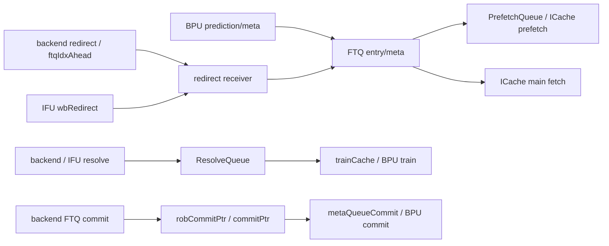

# Frontend FTQ

本文按 Chisel 源码整理 FTQ 的主要路径。生成 RTL 的端口和
内部信号需结合同一 DUT manifest 核对。

源码入口为 [Ftq.scala](../../../src/main/scala/xiangshan/frontend/ftq/Ftq.scala)、
[Bundles.scala](../../../src/main/scala/xiangshan/frontend/ftq/Bundles.scala) 和
[FtqParameters.scala](../../../src/main/scala/xiangshan/frontend/ftq/FtqParameters.scala)。

## 总览

FTQ 保存 BPU 预测块及 redirect、resolve、commit meta，向 ICache 发起预取和
main-fetch 请求，处理 backend/IFU redirect，并向 BPU 发送训练和提交反馈。



## 参数与核心状态

默认 `FtqSize=64`、`ResolveQueueSize=16`、`BpTrainStallLimit=8`。
非 FDIP 预取使用 `PrefetchQueue`，默认容量为 8。

| 状态 | 作用 |
| --- | --- |
| `bpuPtr` | BPU 下一次普通预测写入位置。 |
| `pfPtr` | FDIP prefetch 的连续两项窗口。 |
| `fetchPtr` | main fetch 的连续三项窗口。 |
| `commitPtr` | FTQ 下一项待提交 entry。 |
| `pnrPtr` | BPU 已无法通过 override 撤回的 entry 边界。`passedPnr(ptr)` 为 `pnrPtr > ptr`。 |
| `entryQueue` | 保存每项的 `startPc`、`taken` 和 `endPosition`。 |
| `metaQueueRedirect/Resolve/Commit` | 分别保存 redirect、train 和 commit 所需 BPU meta。 |
| `backendException/hasSatpFlush/backendFlagPtr` | backend fault 或 satpFlush 的标记及其 FTQ 归属。 |
| `trainCache/trainIndexCache` | 等待 BPU 接收的训练信息及其 FTQ pointer。 |

`FtqPtr` 带 `flag/value`。`FtqPtrVec` 表示从一个 base 展开的连续 pointer 窗口。
默认配置下 `value` 为 6 bit，具体宽度随 `FtqSize` 变化。

## BPU 写入和 override

预测 ready 同时受 FTQ 容量、`PrefetchDepth` 限定的预测领先距离和
`bpTrainStallCnt` 限制。普通 `prediction.fire` 写入 `bpuPtr` 并前进一项。
S2/S3 override 分别使用 `s2FtqPtr`、`s3FtqPtr`，S3 优先，并把写指针恢复到
对应 entry 的后一项。有效 redirect 抑制当拍预测写入。

BPU meta 按 `s3FtqPtr` 写入三个 meta 数组。meta 到达时，`pnrPtr` 推进到
`s3FtqPtr + 1`。redirect 对 `pnrPtr` 的恢复具有更高优先级。

## ICache 预取与 main fetch

`PrefetchQueue` 汇合 FDIP entry 和 `softPrefetch` 请求，向 ICache 输出预取。
队列容量不足时软件 prefetch 请求可能被丢弃，接口不会反压 load unit。
第二个 FDIP entry 需要越过 `pnrPtr`，且两个候选均不能带 backend flag。
预取 fire 时，`pfPtr` 按出队请求的 `numFdip` 前进。

main fetch 使用 `entryQueue(fetchPtr(0/1))` 生成候选，输出到
`io.toICache.toMainPipe`。第二个 fetch 候选需要同时满足以下条件。

- 已越过 BPU override 边界。
- 两项 size 之和不超过 `FetchBlockInstNum`，size 单位为半字。
- 两项属于同一虚拟页。
- 两项均无 backend fault/satpFlush 标记。

main-fetch fire 后，`fetchPtr` 根据 ICache 返回的 `realTwoFetchValid` 前进一项
或两项。S2/S3 override 会回退受影响的 `pfPtr/fetchPtr`，并通过
`flushFromBpu.stage(2/3)` 通知 ICache 和 IFU。

## Redirect 与 backend flag

[BackendRedirectReceiver.scala](../../../src/main/scala/xiangshan/frontend/ftq/BackendRedirectReceiver.scala)
接收单个 `Valid[FtqPtr]` 类型的 `ftqIdxAhead`。前一拍 ahead 有效且 pointer 与
当前 redirect 一致时使用直接路径，否则将实际 redirect 寄存一拍。
实际 redirect 与 ahead 同拍时，实际 redirect 的索引优先。

[IfuRedirectReceiver.scala](../../../src/main/scala/xiangshan/frontend/ftq/IfuRedirectReceiver.scala)
将 IFU writeback 转换为 flush-after redirect，在 return 场景选用保存的 RAS
stack top。`canTrain` 有效时还生成 IFU resolve。backend redirect 会抑制同拍
IFU redirect/resolve 的生成。

FTQ 最终选择 backend redirect，其次为 IFU redirect。redirect 将 `bpuPtr`、
`pfPtr`、`fetchPtr` 和 `pnrPtr` 设为 `redirect.bits.newFtqIdx`。
BPU redirect 的 meta 从提前给出的 FTQ index 读取并寄存一拍。
ICache 收到最终 `redirectFlush`，IFU 的 redirect valid 来自 backend redirect。

backend fault 和 satpFlush 保存到 `backendException/hasSatpFlush`。
`backendFlagPtr` 使用 `backendRedirect.bits.newFtqIdx`，首个 prefetch/main-fetch
请求按 pointer 匹配注入标记。`fetchPtr` 领先标记 entry 至少三个 fetch block
后清除标记。验证时需覆盖 override、双 fetch 降级及相邻 redirect 的归属。

## Resolve 和 BPU train

[ResolveQueue.scala](../../../src/main/scala/xiangshan/frontend/ftq/ResolveQueue.scala)
接收 backend resolve 和 IFU resolve，按 FTQ entry 聚合 branch 信息。
backend redirect 在队列内传播三个周期，用于清除 younger resolve。
BPU 重新使用物理 entry 时也会使旧 entry 失效。

FTQ 从 ResolveQueue 读取训练信息和对应 `metaQueueResolve`，先缓存到
`trainCache`，再与 BPU ready 握手。缓存及入队训练均按 backend redirect 的
FTQ 边界过滤，入队时还检查前一拍 redirect。首个 mispredict 之后的 branch
通过位置 mask 排除，避免 younger branch 更新 predictor。

## FTQ entry commit 与 BPU/RAS commit

backend 通过 `io.fromBackend.commit: Valid[FtqPtr]` 给出提交边界。
`DataHoldBypass` 保存最近的 `robCommitPtr`，FTQ 计算以下条件。

```text
commit = commitPtr <= robCommitPtr
```

每当条件成立，`commitPtr` 前进一项，并在同拍发送
`io.toBpu.commit.valid := commit` 和
`io.toBpu.commit.bits.meta := metaQueueCommit(commitPtr(0).value)`。
重复收到同一 backend commit 边界时，已越过该边界的 entry 不会重复提交。

redirect 根据 source entry 修正保存的 `attribute.rasAction`。
RAS 以 `io.commit.valid && io.enable` 寄存 commit meta，根据 call/return
属性和保存的推测栈索引更新 committed stack。

BackendModel 的 instruction commit 资格与 FTQ-entry commit 条件见
[BackendModel 规范](../frontend-backend-model.md)。

## 辅助模块与核对入口

`Ftq.scala` 实例化 `ResolveQueue` 和 `PrefetchQueue`。
`EntryQueue.scala`、`MetaQueue.scala`、`CfiQueue.scala`、`SpeculationQueue.scala`
仍在源码目录中，当前顶层使用寄存器数组维护相关 entry/meta。

核对生成 DUT 时，从 `CtrlToFtqIO`、`FtqToBpuIO` 和 ICache main-fetch 接口开始，
确认 `fetchPtr/pnrPtr`、backend flag、三类 meta 及 trainCache 的实际信号名。
源码静态关系与生成包内观察点均需绑定同一设计版本。
