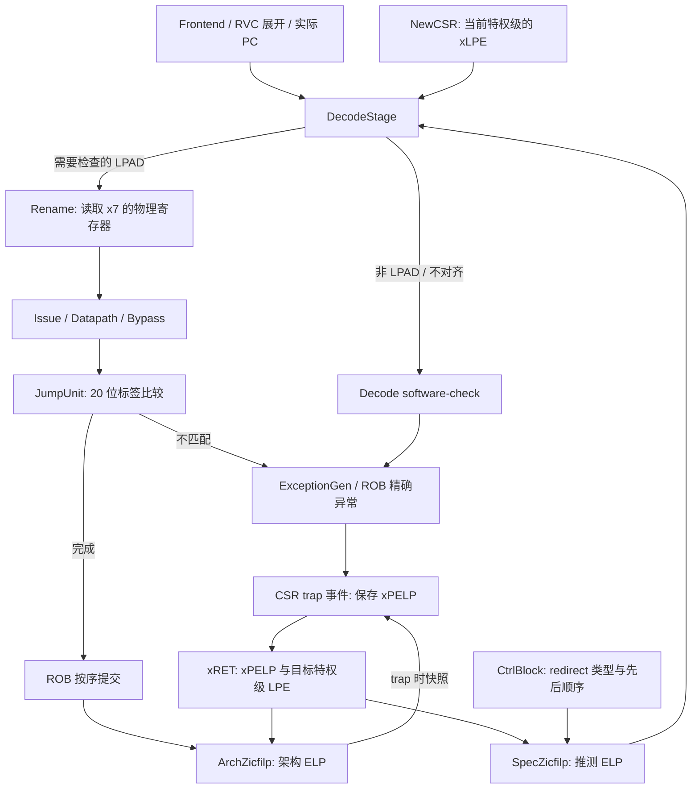

# XiangShan LPAD（Zicfilp）实现解析与潜在问题

分析日期：2026-10-15。代码基线：本地 `zicfilp` 分支，提交 `2eb6d92d7b2dcce7674c116339f74f206337d054`。

规范依据：[RISC-V Shadow Stacks and Landing Pads](../build/riscv-cfi.pdf) 第 3 章，尤其是 §3.1、§3.3、§3.4、§3.5；下文页码指文档内印刷页码。本文件说明当前实现，不修改 RTL。

当前实现的核心是：**在 Decode 检查“目标是不是 LPAD”，在 JumpUnit 检查“LPAD 标签是否匹配”，在 ROB 提交时维护架构 ELP，在 trap/xRET 时保存与恢复 ELP。** LPAD 没有专用执行单元，而是复用 AUIPC 的编码和立即数路径，并在需要检查时改派到 JumpUnit。

静态核对中，编码、对齐、标签比较和基本状态更新均能与规范对应，尚未确认基础指令语义错误。已确认的问题包括默认设备树缺少扩展声明、零标签存在不必要的寄存器依赖；此外，当前实现不保证标签检查完成前阻止年轻指令推测执行。具体证据、影响和待验证项见第 9 节。

相关 Chisel 源码已补中文注释，按 [源码阅读顺序](lpad-code-reading.md) 可直接阅读实现。如果还不熟悉 `Reg/Wire/Mux`、流水握手或寄存器重命名，先读 [RTL 文档的硬件阅读说明](lpad-rtl-design.md#hardware-reading)。本文用于说明语义与问题；[RTL 文档](lpad-rtl-design.md) 按连线、组合电路和时钟沿展开具体硬件。

本次讨论过的几个问题可直接定位：

| 想弄清的问题 | 本文入口 | 更详细的硬件说明 |
| --- | --- | --- |
| AUIPC/LPAD 走哪个通道，falseInsts 是什么 | 第 3.4 节 | [译码表和控制选择器](lpad-rtl-design.md#decode-auipc-channel) |
| 位置 i 与周期 T 是什么关系 | 第 4.1、4.2 节 | [SpecZicfilp 的寄存器与组合链](lpad-rtl-design.md#spec-hardware) |
| 下游阻塞后到底保持什么 | 第 4.2 节 | [阻塞两拍的完整信号表](lpad-rtl-design.md#spec-stall) |
| LPAD 为什么能读到正确版本的 x7 | 第 4.3 节 | [RAT、物理编号、Issue 和数据 mux](lpad-rtl-design.md#x7-hardware) |
| LPAD 在 Decode 清 ELP，trap 为什么仍保存 1 | 第 6、7 节 | [Decode 与提交边界的对照](lpad-rtl-design.md#commit-vs-decode) |

## 1. LPAD 要实现什么

### 1.1 指令编码与标签

LPAD 使用 `AUIPC rd=x0` 的 HINT 编码：

```text
31                         12 11        7 6               0
+----------------------------+----------+-----------------+
|       LPL，20 位标签        | rd=00000 | opcode=0010111  |
+----------------------------+----------+-----------------+

instruction = (LPL << 12) | 0x17
```

`lpad 0` 的编码是 `0x00000017`，`lpad 0x12345` 的编码是 `0x12345017`。LPL 直接取指令的 `[31:12]`，不需要像 JAL 立即数那样重排。

软件通常先用 `lui x7, label` 建立预期标签，再进行间接跳转；硬件比较的是 `x7[31:12]`。`x7[11:0]` 和 RV64 的 `x7[63:32]` 均不参与比较。**LPL=0 是通配标签**，不要求 `x7[31:12]` 也为 0。

### 1.2 三种状态不要混淆

| 名称 | 含义 | 当前实现 |
| --- | --- | --- |
| xLPE | 当前特权级是否启用 Zicfilp | `NewCSR.toDecode.enableZicfilp` |
| ELP | 是否要求下一条架构指令必须为合法 LPAD | Decode 的推测态、提交侧的架构态各保存一份 |
| xPELP | 进入 trap/debug/RNMI 前保存的 ELP | `MPELP`、`SPELP`、`PELP`、`MNPELP` 等 CSR 字段 |

ELP 初值为 0。启用保护后，需要 LPAD 的间接跳转将 ELP 置 1。目标指令必须同时满足：

1. PC 为 4 字节对齐。
2. 编码为 `AUIPC rd=x0`。
3. `LPL == 0`，或者 `LPL == x7[31:12]`。

成功后 ELP 清 0。失败则产生 software-check exception，`xcause=18`、`xtval=2`，并通过 trap 路径保存失败前的 ELP。

**ELP=0 时，即使标签不匹配，LPAD 也不应报错；xLPE=0 或硬件未实现扩展时，LPAD 作为无架构副作用的 HINT 执行。** PC 为 `4n+2` 的同一编码，在不期待 LPAD 时同样不能仅因缺少 4 字节对齐而报 landing-pad fault。

### 1.3 哪些间接跳转要求 LPAD

规范 §3.1 的条件为：

```text
is_lp_expected = (JALR || C.JR || C.JALR)
                 && rs1 != x1 && rs1 != x5 && rs1 != x7
```

判断依据是 **rs1**，不是 rd，也不是“这条指令是否写返回地址”。例如：

| 指令 | 目标是否要求 LPAD（xLPE=1） | 原因 |
| --- | --- | --- |
| `jalr x1, 0(x10)` | 是 | rs1=x10，不在豁免集合 |
| `jalr x0, 0(x10)` | 是 | 间接尾调用也受检查 |
| `jalr x0, 0(x1)` | 否 | rs1=x1，典型返回 |
| `jalr x1, 0(x1)` | 否 | rs1=x1，允许语义上的直接调用序列 |
| `jalr x0, 0(x7)` | 否 | 软件保护分支，由软件约束目标 |
| `jal x1, target` | 否 | 直接跳转不设置 ELP |

`C.JR/C.JALR` 经前端 [RvcExpander.scala](../src/main/scala/xiangshan/frontend/ifu/RvcExpander.scala#L23) 展开为 JALR 形式，因此后端不需要另写一套压缩指令条件。

## 2. 整体硬件路径



源码导航：

| 文件 | 主要职责 |
| --- | --- |
| [Parameters.scala](../src/main/scala/xiangshan/Parameters.scala#L56) | `HasZicfilp` 硬件开关，当前默认 `true` |
| [Bundles.scala](../src/main/scala/xiangshan/backend/Bundles.scala#L112) | 从实际 PC 生成对齐标志，定义指令元数据 |
| [DecodeStage.scala](../src/main/scala/xiangshan/backend/vector/Decoder/DecodeStage.scala#L126) | 识别受保护 JALR/LPAD、连接推测状态、改派执行单元 |
| [SpecZicfilp.scala](../src/main/scala/xiangshan/backend/decode/SpecZicfilp.scala#L28) | 同周期和跨周期的推测 ELP 跟踪 |
| [JumpUnit.scala](../src/main/scala/xiangshan/backend/fu/wrapper/JumpUnit.scala#L12) | 标签检查，屏蔽 LPAD 的分支重定向和训练 |
| [BypassNetwork.scala](../src/main/scala/xiangshan/backend/datapath/BypassNetwork.scala#L225) | 对 LPAD 保留原始 U 型立即数，不叠加 PC offset |
| [CompressUnit.scala](../src/main/scala/xiangshan/backend/rename/CompressUnit.scala#L106) | 阻止改变 ELP 的指令与其他指令做 ROB 压缩 |
| [RobBundles.scala](../src/main/scala/xiangshan/backend/rob/RobBundles.scala#L262) | 将 JALR/LPAD 标记从入队传到提交 |
| [ExceptionGen.scala](../src/main/scala/xiangshan/backend/rob/ExceptionGen.scala#L107) | 收集 JumpUnit 回写的 software-check |
| [archZicfilp.scala](../src/main/scala/xiangshan/backend/archZicfilp.scala#L19) | 提交态 ELP、trap 清零、xRET 恢复 |
| [CtrlBlock.scala](../src/main/scala/xiangshan/backend/CtrlBlock.scala#L459) | 连接架构状态、ROB 异常快照与 Decode 重定向恢复 |
| [NewCSR.scala](../src/main/scala/xiangshan/backend/fu/NewCSR/NewCSR.scala#L1193) | LPE 生成、xRET 恢复值、LPE 写入后的 flush |

## 3. Decode 如何识别和处理 LPAD

### 3.1 对齐信息来自真实 PC

`DecodeInUop.connectCtrlFlow` 产生：

```scala
this.ZicfilpPCAligned.foreach(_ := source.pc(1, 0) === 0.U)
```

这个位随 `DecodeInUop → MopCtrlBundle → DecodeStage` 传递，不依赖 debug PC 是否启用。Decode 的 LPAD 条件为：

```scala
bits.ZicfilpLPAD.get :=
  inst(6, 0) === "b0010111".U &&
  inst(11, 7) === 0.U &&
  mopInfo.ZicfilpPCAligned.get
```

所以代码中的 `ZicfilpLPAD` 实际表示“**编码符合且 PC 对齐的 LPAD**”，不只是指令编码匹配。目标 PC 为 `4n+2` 时，该位为 0；如果 ELP=1，就会在 Decode 作为缺少合法 LPAD 报错。

`PseudoInstructions.scala` 虽然定义了 [LPAD BitPat](../src/main/scala/xiangshan/backend/decode/isa/PseudoInstructions.scala#L74)，但真正的状态判断入口是上述 DecodeStage 逻辑。不能只看这个 BitPat 就认为 LPAD 已完成译码。

### 3.2 区分“是 LPAD”和“本次需要检查的 LPAD”

| 字段 | 含义 | 主要消费者 |
| --- | --- | --- |
| `ZicfilpJalr` | 满足 rs1 条件、会要求目标 LPAD 的 JALR；不是所有 JALR | 推测 ELP、ROB、redirect |
| `ZicfilpLPAD` | 编码和对齐正确的 LPAD，不要求当前 ELP=1 | 推测检查输入、ROB 提交、压缩控制 |
| `ZicfilpLPADValid` | xLPE=1、ELP=1，且当前是对齐 LPAD，需要执行标签检查 | Issue/执行路径、JumpUnit |

当 `ZicfilpLPADValid=1`，Decode 在普通 AUIPC 结果上覆盖这些控制字段：

```scala
bits.fuType     := FuType.jmp.U
bits.fuOpType   := JumpOpType.j
bits.rfWen      := false.B
bits.lsrc(0)    := 7.U
bits.srcType(0) := SrcType.reg
```

普通 AUIPC 由 [ScalaUopTable](../src/main/scala/xiangshan/backend/vector/Decoder/Uop/ScalaUopTable.scala#L54) 映射到 LinkUnit；LinkUnit 没有通用寄存器操作数，因此无法直接读取 x7。改派到 JumpUnit 后，LPAD 仍是一条 uop，通过普通 Rename/RAT、Issue、寄存器读和旁路网络获得 x7。

这里选择 `JumpOpType.j` 只是复用执行通路，**不会让 LPAD 成为一条架构跳转指令**。`selImm` 继续保留 AUIPC 的 U 型立即数选择；延迟字段在覆盖之后通过 `LatDecoder(bits.fuType, bits.fuOpType)` 重新生成。

当 xLPE=0 或 ELP=0 时，不执行上述覆盖，而是保留 AUIPC 到 x0 的路径。它在架构上是 no-op，但仍可能消耗流水线资源。

### 3.3 为什么标签值能原样到达 JumpUnit

[Imm_U](../src/main/scala/xiangshan/backend/decode/DecodeUnit.scala#L53) 先提取 `inst[31:12]`，在执行数据路径上重建 `LPL << 12`。JumpUnit 再读取 `imm[31:12]` 得到 LPL。

这里有两处配套修改：

- [NJmpCfg](../src/main/scala/xiangshan/backend/fu/FuConfig.scala#L240) 的 `immType` 包含 `Imm_U()`，允许 JumpUnit 使用 U 型立即数。
- BypassNetwork 在 `isJR || isLPAD` 时不把 FTQ 内的 PC offset 加入立即数，防止改写标签位。

只修改 Decode 的 `fuType` 而遗漏上述任一环节，都不能构成完整的 LPAD 标签通路。

### 3.4 AUIPC 的通道与 falseInsts

当前普通 AUIPC，包括 `rd=x0`，通过 SimpleDecodeChannel 译码。依据是 [ScalaUopTable.scala](../src/main/scala/xiangshan/backend/vector/Decoder/Uop/ScalaUopTable.scala#L54) 的 `AUIPC -> Seq(auipc)`，其 opcode 属于 LinkOpcodes，基础结果是一条 LinkUnit uop。

Simple、Pseudo 等 decoder 会在各输入位置并行观察指令。当前 PseudoDecodeChannel 表没有 LPAD，所以没有用 pseudo 结果覆盖 AUIPC。DecodeChannels 完成选择及 uop 缓冲之后，DecodeStage 才按前述条件识别 LPAD，必要时把输出字段选择为 JumpUnit 控制。

硬件上，`when(lpadValid)` 对 `fuType/lsrc/srcType/rfWen` 的覆盖是一组组合选择器，不是先执行 AUIPC 再执行 LPAD。选择结果随后由下一级流水寄存器锁存。通道类型也不限制 lane 编号：AUIPC 可以出现在任意有效位置。

[CanRobCompressField.scala](../src/main/scala/xiangshan/backend/vector/Decoder/DecodeFields/SimpleDecodeChannel/CanRobCompressField.scala#L14) 的 `falseInsts` 是让 `canRobCompress` 这个控制位取 0 的指令名集合；AUIPC 在其中。该集合在生成译码表时使用，运行时没有字符串集合查询。它不表示非法指令，也不决定指令走哪个通道。

当前分支用 `canRobCompress` 参与高密度 ROB 的 simple 分类，完全禁止 LPAD 与其他指令共享条目语义则由 `CompressUnit.changesELP` 等规则保证。详细控制与源码位置见 [RTL 文档第 3.4、3.5 节](lpad-rtl-design.md#decode-auipc-channel)。

## 4. SpecZicfilp：推测 ELP 和多 uop 边界

### 4.1 一只 ELP 寄存器，两条本拍组合链

模块中只有 `speculativeELP = RegInit(false.B)` 保存跨周期状态。`outputELP` 与 `nextELP` 都是 Wire，不能独立记住上一拍的值。长度为 `DecodeWidth+1`，是因为 N 个位置有 N+1 个边界：组前一个边界，每处理一个位置又产生一个边界。

例如每拍看 4 个输出位置，`outputELP(0)` 是位置 0 之前的状态，`outputELP(1)` 是位置 0 之后/位置 1 之前的状态，以此类推。位置是同一拍的并行槽位；周期是时间轴上不同的拍。源码中的 for 展开成组合逻辑，不是每个位置额外花一个周期。

两条链的等价表达式为：

```text
outputELP[0] = speculativeELP
nextELP[0]   = speculativeELP

check[i]     = valid[i] && outputELP[i]
exception[i] = enable && check[i] && !isLPAD[i]
lpadValid[i] = enable && check[i] &&  isLPAD[i]

outputELP[i+1] = valid[i] ? isJalr[i] : outputELP[i]
nextELP[i+1]   = fire[i]  ? isJalr[i] : nextELP[i]
```

`outputELP` 根据有效指令计算“当前组各位置要附带什么检查控制”；`nextELP` 根据已握手指令计算“本组实际前进后，下一拍应该记住什么”。在正常路径的时钟沿，寄存器写入的是 `nextELP.last`，不是 `outputELP.last`。

假设初始 ELP=0、enable=1，当前组全部接收：

| 位置 | uop | Spec valid | 进入位置的 ELP | 当前输出 | 送往下一位置的 ELP |
| ---: | --- | ---: | ---: | --- | ---: |
| 0 | JALR link | 1 | 0 | 无需检查当前指令 | 1 |
| 1 | 同一 JALR 的 jr | 0 | 1 | 跳过非 first uop | 1 |
| 2 | 目标 LPAD | 1 | 1 | lpadValid=1 | 0 |
| 3 | ADD | 1 | 0 | 无需检查当前指令 | 0 |

这里的状态从 `0→1→1→0→0` 在同一拍内通过组合选择器传播。时钟沿后寄存器仍为 0，但 LPAD 的检查标志已随输出 payload 被接收，检查并未被跳过。

遇到受保护 JALR 后，后续第一个架构指令看到 ELP=1。若它不是 LPAD，Decode 给它附上 software-check。推测链随后仍可前进，最终由 ROB 保证异常精确提交；推测状态不承担 trap 时的架构保存职责。

寄存器更新优先级为 `redirect > !enable 清零 > nextELP.last`。Reset 时为 0。

### 4.2 JALR 跨拍与下游阻塞：逐拍看握手

当前普通 `JALR rd≠x0` 分成 `link` 和 `jr` 两个 uop。如果把每个 uop 都当成一条架构指令，`link` 设置 ELP 后，`jr` 自己就可能被错误地当成“不是 LPAD 的下一条指令”。

DecodeStage 使用：

```scala
spec.io.valid(i) := coUop.valid && coUop.bits.info.isFirstUop && !in.redirect.valid
spec.io.fire(i)  := spec.io.valid(i) && out.uop(i).ready
```

这里 `coUop.valid=1` 表示有一条有效 uop，Spec valid 还要额外要求 firstUop。jr 自身即使有效并且被下游接收，其 Spec valid/fire 仍为 0，因为它不是新的架构指令。

假设每拍 4 个位置，T0 的 JALR link 位于最后一个位置，T1 起下游阻塞两拍。期间 enable=1 且没有 redirect：

| 周期 | Decode 位置 0→3 | ready | 沿前 specELP | LPAD 的 lpadValid | 沿后 specELP |
| --- | --- | ---: | ---: | ---: | ---: |
| T0 | `[A,B,C,link]` | 1 | 0 | 无 LPAD | 1 |
| T1 | `[jr,LPAD,D,E]` | 0 | 1 | 1 | 1 |
| T2 | `[jr,LPAD,D,E]` | 0 | 1 | 1 | 1 |
| T3 | `[jr,LPAD,D,E]` | 1 | 1 | 1 | 0 |

T1、T2、T3 展示的是同一组 uop；只有 T3 发生接收。T1 的两条链为：

```text
Spec valid = [0, 1, 1, 1]    # jr 不是 firstUop
Spec fire  = [0, 0, 0, 0]    # 下游不接收
outputELP  = [1, 1, 0, 0, 0] # 当前组合逻辑看见 LPAD
nextELP    = [1, 1, 1, 1, 1] # 没有指令实际前进
```

所以本拍能输出 lpadValid=1，但时钟沿后保存的 ELP 仍为 1。T2 重复同样的计算。T3 恢复接收，nextELP 变成 `[1,1,0,0,0]`，时钟沿后 ELP 才清 0；同一个沿把 LPAD 连同 `LPADValid=1` 锁存进 Decode→Rename 流水寄存器。

之后 JumpUnit 使用这条 uop 自己携带的检查标志，不读取实时 specELP。阻塞期间检查位持续为 1 不代表重复执行；异常位持续为 1 也不代表重复进入 trap。

下游阻塞传到 Decode ready 后，当前代码还会保持 uop buffer 的有效数量和内容、拉低输入 ready 使上游不消耗当前指令，并对 RAT 读端口置 hold。组合逻辑仍然计算当前组控制。寄存器保持和完整连线见 [RTL 文档第 4.6 节](lpad-rtl-design.md#spec-stall)。

若 JALR 与 LPAD 都在同一个尚未接收的组中，初始 specELP=0，则阻塞时寄存器保持 0；同拍组合链仍可让 LPAD 获得检查标志。不能把“阻塞时保持 1”理解为通用规则：保持的是之前已经接收进度所对应的旧值。

`JALR rd=x0` 则可以通过伪指令路径只产生 jump uop。两种形式最终都应按“一条架构指令”更新 ELP。

### 4.3 x7 必须读取程序顺序上的正确版本

Decode 为有效 LPAD 补上隐含源 `lsrc0=7、srcType0=reg`；RAT 返回的是物理寄存器编号，Rename 将它写入 psrc。实际数值在执行前由 Datapath/Bypass 取得。下面把物理编号假设为 p42、p51，便于区分不同版本：

| 程序顺序 | 指令 | Rename 结果 |
| --- | --- | --- |
| 1 | `lui x7,0x12345` | 写入新物理目的 p42，预期值为 `0x12345000` |
| 2 | `jalr x1,0(x10)` | 不改变 x7 的映射 |
| 3 | `lpad 0x12345` | 源固定为 p42 |
| 4 | `addi x7,x0,0` | 再写 x7，分配新物理目的 p51 |

即使第 4 条比 LPAD 更早执行，LPAD 仍读 p42。p51 是另一个物理存储位置，年轻指令更新映射不会修改 LPAD 已经建立的源编号。

如果 LUI 和 LPAD 同拍重命名，RAT 可能读出周期开始的旧映射。已有 Rename 比较同组更老指令的 ldest 与 LPAD 的 lsrc；发现都为 7 且确实写整数目的，就把 LUI 新分配的 p42 旁路给 LPAD。这里传的是编号，LUI 不需要在这拍已经算出数值；Issue 继续负责等待 p42 的结果。对应逻辑见 [Rename.scala](../src/main/scala/xiangshan/backend/rename/Rename.scala#L773)。

执行数据旁路则是另一件事：生产者结果到达时，已有数据选择器可以把实际值直接提供给 LPAD，或者从物理寄存器/已有缓存中取数。等待源就绪首先是 Issue 条目的等待，不等于 Decode 接口立即整组阻塞。

一个容易漏测的例子是 `jalr x7,0(x10)`。这条指令用 x10 跳转，同时把返回地址写 x7。假设其 PC 为 `0x80001000` 且是 32 位指令，则目标 LPAD 读取的 x7 低 32 位是 `0x80001004`，标签比较使用 `0x80001`，不再使用之前 LUI 的 `0x12345`。Rename 会让 LPAD 依赖 JALR link uop 的新物理目的。

零标签也仍有依赖：`ld x7,... → jalr x1,... → lpad 0` 中，LPAD 当前仍等待 load 的物理目的就绪，尽管比较器看到零标签后不使用 x7 决定结果。因此没有专用标签寄存器或新增读端口，不代表没有队列等待和现有取数资源开销。[RTL 文档第 5.3 节](lpad-rtl-design.md#x7-hardware) 逐项画出了这条通路。

## 5. JumpUnit：标签比较与异常回写

JumpUnit 的核心逻辑为：

```scala
val isLPAD = io.in.bits.ctrl.ZicfilpInfos.get.ZicfilpLPADValid
val lpadLabel = imm(31, 12)
softwareCheck := isLPAD && lpadLabel.orR && src(31, 12) =/= lpadLabel
```

这里 `src` 是重命名后的 x7 值。该表达式准确覆盖“非零标签不匹配才报错”。零标签不依赖 x7 的实际数值；标签最高位为 1 时也仍按 20 位位模式比较，不比较 RV64 的符号扩展部分。

因为复用了跳转单元，还必须屏蔽两类行为：

```scala
redirectValid := io.in.valid && !isLPAD && (...)
io.toFrontendBJUResolve.get.valid := io.out.valid && !isLPAD
```

否则 `pc+imm` 这个内部计算结果可能被当成 LPAD 的跳转目标，产生错误重定向或污染分支预测训练。当前代码已做这两处屏蔽。LPAD 完成后仍产生执行完成回写，但不写 GPR。

标签错误沿以下路径到达精确异常处理：

```text
JumpUnit.exceptionVec(softwareCheck)
  → ExeUnit / WriteBackRobBundle
  → CtrlBlock 延迟与 redirect 取消过滤
  → ExceptionGen 的 jmp_wb 分组
  → ROB 阻止错误指令提交
  → CSR trap
```

[FuConfig.effectiveExceptionOut](../src/main/scala/xiangshan/backend/fu/FuConfig.scala#L198) 在 `HasZicfilp && isJmp` 时加入 software-check；[ExceptionGen](../src/main/scala/xiangshan/backend/rob/ExceptionGen.scala#L107) 显式包含 jump 写回。仅在 JumpUnit 设置异常位而没有这些下游连接，错误就无法完整送达 ROB。

## 6. ArchZicfilp：为什么还需要提交态 ELP

Decode 可能已经看过很多未提交指令，甚至已将 ELP 清零；这不能代表发生中断时软件应该恢复的状态。提交态因此单独由 `ArchZicfilp` 保存。

### 6.1 按提交顺序折叠状态

`CtrlBlock` 仅在 `rob.io.commits.isCommit && commitValid(i)` 时使某个提交 lane 生效，ROB walk 不更新架构 ELP。`ArchZicfilp` 从旧 ELP 开始依次处理 lane：

```text
有效的受保护 JALR 提交 → ELP=1
有效的 LPAD 提交       → ELP=0
其他提交/无效 lane    → 保持
```

用 `foldLeft` 而不是只看最后提交指令，可以正确处理一周期 `JALR → LPAD → 普通指令` 等组合。普通指令不会凭空清除已有 ELP。

标签错误的 LPAD 不会提交，因此不会通过 `commitLPAD` 提前清掉架构 ELP。缺少 LPAD 的目标指令同样不能正常提交。trap 入口应保存的 ELP 仍为 1。

更新优先级是：

```text
trap 清零 > xRET 恢复 > !enable 清零 > 提交更新
```

输出还有 `archELP && enable` 的门控。

### 6.2 ROB 压缩为什么要避开这两类指令

ROB 条目携带 `ZicfilpJalr` 和 `ZicfilpLPAD`。这些是每条指令改变 ELP 所需的信息，不能与任意多条架构指令合并后只留一个布尔值。

`CompressUnit.cannotCompressVec` 把 `ZicfilpJalr || ZicfilpLPAD` 归为不能与其他指令压缩的情况；拆成多个 uop 的指令也受单独限制。这是在当前 ROB 元数据组织下保证 ELP 可恢复的必要条件，不宜只为压缩率删除。

## 7. Redirect、trap 和 xRET

### 7.1 Decode 的推测态恢复

[CtrlBlock](../src/main/scala/xiangshan/backend/CtrlBlock.scala#L522) 在当前与延迟一拍的 redirect 候选间选择最老者，并向 SpecZicfilp 提供恢复值：

| redirect 类型 | 推测 ELP 恢复值 |
| --- | --- |
| 合法 xRET | redirect 携带的 `ZicfilpRetELP` |
| 受保护 JALR 的执行重定向 | `ZicfilpJalr && enableZicfilp`，即 1 |
| 普通分支、load replay、ROB flush 等 | 0 |

JALR 预测正确时，Decode 的正常顺序状态链已经设置 ELP；预测错误时，需要重定向元数据为正确目标重新设置 ELP。普通分支通常处于 ELP=0 的合法指令流中。

ROB flush 和 load replay 路径显式将 JALR/xRET 标记清零，避免 `DontCare` 或来源无关的字段影响恢复。这里并没有一套“任意 ROB 位置的 ELP checkpoint”；恢复依赖现有 redirect 的语义，因此新增 redirect 类型时必须同时检查 ELP。

### 7.2 trap 必须先保存旧值，再进入 ELP=0 的 handler

当前实现的关键保护是 [ROB 快照](../src/main/scala/xiangshan/backend/rob/Rob.scala#L908)：

```scala
io.exception.valid := RegNext(exceptionHappen)
io.exception.bits.ZicfilpELP.foreach(
  _ := RegEnable(io.ZicfilpELP.get, exceptionHappen)
)
```

在识别异常/中断边界时捕获架构 ELP，随 ExceptionInfo 经过 CSR wrapper 送到 NewCSR。ArchZicfilp 随后可以清零；CSR trap 事件使用快照，而不是再读取已经变成 0 的实时 ELP。

[NewCSR.scala](../src/main/scala/xiangshan/backend/fu/NewCSR/NewCSR.scala#L875) 在 `hasTrap` 时选择 `io.fromRob.trap.bits.ZicfilpELP`。各事件分别保存到：

| trap 目标 | 保存字段 | 位号 |
| --- | --- | ---: |
| M | `mstatus.MPELP` | 41 |
| S/HS | `mstatus.SPELP`，经 `sstatus` 访问 | 23 |
| VS | `vsstatus.SPELP` | 23 |
| Debug | `dcsr.PELP` | 18 |
| RNMI | `mnstatus.MNPELP` | 9 |

例如受保护 JALR 已提交、目标 LPAD 取指发生 page fault 时，保存值应为 1。handler 修复映射并返回后，原目标仍必须接受 LPAD 检查。当前代码已包含上述快照链路；不能把“trap 时读实时 archELP 可能已清零”当成尚未修复的问题。

### 7.3 xRET 按返回目标的 LPE 恢复

[NewCSR.retELP](../src/main/scala/xiangshan/backend/fu/NewCSR/NewCSR.scala#L1193) 分别处理 MRET、SRET、MNRET、DRET：

```text
restoredELP = 对应保存字段 && 返回目标特权级的 LPE
```

它使用目标特权级和目标虚拟化状态选择 LPE，而不是使用 handler 当前模式的 LPE。CSR wrapper 仅对没有 illegal/virtual-instruction 异常的 xRET 设置 `ZicfilpXRetValid`；恢复值随 redirect 同时送往推测态和架构态。

MRET/SRET/MNRET 事件会清除其对应保存字段。此 PDF 对 Debug 返回的描述是恢复 `dcsr.pelp`，未要求与 MRET/SRET 相同的清零动作；不能仅凭 DRET 没有清 `PELP` 就认定违规。

## 8. 启用控制与异常语义

### 8.1 硬件开关和运行时开关

`HasZicfilp` 控制是否生成相关字段和模块。它为 true 并不代表运行时已经开启保护；相关 LPE 字段复位均为 0，需要软件配置。

当前支持 S 模式的平台，其 LPE 来源为：

| 当前模式 | LPE 来源 |
| --- | --- |
| M | `mseccfg.MLPE[10]` |
| S/HS | `menvcfg.LPE[2]` |
| VS | `henvcfg.LPE[2]` |
| U/VU | `senvcfg.LPE[2]` |

该表与所附规范 §3.3 的“实现 S 模式”配置一致。各模式独立启用，不能把它解释成必须同时打开所有上级 LPE 的与逻辑。

[NewCSR 的 zicfilpLPEChange](../src/main/scala/xiangshan/backend/fu/NewCSR/NewCSR.scala#L1060) 检测上述四个字段的写入变化，并加入 `flushPipe`，使已经按旧 LPE 解码的年轻指令重新取指。这一处理当前已经存在。

### 8.2 两种失败来源汇合到同一种架构异常

| 失败条件 | 检查位置 | 架构结果 |
| --- | --- | --- |
| ELP=1，目标不是 LPAD | Decode / SpecZicfilp | cause=18，tval=2 |
| ELP=1，目标 PC 不为 4 字节对齐 | Decode，将其排除在合法 LPAD 之外 | cause=18，tval=2 |
| ELP=1，LPAD 非零标签不匹配 | JumpUnit | cause=18，tval=2 |

[ExceptionNO.priorities](../src/main/scala/xiangshan/package.scala#L758) 将 instruction page/guest-page/access fault 放在 software-check 前，将 illegal/virtual-instruction 放在后面，符合本文所需的主要优先级关系。M/HS/VS trap 事件将 landing-pad fault 的 tval 设置为 2，例如 [TrapEntryMEvent.scala](../src/main/scala/xiangshan/backend/fu/NewCSR/CSREvents/TrapEntryMEvent.scala#L94)。

如果同一目标还触发 fetch fault，应报告较高优先级的 fetch fault并保留 ELP，修复后返回再检查 LPAD。若目标是非法指令，则 software-check 应胜过 illegal-instruction。更细的 breakpoint/debug 优先级需要结合触发类型另行验证，不能只看一个异常位。

## 9. 已确认的问题、能力边界与待验证风险

### 9.1 默认设备树没有声明 zicfilp：集成缺口

**证据：** [Parameters.scala 的 ISAExtensions](../src/main/scala/xiangshan/Parameters.scala#L306) 没有 `zicfilp`；[XSDts.scala](../src/main/scala/xiangshan/XSDts.scala#L29) 直接使用该列表生成 `riscv,isa-extensions`。与此同时，`HasZicfilp` 默认是 true。

**影响：** 依赖默认设备树进行扩展发现的固件或操作系统，可能不会向软件报告 Zicfilp，也不会启用用户态保护。LPAD 因兼容 HINT 编码仍然能执行，所以“程序能跑”不能证明保护已生效。外部固件可以提供不同设备树，因此这是仓库默认描述路径中的缺口，不代表所有部署都会受影响。

**建议：** 扩展声明随 `HasZicfilp` 条件生成，并验证实际交付 DTB、固件和操作系统的能力发现与启用链路。`misa` 的单字母扩展位不能替代这项多字母扩展声明。

### 9.2 lpad 0 仍读取 x7：确定的冗余依赖

**证据：** Decode 对所有 `lpadValid` 无条件设置 `lsrc(0)=7`、`srcType(0)=reg`，而 JumpUnit 在 `LPL=0` 时不使用 x7 的数值决定结果。

**影响：** 零标签仍形成对 x7 生产者的依赖，消耗寄存器读资源，并可能推迟 LPAD 的发射和退休。例如 `ld x7,0(x11)` 尚未完成时，后续受保护跳转目标的 `lpad 0` 仍要等待该 load，而规范不要求这种等待。它不改变架构比较结果，属于性能问题。

**建议：** 仅对 `inst[31:12] != 0` 的有效 LPAD 建立 x7 源操作数；零标签使用不读寄存器的源类型。优化需与现有 Issue/Bypass 对 `SrcType.no` 的处理配套验证。

### 9.3 当前不保证阻止非法目标后的推测执行：安全能力边界

**证据：** 非零标签比较在 JumpUnit 才完成；Decode 没有给 LPAD 增加 blockBackward，也没有把年轻指令依赖于 LPAD 检查结果。即使 Decode 已发现目标不是 LPAD，[Dispatch](../src/main/scala/xiangshan/backend/dispatch/Dispatch.scala#L591) 对该 uop 的异常过滤也不等于对所有年轻 uop 设置全局屏障。

**影响：** ROB 能阻止错误路径产生正常架构提交，但不能据此推断标签错误后的年轻 load 从未执行，或缓存等微架构状态未受影响。尤其当 x7 来自慢 load 时，标签检查可能较晚完成，留下推测窗口。

规范 §3.1 第 24 页把减少或阻止非法目标推测作为实现可利用的安全收益，没有要求所有实现都采用完整推测屏障。因此，这里不能直接判成 LPAD 的 ISA 功能错误，也不能声称已实现完整的 Spectre-v2 防护。

**建议：** 若设计目标包括“LPAD 检查成功前不允许目标后指令发射”，应单独设计发射门控、检查结果依赖或其他推测约束，并测量性能代价；不能只依赖精确异常。

### 9.4 状态恢复需要端到端回归：高优先级验证项

静态连接已经覆盖 ROB 快照、xRET 恢复、LPE 写后 flush 和 first-uop 更新。尚需 RTL 仿真确认以下跨模块时序；这些是待验证风险，本文没有把它们报告为已复现 bug：

| 场景 | 应核对的结果 |
| --- | --- |
| JALR 的 link/jr 跨 Decode 输出边界，且发生反压 | ELP 仅推进一次，不把 jr uop 当成目标指令 |
| 一个周期同时出现旧 redirect 和更老的新 redirect | 选最老者，恢复值与最终目标一致 |
| JALR 提交后，LPAD 前发生中断或 fetch fault | xPELP=1，handler ELP=0，返回后再次检查原目标 |
| 标签错误与更老 redirect 同时出现 | 被取消指令的异常不应触发 trap |
| xRET 返回到 LPE=0 的模式 | 不恢复 ELP=1；不能沿用 handler 的 enable |
| 开关 LPE 时 Decode 内已有缓冲指令 | flush 后按新配置重新解码，无旧 LPADValid 残留 |
| Debug/RNMI 打断 ELP=1 的窗口并返回 | 对应 PELP 快照、恢复值与返回 PC 对应 |
| LPAD 检查通过但尚未退休时进入中断边界 | xPELP 反映真正提交边界，不能直接采用 Decode 的 0 |

特别是普通 redirect 默认恢复为 0 的设计，依赖“此类恢复点无需等待 LPAD”的流水线约束。未来加入新 replay、异常重执行或其他重定向来源时，应重新证明这个约束，不能机械地把新类型也归为 0。

### 9.5 缺少可见的专用回归，以及少量资源开销

本次在 `src/test` 和 `scripts` 中未检索到以 Zicfilp/LPAD 为目标的专用测试。不能据此断定外部验证环境没有测试，但仓库内可见的回归证据不足。

此外，所有对齐的 `AUIPC rd=x0` 都设置 `ZicfilpLPAD` 并触发禁止 ROB 压缩的条件，即使运行时未启用保护。有效 LPAD 还会占用 JumpUnit；零标签也不例外。这些是可从代码直接看到的资源使用，具体 IPC、面积和时序损失仍需测量。

优先应补全功能与状态恢复回归，再考虑零标签源依赖优化，以及在不损害提交元数据语义的前提下减少未启用时的额外开销。

## 10. 建议的最小验证矩阵

| 类别 | 输入/场景 | 预期 |
| --- | --- | --- |
| 关闭扩展 | xLPE=0，间接跳转到任意指令 | 不因 LPAD 产生异常 |
| 不期待 LPAD | xLPE=1、ELP=0，非零标签与 x7 不同 | LPAD 仍为 no-op |
| 零标签 | ELP=1，`lpad 0`，x7 为任意值 | 成功，提交后 ELP=0 |
| 正确标签 | ELP=1，LPL=x7[31:12]≠0 | 成功 |
| 错误标签 | ELP=1，LPL≠0 且不匹配 | cause=18，tval=2，错误前 ELP 保存为 1 |
| 比较位宽 | 只改变 x7[63:32] 或 [11:0] | 不影响比较 |
| 高位标签 | LPL=0x80000/0xfffff，x7 有不同高 32 位 | 只按低 32 位中的 [31:12] 比较 |
| 非 LPAD | ELP=1，目标为普通指令或 AUIPC rd≠x0 | software-check |
| 对齐 | ELP=1，LPAD 编码位于 PC=4n+2 | software-check |
| HINT 对齐兼容 | ELP=0 或 xLPE=0，PC=4n+2 的 LPAD 编码 | 不因 LPAD 的 4 字节要求报错 |
| JALR 分类 | 遍历 rs1=0..31，并覆盖不同 rd 和 C.JR/C.JALR | 仅 rs1=1/5/7 豁免 |
| RAW 依赖 | LUI/load 写 x7 后立即间接跳转；含同周期旁路 | LPAD 读取正确物理寄存器版本 |
| JALR 写 x7 | `jalr x7,0(x10)` 后执行 LPAD | 使用跳转写入后的 x7 |
| 拆分与反压 | link/jr/LPAD 跨周期，逐拍插入 stall | 不重检、不漏检 |
| 预测恢复 | 正确预测、JALR 目标误预测、返回误预测 | 正确路径的 ELP 相同 |
| 多提交 | JALR/LPAD/普通指令的多 lane 组合和空 lane | 按架构顺序折叠 ELP |
| 异常优先级 | fetch fault+SWC、illegal+SWC、不同 trigger | 选规范规定的异常并保存正确 ELP |
| trap 返回 | M/S/VS/Debug/RNMI，目标 LPE 分别为 0/1 | 保存字段、目标 PC、恢复 ELP 一致 |
| 配置变化 | 写 MLPE/各 LPE，覆盖写同值与变值 | 变值时正确重解码，开关关闭后不遗留检查 |
| 硬件关闭 | `HasZicfilp=false` 完成 elaboration 与 HINT 执行 | 无 Option 字段引用错误、无 LPAD 异常 |
| 能力发现 | 检查实际 DTB 与 OS 可见扩展 | 声明与生成硬件配置一致 |

本文完成了对所附规范和当前源码的静态核对、状态/异常通路追踪及仓库测试入口检索；未运行 LPAD 专用 RTL 仿真或整核 DiffTest。因此，以上“待验证风险”不代表已经复现功能失败，也不应把静态核对结果当作完整的 Zicfilp 验证结论。
