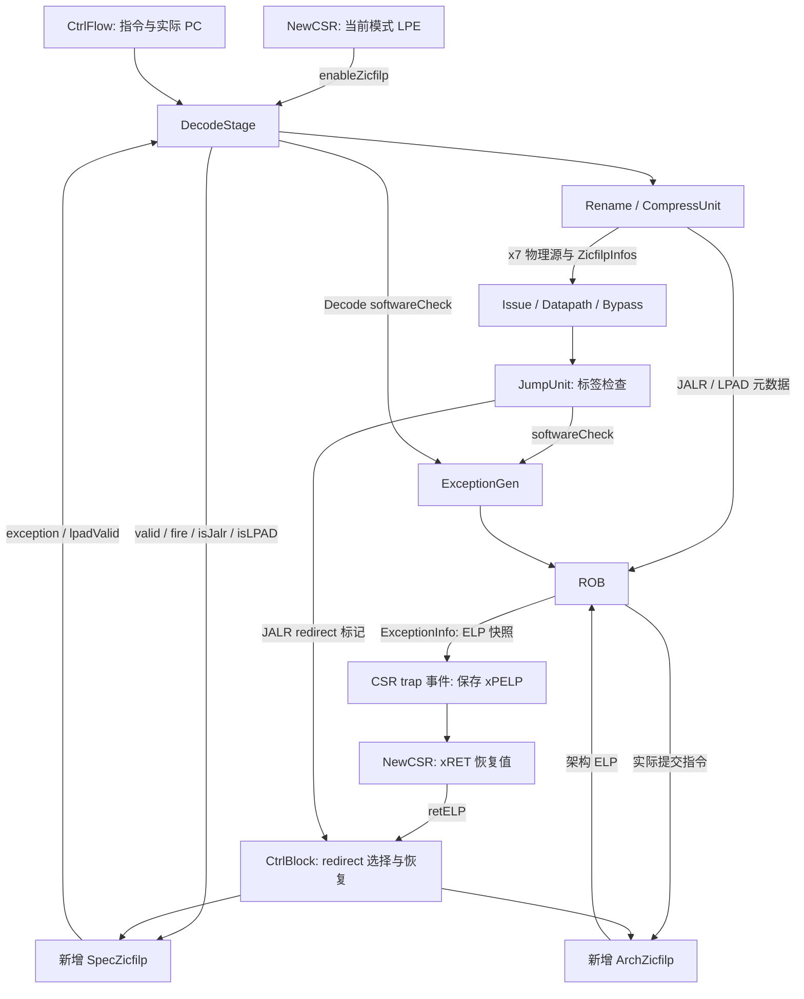
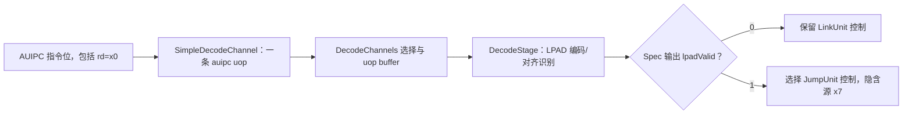
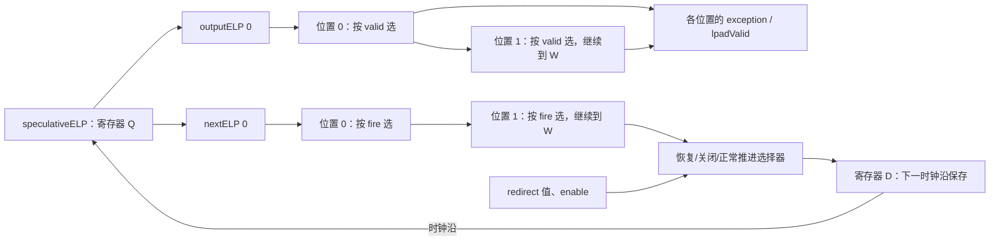
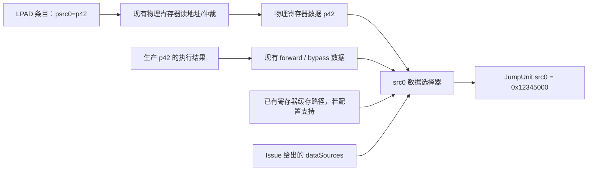
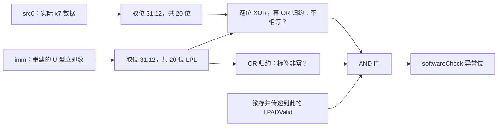
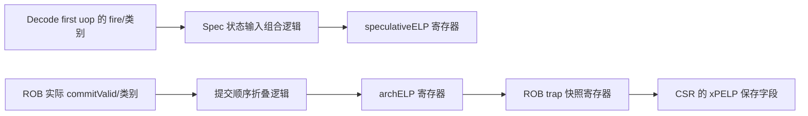

# XiangShan LPAD（Zicfilp）RTL 设计与代码改动说明

版本：v1.2，补充源码中文注释与阅读顺序。更新日期：2026-10-16。

实现版本：`zicfilp` 分支，`2eb6d92d7b2dcce7674c116339f74f206337d054`。改动前基线：`18657f51c`，即引入 Zicfilp 的提交 `a43bcfae8` 的父提交。本文描述这个基线到当前版本的实际 RTL 源码变化，包含架构 ELP 快照修复 `1ce8ede1a` 和接口补全 `60da49cc1`。

设计依据为 [riscv-cfi.pdf](../build/riscv-cfi.pdf) 第 3 章。文中的 Scala 片段摘自当前源码，省略了无关字段；标注“等价 RTL 示意”的 SystemVerilog 用来解释寄存器和组合逻辑，不是工具生成的 Verilog 原文。源码链接对应上述实现版本。

相关 Chisel 源码已补中文注释，可从 [源码阅读顺序](lpad-code-reading.md) 直接进入各段。注释中的“LPAD 阅读”用于定位入口；源码行号对应当前带注释的工作区，功能基线仍为上述提交。

<a id="hardware-reading"></a>

## 0. 先把源码中的变量对应到硬件

阅读顺序建议是：本节 → 第 3 节的 Decode → 第 4 节的逐拍例子 → 第 5.3 节的 x7 数据通路 → 第 6 节的比较器 → 第 8、11 节的提交和 trap。接口清单、CSR 字段和改动附录可以在理解这些通路之后再查。

### 0.1 哪些东西保存状态，哪些东西只是连线

| Chisel 写法 | 对应硬件 | 怎么理解时间 |
| --- | --- | --- |
| `RegInit(false.B)` | 有复位值的 1 位寄存器 | 当前周期输出旧值，在有效时钟沿更新 |
| `Wire(Vec(...))` | 一组组合信号 | 由当前输入和寄存器输出计算，不独立保存上周期结果 |
| `Mux(sel, a, b)` | 二选一选择器 | `sel=1` 输出 a，否则输出 b |
| `when(cond) { reg := value }` | 寄存器输入选择/写使能逻辑 | 条件成立时，在时钟沿写入 value |
| `when(cond) { wire := value }` | 组合选择逻辑 | 条件成立时改变本周期输出，没有额外时钟沿 |
| `RegEnable(data, en)` | 带写使能的寄存器 | `en=0` 保持；`en=1` 在时钟沿锁存 data |
| Scala `for` / `foldLeft` | elaboration 时展开的硬件逻辑 | 不表示每次循环花一个时钟周期 |

例如 `speculativeELP` 是一只 1 位触发器；`outputELP(0..DecodeWidth)` 和 `nextELP(0..DecodeWidth)` 是从这只触发器输出出发的两组组合信号。它们不是两套 ELP 寄存器阵列。

文中写“周期 T1”，指两个相邻有效时钟沿之间的时间。“T1→T2 时钟沿”指 T1 结束、T2 开始的那个沿。表中的“沿前 ELP”是寄存器 Q 端当前值，“沿后 ELP”是在该沿之后的新 Q 值。以下例子用上升沿表示，不展开复位电路细节。

### 0.2 一条指令有三种不同的通过条件

| 阶段 | 条件 | 条件成立意味着什么 |
| --- | --- | --- |
| Decode 输出 | `valid && ready`，简称 fire | 这条 uop 被下一流水级接收 |
| Issue/执行 | 源就绪、资源允许、发射成功 | uop 可以取得操作数并执行 |
| ROB 提交 | 指令到达提交边界，已完成且无阻止提交的异常 | 指令效果成为架构状态 |

Decode 的 fire 不等于指令已执行，也不等于已提交。LPAD 可以已经离开 Decode，却仍在 Issue 等待 x7；也可以已经比较成功，却仍在 ROB 等待更老指令。

本实现正因为存在这些时间差，才同时需要 Decode 的推测 ELP 和提交侧的架构 ELP。

### 0.3 ELP、指令标签和 x7 是三条不同的线

用下面的程序贯穿后文。假设运行时保护开启，x10 已经指向 4 字节对齐的 `target`，前端沿正确预测路径提供指令：

```asm
    lui  x7, 0x12345       # x7 的低 32 位 = 0x12345000
    jalr x1, 0(x10)        # rs1=x10，目标需要 LPAD

    # target 可以位于其他地址；以下写法只展示执行顺序
target:
    lpad 0x12345            # 编码 0x12345017
    add  x12, x13, x14
```

| 信息 | 示例 | 从哪里来 | 用来决定什么 |
| --- | --- | --- | --- |
| ELP | 1 位，0 或 1 | SpecZicfilp / ArchZicfilp 寄存器 | 当前边界是否期待 LPAD |
| LPAD 标签 LPL | 20 位，`0x12345` | LPAD 的 `inst[31:12]` | 当前目标声明接受哪个标签 |
| x7 的值 | RV64 值，本例为 `0x12345000` | 普通整数物理寄存器或数据旁路 | 与 LPL 比较的预期标签取自 `[31:12]` |

ELP=1 只表示“接下来必须检查入口”，不会保存 `0x12345`。标签跟着 LPAD 的立即数走，x7 的值跟着普通寄存器依赖走；两者在 JumpUnit 才相遇。

## 1. 设计目标与改动边界

LPAD 用来约束间接跳转的合法目标。启用 Zicfilp 后，满足条件的 JALR 要求目标第一条指令是 4 字节对齐的 LPAD；LPAD 的非零 20 位标签还必须与 `x7[31:12]` 相等，否则产生 `cause=18、tval=2` 的 software-check exception。

本次实现把这项约束接入现有乱序流水线，新增两个状态模块：Decode 侧的 `SpecZicfilp` 和提交侧的 `ArchZicfilp`。检查复用 JumpUnit、整数重命名、Issue 和 ROB 异常路径。

| 子系统 | 改动前 | 改动后 |
| --- | --- | --- |
| Decode | `AUIPC rd=x0` 按原有 AUIPC/HINT 路径处理 | 识别 LPAD、检查目标类型/对齐，必要时转到 JumpUnit |
| 状态跟踪 | 没有运行中的 ELP 跟踪模块 | 推测 ELP 与架构 ELP 分开维护 |
| 执行 | JumpUnit 处理跳转和预测修正 | 额外完成 LPAD 的 20 位标签比较 |
| 元数据 | uop 不带 Zicfilp 执行标记 | Decode、Rename、Issue、Datapath、EXU 传递标记 |
| ROB | 不按 JALR/LPAD 更新 ELP | 保存指令类别，提交时更新架构 ELP，trap 时捕获旧值 |
| 异常生成 | 没有来自 LPAD 标签比较的 jump 异常端口 | 按配置扩展稀疏异常向量和 ExceptionGen 分组 |
| CSR | 部分 LPE 字段已有只读占位，ELP 保存/恢复未接通 | 打开可写属性，增加保存字段、trap 更新和 xRET 恢复 |
| Redirect | 没有携带 ELP 恢复语义 | 携带受保护 JALR/xRET 标记与恢复值 |

主仓库的功能差分涉及 **39 个 Scala 文件，其中 2 个为新增文件**。同一比较范围还包含 `rocket-chip` 子模块指针变化；该子模块差分是 Zicfiss 的指令/RVC 修改，不属于本文 LPAD 设计。逐文件清单见附录 A。

LPAD 复用已有 `AUIPC rd=x0` 编码，未新增主 opcode 或专用指令拆分方式。已有 `Imm_U`、LinkUnit 和 RVC 展开逻辑作为基础设施复用；本文的硬件增量集中在状态、控制、元数据和异常链路。

## 2. 总体结构与新增接口

### 2.1 模块连接



图中有三种不同的数据：LPAD 的标签来自指令立即数，预期标签来自普通 GPR x7，ELP 是独立的 1 位状态。实现没有把 20 位标签复制进新的状态寄存器。

### 2.2 接口和位宽

| 新增信号/字段 | 位宽 | 产生位置 → 使用位置 | 硬件含义 |
| --- | ---: | --- | --- |
| `HasZicfilp` | Scala Boolean | 参数 → 各模块生成器 | elaboration 开关，不是运行时端口 |
| `enableZicfilp` | 1 | NewCSR → Decode、ArchZicfilp | 当前特权级的运行时 LPE |
| `ZicfilpPCAligned` | 1/指令 | CtrlFlow 转换 → Decode | 原始 PC 是否满足 `pc[1:0]=0` |
| `ZicfilpInfo.ZicfilpJalr` | 1/uop | Decode → 执行、ROB、redirect | 该 JALR 是否要求目标 LPAD |
| `ZicfilpInfo.ZicfilpLPADValid` | 1/uop | Decode → JumpUnit | 本次 LPAD 是否必须检查标签 |
| `ZicfilpLPAD` | 1/指令元数据 | Decode → ROB → 提交 | 编码及对齐正确的 LPAD |
| `ZicfilpRedirect` | valid 1 + bits 1 | CtrlBlock → SpecZicfilp | 推测 ELP 恢复请求及恢复值 |
| `Redirect.ZicfilpJalr` | 1 | JumpUnit → CtrlBlock | 重定向是否来自受保护 JALR |
| `Redirect.ZicfilpXRetValid` | 1 | CSR wrapper → CtrlBlock | 是否使用合法 xRET 的恢复值 |
| `Redirect.ZicfilpRetELP` | 1 | CSR wrapper → CtrlBlock | xRET 恢复值 |
| `ExceptionInfo.ZicfilpELP` | 1 | ROB → CSR trap | 异常边界的架构 ELP 快照 |
| `NewCSR.ZicfilpELP` | 1 | CtrlBlock → Backend → CSR | 实时架构 ELP 输入 |
| `NewCSROutput.retELP` | 1 | NewCSR → CSR wrapper | 已按目标模式 LPE 门控的恢复值 |

相关类型见 [Bundle.scala](../src/main/scala/xiangshan/Bundle.scala#L87)、[backend/Bundles.scala](../src/main/scala/xiangshan/backend/Bundles.scala#L127)、[CSR.scala](../src/main/scala/xiangshan/backend/fu/wrapper/CSR.scala#L454)。

### 2.3 编译开关如何改变生成的 RTL

[Parameters.scala](../src/main/scala/xiangshan/Parameters.scala#L56) 增加 `HasZicfilp: Boolean = true`，并经 `HasXSParameter` 暴露给各模块。当前实现用 `OptionWrapper` 或 `Option.when` 条件生成模块和字段：

```scala
val specZicfilp = Option.when(HasZicfilp)(Module(new SpecZicfilp))
val ZicfilpInfos = OptionWrapper(HasZicfilp && cfg.isJmp, new ZicfilpInfo)
```

`HasZicfilp=false` 时，对应 Option 字段和状态模块不会生成；CSR 中相关占位字段保持只读复位值。`HasZicfilp=true`、但运行时 LPE=0 时，硬件仍然存在，只是关闭检查并清除 ELP。两种配置对面积、信号位宽及兼容行为的含义不同。

## 3. Decode 改动：识别、异常生成与执行单元改派

### 3.1 从实际 PC 增加 1 位对齐元数据

改动位于 [DecodeInUop.connectCtrlFlow](../src/main/scala/xiangshan/backend/Bundles.scala#L130)：

```scala
val ZicfilpPCAligned = OptionWrapper(HasZicfilp, Bool())
// connectCtrlFlow(source: CtrlFlow)
this.ZicfilpPCAligned.foreach(_ := source.pc(1, 0) === 0.U)
```

DecodeStage 再把它复制到 [MopCtrlBundle](../src/main/scala/xiangshan/backend/vector/Decoder/DecodeChannels.scala#L674)，使它随 DecodeChannels 的 buffering、uop 选择一起传递。

对应 RTL 增量是对 PC 低两位的零判断，以及相关指令缓冲/流水线 payload 的 1 位扩展。使用独立控制字段，可以在关闭 debug PC 字段时仍完成对齐检查。

### 3.2 增加两类指令识别逻辑

[DecodeStage.scala](../src/main/scala/xiangshan/backend/vector/Decoder/DecodeStage.scala#L214)：

```scala
bits.ZicfilpInfos.get.ZicfilpJalr :=
  inst(6, 0) === "b1100111".U && inst(14, 12) === 0.U &&
  inst(19, 15) =/= 1.U && inst(19, 15) =/= 5.U && inst(19, 15) =/= 7.U

bits.ZicfilpLPAD.get :=
  inst(6, 0) === "b0010111".U && inst(11, 7) === 0.U &&
  mopInfo.ZicfilpPCAligned.get
```

第一类是受保护 JALR：`rs1` 不等于 x1、x5、x7。这里比较的是指令 `[19:15]`，不是目的寄存器 `[11:7]`，所以 `jalr x7,0(x10)` 仍是受保护跳转。

第二类是合法 LPAD 入口：`AUIPC rd=x0` 且 PC 为 4 字节对齐。硬件上可以把它看成 7 位 opcode 比较、5 位 rd 零检测和 1 位 PC 对齐标志的 AND。LPAD 的 `[31:12]` 是标签，不参与这一步编码分类。这些比较是 Decode 的新增组合逻辑，未增加专用指令译码通道。

`ZicfilpLPAD` 与 `ZicfilpLPADValid` 的用途不同：前者记录指令类别并送往 ROB；后者还要求 LPE=1、推测 ELP=1，控制本次执行检查。不对齐的 LPAD 编码会令前者为 0，在期待 LPAD 时走 Decode software-check。

### 3.3 有效 LPAD 从 LinkUnit 改派到 JumpUnit

改动前，AUIPC 由普通表映射到 LinkUnit；其运算为 `pc+imm` 并尝试写 rd，rd=x0 时没有架构寄存器效果。LinkUnit 的源数据配置为 `NoData()`，不具备读取 x7 的输入条件。

改动后，Decode 对需要检查的 LPAD 覆盖以下字段：

```scala
bits.ZicfilpInfos.get.ZicfilpLPADValid := spec.io.lpadValid(i)
bits.exceptionVec(softwareCheck) := spec.io.exception(i)
when(spec.io.lpadValid(i)) {
  bits.fuType := FuType.jmp.U
  bits.fuOpType := JumpOpType.j
  bits.rfWen := false.B
  bits.lsrc(0) := 7.U
  bits.srcType(0) := SrcType.reg
}
```

| 覆盖项 | RTL/流水线效果 |
| --- | --- |
| `fuType=jmp` | 使用已有 jump Issue/EXU 选择路径 |
| `fuOpType=j` | 复用现有 JumpUnit 操作类型，LPAD 身份由独立标记区分 |
| `rfWen=false` | 保留执行完成回写，关闭 GPR 写入 |
| `lsrc(0)=7`、`srcType(0)=reg` | RAT 查 x7，建立物理源依赖，使用正常寄存器读和旁路 |
| `exceptionVec(softwareCheck)` | 将“不存在合法 LPAD”的错误直接送入 ROB 入队异常路径 |

该逻辑不增加 LPAD 的 uop 数量，`selImm` 仍沿用 AUIPC 的 U 型立即数。覆盖之后，代码通过 `LatDecoder(bits.fuType,bits.fuOpType)` 产生实际执行类型的延迟信息；RAT 读地址也从覆盖后的 `lsrc` 取得。

硬件上，这相当于给 Decode 的 FU 选择、源寄存器编号、源类型和写使能增加由 `lpadValid` 控制的选择逻辑。ELP=0 或 LPE=0 时，保留原来的 AUIPC/HINT 路径。

以源寄存器地址为例，等价 RTL 示意是：

```systemverilog
assign final_lsrc0   = lpad_valid ? 5'd7 : base_lsrc0;
assign final_srcType = lpad_valid ? SRC_REG : base_srcType;
assign final_fuType  = lpad_valid ? FU_JMP : base_fuType;
assign final_rfWen   = lpad_valid ? 1'b0 : base_rfWen;
assign int_rat_addr0 = final_lsrc0;
```

这里的 `base_*` 是译码通道已经产生的控制字段，`final_*` 是 DecodeStage 输出的字段。`when` 覆盖写法表达的是这些选择器，不是先执行一次 AUIPC、再执行一次 LPAD，也没有为覆盖过程增加一个周期。

`lpadValid=1` 只是向下游发布“这条 uop 要检查标签”。Decode 此时还不知道 x7 的数值，所以不能在这里声称标签已经通过。

<a id="decode-auipc-channel"></a>

### 3.4 AUIPC 实际在哪个通道译码

[DecodeChannels.scala](../src/main/scala/xiangshan/backend/vector/Decoder/DecodeChannels.scala#L94) 为每个输入指令位置实例化 Simple、Pseudo、Vector、Vset 等 decoder。它们并行接收相同指令位，后面的选择器选出适用结果。通道类型和位置编号是两回事：一条 AUIPC 可以出现在任意有效位置。

当前 [ScalaUopTable.scala](../src/main/scala/xiangshan/backend/vector/Decoder/Uop/ScalaUopTable.scala#L54) 的映射为 `AUIPC -> Seq(auipc)`，而 `auipc` 属于 `LinkOpcodes`。因此普通 AUIPC 通过 SimpleDecodeChannel 产生一条 link FU uop。

[PseudoDecodeChannel 的实际表](../src/main/scala/xiangshan/backend/vector/Decoder/DecodeChannel/PseudoDecodeChannel.scala#L188) 没有 LPAD 项；[PseudoInstructions.scala](../src/main/scala/xiangshan/backend/decode/isa/PseudoInstructions.scala#L74) 仅定义了 LPAD 的 BitPat，定义存在不代表它已经接入某个 decoder 表。



所以当前 `rd=x0` 的 AUIPC 同样先走 Simple；是否改派 JumpUnit，由后处理的状态决定。[NumWbField.scala](../src/main/scala/xiangshan/backend/vector/Decoder/DecodeFields/SimpleDecodeChannel/NumWbField.scala#L30) 只把 JAL/JALR 列入双完成回写集合，AUIPC 为一次；相应源码注释也已明确这一区别。

### 3.5 falseInsts 只决定一个控制字段的取值

[CanRobCompressField.scala](../src/main/scala/xiangshan/backend/vector/Decoder/DecodeFields/SimpleDecodeChannel/CanRobCompressField.scala#L14) 中的逻辑是：

```scala
if (falseInsts.contains(inst.name)) n else y
```

`falseInsts` 是 `canRobCompress` 字段要取 0 的指令名集合，AUIPC 在其中。`getVariableNameSeq(AUIPC, JAL, ...)` 通过 Scala 宏取得名字，在生成译码表时决定各表项的这一位。生成出的硬件是指令位到控制位的译码逻辑，没有运行时字符串集合查询。

这既不表示“非法指令”，也不决定 Simple/Pseudo 通道选择。本分支中，该字段参与 [DecodeStage 的 simple 分类](../src/main/scala/xiangshan/backend/vector/Decoder/DecodeStage.scala#L186)，影响高密度 ROB segment 的组织；`canRobCompress=0` 本身不能概括全部 ROB 配对规则。LPAD 必须保留独立条目语义，另由第 8.2 节的 `changesELP` 约束保证。

<a id="spec-hardware"></a>

## 4. 新增 SpecZicfilp：一只寄存器与两条组合链

### 4.1 这只 1 位寄存器到底记住什么

[SpecZicfilp.scala](../src/main/scala/xiangshan/backend/decode/SpecZicfilp.scala#L28) 中真正跨周期保存的状态只有：

```scala
val speculativeELP = RegInit(false.B)
```

它保存“沿当前推测执行流，下一个被 Decode 接收的架构指令是否必须是 LPAD”。受保护 JALR 的 first uop 被接收后，状态变为 1；目标 LPAD 被接收后，状态变为 0。

这里的“下一个”按前端预测的执行顺序理解。例如 JALR 正确预测时，后续输入可以直接是目标 LPAD，地址不必为 JALR 的 PC+4。模块自身没有计算跳转地址，也不读取 x7。

| 端口 | 含义 | 注意事项 |
| --- | --- | --- |
| `enable` | 当前模式的运行时 LPE | 为 0 时不产生检查输出 |
| `redirect.valid/bits` | 恢复请求及 1 位恢复值 | 在时钟沿覆盖旧推测状态 |
| `valid(i)` | 位置 i 有效且是架构指令的第一个 uop | 不等同于所有有效 uop |
| `fire(i)` | 上述 first uop 本拍实际被下游接收 | `valid(i) && ready(i)` |
| `isJalr(i)` | 原指令是要求 LPAD 的 JALR | rs1=x1/x5/x7 的 JALR 为 0 |
| `isLPAD(i)` | 编码及 PC 对齐正确 | 不包含标签是否匹配的判断 |
| `exception(i)` | 当前入口缺少合法 LPAD | 随 uop 传递的 software-check 异常位 |
| `lpadValid(i)` | 当前 LPAD 必须执行标签检查 | 不代表已经通过标签检查 |

### 4.2 位置 i、周期 T 和 firstUop 是三个概念

以下用每拍 4 个输出位置说明；这是便于阅读的例子，实际宽度由配置决定。横向是同一拍的多个 uop 槽位，纵向才是不同周期：

| 周期 ↓ / 位置 → | 0，较老 | 1 | 2 | 3，较年轻 |
| --- | --- | --- | --- | --- |
| T0 | 普通指令 A | 普通指令 B | 普通指令 C | JALR 的 link |
| T1 | 同一 JALR 的 jr | 目标 LPAD | 普通指令 D | 普通指令 E |

JALR 在本实现中可以拆成 `link+jr`：link 写返回地址，jr 执行跳转。它们合起来是一条架构指令，必须只推进一次 ELP。

因此 [DecodeStage.scala](../src/main/scala/xiangshan/backend/vector/Decoder/DecodeStage.scala#L130) 接入的是：

```scala
spec.io.valid(i) := coUop.valid && coUop.bits.info.isFirstUop && !in.redirect.valid
spec.io.fire(i)  := spec.io.valid(i) && out.uop(i).ready
```

| uop | Decode 输出 valid | firstUop | Spec valid | ready=1 时的 Spec fire |
| --- | ---: | ---: | ---: | ---: |
| JALR link | 1 | 1 | 1 | 1 |
| 同一 JALR 的 jr | 1 | 0 | 0 | 0 |
| LPAD | 1 | 1 | 1 | 1 |

jr 的 Spec fire 为 0，不妨碍 jr 本身向下游传递。它只表示这个 uop 不再触发一次“架构指令边界”的状态更新。`JALR rd=x0` 可以从 pseudo 通道只产生一个 first/last 都为 1 的 jr，这时该 jr 正常参与 ELP 更新。

### 4.3 先看一个位置的组合电路

对位置 i，把 `outputELP(i)` 看成该位置输入的 ELP。电路先决定是否检查当前指令，再算提供给下一个位置的 ELP：

```scala
val checkLandingPad = io.valid(i) && outputELP(i)
io.exception(i) := io.enable && checkLandingPad && !io.isLPAD(i)
io.lpadValid(i) := io.enable && checkLandingPad && io.isLPAD(i)
outputELP(i + 1) := Mux(io.valid(i), io.isJalr(i), outputELP(i))
```

假设 enable=1，单个位置的结果如下：

| Spec valid | 进入位置的 ELP | 当前指令 | exception | lpadValid | 送往下一位置的 ELP |
| ---: | ---: | --- | ---: | ---: | ---: |
| 0 | 任意 | 空槽位或非 first uop | 0 | 0 | 保持进入值 |
| 1 | 0 | 受保护 JALR | 0 | 0 | 1 |
| 1 | 0 | 普通指令或 LPAD | 0 | 0 | 0 |
| 1 | 1 | 合法对齐 LPAD | 0 | 1 | 0 |
| 1 | 1 | 普通指令 | 1 | 0 | 0 |
| 1 | 1 | 又一条受保护 JALR | 1 | 0 | 1 |

最后两行说明：模块会给缺少 LPAD 的指令标记异常，但不会等待 trap 或比较成功才继续推演后续 ELP。软件最终看到的精确状态由 ROB/ArchZicfilp 保证。

### 4.4 为什么需要两条链，而不是一条

```scala
val outputELP = Wire(Vec(DecodeWidth + 1, Bool()))
val nextELP = Wire(Vec(DecodeWidth + 1, Bool()))
outputELP.head := speculativeELP
nextELP.head := speculativeELP

for (i <- 0 until DecodeWidth) {
  // exception / lpadValid 使用上节的 outputELP(i)
  outputELP(i + 1) := Mux(io.valid(i), io.isJalr(i), outputELP(i))
  nextELP(i + 1)   := Mux(io.fire(i),  io.isJalr(i), nextELP(i))
}
```

| 组合链 | 选择器的控制信号 | 解决的问题 |
| --- | --- | --- |
| `outputELP` | valid | 当前这组 uop 中，每个位置应该附带什么检查控制 |
| `nextELP` | fire | 当前这组实际前进之后，下一拍应记住什么状态 |

两条链从同一只寄存器的 Q 端开始。每个位置增加一个 1 位选择器，`outputELP` 还分支出检查用的 AND/反相逻辑。概念连接如下：



W 表示配置的输出位置数。箭头穿过多个位置表示组合依赖，不表示穿过多级流水寄存器。源码中的 for 在生成电路时展开；位置 0 到位置 3 的推演在同一拍内完成。

只看寄存器更新，等价 RTL 示意为：

```systemverilog
always_ff @(posedge clock) begin
  if (reset)               speculative_elp <= 1'b0;
  else if (redirect_valid) speculative_elp <= redirect_elp;
  else if (!enable)        speculative_elp <= 1'b0;
  else                     speculative_elp <= next_elp[DECODE_WIDTH];
end
```

复位之外的选择优先级是 `redirect > 关闭扩展 > 正常推进`。虽然正常路径每拍都赋值，全部 fire=0 时 `nextELP.last` 等于旧 Q，所以状态仍保持。

### 4.5 同一拍内的 JALR 和 LPAD 怎么连接

假设沿前寄存器为 0，输出为 `[link, jr, LPAD, ADD]`，本拍全部接收：

| 位置 i | uop | Spec valid | isJalr | isLPAD | outputELP(i) | exception | lpadValid | outputELP(i+1) |
| ---: | --- | ---: | ---: | ---: | ---: | ---: | ---: | ---: |
| 0 | JALR link | 1 | 1 | 0 | 0 | 0 | 0 | 1 |
| 1 | 同一 JALR 的 jr | 0 | 1 | 0 | 1 | 0 | 0 | 1 |
| 2 | 目标 LPAD | 1 | 0 | 1 | 1 | 0 | 1 | 0 |
| 3 | ADD | 1 | 0 | 0 | 0 | 0 | 0 | 0 |

`isJalr=1` 在 jr 上仍可见，因为它来自原始 JALR 编码；但 Spec valid=0，所以不消费期待，也不产生异常。

```text
沿前寄存器 Q = 0
outputELP    = [0, 1, 1, 0, 0]
nextELP      = [0, 1, 1, 0, 0]   # 本拍接收，fire=Spec valid
lpadValid    = [0, 0, 1, 0]
沿后寄存器 Q = 0
```

寄存器前后都是 0，不表示没有检查。位置 2 在本拍组合逻辑中已经获得 `lpadValid=1`，并随 LPAD 被下一级锁存。JALR 的设置和 LPAD 的消耗可以在一组内抵消，检查标志仍然正确传递。

<a id="spec-stall"></a>

### 4.6 下游阻塞时，什么保持，什么仍然计算

下面的“阻塞”明确指 Decode 输出的 `ready=0`。更后端资源暂时不足，可能先由中间流水级吸收；只有 ready 拉低到这个接口，才发生这里的保持。

Decode 和 Rename 之间的 [PipelineConnect](../utility/src/main/scala/utility/PipelineConnect.scala#L108) 保存输出 payload；[CtrlBlock.scala](../src/main/scala/xiangshan/backend/CtrlBlock.scala#L738) 连接这一级。正常无 flush、block=0 时，它的关键行为等价于：

```systemverilog
assign decode_ready = rename_ready;
assign take_decode = decode_valid && decode_ready;
always_ff @(posedge clock) begin
  if (take_decode) pipe_data <= decode_bits;
  // valid 的消费、补入和 flush 优先级由 PipelineConnect 管理
end
```

本实现 [Rename.scala](../src/main/scala/xiangshan/backend/rename/Rename.scala#L494) 的各位置 ready 使用同一个条件：

```scala
io.in(i).ready := !io.in(0).valid || canOut
```

所以这里没有“位置 0 卡住，位置 2 的 LPAD 独自先被接收”的情况。Spec 的 valid 链依赖这种整组按序接收约束。

假设 T0 接收 `[A,B,C,link]`，之后连续阻塞两拍：

| 周期 | Decode 当前输出，按位置 0→3 | ready | 沿前 ELP | LPAD 的 lpadValid | 沿后 ELP |
| --- | --- | ---: | ---: | ---: | ---: |
| T0 | `[A,B,C,JALR-link]` | 1 | 0 | 无 LPAD | 1 |
| T1 | `[JALR-jr,LPAD,D,E]` | 0 | 1 | 1 | 1 |
| T2 | `[JALR-jr,LPAD,D,E]` | 0 | 1 | 1 | 1 |
| T3 | `[JALR-jr,LPAD,D,E]` | 1 | 1 | 1 | 0 |
| T4 | 下一组普通指令 | 1 | 0 | 无 LPAD | 0 |

T1、T2、T3 的这一行指令是同一组。T1 时各信号为：

```text
Decode uop valid = [1, 1, 1, 1]
firstUop         = [0, 1, 1, 1]
Spec valid       = [0, 1, 1, 1]
ready            = [0, 0, 0, 0]
Spec fire        = [0, 0, 0, 0]

outputELP        = [1, 1, 0, 0, 0]  # valid 链看见 LPAD
nextELP          = [1, 1, 1, 1, 1]  # fire 链没有任何接收
lpadValid        = [0, 1, 0, 0]
```

这时虽然 `outputELP.last=0`，寄存器 D 端正常推进的来源却是 `nextELP.last=1`，所以时钟沿后仍为 1。T2 再次计算相同结果。T3 ready 恢复后，Spec fire 变为 `[0,1,1,1]`，nextELP 变为 `[1,1,0,0,0]`；在 T3→T4 沿，寄存器才更新为 0。

同一个时钟沿还有另一个动作：下一级把 LPAD 的 payload，包括 `ZicfilpLPADValid=1`，锁存进去。之后推测 ELP 已为 0，已接收的 LPAD 仍带着锁存的检查标志，最终送到 JumpUnit。它不会重新读取那时的实时 ELP 决定是否检查。

阻塞时的硬件保持关系可以逐项对照源码：

| 对象 | ready=0 时的行为 | 依据 |
| --- | --- | --- |
| `speculativeELP` | 全部 Spec fire=0，正常路径回写旧值 | `nextELP` 链 |
| Decode→Rename 的 payload 寄存器 | 不锁存当前输出组 | `RegEnable(left.bits, leftFire)` |
| DecodeChannels 的 uop buffer 数量 | 无 redirect 时保持 | `RegEnable(..., out.head.valid && renameCanAccept || redirect)` |
| uop buffer 内容/附带原指令信息 | 写使能被 `renameCanAccept` 关掉 | `uopBufferUpdateVec` |
| Decode 输入指令 | 输入 ready=0，上游不消耗它们 | `acceptVec(i) && renameCanAccept` |
| RAT 读端口 | hold=1 | `hold := !out.uop(i).ready` |
| `outputELP`、`lpadValid`、`exception` | 仍是当前输入的组合结果 | 它们是 Wire/输出连线 |

因此 `lpadValid` 连续为 1 不代表重复发射；`exception` 连续为 1 也不代表连续进入 trap。没有 fire 的周期，下一级不会把这份 uop 再接收一次。

如果 `[link,jr,LPAD,ADD]` 整组从 ELP=0 开始被阻塞，outputELP 仍为 `[0,1,1,0,0]`，但 nextELP 为 `[0,0,0,0,0]`，寄存器保持 0，因为组内 JALR 同样还没被接收。恢复时 LPAD 仍会携带 lpadValid=1，寄存器沿后仍为 0。这与上一例“JALR 已在前一拍接收，因此阻塞时保持 1”并不矛盾。

### 4.7 目标不是 LPAD，与 LPAD 标签错误分别发生在哪里

假设已接收 JALR，沿前 ELP=1：

| 目标 | Spec 输入 isLPAD | Spec 输出 | 后续处理 |
| --- | ---: | --- | --- |
| 普通 ADD | 0 | exception=1，lpadValid=0 | software-check 随目标 uop 进入 ROB |
| LPAD 编码但 PC=4n+2 | 0 | 同上 | 对齐问题在 Decode 判定 |
| 对齐 LPAD，标签正确 | 1 | exception=0，lpadValid=1 | JumpUnit 比较通过 |
| 对齐 LPAD，非零标签错误 | 1 | exception=0，lpadValid=1 | JumpUnit 比较后回写异常 |

SpecZicfilp 看不到 x7，因此后两行在 Decode 完全相同。目标被接收后，推测 ELP 都可变为 0；如果后来发现标签错误，失败 LPAD 不能提交，架构 ELP 仍保留等待入口检查的状态。

### 4.8 阻塞期间发生 redirect 怎么办

单纯 stall 保留当前组；redirect 会清除应当丢弃的推测指令。DecodeStage 用 `!in.redirect.valid` 关闭 Spec valid，DecodeChannels 清空 uop buffer 的有效数量，流水级也按 flush 处理。

与此同时，Spec 寄存器按恢复请求更新，优先级高于 fire。受保护 JALR 目标误预测时，正确目标重新进入 Decode 前需要 ELP=1；xRET 则使用随返回请求携带的恢复值。当前 CtrlBlock 的其他重定向恢复为 0，具体选择规则和适用约束见第 9 节。

这些状态恢复仍在时钟沿发生，不能把组合检查输出当成新的持久状态。

## 5. Rename、Issue 和 Datapath 的元数据扩展

### 5.1 两位执行标记贯穿已有 payload

[ZicfilpInfo](../src/main/scala/xiangshan/Bundle.scala#L88) 新增：

```scala
class ZicfilpInfo(implicit p: Parameters) extends XSBundle {
  val ZicfilpJalr = Bool()
  val ZicfilpLPADValid = Bool()
}
```

[backend/Bundles.scala](../src/main/scala/xiangshan/backend/Bundles.scala#L205) 将这两位加入下列接口：

| 阶段/类型 | 生成条件 | 用途 |
| --- | --- | --- |
| `DecodeOutUop`、`RenameOutUop` | HasZicfilp | 保留 Decode 判断 |
| `DispatchOutBaseUop` | HasZicfilp | 随派发进入执行通路 |
| `RegionInUop`、`EntryOg1Payload` | HasZicfilp 且 Issue block 有 jump | 随 Issue 队列内容保存 |
| `IssueQueueDeqOg1Payload` | HasZicfilp 且 EXU 有 JumpUnit | 随选中的出队 uop 传出 |
| `Og1InUop` | HasZicfilp 且 EXU 有 JumpUnit | 参与操作数准备和旁路控制 |
| `ExuInput`、`ExuInputCtrlBundle` | HasZicfilp 且 EXU 有 JumpUnit | 随执行输入控制传递 |
| `FuncUnitCtrlInput` | HasZicfilp 且当前 FU 是 jump | 让 JumpUnit 区分 LPAD 与正常跳转 |

这些变化使相关队列条目和流水寄存器变宽。具体总位数取决于 Issue 队列数量、深度和执行单元配置；不能把一份 2 位 Bundle 的定义当成整个核只增加两位存储。

### 5.2 手工组装接口必须显式补线

已有同名 Bundle 连接可带上同名新增字段，但手工组装路径需要额外赋值。当前实现明确补了两处：

```scala
// Og1InUop.fromIssueBundle
this.ZicfilpInfos.foreach(_ := source.ZicfilpInfos.get)

// ExeUnit：FU 当前输入与流水控制输入均补齐
sink.bits.ctrl.ZicfilpInfos.foreach(x => x := source.bits.ctrl.ZicfilpInfos.get)
sink.ZicfilpInfos.foreach(x => x := source.ctrl.ZicfilpInfos.get)
```

位置分别见 [Bundles.scala](../src/main/scala/xiangshan/backend/Bundles.scala#L1107) 和 [ExeUnit.scala](../src/main/scala/xiangshan/backend/exu/ExeUnit.scala#L202)。前一处是 `60da49cc1` 的接口补全内容：只有字段声明而没有这根连接，会让 Decode 已识别的 LPAD 身份无法可靠到达执行阶段。

<a id="x7-hardware"></a>

### 5.3 x7 使用现有寄存器依赖机制：从编号到实际数据

#### 5.3.1 Decode 只说“要读 x7”，还没有读出数值

LPAD 的指令位中没有一个可变的 rs1 字段；规范规定其隐含源为 x7。Decode 用 `lsrc(0)=7` 和 `srcType(0)=reg` 表达这个隐含源，并把整数 RAT 读地址接为 7：

```scala
bits.lsrc(0) := 7.U
bits.srcType(0) := SrcType.reg
// 赋值覆盖后，RAT 地址使用最终输出值
out.intRat(i)(0).addr := out.uop(i).bits.lsrc(0)
```

这根 5 位地址线的值是 7，不是 `0x12345000`。Decode 使用的是 RAT 读端口，RAT 返回物理寄存器编号；实际 x7 数据在后面的 Datapath/Bypass 中取得。

| 名称 | 示例 | 数据含义 |
| --- | --- | --- |
| `lsrc(0)` | 7 | 架构源寄存器编号：x7 |
| RAT 中的映射 | `x7 → p42` | 当前推测流中，x7 对应哪个物理寄存器 |
| `psrc(0)` | 42 | 这条 LPAD 要等待、要读取的物理源编号 |
| 物理寄存器 p42 的内容 | `0x12345000` | 生产者写出的实际数值 |
| JumpUnit 的 `src(0)` | `0x12345000` | 已经取出的操作数数据 |

p42 是为了说明而假设的物理编号，具体分配值由 FreeList 决定。

#### 5.3.2 为什么物理编号能保证“程序顺序上的版本”

假设重命名前 `x7→p20`。执行下面这段指令：

```asm
    lui  x7, 0x12345
    jalr x1, 0(x10)
target:
    lpad 0x12345
    addi x7, x0, 0
```

按照指令从老到年轻的顺序，Rename 做以下事情：

| 指令 | Rename 动作 | 对 LPAD 的意义 |
| --- | --- | --- |
| LUI 写 x7 | 分配 p42 作为目的，新的 x7 映射为 p42 | p42 将保存标签值 |
| JALR 写 x1 | 分配 x1 的目的，不修改 x7 映射 | x7 仍对应 p42 |
| LPAD 读 x7 | 把源编号 p42 写入 LPAD 的 psrc(0) | 后续始终依赖这个版本 |
| ADDI 再写 x7 | 分配另一个目的 p51，新的 x7 映射为 p51 | 不修改已生成 LPAD 的 psrc |

因此，即使年轻 ADDI 先执行并把 p51 写成 0，较老 LPAD 仍读 p42。乱序执行可以改变执行时间，但已经建立的源编号决定了它读取哪次写入。后续 RAT 映射变化不会使 Issue 中的 LPAD 重新查一次 x7。

#### 5.3.3 同周期 Rename 旁路传的是编号

如果 LUI、JALR、LPAD 同一拍进入 Rename，周期开始时 RAT 读 x7 可能仍返回旧编号 p20。LUI 对 RAT 的更新要在时钟沿保存，但当前拍的 LPAD 已经需要选择 p42。

已有 [Rename.scala](../src/main/scala/xiangshan/backend/rename/Rename.scala#L773) 检查所有同组更老位置：

```scala
val indexMatch = in.bits.ldest === lsrc
val writeMatch = intRen && needIntDest(k) || ...
// 匹配的较老指令 pdest 用来覆盖 RAT 读出的 psrc
```

对 LPAD，这个匹配可以理解成：

```text
更老 LUI 的 ldest = 7
当前 LPAD 的 lsrc = 7
更老 LUI 确实写整数目的
    → 匹配成立
    → LPAD.psrc0 选择 LUI.pdest，即 p42
```

硬件上是 5 位架构编号比较器、写使能门控以及物理编号选择器。若同组有多条更老指令写 x7，`foldLeft` 选择程序顺序上最近的那一条。省略特殊指令处理的等价 RTL 示意为：

```systemverilog
always_comb begin
  lpad_psrc0 = rat_x7_psrc;             // 默认旧映射 p20
  for (int k = 0; k < LPAD_POSITION; k++) begin
    if (older_writes_int[k] && older_ldest[k] == 5'd7)
      lpad_psrc0 = older_pdest[k];      // 后面的匹配覆盖前面的
  end
end
```

这个旁路不要求 LUI 在当前拍完成计算；它只是先建立“LPAD 依赖生产 p42 的指令”这件事。跨拍时，已更新的 RAT 映射也能提供 p42。

#### 5.3.4 Issue 怎么知道 p42 是否已经有值

物理目的刚分配后，其结果可能尚未产生。[BusyTable.scala](../src/main/scala/xiangshan/backend/rename/BusyTable.scala#L147) 保存物理寄存器的 busy 状态，分配置 busy，写回/支持的唤醒清 busy；读响应表示该源能否就绪。

进入 Issue 后，已有条目结构保存 `psrc`、`srcState` 和数据来源选择信息，见 [EntryBundles.scala](../src/main/scala/xiangshan/backend/issue/EntryBundles.scala#L25)。对当前 LPAD，可以把条目理解为：

```text
psrc0       = 42
srcState0   = 尚未就绪
LPADValid   = 1
imm         = 0x12345 的紧凑表示
```

生产者的唤醒/写回携带物理目的编号。与 `psrc0=42` 匹配时，Issue 更新源状态，并按现有规则决定从寄存器还是旁路取得值。普通发射条件包括所有需要的源就绪、条目有效且未被阻止；快速唤醒还可以提前安排发射，让操作数在到达执行单元时经旁路提供，取消和重发继续使用原有机制。

这里的 `srcReady=0` 表示某条 uop 在 Issue 中等待数据，与第 4.6 节 Decode 接口的 `ready=0` 是不同信号。Issue 尚有空位时可以继续接收其他 uop；只有队列或后续资源限制形成背压，等待才可能继续传到 Decode。

#### 5.3.5 Datapath 的数据选择器才拿到实际数值

[DataPath.scala](../src/main/scala/xiangshan/backend/datapath/DataPath.scala#L106) 把已选 uop 的 psrc 接到现有整数物理寄存器读仲裁器；[BypassNetwork.scala](../src/main/scala/xiangshan/backend/datapath/BypassNetwork.scala#L181) 再按 dataSources 选择实际操作数：



概念上的选择关系为：

```text
src0 = 选择(寄存器读数据，执行结果 forward，保存一拍的 bypass，已有缓存数据等)
```

如果值早已可读，使用寄存器或已有缓存；如果生产者结果正在经过旁路，直接接入该数据。具体路径由现有配置和调度决定，LPAD 不要求生产者先提交。

“没有新增专用读端口”指复用这些已有端口、仲裁器和数据 mux。LPAD 的取数仍会形成实际需求，并可能与其他 uop 竞争资源。普通流水寄存器和 Issue 条目照常保存 psrc、立即数和控制位；这里没有增加 LPAD 专用的 20 位“跳转前 x7 标签”寄存器。

#### 5.3.6 JALR 自己写 x7 时，LPAD 应读返回地址

```asm
    lui  x7, 0x12345
    # 假设下面是 PC=0x80001000 处的 32 位 JALR
    jalr x7, 0(x10)
target:
    lpad 0x12345
```

JALR 使用 x10 决定跳转目标，同时把 PC+4 写入 x7。目的 x7 不豁免保护；rs1=x10 仍要求 LPAD。

| uop | 与 x7 有关的物理编号 | 结果/用途 |
| --- | --- | --- |
| LUI | pdest=p42 | 低 32 位为 `0x12345000` |
| JALR link | pdest=p43 | 返回地址低 32 位为 `0x80001004` |
| JALR jr | 读取 x10 的物理源 | 执行跳转 |
| 目标 LPAD | psrc0=p43 | 等待并读取 JALR 写入的返回地址 |

所以比较的是 `0x80001` 与 `0x12345`，会不匹配。这个程序不能指望 LPAD 仍检查之前 LUI 的标签。若 LPAD 标签是 `0x80001`，则只就标签比较而言能通过；x7 的高 32 位和低 12 位不参与比较。

Rename 中的 `linkToJrFalseDep` 只处理同一跳转拆分产生的 link→jr 假依赖，LPAD 的 isJ/isJr 分类为 0，不属于这项豁免，必须保留 link→LPAD 的真实 x7 依赖。

#### 5.3.7 lpad 0 为什么仍会等 x7

```asm
    ld   x7, 0(x11)       # 假设 load 结果较晚才返回
    jalr x1, 0(x10)
target:
    lpad 0
```

假设 load 的目的为 p90，当前 Decode 仍为这个有效 LPAD 设置 `lsrc0=7、srcType0=reg`，所以 Rename 给它 `psrc0=p90`。Issue 看到这个源尚未就绪，就会跟踪 load 的完成/唤醒；执行时也仍按正常源准备逻辑取数。

但 JumpUnit 比较电路里 `label_nonzero=0`，任何 x7 值都不会导致标签错误。规范允许这次检查不依赖 x7；当前控制却在更早的 Rename/Issue 层已经建立了依赖。这会延长该 LPAD 在队列中的等待，增加现有取数通路的使用需求，并可能推迟其发射/完成。

优化需要在生成源控制时识别零标签，使它不依赖 x7，同时核对 Issue/Datapath 对无寄存器源的处理；仅在 JumpUnit 中忽略比较结果，不能消除已经建立的依赖。本文描述当前实现，这项优化尚未应用。

## 6. JumpUnit 和立即数数据通路改动

### 6.1 NJmpCfg 新增 U 型立即数支持

[FuConfig.scala](../src/main/scala/xiangshan/backend/fu/FuConfig.scala#L240) 的变化是：

```diff
- immType = Set(Imm_I(), Imm_J()),
+ immType = Set(Imm_I(), Imm_J(), Imm_U()),
```

AUIPC/LPAD 的 Decode 立即数是 `inst[31:12]`，已有 `Imm_U` 重建成 `{LPL,12'b0}`。增加 `Imm_U()` 使该选择在 jump 执行配置中合法，标签可以复用原有立即数提取和传输网络。

以 `lpad 0x12345` 为例，数据在各阶段的表示如下：

| 位置 | 值 | 解释 |
| --- | --- | --- |
| 原始指令 | `0x12345017` | 低 12 位包含 rd=0 和 AUIPC opcode |
| Decode 的 U 型紧凑立即数 | `0x12345` | 只提取 `inst[31:12]`，没有携带 opcode |
| 执行通路重建的 U 型立即数低 32 位 | `0x12345000` | LPL 左移 12 位 |
| JumpUnit 的 `imm[31:12]` | `0x12345` | 取回标签供比较 |

这条立即数路径和第 5.3 节的 x7 数据路径是两路输入。Rename 不会把 x7 值塞进立即数，ELP 寄存器也不会携带标签。

### 6.2 BypassNetwork 对 LPAD 不叠加 PC offset

[BypassNetwork.scala](../src/main/scala/xiangshan/backend/datapath/BypassNetwork.scala#L225)：

```diff
- val immBJU = imm + Mux(isJR, 0.U, SignExt(thisPcOffset, imm.getWidth))
+ val isLPAD = exuInput.bits.ZicfilpInfos.map(_.ZicfilpLPADValid).getOrElse(false.B)
+ val immBJU = imm + Mux(isJR || isLPAD, 0.U, SignExt(thisPcOffset, imm.getWidth))
```

普通 PC 相对跳转需要结合 FTQ 内的指令 offset；LPAD 的立即数表示标签，应原样送到比较器。新增 OR 条件控制已有 offset 选择器，使 LPAD 的输入保持 `{LPL,12'b0}`，避免语义依赖 PC offset 的取值范围或未来数据通路变化。

### 6.3 增加 20 位比较器和非零检测

[JumpUnit.scala](../src/main/scala/xiangshan/backend/fu/wrapper/JumpUnit.scala#L60)：

```scala
val lpadLabel = imm(31, 12)
io.out.bits.ctrl.exceptionVec(ExceptionNO.softwareCheck) :=
  isLPAD && lpadLabel.orR && src(31, 12) =/= lpadLabel
```

等价 RTL 示意：

```systemverilog
assign label_nonzero = |imm[31:12];
assign label_mismatch = |(src0[31:12] ^ imm[31:12]);
assign software_check = is_lpad && label_nonzero && label_mismatch;
```

新增逻辑包括 20 位不等比较、20 位非零检测及条件门控。LPL=0 时任意 x7 都匹配；非零标签只比较 x7 的 `[31:12]`，RV64 高 32 位不参与。

把它画成组合电路，就是：



| isLPAD | LPL | x7[31:12] | label_nonzero | label_mismatch | softwareCheck |
| ---: | --- | --- | ---: | ---: | ---: |
| 0 | 任意 | 任意 | 任意 | 任意 | 0 |
| 1 | `0x12345` | `0x12345` | 1 | 0 | 0 |
| 1 | `0x12345` | `0x54321` | 1 | 1 | 1 |
| 1 | `0x00000` | `0x54321` | 0 | 1 | 0 |

最后一行是零标签通配的门级原因。它只关闭比较结果对异常输出的贡献，不会反向撤销 Issue 中已经存在的 x7 源依赖。

比较器本身没有另存一份状态。它计算当前执行输入的异常位；只有带有效执行完成的输出被接收，这个位才属于一条实际完成的 uop。

### 6.4 屏蔽 LPAD 的跳转副作用

JumpUnit 原本会计算跳转目标、判断预测错误并产生 resolve。LPAD 复用该模块时，必须通过身份位关闭这些有效信号：

```scala
redirectValid := io.in.valid && !isLPAD && (needRedirect || redirect.hasBackendFault)
io.toFrontendBJUResolve.get.valid := io.out.valid && !isLPAD
```

其 RTL 增量是在原有 redirect/resolve valid 上增加 `!isLPAD` 门控。内部仍可能组合计算 `pc+imm`，但对 LPAD 不将该结果作为有效控制流重定向或分支训练。

正常 JALR 还新增：

```scala
redirect.ZicfilpJalr.foreach(_ := io.in.bits.ctrl.ZicfilpInfos.get.ZicfilpJalr)
```

用于误预测后的 ELP 恢复。LPAD 的完成仍使用已有 `io.out.valid`，数据结果为 0，GPR 写入由 Decode 关闭。JumpUnit 模块内部没有为标签比较新插入一级流水寄存器，整条执行路径的周期数仍受既有 EXU 配置和排队影响。

## 7. 异常路径改动：从比较器接到精确 trap

### 7.1 两个异常源

| 来源 | 触发条件 | 进入 ROB 的路径 |
| --- | --- | --- |
| Decode | 期待 LPAD，但目标不是对齐 LPAD | uop 的入队异常向量 |
| JumpUnit | 有效 LPAD 的非零标签不匹配 | 执行完成后的 writeback 异常向量 |

`softwareCheck=18` 以及它在异常优先级中的位置在改动前已经存在。本次复用该编号，主要扩展其实际携带范围和异常源接入，而不是重新分配 cause。

硬件中的“发现错误”和“进入 trap”发生在不同阶段。Decode/JumpUnit 给具体 uop 设置异常位，ROB 保存并按年龄仲裁；等这条指令成为可处理的最老异常时，才生成 trap 请求。更年轻错误路径上的异常可以被 redirect 取消。

因此，LPAD 的标签比较失败不会直接让 JumpUnit 把 PC 改到 handler。LPAD 的有效分支 redirect 已被关闭；异常经 ROB→CSR 路径产生正确的异常入口 PC。`softwareCheck` 是逻辑异常编号 18，稀疏接口实际携带哪些位由配置决定，不要求每个实际 RTL 端口都是完整 19 位向量。

### 7.2 稀疏异常向量必须在每一级都包含 bit 18

`ExceptSparseVec` 按配置选择实际携带的异常位；上游产生一个没有进入下游集合的位，并不能自动到达 ROB。因此本次增加了整条配置链：

```scala
// FuConfig
def effectiveExceptionOut(hasZicfilp: Boolean): Seq[Int] = {
  val zicfilpExceptions = if (hasZicfilp && isJmp) Seq(softwareCheck) else Seq.empty
  (exceptionOut ++ zicfilpExceptions).distinct.sorted
}
```

| 配置/接口层次 | 具体改动 |
| --- | --- |
| `FuConfig` | jump FU 在启用硬件时增加 software-check |
| `ExeUnitParams` | 汇总 FU 的有效异常集合；增加带参数的 `needExceptionGen` |
| `BackendParams` | 重新汇总异常集合、异常写回端口数量和端口列表 |
| `ExceptionNO.decodeSet(HasZicfilp)` | Decode/Rename 的稀疏向量加入 software-check |
| `FuncUnitCtrlOutput`、EXU 输出、`WriteBackRobBundle` | 改用有效异常集合定义 payload |
| `ExceptionGen`、`RobDeqPtrWrapper` | 接收端使用相同集合，避免异常位丢失或类型不匹配 |
| `CtrlBlock`、`Rob` | 按同一 `needExceptionGen(HasZicfilp)` 筛选与生成异常相关端口 |

关键源码见 [FuConfig.scala](../src/main/scala/xiangshan/backend/fu/FuConfig.scala#L198)、[ExeUnitParams.scala](../src/main/scala/xiangshan/backend/exu/ExeUnitParams.scala#L92)、[package.scala](../src/main/scala/xiangshan/package.scala#L803)。

这些 Scala 方法会改变生成 RTL 的字段集合、MixedVec 端口数量和选择逻辑，不只是软件层面的 API 重命名。旧的无参数方法仍保留；LPAD 相关使用点需要调用显式带 `HasZicfilp` 的版本。

### 7.3 ExceptionGen 增加 jump 写回分组

[ExceptionGen.scala](../src/main/scala/xiangshan/backend/rob/ExceptionGen.scala#L107)：

```scala
val jmp_wb = wbAllExcept.zip(wbExuParams)
  .filter(_._2.fuConfigs.exists(_.isJmp)).map(_._1)
val writebacks = Seq(csr_wb, load_wb, store_wb, varith_wb, jmp_wb).filter(_.nonEmpty)
```

新增 jump 分组参与原有最老异常选择及流水寄存。异常仲裁仍按 ROB 顺序和 redirect 取消规则处理，当前/更老重定向可以取消错误路径的标签错误。

CtrlBlock 中 `delayedNotFlushedWriteBackNeedFlush` 的端口个数和筛选条件也一起改为带硬件开关的版本，保证它和 ROB 的异常端口一一对应。只在 JumpUnit 内增加比较器而遗漏这些改动，不能构成完整的精确异常实现。

## 8. ROB 与新增 ArchZicfilp：维护提交边界的状态

### 8.1 ROB 条目新增两位指令类别

[RobBundles.scala](../src/main/scala/xiangshan/backend/rob/RobBundles.scala#L158) 的 ROB 条目和提交条目新增 `ZicfilpJalr`、`ZicfilpLPAD`。入队与提交接口均显式复制：

```scala
robEntry.ZicfilpJalr.zip(robEnq.ZicfilpInfos).foreach { case (sink, source) =>
  sink := source.ZicfilpJalr
}
robEntry.ZicfilpLPAD.zip(robEnq.ZicfilpLPAD).foreach { case (sink, source) =>
  sink := source
}
```

这里保存的是指令类别，不需要保存标签值。标签正确与否已通过执行完成/异常机制决定是否允许提交。

### 8.2 阻止改变 ELP 的指令与其他指令压缩

[CompressUnit.scala](../src/main/scala/xiangshan/backend/rename/CompressUnit.scala#L106) 增加：

```scala
val changesELP = if (HasZicfilp) {
  x.bits.ZicfilpInfos.get.ZicfilpJalr || x.bits.ZicfilpLPAD.get
} else {
  false.B
}
```

并把 `changesELP` 加入 `cannotCompressVec`。现有 ROB 以条目携带上述布尔元数据；若把 `JALR → LPAD` 等多条指令压成一项，单组标记不能表达每个架构边界的状态变化。因此，ELP 改变点保留独立的指令条目语义，多 uop 指令仍遵守既有 first/last 分配规则。

对应硬件变化是压缩判定组合条件扩展，可能降低此类指令附近的压缩率。即使运行时 LPE=0，分类标记仍可能禁止压缩。

### 8.3 ArchZicfilp 只接实际提交，不接 ROB walk

[CtrlBlock.scala](../src/main/scala/xiangshan/backend/CtrlBlock.scala#L459) 新实例化模块并连接：

```scala
arch.io.commitValid(i) := rob.io.commits.isCommit && rob.io.commits.commitValid(i)
arch.io.commitJalr(i) := rob.io.commits.info(i).ZicfilpJalr.get
arch.io.commitLPAD(i) := rob.io.commits.info(i).ZicfilpLPAD.get
```

[ArchZicfilp](../src/main/scala/xiangshan/backend/archZicfilp.scala#L25) 新增一位 `archELP` 寄存器。正常提交通过 `CommitWidth` 级组合折叠更新：

```scala
val commitELP = io.commitValid.zip(io.commitJalr).zip(io.commitLPAD).foldLeft(archELP) {
  case (elp, ((valid, jalr), lpad)) =>
    Mux(io.enable && valid && jalr, true.B,
      Mux(io.enable && valid && lpad, false.B, elp))
}
```

等价 RTL 示意：

```systemverilog
always_comb begin
  commit_elp = arch_elp;
  for (int i = 0; i < COMMIT_WIDTH; i++) begin
    if (enable && commit_valid[i] && commit_jalr[i])
      commit_elp = 1'b1;
    else if (enable && commit_valid[i] && commit_lpad[i])
      commit_elp = 1'b0;
  end
end

always_ff @(posedge clock) begin
  if (reset)                arch_elp <= 1'b0;
  else if (trap)            arch_elp <= 1'b0;
  else if (xret_valid)      arch_elp <= xret_elp;
  else if (!enable)         arch_elp <= 1'b0;
  else if (has_commit)      arch_elp <= commit_elp;
end
assign arch_elp_out = arch_elp && enable;
```

顺序折叠保证同周期多条提交的结果正确：`JALR → LPAD → 普通指令` 的最终 ELP=0；`LPAD → JALR` 的最终 ELP=1；普通指令和无效 lane 保持前值。

当前实现已包含 `1ce8ede1a` 对这部分的修复：早期实现只根据最后提交指令是否为 JALR 决定状态，现在改为显式输入 `commitLPAD` 并依序更新。失败的 LPAD 不提交，因此不会提前清除架构 ELP。

<a id="commit-vs-decode"></a>

### 8.4 推测 ELP 已清零，为什么架构 ELP 还能为 1

两只寄存器的输入分别接在不同的流水线边界：



下面列出一种可能发生的阶段顺序。E0、E1 等表示事件顺序，不承诺它们相隔固定一拍；假设 JALR 和 LPAD 分别在不同 Decode 组中接收，之后没有新的受保护跳转。

| 事件 | 已发生的动作 | 事件之后 specELP | 事件之后 archELP |
| --- | --- | ---: | ---: |
| E0 | Decode 接收 JALR first uop | 1 | 0 |
| E1 | Decode 接收目标 LPAD，附带 LPADValid=1 | 0 | 0 |
| E2 | JALR 到达 ROB 提交边界并提交 | 0 | 1 |
| E3 | LPAD 标签比较成功，完成回写 | 0 | 1 |
| E4 | LPAD 到达提交边界并提交 | 0 | 0 |

E2 到 E4 之间，架构上的“已提交程序”只走过 JALR，还没有走过 LPAD。因此中断若选在这个边界，应保存 archELP=1，返回时仍需检查该目标。即使 LPAD 已经在 E3 比较成功，它还没有提交，不能据此提前把软件可恢复的状态清零。

如果 E3 的标签比较失败，则 E4 的 LPAD 提交不会发生。ROB 处理这条异常前，archELP 保持 1；trap 快照保存这个 1，而不是 Decode 早已产生的 0。第 11 节说明这个 1 如何在实时状态被清零后仍传到 CSR。

ArchZicfilp 的普通提交只更新两个事件：受保护 JALR 置 1，合法 LPAD 清 0，其他提交保持。SpecZicfilp 则会在任意有效 first uop 处推演新的期待，必要时给当前指令标记异常。两者更新条件不同，是为了分别描述推测进度和真正的提交边界。

## 9. Redirect 改动：恢复 Decode 的推测 ELP

### 9.1 Redirect Bundle 增加三位恢复语义

[Redirect](../src/main/scala/xiangshan/Bundle.scala#L233) 增加 `ZicfilpJalr`、`ZicfilpXRetValid`、`ZicfilpRetELP`。JALR 执行单元填写第一位，CSR wrapper 填写后两位。

ROB flush 和 load replay 的字段被显式置 0，见 [CtrlBlock.scala](../src/main/scala/xiangshan/backend/CtrlBlock.scala#L134)。这类请求复用统一 Redirect 类型，但不代表 JALR 或 xRET，不能让未定义或来源无关的值参与 ELP 恢复。

### 9.2 从当前与延迟 redirect 中选择最老者

[CtrlBlock.scala](../src/main/scala/xiangshan/backend/CtrlBlock.scala#L523) 新增：

```scala
val decodeRedirectCandidates = Seq(s1_s3_redirect, s2_s4_redirect)
val decodeOldestRedirectOH = Redirect.selectOldestRedirect(decodeRedirectCandidates)
val decodeOldestRedirect = Mux1H(decodeOldestRedirectOH, decodeRedirectCandidates)

decode.in.ZicfilpRedirect.get.valid := decodeHasNewRedirect
decode.in.ZicfilpRedirect.get.bits := Mux(
  decodeOldestRedirect.bits.ZicfilpXRetValid.get,
  decodeOldestRedirect.bits.ZicfilpRetELP.get,
  decodeOldestRedirect.bits.ZicfilpJalr.get && enableZicfilp
)
```

对应 RTL 包括最老 redirect 的选择、恢复值 mux，以及字段随既有重定向流水寄存的扩展。使用当前和延迟请求，可以在相邻重定向交叠时按年龄决定恢复值。

| 最老有效 redirect | 恢复后的推测 ELP |
| --- | --- |
| 合法 xRET | `ZicfilpRetELP` |
| 受保护 JALR，且当前 LPE=1 | 1 |
| 普通分支、ROB flush、load replay 等 | 0 |

正常预测路径由 Decode 自身设置 ELP；JALR 误预测后则由 redirect 再为正确目标设置。这里没有增加按 ROB 位置索引的 ELP checkpoint 阵列，恢复值依赖重定向类型及已有流水线顺序约束。

## 10. CSR 改动：使能、保存字段和 xRET

### 10.1 CSR 字段及访问属性

| CSR 字段 | 位 | 源码改动 | 用途 |
| --- | ---: | --- | --- |
| `mseccfg.MLPE` | 10 | 已有 RO 占位增加复位 0；HasZicfilp 时设 RW | M 模式使能 |
| `menvcfg.LPE` | 2 | 已有 EnvCfg.LPE 在 MEnvCfg 中条件设 RW | S/HS 模式使能 |
| `henvcfg.LPE` | 2 | HEnvCfg 条件设 RW | VS 模式使能 |
| `senvcfg.LPE` | 2 | SEnvCfg 条件设 RW | U/VU 模式使能 |
| `mstatus.MPELP` | 41 | 新增字段，复位 0，条件设 RW | M trap 保存 ELP |
| `mstatus.SPELP` / `sstatus.SPELP` | 23 | 新增字段并补齐 sstatus 别名 | S/HS trap 保存 ELP |
| `vsstatus.SPELP` | 23 | 使用带开关的 SstatusBundle | VS trap 保存 ELP |
| `dcsr.PELP` | 18 | 新增字段，复位 0，条件设 RW | Debug entry 保存 ELP |
| `mnstatus.MNPELP` | 9 | 已有字段在启用时设 RW | RNMI 保存 ELP |

关键代码见 [MachineLevel.scala](../src/main/scala/xiangshan/backend/fu/NewCSR/MachineLevel.scala#L558)、[SupervisorLevel.scala](../src/main/scala/xiangshan/backend/fu/NewCSR/SupervisorLevel.scala#L225)、[DebugLevel.scala](../src/main/scala/xiangshan/backend/fu/NewCSR/DebugLevel.scala#L352)。

`MstatusBundle`、`SstatusBundle`、`MEnvCfg`、`HEnvCfg`、`SEnvCfg`、`DcsrBundle`、`MnstatusBundle` 的构造参数增加 `hasZicfilp`，实际 CSR 模块传入硬件配置。MstatusModule 内部的 sstatus 输出和别名写接口也使用同一参数，使软件从 sstatus 访问 SPELP 时确实访问 mstatus 中的同名状态。

### 10.2 生成当前模式的 enableZicfilp

[NewCSR.scala](../src/main/scala/xiangshan/backend/fu/NewCSR/NewCSR.scala#L1631) 增加模式选择：

```scala
enable := MuxCase(false.B, Seq(
  isModeM  -> mseccfg.regOut.MLPE.asBool,
  isModeHS -> menvcfg.regOut.LPE.asBool,
  isModeVS -> henvcfg.regOut.LPE.asBool,
  (isModeHU || isModeVU) -> senvcfg.regOut.LPE.asBool,
))
```

它通过 CSR wrapper 已有的 `csrToDecode := RegNext(csrMod.io.toDecode)` 发布给 Decode。RTL 增量为模式选择组合逻辑和既有 CSR-to-Decode 流水寄存器的一位扩展。这里按当前平台实现 S 模式的配置选择，各特权级 LPE 独立。

### 10.3 LPE 改写加入 flushPipe

[NewCSR.scala](../src/main/scala/xiangshan/backend/fu/NewCSR/NewCSR.scala#L1060) 对四个使能字段增加写入变化检测：

```scala
val zicfilpLPEChange = if (HasZicfilp) {
  Seq(
    mseccfg.w.wen && mseccfg.w.wdataFields.MLPE =/= mseccfg.regOut.MLPE,
    menvcfg.w.wen && menvcfg.w.wdataFields.LPE =/= menvcfg.regOut.LPE,
    henvcfg.w.wen && henvcfg.w.wdataFields.LPE =/= henvcfg.regOut.LPE,
    senvcfg.w.wen && senvcfg.w.wdataFields.LPE =/= senvcfg.regOut.LPE,
  ).reduce(_ || _)
} else false.B
```

其结果 OR 入既有 `flushPipe`。这是四组单比特变化检测和一条 flush 请求扩展；改变 LPE 的 CSR 指令按原有 flush-pipe 机制清除年轻指令，使其按新配置重解码。只更新 CSR 而不 flush，可能让已经形成的旧 `LPADValid/exception` 控制继续流动。

### 10.4 trap 事件既要增加字段，也要增加更新连接

事件框架使用 `addInEvent` 决定本次事件更新哪些 CSR 字段。以 M trap 为例：

```scala
// TrapEntryMEventOutput
val mstatus = ValidIO((new MstatusBundle)
  .addInEvent(_.MPV, _.MPP, _.GVA, _.MPIE, _.MIE, _.MDT, _.MPELP))
// TrapEntryMEventModule
out.mstatus.bits.MPELP := current.ZicfilpELP.getOrElse(false.B)
```

若只给 `bits.MPELP` 赋值而未将它加入事件更新字段，该赋值不足以表达一次实际 CSR 更新。本次对所有入口补齐：

| 入口事件 | 增加的更新字段 | 新值 |
| --- | --- | --- |
| `TrapEntryMEvent` | mstatus.MPELP | trap 边界 ELP |
| `TrapEntryHSEvent` | mstatus.SPELP | trap 边界 ELP |
| `TrapEntryVSEvent` | vsstatus.SPELP | trap 边界 ELP |
| `TrapEntryDEvent` | dcsr.PELP | Debug entry 前 ELP |
| `TrapEntryMNEvent` | mnstatus.MNPELP | RNMI 前 ELP |

M/HS/VS 事件还增加了 `isZicfilp = isException && highPrioTrapNO==EX_SWC`，并把 `2.U` 加入 tval 选择器；cause 继续走已有异常选择路径。

### 10.5 xRET 恢复值由 NewCSR 生成

[NewCSR.retELP](../src/main/scala/xiangshan/backend/fu/NewCSR/NewCSR.scala#L1193) 的语义是：

```text
retELP = savedPELP && LPE(返回目标的特权级, 返回目标的虚拟化状态)
```

| 返回指令 | 保存值来源 | 同时进行的保存字段更新 |
| --- | --- | --- |
| MRET | mstatus.MPELP | MretEvent 将 MPELP 清 0 |
| SRET，在 VS 中执行 | vsstatus.SPELP | SretEvent 的相应输出将 SPELP 清 0 |
| SRET，在 M/HS 中执行 | mstatus.SPELP | SretEvent 的相应输出将 SPELP 清 0 |
| MNRET | mnstatus.MNPELP | MNretEvent 将 MNPELP 清 0 |
| DRET | dcsr.PELP | 当前保留 PELP；DretEvent 补齐 V/PRV 输出赋值 |

恢复值从事件计算出的目标 `privState` 选择 LPE，再通过：

```scala
out := DataHoldBypass(restoredELP, false.B, normalCSRValid)
```

与 CSR 事务保持一致。这样在保存字段被返回事件清零后，输出仍携带该事务已计算的恢复值。

[CSR wrapper](../src/main/scala/xiangshan/backend/fu/wrapper/CSR.scala#L363) 为返回重定向增加：

```scala
val legalXRetOut = io.out.valid && isXRetReg && !csrModOut.EX_II && !csrModOut.EX_VI
redirect.ZicfilpXRetValid.foreach(_ := legalXRetOut)
redirect.ZicfilpRetELP.foreach(_ := csrModOut.retELP.getOrElse(false.B))
```

CtrlBlock 在选中的 xRET redirect 上同时恢复推测 ELP 和架构 ELP。非法/虚拟指令异常的 xRET 不使用这条恢复标记。

## 11. trap 快照修复：保存异常边界的旧 ELP

### 11.1 为什么必须有独立快照

trap 时 ArchZicfilp 需要清零，handler 从 ELP=0 开始执行；但 CSR xPELP 又必须保存 trap 前的 ELP。ROB 到 CSR 的异常信息存在流水延迟，因此不能等 CSR 真正处理事件时再读取已经清零的实时值。

`1ce8ede1a` 把一位 ELP 快照加入 `ExceptionInfo`，补上整条传输链：

```text
ArchZicfilp.archELP
  → CtrlBlock.rob.io.ZicfilpELP
  → ROB 在 exceptionHappen 时 RegEnable
  → ExceptionInfo.ZicfilpELP
  → CSR wrapper.fromRob.trap.bits.ZicfilpELP
  → NewCSR / TrapEntryEventInput
  → 对应 xPELP 字段
```

### 11.2 ROB 捕获与实时状态清零分离

[Rob.scala](../src/main/scala/xiangshan/backend/rob/Rob.scala#L908)：

```scala
io.exception.valid := RegNext(exceptionHappen)
io.exception.bits.ZicfilpELP.foreach(_ := RegEnable(io.ZicfilpELP.get, exceptionHappen))
```

同时，CtrlBlock 把 `rob.io.exception.valid` 接到 `arch.io.trap`。两个请求的拍点不同：先在异常判定边界锁存旧值，再沿异常 valid 通路请求架构态清零。

| 时刻 | ROB 行为 | 架构 ELP / 快照 |
| --- | --- | --- |
| 周期 T0 | `exceptionHappen=1` | 架构 ELP 假设为 1 |
| T0→T1 时钟沿 | 锁存 ELP；寄存 exception valid | 快照=1 |
| 周期 T1 | `io.exception.valid=1`，ArchZicfilp 看到 trap | 快照独立于后续实时状态 |
| T1→T2 时钟沿 | ArchZicfilp 执行 trap 清零 | 实时 ELP=0，快照仍为 1 |
| CSR 消费该异常时 | 使用异常 payload 保存 xPELP | xPELP=1 |

该表只标明新增快照与清零的因果关系，CSR 接口后续阶段按现有异常流水推进。

### 11.3 NewCSR 在 trap 时选择快照

[NewCSR.scala](../src/main/scala/xiangshan/backend/fu/NewCSR/NewCSR.scala#L875)：

```scala
in.ZicfilpELP.foreach { sink =>
  sink := Mux(hasTrap, io.fromRob.trap.bits.ZicfilpELP.get,
    io.ZicfilpELP.getOrElse(false.B))
}
```

RTL 增量是异常快照寄存及其 payload 传递、trap 输入选择器。实时 ELP 仍经 [Backend.scala](../src/main/scala/xiangshan/backend/Backend.scala#L526) 接入 CSR；常规 trap 优先选择随异常捕获的值。

后续 `60da49cc1` 还补齐了 NewCSR 的 `fromRob.trap` 结构声明。它与 Issue 出队元数据的手工赋值一样，属于让整条信号链真正闭合的必要接口改动。

## 12. 三条执行流程与状态变化

### 12.1 正常有标签间接调用

```asm
lui   x7, 0x12345
jalr  x1, 0(x10)
# x10 指向 4 字节对齐的 target
target:
  lpad 0x12345
```

下面是逻辑阶段顺序；实际周期取决于预测、缓冲、反压和 x7 就绪时间。

| 阶段 | 控制与数据变化 |
| --- | --- |
| Decode JALR first uop | 识别 rs1=x10 为受保护跳转，握手后 speculativeELP=1 |
| Decode LPAD | 编码/对齐正确，组合产生 LPADValid，选择 jump、源 x7、关闭 GPR 写；仅在被接收的时钟沿消耗推测 ELP |
| Rename/Issue | 读取 x7 的正确物理版本并等待就绪 |
| JumpUnit | 比较 `0x12345` 与 x7[31:12]，异常位为 0，屏蔽 redirect/resolve |
| 提交 JALR | archELP=1 |
| 提交 LPAD | archELP=0；若同周期提交则按 lane 顺序折叠 |

### 12.2 目标缺少 LPAD 或标签不匹配

缺少/不对齐的 LPAD 在 Decode 标记异常；标签不匹配在 JumpUnit 回写异常。两者汇入 ExceptionGen/ROB，并阻止出错目标指令正常提交。受保护 JALR 已提交时，架构 ELP 为 1，进入 handler 前将 1 保存到 xPELP，再清实时 ELP。

此时 Decode 的推测 ELP 可能已经清成 0，也可能已经沿错误路径继续推进；trap 快照使用架构态，避免把这些未提交变化作为软件可恢复状态。

### 12.3 JALR 与 LPAD 之间被中断

假设 JALR 已提交而目标 LPAD 尚未提交，中断边界的 ELP=1。ROB 快照保存 1，handler 从 0 开始；xRET 计算 `savedPELP && targetLPE`。若目标模式仍开启 LPE，则恢复 1，重新取到的原目标必须继续满足 LPAD 检查。若目标模式 LPE=0，则恢复 0。

该流程要求恢复值与返回 PC 对应；不能仅保存目标地址而丢掉“该地址现在期待 LPAD”的状态。

## 13. RTL 资源、时序与实现约束

### 13.1 资源增量

| 类型 | 当前设计增加/启用的内容 |
| --- | --- |
| 核心状态 | SpecZicfilp 与 ArchZicfilp 各 1 位寄存器 |
| CSR 状态 | 4 个 LPE 使能位、5 个独立 PELP 保存位的功能；sstatus.SPELP 是 mstatus 别名 |
| 指令/流水元数据 | 对齐 1 位、执行标记 2 位、ROB 类别 2 位、redirect 3 位、trap 快照 1 位等，按实际队列/寄存实例复制 |
| 检查逻辑 | PC 对齐判断、JALR/LPAD 编码比较、20 位标签比较与非零检测 |
| 选择逻辑 | Decode 控制覆盖、推测/提交状态链、最老 redirect 选择、CSR LPE/PELP 选择 |
| 异常通路 | jump 异常写回接入、稀疏异常位、仲裁输入及相应流水 payload |

CSR 表表示逻辑状态功能，不等于综合后净增加相同数量的触发器：部分字段在基线已有占位，综合也可能合并或优化逻辑。精确面积应比较相同配置下的综合结果。

### 13.2 需要关注的组合路径

| 路径 | 影响因素 |
| --- | --- |
| Decode 组内 ELP 链 → lpadValid → FU/源覆盖 → RAT 地址/控制 | DecodeWidth、valid 分布、控制扇出 |
| nextELP 链 → speculativeELP 输入 | DecodeWidth、反压信号 |
| 提交类别折叠 → archELP 输入 | CommitWidth、commitValid 扇出 |
| x7 操作数 → 标签比较 → software-check 回写 | 比较器实现、EXU 路由及回写阶段 |
| redirect 年龄选择 → ELP 恢复 | 重定向选择器和跨模块路径 |
| CSR 写入变化 → flushPipe | CSR 更新和既有 flush-pipe 时序 |

新增组合链没有给出固定的时序裕量，不能仅据代码推断“零代价”或“固定增加一拍”。标签比较复用 JumpUnit，LPAD 的吞吐还受到已有 jump 队列、执行端口和回写带宽约束。

### 13.3 必须保持的设计约束

| 约束 | 代码中保障它的改动 |
| --- | --- |
| 一条架构指令只推进一次推测 ELP | Spec 输入限定 firstUop |
| stall 不提前消费状态 | nextELP 按 fire 更新 |
| 标签比较使用程序顺序上的 x7 | Decode 源操作数改写与普通 Rename/Issue 依赖 |
| LPAD 不产生有效分支重定向/训练 | JumpUnit 两处 `!isLPAD` 门控 |
| 出错或被取消指令不更新提交态 | ROB 精确异常、commitValid 门控、redirect 取消 |
| 多提交按架构顺序改变 ELP | commitELP foldLeft |
| trap 保存旧 ELP，handler 使用 0 | ROB 独立快照与 ArchZicfilp trap 清零 |
| xRET 恢复值跟随本次返回事务 | targetLPE、DataHoldBypass、合法返回标记 |
| 各级不丢 software-check | 参数化的稀疏异常集合与端口筛选 |

本设计保证的检查落实在精确异常/提交层面。当前代码没有增加“LPAD 校验成功前禁止所有年轻指令发射”的统一屏障；零标签也仍然读取 x7。这些能力边界及集成问题详见 [LPAD 实现解析与潜在问题](lpad-implementation.md#9-已确认的问题能力边界与待验证风险)。

## 14. 验证范围与评审重点

本设计文档通过 `18657f51c..2eb6d92d7` 的源码差分和当前接口连接整理，未在本次文档任务中修改 RTL，未新增或运行硬件仿真。功能实现的确认还需要对应测试结果。

建议评审时先核对每条信号链闭合，再覆盖五类回归：基础编码/对齐/标签比较；JALR 多 uop 与 Decode 反压；正确预测与重定向交叠；中断/fetch fault/标签错误的 PELP 保存和 xRET 恢复；HasZicfilp 开关、LPE 写入 flush 与稀疏异常端口的一致性。

<a id="waveform-observation"></a>

### 14.1 按本文例子阅读波形时，分别观察什么

下表使用源码中的逻辑名称；实际生成 RTL 的层次和信号名取决于 Chisel/firtool 的命名与优化。例子中的 p42 等是示意物理编号，观察时替换为本次分配的编号。

| 观察位置 | 信号/内容 | 应当看到的关系 |
| --- | --- | --- |
| DecodeChannels 输出 | `coUop.valid`、`isFirstUop`、原指令 | link/jr 都可以有效，但只有 link 的 first=1 |
| SpecZicfilp 输入 | `valid`、`fire`、`isJalr`、`isLPAD` | fire=valid&&下游 ready；非 first 的 jr 不参与状态更新 |
| SpecZicfilp 状态 | `speculativeELP`、`outputELP`、`nextELP` | 组内链在一拍内推演；持久状态在沿后变化 |
| Decode 输出控制 | `fuType`、`lsrc0`、`srcType0`、`rfWen`、`LPADValid` | 有效 LPAD 选择 jump、x7 源和禁止 GPR 写 |
| Decode→Rename 流水级 | payload 寄存器的写使能与保存的 LPADValid | stall 时不补入；恢复接收沿锁存检查标志 |
| Rename 输出 | LPAD.psrc0、更老 x7 生产者的 pdest | LPAD 选择最近的更老 x7 目的物理编号 |
| BusyTable / Issue 条目 | 该 psrc 的就绪状态、srcState、wakeup、dataSources | 未就绪时等待；唤醒后按既有取数路径发射 |
| Datapath / Bypass | 读地址、数据来源选择、实际 src0、重建的 imm | 编号 p42 和数据 0x12345000 是两个不同信号 |
| JumpUnit | LPADValid、src0[31:12]、imm[31:12]、异常位、redirect/resolve valid | 非零不匹配才报错；LPAD 的分支 valid 为 0 |
| ROB / ArchZicfilp | commitValid、JALR/LPAD 类别、archELP | 执行完成不直接改变 archELP，真正提交才改变 |
| trap 快照 / CSR | exceptionHappen、异常有效位、快照、xPELP | 捕获旧 archELP，再清实时状态，CSR 保存快照 |

例如第 4.6 节 T1/T2 的 LPADValid 应持续为 1，但流水寄存器写使能为 0，speculativeELP 应保持为 1。T3→T4 沿之后，保存进流水级的 LPADValid 为 1，同时 speculativeELP 为 0。这两个信号值不同，正是正常流水推进的结果。

第 5.3 节则应先跟踪“编号如何建立”，再跟踪“数值何时产生”：确认 LPAD.psrc0=p42，然后找到 pdest=p42 的生产者及其唤醒/结果，最后观察 JumpUnit.src0。直接寻找“全局 x7 当前值”不能区分乱序流水中同时存在的不同版本。

## 附录 A. 主仓库逐文件改动清单

以下 39 个文件均来自实际差分。两份 ELP 模块为新增，其余为现有模块或接口修改。

| 文件 | 改动内容 |
| --- | --- |
| [Bundle.scala](../src/main/scala/xiangshan/Bundle.scala) | 定义两位 ZicfilpInfo；Redirect 增加三位恢复元数据 |
| [Parameters.scala](../src/main/scala/xiangshan/Parameters.scala) | 增加 HasZicfilp 及参数访问接口 |
| [Backend.scala](../src/main/scala/xiangshan/backend/Backend.scala) | 将实时架构 ELP 连接到 CSR 输入 |
| [BackendParams.scala](../src/main/scala/xiangshan/backend/BackendParams.scala) | 增加按 HasZicfilp 生成的异常集合和端口计数接口 |
| [backend/Bundles.scala](../src/main/scala/xiangshan/backend/Bundles.scala) | 扩展指令、Issue、执行、写回、异常 payload；补齐出队字段复制 |
| [CtrlBlock.scala](../src/main/scala/xiangshan/backend/CtrlBlock.scala) | 实例化架构 ELP，连接提交/快照，生成推测恢复值，调整异常端口 |
| [archZicfilp.scala](../src/main/scala/xiangshan/backend/archZicfilp.scala) | **新增**：提交态 ELP 寄存器、顺序折叠及 trap/xRET 优先级 |
| [BypassNetwork.scala](../src/main/scala/xiangshan/backend/datapath/BypassNetwork.scala) | LPAD 立即数不叠加 PC offset |
| [SpecZicfilp.scala](../src/main/scala/xiangshan/backend/decode/SpecZicfilp.scala) | **新增**：推测 ELP、组内检查、握手更新和 redirect 恢复 |
| [ExeUnit.scala](../src/main/scala/xiangshan/backend/exu/ExeUnit.scala) | 向 FU 当前/流水控制输入传递 ZicfilpInfo |
| [ExeUnitParams.scala](../src/main/scala/xiangshan/backend/exu/ExeUnitParams.scala) | 汇总有效异常位并识别新增异常写回端口 |
| [FuConfig.scala](../src/main/scala/xiangshan/backend/fu/FuConfig.scala) | jump 增加 software-check 输出和 Imm_U 支持 |
| [FuncUnit.scala](../src/main/scala/xiangshan/backend/fu/FuncUnit.scala) | jump 控制输入增加标记；输出使用有效异常集合 |
| [CSREvent.scala](../src/main/scala/xiangshan/backend/fu/NewCSR/CSREvents/CSREvent.scala) | trap 事件公共输入增加 ELP |
| [DretEvent.scala](../src/main/scala/xiangshan/backend/fu/NewCSR/CSREvents/DretEvent.scala) | 补齐 dcsr.V/PRV 的返回事件输出赋值 |
| [MNretEvent.scala](../src/main/scala/xiangshan/backend/fu/NewCSR/CSREvents/MNretEvent.scala) | 返回事件加入 MNPELP 更新并清零 |
| [MretEvent.scala](../src/main/scala/xiangshan/backend/fu/NewCSR/CSREvents/MretEvent.scala) | 返回事件加入 MPELP 更新并清零 |
| [SretEvent.scala](../src/main/scala/xiangshan/backend/fu/NewCSR/CSREvents/SretEvent.scala) | M/HS 与 VS 返回事件加入 SPELP 更新并清零 |
| [TrapEntryDEvent.scala](../src/main/scala/xiangshan/backend/fu/NewCSR/CSREvents/TrapEntryDEvent.scala) | Debug entry 保存 ELP 到 dcsr.PELP |
| [TrapEntryHSEvent.scala](../src/main/scala/xiangshan/backend/fu/NewCSR/CSREvents/TrapEntryHSEvent.scala) | HS trap 保存 SPELP，landing-pad fault 的 tval=2 |
| [TrapEntryMEvent.scala](../src/main/scala/xiangshan/backend/fu/NewCSR/CSREvents/TrapEntryMEvent.scala) | M trap 保存 MPELP，landing-pad fault 的 tval=2 |
| [TrapEntryMNEvent.scala](../src/main/scala/xiangshan/backend/fu/NewCSR/CSREvents/TrapEntryMNEvent.scala) | RNMI entry 保存 MNPELP |
| [TrapEntryVSEvent.scala](../src/main/scala/xiangshan/backend/fu/NewCSR/CSREvents/TrapEntryVSEvent.scala) | VS trap 保存 SPELP，landing-pad fault 的 tval=2 |
| [DebugLevel.scala](../src/main/scala/xiangshan/backend/fu/NewCSR/DebugLevel.scala) | DcsrBundle 增加 PELP 及配置属性 |
| [HypervisorLevel.scala](../src/main/scala/xiangshan/backend/fu/NewCSR/HypervisorLevel.scala) | HEnvCfg 的 LPE 条件可写 |
| [MachineLevel.scala](../src/main/scala/xiangshan/backend/fu/NewCSR/MachineLevel.scala) | MPELP/SPELP、MLPE/LPE、MNPELP、sstatus 别名及参数化 |
| [NewCSR.scala](../src/main/scala/xiangshan/backend/fu/NewCSR/NewCSR.scala) | 实时/快照 ELP、返回恢复值、LPE 输出与写入 flush |
| [SupervisorLevel.scala](../src/main/scala/xiangshan/backend/fu/NewCSR/SupervisorLevel.scala) | Sstatus SPELP、SEnvCfg LPE 及配置属性 |
| [VirtualSupervisorLevel.scala](../src/main/scala/xiangshan/backend/fu/NewCSR/VirtualSupervisorLevel.scala) | 使用带开关的 SstatusBundle 生成 vsstatus |
| [CSR wrapper](../src/main/scala/xiangshan/backend/fu/wrapper/CSR.scala) | 接入实时/快照 ELP，发布 enable 与 xRET 恢复元数据 |
| [JumpUnit.scala](../src/main/scala/xiangshan/backend/fu/wrapper/JumpUnit.scala) | 标签检查，LPAD redirect/resolve 门控，JALR 恢复标记 |
| [CompressUnit.scala](../src/main/scala/xiangshan/backend/rename/CompressUnit.scala) | 禁止 ELP 改变指令与其他指令做 ROB 压缩 |
| [ExceptionGen.scala](../src/main/scala/xiangshan/backend/rob/ExceptionGen.scala) | 条件异常集合和 jump 写回分组 |
| [Rob.scala](../src/main/scala/xiangshan/backend/rob/Rob.scala) | 调整异常端口集合，新增异常边界 ELP 快照 |
| [RobBundles.scala](../src/main/scala/xiangshan/backend/rob/RobBundles.scala) | ROB/commit 条目新增 JALR、LPAD 标记并连接 |
| [RobDeqPtrWrapper.scala](../src/main/scala/xiangshan/backend/rob/RobDeqPtrWrapper.scala) | 使用包含 Zicfilp 的有效异常状态类型 |
| [DecodeChannels.scala](../src/main/scala/xiangshan/backend/vector/Decoder/DecodeChannels.scala) | MopCtrlBundle 增加 PC 对齐元数据 |
| [DecodeStage.scala](../src/main/scala/xiangshan/backend/vector/Decoder/DecodeStage.scala) | 识别、Spec 实例与 first-uop 连接、LPAD 执行改派 |
| [package.scala](../src/main/scala/xiangshan/package.scala) | 参数化 Decode/ExceptionGen 的异常集合 |

可使用以下命令查看本文对应的主仓库差分：

```bash
git diff 18657f51c 2eb6d92d7 -- src/main/scala/xiangshan
```
