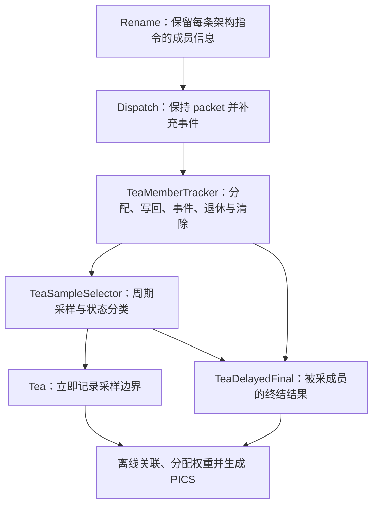

# 香山 TEA 实现机制：压缩 ROB 下的指令级时间归因

本文描述当前工作区的 TEA 实现，包括架构指令元数据、完成跟踪、周期采样、延迟归因及 PICS 计算。对应实现基于 HEAD `a549cc7b9e75af6fdeae87e323013d4ad39467d4` 上的本地修改，记录日期为 2026-10-15。

TEA 保留功能 ROB 原有的压缩、执行和提交决策，额外维护 debug 元数据。每个采样边界先判断周期状态，再确定归因指令，最后按照指令的性能签名向量 PSV（Performance Signature Vector）累计时间权重。

当前 Stalled 采用用户选择的“队首物理 Entry 中最老未完成成员”策略：A 已完成、B 未完成时归给 B。这是对论文 next-committing 口径的压缩适配扩展，不等同于严格关键路径判定。

## 1. 整体数据流



需要区分三个维度：周期状态回答“这个周期处于什么状态”，归因目标回答“时间记到哪些指令”，PSV 回答“这些指令记录过哪些事件”。事件名中的 DR、FL、ST 不决定采样状态；例如 Computing 样本中的退休指令也可以携带 ST_L1。

## 2. ROB 压缩后的指令表示

### 2.1 Entry、Slot、架构指令和 uop

物理 ROB Entry 具有 Former/Latter 两个逻辑 Slot。一个 Simple Slot 可以包含多条架构指令；一条架构指令也可能拆成多个 uop。融合会让两条架构指令共享执行操作，move elimination 则可能消除实际执行，但两者都不能减少 TEA 的架构成员数。

```text
物理 ROB Entry #20
├── Former Slot
│   ├── rank 0：I0，PC、PSV、执行 owner、剩余写回数
│   ├── rank 1：I1，PC、PSV、执行 owner、剩余写回数
│   └── rank 2：I2，PC、PSV、执行 owner、剩余写回数
└── Latter Slot
    └── rank 3：I3，PC、PSV、执行 owner、剩余写回数
```

`rank` 是成员在物理 Entry 内的程序顺序。当前不再用 Slot 首条指令的 PC 和聚合 PSV 代表整个 Slot，也不保留旧 `slotPsv` 兼容层。

### 2.2 Rename 捕获与部分 Dispatch

Rename 使用原始有效向量 `validVec`、压缩成员 mask 和 fusion 信息捕获架构成员。融合 follower 即使不再单独发出 uop，也保留自己的 PC 和初始 PSV。每条架构指令只在其 `firstUop` 捕获一次。

成员信息包括：

| 字段 | 用途 |
| --- | --- |
| `robIdx` | 物理索引、环绕 flag 和 Former/Latter 身份 |
| `rank` | 物理 Entry 内的架构成员顺序 |
| `owner` | 决定完成状态的执行成员；融合 follower 指向 leader |
| `pc` | 当前架构指令的真实 PC |
| `psv` | 当前成员的初始事件签名 |
| `numWB` | 预期写回数量，用于多成员 Slot 的成员完成跟踪 |

PC 直接来自原始指令的 debug 元数据，不根据 `PC+4` 或指令长度重建；成员在 ROB 分配时按当时的指令地址转换模式扩展到 `XLEN`，Sv39/Sv48 使用符号扩展，bare 和 x4 模式使用零扩展。TEA 没有独立保存 RVC 长度字段。

完整成员集合通过一个 packet 级 sideband 跟随 Rename→Dispatch 保持，并与实际 ROB 入队流水对齐。物理 Entry 首次分配时，安装它的全部成员，包括尚未实际 Dispatch 的成员。后续成员真正被 ROB 接受时，再合并各自的入队 PSV。

这种做法使 TEA 在部分 Dispatch 期间也能识别尚未进入 ROB 的阻塞成员，同时避免在每个执行 uop 中携带完整成员列表。

### 2.3 动态身份与 Entry 复用

在线入队事件和写回通过 `robIdx + rank` 定位成员；其中 `isSameSlot` 比较物理索引、真实分配的 flag 和 Former/Latter。执行期 Slot 事件不携带 rank，按同一 Slot 匹配。

离线 Stalled 关联使用：

```text
target = (allocationCycle, robIndex, rank)
```

`allocationCycle` 在物理 Entry 分配时记录，防止同一索引回收复用后与旧样本串联。保存的 flag 也来自该 Entry 的实际分配指针，不借用当前 `deqPtr.flag`。

## 3. 指令完成、退休和清除

`TeaMemberTracker` 为各成员保存 `live`、PSV、执行 owner 和剩余写回数，并为被 Stalled 采中过的成员设置标记。

对于多成员 Simple Slot，实际被 ROB 接受的逐端口写回按 Slot 和 rank 匹配，更新：

```text
remaining = max(remaining - 本周期匹配的有效写回数, 0)
```

使用的是 `io.writeback`，不会重复乘以 `writebackNums`，也不使用未过滤的执行单元写回。`teaMemberRank` 沿现有 `PerfDebugInfo` 经过 IQ、执行单元和写回路径传播。

完成判定分为两种：

- 多成员 Slot：功能 ROB 已报告 Slot 完成，或该成员执行 owner 的剩余写回数为零，即视为完成。
- 单架构成员 Slot：以功能 ROB 的 Slot 完成状态为准，支持 singleton 多 uop 指令，避免某一次 uop 写回造成提前完成。

融合 follower 使用 leader 的 owner；被消除的 move 不需要独立写回。普通压缩成员仍按各自的执行和写回完成，压缩本身不要求它们有数据依赖。

真实退休时，根据实际有效的 Slot 提交指针展开全部 live 架构成员。默认 `CommitWidth=8`、`RenameWidth=8`，输出容量为 64 个成员；每个有效退休 Entry 都检查展开数量是否等于功能 ROB 的架构退休数。

Redirect 按成员的 Slot 指针判断清除，可以清除 Latter 并保留 Former。被清除成员退出 live 集合，不再输出退休信息；已采中的目标在清除时输出 cancelled 终结结果。新分配会重新初始化该 Entry 的成员和采样标记。

## 4. PSV 事件记录

当前支持以下 8 个 bit：

| bit | 事件 | 当前来源与含义 |
| ---: | --- | --- |
| 0 | DR_L1 | 取指请求记录过 ICache miss |
| 1 | DR_TLB | 取指请求记录过 ITLB miss |
| 2 | DR_SQ | ROB 为空，最老待 Dispatch 的 store 被 SQ 空间阻塞 |
| 3 | FL_MB | 控制流误预测重定向 |
| 4 | FL_EX | 异常引起的 flush，排除中断优先处理的情况 |
| 5 | FL_MO | 内存顺序违例重定向 |
| 6 | ST_L1 | 数据访问记录过 DCache miss |
| 7 | ST_TLB | 数据访问记录过 DTLB miss |

PSV 是事件签名，不是事件计数器，也不直接保存延迟：

```text
PSV_new = PSV_old OR 新增事件 mask
```

同一种事件发生多次仍然只有一个 bit。同周期入队和执行事件会合并到可见 PSV，供当周期退休、恢复原因读取和终结记录使用。

前端 packet 的 DR_L1、DR_TLB 只绑定到最早有效指令，再随该指令传播。Dispatch 产生的 DR_SQ 按对应成员 rank 合并。当前执行期事件仍按包含 flag 的 Slot 身份更新，依赖现有压缩分类定位相应 Complex 指令；没有为任意 Simple 组内新增事件提供独立事件 rank 接口。

`PSV=0` 显示为 `No recorded event`，只表示没有记录到上述事件。例如长除法可以产生大量 Stalled 时间，同时保持 PSV 为零。ST_LLC 当前未实现。

## 5. 采样节奏和状态分类

构建时 `WITH_TEA=1` 独立控制 TEA tracker、selector 和数据库记录逻辑是否 elaboration。启用该构建开关后，`TeaSampleSelector` 每周期推进自己的 `cycle` 计数器；运行时 `enableTea` 控制新样本，`teaSamplePeriod` 控制固定间隔。默认 period 为 256（详细验证可设为 1），period 为 0 时当前实现也逐周期采样。重新启用时 countdown 为零，会立即开始采样。

采样间隔按周期推进，不等待先前目标退休。关闭采样后，debug 成员和恢复原因仍继续跟踪，已采样目标及待处理的 Drained 后继仍可产生终结记录。

状态分类优先级如下，其中“恢复原因”指当前可见的原因：

```text
if 本周期有真实提交:
    Computing
else if 正在 ROB walk 或存在 redirect:
    Flushed
else if ROB 为空且恢复原因有效:
    Flushed
else if ROB 为空:
    Drained
else:
    Stalled
```

Computing 优先级最高。即使同时存在恢复相关信号，有真实提交的周期仍按 Computing 计算。walk/redirect 没有已支持的有效原因时，状态可以是 Flushed，但归因记录为 Unknown。

| 状态 | 数值 | 归因目标 | 每个采样边界的权重 |
| --- | ---: | --- | --- |
| Computing | 0 | 当周期实际退休的全部架构指令 | N 条各得 `1/N` |
| Stalled | 1 | 队首物理 Entry 的最老未完成成员 | 目标得到 1 |
| Flushed | 2 | 引起当前恢复的指令 | 原因得到 1 |
| Drained | 3 | 边界之后首次真实提交的首条架构指令 | 后继得到 1 |

### 5.1 Computing：按真实架构退休数分摊

设当周期所有退休 Entry 合计退休 N 条架构指令，则每条权重为 `1/N`。例如 Entry A 退休 3 条、Entry B 退休 1 条，四条指令各得 `1/4`，不会先按 Entry 或 Slot 等分。

RTL 直接记录展开后的有效成员 PC/PSV，离线脚本计算权重。当前采用 `CommitWidth * RenameWidth` 宽采样记录，没有实现“只记提交 Entry、再离线查完整元数据表”的分层 Computing 日志。

### 5.2 Stalled：锁定最老未完成成员，延迟读取最终 PSV

在采样边界检查队首物理 Entry 的 live 成员，按 rank 选择第一个未完成者。A 已完成、B 未完成时选择 B；A、B 均未完成时先选 A，后续边界可以在 A 完成后改选 B。

每个边界立即记录目标身份，不立即固定 PSV。目标退休时输出最终 PC/PSV；被清除时输出 cancelled。离线通过 target 关联，因此采样之后才出现的事件也能纳入该成员的最终签名。

如果成员全已完成，但其他提交条件仍未满足，周期仍为 Stalled，目标记为 Unknown。该策略没有判断谁最终最晚完成，也不提供严格关键路径证明。

### 5.3 Drained：关联下一次真实提交

ROB 为空且没有有效恢复原因时，立即记录 Drained 边界，同时设置 `drainPending`。之后首次真实提交时，输出当次提交首条架构指令的 PC/PSV。

例如连续十个 Drained 边界后首次提交 A、B、C，十个边界各将权重 1 归给 A。RTL 只需保存是否存在待终结需求，因为每个原始边界已经写入数据库；离线选择采样周期之后的第一条 Drained 终结记录。

### 5.4 Flushed：保存整个恢复阶段的原因

控制流误预测、内存顺序违例和异常会保存原因 PC 及当时可见 PSV，包括当前新增的 FL bit。原因跨 walk、ROB flush 后续 redirect 和空 ROB 恢复等待保留，在恢复路径实际分配 ROB Entry 时结束。

Flushed 使用保存的原因快照，不像 Stalled 那样等待目标退休后的最终 PSV。ROB 自己发出的 flush 所产生的后续 redirect 不会无故清掉原因；不支持的新 flush/redirect 会使旧原因失效，避免沿用错误归因。中断不被标成 FL_EX。

## 6. 两张数据库表与延迟关联

以下以 hart 0 为例。采集时必须同时导出 `Tea_0` 和 `TeaDelayedFinal_0`。

| 表 | 主要字段 | 用途 |
| --- | --- | --- |
| `Tea_0` | `CYCLE`、`STATE`、`VALIDMASK_n`、`PCVEC_n`、`PSVVEC_n`、`TARGETVALID`、`TARGET_*` | 每个到期边界立即记录状态和直接归因或目标身份 |
| `TeaDelayedFinal_0` | `CYCLE`、`ISDRAIN`、`CANCELLED`、`MEMBER_PC`、`MEMBER_PSV`、`MEMBER_TARGET_*` | 被采 Stalled 成员的终结结果，或 Drained 的后继提交 |

Computing 和已知原因的 Flushed 从边界表直接读取 PC/PSV。Stalled 按 target 关联成员终结记录；Drained 按时间关联未来第一条 `ISDRAIN=1` 的记录。`STAMP` 不参与关联。

PC 字段按 `XLEN` 记录。SQLite 会把最高位为 1 的 64 位整数读成负数，离线脚本在聚合、过滤和 ELF 匹配前统一恢复为无符号 64 位地址。

同一成员被采样 100 次，可以只有一条成员终结记录，供 100 条边界共同关联。终结记录只针对被采中的 Stalled 成员和待处理的 Drained 后继，不记录全部退休指令的独立终结日志。

`VALIDMASK_n` 按每个物理提交项的 `RenameWidth` 位分块。默认是 8 个 8 位整数，避免把含 bit 63 的无符号 64 位 mask 直接写入 SQLite 而损失精度。数组中的位置对应提交 Entry lane 与成员 rank，不固定代表两个 Slot。

无法完整解析的样本保留为以下类别：

| 类别 | 脚本内部 PSV 占位值 | 含义 |
| --- | ---: | --- |
| Cancelled | -1 | 锁定的目标随后被清除；保留已知 PC |
| Unresolved | -2 | 数据库中尚无目标或后继的终结结果 |
| Unknown target/cause | -3 | 没有可选未完成成员或没有已支持的恢复原因 |

这些是分析占位类别，不是硬件事件 bit。每个此类样本仍保留权重 1，不会被删除或当作 PSV 为零。

## 7. 离线 PICS 计算

分析脚本先解析每条采样记录的目标集合，再为每个目标分配权重：

```text
w(sample, instruction) = 1 / N    当 sample 为 Computing
                       = 1        其他状态的单个归因目标或占位目标

W(pc, psv) = 所有归给该静态 PC、该 PSV 组合的权重之和
```

同一静态 PC 的不同动态实例累计到同一根条形；每个完整 PSV 组合形成条形内的一段。PSV 为 `ST_L1 | ST_TLB` 时，权重完整进入这个组合，不在两个 bit 之间再次分摊。图中仅显示 Top PC 和部分主要组合，CSV 保留全部 PC 与精确组合。

未做 PC 过滤、且保留全部占位归因时，每个采样边界总权重为 1，因此总权重应等于采样边界数，允许浮点累计误差。

脚本输出单位是 captured sample equivalents（采样当量），没有自动乘上采样周期。period=1 时每个样本对应一个采集周期；固定 period=P 时，可用 `P * W` 估计相应周期数。更稀疏的周期采样是估计，不是逐周期精确记录。

事件 bit 热图使用与 PICS 相同的采样权重，统计带有该 bit 的权重占所选总权重的比例；原始条目计数仍在汇总中保留。多个 bit 可重叠，不能把热图比例相加当作互斥周期分解或独立硬件事件数。状态图也使用采样权重。提供有效 SPEC 日志和采样周期时，脚本另输出每千条已退休指令的采样周期当量，与实际 ROB 周期计数单列对照；不补齐丢样，也不据此声称可回收周期。

### 7.1 四条压缩指令的计算示例

设 A、B、C、D 位于同一个物理 Entry，采样 period=1。周期 100～102，A、C、D 已完成，B 的除法未完成；周期 103 四条一起退休。

| 采样边界 | 状态 | 目标与权重 |
| --- | --- | --- |
| 100 | Stalled | B 得到 1 |
| 101 | Stalled | B 得到 1 |
| 102 | Stalled | B 得到 1 |
| 103 | Computing | A、B、C、D 各得到 1/4 |

最终 A、C、D 各得 0.25，B 得 3.25，总计为 4。各条权重按各自 PSV 分类；B 即使 PSV=0，仍保留这 3.25 的热点权重。

### 7.2 ROI、PC 过滤与分母

`--cycle-range START END` 筛选原始采样边界的半开区间 `[START, END)`，但延迟终结记录仍从完整数据库读取。因此，ROI 内采样、ROI 外退休的目标仍可正确关联。

Computing 的 N 在 PC 排除前计算。四条指令各得 1/4，即使过滤其中三条，剩下一条仍为 1/4，不会扩大成 1。PC 过滤后不再要求所选权重等于原始边界数。

`--spec-checkpoint` 只针对脚本中指定的 SPEC flash/restorer PC 范围；未知 PC 仍保留权重。它不是通用的“排除所有启动代码”选项。解释应用热点时，应选择合适的 ROI，避免启动恢复时间主导全程结果。

## 8. 采集和分析示例

EMU 构建需要 ChiselDB、Constantin 和 backend debug PC 支持。当前使用的构建命令为：

```bash
proxychains -q make emu WITH_TEA=1 WITH_CHISELDB=1 WITH_CONSTANTIN=1 -j64 \
  NOOP_HOME=/nfs/home/wujiabin/work/xs-env/XiangShan2-wt-tea-correctness
```

准备 `tea.cst`：

```text
enableTea0 1
teaSamplePeriod0 1
```

在仓库根目录采集一个 CoreMark 窗口：

```bash
build/verilator-compile/emu -s 0 \
  -i ready-to-run/coremark-2-iteration.bin \
  --diff ready-to-run/riscv64-nemu-interpreter-so --max-instr 5000 \
  --cst-file tea.cst --dump-select-db 'Tea_0 TeaDelayedFinal_0' \
  --db-path build/tea.db

python3 scripts/tea_visualize.py build/tea.db \
  --labels coremark-5k --output build/tea-plots
```

输出包括 PICS、时间线、对比图的 PNG/PDF，以及热点 CSV、时间线 CSV、汇总 CSV/JSON。反汇编标注、ROI 和多数据库分析的参数见[分析脚本说明](../scripts/tea_visualize.md)。

## 9. 实现入口

| 文件 | 职责 |
| --- | --- |
| [Tea.scala](../src/main/scala/xiangshan/Tea.scala) | 事件位、成员/样本结构、状态分类、采样节奏和 Drained 终结 |
| [Bundle.scala](../src/main/scala/xiangshan/Bundle.scala) | `PerfDebugInfo.teaMemberRank` |
| [Rename.scala](../src/main/scala/xiangshan/backend/rename/Rename.scala) | 架构成员捕获、压缩映射、融合 owner 和 rank |
| [CtrlBlock.scala](../src/main/scala/xiangshan/backend/CtrlBlock.scala) | 成员 sideband 的 packet 保持与入队流水对齐 |
| [TeaMemberTracker.scala](../src/main/scala/xiangshan/backend/rob/TeaMemberTracker.scala) | 成员生命周期、完成状态、PSV、提交展开、目标选择和终结 |
| [Rob.scala](../src/main/scala/xiangshan/backend/rob/Rob.scala) | 接入实际分配/写回/提交/事件，维护恢复原因并写数据库 |
| [RobBundles.scala](../src/main/scala/xiangshan/backend/rob/RobBundles.scala) | ROB 指针的 Entry/Slot/flag 身份比较 |
| [tea_visualize.py](../scripts/tea_visualize.py) | 延迟关联、权重计算、PC 聚合和图表导出 |

## 10. 当前验证范围

已有 18 项硬件测试、4 项分析测试及 6 组整机 NEMU DiffTest 通过。定向程序、CoreMark 5k 窗口、中断与非法指令程序的 TEA 开关对照，显示指令数和核周期一致；三份 period=1 数据库的边界连续、总权重守恒。新增测试覆盖 Sv39 地址符号扩展、bare 地址零扩展，以及 SQLite 有符号 64 位 PC 到 ELF 地址的匹配。新增 PC 扩展和 elaboration 开关后尚未重新运行整机 DiffTest。

定向结果包含：除法 B 的 643 个 Stalled 边界，融合两条指令和 eliminated move 各 32 次架构退休，ECALL 的 544 个 FL_EX 恢复边界。具体命令、数据和图表见[验证报告](../reports/tea-members-verification.md)。

这些检查没有穷尽全部压缩边界。混合 RVC 的逐条 PC 对照、SC/CS/CC 各类型独立定向验证、Latter 真实异常以及向新分配 Entry 专门注入旧 flag 事件，尚未全部做专项覆盖。也未完成全套 SPEC、长程压力或 vector 端到端验证。

当前没有评估宽 Computing 日志的长期采集开销、综合面积与时序。TEA 开关对照验证的是所测路径的执行行为，不能用来判断 ROB 压缩本身的性能收益。

## 11. 低开销周期统计与队首上下文

新增逻辑仅在 `WITH_TEA=1` 下生成，不改变功能 ROB、PSV、成员完成或延迟关联规则。
`TeaCycleStats` 使用固定数量的计数器，不增加按 ROB 大小增长的存储，也不增加逐指令时间戳。

### 配置

| 模式 | Constantin 配置（hart 0） | 行为 |
| --- | --- | --- |
| Summary | `enableTeaStats0 1`、`enableTea0 0` | 精确周期计数和区间摘要，不写 TEA 边界样本 |
| Sample | `enableTea0 1`、`teaSamplePeriod0 256` | 自动启用周期统计，同时稀疏采样 |
| Detail | `enableTea0 1`、`teaSamplePeriod0 1` | 逐周期采样，用于短窗口验证 |

默认采样周期为 256；现有 Constantin 文件中的显式周期（如 1000）保持生效。
`teaGapThreshold0` 默认 128，只控制完整无提交区间的明细输出阈值，不影响直方图。
Summary 是采集模式，现有 TEA tracker 仍然 elaboration 并跟踪成员；它主要节省数据库写入，
不承诺消除 tracker 的计算成本。若不需要任何 TEA 功能，构建时不设置 `WITH_TEA=1`。

数据库导出需包含四张表：

```text
--dump-select-db 'Tea_0 TeaDelayedFinal_0 TeaCycleSummary_0 TeaNoCommit_0'
```

### 统计口径与边界

- `TeaCycleSummary` 在统计 enable 开启/关闭边界，以及每 4096 个连续启用周期写一条累计快照。
  enable 为 `enableTeaStats || enableTea`。重新开启累计值不清零，但无提交区间不会跨过关闭窗口。
- `STATES_0..3` 是启用期间 Computing/Stalled/Flushed/Drained 的精确周期数，
  `RETIRED` 是架构指令数；不是物理 Entry 数。`CYCLE` 是已观察前缀的右开边界。
- `GAPS_0..4` 统计完整无提交区间的 1–7、8–31、32–127、128–511、512+ 周期直方图。
  采集开启时已经无提交的区间标为 left-censored，关闭时尚未结束的区间标为 right-censored；
  二者均不进入完整区间直方图，而是计入 `CENSOREDGAPS`。截断区间不受明细阈值限制。
- `TeaNoCommit` 保存 `[START, END)` 和区间内 Stalled/Flushed/Drained 周期数；三者之和等于区间长度。
  区间可能跨越多个队首或恢复原因，不把整个区间归给恢复提交的 PC。可按 CYCLE 查找附近 TEA 样本。
- 关闭采集后必须再执行一个采样时钟，才能写出关闭快照及截断区间。
  若仿真直接结束，最后快照只覆盖其 `CYCLE` 之前的启用周期，最多可能漏掉 4095 个尾部周期；
  `PENDING` 保留快照时尚未结束的无提交长度，`CLOSED=0` 表明未观察到采集关闭。
  重新开启立即写入 CLOSED=0 的快照，避免沿用上一窗口的关闭标记。不能将未关闭结果当作完整切片统计。

### 原因快照

`Tea_0.CONTEXT_*` 保存当周期实际退休数、队首指针/有效/完成状态及原有 Top-down 原因。
`COMMITBLOCKMASK` 的 bit 0..8 依次为 misPredBlock、lastCycleFlush、WFI、redirect、
待处理 deq flush、deqFlushBlock、criticalError、traceBlock、walk。
原始 mask 保留重叠条件；离线主分类优先 Computing，其次最低有效 mask bit，最后是有效队首原因。

Top-down 原因固定为 Entry 级证据，不能证明它属于 TEA 选中的 rank；PSV 仍为最终历史签名，
不表示当前还在等对应事件。headReady 表示物理队首完成状态，不表示必然允许提交。
`head_context.csv` 同时保留原始 mask、原因 ID、静态作用范围和采样权重，不合并成可消除周期。
原因 ID 的名称来自分析脚本所在 checkout 的 `TopDownCounters`，分析时使用与采集匹配的版本。

### 分析与验证

沿用 `scripts/tea_visualize.py` 命令。每个输入额外生成 `head_context.csv`、
`cycle_summary.json` 和 `no_commit_intervals.csv`。后两者覆盖全部已采集的启用窗口，
不应用 `--cycle-range` 或 PC 排除条件；JSON 的 scope/observed_end/collection_closed 显式记录该口径。
旧数据库仍可分析，没有新增字段时上下文表为空，不生成精确周期结果。
Summary 模式分析仍需保留四表 schema；`--spec-log-dir` 要求 ROI 内存在 TEA 样本，
因此纯 Summary 使用普通分析入口。全启用窗口摘要不能直接作为 SPEC 测量 ROI 的精确计数。

```bash
python3 scripts/test_tea_visualize.py
proxychains -q mill -i xiangshan.test.testOnly xiangshan.TeaCycleStatsTest
```

RTL 测试覆盖采集边界、区间长度、直方图边界、关闭后重新开启和周期快照的包含关系。
实际仿真速度和数据库体积仍需使用相同切片测量；没有预设已达到某个开销百分比。
