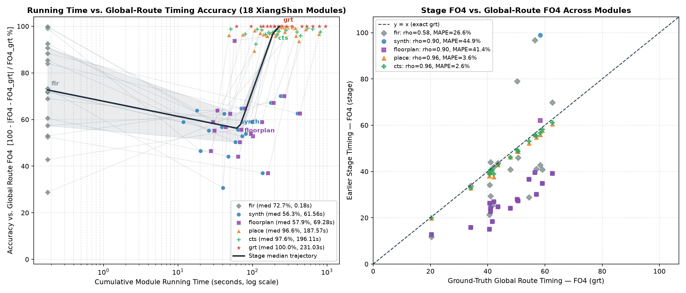

# XSTile through an open-source physical flow (experimental)

> **Status (2026-11-24): built and measured end to end in this tree.** Built at
> XiangShan `b9638259e9` (`kunminghu-v3` base) with [`bazel-orfs`][bo]
> [`d7f591de`][pin] on a 32-core, 122 GiB RAM Linux machine: every block and
> `XSTile` pass global-placement driver checks (`<part>_gpl_driven`), global
> route (`5_1_grt`), standalone KPIs (`<part>_kpi`), and flat stitched OpenSTA
> interface-logic-model timing (`XSTile_ilm_sta`, `XSTile_ilm_sta_nowire`).
> Five partitioning and SDC strategies were evaluated end to end
> ([below](#partitioning--sdc-strategies-evaluated)); the active default is the
> winning **5-block + sea-of-gates hub at `473 ps` SDC**, reaching **`1,822 ps`
> abstract** and **`1,845 ps` (`542.0 MHz`) flat stitched** (`0` endpoints over
> `2,000 ps`).

This package (`scripts/openroad-flow/`) and the optional root Bazel files
(`MODULE.bazel`, `BUILD.bazel`, `.bazelrc`, `.bazelignore`) generate
XiangShan's Verilog from this checkout, provide fast-turnaround module PPA
and FO4 timing signals (`bazelisk run //:ppa`), and take XSTile (the core,
its L1 caches and the L2) through synthesis, floorplan, placement, clock
tree synthesis and global route on the ASAP7 predictive PDK with yosys and
OpenROAD, opening the result in OpenROAD's web viewer. No RTL, `build.mill`
or `Makefile` changes, and `--symlink_prefix=.bazel/` keeps the repository
root clean for Mill and Makefile users.

**The terms.** This is an experimental flow:

- it is not supported and not in CI;
- issues and pull requests that fix it are welcome, but nobody is promised
  anything;
- it is stated plainly as experimental, so that nobody expects more of
  it than it gives.

**What it is not.** No substitute for a commercial flow, and not
comparable with XiangShan's own 7 nm results: a predictive PDK, stopped
at global route (no detailed route), a reduced configuration (integer-only
core, 512 KB L2), the register files generated rather than synthesised,
and structural patches to the RTL carried for synthesis runtime
([below](#xiangshan-through-this-flow)). What it offers is something
anyone can reproduce, open and ask questions of.

**Why Bazel.** Bazel is a convenient way to express and install every
dependency of the flow -- JDK, Scala, Chisel, firtool, espresso, yosys,
OpenROAD, ORFS and the PDK -- with one tool, and it is what OpenROAD and
bazel-orfs use. mill remains XiangShan's build; this directory does not
replace or change it.

The flow's rules, its scheduler, its debugging tools and most of what is
known about running it live in bazel-orfs, which this repository depends on
at commit [`d7f591de`][pin] (`scripts/openroad-flow/openroad.MODULE.bazel`,
included from root `MODULE.bazel`). Links into bazel-orfs below are pinned
to that commit.

## Fast-turnaround PPA & FO4 signal (`//:ppa`)

Before waiting hours on full-tile global route, two fast commands run from
any directory in the checkout to check structural hygiene (flops, flop bits,
combinational area, inferred SRAM bits, clock gates, max fanout, combinational
`mem2mem` hazards) and logic depth in PDK-independent **FO4** units
(`1 FO4 = 14.37 ps` on ASAP7 `INVx1_ASAP7_75t_R`; Kunminghu's 3.0 GHz /
333 ps 7 nm target is `41.1 FO4`, or `591 ps` on ASAP7):

```sh
bazelisk run //:ppa -- --stage=fir        # Static CIRCT MLIR (.fir) FO4 & structure (~9 s cold parse, <1 s cached)
bazelisk run //:ppa                       # Yosys + ABC speed synthesis + OpenSTA across 18 representative modules
bazelisk run //:ppa -- --stage=place      # Or floorplan, place, cts, grt
bazelisk run //:plot_stages               # Runtime vs. global-route accuracy across fir -> grt
```

Design principles (minimum cognitive load, minimum false positives, POLA):

- **Always a complete report, silent git diff when clean:** `bazelisk run //:ppa`
  always prints the full 18-module subsystem panel (FO4 summary first, then
  ASAP7 picoseconds and area, then worst endpoints with Chisel `file.scala:line`
  locators). When files changed relative to `git merge-base`, affected modules
  are sorted to the top with `*`; when no RTL module changed (docs, CI, sim-only
  Scala, or a clean branch), the `git merge-base` apparatus stays silent.
- **100 % core-wide PR coverage in `--stage=fir`:** `fir_ppa.py` analyzes all
  1,652 elaborated `MinimalConfig` modules in ~9 s using an exact per-port
  Interface Logic Model (ILM). Untouched runs show the 18-module subsystem
  panel; if a branch modifies any module outside the 18-module panel, its
  direct CIRCT `#loc` match surfaces automatically, and `--module=<pattern>`
  queries any of the 1,652 modules.
- **Fast `bazelisk build //...` and `bazelisk test //...`:** Heavy Verilog
  elaboration and physical P&R targets are tagged `manual`, so default wildcard
  builds compile Scala/Chisel and run unit tests in seconds.

### Stage running time vs. global-route (`grt`) accuracy

Measured across all 18 representative XiangShan modules (`AheadBtb`,
`BusyTable`, `DecodeStage`, `Directory`, `FMulFlt`, `IBuffer`,
`IssueQueueAluMul`, `IssueQueueLdu`, `Ittage`, `LoadQueueRAR`, `NewCSR`,
`RenameTableWrapper`, `Rob`, `Sbuffer`, `Sc`, `TLB`, `VIMacU`,
`VirtualStoreQueue`):



| Stage | Modules | Median time (s) | Total time (s) | Median accuracy vs. `grt` (%) | MAPE (%) | Spearman $\rho$ vs. `grt` | What it catches |
|---|---:|---:|---:|---:|---:|---:|---|
| `fir` | 18 | 0.18 | 3.2 (+ ~9 s `.fir` parse) | 72.7 | 26.6 | 0.578 | Exact flop/SRAM/ICG/port counts, fanout explosions, gross logic-depth jumps |
| `synth` | 18 | 61.6 | 1,649.0 | 56.3 | 44.9 | **0.901** | Technology-mapped gate count/area, real SRAM blackboxes, logic-cone rank order (no wire RC yet) |
| `floorplan` | 18 | 69.3 | 1,936.6 | 57.9 | 41.4 | **0.901** | Post-floorplan `repair_timing` (`unbuffer,sizeup,swap,vt_swap`) |
| `place` | 18 | 187.6 | 4,477.1 | **96.6** | **3.6** | **0.958** | Timing- & routability-driven placement wire RC |
| `cts` | 18 | 196.1 | 4,924.6 | **97.6** | **2.6** | **0.964** | Propagated clock tree skew & post-CTS repair |
| `grt` | 18 | 231.0 | 5,886.5 | **100.0** | **0.0** | **1.000** | Global-route parasitics & setup repair (ground truth) |

`synth` underpredicts absolute routed period by ~44 % because wire and repeater
delay are absent before placement, yet its module rank correlation with `grt`
is already **$\rho = 0.901$**; `place` reaches **96.6 %** median accuracy
(**3.6 %** MAPE). Fast signals catch structural and logic-depth regressions in
seconds to a minute; subtle floorplan, congestion and cross-block wire effects
still require global route.

### 10-topic historical XiangShan PR backtest (`--stage=fir`)

Validated across 10 recent XiangShan commits/PRs spanning critical-path fixes,
SRAM/queue sizing, decode PLA, BPU gating, LSU replay, CSR, vector-FP datapaths,
and 3 negative controls (CI workflow `#6604`, sim-only DPI Scala `#6444`, and
pure `Backend.scala` wiring reorder `ce3ea7907`):

- **0 / 3 false positives** on negative controls (`0 / 1,652` modules changed on
  pure RTL wiring reorganization `ce3ea7907`; git banner silent on CI and
  sim-only DPI Scala edits).
- **PR `#6489` (`timing(ubtb): check hit in t1`):** Static `fir` caught `Bpu`
  `reg2reg` dropping `60.64 -> 58.16 FO4` (`-2.48 FO4`, `-2` levels) and
  `MicroBtb` `in2reg` dropping `29.42 -> 17.75 FO4` (`-11.67 FO4`, `-12` flops,
  `-376 GE`), eliminating `ubtb/t1_hit` as `Bpu`'s critical endpoint.
- **PR `#6590` (`fix(unalign, lsu)`):** Caught `LoadQueueReplay` `reg2reg`
  rising `42.46 -> 44.41 FO4` (`+1.95 FO4` at `LoadQueueReplay.scala:288`),
  `+7` flops, and `max_fanout` `1,239 -> 1,316` (`+77`).
- **PR `#6586` (`fix(decode): zicbop`):** Caught `+2,672 GE` (`8 x +334 GE` in
  `PseudoDecodeChannel`) with `0.00 FO4` change on `DecodeStage` `reg2reg`
  (non-critical slack, no false timing alarm).

## Partitioning & SDC strategies evaluated

Five top-level physical partitioning and constraint strategies were built and
measured through global route (`5_1_grt`) at `bazel-orfs` [`d7f591de`][pin] to
pick the active configuration in `scripts/openroad-flow/xstile/`:

| Strategy | Die (`mm^2`) | SDC (`ps`) | Block ceiling (`ps`) | Abstract `XSTile` (`ps`) | Flat / crossing `XSTile` (`ps`) | Zero-wire (`ps`) | Endpoints `> 2,000 ps` (flat / crossing) | Peak top GB | Verdict |
|---|---:|---:|---:|---:|---:|---:|---:|---:|---|
| **1. 5-block + sea-of-gates hub (`473 ps` SDC)** | 5.67 | 473 | **1,066** (`MemBlock`) | **1,822** | **1,845** (`542.0 MHz`) | **1,436** | **0** (of 381,980) | 54.6 | **Selected default** |
| **2. Implied 4-macro zero-glue (`firm` stitch)** | **4.44** | 473 | 1,676 (`Backend`) | — | 2,301 (`434.6 MHz`) | — | 1,258 (100 % `MemBlock <-> Backend`) | 66.6 | `-35 %` die vs. 6.81 mm^2, `0` internal `> 2,000 ps`, unbuffered seam limits |
| **3. 5-block + sea-of-gates hub (`1,800 ps` SDC)** | 5.67 | 1,800 | 1,858 (`Frontend`) | 2,377 | 2,334 (`428.4 MHz`) | 1,481 | 11,204 (of 389,729) | 54.6 | `+489 ps` slower flat than `473 ps` SDC |
| **4. Implied 4-macro + `unfirm` seam dissolve** | 4.44 | 473 | 1,676 (`Backend`) | — | 3,645 (`274.3 MHz`) | — | 9,615 (`+8,357` vs. `firm`) | 69.0 | Lost post-GRT block setup repair (`+1,344 ps` worse) |
| **5. Implied 4-macro + full stdcell dissolve** | 4.44 | 473 | — | — | `> 2,529` *(virtual GPL)* | — | — | 69.0 | **Over 90 min, stopped** at GPL iter 440 (`6.68 M`-pin virtual buffering) |

### Key findings from the strategy comparison

1. **Is `1,822 ps` at `473 ps` SDC real or an abstract-timing illusion? Real (`1,845 ps` flat).**
   Linking `XSTile`'s post-GRT netlist and SPEF with all 5 hardened blocks' and
   all 3 parent register files' post-GRT interface logic models and SPEFs in
   OpenSTA (`XSTile_ilm_sta`) yields **`1,845 ps`** (`WNS = -1,372 ps`), within
   **`+23 ps` (`+1.26 %`)** of `.lib` abstract timing (`1,822 ps`), with **`0`
   endpoints over `1,900 ps` or `2,000 ps`** across all `381,980` stitched
   endpoints (`1,436 ps` zero-wire, `+409 ps` wire + skew). Every crossing
   across all 5 major blocks closes `<= 1,820 ps` (`XSTile -> VecRegionModule`
   `1,820 ps`, `parent` `1,819 ps`, `XSTile -> CoupledL2` `1,818 ps`,
   `XSTile -> MemBlock` `1,811 ps`, `XSTile -> via:MemBlock -> XSTile` `1,790 ps`);
   only `XSTile -> RobEntryFile` reaches `1,845 ps` (`780` endpoints in
   `[1830, 1850) ps`).
2. **Why `473 ps` SDC beats `1,800 ps` SDC by `489 ps` flat (`1,845 ps` vs. `2,334 ps`).**
   Under `1,800 ps` SDC, all 5 blocks stop optimizing once near `1,268–1,858 ps`
   (`+241` to `+796 ps` slower per block than at `473 ps` SDC), and parent
   timing-driven GPL and post-GRT `repair_timing` leave wire + skew overhead at
   `+853 ps` (`1,481 -> 2,334 ps`, `11,204` stitched endpoints `> 2,000 ps`).
   Under `473 ps` SDC (`in2reg/reg2out = 378.4 ps`), every block (`864–1,066 ps`)
   and parent cone receives full VT-swap, sizing, buffering and timing-driven
   placement pressure.
3. **Implied 4-macro zero-glue floorplan (`L2Top` + `Backend` + `MemBlock` + `Frontend`).**
   XiangShan's RTL partitions `XSCore` cleanly into `Frontend`, `MemBlock` and
   `Backend` with **0 glue cells**, and `XSTile` adds `L2Top` plus only **7
   `IntBuffer` synchronizer flip-flops** (`0` direct wires between `L2Top` and
   `Frontend` or `Backend`). On a `2432.304 x 1827.060 um` (`4.444 mm^2`) die
   snapped to `Q = 41.04 um = lcm(2.16 um M8 PDN, 0.57 um gcell)` with
   `Backend`'s 5 register files placed along its South wall and `gpl_clusters`
   enabled, standalone `Backend` closes at **`1,676 ps`** (`203,685` regs, `0`
   endpoints `> 2,000 ps`), `MemBlock` at **`1,430 ps`**, `Frontend` at
   **`1,212 ps`** and `L2Top` at **`900 ps`**. Rigid Pass 1 stitching
   (`XSTile_parent_pm_firm_top`, `66.7 min`, `66.6 GB`) keeps `0` inside-macro
   paths `> 2,000 ps`, `0` crossings `> 2,000 ps` on `Frontend <-> Backend`,
   `Frontend <-> MemBlock` and `L2Top <-> MemBlock`, and `1,258` crossings
   `> 2,000 ps` (`2,301.1 ps` worst) across the unbuffered `4,878`-pin
   `MemBlock <-> Backend` load-wakeup seam. In Strategy 1, `intRegion` sits in
   the buffered parent hub where post-GRT `repair_timing` buffers that seam to
   `1,722 ps`.
4. **Why dissolving abutted macros regressed QoR and runtime.**
   Pass 2 selective seam dissolve (`unfirm`: `23,037` crossing cells = `0.28 %`
   of the tile, `35,814` nets re-routed) regressed `MemBlock <-> Backend`
   crossings from `2,301.1 ps` (`1,258` `> 2,000 ps`) to `3,645.2 ps` (`9,615`
   `> 2,000 ps`): ripping up post-GRT-repaired block routes and re-placing with
   placement-RC `repair_design` (without post-GRT `repair_timing -setup`) lost
   the blocks' FastRoute setup buffering/SLVT swaps and stretched shared
   start-register side fanouts. Dissolving all `7.81 M` standard cells hit the
   `90 min` cap at `global_placement` iteration `440` (`overflow = 0.3128`)
   after `6.68 M`-pin virtual buffering. Both configurations remain reproducible
   in this branch's commit history.

## Machine requirements

Only [bazelisk](https://github.com/bazelbuild/bazelisk) is needed on the
host, and a checkout with its submodules (`make init`). Everything else is
downloaded and built: OpenROAD and yosys from source take 30 to 60 minutes
the first time, and some tens of GB of disk in Bazel's cache.

| What | Machine | Time, first build |
|---|---|---|
| Loading and analysis of every target | any | minutes (downloads OpenROAD's sources) |
| Fast static PPA & FO4 (`//:ppa -- --stage=fir`) | 16 GB | ~9 s cold `.fir` parse once MinimalConfig `.fir` is built |
| The minimal configuration's Verilog | 16 GB | ~8.5 min warm; compiling XiangShan's Scala dominates cold |
| The flow's Verilog (FlowConfig) + surgery + array extraction | 32 GB (JVM capped at 24 GB) | ~15–25 min |
| One block, FltRegionModule, to global route | 16 cores, 32 GB | about 2 h from nothing (`grt` ~10 min at 7 GB) |
| The whole tile: five blocks, then the parent | 128 GB | ~12–18 h on 32 cores (waves scheduled to free RAM) |

One parent build at a time: the parent's global route peaks at 53 to
85 GB. The scheduler (`//scripts/openroad-flow/xstile:build`) packs the blocks into waves that
fit free memory and runs the parent alone.

## Run book

Run commands from any directory in the XiangShan checkout. Each step
has a prediction (as of bazel-orfs `d7f591de`), a gate that says it
passed, and the bazel-orfs skill or document that owns its failures. The
skills are in bazel-orfs's [`.claude/skills/`][skills]; an agent gets them
locally ([Definition of done](#definition-of-done)).

**0. Sources.** `make init` in the XiangShan checkout. Gate: `rocket-chip`,
`rocket-chip/hardfloat`, `rocket-chip/cde`, `XSCache/OpenNCB`,
`XSCache/ZhuJiang`, `utility`, `yunsuan`, `difftest`, `ChiselAIA` and
`ChiselIOPMP` are populated.

**1. Analysis & unit tests.** `bazelisk build --nobuild //... && bazelisk test //...` --
minutes the first time, seconds warm. Gate: `Build completed successfully` and
all 10 unit tests pass. On a failure, the [`analyze-before-push`][skills] skill.

**2. Verilog, unpatched configurations.**
`bazelisk build //:verilog_minimal` (or `bazelisk build //:verilog` for
`DefaultConfig`, or `bazelisk build //scripts/openroad-flow/verilog:xiangshan_flat_minimal`).
Gate: split SystemVerilog files including `XSTile.sv` are emitted.

**3. Verilog, the flow's configuration, and the surgery.**
`bazelisk build //scripts/openroad-flow/verilog:xiangshan_flat //scripts/openroad-flow/xstile/surgery:xiangshan_surgered //scripts/openroad-flow/xstile/arrays:xiangshan_extracted`
-- 32 GB. Gate: `bazelisk build //scripts/openroad-flow/xstile/surgery:xiangshan_surgered_elaborates`
passes (slang elaborates the surgered core under XSTile), and
`bazelisk test $(bazelisk query 'tests(//scripts/openroad-flow/xstile/arrays/...)' | grep -v Rob_check_test)` passes: each
extraction proven equal to its module, each negative control different
(direct `Rob_check_test` on the decoded 352-entry ROB miter without
`--keep-idx` exceeds `7,200 s` in single-threaded ABC `iprove`).
On a surgery precondition failure, xs_surgery.py names the entry; the
[`surgery`][skills] skill.

**4. One block.** `bazelisk build //scripts/openroad-flow/xstile:FltRegionModule_grt //scripts/openroad-flow/xstile:FltRegionModule_kpi //scripts/openroad-flow/xstile:FltRegionModule_gpl_driven`
-- about 2 h from nothing on 16 cores and 32 GB, the block's own global
route about 10 min at 7 GB. Gate: `FltRegionModule_gpl_driven` passes,
and the period in `.bazel/bin/scripts/openroad-flow/xstile/FltRegionModule_kpi.txt` is
`1,027 ps`. The global route log ending in `RSZ-0062 Unable to
repair all setup violations` is expected: repair gave up, the period is
what is measured. Then `bazelisk run //scripts/openroad-flow/xstile:FltRegionModule_grt gui_grt`
opens the web viewer.

**5. Every block, then the parent.**

```sh
bazelisk run //scripts/openroad-flow/xstile:build -- --plan-only   # the waves, nothing built
bazelisk run //scripts/openroad-flow/xstile:build                  # every block + parent KPIs
bazelisk build //scripts/openroad-flow/xstile:XSTile_ilm_sta       # flat stitched OpenSTA
bazelisk run //scripts/openroad-flow/xstile:XSTile_grt gui_grt     # the web viewer
```

`--plan-only` says which unit is over the free memory. Gate: every
`<part>_gpl_driven` passes in its wave, every `<part>_kpi` is written, and
`resources.json` is refreshed (commit it). On a memory problem, the
[`scale-to-memory`][skills] skill; on a stage that grinds or fails,
[`openroad-field-guide`][skills] first, then [`openroad-debug`][skills];
on a global route repair that runs for hours, [`repair-timing-grt`][skills];
on a rebuild nobody expected, [`cache-miss`][skills]. A stage can be taken
out of Bazel and iterated on by hand in the dirty lane
([`dirty-lane`][skills]):
`bazelisk run @bazel-orfs//:dirty -- start //scripts/openroad-flow/xstile:FltRegionModule grt`.

**6. Look and ask.** `bazelisk run //scripts/openroad-flow/xstile:XSTile_grt_odb_debug` starts a
persistent OpenROAD session on the parent's global route: the
[`odb-debug`][skills] skill (macros, worst paths, legality, headless
images). The period's headroom: [`repair-headroom`][skills].

## What days of runs look like

Per stage, minutes and peak GB, from the scheduler's record
(`xstile/resources.json`):

| part | floorplan | place | cts | grt |
|---|---|---|---|---|
| XSTile, the parent | 6, 10 | 196, 31 | 19, 41 | 81, 55 |
| MemBlock | 49, 10 | 100, 27 | 118, 28 | 42, 36 |
| Frontend | 24, 5 | 48, 14 | 24, 22 | 42, 26 |
| VecRegionModule | 10, 4 | 31, 11 | 6, 11 | 17, 15 |
| CoupledL2 | 13, 3 | 15, 7 | 25, 8 | 26, 11 |
| FltRegionModule | 1, 2 | 13, 5 | 1, 5 | 10, 7 |

Add synthesis (minutes per partition, the register files and memories as
macros of their own built in parallel), the abstracts, and the first build
of OpenROAD and yosys. A clean build of every part from scratch is under a
day on a 32-core, 128 GB machine.

Signs of a healthy run:

- global placement's log (`3_3_place_gp.log`) shows timing-driven
  iterations (GPL-0100) and routability-mode iterations (GPL-1017); the
  `<part>_gpl_driven` gates check it, because neither driver says so in
  the exit status when it does not run;
- global route ends with the period read by `<part>_kpi`, with
  congestion allowed (see [What is deliberately broken](#what-is-deliberately-broken));
- each stage within about twice its time above. A stage far past that
  is watched, not waited on ([`dogfooding`][skills], rule 11); a global
  route past its estimate is not by itself a hang.

Where runs have ground or died, and what was done about each, is
bazel-orfs's [timing inventory][ideas] (63 entries, each a measurement
and what it implies) and [`openroad-field-guide`][skills]. The parent's
peak memory came down from 196 GB (the whole top in one process,
2026-10-30) to 55–61 GB through carried OpenROAD patches -- the global
route backing-file series 0183-0198 among them -- and the carve into five
blocks; without them the parent does not fit 128 GB (the design README's
memory table).

## XiangShan through this flow

What this flow learned about XiangShan from the outside; corrections from
the people who know the design are the most welcome contribution.

**The boundary and the configuration.** XSTile is the unit hardened: one
clock, the core with its L1s and the L2, instanced per core in XSTop. The
generator (`verilog/src/FlowGenerator.scala`) elaborates XSTop and the
flow takes XSTile out of it. The configuration is DefaultConfig with the
FPU and VPU turned off, no bitmap check, no custom cache-op CSRs, no memory
BIST, a 512 KB L2 and a 1 MB LLC. `HasFPU = false` and `HasVPU = false`
gate the ISA, not the hardware: the floating-point and vector regions are
still built, and are hardened blocks. Debug, perf, difftest, ChiselDB and
Constantin apparatus is off (`FPGAPlatform = true`).

**The cut.** Five hardened blocks -- Frontend, MemBlock, CoupledL2,
VecRegionModule, FltRegionModule -- each implemented through global route
at its planned outline with its pins on the side its partners are, and
the parent, XSTile's own logic (the backend's control, the integer
region, decode, dispatch, rename, the ROB), placed between them. The plan
(`xstile/plan/`) was drawn by bazel-orfs's [`macro-selection`][skills]
tables from the RTL's interfaces in space and time. Hardening Backend as a
single macro with placement clustering (`gpl_clusters`) and South-wall
register-file placement closes Backend internally at `1,676 ps`, but leaves
`2,301 ps` across the unbuffered `MemBlock <-> Backend` seam
([above](#partitioning--sdc-strategies-evaluated)); keeping `intRegion` and
`ctrlBlock` in the buffered parent hub reaches `1,845 ps` flat.

**Register files and memories.** Nine multi-ported register files are
generated as macros rather than synthesised (yosys does not finish them at
this size): IntRegFile, FpRegFile, VfRegFile, the Ftq's four queues, the
rename buffer and the ROB's entry file (`xstile/*.regfile`). The last
five exist as modules only because of carried RTL patches (below). The
SRAMs become macros through ORFS's AUTO_MEMORIES on firtool's
`array_<depth>x<width>` modules; firtool is run without
`--repl-seq-mem`, which would turn 18 of 38 convertible memories into
blackboxes.

**Clock gating.** Utility's `ClockGate` becomes CIRCT's clock-gate
intrinsic (carried patch 0010), so firtool folds a gate whose enable is
constant: ExeUnit's CSR and fence units tie theirs high, and as gates
they left every register behind them untimed (OpenSTA#532). The rest map
onto ASAP7's integrated clock gate (`xstile/xs_icg.ys`,
`xstile/xs_icg_map.v`): E to ENA, TE to SE.

**What synthesis does to some modules, and the RTL patches.** XiangShan
writes per-entry logic as loops over the entries; synthesised flat, one
module becomes one long single-threaded synthesis partition. The carried
patches (`verilog/patches/`, each header says why) give the logic a module
to live in, behaviour unchanged:

| patch | module | before |
|---|---|---|
| 0002 | Ftq's four queues as register-file modules | 53 kbit of flops behind 64:1 read muxes |
| 0003, 0007, 0008 | Rob: one entry cell per entry, its inputs as one bus, its payload as a register file | one module of 214 k lines, about 40 min in ABC; 443 pins per cell |
| 0004 | the store queue: one entry cell per entry | 56 min, 36 of them in ABC |
| 0005 | the rename buffer as a register file | twenty 352:1 read muxes, a 20-minute partition |
| 0006 | the store queue's forwarding, one module per load pipeline | over 20 minutes in ABC |
| 0010 | Utility's ClockGate as the CIRCT intrinsic | gates with a constant enable survived |
| 0011 | `debug_runahead_checkpoint_id` in debug builds only | about 13 k flops in MemBlock and a 64-bit port on three blocks |

**Netlist surgery** (`xstile/surgery/`): before synthesis, the branch and
jump units' mispredict compares are rewritten without the adder, and
constants firtool leaves on the ports of the modules the flow keeps are
folded in five rounds, each entry's precondition checked exactly.
`XSTile_boundary_constants` finds them. **The array front end**
(`xstile/arrays/`) extracts the per-entry logic of the load and store
queues, the TLB and the ROB as one cell per entry, each extraction proven
equal to its module with a negative control.

**Where the period is.** Every block (`864–1,066 ps`) is far faster than
the parent (`1,822 ps` abstract, `1,845 ps` flat). In flat stitched OpenSTA
(`XSTile_ilm_sta`), all 5-block crossings close at or below `1,820 ps`
(`XSTile -> VecRegionModule` `1,820 ps`, `parent` `1,819 ps`,
`XSTile -> CoupledL2` `1,818 ps`, `XSTile -> MemBlock` `1,811 ps`); the
overall critical path (`1,845 ps`) is `enqRob_req_0_bits_r_firstUop` into
the generated `RobEntryFile` macro (`ram.storage_324_0_6.bit11.bit/D`).
bazel-orfs's [timing inventory][ideas], entries 58 and 63, has the history.

## Reference results

Measured in this tree at `bazel-orfs` [`d7f591de`][pin] (2026-11-24),
reproducing `bazel-orfs` KPI Run 35 (`473 ps` SDC) and Run 36 (`1,800 ps`
SDC) to `0 ps` across every flow, alongside flat stitched OpenSTA
(`XSTile_ilm_sta`):

| Part / View | This tree @ `473 ps` SDC (`ps`) | `bazel-orfs` Run 35 (`ps`) | This tree @ `1,800 ps` SDC (`ps`) | `bazel-orfs` Run 36 (`ps`) |
|---|---:|---:|---:|---:|
| **`XSTile` (flat ILM w/ GRT SPEFs)** | **1,845** (`0` > 2,000 ps) | — | 2,334 (`11,204` > 2,000 ps) | — |
| **`XSTile` (flat ILM, zero wire)** | **1,436** (`0` > 2,000 ps) | — | 1,481 (`0` > 2,000 ps) | — |
| **`XSTile`, the parent (abstract)** | **1,822** (`0` > 2,000 ps) | 1,822 | 2,377 (`1,555` > 2,000 ps) | 2,377 |
| `MemBlock` | **1,066** | 1,066 | 1,752 | 1,752 |
| `Frontend` | **1,062** | 1,062 | 1,858 | 1,858 |
| `FltRegionModule` | **1,027** | 1,027 | 1,268 | 1,268 |
| `VecRegionModule` | **975** | 975 | 1,353 | 1,353 |
| `CoupledL2` | **864** | 864 | 1,559 | 1,559 |

`0` endpoints over `2,000 ps` (`0` over `1,900 ps`) at `473 ps` SDC. About
7.9 M standard cells, 735 k flops, 338 macros, a die of about 2.1 x 2.7 mm.
The full series, from 6,200 ps: bazel-orfs's [design README][design] and
[`kpi.json`][kpi].

### What is deliberately broken

Global route skips past pin access (OpenROAD DRT-0073 on one pin per block,
inventory entry 12) and runs with congestion allowed: the period is what
is tracked, not a routable layout. The register files are generated, not
synthesised. The configuration is integer-only with a small LLC.

## Moratoriums

Things not to try, each with why and what would lift it. "Inventory" is
bazel-orfs's [timing inventory][ideas].

| # | Do not | Why | Lifted when |
|---|---|---|---|
| M1 | Rank alternatives before global route, by a synthesis, floorplan or placement number or an estimate model | Only global route says: ABC buffer trees that looked real at synthesis and place were worth nothing there; a keep A/B timed at synthesis pointed one way unbuffered and the other buffered ([`dogfooding`][skills], rule 14) | One can name why the earlier attempts failed and what is genuinely new; "a better estimate" is not new |
| M2 | Fix timing with multicycle or false-path exceptions, or by adding registers to the RTL | The flow's tools are what is measured; fix them, not the design ([`dogfooding`][skills], rule 1) | Never, for this flow |
| M3 | Clean the Bazel cache, partly or wholly | A day of builds is in it. A surprising rebuild is investigated through its keys ([`cache-miss`][skills]); to rebuild something, change code that reaches its key | Never |
| M4 | Quote a period from a part whose global placement ran without its timing or routability driver | Neither driver says so in the exit status; such data is invalid | Never; `<part>_gpl_driven` is the gate |
| M5 | Dissolve the hardened blocks into the parent for a shorter period | Failed in bazel-orfs (inventory 51) and confirmed again here on the implied 4-macro floorplan: selective `unfirm` regressed `2,301 -> 3,645 ps`, and full `7.81 M`-cell dissolve exceeded 90 min in GPL iter 440 | Post-GRT timing repair runs on the stitched top without ripping up side fanouts, and a one-block arm comes before an all-block one |
| M6 | Retry without new data: ordering the logic segment by logic position (+146 % overflow); a regenerated pin-partner dump (parent 9 %, regions 16 and 30 % worse); flattening a region or MemBlock into the parent (global route past 119 GB); a block with a generated memory and no keep list (yosys cannot cost the blackbox) | Measured (inventory 35) | New data |
| M7 | Run one of the parked campaign arms without a reason | Each is a global route of about six hours (inventory 58, 63) | A reason why it is new is named |
| M8 | Retime | OpenROAD's retiming does forward moves only, no async set/reset flops (23 % of XSTile's), no hierarchical designs; its bound here is -163 ps | OpenROAD#12304 lands with those, and the hard blocks are fenced off |
| M9 | Give ABC a delay target | Frontend 7 % slower and 1.4 % larger at 473 ps (inventory 39) | New evidence on why |
| M10 | Use global placement's timing pull without its slack threshold | It pulled 138,000 of 156,682 endpoints and ground for 8 h 34 min (inventory 63) | Measured on the tail only (`XS_GPL_TAIL_PULL`) |
| M11 | Balance the blocks' clocks, move the blocks or tune CTS to cure the tail | Measured: not the cause; balancing makes the tail worse (inventory 63) | Global route data says otherwise |
| M12 | Read a synthesis-stage number before `repair_design` | Unbuffered netlists rank nothing (inventory method notes) | Never |
| M13 | Synthesise the register files | yosys does not finish them at this size | yosys does |
| M14 | Expect a routable layout | Pin access is skipped and congestion allowed (above) | DRT-0073 on the blocks' pins is understood and fixed (inventory 12) |
| M15 | Judge a change by WNS < 0, or in percent of WNS | The minimum period in ps, and the endpoints and excess over 2,000 ps, decide (inventory 55, 58) | Never |
| M16 | Run two parent builds on one 128 GB machine | The parent's global route peaks at 53 to 85 GB | More memory |
| M17 | Wait on a doomed baseline | Probe the scaling at small sizes and cap every point ([`no-doomed-baselines`][skills]) | Never |
| M18 | Run equivalence checking (kepler-formal) at full size | It works at module size | kepler-formal scales |
| M19 | Add power measurement to this directory | Out of scope ([Future work](#future-work)) | It is ported on its own |

## Things to fix

Tasks for whoever continues, each with how to check it and how it retires.

1. **Rebase onto latest `kunminghu-v3`** (ahead of this branch's base). On
   newer `kunminghu-v3`, several of the carried patches on XiangShan need
   rebasing, and the surgery's manifest, the arrays' module names and the
   plan's pins name ports and modules of this base. Check: steps 1 to 4 on
   the new base. Update `verilog/resources/gitStatus`.
2. **The carried OpenROAD, OpenSTA, ORFS, yosys and sv-elab patches**
   retire upstream. `bazelisk run @bazel-orfs//:bump` moves the pin;
   `@bazel-orfs//tools/carried_patches:check_carried_patches` against a
   pristine tree says ABSORBED for a patch upstream took (the
   [`carried-patches`][skills] skill). Copies here:
   `bazel-orfs-patches/` (38 OpenROAD, 12 OpenSTA, 3 sv-elab) and
   `patches/` (8 yosys, 1 boost.icl, 5 that quiet build warnings); ORFS's
   15 come through the module. The list and each patch's reason:
   bazel-orfs's [`patches/`][patches] and [`MODULE.bazel`][module].
3. **The RTL patches** (`verilog/patches/`) retire if XiangShan ever
   carries an equivalent change; until then the flow applies them to a copy
   of the sources. Check: the build without the patch reaches the same
   synthesis time and period.
4. **Regenerating the plan** needs a pin-partner dump that is not checked
   in (`probe_pin_partners.tcl` on `XSTile_synth_odb_debug`); needed after
   the rebase if ports moved. The [`macro-selection`][skills] skill.
5. **`verilog/resources/gitStatus`** is written by hand; generate it from
   the checkout.
6. **A Chinese translation of this README**, if wanted.
7. **Left out of this port**: bazel-orfs's checks that the L2's SRAMs
   reached the netlist as macros, the flat-tile variant, the pin-plan
   variants, the kit for other tools, the KPI history and charts, and the
   LEC proof of the branch-unit surgery (kepler-formal). Port one when it
   is needed.

## Keeping up with bazel-orfs

`bazelisk run @bazel-orfs//:bump` moves the bazel-orfs, OpenROAD and ORFS
pins and rewrites the OpenROAD, qt-bazel and sv-elab blocks of
`scripts/openroad-flow/openroad.MODULE.bazel` and `bazel-orfs-patches/`. Everything else in the root-only
section of `openroad.MODULE.bazel`, `patches/` and `.bazelrc` is synced by hand:
diff bazel-orfs's `MODULE.bazel` and `patches/` between the old pin and the
new one and carry each change here with its reason. bazel-orfs's
[`docs/openroad.md`][openroad], "Root MODULE.bazel requirements".

## Definition of done

Verified on 2026-11-24 at [`d7f591de`][pin]:

1. `bazelisk build --nobuild //...` passes.
2. `//scripts/openroad-flow/verilog:xiangshan_flat`, `//scripts/openroad-flow/xstile/surgery:xiangshan_surgered_elaborates`
   and `//scripts/openroad-flow/xstile/arrays:xiangshan_extracted` build, all 10
   default unit tests (`bazelisk test //...`) pass, and 11 of 12 manual array
   equivalence tests pass (`LoadQueueRAR`, `LoadQueueReplay`,
   `PhysicalStoreQueue`, `TLBFA_1` and `VirtualStoreQueue` `check` + `control`,
   plus `Rob_control_test`; direct `Rob_check_test` on the decoded 352-entry
   ROB miter without `--keep-idx` exceeds `7,200 s` in single-threaded ABC
   `iprove`).
3. `bazelisk run //scripts/openroad-flow/xstile:build` finishes: every block and the parent
   through global route, every `<part>_gpl_driven` gate passes, every
   `<part>_kpi` is written.
4. Each part's period matches the `bazel-orfs` reference results (`0 ps`
   delta on Run 35 and Run 36), and flat stitched OpenSTA (`XSTile_ilm_sta`)
   confirms `1,845 ps` (`0` endpoints over `2,000 ps`).
5. `xstile/resources.json` is refreshed by the run and committed.
6. The status line at the top records the date, the XiangShan and
   bazel-orfs commits, the machine, and the measured strategy results.

The limits while working here: the moratoriums above; no power
measurement in this directory; an RTL change is a patch in
`verilog/patches/` with a header saying why, function kept and checked.

No agent configuration or skills are part of this directory. bazel-orfs
has its own, for its own tools, and an agent can link them locally at the
version `MODULE.bazel` pins:

```sh
bazelisk run @bazel-orfs//:agent -- setup
```

writes `.mcp.json`, `.claude/settings.json` (a session hook that
links the skills) and `CLAUDE.md` (which imports bazel-orfs's
[agent rules][rules]); `.gitignore` keeps them local. The
hook links bazel-orfs's whole source tree as `.claude/bazel-orfs`, so the
timing inventory and the design README are readable offline:
[`tools/agent/README.md`][agent].

## Reporting problems

A problem with the flow on XiangShan: an issue here, saying it concerns
this experimental flow. A problem in yosys, OpenROAD or ORFS that the flow
exposes: an issue in bazel-orfs, which carries the fix as a patch until
upstream has it. An untar-and-run reproducer of a stage:
`bazelisk run @bazel-orfs//:dirty -- archive //scripts/openroad-flow/xstile:<part> <stage> <file.tar.gz>`.

## Future work

Activity-driven power for XiangShan (CoreMark per Joule) is being worked
on in bazel-orfs's [coremark_joule study][cmj] and may come here later.
Below 2,000 ps, the ranked list of what is next is inventory entry 63.

## Credits and licence

Ported from [bazel-orfs][bo] at `d7f591de`, where the flow, the plan, the
surgery and the measurements were developed; the files here keep
bazel-orfs's licence (`LICENSE` in this directory), the patches their
projects'.

[bo]: https://github.com/The-OpenROAD-Project/bazel-orfs
[pin]: https://github.com/The-OpenROAD-Project/bazel-orfs/tree/d7f591def545607b6188679233d223229de9b9eb
[skills]: https://github.com/The-OpenROAD-Project/bazel-orfs/tree/d7f591def545607b6188679233d223229de9b9eb/.claude/skills
[ideas]: https://github.com/The-OpenROAD-Project/bazel-orfs/blob/d7f591def545607b6188679233d223229de9b9eb/ideas/xiangshan-timing.md
[design]: https://github.com/The-OpenROAD-Project/bazel-orfs/blob/d7f591def545607b6188679233d223229de9b9eb/test/coremark_joule/designs/asap7/xiangshan/README.md
[kpi]: https://github.com/The-OpenROAD-Project/bazel-orfs/blob/d7f591def545607b6188679233d223229de9b9eb/test/coremark_joule/designs/asap7/xiangshan/kpi.json
[patches]: https://github.com/The-OpenROAD-Project/bazel-orfs/tree/d7f591def545607b6188679233d223229de9b9eb/patches
[module]: https://github.com/The-OpenROAD-Project/bazel-orfs/blob/d7f591def545607b6188679233d223229de9b9eb/MODULE.bazel
[openroad]: https://github.com/The-OpenROAD-Project/bazel-orfs/blob/d7f591def545607b6188679233d223229de9b9eb/docs/openroad.md#root-modulebazel-requirements
[rules]: https://github.com/The-OpenROAD-Project/bazel-orfs/blob/d7f591def545607b6188679233d223229de9b9eb/docs/agent-rules.md
[agent]: https://github.com/The-OpenROAD-Project/bazel-orfs/blob/d7f591def545607b6188679233d223229de9b9eb/tools/agent/README.md
[cmj]: https://github.com/The-OpenROAD-Project/bazel-orfs/blob/d7f591def545607b6188679233d223229de9b9eb/test/coremark_joule/README.md
