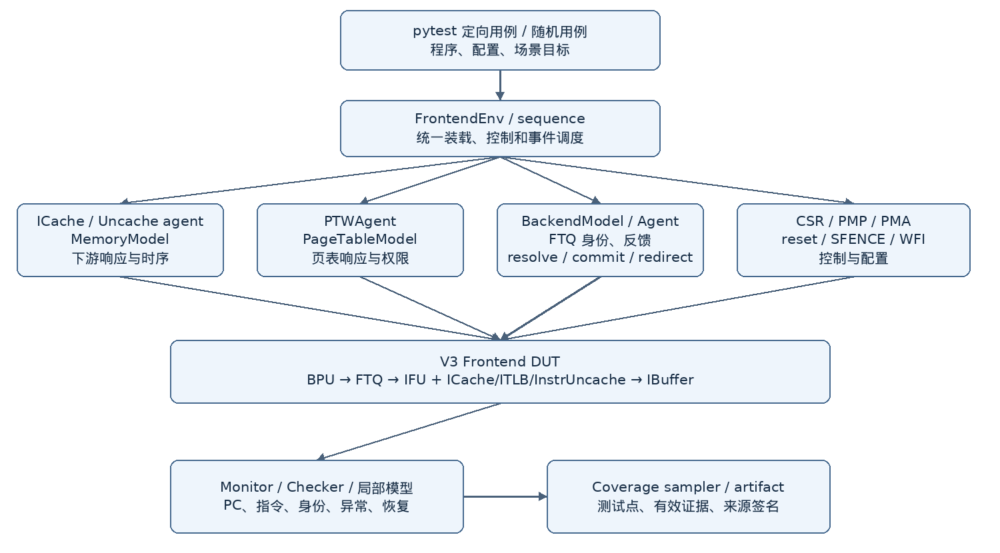
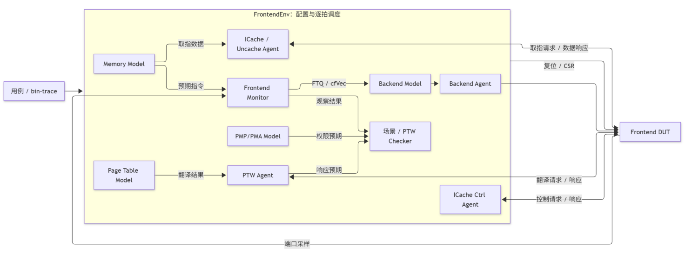
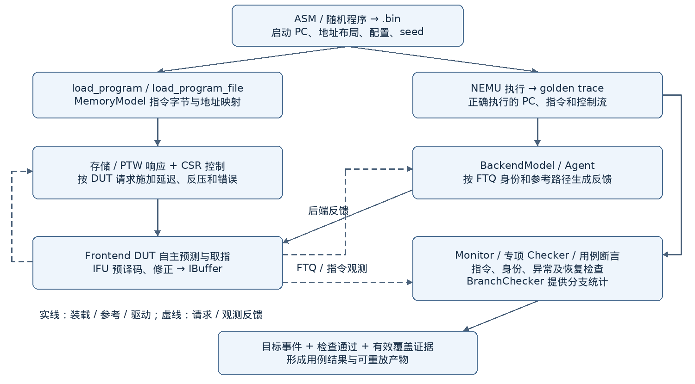

# 香山昆明湖处理器 Frontend Block Test 验证方案

**文档版本：V1.3**

**创建日期：2026-10-15**

**适用对象：香山昆明湖 V3 Frontend**

**验证层级：Block Test（BT）**

**验证方法学：Python / Picker / toffee，灰盒组合验证**

## 一、前端功能概述

香山昆明湖 V3 Frontend 位于指令存储层次与后端译码之间，负责预测取指路径、获取指令字节、识别指令边界、预译码、预测检查及指令交付。

前端采用预测与取指解耦的流水结构，通过 BPU、FTQ、IFU、ICache、ITLB、InstrUncache 和 IBuffer 的协作，持续向后端提供带有 PC、预测信息、FTQ 身份和异常元数据的有效指令流，并接收后端解析、提交和重定向反馈。

BPU 根据取指 PC、分支历史和返回地址栈状态，预测控制流类型、分支方向、目标地址及取指块边界；多级预测器共同形成预测结果，并利用 IFU 检查和后端反馈完成修正、训练与历史恢复。

FTQ 保存预测块及其元信息，协调取指、预取、预译码写回、分支解析和提交，维护条目的分配、指针推进和释放，使预测信息与实际取指结果按同一 FTQ 身份对应。

在指令获取路径上，ICache 的 MainPipe 处理需求取指，PrefetchPipe 提前请求后续指令块，WayLookup 提供取指所需的缓存查找信息，MissUnit 管理缺失请求与 refill。

ITLB 完成虚拟地址翻译，缺失时通过 PTW 接口获取页表结果；PMP/PMA 及页表属性共同决定执行权限和 cacheable、NC、MMIO 路径。

IFU 接收指令数据及翻译、属性和异常信息，完成 RVI/RVC 边界识别、跨块或跨页指令拼接、压缩指令扩展和预译码，并通过 PredChecker 检查预测与实际指令的对应关系，形成必要的裁剪和重定向。双取指路径还需要协调第二块请求资格、双块返回、合并和有效指令范围。

MMIO 和 NC 取指由 IFU 的非缓存处理路径与 InstrUncache 协作完成。InstrUncache 将请求转换为 TileLink 事务，维护请求身份、响应配对及多 beat/resend 状态；IFU 负责指令拼接、异常关联和重定向后的交付控制。

IBuffer 缓存 IFU 交付的指令、PC 和元数据，处理多路入队、出队、满空、回绕与后端反压，按程序顺序向后端交付。当前 IBuffer 还通过 VTypeGen 推导并传递向量类型状态，配合后端完成 VType 更新和恢复；部分向量指令解码及微操作拆分前移到 IBuffer 的功能作为后续设计预留。

前端在分支预测错误、异常、中断和刷新等事件发生时，按各控制来源的优先级恢复取指路径，清理失效的 FTQ、流水及 IBuffer 状态，并按协议处理已发出的存储与翻译事务。晚到响应按原请求身份处理，被终止路径的指令结果在交付侧丢弃；新路径从正确 PC 重新建立预测与取指。

复位、fence.i、SFENCE 和地址空间切换分别控制状态初始化、指令缓存同步及翻译失效，WFI 控制停发、安全状态和唤醒后的恢复；Perf/DFT 接口提供性能观测及测试控制。

当前 Frontend BT 以完整前端为验证对象，采用 Python/toffee 灰盒组合验证，围绕程序指令流、外部存储和 PTW 响应、后端反馈及控制信号组织激励。

重点检查正常取指、分支预测与修正、FTQ 管理、cacheable/MMIO/NC 路径、跨页与双取指、异常和 Trigger、重定向恢复及后端实际消费；通过 golden trace、局部行为模型、接口检查和功能覆盖证据共同评价验证结果。向量状态、Perf/DFT、多配置及后续设计预留能力按风险和设计进度逐步补充。

## 二、测试场景分析

前端的功能场景围绕“预测取指路径、获取指令、形成有效指令并交付后端”的完整流程展开，同时考虑地址翻译与访问权限、异常处理，以及复位、重定向和刷新等控制事件。场景分析从整体功能目标、子模块职责和模块间协作三个维度展开，分别明确前端要完成的行为、各模块承担的功能，以及这些功能在完整取指流程中的衔接关系。

**整体功能目标维度**：按复位与启动、分支预测、FTQ 管理、地址翻译与权限检查、cacheable/MMIO/NC 取指、指令边界与预解码、指令交付、异常处理及恢复等功能组织一级验证场景。每类场景明确要证明的行为、涉及的设计范围及与其他场景的分工，形成前端功能的总体划分，见 2.3 节。

**子模块职责维度**：按 BPU、FTQ、IFU、ICache、ITLB 与 PMP/PMA、InstrUncache、IBuffer 及顶层控制拆解设计。在各模块内部，结合其处理的数据、维护的状态和接口行为，分析正常处理、资源满空与回绕、反压、错误以及控制事件打断后的恢复等场景，见 2.1 节。

**模块间协作维度**：沿预测、取指、翻译、指令形成和交付的链路，分析请求与响应的关联、指令及元数据的传递、各级反压传播，以及异常和重定向时的协同处理，检查多个模块共同完成一项功能时的整体行为，见 2.2 节。

一级验证场景与按模块划分的场景相互对应，同一功能可以涉及多个模块，同一模块也可以参与多类功能。例如，“地址翻译与权限检查”涉及 ITLB、PTW 接口、PMP/PMA 和 ICache 的属性识别；“2-fetch 双取指”涉及 FTQ 的请求资格、ICache 的双块返回、IFU 的合并裁剪和 IBuffer 的交付。IFU 则同时参与 cacheable、MMIO/NC、指令边界、异常和恢复等多类场景。一级场景明确整体功能目标，模块场景明确各环节的职责，交互场景检查这些环节组合后的行为，三者共同构成功能验证范围。

### 2.1 模块拆解与测试场景矩阵

本节按子模块的功能职责展开，分别说明模块功能、典型场景及接口交互。各场景列出触发条件、预期行为和关键观测项，用于检查模块在正常处理、边界条件及异常恢复下的行为。

#### 2.1.1 BPU（分支预测单元）

**模块功能**

BPU 根据取指 PC 和历史信息产生预测块、控制流类型、方向及目标，维护多级 BTB/TAGE/SC、RAS、GHR/PHR 等状态，并接收 FTQ/后端反馈完成训练和恢复。

**测试场景**

| **场景编号** | **场景名称** | **场景描述与预期检查点** | **关键接口/观测点** |
|:---|:---|:---|:---|
| BPU-001 | 基本分支预测 | 顺序流、直接跳转、条件分支和间接跳转产生预测结果 | 预测有效性、taken、目标 PC、控制流类型 |
| BPU-002 | 多预测器协同 | 多级 BTB、TAGE、SC、ITTAGE 等结果按优先级选择并形成最终预测 | 预测来源、override、目标和置信信息一致 |
| BPU-003 | CALL/RET 与 RAS | 函数调用压栈、返回弹栈，嵌套调用和异常路径下维持返回地址 | RAS push/pop、返回目标和深度边界 |
| BPU-004 | 历史状态更新 | 分支结果、路径信息和预测反馈更新 GHR/PHR；flush 后恢复到正确历史 | 更新时机、历史长度、恢复边界 |
| BPU-005 | 训练与预测修正 | 后端 resolve/commit 和 IFU checker redirect 驱动预测器训练 | 训练条目身份、训练方向和更新条件 |
| BPU-006 | 预测器控制 | CSR 或配置开关改变各预测器启用状态 | 使能切换后的预测来源和默认行为 |
| BPU-007 | 流水线冲刷与恢复 | reset、redirect、override 后清理旧级间状态并从新 PC 重新预测 | 旧预测不再出队，新取指路径状态自洽 |

**接口交互**

BPU 接收启动地址、CSR 控制及 FTQ/后端预测反馈，向 FTQ 提供预测块、方向、目标和历史信息；IFU checker 与后端解析结果共同参与预测修正和恢复。

#### 2.1.2 FTQ（取指目标队列）

**模块功能**

FTQ 缓存 BPU 预测块及元信息，协调预取、取指、resolve、commit 和重定向，维护各类队列及指针的生命周期。

**测试场景**

| **场景编号** | **场景名称** | **场景描述与预期检查点** | **关键接口/观测点** |
|:---|:---|:---|:---|
| FTQ-001 | 预测块入队 | BPU 预测结果写入 Entry/Meta 等队列 | 入队条件、条目身份和元信息完整 |
| FTQ-002 | 取指与预取推进 | PF/IFU 指针按请求和响应推进，不能跳过未完成条目 | 请求顺序、valid/ready 和指针推进 |
| FTQ-003 | 指针回绕 | bpu、pf、ifu、wb、commit 等指针跨边界回绕 | wrap 位、条目匹配和年龄关系 |
| FTQ-004 | 满空与反压 | 队列满时阻止继续入队，空时不产生伪请求；下游反压时状态保持 | full/empty、反压稳定性和无重复请求 |
| FTQ-005 | resolve/commit | IFU checker、后端 resolve 和 commit 关联到同一 FTQ 条目 | owner、offset、提交顺序和释放时机 |
| FTQ-006 | 多来源重定向 | IFU、后端、异常、中断、fence.i 等来源仲裁并截断旧路径 | 优先级、截断范围、新 PC 和恢复进度 |
| FTQ-007 | 双取指资格 | 同一预测块的第二取指请求只在资格满足时发出 | 跨块边界、异常、反压和 flush 条件 |

**接口交互**

FTQ 接收 BPU 预测块，向 IFU/ICache 提供取指及预取请求，接收 IFU 写回、后端 resolve/commit 和 redirect；通过 ftqPtr、offset 和有效位关联预测、取指、提交与条目释放。

#### 2.1.3 IFU（取指单元）

**模块功能**

IFU 接收 cacheable、MMIO 和 NC 数据，完成单/双块组织、指令边界识别、RVC 扩展、预译码、PredChecker 和 Trigger 匹配，并把有效指令交给 IBuffer。

**测试场景**

| **场景编号** | **场景名称** | **场景描述与预期检查点** | **关键接口/观测点** |
|:---|:---|:---|:---|
| IFU-001 | cacheable 取指 | 接收 ICache 命中或 refill 数据并形成指令流 | 请求/响应身份、数据和 PC 对齐 |
| IFU-002 | MMIO/NC 取指 | 处理非缓存响应、反压、resend 和属性切换 | 顺序、属性、响应消费和错误传递 |
| IFU-003 | 指令边界识别 | RVI/RVC 混合、跨 8B beat、跨 cache block 和跨页指令拼接 | 长度判断、半字保存和拼接结果 |
| IFU-004 | 预译码与 RVC 扩展 | 识别控制流、异常和压缩指令并生成标准指令字 | predecode、扩展结果和元数据 |
| IFU-005 | PredChecker 修正 | 预译码结果与 BPU 预测不一致时产生 checker redirect | redirect PC、FTQ owner、裁剪范围和优先级 |
| IFU-006 | 双块合并与裁剪 | 两个取指块同时返回时按起始 PC、分支和异常裁剪有效指令 | block 边界、有效位、顺序和异常 lane |
| IFU-007 | Trigger 与异常 | 指令地址、数据匹配或访问错误关联到对应指令 | trigger 命中、异常类型、优先级和传递 |
| IFU-008 | 反压、flush 与恢复 | IBuffer 反压或前端 flush 时保持输入稳定，恢复后不复用旧状态 | valid/ready 稳定性、新旧取指路径隔离和无丢重指令 |

**接口交互**

IFU 与 FTQ 交换取指请求、预译码写回和重定向，与 ICache 交换缓存数据及翻译/异常属性，与 InstrUncache 交换 MMIO/NC 请求、响应和补取信息，通过 toIBuffer 交付指令及异常元数据。

#### 2.1.4 ICache（指令缓存）

**模块功能**

ICache 提供 cacheable 指令访问，管理命中、缺失、预取、替换、refill、属性识别和在途事务，并向 IFU 返回数据及异常信息。

**测试场景**

| **场景编号** | **场景名称** | **场景描述与预期检查点** | **关键接口/观测点** |
|:---|:---|:---|:---|
| ICACHE-001 | 命中访问 | tag/data 命中后在规定延迟返回指令块 | 命中判定、way、数据和响应身份 |
| ICACHE-002 | 缺失与 refill | 缺失发起下游请求，接收 beat 并填充后完成取指 | MSHR、beat 顺序、refill 和重试 |
| ICACHE-003 | 预取 | 预取请求与需求请求并行或竞争时保持正确性 | 预取资格、取消和资源占用 |
| ICACHE-004 | 替换与冲突 | set/way 冲突触发替换，不能破坏有效在途请求 | victim、替换状态和数据一致 |
| ICACHE-005 | 双块与边界 | 两个连续块或跨页请求同时参与取指 | WayLookup、第二块资格和返回配对 |
| ICACHE-006 | 属性与权限路径 | 根据翻译结果选择 cacheable、NC 或 MMIO 路径并处理 PMP/PMA 结果 | 属性、权限、路径选择和异常 |
| ICACHE-007 | ECC、总线错误与拒绝 | 处理 corrupt、denied、ECC 错误并生成正确异常元数据 | 错误归属、错误优先级和响应收敛 |
| ICACHE-008 | fence.i、flush 与 WFI | 刷新、重定向和 WFI 期间处理 cache 状态及在途请求 | 取消/完成规则、安全状态和恢复 |

**接口交互**

ICache 接收 FTQ/IFU 取指与预取需求，使用 ITLB/PTW 翻译和 PMP/PMA 权限结果，通过下游存储接口完成缺失与 refill，向 IFU 返回数据、属性和异常；同时响应刷新、重定向和 WFI 控制。

#### 2.1.5 ITLB、PTW 与 PMP/PMA

**模块功能**

ITLB 完成虚拟地址翻译、权限检查和 TLB 刷新；PTW 提供缺失翻译；PMP/PMA 根据物理地址、特权级和属性决定可执行性及路径。

**测试场景**

| **场景编号** | **场景名称** | **场景描述与预期检查点** | **关键接口/观测点** |
|:---|:---|:---|:---|
| XLATE-001 | TLB 命中与缺失 | 命中直接返回翻译，缺失向 PTW 发起请求并 refill | request/response 配对、命中标志和 refill |
| XLATE-002 | 多级翻译与权限 | Bare、分页、G-stage、页表权限和特权级组合生效 | page fault、权限位、GPA/异常元数据 |
| XLATE-003 | 页边界与跨页 | 一次取指跨页时分别处理两页翻译和异常 | lane 归属、第二页请求和拼接条件 |
| XLATE-004 | PTW 延迟与旧响应 | PTW 反压、延迟、乱序或翻译上下文切换后，属于旧请求或旧上下文的 PTW 响应必须丢弃，不得写入当前翻译状态或推进新路径 | tag、owner、新旧翻译上下文区分和响应丢弃 |
| XLATE-005 | SFENCE 与上下文切换 | satp、特权级和 SFENCE 改变后清理或保留正确 TLB 状态 | flush 范围、时序和新旧上下文隔离 |
| XLATE-006 | PMP/PMA 属性检查 | PMP 区域、优先级、执行权限和 PMA 属性决定访问结果 | 匹配范围、权限异常和 cacheable/NC/MMIO 选择 |

**接口交互**

ITLB 向 PTW 请求缺失翻译，接收页表项、权限和异常结果；CSR 与 SFENCE 控制翻译上下文及失效范围。PMP/PMA 将物理地址权限和属性提供给取指路径。Frontend BT 在 PTW 外部接口提供页表响应。

#### 2.1.6 InstrUncache（MMIO/NC 非缓存取指）

**模块功能**

InstrUncache 将 IFU 的非缓存请求转换为 TileLink 事务，管理请求条目、beat/resend、响应和重定向后的事务处置。

**测试场景**

| **场景编号** | **场景名称** | **场景描述与预期检查点** | **关键接口/观测点** |
|:---|:---|:---|:---|
| UNC-001 | MMIO 顺序取指 | 按顺序发送请求并接收 MMIO 响应 | 请求属性、响应配对和顺序 |
| UNC-002 | NC 单独取指 | 连续 NC 取指请求保持正确的属性、响应配对和指令顺序 | NC 属性、队列占用和交付顺序 |
| UNC-003 | cacheable/NC/MMIO 属性切换 | cacheable、NC 和 MMIO 请求交替出现时，按各自属性选择路径，保持事务身份和指令顺序 | 属性切换边界、路径选择、队列占用和交付顺序 |
| UNC-004 | 多 beat/resend | 跨 beat 或跨页指令需要重复请求、拼接和交付 | beat 计数、resend 条件和拼接 |
| UNC-005 | ready/valid 反压 | A/D 通道反压时 payload 保持，响应只消费一次 | valid 稳定性、握手和无重复消费 |
| UNC-006 | denied/corrupt 错误响应 | TileLink D 通道返回 denied 或 corrupt 时，InstrUncache 为对应请求形成明确的错误结果，释放或收敛事务且不交付伪造指令 | 错误元数据、请求响应配对、事务终止状态和异常归属 |
| UNC-007 | uncacheRedirect 与在途事务 | 前端重定向在请求尚未握手、请求已发出但响应未到达、响应到达前后分别发生时，InstrUncache 按总线协议完成已发事务，IFU 清理被重定向取消的取指状态；旧路径响应由 IFU 阻止交付到 IBuffer | 取消边界、A/D 通道握手、响应归属、旧路径隔离和恢复首请求 |

**接口交互**

InstrUncache 接收 IFU 非缓存请求，通过 TileLink A/D 通道与外部存储交互，并向 IFU 返回数据、错误和 resend 结果。重定向后的旧指令交付由 IFU 按请求身份和流水有效状态控制；已发总线事务按照握手协议完成。

#### 2.1.7 IBuffer（指令缓冲区）

**模块功能**

IBuffer 解耦 IFU 与后端，缓存指令、PC 和异常/控制流元数据，按程序顺序向后端提供多路消费接口。当前还负责 VSETVL/VSETVLI/VSETIVLI 相关的 vtype/specvtype 推导与传递；后续可按设计演进承载部分向量指令解码和 uop 拆分，但该部分尚未作为当前 RTL 能力计入完成度。

**测试场景**

| **场景编号** | **场景名称** | **场景描述与预期检查点** | **关键接口/观测点** |
|:---|:---|:---|:---|
| IBUF-001 | 指令入队 | IFU 单条或多条指令写入缓冲区 | 入队 valid、lane 顺序和元数据 |
| IBUF-002 | 指令出队与实际消费 | 后端 ready 时按顺序消费，反压时保持呈现 | fire、PC/指令一致和无重复消费 |
| IBUF-003 | 满空与回绕 | 容量边界、指针回绕和同时入队/出队 | occupancy、指针和边界行为 |
| IBUF-004 | Flush 清理 | redirect/异常/中断清除旧路径指令 | 清理范围、新旧取指路径隔离和恢复首条指令 |
| IBUF-005 | 多端口与异常元数据 | 多路输出及异常、Trigger、控制流信息保持对应关系 | lane 对齐、优先级和元数据完整 |
| IBUF-006 | 向量状态传递 | VSETVL/VSETVLI/VSETIVLI 及后端恢复状态时，按指令顺序更新并携带 vtype/specvtype；恢复期间暂停会导致状态错误的输出 | vtype/specvtype 与指令对应、VSET 顺序、恢复停发和状态切换边界 |
| IBUF-007 | 向量指令拆分预留 | 若后续将部分向量指令的解码或 uop 拆分从后端前移到 IBuffer，需保持原指令 PC、FTQ/异常身份、uop 顺序和最后一条标记 | 拆分数量、uop 身份、源指令关联、顺序和 flush/反压恢复；随该功能的设计实现补充验证 |

**接口交互**

IBuffer 接收 IFU 的指令、PC、FTQ 身份和异常元数据，通过多路 CtrlFlow 输出交付后端；后端提供接收能力、VType 提交与恢复状态，flush 控制旧路径指令清理。

#### 2.1.8 Frontend 顶层协作、WFI 与 Perf/DFT

**模块功能**

顶层连接 BPU、FTQ、IFU、ICache、翻译和交付路径，分发 reset/CSR/flush/test 控制，汇总 WFI 安全状态和性能信息。

**测试场景**

| **场景编号** | **场景名称** | **场景描述与预期检查点** | **关键接口/观测点** |
|:---|:---|:---|:---|
| TOP-001 | 复位与启动 | reset 后清理旧事务，从启动地址建立新的取指流 | 复位后的新状态、首个请求和状态初始化 |
| TOP-002 | redirect/flush 仲裁 | backend、IFU、异常、中断、fence.i 等来源共同到达时选择正确路径 | 优先级、取消范围和新路径恢复 |
| TOP-003 | WFI 停发与恢复 | wfiReq 期间停止新取指；尚未握手的 InstrUncache A 通道请求撤回，已发出的事务按协议完成；解除后恢复取指 | wfiSafe、A 通道撤回/重发、在途状态和唤醒后首请求 |
| TOP-004 | Perf/DFT/SRAM | 性能事件、DFT 和 SRAM 控制在当前配置下生效且不破坏功能路径 | 事件计数、控制隔离和可观测性 |

**接口交互**

Frontend 顶层连接预测、取指、翻译、非缓存访问和交付链路，接收后端重定向、CSR、reset、WFI 和 DFT 控制，向环境提供有效指令、状态及性能观测。

### 2.2 模块间交互测试场景

本节沿完整取指流程组织跨模块场景，检查各模块之间的请求与响应关联、指令顺序、异常传递和恢复关系。每个场景结合相关模块的局部行为，检查从触发事件到最终交付或恢复的完整过程。

**测试场景**

| **场景编号** | **场景名称** | **涉及模块** | **场景描述** |
|:---|:---|:---|:---|
| INT-001 | 正常取指流程 | BPU → FTQ → IFU → ICache/ITLB/PMP → IBuffer | 从预测块入队到后端消费，PC、指令和元数据保持一致 |
| INT-002 | 预测正确与训练 | BPU → FTQ → Backend | 预测命中时无多余 redirect，resolve/commit 后正确训练和释放条目 |
| INT-003 | IFU checker 重定向 | IFU → FTQ → BPU | 预译码发现预测错误，按 owner/offset 截断旧路径并恢复新 PC |
| INT-004 | 后端重定向与异常 | Backend → FTQ → BPU/IFU/IBuffer | mispredict、异常或中断冲刷前端，旧结果不得交付 |
| INT-005 | ICache 缺失 | FTQ → ICache → memory/L2 → IFU | 缺失、refill、响应反压和恢复后的指令交付闭环 |
| INT-006 | MMIO/NC 取指 | IFU → InstrUncache → external memory | 属性识别、顺序请求、resend、错误和交付闭环 |
| INT-007 | TLB 缺失与刷新 | ICache → ITLB → PTW → ITLB | 翻译缺失、PTW 返回、SFENCE/上下文切换，以及旧上下文响应的丢弃 |
| INT-008 | 跨页取指 | FTQ → ICache/ITLB → IFU → IBuffer | 两页翻译、第二页请求、跨页指令拼接、页异常和恢复后的首条指令 |
| INT-009 | 2-fetch 双取指 | FTQ → ICache → IFU → IBuffer | 第二块请求资格、双块返回合并、PredChecker 裁剪、异常、反压和 flush |
| INT-010 | WFI 与在途事务 | Frontend → ICache/InstrUncache | 停发前完成安全收敛，唤醒后从正确 PC 恢复 |

**重定向场景是跨模块验证的重点**。至少覆盖以下来源和组合：

异常来源至少包括：ICache/InstrUncache 的总线错误、denied/corrupt 和 ECC 结果，ITLB/PTW 的缺页与访存权限异常，PMP/PMA 权限异常，Trigger 命中，以及后端传入的异常和中断。每类异常都要检查它与具体指令的关联、异常类型和元数据、与其他重定向来源的优先级，以及旧路径事务是否被清理。

| **重定向类型** | **触发条件** | **主要影响** | **检查重点** |
|:---|:---|:---|:---|
| IFU checker redirect | 预译码结果与预测不一致 | 截断对应 FTQ 条目及其后的旧路径 | owner、offset、恢复 PC、优先级 |
| 后端分支重定向 | resolve 结果与预测不一致 | 冲刷前端并重新建立预测/取指流 | backend 优先级、训练和提交关系 |
| 异常/中断重定向 | 缺页、权限、总线错误或外部中断 | 终止旧路径并携带异常元数据 | 异常 lane、trap 信息和被终止路径响应的丢弃 |
| fence.i / 翻译刷新 | 指令缓存或地址空间状态改变 | 使相关缓存/翻译状态失效 | 刷新范围、在途事务和新上下文 |
| WFI 停止/恢复 | 前端进入或退出停发状态 | 暂停新请求并恢复取指 | 安全状态、握手和首个恢复请求 |

第三章进一步说明如何围绕上述场景组织指令流、接口响应及控制事件，并通过参考模型和检查机制判断预期行为。

### 2.3 一级验证场景与范围

本节从整体功能目标归纳一级验证场景，明确每类功能的预期行为、涉及模块及场景范围。每类一级场景结合 2.1 节中的相关模块场景与 2.2 节中的交互场景展开，使局部功能检查与完整流程检查对应到同一功能目标。

| **一级场景** | **要证明的行为** | **当前 RTL 范围** | **场景边界** |
|:---|:---|:---|:---|
| 复位与启动 | 上电及运行中复位后，前端状态重新初始化，旧事务不再交付；从启动地址建立新的取指流 | Frontend，以及 BPU、FTQ、IFU、ICache、ITLB、InstrUncache、IBuffer 的复位边界 | 关注硬件复位与取指恢复；普通 redirect/flush 恢复归对应场景 |
| 分支预测 | BPU 生成预测块，FTQ 接收预测及元信息；预测器使能、预测修正、训练、历史更新和恢复自洽 | BPU 中的 uBTB、aBTB、uTage、mBTB、Tage、SC、ITTAGE、RAS、PHR、FallThrough，以及 FTQ 接收侧 | 关注预测结果及反馈；FTQ 队列管理归 FTQ 管理 |
| FTQ 管理 | 预测块入队、取指与预取请求推进、resolve/commit 反馈及条目释放正确；覆盖指针回绕、满空和反压 | FTQ 的 EntryQueue、MetaQueue、SpeculationQueue、CfiQueue、ResolveQueue、CommitQueue | 关注队列生命周期；重定向来源、仲裁和恢复归 redirect/flush 恢复 |
| 地址翻译与权限检查 | 翻译模式、TLB 命中与缺失、PTW 返回、页表权限、SFENCE、上下文切换及 PMP/PMA 检查正确 | ITLB、PTW 接口及过滤/转发逻辑、PMP/PMA、ICache 属性识别 | 关注地址、权限和取指属性；异常交付归异常与 Trigger |
| cacheable 取指 | ICache 命中、缺失及 refill 后，IFU 正确完成取数、属性确认、预译码、预测检查和交付 | FTQ、ICache MainPipe、PrefetchPipe、MissUnit、WayLookup，IFU cacheable 路径 | 关注 cacheable 主路径；双块取指单独列为其子路径，属性切换归地址翻译与权限检查 |
| 2-fetch 双取指 | cacheable 取指路径下，双请求资格、WayLookup、MainPipe 双块返回、IFU 合并、PredChecker 裁剪及 IBuffer 交付正确；覆盖第二块无效、异常、反压和 flush | FTQ、ICache、IFU、IBuffer 的 cacheable 双块路径 | 仅适用于 cacheable 取指；MMIO 和 NC 取指不进入 2-fetch 路径 |
| MMIO 取指 | 正确选择 MMIO 路径，顺序发起请求、接收响应；跨 8B beat 和跨页指令的 resend、拼接与交付正确 | IFU 的 IfuUncacheUnit、InstrUncache、TileLink 接口 | 关注 MMIO 的顺序化及边界处理 |
| NC 取指 | 正确识别 NC 属性，发送请求并处理响应、反压；与 cacheable、MMIO 混合时保持事务和指令顺序 | ICache 属性识别、IFU、InstrUncache | 关注 NC 路径及混合流；MMIO 特有顺序化归 MMIO 取指 |
| 指令边界与预解码检查 | 正确识别 RVI/RVC 指令边界，完成跨块/跨页拼接、RVC 扩展、预译码、PredChecker 检查及 Trigger PC 预匹配 | IFU 的 InstrBoundary、InstrCompact、RvcExpander、PreDecode、PredChecker、FrontendTrigger | 关注指令形成、预测检查和 PC 匹配；Trigger 动作及异常交付归异常与 Trigger |
| Perf+DFT | 性能事件、topdown 信息及 DFT、SRAM 控制在当前配置下正确工作，相关控制不破坏功能路径 | Frontend 顶层及各模块的性能、DFT 接口 | 关注 BT 可驱动和观测的功能；不承担芯片级测试流程验证 |
| 异常与 Trigger | 总线访问错误、翻译及权限异常、指令异常元数据和 Trigger 动作正确关联到指令，并传递至后端 | ICache、InstrUncache、ITLB、PMP/PMA、FTQ、IFU、IBuffer | 关注异常与 Trigger 的归属、优先级和交付；后端译码及 trap 处理不在 Frontend BT 内 |
| redirect/flush 恢复 | backend redirect、IFU wbRedirect、IFU uncacheRedirect、BPU override、fence.i 和翻译刷新正确仲裁并生效，旧路径事务不再产生副作用，新路径恢复 | FTQ redirect receiver、BPU、IFU、ICache、ITLB、InstrUncache、IBuffer | 关注取消、仲裁和恢复；总线在途请求可完成，但旧结果不得被新路径复用 |
| 取指结果交付 | IBuffer 正确接收入队指令，维持 PC、指令和元数据顺序，在反压、满空、回绕与 flush 后正确交付后端 | IFU 到 IBuffer 接口、IBuffer、backend 接口 | 以实际消费为准，反压期间重复呈现 valid 不算重复消费 |
| wfi | 正确停止取指并报告安全状态，处理 ICache、InstrUncache 在途事务；退出停发状态后正确恢复取指 | Frontend 顶层、ICache、InstrUncache | 关注前端停发、安全握手及恢复；后端 WFI 执行和唤醒决策属于外部输入 |

## 三、验证策略

### 3.1 验证架构框图

Frontend BT 以完整 Frontend 边界为主开展灰盒验证。DUT 是 DefaultConfig 下抽出的 V3 Frontend，验证范围覆盖 Frontend 内部模块协作；Python 环境既驱动外部接口，也观测必要的内部接口和事务信息。下表按环境与 DUT 交互的验证通道和激励来源组织，描述的是职责集合：

| **验证通道 / 激励源** | **当前承担者** | **验证关注** |
|:---|:---|:---|
| 指令存储 / L2 响应 | ICacheAgent + MemoryModel | 命中、缺失、refill 延迟、反压；不要求完整 L2 VIP |
| MMIO / InstrUncache | UncacheAgent | NC/MMIO 请求、响应、resend、TL user 属性稳定性 |
| 地址翻译 | PTWAgent + PageTableModel | SV39/G-stage、权限、缺页、SFENCE、上下文切换 |
| 后端 | BackendAgent + BackendModel | commit、resolve、redirect、flush、异常和中断重定向 |
| CSR / PMP / PMA | CSR bundle + PMP/PMA 模型 | 预测器使能、SATP/特权级、PMP/PMA 配置与检查 |
| 复位 / DFT | clock-reset、DFT bundle | 硬件复位与 Python 模型状态同步 |

BPU 的预测结果由 DUT 内部预测器产生。当前环境结合程序执行 trace、后端反馈和监视记录检查取指路径及重定向恢复；预测器内部训练、历史和 RAS 等状态的专项判定依据，以及预测质量评估方法，在 BPU 专项方案评审中明确。

<figure>

<figcaption>
图 1 Frontend BT 验证架构
</figcaption>
</figure>

### 3.2 验证方法

#### 3.2.1 构建、仿真与覆盖率

Frontend BT 验证平台使用 Verilator 和 VCS 两种仿真工具。make frontend 默认构建 Verilator 版本，也可通过 make frontend-verilator 显式选择；make frontend-vcs 构建 VCS 版本。

构建过程：

- Mill 根据 Chisel 源码生成 RTL。

- Picker 以 Frontend.sv 为顶层，构建 Python DUT 包。

- 生成 manifest 文件，记录构建配置、源码版本和产物摘要。

运行测试时，通过 TB_FRONTEND_SIM 选择并加载对应仿真工具的 DUT 包。其中，Verilator 默认生成 FST 波形，VCS 默认生成 FSDB 波形。运行产物默认保存在 build-frontend/artifacts/\<run-id\>/，也可通过 TB_ARTIFACT_DIR 指定根目录。

工程已提供 Python/Toffee 功能覆盖及部分 SV 功能覆盖实现。各覆盖域的接入范围与有效性结合当前设计基线、采样合同和运行证据确认：

- Toffee funcov 在 Python 侧采样，并支持生成 HTML 覆盖率报告。

- SV funcov 通过绑定到 Frontend 的 SystemVerilog covergroup 采样 DUT 信号，随 VCS 构建加入仿真，覆盖率结果可在 Verdi 中查看。

功能覆盖命中以目标事件实际发生、有效采样条件满足且相关 Checker/断言通过为依据，记录设计与构建基线、运行配置及覆盖项定义。Python/Toffee 与 SV 的统计按对应覆盖项逐项核对，汇总时依据统一定义去重；后续 SV 迁移按域分批推进，保留语义与采样对照结果。

代码覆盖率由仿真工具收集：Verilator 生成 .dat 文件，VCS 生成 .vdb 文件。

#### 3.2.2 验证平台组成与职责

验证平台与 DUT 之间的主要激励、反馈和观察路径：

FrontendEnv 接收用例或 bin-trace 的配置，管理并逐拍调度 Agent、Monitor、Model 和 Checker，直接驱动 DUT 的复位和 CSR 接口。如下图所示，其中，双向连线表示 DUT 发出请求、Agent 提供响应；ICache Ctrl Agent 则发起控制请求并接收 DUT 响应。场景 Checker 的预期来自用例配置，PTW Checker 的响应期望来自 PTW Agent。

<figure>

<figcaption>
图 2 验证平台的组成
</figcaption>
</figure>

主要 Agent 的职责和代码位置：

| **Agent** | **作用** | **代码位置** |
|:---|:---|:---|
| ICache Agent | 按配置概率选择响应延迟，返回缓存行数据并可注入 denied/corrupt | env/agents/icache_agent.py |
| ICache Ctrl Agent | 一次处理一笔缓存控制读写 | env/agents/icache_control_agent.py |
| Uncache Agent | 按普通和 MMIO 两档延迟返回数据，可注入 denied/corrupt | env/agents/uncache_agent.py |
| PTW Agent | 按配置延迟返回翻译结果，默认在 sfence 时丢弃待发响应 | env/agents/ptw_agent.py |
| Backend Agent | 把 Backend Model 的决定写到 DUT 端口 | env/agents/backend_agent.py |

Frontend Monitor（env/monitors/frontend_monitor.py）：

- 统一采样 DUT 端口，向 Backend Model 和各 Checker 提供观察结果，并检查指令内容与重定向恢复。

验证环境通过四类 Model 提供取指数据、地址翻译与权限预期，并决定后端反馈：

| **Model** | **作用** | **结果用途** | **代码位置** |
|:---|:---|:---|:---|
| Memory Model | 保存指令数据和 MMIO 地址范围，提供指令字节及 cacheline | 由 ICache/Uncache Agent 向 DUT 返回取指数据 | env/model/memory_model.py |
| Page Table Model | 支持 bare 和 SV39，按 PTW 请求的 s2xlate 处理翻译；bare 模式不加载页表，PTW 响应发出前按配置处理 PBMTE | 由 PTW Agent 向 DUT 返回翻译结果或异常 | env/model/page_table_model.py |
| PMP/PMA Model | 根据场景配置计算执行权限和是否可缓存；未命中时，PMP 按特权级决定，PMA 拒绝访问且判为不可缓存 | 用于地址翻译场景的检查预期 | env/model/pmp_pma_model.py |
| Backend Model | 根据 DUT 观察结果以及用例或 trace 决定重定向、分支解析、提交、调用返回提交和 ftqIdxAhead | 由 Backend Agent 驱动 DUT | env/core/backend_model.py |

#### 3.2.3 环境配置与运行流程

FrontendEnv 负责 DUT 配置和逐拍调度；Backend Model 的运行模式随测试方式和用例配置选择。

环境配置：

- 地址模式和 Agent 参数由 env/support/env_config.py 定义；地址模式默认 bare，也支持 SV39。

- FrontendEnv 通过 CSRControlBundle 直接驱动 CSR，没有独立的 CSR Agent。初始化时设置特权级和 satp/vsatp/hgatp 等翻译配置；运行中可调整 BPU 开关、触发 TLB CSR 变更、写入 PMP/PMA 配置并设置 PBMTE。

复位阶段：

- ICache、ICache 控制、Uncache 和 PTW Agent 清除未完成事务并将相关接口置空闲；Backend Model 重建当前 FTQ 执行轮次状态，Backend Agent 输出置空闲，Frontend Monitor 清除临时恢复状态。

- golden trace 游标、累计诊断和已有监视记录保留；两个 PTW Checker、Frontend Monitor 和地址翻译场景 Checker 暂不执行常规观察。

复位释放后：

- 外围 Agent 处理 DUT 请求并驱动响应，Frontend Monitor 采样端口，Backend Model 规划后端反馈，Backend Agent 将反馈写入 DUT。

- Frontend Monitor 在后端反馈前采样 FTQ 和 cfVec，在反馈后记录实际驱动的 redirect，用于检查后续 cfVec 的恢复结果。

- ICache SRAM 注入（env/agents/icache_ecc_injection_agent.py）由用例显式调用，可注入 meta/data ECC 错误或多路命中，不在每拍自动执行。

按主要激励组织方式，用例分为两类：

- Python 用例通过场景与控制接口精细安排响应、时序及控制事件，也可装载程序和 golden trace，覆盖正常处理、边界及异常场景。

- bin 用例以程序指令序列为主，结合执行 trace、存储与翻译响应及控制配置，覆盖正常路径和程序运行中的异常、反压与恢复场景。

Backend Model 有三种运行方式：

| **方式** | **行为** |
|:---|:---|
| auto_python | 默认的 Python 用例模式；自动安排 resolve 和 commit，有可归因的 golden 错误路径时自动安排重定向，也允许用例显式注入 |
| manual_python | 自动安排 resolve 和 commit；不自动安排 golden 错误路径重定向，恢复由用例显式决定 |
| auto_bin | 加载执行 trace 后进入，按 trace 自动恢复，不再接受用例注入 |

Frontend BT 的 testcase 从测试点目标出发，组合指令流、内存响应、地址翻译、控制事件和后端反馈，推动完整 Frontend 走过目标路径。三类激励在同一个 testcase 中协同工作，共同形成目标场景。

**第一步：由测试点定义场景和初始条件。** 定向用例先根据主表选择目标行为，例如正常取指、跨页、2-fetch、PTW 旧响应、MMIO/NC、异常或 redirect/flush；然后确定 ASM/ISA trace、启动 PC、页表和权限、PMP/PMA 属性、cacheable/NC/MMIO 属性、reset 时序、ready/valid 策略以及是否需要后端 resolve/redirect。随机用例沿用同一套环境入口，只把指令流、延迟、属性和控制事件参数化，并保留 seed、trace cursor 和配置。

**第二步：由指令流和存储模型提供取指数据。** ASM 源程序或随机指令序列经编译生成二进制指令字节；用例通过 load_program / load_program_file 将指令字节按装载地址写入 MemoryModel，并通过 load_golden_trace_file 加载 NEMU 的预期 PC、指令字和程序顺序。反汇编文件用于核对地址、指令编码和分支位置。DUT 发出的取指请求经过 ICache 或 InstrUncache；ICacheAgent、UncacheAgent 和 MemoryModel 在下游接口返回缺失 refill、MMIO/NC 数据 beat 及 denied/corrupt 等结果；ICache 命中由 DUT 内部缓存状态产生，resend 由 IFU/InstrUncache 根据指令边界和响应状态发起。指令数据沿 DUT 的取数、拼接、预译码、PredChecker 和异常生成路径传播，最后由 IFU 通过 toIBuffer 交付。

这里需要区分两条链路：程序的 .bin 指令字节按地址装载到 MemoryModel，同一程序在 NEMU 上运行生成 golden trace；golden trace 描述程序在正确执行下应接受的 PC、指令字、顺序和控制流结果，作为 FrontendMonitor/BranchChecker 的语义参考。golden trace 提供检查所需的程序语义和后端反馈参考；各 agent 和用例控制请求响应时序。DUT 的实际输入来自它发出的取指请求，以及 ICache/InstrUncache、PTW、PMP/PMA、CSR、reset 和 BackendModel 对这些请求的响应与控制。验证环境将 DUT 最终交付到 IBuffer/Backend 的有效指令流与 golden trace 对齐，同时检查请求响应身份、异常、redirect、反压和旧路径清理。

<figure>

<figcaption>
图 3 程序、golden 与接口激励流程
</figcaption>
</figure>

图中的实线表示程序装载、参考数据及环境驱动的传递；虚线表示 DUT 请求和观测事件进入环境的反馈路径。golden trace 为 BackendModel 提供正确执行路径参考，并用于检查结果关联；Monitor、专项 Checker 和用例断言分别检查指令内容、身份、异常及恢复，BranchChecker 提供分支统计。

**第三步：由外部接口模型控制时序和翻译结果。** ICache、InstrUncache 和 PTW agent 在请求已经由 DUT 发出后施加延迟、ready/valid 反压、响应乱序、第二 beat 返回、页表 walk 结果和权限结果。PageTableModel 提供页表映射、权限、缺页和 GPA 参考信息，PTWAgent 返回相应页表响应；ITLB 命中与缺失由 DUT 的翻译缓存状态决定；PMP/PMA 模型决定物理地址属性和访问许可。这样同一条指令流可以被安排在命中、缺失、跨页、反压、旧响应或错误响应等不同事务时序下，验证的是接口握手、请求响应身份、异常元数据和交付顺序。

**第四步：由 DUT 和后端模型共同形成控制流变化。** BPU 预测和 IFU checker redirect 由 DUT 根据预测与预译码结果产生；后端 resolve、commit、mispredict、异常或中断由 BackendModel 按当前 FTQ 的真实 ftqPtr、offset、PC 和来源生成反馈，再通过 BackendAgent 注入 DUT。fence.i、SATP/SFENCE、WFI、CSR 和 reset 由对应控制接口驱动。redirect 的验证重点是来源仲裁、旧 FTQ/IFU/ICache/InstrUncache/IBuffer 状态清理、新 PC 恢复，以及在途响应与新路径的身份对应。

**第五步：由 Monitor、专项 Checker 和用例断言检查结果。**Monitor 与 Agent 事件记录保留有效输出、请求响应及控制信息。加载 golden trace 时，由 BackendModel 维护参考游标、关联动态指令并生成后端反馈；FrontendMonitor 检查指令内容与重定向后的恢复目标。地址翻译、PTW 等专项 Checker 及用例断言按各自启用条件检查局部行为。BranchChecker 记录指令、分支及错预测统计；Bare 顺序取指的 IFU 局部参考模型由相应试点用例显式调用。覆盖率采样器记录满足目标条件且来源信息有效的事件。

因此，三类激励的关系是：固定指令流提供“取什么”，外部接口模型决定“什么时候返回、返回什么状态”，后端与控制模型决定“何时改变取指路径”；DUT 自己产生的预测修正和部分异常/redirect 作为被观测、被检查的结果。一个完整 testcase 根据目标组合其中两类或三类激励，并以场景目标、checker/断言和覆盖证据共同完成判定。

随机回归用于发现新场景，并给定向用例提供种子，具体目标由定向用例和有效覆盖证据确认。随机种子、trace cursor 和配置必须随 artifact 保留。

#### 3.2.4 参考模型与检查

Frontend BT 采用端到端指令流检查、局部行为级模型和接口不变量检查相结合的方法。Monitor 对 DUT 和环境进行观测，检查以有效事件和接口不变量为边界，验证场景目标是否发生、输出是否符合预期、事务是否保持正确关系，以及异常和恢复是否符合设计语义。

检查手段采用分层组合方式：程序执行 trace 提供正确路径参考；已有局部模型、专项 Checker 及用例预期用于检查对应功能；接口和必要内部观测用于关联握手、身份、顺序及恢复事件。各检查的当前接入范围在下文说明，待建设的局部模型和状态性质按场景逐步补充。

当前暂不为整个前端 DUT 建立 cycle 级参考模型；bin-trace 测试以 NEMU 生成的执行 trace 作为行为级参考，检查 DUT 的执行路径。trace 不提供逐拍的提交时序、重定向过渡期或动态 FTQ/CFI 状态，这些由验证环境另外维护。不加载 golden trace 的 Python 测试用例没有统一的执行路径参考模型；用例和场景配置提供预期 PC、指令内容、地址翻译或异常等局部期望，再由用例断言检查。

现有环境对执行路径、指令内容、重定向恢复和地址翻译场景的检查范围如下：

- 执行路径（env/model/golden_trace.py、env/core/backend_model.py）：期望来自 NEMU 日志转成的执行 trace。DUT 偏离时，Backend Model 按 trace 发重定向，把取指拉回到正确路径。

- 指令内容（env/monitors/frontend_monitor.py、env/support/rvc_decoder.py）：无异常时，把 cfVec 上的指令和 Memory Model 里该 PC 的字节比较。压缩指令先扩展成 32 位。

- 重定向恢复（env/monitors/frontend_monitor.py）：检查重定向后第一笔 cfVec 的 PC 是否等于 DUT 端口给出的 redirect target。

- 地址翻译检查（env/monitors/translation_permission_oracle.py）：由地址翻译 Sequence 启用，在场景要求完成时检查 PTW 请求和响应是否出现，以及预期取指地址或异常是否出现。不判断 ITLB 是否命中，也不在该场景之外自动做这项检查。

PTW Agent 默认由 env/nemu/ptw_adapter_template.py 调用 Page Table Model 生成响应，不向 NEMU 请求地址翻译结果；环境提供可替换的 PTW 响应适配器接口，若要使用 NEMU 的翻译结果，还需实现并配置相应适配器。

BPU 对分支方向或目标的预测偏差由 IFU 检查及后端解析纠正；在纠错与恢复机制正确工作的前提下，这类偏差通常体现为错误路径取指和流水恢复开销，主要影响性能。端到端指令流检查评价纠错后实际交付的指令与顺序；BPU 本身的预测行为及预测质量需要专项检查和性能评估。训练身份、历史更新、控制协议及恢复过程仍按设计规则检查，其中的错误可能影响前端状态、取指推进或恢复正确性。

若要求对每周期、每个预测块的方向、目标及预测元信息进行精确对照，参考模型需要与 RTL 对齐预测流水、训练时机、历史更新和恢复时序，建设与维护工作量较大。BPU 专项方案评审需明确现有检查的证明范围、预测质量的评估依据，以及是否引入周期精确模型及其适用范围。

下面这些行为暂时没有参考模型：

| **检查对象** | **现状** |
|:---|:---|
| BPU 预测结果 | 不判断 predictor 应预测成什么。BpCtrlConfig 只提供 uBTB、aBTB、mBTB、TAGE、SC、ITTAGE 六个使能开关 |
| ICache 命中、替换、一致性 | 不判断缓存内部状态 |
| ITLB 命中与替换 | 不判断 TLB 表项 |
| IBuffer 入队与出队 | 不判断缓冲区内容 |
| IBuffer 向量状态与后续职责演进 | 待补专项检查：以 IBuffer 输出的宏指令、vtype/specvtype 及恢复状态为 Frontend BT 的检查对象。后端 decoder 的 uop 拆分由后端验证承担；若未来拆分职责前移到 IBuffer，再按新接口扩展本方案。 |
| FTQ 内部队列 | 不判断队列内容。env/model/backend_state.py 只记录环境自己驱动过的解析和提交 |

## 四、验证计划

### 4.1 验证阶段规划

环境、DUT 集成、测试点主表和功能覆盖率框架已经在用，后续按领域推进场景、回归和覆盖证据收口。

| **工作包** | **验证任务** | **阶段交付** | **负责人** |
|:---|:---|:---|:---|
| 环境与构建基线 | 对齐设计版本、DUT 包、信号清单和运行配置，核对 Verilator/VCS 的构建与采样接口 | 可复现构建、manifest 及基础检查记录 | 加柏文 |
| IFU / PredChecker | 组织取指、指令边界、预译码、预测修正和 Trigger 场景，完善对应检查 | 定向用例、检查方法及有效运行证据 | 加柏文 |
| FTQ / 双取指 | 检查请求推进、队列边界、条目身份、双取指资格与合并，以及反压和恢复 | 模块及交互场景、状态与身份检查结果 | 加柏文 |
| 翻译 / 异常 / MMIO / NC | 覆盖翻译权限、非缓存取指、错误响应、跨页与恢复，确认 GPA 等异常元数据边界 | 专项场景、模型预期及恢复检查结果 | 赵欣冉 |
| ICache | 覆盖 MainPipe、MissUnit、PrefetchPipe、WayLookup、ECC、替换冲突及反压 | 用例、信号观测与指令返回检查结果 | 芮尔涵 |
| BPU | 确认局部行为规则、预测质量基准及参考模型需求，补充可控训练与恢复场景 | 专项评审结论、检查范围及模型建设计划 | 加柏文牵头，三人协作 |
| 随机回归 | 组合程序、延迟、属性与控制事件，保存种子和参考数据，分析新发现的场景 | 可重放回归记录及回流的定向用例 | 赵欣冉、芮尔涵 |
| 覆盖分析与结果维护 | 维护场景、覆盖项和用例的对应关系，按有效运行证据分析缺口并反标 | 覆盖报告、问题清单及关闭依据 | 加柏文 |

#### 4.1.1 优先级

| **级别** | **范围** | **完成判据** |
|:---|:---|:---|
| P0 | 正常取指、FTQ 基本管理、ICache 命中/缺失、IFU 预译码与 PredChecker、backend/IFU redirect、复位后的启动与状态清理 | 目标场景发生，相关 Checker/断言通过，运行证据绑定当前设计与构建基线 |
| P1 | 跨页、双取指、翻译异常、PMP/PMA、MMIO/NC、InstrUncache resend、ICache flush 与反压 | 专项场景和边界有可复现证据；适用性及不可达项有评审结论 |
| P2 | BPU 预测器组合、Trigger data-match、多配置及形式性质扩展 | 按设计进度及专项评审安排，形成检查方法、运行结果和剩余风险结论 |

### 4.2 里程碑与交付物

| **里程碑** | **时间点** | **交付物** | **验收标准** |
|:---|:---|:---|:---|
| TR3 方案评审 | 项目评审时间待确认 | 验证方案、测试点主表、环境与模型能力评估、风险清单 | 场景、平台能力、证据口径和责任人一致 |
| 功能验证收口 | 2027-03 | 当前基线回归报告、功能覆盖报告、问题及设计豁免清单 | P0/P1 达到评审确认的覆盖目标；未关闭项有批准结论和处理计划，稳定随机场景回流定向回归 |
| RTL 验证完成 | 2027-09 | 功能/代码覆盖报告、签核基线、回归记录和遗留风险 | 达到评审确认的功能与代码覆盖目标；未覆盖项有分析及批准结论，遗留风险有责任人和处理计划 |

2027-03 功能验证、2027-09 RTL 验证完成是项目节点，具体验证工作倒排见 5.2 节。

## 五、验证人员安排

### 5.1 人力投入

目前由3人协作完成前端BT验证工作。

### 5.2 时间估算

现阶段按 2026-10 至 2027-09 安排约 12 个月的验证窗口；2027-03 为功能验证评审节点，2027-09 为 RTL 验证评审节点。以下沿用原方案倒排建议，具体投入与运行容量由项目确认。

#### 5.2.1 2027-03 功能验证倒排计划

| **阶段** | **建议窗口** | **主要工作** | **阶段出口** |
|:---|:---|:---|:---|
| 基线与准备 | 2026-10 ～ 2026-11 | 固定设计基线、DUT manifest、运行配置、trace 来源和测试点适用性；补齐缺探针、owner 和 checker 合同 | 可复现的 DUT/环境基线，开放项有 owner |
| 用例开发与增补 | 2026-11 ～ 2026-12 | 按 P0/P1 优先级补充基本取指、FTQ、复位、redirect/flush、异常/Trigger、跨页和双取指场景；BPU 算法扩展按专项评审推进 | P0/P1 用例可执行，对应检查和覆盖项已明确 |
| 首轮批量回归 | 2027-01 | 在统一基线运行 P0/P1 回归，收集失败日志、trace、波形和覆盖产物 | 形成问题清单，区分 DUT、环境和场景定义问题 |
| 问题定位与回归修复 | 2027-01 ～ 2027-02 | 修复环境及模型问题，定位 RTL 问题并回归；补充翻译、非缓存和恢复等边界 | P0/P1 失败项有结论；阻塞项有批准的处理计划或设计豁免 |
| 功能覆盖率收口 | 2027-02 | 重新运行 aggregate，确认严格叶子分母、HIT evidence、拒绝原因和随机/定向结果边界 | P0/P1 功能覆盖率报告可评审，未关闭项有责任人 |
| 功能验证报告 | 2027-03 | 汇总回归、checker、功能覆盖率、遗留问题和设计豁免 | 形成 2027-03 功能验证完成评审材料 |

#### 5.2.2 2027-09 RTL 验证倒排计划

2027-03 功能验证完成后，继续以 RTL 验证为目标推进剩余场景和代码覆盖率；不能把功能覆盖率达到目标直接等同于 RTL 验证完成。

| **阶段** | **建议窗口** | **主要工作** | **阶段出口** |
|:---|:---|:---|:---|
| P2 与多配置扩展 | 2027-03 ～ 2027-05 | 推进 P2、Perf/DFT、多配置及设计变更场景，跟进功能验证评审批准的遗留项 | 扩展用例及适用性结论稳定，遗留项按计划关闭 |
| RTL 回归与覆盖率分析 | 2027-05 ～ 2027-07 | 运行 full-RTL 回归，收集行、条件、状态机和翻转覆盖率，定位未覆盖原因 | 代码覆盖率缺口分类完成，缺口有用例、不可达或设计豁免归因 |
| 覆盖率补洞与问题收口 | 2027-07 ～ 2027-08 | 增补用例、修复 RTL/环境问题、重跑受影响的功能和代码覆盖率 | 严格叶子关闭或批准移出分母，开放问题有 owner 和结论 |
| 最终 RTL 验证报告 | 2027-09 | 固化设计基线、manifest、回归结果、功能/代码覆盖率和遗留问题 | 形成 RTL 验证完成评审材料，覆盖目标与未覆盖项处置有明确结论 |

### 5.3 协作机制

公共环境由三人共用：env/core/frontend_env.py、env/model/、env/sequences/、tests/py/environment/。改公共接口、信号合同或 registry 前同步另外两人。

协作方式：

1.  周会过当前 DUT 回归、未关闭叶子和待设计确认项。
2.  测试点语义、适用性和分母变更先 review，再改 CSV、sampler 和用例。
3.  每次运行按第三章约定将日志、波形、覆盖产物及来源信息保存到统一运行目录，绑定设计与构建基线；覆盖率反标引用对应运行证据，团队共用覆盖项及结果记录。

## 六、风险管理

### 6.1 风险识别

| **风险** | **触发条件与影响** | **检查依据** | **责任人 / 处理方向** |
|:---|:---|:---|:---|
| BPU 预测行为判定与性能评估 | 当前缺少周期精确预测器模型及逐预测块期望结果；后端纠错后程序仍可正确执行，预测质量退化可能被端到端功能检查掩盖；精确建模还会增加建设和维护成本 | BPU 专项方案评审；局部行为检查范围、预测质量基准及指标、逐周期模型需求与投入评估 | 加柏文牵头，与设计明确行为检查和性能评估方法，评审周期精确模型的必要性、范围及工期 |
| Verilator/VCS 行为差异及 Python 功能覆盖采样可信度 | 两种工具在初始化、X 态处理、组合逻辑收敛及调度上的差异，或 Python 采样相位与信号有效时刻不一致，可能造成事件漏采、误采及覆盖结论偏差 | 相同设计配置、程序和输入事件序列的双工具对照；波形、独立 SV 采样或断言与 Python 事件记录核对 | 加柏文牵头，三人按模块检查关键采样信号；统一复位和采样约定，形成工具差异清单及可信度结论 |
| Python 功能覆盖迁移至 SV 的工作量与进度 | 迁移范围、工具对 SV 功能覆盖的支持及语义转换工作量尚待评估；覆盖点、交叉覆盖和事件条件转换或双轨维护可能增加工期，影响回归与覆盖收口 | 工具支持范围、迁移清单、代表性模型试迁移结果、两套采样与命中对照、实测工作量和排期 | 加柏文牵头，三人按模块评估；方案评审明确迁移范围，试迁移后确定人日、分批交付时间和回归切换条件 |
| RTL 与验证接口变化 | IFU/IBuffer/异常字段调整造成 driver、monitor 和 sampler 失配 | 接口合同测试、探针检查、manifest 和 RTL 差异 | 三人按模块更新接口和回归用例 |

#### 6.1.1 测试框架与参考模型能力评估

以下“已有实现”依据当前源码和原方案；“待验证”表示仍需当前 DUT 的专项回归证据，“设计预留”表示待设计功能接入后展开。能力实现和覆盖签核分别记录。

##### 6.1.1.1 测试框架能力评估

| **特性分类** | **特性** | **状态** | **当前能力 / 待补工作** |
|:---|:---|:---|:---|
| 指令流入口 | 程序装载与 golden 加载 | 已有实现 | load_program/load_program_file 装载二进制；load_golden_trace_file 建立参考游标 |
| 数据响应 | ICache/InstrUncache 外部响应 | 已有实现 | 存储模型与 agent 提供数据、延迟、反压和错误结果；按当前接口验证 |
| 地址翻译 | 页表、PTW 与翻译控制 | 已有实现 | PageTableModel、PTWAgent、SATP/SFENCE 和翻译上下文检查；补齐各模式证据 |
| 后端反馈 | resolve/commit/redirect | 已有实现 | BackendModel 按 FTQ 身份生成事件，BackendAgent 驱动接口；补来源竞争用例 |
| 复位与恢复 | 硬件复位同步模型清理 | 已有实现 | 清除在途 FTQ/后端状态，保留诊断统计；补主表证据 |
| 场景组合 | 跨页、双取指、属性切换、WFI | 待验证 | 分别组织基本场景和并发组合，用当前 DUT 形成可复现记录 |
| 向量状态 | IBuffer VType 控制与观测 | 待验证 | RTL 已有 VTypeGen 和后端恢复输入；环境已有字段初始化，需专项激励和判定 |
| 向量拆分 | IBuffer 解码及 uop 拆分 | 设计预留 | 设计接口确定后补输出单位、拆分身份、异常和恢复合同 |
| 功能覆盖 | sample hub / CovGroup / artifact | 已有实现 | 主表与 pilot registry 绑定；按签名验证证据并持续补洞 |
| 多配置与 Perf/DFT | 配置组合与控制影响 | 待验证 | 明确当前配置可驱动项、观测点和设计适用性 |

##### 6.1.1.2 参考模型能力评估

| **模型层次** | **特性** | **状态** | **当前能力 / 待补工作** |
|:---|:---|:---|:---|
| 程序语义 | Golden trace / BackendModel / FrontendMonitor | 已有实现 | trace 提供正确执行路径，BackendModel 维护游标和后端反馈，Monitor 检查指令内容及恢复；BranchChecker 记录分支统计 |
| 分支预测 | BPU 预测行为与预测质量判定 | 待专项方案评审 | 当前以接口及局部规则检查为主；逐预测块期望、性能基准及周期精确模型需求由专项评审明确 |
| 后端行为 | BackendModel / FTQ 身份 | 已有实现 | resolve、commit、redirect 的身份、时序和状态关系 |
| 地址翻译 | PageTableModel / 翻译判定模型 | 已有实现 | 映射、权限、异常与 GPA；各模式和恢复场景需要当前证据 |
| 权限属性 | PMP/PMA 模型 | 已有实现 | 物理地址区域权限和取指属性 |
| 指令数据 | MemoryModel | 已有实现 | 按地址提供已装载的程序字节和存储响应参考 |
| IFU 局部行为 | IFU fetch reference | 已有试点 | 由 Bare 顺序取指试点用例显式调用，检查配置的期望 PC 序列；适用范围为对应试点场景 |
| 特性检查 | 预译码、PredChecker、双块裁剪 | 待验证 | 使用专项判定和必要内部观测补齐各目标叶子证据 |
| 向量状态 | VType 更新与恢复参考 | 待添加专项检查 | 对 VSET 顺序、状态传递、反压与后端恢复建立期望 |
| 向量拆分 | 源指令与微操作关联参考 | 设计预留 | 未来拆分职责前移到 IBuffer 后，依据确认的新接口建立源指令到微操作的对应及恢复检查 |

### 6.2 应对策略

1.  **BPU 验证方案评审：**围绕行为检查、预测质量评估及精确模型需求制定专项方案。行为检查依据设计规则、可控训练序列及内部观测，检查各预测器协同、训练对象与更新条件、RAS/分支历史及重定向恢复。预测质量评估采用固定程序集、设计配置、预热条件和后端反馈时序，分别统计方向预测准确率、目标预测准确率及错预测恢复开销；计数对象、分母、统计窗口和验收阈值由设计与验证共同确认，并与认可的基准结果对照。BT 统计随环境条件一并记录，全核性能结论结合全核运行结果评估。对需要逐周期、逐预测块对照的内容，评估模型的流水、训练与恢复精度，以及开发人日、设计变更维护成本和所需资源，明确专项验证与 Frontend BT 的分工、可证明范围及剩余风险，评审确定是否建设周期精确模型和交付计划。
2.  **仿真工具与采样可信度确认：**在同一 RTL、参数、程序及输入事件序列下，选择复位、单周期脉冲、ready/valid 握手、反压、重定向和异常等代表场景，分别运行 Verilator 与 VCS。明确时钟边沿、驱动阶段及信号稳定后的采样时刻，将 Python 记录与波形中的真实事件、独立 SV 采样或断言核对；检查每个目标事件的信号值、有效条件、请求身份及采样次数，并加入事件未发生时保持未命中的反例。对工具差异记录原因、适用范围和处理办法，以对照结果确认关键功能覆盖采样的可信度。
3.  **SV 功能覆盖迁移评估与排期：**方案评审阶段明确迁移需求、覆盖模型范围和优先级，确认 Verilator 与 VCS 对 covergroup、交叉覆盖及覆盖报告的支持范围，确定各工具的执行范围和覆盖统计流程；选择包含单点、交叉覆盖及跨周期事件的代表模型进行试迁移。统一覆盖项定义、复位处理、握手条件、事件关联和采样时刻，在工具支持范围内用相同用例对照 Python 与 SV 的事件和命中结果，并保留双工具行为对照。根据试迁移实测工作量估算剩余人日，补充接口接入、调试、回归验证及并行维护时间，形成分批迁移计划，并纳入 5.2 节的项目排期。具体完成日期待试迁移及评审后确定；回归切换以语义对照通过和差异关闭为条件。
4.  **RTL 与验证接口变更管理：**记录 RTL、配置、接口和内部观测的变更，识别受影响的模型、Agent、Checker、采样器及用例。同步更新后，先完成接口与环境检查，再运行相关 DUT 定向及批量回归。每次运行绑定设计版本、构建 manifest、程序/trace 和采样定义；保留命令、种子、波形及日志，覆盖反标引用通过检查的同次运行证据。

## 七、附录

### 7.1 参考文档

以下路径以 src/test/python/Frontend/ 为根目录。

| **材料** | **路径** | **用途** |
|:---|:---|:---|
| 现有前端验证方案 | docs/01_testplan/v1.1/Frontend_BT_验证方案.md | 本版场景和验证内容来源 |
| 原始方案 | docs/01_testplan/v1.0/Frontend_BT_验证方案_v1.0.md | 历史版本对照 |
| 格式参考 | docs/01_testplan/references/memblock验证方案.docx | 章节、场景矩阵和风险评估组织方式 |
| 测试点主表 | docs/02_testpoint/Frontend_testpoint_0525_coverage_backannotated.csv | 测试点、状态和证据反标 |
| 功能覆盖 registry | docs/03_funcov_model/frontend_bt_functional_coverage_pilot.csv | 覆盖项和 sampler 绑定 |
| 设计验证对齐模板 | docs/04_alignment/Frontend_BT_设计验证对齐材料模板.md | 基线、状态和评审口径 |
| 环境入口 | env/core/frontend_env.py | 程序装载、agent、控制和事件协作 |
| IBuffer RTL | src/main/scala/xiangshan/frontend/ibuffer/（仓库根目录） | VType 处理及向量职责演进 |
| BPU 专项策略与模型建设 | docs/01_testplan/bpu/v0.1/BPU_验证策略与参考模型建设方案_v0.1.md | BPU 规则确认、分层检查、预测质量及周期精确模型需求评审 |

### 7.2 术语表

| **术语** | **中文含义 / 本方案用途** |
|:---|:---|
| BT | 模块级验证，当前对象为完整 V3 Frontend |
| DUT | 被测 RTL，由固定配置和构建 manifest 标识 |
| 灰盒验证 | 结合外部接口、必要内部观测、语义参考和局部判定的验证方法 |
| BPU / FTQ / IFU / IBuffer | 分支预测、取指目标队列、取指单元和指令缓冲区 |
| Program binary / .bin | 按地址装载到存储模型的二进制程序字节 |
| ASM / 反汇编 | 指令源码与程序编码的可读表示，用于设计场景和核对地址 |
| Golden trace | NEMU 执行产生的参考指令及控制流序列，供检查与后端反馈使用 |
| ProgramMap | 程序地址与指令信息映射，用于对应 PC、指令和目标事件 |
| resolve / commit | 后端分支解析和提交反馈，用于预测训练及 FTQ 状态推进 |
| redirect / flush | 重定向取指路径和清理相关无效状态的控制事件 |
| ftqPtr / offset / owner | 标识取指条目、条目内位置和事务归属的信息 |
| fire | valid 与 ready 同时有效时发生的实际握手 |
| ITLB / PTW | 指令地址翻译缓存与页表遍历响应接口 |
| PMP / PMA / PBMT | 物理地址权限、物理内存属性和页表指定的内存类型 |
| MMIO / NC / cacheable | 内存映射 I/O、不可缓存和可缓存取指属性 |
| denied / corrupt / ECC | 总线拒绝、数据错误标志和错误检测/纠正信息 |
| VType / specvtype | 向量类型状态及推测状态，随指令关联和恢复 |
| uop | 微操作；向量拆分前移后用于描述原指令的展开结果 |
| WFI / SFENCE / fence.i | 停发等待、翻译刷新和指令缓存同步控制 |
| provenance / manifest | 证据来源信息和构建清单，用于关联 DUT、环境与运行结果 |
| HIT / MODELED / BLOCKED | 已有有效命中、已有建模、存在待解决阻塞的测试点状态 |

### 7.3 修订历史

| **版本** | **日期** | **修订人** | **修订内容** |
|:---|:---|:---|:---|
| V1.0 | 历史版本 | 原文档维护者 | 原始前端验证方案，供历史对照 |
| V1.1 | 2026-10-12 ～ 2026-10-13 | 加柏文及文档协作修订 | 按 Python 环境刷新；细分 PTW、非缓存、跨页、双取指和向量预留场景，补充激励流程 |
| V1.2 | 2026-10-14 | 加柏文及文档协作修订 | 参照 MemBlock 七章格式，补接口交互、人员规划、风险评估、能力评估和附录 |
| V1.3 | 2026-10-15 | 组内讨论修订 | 调整验证方法与能力说明，删减历史统计及重复人员分工；精简人力投入，统一检查职责、验证范围、计划、图示和风险应对 |
