# Frontend BT 验证设计：场景推导与测试点分解

版本：V0.1 · 日期：2026-10-23 · 对象：昆明湖 V3 Frontend · 状态：评审稿

本文组织验证报告中的“验证设计”内容，说明**验证范围从哪里来、14个一级主题怎样形成、各类场景怎样进一步拆分，以及验证义务怎样落到激励、检查和覆盖**。

本文承接 [V1.3 验证方案](../../v1.3/Frontend_BT_验证方案_v1.3.md)的范围和环境说明，吸收[测试点拆解串讲](../../../05_sharing/Frontend_BT_测试点拆解串讲.md)的推导方式，以[测试点主表](../../../02_testpoint/Frontend_testpoint_0525_coverage_backannotated.csv)为具体定义入口。主表继续维护唯一的测试点与覆盖绑定；本文件解释其组织依据，不建立另一套测试点清单。

| 阅读问题 | 对应内容 |
|---|---|
| 有限仿真怎样支撑前端功能交付？ | 第一章：目标、行为建模、激励检查与回归验收 |
| 全局流程怎样对应14个主题？它们是什么关系？ | 第二章：生命周期、主题来源与关系 |
| 哪种分解方法适合哪类风险？UT点怎样转为BT点？ | 第三章：方法选择与公共筛选 |
| 每个一级主题内部怎样展开？ | 第四章：14类场景的图、分类与检查边界 |
| 叶子怎样形成可执行的验证设计？ | 第五章：粒度、激励、checkpoint与覆盖 |
| 分解结果怎样反查完整性和一致性？ | 第六章：设计检查准则与规则确认项 |

本文按“**职责与规则→行为分支→错误风险→验证场景→可实施叶子**”展开。分解路径由现有主表、UT积累和机制分析归纳，不作为三人当时逐步操作的历史记录。人力排期、commit分析和执行进展由既有工作记录维护。

## 一、前端BT功能验证的总体思路

前端BT能够控制DUT的输入，并采样输出和必要内部状态；但前端是有状态的时序系统，输出取决于当前输入及此前形成的状态。同一组输入在不同历史下可能产生不同的合法行为，验证对象因而是输入、状态与输出之间的时序关系，不能仅靠遍历单拍信号组合判断功能正确性。

本章说明如何将庞大的信号与历史空间转化为可检查的行为场景，并通过测试点、用例和回归，在有限资源下形成支撑功能交付的证据。第二章再展开这些行为场景与14个一级主题的具体对应。

### 1.1 从整体职责确定验证目标

Frontend负责预测路径、取得指令字节、形成指令并交付后端。前端BT的总体验证目标是**保证前端的功能正确性**，从以下三个维度组织检查：

| 检查维度 | 验证内容 | 需要防止的错误 |
|---|---|---|
| 交付结果正确 | 每次有效交付的指令内容、PC、顺序、有效范围，以及随指令交付的FTQ标识、异常等信息均正确且相互对应 | 指令错误、遗漏或重复，附带信息与指令错位 |
| 事务与状态行为正确 | 请求与响应正确关联，事务处理、资源分配与释放、预测器训练等状态更新符合规则 | 请求响应串项、事务遗漏或不符合协议的重复处理、资源覆盖或泄漏、错误训练 |
| 控制与恢复正确 | 重定向、取消、冲刷等事件的处理范围、恢复目标和状态处理符合规则 | 失效范围错误、旧路径结果污染新路径、恢复目标错误、恢复后无法继续取指 |

三个维度共同支撑前端功能正确性，彼此存在联系，并非相互正交的独立目标。交付结果关注当次交付是否正确；事务与状态行为关注处理过程中是否留下错误状态，这些错误可能积累并影响后续取指；控制与恢复关注路径变化或异常事件发生时，能否正确处理受影响的事务与状态，并恢复正确的指令交付。

仅比较交付的PC和指令编码，或观察“程序最终跑通”，不足以覆盖上述检查：附带信息错误可能没有被比对，错误训练或资源泄漏也可能尚未影响当前输出。因此，交付结果检查需要与事务、状态及恢复过程的检查共同构成功能验证证据。

当前尚未制定性能验证方案，预测准确率、吞吐率和延迟等性能指标不作为本章的验收目标。预测器训练等行为仍需按功能规则检查。

### 1.2 从信号空间建立可验证的行为模型

输入可驱动、输出可采样提供了验证条件，还需要回答：哪些输入序列有意义，哪些情况可以归为同类，每一类应满足什么规则。验证设计先固定DUT配置、接口协议和外部环境假设，再从功能职责提取事务、状态、事件和预期结果，将其组织为行为场景。

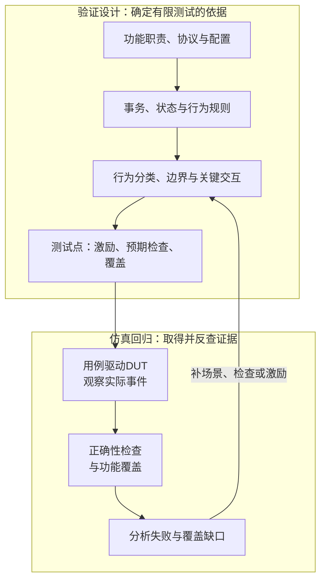

有限测试的代表性来自对行为的分类与有依据的取舍：

- **以事务和规则组织信号：** 将ready/valid、地址、标识和响应等信号还原为接受、等待、完成与取消等事件，明确每类事件的前提、状态变化和预期结果。输入的可驱动性不意味着任意组合都属于验收范围；协议允许的异常输入与故障注入另有明确预期。
- **按行为差异划分类别：** 只对会改变处理规则、结果或风险的条件继续拆分；对共享规则的值选取代表，并保留边界。例如，地址不同不必逐个遍历，但地址对齐、跨行跨页、翻译、权限或缓存映射关系改变时，不能直接归为同类。分类依据需要评审，并通过覆盖和发现的问题反查。
- **关注状态迁移和关键交互：** 基本行为之外，覆盖资源边界、连续占用与复用、异常，以及事件在不同处理阶段到达的影响。组合爆炸时保留有因果依赖或已知风险的交互，其余合法空间选择相应组合强度；两两覆盖不替代必须验证的高阶交互。

叶子测试点定义具体的验证义务：**在什么条件下，针对哪个事务或状态，检查什么预期，以什么事件确认已经覆盖。** 测试点组织需要验证的行为，用例负责实现激励；两者不是一一对应，一次运行可以验证多个点，一个点也可能需要多种数据、时序或历史才能充分检查。

### 1.3 用例如何激励并检查前端

BT以完整Frontend为DUT，外部存储、PTW响应和后端反馈由环境提供。激励通过三类入口协同构造目标行为：

- **程序与数据：** 组织指令序列、地址布局与控制流，提供取指字节；既形成基本路径，也形成跨边界和持续运行的历史。
- **接口响应与时序：** 控制合法的存储、翻译、权限及错误响应，安排延迟和反压，使事务经历目标占用、等待和完成过程。
- **反馈与控制：** 关联真实事务提供后端反馈，在目标处理阶段安排控制事件，验证状态更新、打断与恢复。内部预测、缓存命中和资源状态由DUT运行形成，以实际观察确认，不以配置代替发生证据。

每个场景按1.1的三个维度配置相应检查：

- **交付结果：** 在有效交付或消费事件上核对指令、PC、顺序及附带信息。程序参考提供语义预期，翻译、权限和异常规则确定相关结果，事务记录用于核对动态关联；推测执行和恢复阶段按各自规则处理，不能把所有输出直接套用同一条正确路径参考。
- **事务与状态：** 按协议及状态更新规则跟踪请求响应、消费、分配、释放与复用，通过checker、断言或局部模型检查身份、次数、保持条件和状态变化，发现尚未显现为交付错误的过程违规。
- **控制与恢复：** 根据事件来源与作用范围独立确定取消和恢复预期，检查旧事务收尾、失效结果隔离及新路径推进。既核对恢复目标本身，也检查实际恢复结果，避免只与DUT自己产生的目标相互印证。

输入可控、输出可见不等于内部错误一定暴露。用例需通过后续操作使潜在错误产生可检查的后果，或增加必要内部观察与局部检查；仅增加相似输出样本不能替代检查能力。具体参考预期来自架构规范、接口协议、确认规则及经确认的模型，不能仅复制DUT当前行为。

本节定义需要具备的能力，不表示现有checker已全部实现。完整PTW页表遍历、后端执行、trap处理和最终CSR更新由相应层级验证，本层级检查前端对外部输入的处理与边界交互。

### 1.4 覆盖驱动回归与功能交付依据

回归将有限资源用于尚未验证的行为和高风险交互：定向用例确保基本行为、边界和指定事件次序可达，受约束随机用例扩展数据、时序与历史组合，持续运行场景检查资源复用和状态积累。分层运行基本检查、专项场景与组合回归，优先处理关键功能和高风险缺口；具体预算和验收阈值在执行计划中确定。

回归结果同时回答三个问题：

1. **模型是否覆盖了该验的内容：** 功能职责、接口规则、状态迁移与异常恢复均能追溯到测试点，必要交互有明确归属；通过评审、代码覆盖、历史缺陷及设计变更反查遗漏，更新场景与检查。
2. **这些内容是否实际发生：** 功能覆盖记录实际行为类别、资源与边界状态、事件迁移及必要交叉组合，并带有有效采样条件。覆盖缺口需要区分激励未到达、定义或采样问题、配置不适用和确实不可达，不能只增加随机种子或直接删除覆盖项。
3. **发生后是否确实检查正确：** 叶子测试点的相应检查在该运行中启用、观察到目标并通过。检查失败进入定位、修复和复测，新增可重现用例保留在回归中；覆盖命中但缺checker仍是验收缺口，具体闭环口径见5.3。

功能交付以明确设计版本、配置和环境假设为前提：适用测试点按约定完成覆盖与正确性验收，回归及缺陷复测通过，未覆盖项、规则疑问与检查缺口均有分析和经评审的处置，并保留可重现证据。该过程支持范围明确的功能验收，不将用例数、仿真时长或单一覆盖百分比等同于绝对无缺陷。

第一章确立“行为建模→测试点→激励与检查→回归反查→交付验收”的总体方法；第二章开始说明前端的行为模型和14个一级主题怎样具体形成。

## 二、从全局生命周期推导14个一级主题

本章沿全局行为识别处理责任，再以会改变行为的条件展开场景，并说明它们怎样组织为14个一级主题。以下条件用于展开验证空间；第一章的三个检查维度用于判断这些场景中的行为是否正确。

| 空间维度 | 典型分类 | 为什么需要拆分 |
|---|---|---|
| 处理路径与宽度 | cacheable/MMIO/NC，单取/双取 | 数据来源、访问约束或协同宽度不同 |
| 事务所处阶段 | 待接受、在途、待消费、完成与释放 | 同一事件在不同阶段到达，保持、取消或收尾责任不同 |
| 指令、地址与配置 | 指令长度、地址边界、翻译模式、权限与上下文 | 指令形成、访问许可或异常判定规则不同 |
| 已有资源与状态 | 队列空满、已有匹配项、缓存命中/缺失、已保存半条指令 | 相同输入在不同状态下，可能需要等待、合并、分配或补取 |
| 事件及相对时序 | 反压、错误响应、重定向、刷新、复位、WFI及其发生时机 | 推进条件、有效范围或恢复行为不同 |

条件组合受配置、协议和已有状态约束，不直接做全量组合。先保留基本行为、边界和必要交互，再对其余合法组合选择覆盖强度（见5.4）。

### 2.1 全局行为图：一级场景的定位根图

**图1：Frontend BT验证根图——主流程、反馈与全局控制分区阅读**

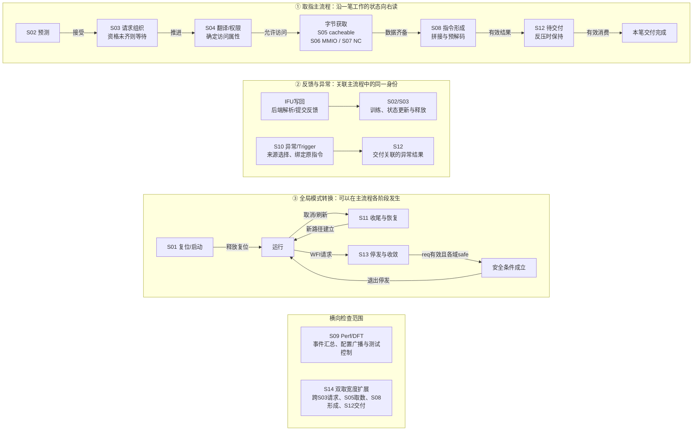

**读图顺序：** 先沿①看取指工作的状态推进，再看②的反馈与异常责任，最后看③的全局模式转换。分区之间通过同一事务身份和作用范围关联，不逐条连跨区长线；横向框标出S09、S14的适用范围。

图是验证行为抽象，多笔取指、翻译和缓存访问可并行。反馈不阻止新预测；补块、跨页重译及各阶段等待在对应场景图展开。运行中复位按S01重建状态；恢复/停发期间已接受事务按协议收尾，旧事务与新路径可重叠；safe不等于所有内部状态全空。

**从根图读出测试点：** 节点确定观察阶段，箭头标出推进或模式转换条件；等待、拒绝及中途打断继续引出分类与恢复检查。以下给出代表映射，完整范围由2.2及第四章展开。

| 根图入口 | 继续拆哪些条件与风险 | 现有点入口 |
|---|---|---|
| 请求组织→字节获取入口 | request/meta齐备或错拍；不单独消费、不串身份 | S05，L774/L775 |
| 字节获取：等待→完成 | 匹配项与资源有无；不重复分配，完成后可复用 | S05，L881/L884/L897/L991 |
| 字节获取与指令形成间的补半 | 长度、beat/page边界；内部补取与跨页交接责任不同 | S06/S08，L1114–L1118、L1127/L1128 |
| 运行→恢复，旧事务继续收尾 | 事件在接受前/后到达；隔离旧结果并恢复新路径 | S06/S11/S12，L1110/L1111 |
| 待交付：反压保持→有效消费 | 保持、解除反压、消费宽度；防止丢失或重复 | S12/S14，L1535/L1536、L1654 |

贯穿这些入口的不变量是：**有效工作不丢失、不重复、不串项；失效工作按协议收尾，结果不冒充新路径；满足外部响应和接收前提时能够继续前进。**

### 2.2 14个一级主题的来源与定位

先沿正常取指建立基本责任，再逐项分析哪些条件会改变处理路径、状态或检查标准，形成以下场景组：

| 分析步骤 | 为什么需要继续拆分 | 形成的一级主题 |
|---|---|---|
| 沿正常流识别责任交接 | 选址、组织请求、确定访问资格、形成指令、交付各有独立错误 | S02预测、S03 FTQ、S04翻译权限、S08指令形成、S12交付 |
| 展开取数字节的属性分路 | cacheable、MMIO、NC的数据来源、缓存与顺序约束不同 | S05、S06、S07 |
| 加入建立、打断与停发 | 冷启动正确不能保证运行中复位、取消和安全收敛正确 | S01复位启动、S11恢复、S13 WFI |
| 沿错误传播反查主流程 | 局部发现错误后，仍需选择、绑定原指令并交付 | S10异常与Trigger |
| 将单块扩展为双块 | 资格、实际服务、指针推进和结果合并增加跨部件责任 | S14双取指 |
| 核对主流程之外的接口 | 指令流正确无法证明事件汇总和测试控制连接正确 | S09 Perf+DFT |

这个过程将正常路径扩展为带状态、控制和交互的验证范围。一级主题用于组织责任，不要求与RTL模块一一对应；例如ICache相关行为分布在取数、恢复、WFI和双取等主题中。

下表S01—S14仅用于本文导航，不替代主表层级、TP_ID或Bin_ID；顺序沿用当前主表。

| 编号与一级主题 | 从整体职责推出的问题 | 根图定位与关系 | 展开入口 |
|---|---|---|---|
| S01 复位与启动 | 状态从哪里建立，旧工作怎样隔离？ | ③复位启动→运行；运行中复位按S01展开 | [4.1](#s01) |
| S02 分支预测 | 下一段取什么，反馈怎样训练和恢复？ | ①预测建立；②按身份关联训练反馈 | [4.2](#s02) |
| S03 FTQ管理 | 预测、取指、反馈和释放怎样对应同一项？ | 请求登记/推进；反馈关联和释放责任 | [4.3](#s03) |
| S04 地址翻译与权限检查 | 地址、执行许可和属性怎样确定？ | ①翻译权限→字节获取；拒绝结果关联②异常 | [4.4](#s04) |
| S05 cacheable取指 | 命中/缺失怎样得到正确字节并形成指令？ | 字节获取的cacheable分支及等待/完成 | [4.5](#s05) |
| S06 MMIO取指 | 非幂等或强顺序要求怎样约束访问？ | 字节获取的MMIO分支及发起/补取约束 | [4.6](#s06) |
| S07 NC取指 | 非缓存属性怎样选择路径并保持身份和顺序？ | 字节获取的NC分支及属性切换 | [4.7](#s07) |
| S08 指令边界与预解码检查 | 字节怎样成为正确指令和可识别的预测修正？ | ①指令形成；补半、检查与裁剪在4.8展开 | [4.8](#s08) |
| S09 Perf+DFT | 事件是否正确汇总，测试控制是否正确到达？ | 横向检查框：事件观测与测试控制 | [4.9](#s09) |
| S10 异常与Trigger | 错误怎样选择、绑定到指令并传播？ | ②异常选择、原指令绑定→异常结果交付 | [4.10](#s10) |
| S11 redirect/flush恢复 | 谁取消什么工作，怎样收尾和恢复？ | 运行→恢复→重建，及旧事务收尾 | [4.11](#s11) |
| S12 取指结果交付 | 缓冲和消费是否保持顺序、身份与次数？ | ①待交付→有效消费；②关联异常结果交付 | [4.12](#s12) |
| S13 WFI | 停什么、等什么、何时安全、怎样恢复？ | 运行→停发收敛→安全→退出停发 | [4.13](#s13) |
| S14 2-fetch双取指 | 宽度从1变2时，哪些资格和交接关系改变？ | 横向检查框：S03至S12的双块宽度协同 | [4.14](#s14) |

14个主题是上述责任在当前主表中的组织结果。反查完整性时，需要核对每项外部承诺、合法行为分支和交接风险是否有归属；目录数量本身不能证明无遗漏。

### 2.3 一级主题之间：递进、分路、交叉与包含

**图2：一级主题的组织关系——用于分类与去重**

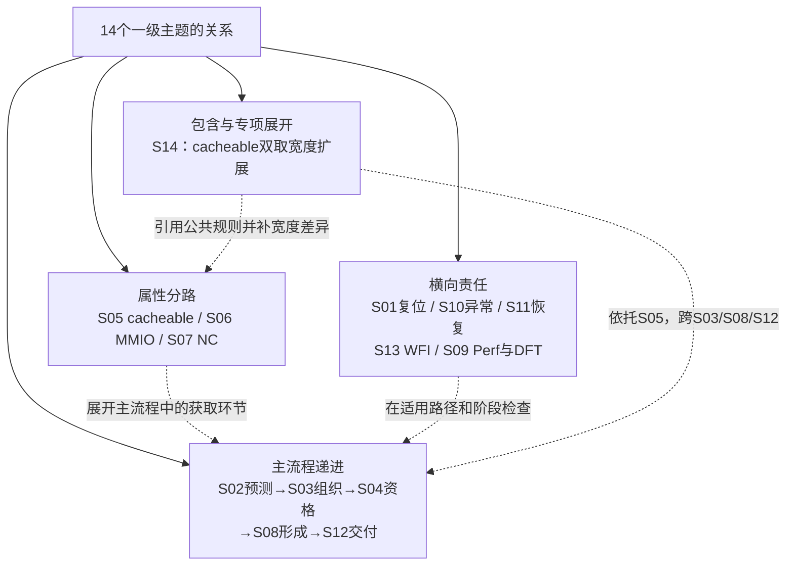

根图回答“行为在哪里发生”，本图回答“目录怎样组织这些行为”。分类关系不表示逐拍执行顺序；公共机制在一处定义，各路径保留适用场景证据。

| 关系 | 实际含义 | 组织规则 |
|---|---|---|
| 递进 | 预测、请求、获取、指令形成和交付逐步完成整体目标 | 在交接处关联同一身份及有效事件 |
| 属性分路 | 一笔实际访问按有效属性选择cacheable/MMIO/NC路径 | 在当前属性规则下分类；属性组合和跨页切换另行分析 |
| 包含与专项展开 | 2-fetch是cacheable的宽度扩展；单个主题仍跨多个部件 | 共同规则引用，宽度变化新增的义务单独定义 |
| 横向交叉 | 异常、恢复、WFI作用于多个路径和阶段 | 公共主题定义来源/范围，各路径定义具体后果 |
| 公共机制复用 | 指令形成、非缓存协议在多个主题中出现 | 一处维护公共规则，各路径提供适用场景证据 |

因此，14个主题**不构成一组完全独立、互斥的正交因素**。同一“MMIO补取期间遇redirect”场景中，S06检查已接受事务的协议收尾，S11检查取消范围与新路径恢复，S12检查有效消费时不混入旧指令；各项义务明确主归属，可共享同次运行证据。去重比较的是验证义务，不能仅凭场景名称相同就合并。

## 三、从机制认识到测试点：方法与公共筛选

### 3.1 拆解顺序与各步产物

**图3：场景设计的推导链**

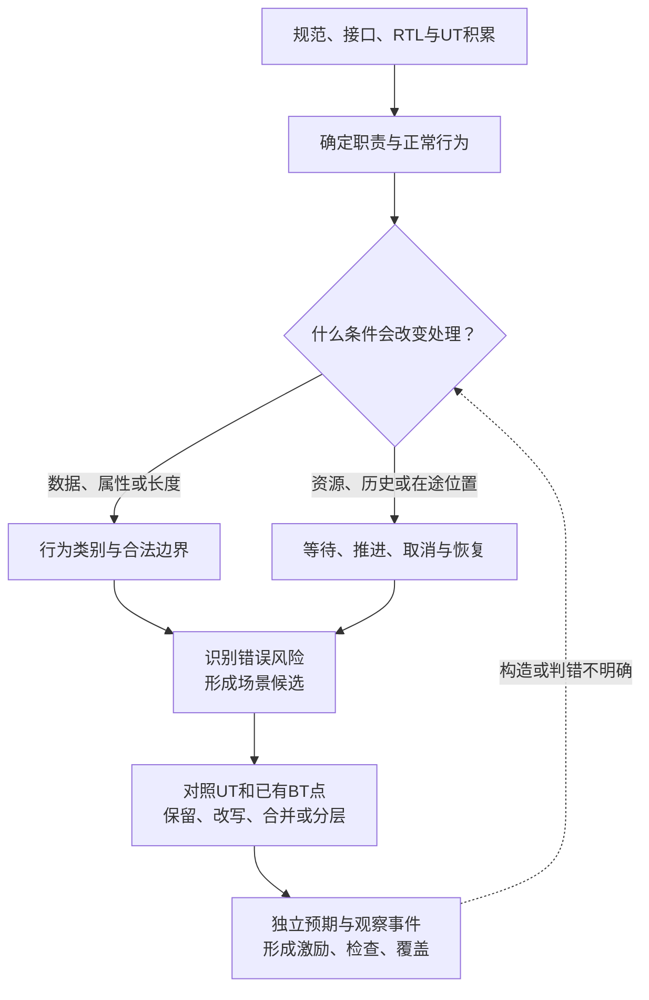

| 分析步骤 | 形成的产物 |
|---|---|
| 明确职责及外部承诺 | 根图、主题范围、环境边界 |
| 识别改变处理的条件 | 行为类别、容量/地址边界、判定表与阶段划分 |
| 沿交接追踪错误风险 | 同一身份的接受、保持、响应、消费、取消和释放义务 |
| 对照UT及已有候选 | 合法约束、必测交互、公共检查及层级分工 |
| 写成可实施叶子 | 明确前提、独立预期、观察事件与功能覆盖 |

### 3.2 哪类风险采用哪种手段

| 机制与风险 | 主方法 | 为什么适用 | 本项目落点 |
|---|---|---|---|
| 输入变化但处理规则相同 | 等价类划分 | 避免为普通数值逐项复制 | MSHR分配/合并/反压，RVC/RVI |
| 容量、长度、地址、环形年龄切换 | 边界值分析 | 关注规则改变的位置及合法邻近值 | 队列空满/回绕，beat/page尾 |
| 多个条件共同决定动作 | 因果分析、判定表 | 区分允许条件和各拒绝原因 | 双取资格、补取抑制、权限/优先级 |
| 历史或在途阶段影响结果 | 状态迁移、时序分析 | 同一事件在不同阶段责任不同 | MMIO等待、redirect、WFI待收 |
| 一项功能经过多个部件 | 场景与生命周期分析 | 局部正确仍可能在交接处出错 | refill后再hit、跨页补半、双块交付 |
| 多因素组合迅速增长 | 受约束组合分析，必要时t-way/正交设计 | 明确交互目标后缩减普通组合 | 布局、命中、完成顺序与反压 |
| 经验指向串项、泄漏、优先级遗漏 | 错误推测 | 提出针对性的错误模型 | 旧PTW响应、旧half、误取消 |
| 错误传播和恢复 | 故障注入，结合阶段分析 | 主动构造错误发生的位置与时间 | TL错误、ECC、第一/第二响应错误 |

这些方法组合使用。错误推测提出风险，状态分析形成时序，边界与判定表补齐分类，checkpoint定义可区分结果。具体方法随机制选择，不要求每个主题机械套用全部术语。

### 3.3 UT转BT的公共筛选机制

**图4：所有模块共用的候选筛选流程**

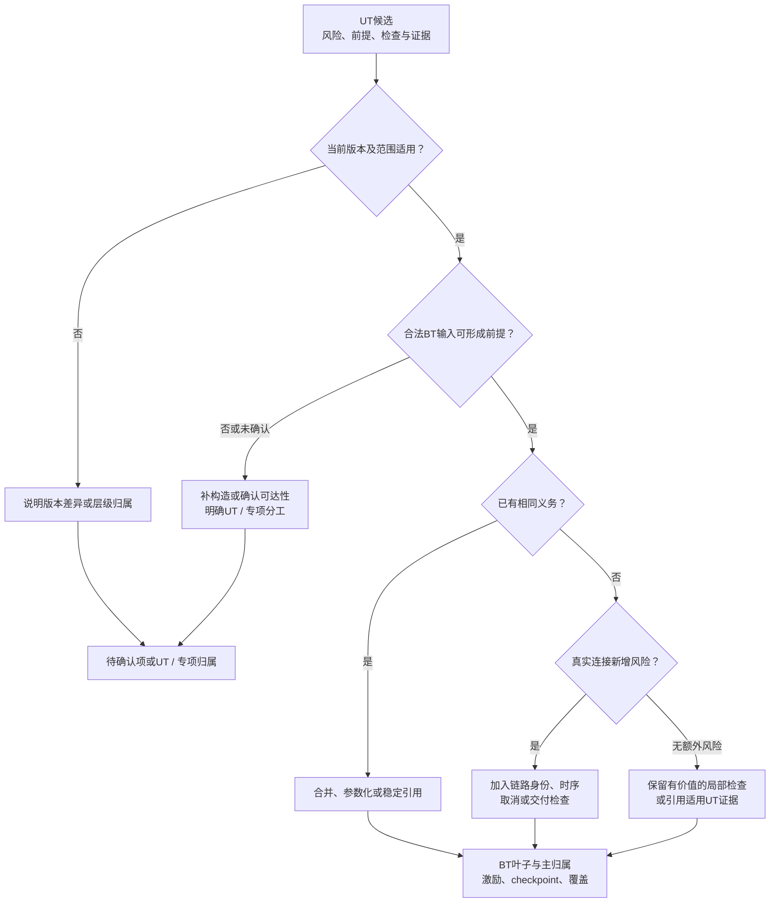

筛选单位是验证义务。比较两个候选时使用：**前提、目标事务、预期行为、观察边界**。四项相同则共享；改变规则或责任则区分。由UT承担的部分关联适用版本、配置和检查证据，同时保留BT真实连接义务。

**转换实例：请求与WayLookup meta错拍会合（L775 / BIN-674）**

以下以现有BT点说明局部义务的转换方式，不作为已核对的UT迁移记录。

| 分析环节 | 从局部候选到BT设计的变化 |
|---|---|
| 局部候选及原假设 | driver直接控制两侧valid和payload，预先保证request/meta属于同一请求；检查只在两侧齐备时原子接受 |
| BT中谁形成前提 | FTQ和WayLookup成为真实生产者。程序布局、响应延迟和流控是候选构造手段，具体能形成哪种错拍需按版本确认 |
| 目标怎样确认 | monitor记录两侧valid/fire、先到payload和FTQ/地址身份；分别确认request先到与meta先到，不能仅以设置了延迟代替实际发生 |
| 新增风险及checkpoint | 先到侧等待时保持；缺另一侧时不单独消费；会合只读一次DataArray，锁存request/meta属于同一工作 |
| 粒度与去重 | 主义务归S05；两种到达顺序作为同叶子的覆盖类别。S03检查FTQ进度，S14检查双取时的消费宽度，各自引用交接证据 |
| 可实施性边界 | 两种顺序分别验证合法可达性；尚不能构造的一类保留待确认，不以强制内部valid代替合法链路场景。已有BIN绑定还需核对实际采样能否区分两类 |

UT中的局部保持与握手规则继续使用；BT补上真实前提的形成、身份配对和上下游进度检查。原用例与checker能否直接复用，取决于接口、版本和观察边界。

### 3.4 与UCagent/BT工作流的交接约定

以下定义公共分析接口，可供人工分析或UCagent等工具使用；不代表当前已完成自动接入。不同模块使用同一筛选尺度，不因生成工具不同改变验证标准。

| 交接环节 | 输入与输出 | 必须保留的信息 |
|---|---|---|
| 输入候选 | UT点、规则资料、RTL基线、已有BT表与环境能力 | 来源、旧前提、原checker范围、适用配置 |
| 分析与筛选 | 对应一级主题，确定保留/改写/合并/分层/待确认 | 分类依据、与兄弟点差异、合法构造和新增义务 |
| 人工核对 | 确认歧义规则、优先级、可达性和层级分工 | 已确认依据与未决问题分别标识 |
| 交付BT实现 | 更新既有主表及覆盖关联，形成测试实现输入 | 完整层级/稳定ID、Condition、Checkpoint、Object、覆盖及检查方式 |

工具产物先接受同一套语义、可达性和查重检查，再进入既有主表；规则待确认项不自动变成已经验收的预期。

### 3.5 实践—理论—实践的对应

| 已核对的公开实践 | 可提炼的方法 | 回到Frontend BT |
|---|---|---|
| OpenHW验证计划模板区分Requirement Location、Feature/Sub-feature、Verification Goals | 需求追踪与职责逐级分解 | 整体目标→14主题→机制/风险→具体义务，保留来源与版本 |
| OpenHW分别定义Pass/Fail Criteria、Test Type与Coverage Method | 目标、判错、激励和覆盖分别设计 | 一条叶子对应合法构造、独立checkpoint及真实采样 |
| OpenHW允许参考模型、断言和环境公共能力等不同检查方式 | 按可观察行为和证明范围选手段 | 程序trace查语义，事务checker查身份，局部性质查保持与恢复 |
| OpenTitan SPI Host的`stall`区分RX空间不足与TX数据不足，分别检查阻塞及恢复 | 按因果区分阻塞来源，再做状态序列检查 | 区分缓存资源阻塞、meta未就绪和下游反压，分别确认目标原因及解除恢复 |
| OpenTitan的`sw_reset`在FIFO已有数据后复位；`data_fifo_status`预测占用并比较full/empty | 运行中状态分析、容量边界与独立队列模型 | FTQ/IBuffer通过真实流建立占用，再查复位、空满和回绕 |
| OpenTitan的`control_cg`区分最小、最大和其余值；`config_opts_cg`覆盖CPOL×CPHA四组合 | 等价类、边界与完整小组合 | 同规则偏移可同叶子多bin；HH/HM/MH/MM保留完整2×2 |
| OpenTitan导入公共CSR/中断/复位等testplan，并以`tests`关联多个testpoint | 公共机制引用与测试点/用例多对多 | MMIO/NC共享协议定义，每个属性路径仍提供合法场景证据 |

本地实践也可反向检验方法：MSHR分配/合并/反压验证行为分类，补取判定验证边界与因果，2-fetch验证跨模块组合。外部模板提供组织经验，具体微架构预期仍以本项目规则为准。

## 四、14类验证场景的展开

本章按“来源与拆分→场景图→分支/方法、风险/检查、主表入口→责任边界”展开。流程图追踪交接，分支图区分条件，反馈图追踪历史；表格将图中的分析继续落到具体义务。标为“主表某分支”的是分类入口，列出L行号的是代表记录，均不表示该组已全部实施或验收。

### 4.1 S01 复位与启动

**来源与拆分：** 前端需要从确定的状态和入口建立新流。先按复位前是否已有工作区分冷启动/运行中复位，再按在途位置细分，检查旧状态隔离及新流建立。

**图5：由初始状态扩展到运行中复位**

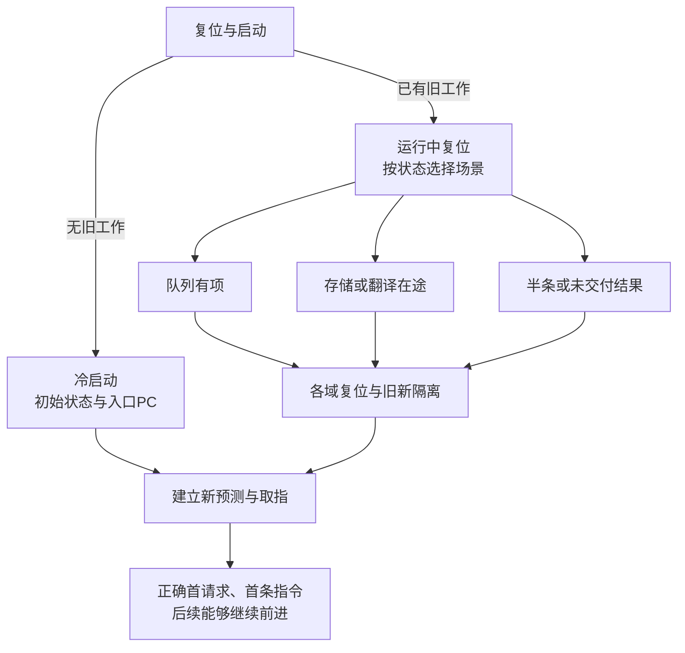

| 改变行为的条件／分解方法 | 风险与验证义务 | 主表入口 |
|---|---|---|
| 无旧状态／已有工作：状态分类 | 冷启动建立初值；运行中复位隔离旧工作 | L14–L17、L29/L32 |
| 复位与控制事件并发：时序与优先级 | 防止redirect/fence改变复位入口或残留状态 | L8、L30 |
| 地址高位与合法对齐：边界分析 | 首请求及首指令采用完整启动地址 | L6/L7、L36/L37 |

**UT到BT与检查边界：** 各模块UT提供局部复位依据；BT关联顶层启动地址、预测、请求与有效指令流。复位后的外部事务按复位域和协议约定处理，不由“reset”推断所有外部工作立即消失。普通路径取消与恢复属于S11。

### 4.2 S02 分支预测

**来源与拆分：** 前向预测和后向状态维护承担不同责任，因此先分预测、训练、恢复与使能，再按首次分配/已有项更新、候选并发和容量边界展开，防止纠错掩盖局部错误。

**图6：预测、训练与恢复形成反馈环**

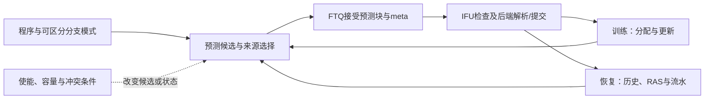

| 改变行为的条件／分解方法 | 风险与验证义务 | 主表入口 |
|---|---|---|
| 预测／训练／恢复／使能：职责分类 | 分别定义通过标准，防止最终纠错掩盖局部状态错误 | 各预测器、历史与RAS分支 |
| 无项／已有项：状态历史 | 分别检查首次建立和后续更新，防止只会分配不会更新 | L121/L122 |
| 多候选同时成立：判定与优先级 | 候选目标可区分，确认真正采用的来源 | L100 |
| 深度、冲突与取消：边界／错误推测 | 历史、RAS保持及恢复后不使用失效状态 | L217、L221及各历史恢复分支 |

**UT到BT与检查边界：** 局部表项与算法枚举按UT/专项分工；BT检查真实FTQ及后端反馈指向正确对象、训练次数与恢复一致性。程序参考提供真实分支语义，确认规则或局部模型提供状态预期；预测质量另有基准与统计口径。参见[BPU专项方案](../../bpu/v0.1/BPU_验证策略与参考模型建设方案_v0.1.md)。

### 4.3 S03 FTQ管理

**来源与拆分：** 同一预测块具有写入、预取、实际取指、写回和提交等不同进度。沿创建到释放逐段检查身份，再叠加空满、回绕和取消，暴露过早推进或误释放。

**图7：一个FTQ项的多阶段进度**

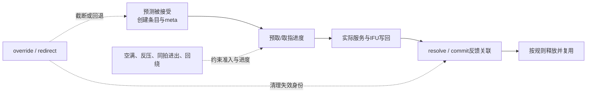

图按条目生命周期组织，不规定全部预测器训练必须等到最终commit。

| 改变行为的条件／分解方法 | 风险与验证义务 | 主表入口 |
|---|---|---|
| 创建、服务、写回与反馈：生命周期 | 各阶段引用同一项，只按对应事件推进 | L263、L292起 |
| 空、近满、满、回绕：容量边界 | 防止覆盖未释放项；释放后恢复准入 | L304、L308、L321 |
| 进出、反馈与取消并发：状态交互 | 防止过早释放、误退指针或保留失效身份 | L311/L312、L327/L328 |

**UT到BT与检查边界：** UT可直接预置队列；BT以真实预测接受、取指服务和后端反馈建立状态，monitor确认目标占用。公共redirect来源和仲裁归S11，本节检查事件作用到具体条目后的进度与内容。双取造成的消费宽度差异归S14。

### 4.4 S04 地址翻译与权限检查

**来源与拆分：** 访问须同时确定地址、执行许可和属性。先按翻译模式及hit/miss分类，再加入权限拒绝、上下文变化与选择性失效，分别检查错地址、错路径和旧结果误用。

**图8：从翻译模式到实际取指路径**

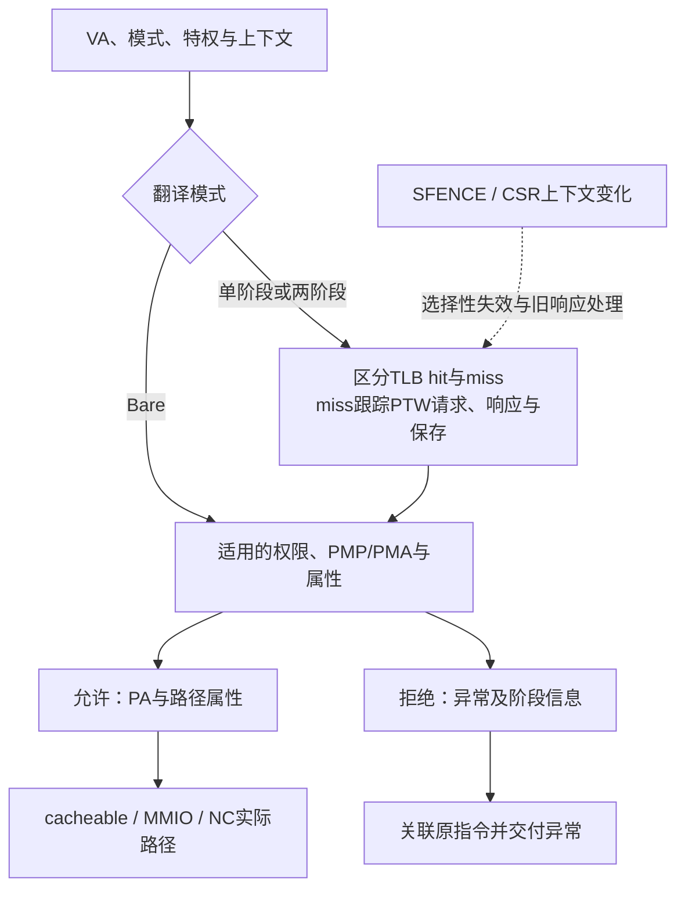

| 改变行为的条件／分解方法 | 风险与验证义务 | 主表入口 |
|---|---|---|
| Bare／单阶段／两阶段：模式分类 | 区分地址含义、访问资格及异常阶段 | 主表翻译模式分支 |
| hit／miss及保存后再访问：状态序列 | 请求与响应匹配，refill后真正复用翻译结果 | L411–L419 |
| 权限、页/区域边界：因果与边界 | 地址正确仍要拒绝非法执行并标明错误阶段 | 主表权限、PMP/PMA分支 |
| 上下文或失效范围变化：正反例 | 旧响应不冒充新上下文；目标失效、非目标保留 | L408、L461/L462 |
| 失效后属性改变：链路场景 | 新地址、属性与实际取指路径一致 | L475–L480 |

**UT到BT与检查边界：** PTW响应由外部模型提供，ITLB状态与命中由DUT形成。BT确认请求上下文、结果使用、权限和实际路径；S10继续检查异常最终归属。参考侧也保存上下文，避免仅凭VPN关联。

### 4.5 S05 cacheable取指

**来源与拆分：** 先按数据是否可用区分hit/miss；miss再按现存项匹配和资源余量区分合并、分配、反压。随后沿refill、写入、再次命中和交付追踪，检查重复请求、丢失与串项。

**图9：正常获取逐步扩展为资源与生命周期场景**

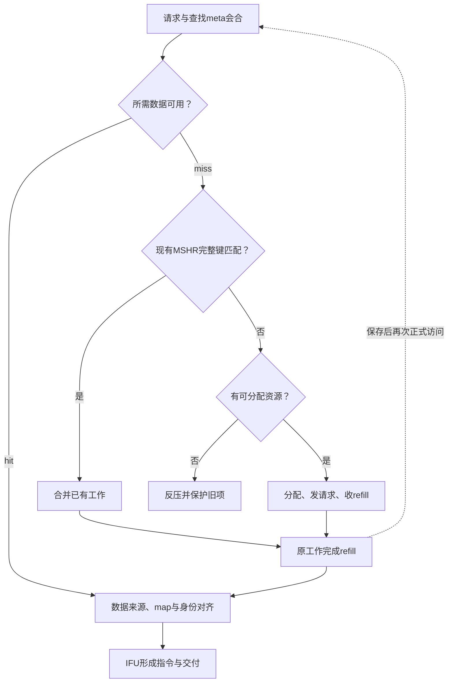

| 改变行为的条件／分解方法 | 风险与验证义务 | 主表入口 |
|---|---|---|
| request/meta齐备或错拍：时序分析 | 原子会合、保持和身份配对正确 | L774/L775 |
| 现存匹配项、资源有无：行为判定 | 分配、合并、反压互不混淆 | L881/L897/L884 |
| 同拍fetch/prefetch及部分键相同：交互与反例 | 同键去重，部分字段相同不能误合并 | L887、L888/L889/L899 |
| line/bank及跨行：地址边界 | 来源、偏移和拼接身份正确 | 主表MainPipe与数据路径分支 |
| refill后再访问：状态序列 | 真正写入并从SRAM命中，不能由原在途项代替 | L991 |
| redirect／fence.i：事件分类 | 各自的取消、保留与失效范围正确 | 主表cacheable取消/失效分支 |

**从判定条件到具体点：** 以下针对合法fetch miss且无取消干扰；“资源”指新分配所需的fetch MSHR。

| 完整地址键匹配有效在途项？ | 新分配资源 | 预期与要防止的错误 | 主表入口 |
|---|---|---|---|
| 是 | 有或无 | 合并原工作，不新增MSHR或Get；防止重复分配 | L897 / BIN-699 |
| 否 | 有 | 分配并保存正确身份；防止漏接或写错项 | L881 / BIN-686 |
| 否 | 无 | 反压且保护旧项；防止覆盖未完成工作 | L884 / BIN-688 |

三类由处理规则区分，资源满并不自动意味着拒绝重复请求。同拍fetch/prefetch去重另列L887 / BIN-690，因为两者到达前均无现存匹配项。refill后再次访问另列L991 / BIN-768，因为只查首次返回无法证明缓存写入成功。

**UT到BT与检查边界：** 保留有价值的局部去重、写回和身份检查；实际预测/请求、缓存状态和外部响应形成激励。普通指令算法归S08，双块新增风险归S14；共同端到端证据可共享。

### 4.6 S06 MMIO取指

**来源与拆分：** 顺序约束决定何时允许发请求；指令长度、beat/page位置和响应错误决定后续动作。按这些条件展开等待、完整返回、内部补取及跨页交接，再叠加阶段内取消。

**图10：MMIO路径的状态与责任切换**

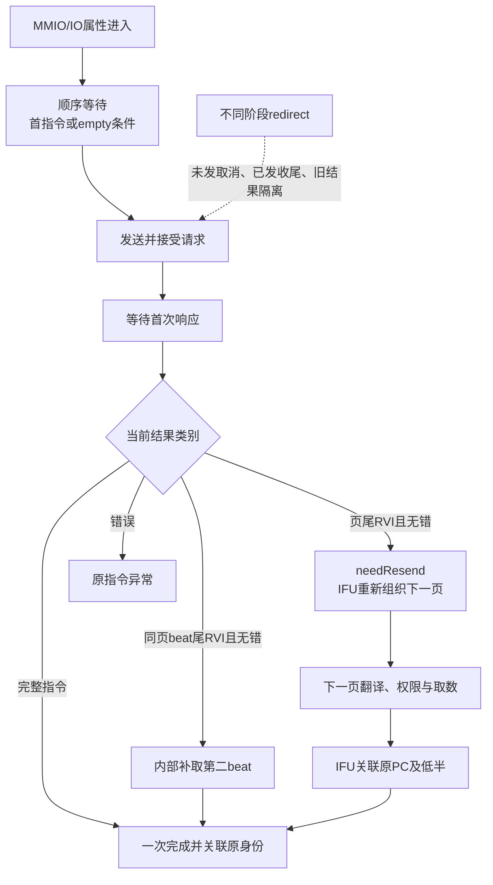

同页跨beat与跨页改变的是补取责任：前者在InstrUncache内部完成，后者交回IFU处理下一页。各成功分支遇错误或取消时转入相应处理。

| 改变行为的条件／分解方法 | 风险与验证义务 | 主表入口 |
|---|---|---|
| 顺序条件未满足／满足：状态迁移 | 不提前发，解除后能发且不重复 | L996/L997 |
| RVI/RVC及beat内偏移：边界分类 | 区分完整返回与内部补取 | L1114–L1116 |
| 首响应clean／错误：因果与故障注入 | 错误抑制补取，负例排除其他拒绝原因 | L1117/L1118 |
| 同页／跨页：责任边界 | 下一页重新翻译，保存原PC及低半 | L1127/L1128 |
| 接受前／在途遇redirect：时序分析 | 按阶段取消或收尾，旧结果不有效交付 | L1055、L1110/L1111 |

**UT到BT与检查边界：** 总线/补取UT提供公共协议，BT增加实际顺序条件、路径属性、half状态和交付身份。第一或第二页错误分别定义，不能由“没有第二请求”独自证明错误抑制；其余触发前提必须实际成立。异常归属接S10，恢复接S11。

### 4.7 S07 NC取指

**来源与拆分：** NC与MMIO共享取数协议，但属性和顺序门控存在差异。公共请求/响应检查复用，NC单独展开属性选择及路径切换，防止复制整套协议而漏掉差异。

**图11：NC采用差异分析，并复用公共协议**

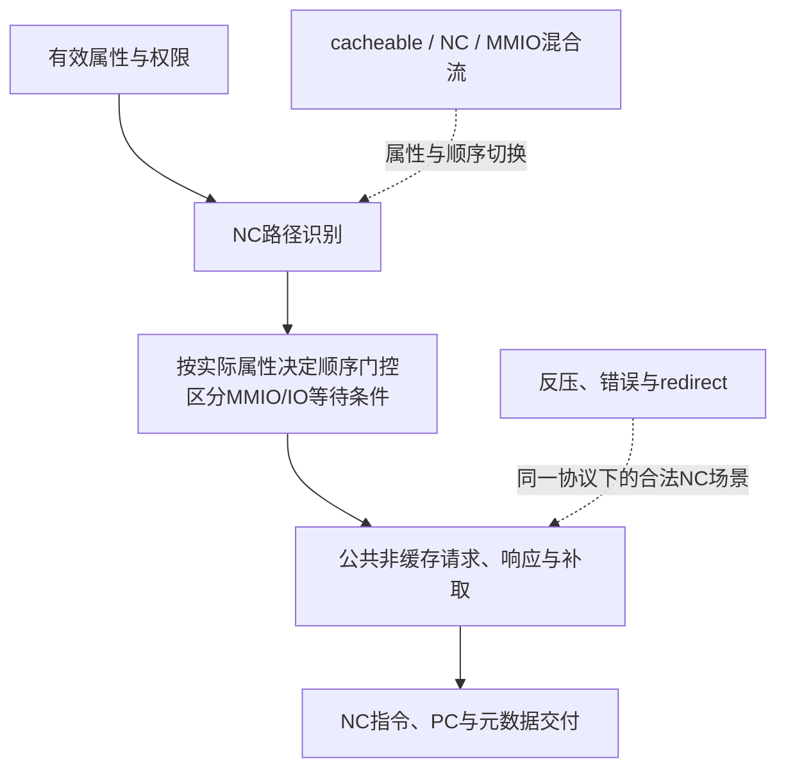

| 改变行为的条件／分解方法 | 风险与验证义务 | 主表入口 |
|---|---|---|
| PBMT.NC、PMA及MMIO属性：差异分析 | 有效属性决定路径和顺序，避免沿用错误门控 | 主表NC属性分支 |
| 共享请求/响应/补半：公共机制引用 | 复用规则，仍需证明NC合法路径实际进入 | L1209引用canonical BIN-1032 |
| cacheable、NC、MMIO切换：状态场景 | 新事务不携带旧路径属性、身份或顺序状态 | L1250 |
| 阻塞、错误或取消：时序交互 | 关联合法NC事务，解除后不丢不重 | 主表NC反压与取消分支 |

**UT到BT与检查边界：** NC区证明该属性路径是公共协议的合法场景，并检查自身差异；不复制整份MMIO状态机。`PBMT.NC`单独无需MMIO式等待的机制，不覆盖掉其他有效属性仍要求顺序化的情况。永久下游停收时的无条件持续前进不作为有限缓存系统的预期。

### 4.8 S08 指令边界与预解码检查

**来源与拆分：** 字节到指令经历起点识别、拼接和槽位变换。按长度、块/页边界和有效范围分类，再展开错配类型及最早错误选择，检查伪指令、错误PC和元数据错位。

**图12：从字节坐标变换到有效指令及预测检查**

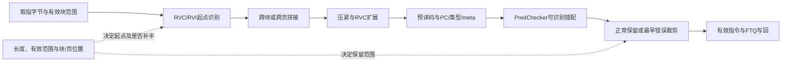

| 改变行为的条件／分解方法 | 风险与验证义务 | 主表入口 |
|---|---|---|
| RVC／RVI低高半：长度分类 | 无效halfword不生成伪指令 | L1256、L1301 |
| 块/页边界及压紧：坐标分析 | 拼接和槽位变化后PC仍为真实起点 | L1278、L1297 |
| 预测范围内／外：正反例 | 合法编码处于有效范围外也不得交付 | L1274 |
| 错配类型及并发位置：判定与优先级 | 选择可识别的最早错误，保留合法前缀 | L1311、L1334 |

**UT到BT与检查边界：** 局部算法组合可参数化，BT检查实际返回数据和预测范围下的PC、身份、异常与槽位共同变换。前端不能凭预译码得到全部条件分支方向或间接跳转目标；需要后端执行信息的义务保留相应层级。路径接入归S05—S07，公共算法归本节。

### 4.9 S09 Perf+DFT

**来源与拆分：** 按接口方向分为性能观测与测试控制：前者追踪事件来源、汇总和计数，后者追踪配置、广播及模式切换。正常指令流无法替代这两类接口的独立检查。

**图13：观测链与控制链分别展开**

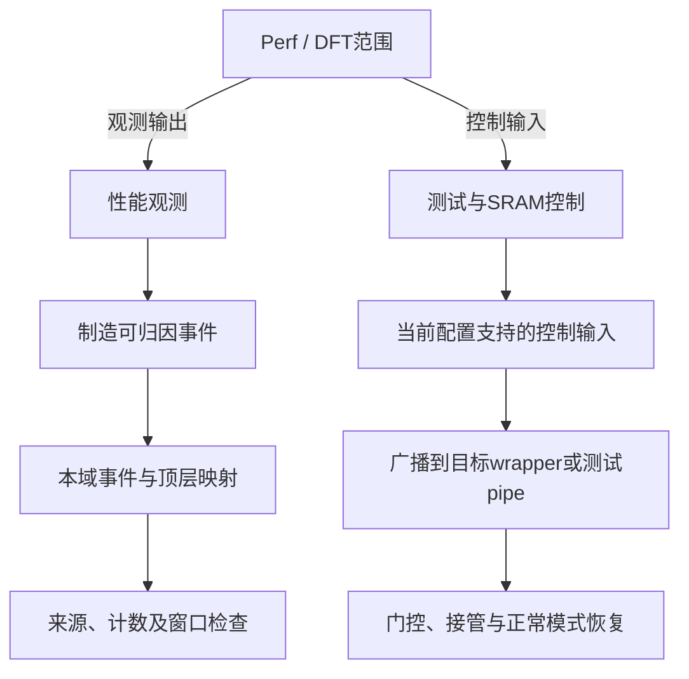

| 改变行为的条件／分解方法 | 风险与验证义务 | 主表入口 |
|---|---|---|
| 不同事件来源：接口追踪 | 独立制造事件，顶层不串项、不漏传 | L1362/L1363 |
| 有效输出及可消费条件：因果判定 | 以实际周期、条数计数，避免valid保持造成多计 | L1366/L1367 |
| 配置支持／禁用：适用性分类 | 控制到达正确目标，检查范围与配置一致 | L1375–L1379 |
| 测试接管与正常模式：状态切换 | 按配置和合同检查端口门控、广播与恢复 | L1379/L1381 |

**UT到BT与检查边界：** 模块UT验证本域事件/控制，BT检查顶层连接和汇总。事件存在、计数正确、性能达标是不同目标；DFT广播验证也不代表芯片级scan/ATPG/MBIST算法已验证。当前配置未实现或禁用的能力明确标记适用性。

### 4.10 S10 异常与Trigger

**来源与拆分：** 局部错误识别之后仍有选择、归属和传播责任。先按来源分类，再区分同指令多源、多指令同时异常及跨页位置，检查类型优先级和原指令绑定。

**图14：从错误来源到有效异常交付**

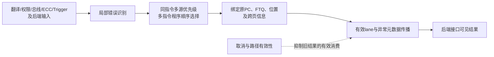

| 改变行为的条件／分解方法 | 风险与验证义务 | 主表入口 |
|---|---|---|
| 翻译/总线/ECC等来源：分类与故障注入 | 分清错误来源及处理方式，避免类型混用 | L1397/L1398、L1401–L1403及翻译异常分支 |
| 同指令多源／多指令同时错误：优先级判定 | 类型选择与最早有效位置分别检查 | L1403，关联L1334；其他组合规则待确认 |
| 第一/第二段及跨页：归属分析 | 后半错误仍绑定原始指令，并检查跨页标记 | L1145、L1469/L1470 |
| Trigger配置、链式和取消：因果与时序 | 命中、动作及有效lane对齐，旧路径结果受抑制 | 关联L1351、L1354/L1355 |

**UT到BT与检查边界：** 路径章节主查局部错误处理，本节主查选择、绑定与传播。标题写跨页时，预期也需明确跨页标记及原起点，不能只查一般异常类型。后端译码及trap动作不扩入本节；当前FrontendTrigger保留输入按实际连接限定范围。

### 4.11 S11 redirect/flush恢复

**来源与拆分：** 控制事件先按来源和作用范围分类，再按旧工作的未发、在途、待消费阶段展开。相同redirect在不同阶段责任不同，分别检查取消、协议收尾、旧新隔离及恢复。

**图15：来源选择后，按旧工作的阶段分别处置**

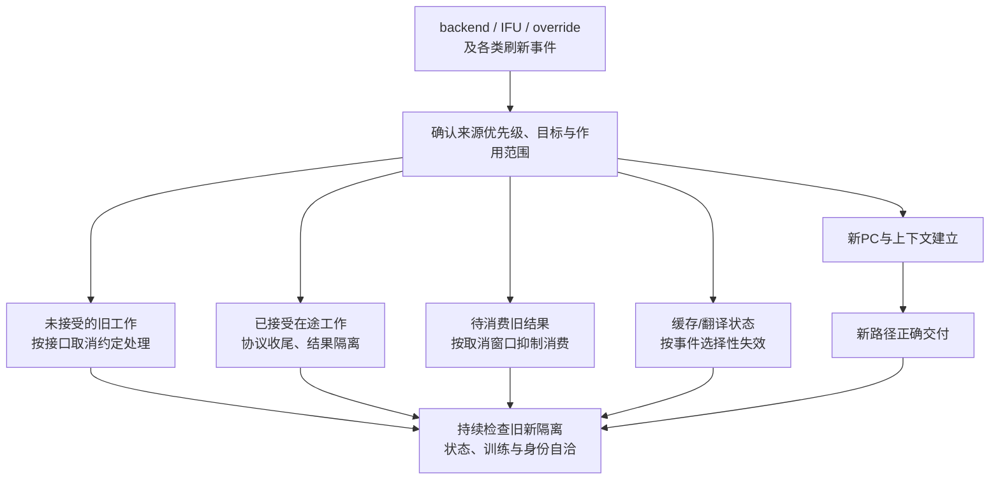

按来源确定作用范围，按阶段确定处置责任；redirect、fence.i、SFENCE分别使用各自规则。新路径可与允许继续收尾的旧事务重叠，检查身份隔离，不要求所有旧响应返回后才启动新路径。

| 改变行为的条件／分解方法 | 风险与验证义务 | 主表入口 |
|---|---|---|
| 来源及并发：分类与优先级 | 采用正确控制来源、目标与范围 | L1475起 |
| 未接受／在途／待消费：时序边界 | 分别检查取消、收尾和有效消费抑制 | 关联L1110/L1111及各路径分支 |
| 命中／不命中作用范围：正反例 | 清理目标，保留非目标合法工作 | L1487–L1489及各路径范围检查 |
| 旧响应晚到、新身份已建立：错误推测 | 新旧不串项，新PC继续交付；按合同解释旧端口展示 | L1502–L1506、L1555 |

**UT到BT与检查边界：** 公共主题负责来源、范围和整体恢复；具体路径负责阶段内协议。当前顶层未向InstrUncache直接传flush，已发总线事务可继续完成，IFU隔离旧指令。L1555还允许flush当拍及随后一周期展示由后端丢弃的旧cfVec；检查以合同中的有效消费为边界。

### 4.12 S12 取指结果交付

**来源与拆分：** 缓冲使“结果已形成”与“结果被消费”分离。沿入队、保留、旁路、分拍输出和释放展开，再加入宽度、空满及反压，检查有效消费的顺序、次数和元数据。

**图16：从入队到有效消费的缓冲生命周期**

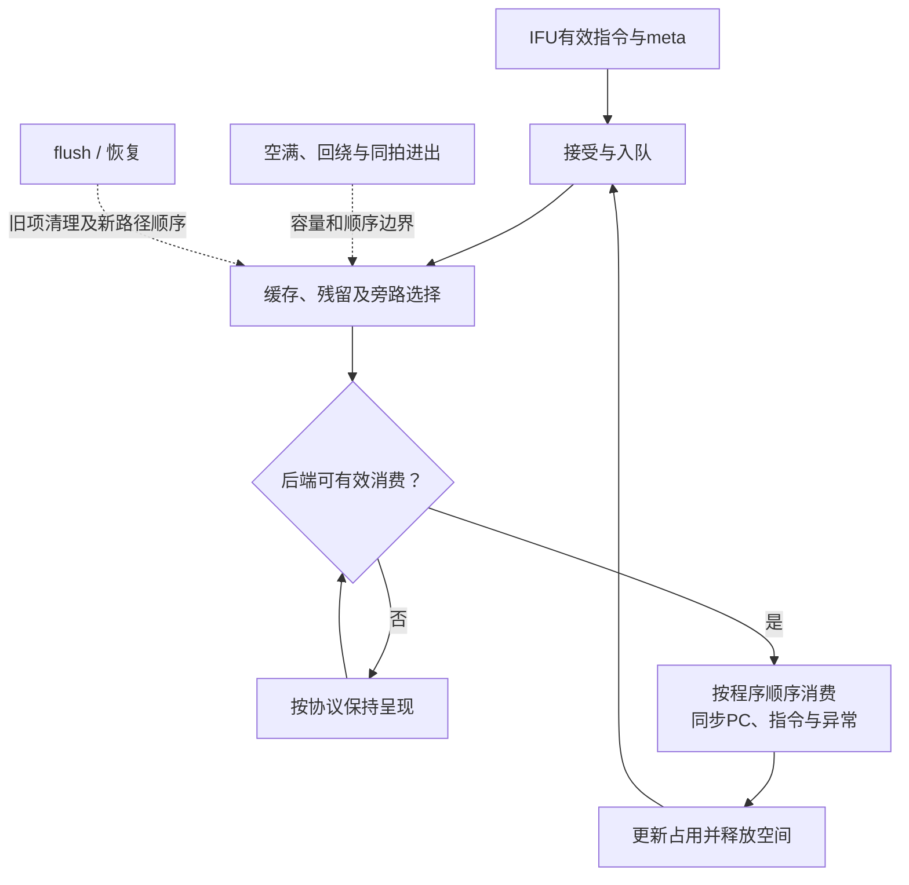

| 改变行为的条件／分解方法 | 风险与验证义务 | 主表入口 |
|---|---|---|
| 输入输出宽度不等：序列分析 | 分拍消费不丢不重，余项与新输入正确衔接 | L1535/L1536 |
| 空、满、旁路、残留与回绕：队列边界 | 正确选择数据并更新占用 | 主表IBuffer缓冲分支 |
| 真正停收／解除：反压时序 | 保持与有效消费计数一致，避免重复计数valid | L1550–L1553 |
| 元数据类型与lane：传播检查 | PC、FTQ、异常、Trigger及跨页字段随同一指令移动 | L1558–L1564，关联L1354 |

**UT到BT与检查边界：** IBuffer局部UT提供缓冲规则，BT以实际IFU输入和后端反馈检查完整序列。观察到valid多拍不等于重复消费。当前vtype/specvtype状态传递按V1.3范围列入检查；未来向量uop拆分前移不计作当前已有功能，详见方案的IBuffer边界。

### 4.13 S13 WFI

**来源与拆分：** WFI需要完成停发、安全汇总和恢复。按请求到达时是否已有在途工作分类，再组合各域safe状态，检查未停即报安全、收尾遗漏及退出后不能恢复。

**图17：停发与在途收敛后形成安全响应**

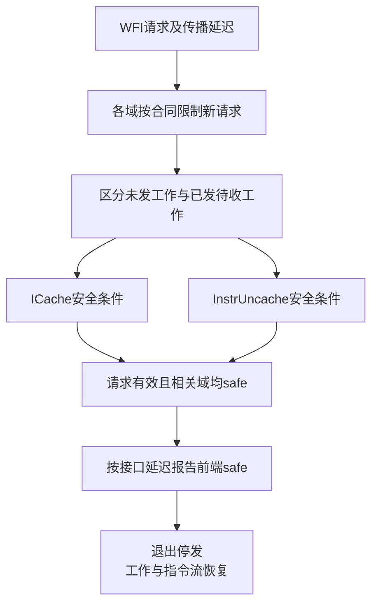

| 改变行为的条件／分解方法 | 风险与验证义务 | 主表入口 |
|---|---|---|
| req与各域safe组合：因果判定 | 防止无请求或未安全时过早报告 | L1568–L1570 |
| 未issue／已issue：状态分析 | 停止新增与接收已发响应分别处理 | L1576、L1587 |
| 响应完成导致本域safe变化：状态序列 | 先确认本域条件，再检查顶层汇总 | L1578、L1588；定义须明确 |
| 传播延迟及退出：时序与恢复 | 请求/响应延迟符合合同，退出后继续前进 | L1567、L1572、L1586 |

**UT到BT与检查边界：** 局部安全定义由各域合同给出，BT检查传播、汇总和恢复。safe可能只排除特定未完成工作，不能一律解释为所有内部状态全空。后端决定WFI执行和唤醒，作为本层外部输入。

### 4.14 S14 2-fetch双取指

**来源与拆分：** 从单块扩展为双块后，先区分双取意图与实际服务，再检查消费/推进宽度；随后展开两块命中组合、拼接与错误位置，识别单块检查无法暴露的协调错误。

**图18：从双取意图到实际消费的完整检查链**

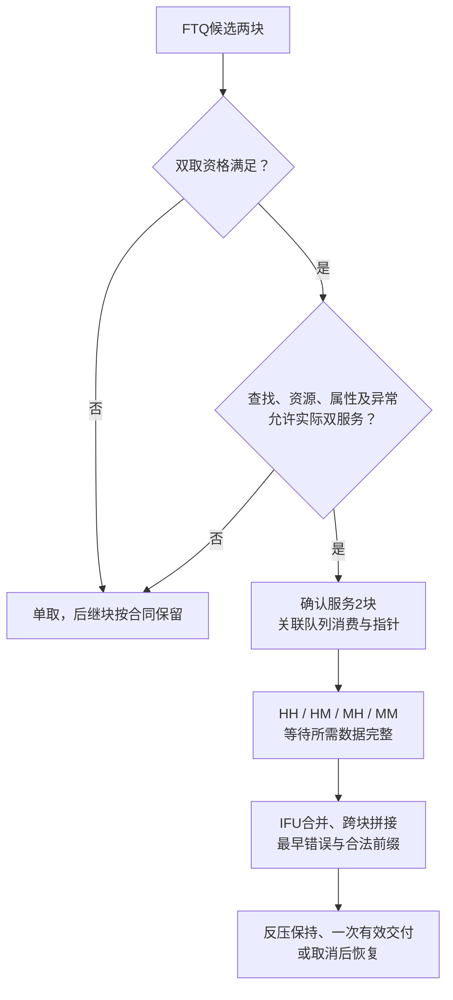

| 改变行为的条件／分解方法 | 风险与验证义务 | 主表入口 |
|---|---|---|
| 全部资格成立／单项拒绝：因果判定 | 负例排除其他门控遮蔽 | L1593–L1597 |
| 双意图／实际双服务或退化：跨模块关联 | 服务、消费、指针推进宽度一致，防止跳块 | L1600/L1601、L1613–L1618 |
| HH/HM/MH/MM：完整2×2组合 | 交换先完成位置，等待数据齐全，防止提前交付或串块 | L1622–L1625 |
| 跨块RVI及混合长度：边界分析 | 拼接、压紧与位置映射不丢不重 | L1638/L1640 |
| 错误位置、反压或取消：优先级与时序 | 保留合法前缀，保持和恢复不破坏身份 | L1646、L1649、L1654 |

**UT到BT与检查边界：** 跨FTQ、WayLookup、MainPipe、IFU和IBuffer检查同一窗口。有效双请求不自动证明双块已被服务。负例排除其他拒绝原因，完成组合区分数据与时间。当前主表“领先超过3项”与RTL的`passedPnr`需核对版本，不能直接假设等价。

## 五、从场景到可实施叶子

### 5.1 层级与停止拆分的标准

当前主表按“一级功能→职责模块→机制→条件/风险类别→具体场景”逐步收敛；主题跨模块时也可按处理环节组织。是否到第五级不是完成标准。

| 叶子要素 | 必须明确的内容 |
|---|---|
| 目标与主归属 | 防什么错误，属于哪个主题，与UT及相邻检查怎样分工 |
| Condition | 合法程序、属性、响应、资源与事件怎样形成目标条件 |
| Checkpoint | 必须发生及不得发生什么，数据/身份/次数/顺序如何判错 |
| Object | 驱动与观察接口，目标事务，采样事件及结束边界 |
| 独立依据 | 程序、协议、确认规则或模型提供哪部分预期 |
| 功能覆盖 | 哪类行为、边界或交互由哪个bin记录 |

停止拆分的依据是前提、预期和观察边界已经明确。例如同一8B beat内RVI的0/2/4偏移均不补取，可归同一叶子并分别覆盖取值；偏移6触发补取、首响应错误抑制补取、跨页转交IFU改变了处理决策，分别表达。

同一规则的数据、PC、身份与次数可共同证明一条语义；公共checker与用例按义务关联，不要求一条测试点独占一个用例，也不要求每个检查字段另立叶子。

### 5.2 一条代表点的实施展开

主表路径为`MMIO取指 / InstrUncache / 跨8B beat内部resend / resend触发条件`，代表点L1114 / BIN-1105。下表用于展开其实施要素，不改写正式CSV。

| 要素 | 同页beat尾RVI内部补取 |
|---|---|
| 适用前提 | 当前8B beat、合法非缓存路径、同页、首次响应 |
| 激励构造 | PC偏移6且非页尾，真实32位指令，高低半及邻近半字可区分；首响应clean，无取消干扰 |
| 目标确认 | 首次请求与响应实际握手，位置、属性、阶段和事务身份一致 |
| 核心checkpoint | 触发第二请求；第二地址、正确拼接、原PC/身份和一次完成由关联检查证明 |
| 功能覆盖 | BIN-1105记录目标触发类别，采样关联同一事务及首次响应阶段 |
| 相邻义务 | L1115/L1116无须补取；L1117/L1118首响应错误；L1120–L1124地址、拼接、错误与完成；L1127/L1128跨页 |

L1114的直接义务是确认补取触发；第二地址、拼接、异常和完成分别关联L1120–L1124。完整运行把这些检查串起，每个叶子仍保持明确预期，避免将整段补取流程重复写入每一行。

### 5.3 激励、checker与覆盖的分工

**图19：同一目标分别形成场景证据与正确性证据**

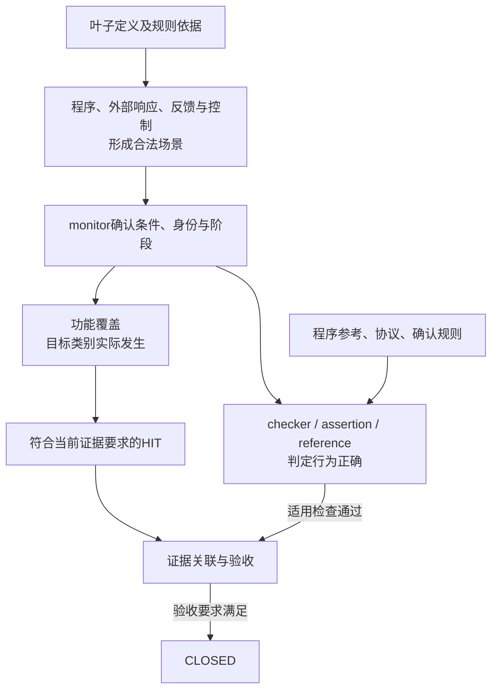

按当前[闭环规范](../../../03_funcov_model/skills.md)，HIT面向真实目标激励和采样证据，CLOSED还需正确性验收；缺checker本身不阻断HIT，同一运行已启用且适用的检查失败不能忽略。图中的CLOSED包含人工验收，不由单个bin自动判定。

程序与外部模型形成输入，DUT形成真实内部状态，monitor确认目标条件，checker比较独立预期，coverage记录类别。coverage predicate不代替checker，检查失败也不能用覆盖命中抵消。

### 5.4 大组合空间的取舍

以双块同页、无异常路径为例：

| 因素 | 可能类别 | 约束与取舍 |
|---|---|---|
| 地址布局 | 同行、不同合法行关系、跨行 | 先确认布局支持目标双服务 |
| 命中模式 | HH/HM/MH/MM | 共享行时部分模式无法独立形成 |
| 完成顺序 | 第一先、第二先、同拍 | 需有相应独立事务且协议/agent允许 |
| 下游状态 | 持续可接收、有限反压后恢复 | 实际确认目标接口反压 |

先定义因素与合法约束，再保留基本类、已知高风险交互；其余空间按目标强度选择受约束pairwise或更高阶组合。两两覆盖不能保证高阶风险。当前HH/HM/MH/MM是完整基础组合，不为使用“正交”术语而删减。配置计划最终由同一事务有效阶段的实际采样确认。

## 六、验证设计的检查准则与确认边界

### 6.1 完整性、去重与可实施性怎样检查

| 检查方向 | 本文形成的依据 |
|---|---|
| 范围 | 外部承诺→根图位置→一级主题：每项责任能否定位，排除范围是否明确 |
| 空间 | 路径、阶段、条件/历史、事件时序→合法组合：基本类、边界和高风险交互是否都有检查 |
| 分类 | 处理条件→行为分支→具体点：每个合法分支是否有检查，拒绝负例是否排除了其他原因 |
| 交互 | 上游保证→下游前提：身份、宽度、反压、晚到和取消是否在交接两侧一致 |
| 去重 | 同一义务→主归属与引用：前提、目标事务、预期、观察边界相同的点是否共享 |
| 实施 | 激励→实际目标事件→checkpoint/bin：是否确认条件真实发生，正确性是否有独立依据 |
| 追踪 | 规则/UT来源→适用版本→BT处置：未确认规则、不可达场景与检查能力缺口是否分开 |

另一位同事只读叶子及父层级，能够一致复述构造与判错方式，是定义清晰度的检验。字段齐全、目录齐全和用例数量不能独自证明无遗漏；本设计也不将现有条目全部认定为已实施或已验收。

### 6.2 需要保留的具体确认边界

| 事项 | 文档中的处理 |
|---|---|
| 双取资格旧阈值与当前PNR规则 | 明确版本核对项，不直接视为等价 |
| BPU状态、时序与预测质量参考 | 区分程序语义、确认规则、局部模型和质量基准 |
| 内部“预置”或ready条件 | 明确合法外部构造与实际观测，否则保留可达性/专项分工问题 |
| 跨页异常与反压观察边界 | 预期覆盖原始PC/标记；反压在目标接口实际确认 |
| DFT、多配置及预留向量职责 | 绑定当前配置与实现范围，未来能力不提前计入 |

这些边界限定验证设计的证明范围；review、执行和验收结果在既有主表及证据中维护。本文件不推算review完成度或coverage闭环度。

## 参考材料与版本定位

| 材料 | 在本文中的用途 |
|---|---|
| [V1.3验证方案](../../v1.3/Frontend_BT_验证方案_v1.3.md) | 第二章范围、模块/交互分析，第三章环境和参考能力 |
| [测试点拆解串讲](../../../05_sharing/Frontend_BT_测试点拆解串讲.md) | UT到BT、真实案例、分解方法与粒度分析 |
| [当前测试点主表](../../../02_testpoint/Frontend_testpoint_0525_coverage_backannotated.csv) | 14主题、具体场景与覆盖绑定 |
| [闭环规范](../../../03_funcov_model/skills.md) | 叶子定义、HIT/CLOSED与证据要求 |
| [Frontend.scala](../../../../../../../main/scala/xiangshan/frontend/Frontend.scala) | 顶层连接、WFI及非缓存flush边界 |
| [Ftq.scala](../../../../../../../main/scala/xiangshan/frontend/ftq/Ftq.scala) | 多进度与当前双取PNR机制 |
| [ICacheMissUnit.scala](../../../../../../../main/scala/xiangshan/frontend/icache/ICacheMissUnit.scala) | 分配、合并、容量和refill |
| [IfuUncacheUnit.scala](../../../../../../../main/scala/xiangshan/frontend/ifu/IfuUncacheUnit.scala) | MMIO/NC差异与状态 |
| [InstrUncacheEntry.scala](../../../../../../../main/scala/xiangshan/frontend/instruncache/InstrUncacheEntry.scala) | beat/page边界、补取和安全条件 |
| [OpenHW Verification Planning 101](https://github.com/openhwgroup/core-v-verif/blob/master/docs/VerifPlans/VerificationPlanning101.md) | 需求来源、子功能、目标、通过标准与覆盖方法的分离；2026-10-22读取 |
| [OpenTitan SPI Host testplan](https://github.com/lowRISC/opentitan/blob/master/hw/ip/spi_host/data/spi_host_testplan.hjson) | 阻塞/恢复、带状态复位、FIFO检查、边界bin、小组合与公共计划复用；2026-10-22读取 |
| [ISTQB CTFL v4.0.1](https://istqb.org/certifications/certified-tester-foundation-level/) | 等价类、边界、判定表和状态迁移等方法术语 |
| [NIST SP 800-142](https://doi.org/10.6028/NIST.SP.800-142) | 受约束组合分析与交互强度 |

分析基线为2026-10-22工作区，Git HEAD为`21a770342d329bab3cfd34268bc97250bb708513`；工作区存在未提交改动，HEAD不单独代表全部材料。本文引用主表快照SHA-256：`4b474e67e10cd1afef53dd8c11d4ff17c4942b2cf65607da6b3aa641f8ceaa19`。L行号按CSV逻辑记录定位，用于本稿阅读；长期关联使用完整层级和稳定ID。正文于2026-10-23完善根图、验证空间与逐类映射，测试点引用继续采用上述快照。
