# 从模块 UT 积累到前端 BT：测试点的分解、取舍与闭环

这次分享围绕[当前测试点主表](../02_testpoint/Frontend_testpoint_0525_coverage_backannotated.csv)，说明三件事：**已有 UT 测试点怎样进入 BT，现有分类体现了哪些分解方法，一条叶子怎样落实为激励、checkpoint 和功能覆盖。**

三位参与者已有 IFU、ICache、BPU 的 UT 经验。前端设计资料不完整，分解的起点仍包括已有的机制理解、模块测试点和风险积累；新增工作集中在完整前端的职责、真实连接和跨模块行为。

**图1：整场分享的逻辑路线**

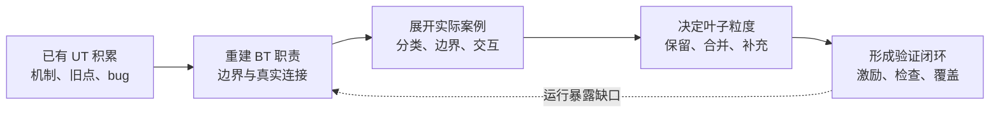

| 内容 | 章节 | 时间安排 | 重点 |
|---|---|---:|---|
| 起点、职责和 UT 到 BT 的取舍 | 一至四 | 15 分钟 | 图2—图4、主表层级、方法与案例对应 |
| 两组主案例 | 五、六 | 20 分钟 | MSHR 分类；补取边界与 redirect 时序 |
| 翻译、2-fetch、BPU | 七至九 | 15 分钟 | 上下文、实际服务、训练反馈 |
| 范围、协作、叶子与闭环 | 十至十三 | 20 分钟 | 交接责任、粒度、图12—图13 |
| 讨论 | 十四 | 5 分钟 | 将方法迁移到其他模块 |

按此路线约 75 分钟，时间为备课估算。60 分钟时缩短其余主题和实施状态部分；90 分钟时增加案例讨论。

材料来自 [V1.3 验证方案](../01_testplan/v1.3/Frontend_BT_验证方案_v1.3.md)、当前主表和工作区 RTL。行号用于定位 2026-10-20 快照，长期关联依靠完整层级与 Bin_ID。文中方法由现有结果归纳，不代表三人当时严格按同一顺序操作；实施示例与原表内容分别标明。

## 一、起点：已有模块 UT，BT 还要解决什么

UT 中可直接驱动的请求、取指返回和训练信息，在完整前端里大多变成了内部连接。请求由真实上游产生，反压由下游状态形成，redirect 也会同时影响多个部件。

因此，复用 UT 点时有四个核心问题：

| 问题 | 对测试点的影响 |
|---|---|
| 原来的风险在 BT 中是否仍然存在？ | 确认版本、配置和功能归属 |
| UT driver 或 stub 保证的前提，现在由谁产生？ | 将直接驱动改为合法程序、响应和反馈序列 |
| 模块单独正确，接起来还可能错在哪里？ | 补身份、时序、反压、取消和恢复的交接检查 |
| 这条义务由 UT 还是 BT 证明？ | 明确层级分工、检查范围与证据 |

例如，UT 可以分别检查两个模块的数据和 metadata。BT 还要检查：**真实连接后，这两份结果是否属于同一笔工作，是否在同一个有效事件中被消费。** 这就是从模块正确性走向组合正确性的增量。

### 1.1 设计资料不完整时，分解依据来自哪里

| 依据 | 提供的信息 | 使用边界 |
|---|---|---|
| ISA、特权规范、协议与接口约定 | 指令长度、权限、异常、事务完成等约束 | 定义必须满足的行为 |
| 当前 RTL、参数、连接、状态和断言 | 职责分配、推进条件、资源与取消机制 | 用于提取机制和观察入口 |
| 已有 UT 点、bug、用例与波形 | 局部风险、可区分激励和检查经验 | 核对原环境假设和适用版本 |
| 设计确认与变更说明 | 规则选择、优先级、时序和实现意图 | 补清存在歧义的预期 |

RTL 可以解释当前机制，独立期望仍需规则或参考依据。例如跨页补取：虚拟页相邻不保证物理页相邻，因此下一页需要重新翻译和检查权限，不能直接沿物理地址补半。这项独立理由能与实现相互印证。

这个阶段的产物是**功能地图、候选风险和具体规则问题**。后续的分类与取舍在此基础上展开。

## 二、从完整前端职责建立功能地图

前端的整体目标是：在正确路径上，按顺序交付有效指令，并保持 PC、长度、预测信息、FTQ 归属和异常等元数据一致。

由此可以识别几类基本错误：字节错误、身份错配、顺序或次数错误、旧路径泄漏、异常归属错误，以及反压或恢复后无法继续前进。

**图2：前端职责与反馈关系**

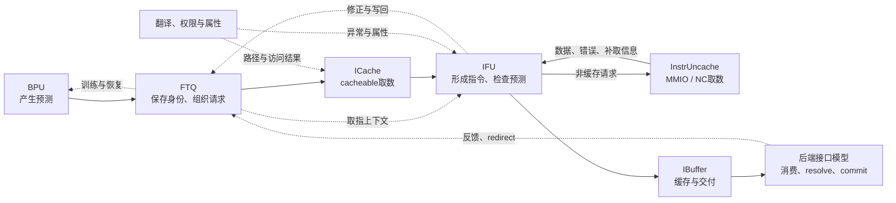

图中展示职责关系，省略部分内部接口；翻译、权限与缓存协作，不表示严格串行流水。

### 2.1 外部职责怎样对应当前主表

| 职责入口 | 对应主表主题 | 分解起点 |
|---|---|---|
| 启动、reset vector | 复位与启动 | 初始入口、局部状态和运行中复位 |
| 预测与后端反馈 | 分支预测、FTQ 管理 | 预测、训练、队列进度和恢复 |
| PTW、CSR、PMP、SFENCE | 地址翻译与权限检查 | 模式、权限、上下文、失效和属性 |
| 存储访问 | cacheable、MMIO、NC 取指 | 路径选择、数据获取、响应和错误 |
| 字节到指令再到消费 | 指令边界与预解码、取指结果交付 | 拼接、压紧、元数据、缓冲与有效交付 |
| 横向控制 | 异常与 Trigger、redirect/flush、WFI | 错误选择、取消范围、安全状态与恢复 |
| 双块处理与辅助接口 | 2-fetch、Perf+DFT | 宽度协调、事件与配置范围 |

当前 14 个一级主题可以从这张职责地图中得到解释。层级随功能边界形成：例如 MMIO/NC 的路径与顺序不同，2-fetch 跨越多个部件，因而分别成为独立主题。

### 2.2 沿一笔取指展开生命周期

每条路径都可以沿同一组事件追踪：**创建 → 接受 → 在途 → 结果待消费 → 完成与释放**，同时加入等待和取消。

**图3：一笔工作的生命周期与取消分支**

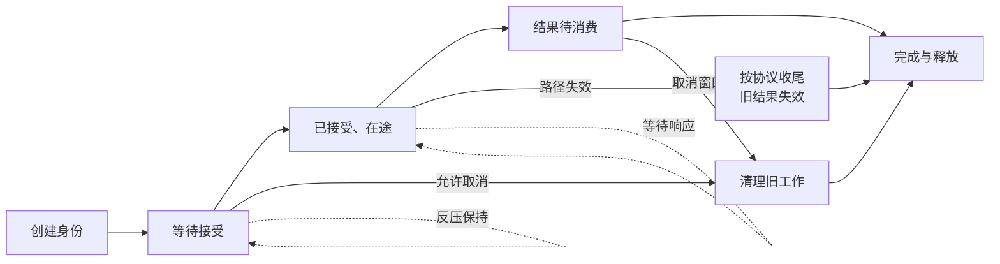

这是验证用的生命周期模型；具体模块是否继续收响应、能否保留填充结果，取决于相应合同。

| 生命周期问题 | 典型分解方向 |
|---|---|
| 谁创建工作，保存哪些信息？ | 请求内容、PC、FTQ、地址与上下文 |
| 何时接受，何时等待？ | 握手、会合、容量边界和保持 |
| 多周期状态记住了什么？ | miss、半条指令、翻译项和预测历史 |
| 何时完成，何时释放？ | 响应匹配、输出次数、资源复用 |
| 中途失效后怎么办？ | 未发取消、已发收尾、旧结果隔离和新路径恢复 |

生命周期把“有哪些功能”进一步变成“这些功能在什么历史和阶段下需要检查”。

## 三、从 UT 候选到 BT 叶子：重组与取舍

### 3.1 UT 点进入 BT 前的处置

**图4：一个 UT 点进入 BT 前的取舍**

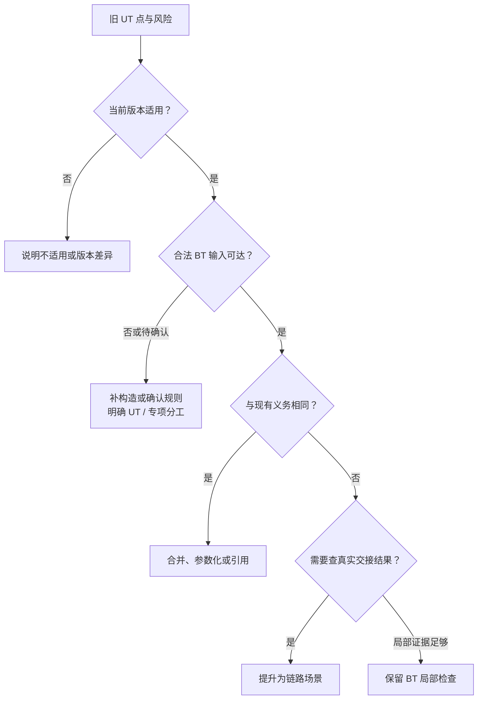

| 处置 | 当前前端中的含义 |
|---|---|
| 保留局部检查 | L775 的请求/meta 会合、L887 的需求与预取去重，仍有独立检查价值 |
| 提升为链路场景 | 局部拼接继续关联 PC、FTQ 身份和最终交付；跨页补半继续关联翻译与异常 |
| 合并、参数化或引用 | 同一规则的不同偏移，共享 MMIO/NC 公共协议，避免平行复制 |
| 由 UT 或专项承担 | 深层表项、计数器和完整内部状态枚举，按适用证据明确分工 |
| 保留待确认项 | 版本、合法可达性、规则或检查能力尚未明确 |

BT 可以保留局部检查。例如重复发出预取未必改变最终指令流，事务次数检查仍能发现问题。取舍依据是它承担的义务及完整前端中能形成的证据。

由 UT 承担的部分，需要适用版本、配置、场景和检查证据，并保留 BT 的连接与代表性场景。

### 3.2 主表五级层级怎样逐步缩小问题

| 层级 | 一般承担的信息 | L1114 的实际路径 |
|---|---|---|
| 一级 | 前端功能 | MMIO 取指 |
| 二级 | 职责模块 | InstrUncache |
| 三级 | 机制 | 跨 8B beat 内部 resend |
| 四级 | 条件或风险类别 | resend 触发条件 |
| 五级 | 具体场景 | 同页 beat 尾 RVI，首响应 clean，触发内部补取 |

另一条路径是 L887：`cacheable取指 / ICache / MissUnit / fetch与prefetch同拍请求 / 同一地址键`。

两条路径都是从功能逐步收敛到可区分行为。叶子可以停在较浅层级；**层数取决于表达需要，可实施性决定是否拆分到位。**

### 3.3 Condition、Checkpoint、Object 怎样互相约束

以 L887 / BIN-690 为例，原表核心内容可归纳为：

| 字段 | 核心内容 |
|---|---|
| Condition | fetch/prefetch miss 同拍；完整地址键相同；均无现存 MSHR 匹配；两类资源有空闲；无取消干扰 |
| Checkpoint | 只建立一份工作：fetch 分配，prefetch 合并；不额外分配、不进预取 FIFO，只发一笔 Get |
| Object | 请求、MSHR、预取 FIFO 和总线事务 |

这里排除“已有 MSHR”，是为了区分同拍去重与现存项合并；保留资源空闲，是为了避免把资源不足造成的未分配误当成去重成功。条件服务于预期的可归因性。

数据、身份、次数等可以共同证明一条完整语义。只有前提、决策或责任确实不同时，拆分才带来新的检查价值。

## 四、从现有测试点归纳分解方法

一组现有点能够恢复出分类依据、风险与验收方式，就体现了相应的方法思路。方法既解释已有工作的逻辑，也用于继续检查边界、交互和重复。

| 方法 | 当前表中的代表点 | 分解逻辑 |
|---|---|---|
| 等价类划分 | L881/L884/L897：分配、反压、合并 | 按处理规则分集合，同类选择代表场景 |
| 边界值分析 | L1114–L1116、L1127/L1129；L1602 | 在 beat/page 尾、长度切换和回绕处选点 |
| 因果分析／判定表 | L1593–L1597；L1114–L1118 | 多个条件共同决定行为，分别检查成立与拒绝原因 |
| 状态迁移／时序分析 | L902–L906；L1055/L1110/L1111 | 同一事件在不同阶段具有不同后果 |
| 场景与生命周期分析 | L991；L1638/L1649/L1654 | 跟踪同一工作穿过多个部件，检查完整结果 |
| 组合分析 | L1622–L1625：HH/HM/MH/MM | 检查两个块的状态组合及位置不对称风险 |
| 错误推测 | L408 的旧 PTW 响应；L1135 的旧 half | 从串上下文、串半条和串身份等错误模型补场景 |
| 故障注入 | 首次/第二次响应错误；ECC 分支 | 区分错误阶段、传播、抑制与恢复 |
| 需求与规则追踪 | 整体功能地图与各点依据 | 从职责追到验证义务，再追到检查和证据 |
| 覆盖模型反馈 | coverage、Bin_ID 与 testcase 绑定 | 从实际采样与缺口反查测试点和激励 |

### 4.1 三个容易混淆的概念

| 概念 | 区分 |
|---|---|
| 等价类与代表值 | 先按行为分集合，再选数值；“随机几个地址”本身不能定义等价类 |
| 分类清楚与正交试验 | 同层分类依据一致；正交或 t-way 另需因素、约束和交互强度 |
| 测试点、用例与 bin | 可以多对多；一叶子可以有多个取值 bin，一次用例也可以提供多个义务的证据 |

L1115 在一条叶子中列 offset_0/2/4，就是同一不补取规则下的多个覆盖取值。L1622–L1625 的四种情况则是完整 2×2 组合，能说明组合分析；它们本身不足以证明整套测试达到 pairwise 或正交覆盖。

范围由职责和规则建立，代码覆盖率用于反查遗漏，避免机械地将每个 RTL 分支转成 BT 测试点。

以下用三组主案例展开：**MSHR 解释分类，非缓存补取解释边界与因果，2-fetch 解释跨模块组合。**

## 五、案例一：cacheable 取指怎样展开成多类义务

当前 `cacheable取指` 有 351 条带定义末端记录。其规模来自多个机制和生命周期的叠加；已有 ICache、IFU UT 点在这里按完整取指链路重新组织。

### 5.1 先建立正常链，再识别各环节的风险

共同目标是：给出可缓存、可执行地址，取得正确字节，并交付正确指令与元数据。

| 链路环节 | 风险与现有点 |
|---|---|
| FTQ 请求与查找信息会合 | 同拍、错拍、反压时不能配错身份；L774/L775/L777 |
| ICache 组织数据 | 行、bank、来源和偏移要一致；L784–L790 等 |
| miss 获取数据 | 分配、合并、容量、refill 和资源释放；L881 起 |
| IFU 形成指令 | 边界、拼接、压紧、PC 和异常同步变换 |
| FTQ/IBuffer 推进与交付 | 实际消费对应正确进度；残留、反压和取消后不丢不重 |

一条“取指正确”因此分成多个有独立错误模型的义务。后续展开围绕**哪种条件改变处理行为、哪段历史影响结果**进行。

### 5.2 MSHR：按行为分类，再加资源边界

miss 引入跨周期工作：分配资源、发请求、接收 refill、供给或写回，并完成释放。对新的合法 fetch miss，首先区分是否已有匹配工作。

**图5：MSHR：按行为分类，再检查资源边界**

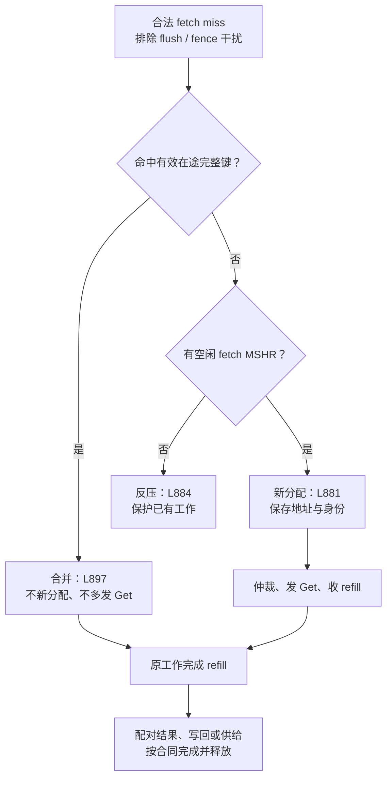

| 现存 MSHR 完整键匹配 | fetch MSHR 有空闲 | 行为类别 | 主表对应 |
|---|---|---|---|
| 是 | 有 | 合并到已有工作 | L897 / BIN-699 |
| 是 | 无 | 按现存项命中规则处理，无需新分配 | L897 的容量交叉需由实际激励确认 |
| 否 | 有 | 新分配 | L881 / BIN-686 |
| 否 | 无 | 反压，保护已有工作 | L884 / BIN-688 |

**等价类**给出分配、合并、反压三类行为；**判定表**检查其前提关系；**容量边界**补上资源紧张时的情况。

“满且重复”说明两个维度存在交互：资源满主要限制需要新分配的请求。若把“满”直接写成所有请求拒绝，就会丢失这一类行为。

L887 则属于另一组前提：fetch/prefetch 同拍同键，之前尚无匹配 MSHR。它检查同拍去重，与 L897 的现存项合并互补。

### 5.3 从正例扩展到反例与生命周期

| 扩展方向 | 需要证明什么 | 当前例子 |
|---|---|---|
| 地址键变化 | 部分字段相同仍不能误合并 | L888/L889/L899 |
| refill 完成 | 数据和请求配对，完成时机、写回与释放正确 | L918 等 |
| 完成后再次访问 | 新 demand 真正从 SRAM hit，未依赖旧在途状态 | L991 |
| redirect/fence.i | 区分取消对象、总线收尾、结果有效性与后续恢复 | L901、L908 起的分支 |

地址字段组合还受配置与上游约束限制，只有合法可达的组合才能成为正常 BT 场景。

其中 L991 是典型的 BT 场景思路：从“refill 正确”继续走到“填充结果被真实后续请求使用”。前后两次访问构成状态变化，能发现单次返回正确但缓存未正确保存的问题。

### 5.4 数据正确以后，还要检查身份和消费

| 原始 halfword 位置 | 0 | 1 | 2 | 3 |
|---|---|---|---|---|
| 内容 | RVC | RVI 低半 | RVI 高半 | RVC |
| 指令起点 | 是 | 是 | 否 | 是 |
| 压紧后槽 | 0 | 1 | 与低半合并 | 2 |

压紧改变了槽位，PC、FTQ 归属、异常和预测信息仍要跟随原指令。因此字节正确、起点正确、元数据正确、有效交付正确是相关但可区分的义务。

队列侧则继续覆盖基本流动、空满、回绕、反压和取消。各阶段依据自己的实际接受或消费事件推进；这些检查把取数链路接到完整的资源与交付生命周期。

**这组案例的分解路径：正常链路 → 行为分类 → 资源与地址边界 → 状态历史 → 取消恢复 → 最终消费。**

## 六、案例二：非缓存补取怎样体现边界、因果和状态分析

MMIO、NC 同样使用非缓存获取机制，但进入路径和顺序要求存在差异。现有点因此既有各自的路径条件，也有可共享的请求、响应和补取协议。

### 6.1 先区分路径，再沿状态检查行为

**图6：IfuUncacheUnit 的路径与等待关系**

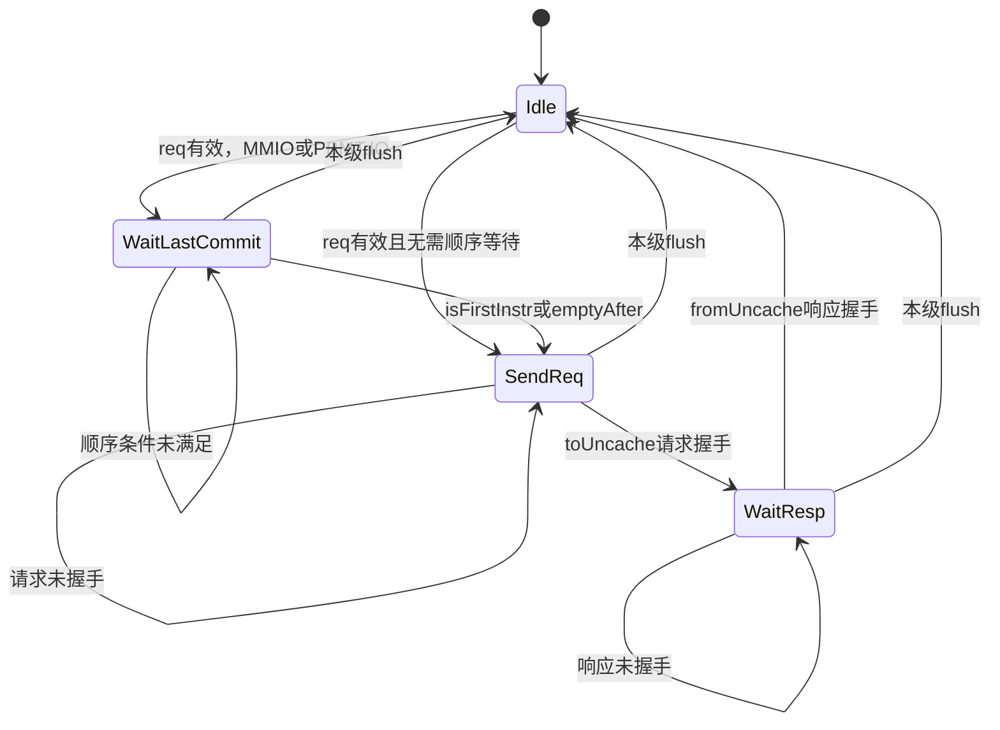

图按当前 IfuUncacheUnit 概括；本级 flush 清理状态，不表示底层已接受事务随之消失。

| 分解层面 | 对应问题 |
|---|---|
| 路径选择 | MMIO/IO、NC 的属性怎样决定进入路径？ |
| 等待与发出 | 何时需要顺序等待，何时允许发出请求？ |
| 接受与返回 | 反压时保持什么，响应怎样关联原工作？ |
| 取消与恢复 | 不同阶段取消后，局部状态、总线和交付分别怎样处理？ |

状态迁移提供场景入口，checkpoint 落到请求、身份、次数和结果上。例如“等待结束”还需要证明没有提前发送、满足条件后能够发送，并且属于原事务。

### 6.2 beat 尾与页尾：处理规则改变的地方

内部补取可概括为：首次返回时，RVI 跨 beat、未跨页、首响应无相应错误，才继续获取第二 beat。

| 条件变化 | 行为变化 | 原表落点 |
|---|---|---|
| 同页 RVI，起于 8B beat 末尾 2B，首响应 clean | 内部发起第二 beat 请求 | L1114 / BIN-1105 |
| RVI 起点改为偏移 0/2/4 | 本指令已完整，不补取 | L1115 / BIN-1106 |
| 相同尾部位置，长度改为 RVC | 本指令已完整，不补取 | L1116 / BIN-1107 |
| 同页尾部 RVI，首响应出错 | 抑制补取，走异常路径 | L1117/L1118 |
| RVI 位于 4KB 页尾 2B | 返回 needResend，由上层处理下一页 | L1127/L1128 |
| 已到第二响应阶段 | 按结果完成，不无限补取 | L1124 |

这里共同使用了三种方法：

| 方法 | 在这组点中的作用 |
|---|---|
| 等价类 | 区分完整 RVC、完整 RVI、缺高半 RVI |
| 边界值 | 选择偏移 4/6、beat 尾/page 尾等规则切换点 |
| 因果判定 | 长度、位置、错误与阶段共同决定补取行为 |

“没有第二请求”只有在其余触发条件确实满足时，才能证明某个拒绝条件起效。例如本来就是 RVC，即使首响应出错，也不足以单独证明错误抑制了 RVI 补取。

### 6.3 用字节布局说明边界与检查

| 场景 | 第一 beat | 后续所需内容 | 责任 |
|---|---|---|---|
| RVI 偏移 4 | 字节 4—7 已完整 | 无 | 直接形成指令 |
| 同页 RVI 偏移 6 | 字节 6—7 为低半 | 字节 8—9 为高半 | 内部补一 beat |
| RVC 偏移 6 | 字节 6—7 已完整 | 无 | 直接形成指令 |
| 页尾 RVI 偏移 0xffe | 本页末尾低半 | 下一虚拟页高半 | 上层重新翻译与取数 |

第二次请求发出后，原表继续区分地址、拼接、第二响应错误和单次完成：L1120–L1124。它们对应“是否做、怎样做、怎样完成、失败怎么办”这几个不同问题。

激励中让高低半和邻近半字可区分，能够暴露取错位置和拼接错误；若周围数据完全相同，这类错误可能被掩盖。

### 6.4 跨页：同一条指令，跨过两个事务

**图7：跨页补半：两个事务，由 IFU 连接成一条指令**

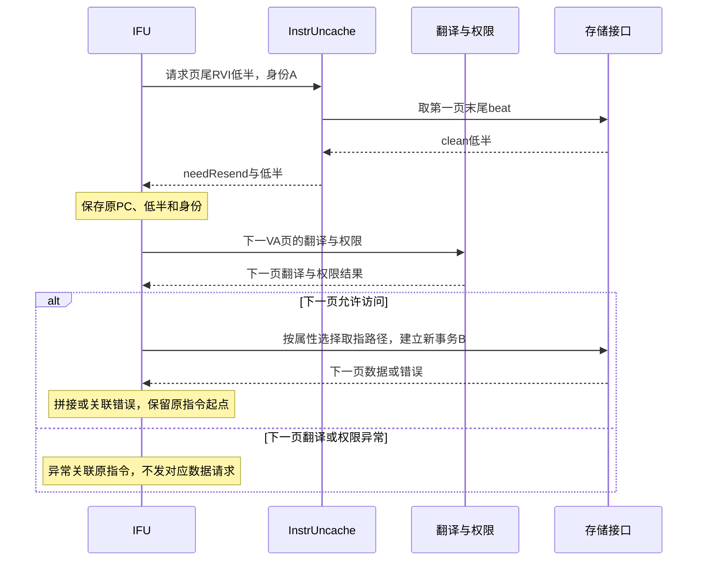

图中 IFU 到存储为职责层简写，实际按属性经对应路径。取消时还需清理半条并隔离旧结果。

跨页改变了责任边界：底层识别不能直接跨物理页补半，上层保存原指令信息并组织下一页。后半出错，异常仍需关联原指令起点。

| 错误发生处 | 独立检查义务 |
|---|---|
| 第一页 | 不误触发下一页补取，以原 PC/身份交付异常；L1145 |
| 第二页 | 已保存低半，仍需把异常归到原指令；同时检查跨页信息 |
| 页间取消 | 旧 half 不能参与新路径拼接；L1135 |

因此跨页单列具有明确依据：路径、状态归属与异常传播都发生了变化。

### 6.5 redirect：按事务阶段选择场景

| redirect 阶段 | 主要义务 |
|---|---|
| 顺序等待、请求未建立 | 取消旧工作，恢复新路径 |
| A 已接受、D 未返回 | 已发事务按协议收尾，旧结果失效 |
| 内部第二请求已接受 | 补取允许完成，旧结果不能进入有效指令流 |
| 已保存半条 | 清理旧 half，避免新旧拼接 |
| 旧指令已在交付缓冲 | 按取消窗口区分端口展示与有效消费 |

**图8：第二次请求已接受后 redirect：完成与有效性分开检查**

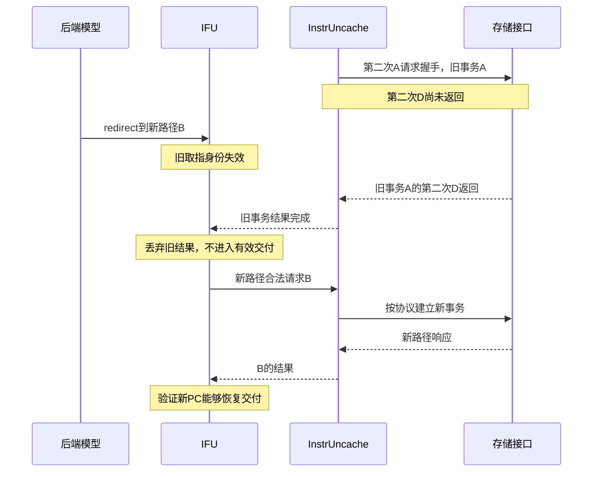

这是受控测试序列，新请求的具体启动时刻按接口合同。当前底层 InstrUncache 未直接连接前端 flush，因此底层完成与上层失效可以同时成立。

现有 [redirect/resend 用例](../../tests/py/jiabowen/test_ifu_instr_uncache_redirected_resend_v3_dut.py)先确认第二 A 已接受、第二 D 未回，再触发 redirect，检查旧结果隔离与新 PC 恢复。其结构说明了时序点怎样落地；本文引用代码，未重新运行该用例。

**这组案例的分解路径：路径差异 → 状态迁移 → 长度与地址边界 → 条件因果 → 跨页交接 → 在途取消。**

## 七、翻译与权限：从地址转换扩展到上下文与路径

`地址翻译与权限检查` 的 113 条带定义末端记录，沿六个维度展开。每增加一层，增加的是地址数值以外的验证义务。

| 维度 | 现有内容 | 新增义务 |
|---|---|---|
| 模式 | Bare、非虚拟化、onlyStage1、onlyStage2、allStage | 路径、输入含义和异常阶段不同 |
| hit/miss | PTW 请求、响应、refill 后再次命中 | 结果既要返回正确，也要正确保存与复用 |
| 权限 | 执行权限、特权关系、非法 PTE、各阶段 fault | 地址正确仍需判访问合法性与错误类型 |
| 上下文 | ASID/VMID、CSR 切换、旧请求晚到 | 相同 VPN 在不同上下文中不能错配 |
| 失效 | 时序、地址/ID 粒度、翻译域 | 目标失效，非目标按规则保留 |
| 属性 | SFENCE 后 cacheable/MMIO/NC 切换 | 新映射决定新路径和顺序要求 |

### 7.1 上下文变化为什么需要独立测试点

L404–L408 区分已有项与在途请求的上下文变化。L408 的关键风险是：旧 PTW 请求已发，切换后旧响应回来，被误用为新上下文的结果。

**图9：上下文切换：相同 VPN 不等于同一请求**

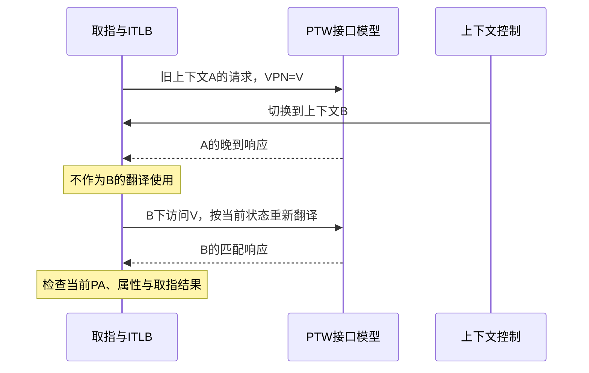

是否保留非当前上下文项取决于具体规则；这里检查的是旧结果不得冒充新上下文。参考侧也需要保存请求上下文，单靠 VPN 关联可能与 DUT 一起犯错。

### 7.2 失效同时具有正反两类义务

| 类别 | 检查方向 | 现有例子 |
|---|---|---|
| 命中失效范围 | 旧项或晚到响应不能恢复为有效结果 | L461 |
| 不命中失效范围 | 仍适用的工作按规则保留，避免误杀 | L462 |
| 属性变化后重新访问 | 使用新 PA、属性和路径，遵守新的顺序要求 | L475–L480 |

这些点体现范围分类、状态历史和正反例分析。不同模式、粒度和时序无需机械做全乘积；高风险交互，例如晚到响应与上下文切换，再作针对性组合。

## 八、案例三：2-fetch 怎样按完整链路拆分

2-fetch 的 41 条带定义末端记录按资格、准备、实际服务、数据完成、合并、修正和交付展开。这组点展示了跨模块机制怎样形成清楚的主线。

**图10：2-fetch 的检查链：资格、实际服务、结果交付**

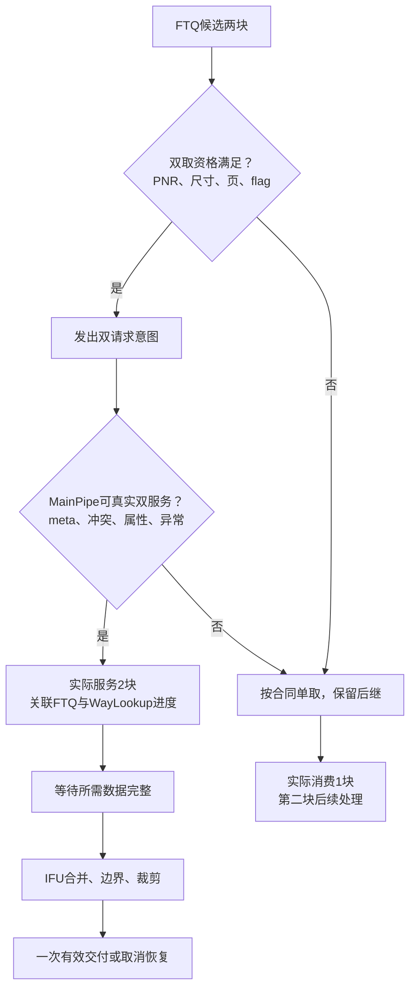

### 8.1 资格与实际服务分别检查

| 阶段 | 需要满足什么 | 原表对应 |
|---|---|---|
| FTQ 形成双请求意图 | 第二块达到允许边界，合计尺寸、页关系和控制属性允许 | L1593–L1597 |
| MainPipe 实际双服务 | 两份查找信息、资源、属性和异常条件允许 | L1613–L1618 |
| 各侧消费进度 | 真正双服务消费 2，退化单服务消费 1 | L1600/L1601 |

当前表的“BPU 领先超过 3 项”与当前 RTL 的 `passedPnr(fetchPtr(1))` 存在表述差异，等价性仍需版本与时序确认。讲解重点是第二块的稳定性与取消边界，避免将一个旧阈值当成永久规则。

因果分析在这里落成“全部成立的正例 + 各类拒绝原因”。负例要使其他门控成立，否则“第二请求无效”无法证明目标条件生效。

FTQ 有双取意图，也可能在下一级退化。于是还需跨模块关联同一接受事务：**实际服务宽度、队列消费宽度和指针推进宽度一致**，避免跳过或重复第二块。

### 8.2 HH/HM/MH/MM：有明确风险的组合分析

| 第一块 | 第二块 | 主表绑定 | 风险区别 |
|---|---|---|---|
| hit | hit | L1622 / BIN-520 | 正常双块返回 |
| hit | miss | L1623 / BIN-521 | 保存第一块，等待第二块，不提前交付 |
| miss | hit | L1624 / BIN-522 | 交换先完成的位置，检查位置不对称错误 |
| miss | miss | L1625 / BIN-523 | 等所需数据齐全，不漏掉或串用 refill |

这是两个二值因素的完整组合。构造时让两块数据可区分，miss 完成错拍，才能观察先到保持、等待完成和最终关联。

四种模式并未穷尽所有时间与布局：两块可能共享行，也可能各自跨行，某些组合受合法性约束。因此普通组合可以进一步筛选，高风险完成顺序或共享资源关系则单独分析。

### 8.3 向后追到指令与交付

| 后续环节 | 新增风险 | 当前点 |
|---|---|---|
| 跨块 RVI | 两个块的半字只形成一条指令，PC 与来源字段正确 | L1638 |
| 混合 RVC/RVI 压紧 | 位置、身份转换不丢不重 | L1640 |
| 两块都有错配 | 选择最早错误，保持合法前缀 | L1646 |
| 只有第二块出错 | 第一块合法前缀保留，错误归属第二块 | L1648/L1649 |
| 反压与取消 | payload 保持、恢复后一次有效交付、旧结果隔离 | L1653–L1655 |

实际反压要在目标接口确认；后端停止接收与 IFU 接口立即反压之间可能隔着缓冲，不能直接视为同一条件。

**这组案例的分解路径：资格因果 → 实际服务 → 进度一致 → 数据组合 → 边界与错误 → 有效交付。**

## 九、BPU：按预测、训练、恢复分别建立义务

BPU 的 117 条带定义末端记录包含多个预测器、历史、RAS 和控制。已有 UT 经验提供了细致的内部风险，BT 继续关注真实预测与反馈链。

**图11：BPU 的前向预测与后向反馈**

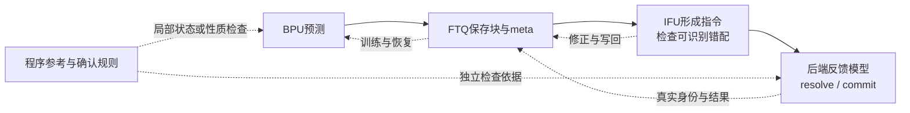

| 职责 | 分解方向 | BT 关注点 |
|---|---|---|
| 前向预测 | 命中/未命中、类型、目标、候选选择 | 采用正确来源，预测信息与 FTQ 身份一致 |
| 后向训练 | 分配、更新、真实反馈生效条件 | resolve/commit 指向正确对象，数据和次数正确 |
| 历史与 RAS | 更新、保持、深度边界与恢复 | override/redirect 前后状态与新路径一致 |
| 使能与质量 | 开关、基准与评价条件 | 功能正确性与预测质量分别验收 |

### 9.1 一组简单例子：分配与更新为什么分开

L121 检查首次出现 taken CFI 后建立新项；L122 检查已有同 PC 项在目标变化后更新。两者都属于训练，但前提和错误模型不同：可能只会首次写入，后续更新失效。

同样，多个预测或恢复来源同时有效时，给出互不相同的目标，才能判断采用了哪个来源。全部目标相同会掩盖选择错误。

### 9.2 不同目标需要不同判定依据

| 要证明的内容 | 判定依据 |
|---|---|
| 实际分支类型、方向和目标 | 程序参考和后端反馈 |
| 训练、选择、状态更新和恢复 | 已确认规则、局部模型或性质检查 |
| 预测质量 | 固定基准、预热、反馈时序和统计口径 |

最终指令流正确可以证明纠错后的路径，不能单独证明训练状态、历史或预测质量。相关能力在 [BPU 专项方案](../01_testplan/bpu/v0.1/BPU_验证策略与参考模型建设方案_v0.1.md)中继续展开。

## 十、其余主题：按入口、出口与横向控制补齐范围

主案例覆盖了主要路径，其余主题沿相同职责地图定位。

| 主题 | 分解维度 | 与前面案例的联系 |
|---|---|---|
| 复位与启动 | 初始状态、入口地址、运行中复位、旧新隔离 | 既检查静态初始化，也检查已有在途工作 |
| 指令边界与 PredChecker | 长度、起点、范围、错配类型、最早错误 | 前端检查其可识别的错配，后端执行结果另有职责 |
| 异常与 Trigger | 产生、选择、绑定、传播 | 局部产生错误，整体保证对应正确指令和输出位置 |
| redirect/flush | 来源、优先级、范围、时序和恢复 | 公共主题定义事件，各路径检查具体状态下的后果 |
| 结果交付 | 缓冲、残留、旁路、反压、取消和顺序 | 端口展示与真正有效消费按合同区分 |
| WFI | 停发、待收、安全汇总与唤醒恢复 | 尚未发出的工作与已发待收工作分别处理 |
| Perf/DFT | 事件、配置、测试控制与适用范围 | 接口范围明确，计数、功能与性能评价各有标准 |

其中异常可沿一条通用链组织：**错误在哪里产生 → 多错误时选择谁 → 属于哪条指令 → 怎样传播到有效输出。** 这样可以区分局部检查和整体检查，减少同名主题间的重复。

范围完整性来自职责、接口和规则的对应。目录是否齐全是初步检查，仍需具体义务支撑。

## 十一、三人的模块积累怎样合成共同的 BT 表

V1.3 的分工覆盖环境/IFU/FTQ、翻译/异常/MMIO/NC、ICache 各管线等领域，BPU 共同协作。各自深入机制，同时沿完整场景对齐模块之间的交接。

### 11.1 以场景核对责任

| 整体场景 | 各域接起的义务 | 易漏交接 |
|---|---|---|
| miss 后形成指令 | 分配/refill → 数据/meta → IFU → 交付 | 返回数据与请求身份 |
| 页尾 RVI | 翻译/属性 → 取数 → 保存半条 → 拼接或异常 | 后半错误仍归属原起点 |
| 在途 redirect | 上游取消 → 总线收尾 → 旧结果隔离 → 新路径 | 完成与有效性边界 |
| 双取退化 | FTQ 意图 → 实际服务 → 消费与指针 | 一端处理 1，另一端推进 2 |
| 属性切换 | 失效 → 新翻译/属性 → 新路径与排序 | 新 PA 携带旧属性 |

每项整体义务有明确主归属，各负责人说明输入前提、局部保证和下游检查。多个可控用例与局部 checker 可以共同提供完整证据。

### 11.2 用同一标准识别重复与表达缺口

两条测试点可按四项比较：**前提、目标事务、预期行为、判错边界**。

| 比较结果 | 处理方式 |
|---|---|
| 四项相同 | 合并或引用 |
| 同一规则，只有合法数值不同 | 参数化，明确覆盖取值 |
| 同一场景中的不同职责 | 保留互补检查，明确共同证据与主归属 |
| 同一模板对应不同标题 | 补清真实差异，再确定粒度 |

另一位同事能够仅凭该行和父层级复述激励与预期，是定义清晰度的直接检验。版本变化时，条件、采样、checker 与覆盖也需一起核对。

## 十二、叶子粒度、实施要素与当前表的状态

### 12.1 拆到什么程度

| 标准 | 一条叶子需要说清什么 |
|---|---|
| 场景可构造 | 程序、属性、响应、控制事件怎样建立前提 |
| 目标可确认 | 哪个事务、哪个阶段，怎样确认条件真实发生 |
| 结果可判错 | 必须与不得发生什么，独立期望来自哪里 |
| 观察边界明确 | 在哪里看、何时算有效，何时完成 |
| 覆盖可关联 | 哪些类别或交互由哪个 bin 记录 |
| 职责与依据可追踪 | 完整层级/ID、规则来源、适用版本与 UT/BT 分工 |

规则、检查和证据相同的参数可以留在一条叶子里；改变决策、责任或错误归属的情况分别表达。点数随取舍增减：补交接风险会增加，公共机制引用和参数化会减少。

### 12.2 用一条实际叶子串起实施要素

以下是对 L1114 / BIN-1105 的实施展开，用于解释字段怎样落地，正式主表保持原样。

| 要素 | 同页 beat 尾 RVI 内部补取 |
|---|---|
| 适用范围 | 当前 8B beat、2B 对齐；合法非缓存路径，属性与顺序前提成立 |
| 激励 | `PC mod 8 = 6` 且不在页尾；真实 32 位指令，高低半可区分；首响应 clean，无 redirect |
| 目标确认 | 同一事务的首次请求/响应、起点、属性和阶段成立 |
| Checkpoint | 触发第二请求；关联地址、正确拼接、PC/身份与一次完成的检查 |
| Object | 请求、响应、补取状态与关联的指令输出 |
| 功能覆盖 | 原表 BIN-1105 的触发类别；采样时关联相同身份和阶段 |
| 相邻义务 | L1115/L1116 不补取；L1117/L1118 首响应错误；L1120–L1124 地址、拼接、错误和完成 |

一条用例可以同时为这组义务提供证据，公共检查通过稳定引用共享。这样既保持分类清楚，也避免把整个流程复制到每一行。

### 12.3 检查与覆盖怎样共同闭环

**图12：同一场景提供两类证据，共同形成正确性闭环**

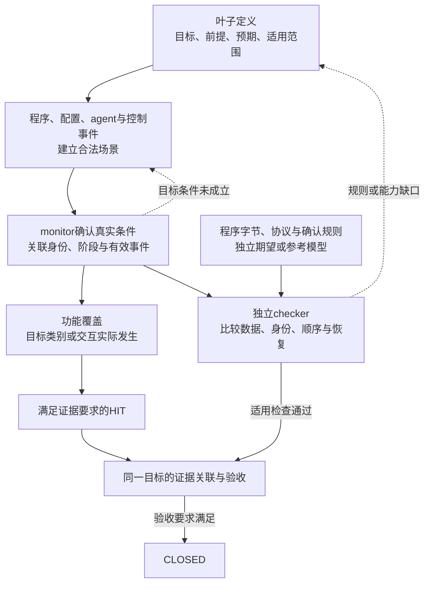

按当前[闭环规范](../03_funcov_model/skills.md)，HIT 表示真实目标激励与采样证据，CLOSED 还需正确性验收。缺 checker 本身不阻断 HIT；同一运行中已启用且适用的检查失败不能忽略。

覆盖回答目标类别是否发生，checkpoint/checker 回答行为是否符合预期。二者围绕同一事务关联，才能支撑对应叶子的验收。

### 12.4 这一千多行代表什么

| 统计口径 | 当前数量 | 含义 |
|---|---:|---|
| CSV 数据记录 | 1654 | 包括标题、层级、定义和协作说明 |
| 结构末端 | 1151 | 按继承层级恢复后，没有后代的记录 |
| 带定义末端 | 1129 | Condition/Checkpoint/Object 至少一项有文本 |
| 三字段齐全 | 700 | 文本完整性统计，仍需语义与可执行性检查 |

1129 条中，427 条有 Condition/Checkpoint 而缺 Object，2 条仅有 Condition。另有 22 条空结构末端，混有 TODO、说明和候选，不能全部视为漏测。上述口径也不等同 active、HIT 或 CLOSED 数量。

当前表已形成 BT 功能框架和大量具体场景，剩余整理主要落在三类定义上：

| 代表问题 | 例子 | 需要补清的内容 |
|---|---|---|
| 标题与内容不一致 | L318 标题是“剩 1 项”，内容却为冷启动空队列；L95/L96 标题是训练，内容仍为预测接收 | 让条件和预期直接覆盖标题中的义务 |
| 内部条件缺少合法构造 | 直接写预置内部队列或内部 ready | 完整前端怎样形成目标状态，或由哪层承担 |
| 缺少预期或有效边界 | L1164、L1578 无 Checkpoint；L1654 的反压接口关系需区分 | 明确完成、正确性与有效观察条件 |

全表三字段文本查重得到 27 组候选；相同文字可能需要合并，也可能需要补差异。明确义务以后，再决定数量与层级。

## 十三、可复用的测试点整理过程

**图13：从已有 UT 积累到可执行 BT 表的整理循环**

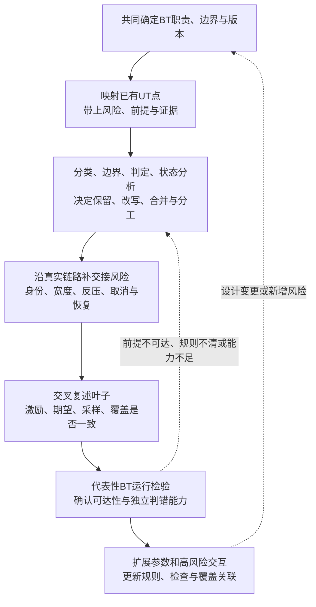

图中的流程可以归纳为四项共同产物：

| 产物 | 回答的问题 |
|---|---|
| 功能与规则地图 | 验证什么，哪些规则明确，哪些待确认 |
| 测试点树与分工 | 按什么分类，UT/BT 谁负责，兄弟点怎样互补 |
| 叶子实施定义 | 激励、目标确认、预期、观察和覆盖怎样对应 |
| 真实运行证据 | 场景是否可达，检查能否判错，组合是否实际发生 |

### 13.1 大组合空间怎样扩展

MSHR 与补取主要依靠行为分类、边界和因果。面对更大的“布局 × 命中模式 × 完成顺序 × 反压”空间，组合方法开始发挥缩减作用。

| 步骤 | 核心内容 |
|---|---|
| 定因素 | 只保留会改变行为或交互的类别 |
| 定约束 | 共享行、路径属性和响应协议会限制可构造组合 |
| 定强度 | 保留基本类与已知高风险交互，其余选择 pairwise 或更高阶 |
| 查实际发生 | 用同一事务有效阶段的观测回标组合 |

两两覆盖不能保证所有高阶错误；已知高风险交互继续单列。配置表给出计划，真实采样给出命中。

整个过程围绕同一条逻辑：**用职责定范围，用方法组织风险，用取舍明确层级，用激励、检查和覆盖检验叶子。**

## 十四、讨论：把方法迁移到其他模块

1. **一个拒绝条件怎样单独证明？** 以双取资格或补取抑制为例，其他条件需要满足什么？
2. **哪些工作允许完成，但结果必须失效？** 对照访存/cache 的在途事务，比较取消与收尾边界。
3. **一条 UT 点进入 BT 后增加了什么义务？** 从真实连接、身份、反压或恢复中选一个具体变化。

---

文档入口：

| 材料 | 用途 |
|---|---|
| [当前测试点主表](../02_testpoint/Frontend_testpoint_0525_coverage_backannotated.csv) | 完整层级、条件、预期、对象和覆盖绑定 |
| [V1.3 验证方案](../01_testplan/v1.3/Frontend_BT_验证方案_v1.3.md) | BT 范围、环境、检查能力与分工 |
| [Frontend.scala](../../../../../main/scala/xiangshan/frontend/Frontend.scala) | 完整前端职责与连接 |
| [ICacheMissUnit.scala](../../../../../main/scala/xiangshan/frontend/icache/ICacheMissUnit.scala) | MSHR 分类、资源和事务机制 |
| [IfuUncacheUnit.scala](../../../../../main/scala/xiangshan/frontend/ifu/IfuUncacheUnit.scala) | 路径、顺序等待和状态 |
| [InstrUncacheEntry.scala](../../../../../main/scala/xiangshan/frontend/instruncache/InstrUncacheEntry.scala) | beat/page 边界、补取与错误 |
| [Ftq.scala](../../../../../main/scala/xiangshan/frontend/ftq/Ftq.scala) | 双取资格与进度 |
| [ICacheMainPipe.scala](../../../../../main/scala/xiangshan/frontend/icache/ICacheMainPipe.scala) | 实际服务、数据与关联 |

方法术语参考 ISTQB CTFL v4.0.1 第 4 章；组合分析参考 NIST SP 800-142；验证计划关联参考 OpenHW《Verification Planning 101》。项目判断依据本地材料，未逐条验收全部测试点。
